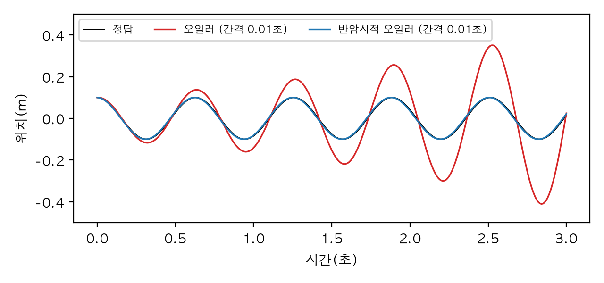

# 부록 B. 로봇 수학 모음

본문을 읽다가 "외적이 어느 쪽을 가리켰더라?", "공분산을 행렬로 옮길 때 앞뒤로 뭘 곱했지?" 하고 멈춘 적이 있나요? 3권은 2권보다 수학이 자주 나옵니다. 로봇은 3차원 공간에서 움직이고, 센서는 늘 흔들리고, 컴퓨터는 연속된 시간을 박자로 끊어서 계산하니까요. 그래서 2장의 회전, 3장의 야코비안, 8장의 공분산, 16장의 이산화처럼 장마다 필요한 수학을 그 자리에서 설명했습니다.

이 부록은 그렇게 흩어진 수학을 한곳에 모은 **참고 상자**입니다. 새로 가르치기보다 이미 본 것을 빨리 다시 찾게 하는 것이 목적이에요. 항목마다 **몇 장에서 썼는지**를 적고, NumPy·SciPy 한두 줄로 바로 확인할 수 있게 했습니다. 개념이 처음이라면 표에 적힌 장으로 돌아가 비유와 그림부터 보세요.

몇 가지 약속이 있습니다.

- 수식은 본문처럼 말과 파이썬 코드로 씁니다. `@`는 행렬 곱, `.T`는 전치, `Δt`는 제어 주기나 시뮬레이션 걸음 간격이에요.
- 모든 코드는 3권 예제 환경(파이썬 3.12, NumPy 2.5.4, SciPy 1.18.1)에서 실행했고, 출력은 그대로 옮겼습니다. 무작위 값은 씨앗을 고정했어요.
- 회전 행렬을 만드는 `Rx`, `Ry`, `Rz`와 -0.0을 지우는 `깔끔`은 2장의 `회전도구.py`를 그대로 가져다 씁니다.

---

## B.1 벡터: 길이, 내적, 외적

### 길이와 내적

벡터는 "어느 쪽으로 얼마나"를 담은 숫자 묶음입니다. 로봇에서는 위치(컵이 로봇에서 어디에 있나), 방향(카메라가 어느 쪽을 보나), 속도, 힘이 모두 벡터예요. 가장 자주 하는 계산은 셋입니다. 길이 재기, 길이를 1로 맞추기(단위 벡터), 그리고 두 벡터가 얼마나 같은 쪽을 가리키는지 재는 **내적**입니다.

```python
import numpy as np

a = np.array([3.0, 4.0, 0.0])
b = np.array([1.0, 0.0, 0.0])

print("길이 |a|        :", np.linalg.norm(a))
print("단위 벡터 a/|a| :", a / np.linalg.norm(a))
print("내적 a·b        :", a @ b)                          # np.dot(a, b)와 같다
각도 = np.arccos(a @ b / (np.linalg.norm(a) * np.linalg.norm(b)))
print(f"사이 각도       : {np.rad2deg(각도):.2f}도")
print("b 방향 성분     :", (a @ b) * b)                    # b가 단위 벡터라서 이렇게 쓴다
```

```text
길이 |a|        : 5.0
단위 벡터 a/|a| : [0.6 0.8 0. ]
내적 a·b        : 3.0
사이 각도       : 53.13도
b 방향 성분     : [3. 0. 0.]
```

(3, 4, 0)의 길이는 5이고, 길이로 나누면 방향만 남은 단위 벡터 (0.6, 0.8, 0)이 됩니다. 내적은 같은 자리끼리 곱해 더한 값이라 3이에요. 내적을 두 길이의 곱으로 나누면 사잇각의 코사인이 되니, `arccos`로 53.13도를 얻었습니다. 마지막 줄처럼 단위 벡터와의 내적은 "그 방향으로 얼마나 가 있나"를 알려 줘요. 2장에서 두 쿼터니언 사이 각도를 잴 때도 내적을 썼어요.

### 외적

**외적**은 두 벡터에 모두 수직인 새 벡터를 만듭니다. 방향은 오른손 법칙(첫째 벡터에서 둘째 벡터 쪽으로 손가락을 감을 때 엄지 방향)을 따르고, 길이는 두 벡터가 만드는 평행사변형의 넓이예요. 2장에서 좌표계의 세 축이 x × y = z를 지키는지 확인할 때 처음 만났고, 3장에서는 야코비안의 한 열을 만드는 데 썼습니다.

```python
import numpy as np

x, y, z = np.eye(3)
print("x × y =", np.cross(x, y), "  y × x =", np.cross(y, x))

# 3장 야코비안의 한 열: 축 방향 z로 도는 관절, 관절에서 손끝까지의 화살표 r
축 = np.array([0.0, 0.0, 1.0])
r = np.array([0.3, 0.0, 0.0])                  # 손끝이 관절에서 x 방향으로 0.3m
각속도 = 2.0                                     # rad/s
print("손끝 속도 = ω (축 × r) =", 각속도 * np.cross(축, r), "m/s")

# 외적의 길이 = 두 벡터가 만드는 평행사변형 넓이, 방향은 두 벡터에 모두 수직
a, b = np.array([2.0, 0.0, 0.0]), np.array([1.0, 3.0, 0.0])
n = np.cross(a, b)
print("a × b =", n, " 넓이:", np.linalg.norm(n), " a·n, b·n:", a @ n, b @ n)
```

```text
x × y = [0. 0. 1.]   y × x = [ 0.  0. -1.]
손끝 속도 = ω (축 × r) = [0.  0.6 0. ] m/s
a × b = [0. 0. 6.]  넓이: 6.0  a·n, b·n: 0.0 0.0
```

x × y는 z인데 y × x는 -z입니다. 외적은 **순서를 바꾸면 부호가 바뀌어요**. 둘째 줄이 3장의 야코비안 계산과 같은 모양입니다. z축으로 도는 관절에서 손끝이 x 방향으로 0.3m 떨어져 있으면, 2rad/s로 돌 때 손끝은 y 방향으로 0.6m/s 움직이죠. 원 위의 점은 반지름에 수직으로 움직인다는 것을 외적 한 번이 계산해 줍니다. 마지막 줄의 넓이 6과, 결과 벡터가 a, b와 내적 0(수직)이라는 것도 보세요.

| 계산 | NumPy | 쓴 곳 |
|---|---|---|
| 길이 | `np.linalg.norm(a)` | 거의 모든 장 |
| 단위 벡터 | `a / np.linalg.norm(a)` | 2장 축-각, 3장 |
| 내적, 사잇각 | `a @ b`, `np.arccos(a @ b / (|a| |b|))` | 2장, 3장, 10장 |
| 외적 | `np.cross(a, b)` | 2장 좌표축, 3장 야코비안, 9장, 10장 |

## B.2 행렬: 곱, 전치, 역행렬

### 곱의 순서와 전치

행렬은 벡터를 다른 벡터로 바꾸는 기계입니다. 회전 행렬은 벡터를 돌리고, 야코비안은 관절 속도를 손끝 속도로 바꾸고, 칼만 필터의 A는 지금 상태를 다음 상태로 옮기죠. 행렬을 다룰 때 기억할 것은 순서, 전치, 역행렬 셋입니다.

```python
import numpy as np

from 회전도구 import Rz, 깔끔

A = np.array([[1.0, 2.0], [3.0, 4.0]])
B = np.array([[0.0, 1.0], [1.0, 0.0]])
print("A @ B =\n", A @ B)
print("B @ A =\n", B @ A)                         # 순서를 바꾸면 결과가 다르다
print("(A @ B).T == B.T @ A.T ?", np.allclose((A @ B).T, B.T @ A.T))
print("행렬식 det(A) =", round(np.linalg.det(A), 6))
print("A의 역행렬 =\n", np.linalg.inv(A))

R = Rz(30)
print("회전 행렬의 역 = 전치 ?", np.allclose(np.linalg.inv(R), R.T), " det(R) =", 깔끔(np.linalg.det(R)))
```

```text
A @ B =
 [[2. 1.]
 [4. 3.]]
B @ A =
 [[3. 4.]
 [1. 2.]]
(A @ B).T == B.T @ A.T ? True
행렬식 det(A) = -2.0
A의 역행렬 =
 [[-2.   1. ]
 [ 1.5 -0.5]]
회전 행렬의 역 = 전치 ? True  det(R) = 1.0
```

A @ B와 B @ A가 다릅니다. 행렬 곱은 **순서가 중요**해요. 2장에서 "z축으로 돌고 x축으로 돌기"와 "x축으로 돌고 z축으로 돌기"가 다른 자세가 된 것이 바로 이 성질입니다. 곱을 전치하면 순서가 뒤집혀 (AB)ᵀ = BᵀAᵀ가 되는데, 8장 칼만 필터의 A P Aᵀ나 3장의 J Jᵀ에서 이 모양을 만나요.

역행렬은 "되돌리는 행렬"이고, 행렬식이 0이면 없습니다. 마지막 줄이 중요해요. 회전 행렬은 **역행렬이 곧 전치**이고 행렬식이 1입니다(2장의 직교 행렬). 그래서 회전을 되돌릴 때는 `np.linalg.inv` 대신 `R.T`를 쓰면 됩니다. 빠르고, 계산 오차도 생기지 않아요.

### 역행렬보다 solve

A x = b를 풀 때 `np.linalg.inv(A) @ b`라고 쓰기 쉽지만, `np.linalg.solve(A, b)`가 더 빠르고 정확합니다. 3장의 감쇠 최소제곱, 8장의 칼만 이득, 16장의 LQR이 모두 `solve`를 썼어요. 그리고 행렬이 특이에 가까우면 어느 쪽으로 풀어도 답이 흔들립니다.

```python
import numpy as np

# A x = b 풀기: inv(A) @ b 대신 solve를 쓴다(더 정확하고 빠르다)
A = np.array([[4.0, 1.0], [2.0, 3.0]])
b = np.array([1.0, 2.0])
x = np.linalg.solve(A, b)
print("x =", x, " 검산 A @ x =", A @ x)

# 거의 특이한 행렬: 조건수가 크면 b의 작은 오차가 x에서 크게 불어난다
A2 = np.array([[1.0, 1.0], [1.0, 1.0001]])
for b2 in [np.array([2.0, 2.0001]), np.array([2.0, 2.0002])]:
    print(f"b = {b2} → x = {np.round(np.linalg.solve(A2, b2), 4) + 0.0}")
print(f"조건수: {np.linalg.cond(A2):.0f}, 특이값: {np.round(np.linalg.svd(A2, compute_uv=False), 6)}")
```

```text
x = [0.1 0.6]  검산 A @ x = [1. 2.]
b = [2.     2.0001] → x = [1. 1.]
b = [2.     2.0002] → x = [0. 2.]
조건수: 40002, 특이값: [2.00005e+00 5.00000e-05]
```

두 번째 행렬은 두 줄이 거의 같습니다. b의 둘째 값을 0.0001만 바꿨는데 답이 (1, 1)에서 (0, 2)로 뛰었어요. 이 예민함을 숫자 하나로 나타낸 것이 **조건수**(가장 큰 특이값 ÷ 가장 작은 특이값)이고, 여기서는 40002입니다. 3장에서 팔을 쭉 편 특이점 근처의 야코비안이 정확히 이런 상태였죠. 가장 작은 특이값이 0에 가까워지면 조건수가 폭발하고, 역기구학이 관절 속도를 터무니없이 크게 냅니다. B.4절에서 다시 봅니다.

| 계산 | NumPy | 쓴 곳 |
|---|---|---|
| 행렬 곱, 전치 | `A @ B`, `A.T` | 2장부터 끝까지 |
| 역행렬 | `np.linalg.inv(A)`. 회전은 `R.T` | 2장, 6장, 9장, 11장 |
| 연립 방정식 | `np.linalg.solve(A, b)` | 3장, 8장, 15장, 16장 |
| 행렬식, 조건수 | `np.linalg.det(A)`, `np.linalg.cond(A)` | 2장, 3장 |
| 특이값 | `np.linalg.svd(A, compute_uv=False)` | 3장 특이점, 11장 ICP |

## B.3 회전과 변환 공식 모음

2장에서 같은 회전을 네 가지 표현(회전 행렬, 오일러 각, 회전 벡터, 쿼터니언)으로 적었습니다. 표현 사이를 오갈 때 쓰는 공식과 약속을 한곳에 모았어요.

### 회전 행렬, 오일러 각, 축-각

```python
import numpy as np
from scipy.spatial.transform import Rotation

from 회전도구 import Rx, Ry, Rz, 깔끔

롤, 피치, 요 = 10, 20, 30                                   # 도
R = Rz(요) @ Ry(피치) @ Rx(롤)                               # 로봇 분야의 롤·피치·요(ROS, URDF rpy)
print("SciPy 'xyz'(고정 축)와 같은가?    ", np.allclose(R, Rotation.from_euler("xyz", [롤, 피치, 요], degrees=True).as_matrix()))
print("SciPy 'ZYX'(움직이는 축)와 같은가?", np.allclose(R, Rotation.from_euler("ZYX", [요, 피치, 롤], degrees=True).as_matrix()))

# 축-각(로드리게스): R = I + sinθ K + (1 - cosθ) K²,  K는 단위 축 k의 외적 행렬
k, θ = np.array([0.0, 0.0, 1.0]), np.deg2rad(30)
K = np.array([[0, -k[2], k[1]], [k[2], 0, -k[0]], [-k[1], k[0], 0]])
print("로드리게스 == Rz(30) :", np.allclose(np.eye(3) + np.sin(θ) * K + (1 - np.cos(θ)) * K @ K, Rz(30)))

# 회전 행렬 → 축과 각도: 각도 = arccos((대각합 - 1) / 2)
회전벡터 = Rotation.from_matrix(R).as_rotvec()
print(f"R의 각도: {np.rad2deg(np.arccos((np.trace(R) - 1) / 2)):.3f}도, "
      f"회전 벡터 길이: {np.rad2deg(np.linalg.norm(회전벡터)):.3f}도, 축: {깔끔(회전벡터 / np.linalg.norm(회전벡터))}")
```

```text
SciPy 'xyz'(고정 축)와 같은가?     True
SciPy 'ZYX'(움직이는 축)와 같은가? True
로드리게스 == Rz(30) : True
R의 각도: 35.817도, 회전 벡터 길이: 35.817도, 축: [0.124 0.616 0.778]
```

첫 두 줄은 2장의 가장 중요한 약속을 다시 확인합니다. 로봇 분야에서 "롤 10도, 피치 20도, 요 30도"는 `Rz(요) @ Ry(피치) @ Rx(롤)`이고, SciPy로는 소문자 `"xyz"`(고정 축)에 [롤, 피치, 요]를 주거나 대문자 `"ZYX"`(움직이는 축)에 [요, 피치, 롤]을 주면 같은 행렬이 나와요. MuJoCo의 `euler` 속성은 기본이 대문자 `"XYZ"`라서 이것과 다르다는 것을 2장 2.9절에서 봤습니다.

셋째 줄은 축 k를 중심으로 θ만큼 도는 회전 행렬을 직접 만드는 **로드리게스 공식** R = I + sinθ·K + (1 - cosθ)·K²입니다. K는 "k와 외적하기"를 행렬로 쓴 것이에요. 거꾸로 회전 행렬에서 각도를 읽을 때는 대각합(`np.trace`)을 쓰는데, 마지막 줄에서 그 각도 35.817도가 회전 벡터의 길이와 같습니다.

### 쿼터니언

```python
import numpy as np
from scipy.spatial.transform import Rotation

from 회전도구 import Rz, 깔끔

# 축 k, 각도 θ → q = [cos(θ/2), sin(θ/2) k]  (w가 맨 앞인 [w, x, y, z] 순서)
θ = np.deg2rad(90)
q = np.array([np.cos(θ / 2), 0.0, 0.0, np.sin(θ / 2)])
r = Rotation.from_quat(q, scalar_first=True)
print("z축 90도 q [w,x,y,z]:", 깔끔(q, 4), " SciPy 기본 [x,y,z,w]:", 깔끔(r.as_quat(), 4))
print("같은 회전 행렬인가? ", np.allclose(r.as_matrix(), Rz(90)))
print("-q도 같은 자세인가?  ", np.allclose(Rotation.from_quat(-q, scalar_first=True).as_matrix(), Rz(90)))

# 합치기는 곱하기, 되돌리기는 켤레(단위 쿼터니언의 역)
r30 = Rotation.from_euler("z", 30, degrees=True)
print("z 90도 다음 z 30도   :", 깔끔((r30 * r).as_euler("xyz", degrees=True)), "도")
print("r * r의 역            :", 깔끔((r * r.inv()).as_quat(scalar_first=True)))

# 두 자세 사이 각도 = 2 arccos(|q1·q2|)
q2 = r30.as_quat(scalar_first=True)
print(f"두 자세 사이 각도    : {np.rad2deg(2 * np.arccos(abs(q @ q2))):.1f}도")
```

```text
z축 90도 q [w,x,y,z]: [0.7071 0.     0.     0.7071]  SciPy 기본 [x,y,z,w]: [0.     0.     0.7071 0.7071]
같은 회전 행렬인가?  True
-q도 같은 자세인가?   True
z 90도 다음 z 30도   : [  0.   0. 120.] 도
r * r의 역            : [1. 0. 0. 0.]
두 자세 사이 각도    : 60.0도
```

z축 90도 회전의 쿼터니언은 [cos 45도, 0, 0, sin 45도]입니다. 각도의 **절반**이 들어가는 것이 쿼터니언의 특징이에요. 출력의 두 배열을 비교해 보세요. 숫자는 같은데 순서가 다릅니다. 이 책이 쓴 라이브러리들의 약속은 이렇습니다.

| 어디서 | 순서 |
|---|---|
| 2장의 `쿼터니언도구.py`, MuJoCo(`quat`, `xquat`) | `[w, x, y, z]` |
| SciPy `Rotation` 기본값 | `[x, y, z, w]` |
| SciPy `Rotation`에 `scalar_first=True` | `[w, x, y, z]` |
| ROS 메시지(`geometry_msgs`), tf2 출력 | 이름 붙은 칸 `x`, `y`, `z`, `w` |

나머지 줄은 쿼터니언의 성질 세 가지입니다. q와 -q는 같은 자세이고(2장 2.6절), 두 회전을 합치는 것은 곱하기이며(SciPy에서는 `*`, 오른쪽 것이 먼저), 단위 쿼터니언의 역은 켤레(허수부 부호를 바꾼 것)예요. 두 자세 사이 각도는 2 arccos(|q1·q2|)로 재는데, 절댓값을 붙이는 이유가 q와 -q가 같은 자세이기 때문입니다.

### 동차 변환

위치와 자세를 함께 옮길 때는 회전 R과 이동 p를 4×4 행렬 하나에 담은 **동차 변환**을 씁니다(2장 2.8절). 이름에 기준을 적는 규칙(`T_방_로봇`은 "방에서 본 로봇")을 지키면, 곱셈의 가운데 이름이 맞물리는지만 보고 사슬을 이을 수 있어요.

```python
import numpy as np

from 회전도구 import Rz, 깔끔


def 변환(R: np.ndarray, p) -> np.ndarray:
    """회전 R과 이동 p를 4×4 동차 변환 하나로."""
    T = np.eye(4)
    T[:3, :3], T[:3, 3] = R, p
    return T


def 역변환(T: np.ndarray) -> np.ndarray:
    """T의 역: 회전은 전치, 이동은 -Rᵀp."""
    R, p = T[:3, :3], T[:3, 3]
    return 변환(R.T, -R.T @ p)


T_방_로봇 = 변환(Rz(90), [2.0, 1.0, 0.0])                # 방에서 본 로봇
T_로봇_컵 = 변환(np.eye(3), [0.5, 0.0, 0.8])             # 로봇에서 본 컵
T_방_컵 = T_방_로봇 @ T_로봇_컵                           # 기준 이름이 사슬처럼 이어진다
print("방에서 본 컵의 위치:", 깔끔(T_방_컵[:3, 3]))
print("점 변환(끝에 1)    :", 깔끔((T_방_로봇 @ [0.5, 0.0, 0.8, 1.0])[:3]))
print("방향 변환(끝에 0)  :", 깔끔((T_방_로봇 @ [1.0, 0.0, 0.0, 0.0])[:3]))
print("역변환 공식 == inv :", np.allclose(역변환(T_방_로봇), np.linalg.inv(T_방_로봇)))
```

```text
방에서 본 컵의 위치: [2.  1.5 0.8]
점 변환(끝에 1)    : [2.  1.5 0.8]
방향 변환(끝에 0)  : [0. 1. 0.]
역변환 공식 == inv : True
```

`T_방_로봇 @ T_로봇_컵`에서 가운데 `로봇`이 맞물려 사라지고 `T_방_컵`이 남았습니다. 로봇이 방에서 90도 돌아 있으니, 로봇 앞쪽 0.5m가 방에서는 y 방향 0.5m가 돼요. 점을 옮길 때는 끝에 1을, 방향만 옮길 때는 끝에 0을 붙입니다. 0을 붙인 방향 (1, 0, 0)은 돌기만 하고 이동은 받지 않아서 (0, 1, 0)이 됐어요. 역변환은 `np.linalg.inv` 대신 "회전은 전치, 이동은 -Rᵀp"로 바로 쓸 수 있습니다.

| 하고 싶은 일 | 식 또는 함수 | 쓴 곳 |
|---|---|---|
| 롤·피치·요 → 행렬 | `Rz(요) @ Ry(피치) @ Rx(롤)`, `Rotation.from_euler("xyz", [롤, 피치, 요])` | 2장, 6장 URDF `rpy` |
| 축-각 → 행렬 | I + sinθ·K + (1 - cosθ)·K², `Rotation.from_rotvec(θ·k)` | 2장, 9장 손눈 보정 |
| 행렬 → 각도 | arccos((대각합 - 1) / 2) | 2장 |
| 축-각 → 쿼터니언 | [cos(θ/2), sin(θ/2)·k] | 2장 |
| 회전 합치기 | `R2 @ R1`, `r2 * r1`, 쿼터니언 곱 | 2장 |
| 두 자세 사이 각도 | 2 arccos(\|q1·q2\|) | 2장 |
| 자세 보간 | slerp(`Slerp`) | 2장 |
| 변환 잇기, 되돌리기 | `T_A_B @ T_B_C`, [Rᵀ, -Rᵀp] | 2장, 6장 tf, 9장, 11장 |

## B.4 미분과 야코비안

### 차분으로 미분하기

미분은 "조금 움직였을 때 얼마나 변하나"의 비율입니다. 식을 몰라도, 함수를 두 번 불러 그 차이를 나누면 근삿값을 얻어요. 3장은 이 방법으로 야코비안을 검산했고, 8장은 EKF의 야코비안을 확인했습니다.

```python
import numpy as np


def f(t: float) -> float:
    return np.sin(t)                    # 위치가 sin(t)로 움직이면 속도는 cos(t)


t, 참값 = 1.0, np.cos(1.0)
for h in [1e-1, 1e-3, 1e-5]:
    전진 = (f(t + h) - f(t)) / h                      # 앞으로 한 칸
    중앙 = (f(t + h) - f(t - h)) / (2 * h)            # 앞뒤로 한 칸씩(3장)
    print(f"h={h:.0e}: 전진 차분 오차 {abs(전진 - 참값):.1e}, 중앙 차분 오차 {abs(중앙 - 참값):.1e}")

# 기록된 신호에서 속도 구하기: np.gradient는 안쪽은 중앙 차분, 양 끝은 한쪽 차분
시각 = np.arange(0, 0.5, 0.1)
print("np.gradient(sin) :", np.round(np.gradient(np.sin(시각), 0.1), 4))
print("참값 cos         :", np.round(np.cos(시각), 4))
```

```text
h=1e-01: 전진 차분 오차 4.3e-02, 중앙 차분 오차 9.0e-04
h=1e-03: 전진 차분 오차 4.2e-04, 중앙 차분 오차 9.0e-08
h=1e-05: 전진 차분 오차 4.2e-06, 중앙 차분 오차 1.1e-11
np.gradient(sin) : [0.9983 0.9933 0.9784 0.9537 0.939 ]
참값 cos         : [1.     0.995  0.9801 0.9553 0.9211]
```

같은 칸 h에서 중앙 차분(앞뒤로 한 칸씩)이 전진 차분(앞으로 한 칸)보다 훨씬 정확합니다. h를 100분의 1로 줄이면 전진 차분의 오차는 100분의 1로, 중앙 차분의 오차는 1만분의 1로 줄어들어요. 그렇다고 h를 한없이 줄이면 컴퓨터의 반올림 오차가 커지니, 1e-6 근처가 무난합니다. 기록된 신호에서 속도를 구할 때는 `np.gradient`가 같은 일을 해 줘요(13장). 양 끝은 한쪽 차분이라 오차가 조금 더 큰 것도 출력에서 보입니다.

### 야코비안

변수가 여럿이면 미분도 표가 됩니다. 관절 각도가 n개, 손끝 좌표가 m개라면, "관절 i를 조금 돌렸을 때 손끝 좌표 j가 변하는 비율"을 m × n 표로 모은 것이 **야코비안**이에요(3장). 손끝 속도 = J @ 관절 속도입니다.

```python
import numpy as np

L1, L2 = 0.3, 0.25                              # 2링크 평면 팔의 링크 길이(m)


def 손끝(q: np.ndarray) -> np.ndarray:
    return np.array([L1 * np.cos(q[0]) + L2 * np.cos(q[0] + q[1]),
                     L1 * np.sin(q[0]) + L2 * np.sin(q[0] + q[1])])


def 수치_야코비안(f, q: np.ndarray, h: float = 1e-6) -> np.ndarray:
    """열 i = 관절 i만 조금 움직였을 때 손끝이 움직인 비율(중앙 차분)."""
    return np.column_stack([(f(q + h * e) - f(q - h * e)) / (2 * h) for e in np.eye(len(q))])


q = np.deg2rad([30.0, 45.0])
J = 수치_야코비안(손끝, q)
s1, s12, c1, c12 = np.sin(q[0]), np.sin(q.sum()), np.cos(q[0]), np.cos(q.sum())
J_식 = np.array([[-L1 * s1 - L2 * s12, -L2 * s12], [L1 * c1 + L2 * c12, L2 * c12]])
print("수치 야코비안 == 식 ?", np.allclose(J, J_식, atol=1e-8))
print("관절 속도 [1, 0] rad/s → 손끝 속도", np.round(J @ [1.0, 0.0], 4), "m/s")

# 손끝 속도를 내려면? 정사각이면 solve, 아니면 의사역행렬, 특이점 근처면 감쇠 최소제곱(DLS)
v = np.array([0.0, 0.1])
λ = 0.01
for 이름, 각 in [("보통 자세", [30.0, 45.0]), ("거의 편 자세", [30.0, 1.0])]:
    J = 수치_야코비안(손끝, np.deg2rad(각))
    의사역 = np.linalg.pinv(J) @ v
    DLS = J.T @ np.linalg.solve(J @ J.T + λ**2 * np.eye(2), v)
    print(f"{이름}: 특이값 {np.round(np.linalg.svd(J, compute_uv=False), 4)}, "
          f"의사역 {np.round(의사역, 2)}, DLS {np.round(DLS, 2)} rad/s")
```

```text
수치 야코비안 == 식 ? True
관절 속도 [1, 0] rad/s → 손끝 속도 [-0.3915  0.3245] m/s
보통 자세: 특이값 [0.5586 0.0949], 의사역 [ 0.46 -0.74], DLS [ 0.45 -0.73] rad/s
거의 편 자세: 특이값 [0.6041 0.0022], 의사역 [  9.84 -21.3 ], DLS [ 0.56 -0.9 ] rad/s
```

`수치_야코비안`은 관절마다 중앙 차분을 해서 열을 하나씩 채웁니다. 3장에서 식으로 구한 야코비안과 일치하죠. 거꾸로 "원하는 손끝 속도를 내려면 관절을 얼마나 돌려야 하나"를 풀 때가 문제입니다. 보통 자세에서는 의사역행렬(`np.linalg.pinv`)과 감쇠 최소제곱(DLS)의 답이 거의 같아요. 그런데 팔꿈치를 1도만 굽힌 거의 편 자세에서는 가장 작은 특이값이 0.0022로 떨어지고, 의사역행렬은 손끝을 0.1m/s 옮기려고 팔꿈치를 21.3rad/s로 돌리라고 합니다. DLS는 λ²만큼 받침을 대서 답을 0.9rad/s 근처로 묶어요. 대신 정확히 0.1m/s는 못 내는데, 특이점 근처에서는 그게 옳은 타협이라는 것이 3장의 결론이었습니다.

| 계산 | NumPy | 쓴 곳 |
|---|---|---|
| 중앙 차분 | `(f(x + h) - f(x - h)) / (2 * h)` | 3장, 8장 |
| 기록의 속도 | `np.gradient(값, 간격)` | 13장 |
| 야코비안 | 관절마다 중앙 차분, 또는 축 × (손끝 - 관절) | 3장, 8장 EKF |
| 의사역행렬 | `np.linalg.pinv(J)` | 3장 |
| 감쇠 최소제곱 | `J.T @ np.linalg.solve(J @ J.T + λ**2 * I, v)` | 3장 |

## B.5 정규분포와 공분산

### 정규분포와 두 측정 합치기

센서 잡음은 대개 평균 근처에 몰리고 멀어질수록 드문 종 모양, **정규분포**로 봅니다(8장). 정규분포는 평균과 표준편차 두 숫자로 다 설명돼요.

```python
import numpy as np

rng = np.random.default_rng(0)
잡음 = rng.normal(0.0, 0.02, size=100_000)            # 평균 0, 표준편차 0.02의 정규분포
print(f"평균 {잡음.mean():+.5f}, 표준편차 {잡음.std():.5f}, 분산 {잡음.var():.6f}")
for k in [1, 2, 3]:
    print(f"±{k}σ 안에 든 비율: {np.mean(np.abs(잡음) < k * 0.02):.1%}")

# 같은 것을 두 센서로 잰 값 합치기(8장): 분산의 역수로 가중 평균하면 분산이 줄어든다
값1, 분산1 = 10.0, 0.3**2                              # 흔들림이 큰 센서
값2, 분산2 = 10.4, 0.1**2                              # 흔들림이 작은 센서
분산 = 1 / (1 / 분산1 + 1 / 분산2)
값 = 분산 * (값1 / 분산1 + 값2 / 분산2)
print(f"합친 값 {값:.3f}, 표준편차 {np.sqrt(분산):.4f} (두 센서 0.3, 0.1보다 작다)")
```

```text
평균 -0.00002, 표준편차 0.02000, 분산 0.000400
±1σ 안에 든 비율: 68.4%
±2σ 안에 든 비율: 95.5%
±3σ 안에 든 비율: 99.7%
합친 값 10.360, 표준편차 0.0949 (두 센서 0.3, 0.1보다 작다)
```

표준편차 0.02로 뽑은 10만 개 가운데 ±1σ 안에 68.4%, ±2σ 안에 95.5%, ±3σ 안에 99.7%가 들어 있습니다. "3σ 밖은 거의 없다"는 감각은 잡음과 고장을 가를 때 쓸모가 있어요. 8장에서 필터를 진단할 때 쓴 숫자들입니다.

뒤쪽은 8장 칼만 필터의 핵심 한 줄입니다. 같은 것을 두 센서로 쟀다면, **분산의 역수로 가중 평균**하는 것이 가장 좋은 합치기예요. 흔들림이 작은 센서(0.1) 쪽인 10.4에 더 가까운 10.360이 나왔고, 합친 표준편차 0.0949는 두 센서 어느 쪽보다도 작습니다. 정보를 합치면 언제나 덜 모르게 된다는 뜻이에요.

### 공분산 행렬

값이 여럿이면 각자의 분산뿐 아니라 "함께 흔들리는 정도"도 있습니다. 이것을 n × n 표로 모은 것이 **공분산 행렬**이에요. 대각선은 각 값의 분산, 바깥은 두 값이 같이 커지고 작아지는 정도입니다. 8장의 P, Q, R이 모두 공분산 행렬이었죠.

```python
import numpy as np

rng = np.random.default_rng(0)
P = np.array([[0.04, 0.03],                    # x, y 위치의 공분산(m²)
              [0.03, 0.09]])                    # 대각은 분산, 바깥은 함께 흔들리는 정도
점들 = rng.multivariate_normal([0.0, 0.0], P, size=50_000)
print("표본 공분산 np.cov:\n", np.round(np.cov(점들.T), 4))
print(f"상관 계수: {P[0, 1] / np.sqrt(P[0, 0] * P[1, 1]):.3f}")

# 타원의 축: 고유값의 제곱근이 축 길이(표준편차), 고유벡터가 방향
고유값, 고유벡터 = np.linalg.eigh(P)
print("축 길이 1σ:", np.round(np.sqrt(고유값), 4), " 긴 축 방향:", np.round(고유벡터[:, 1], 4))

# 선형 변환 y = A x 를 거치면 공분산은 A P Aᵀ (칼만 필터의 예측 단계)
A = np.array([[1.0, 0.1], [0.0, 1.0]])
print("A P Aᵀ:\n", np.round(A @ P @ A.T, 4))
print("옮긴 점들의 공분산:\n", np.round(np.cov((점들 @ A.T).T), 4))
```

```text
표본 공분산 np.cov:
 [[0.0398 0.0299]
 [0.0299 0.0903]]
상관 계수: 0.500
축 길이 1σ: [0.1611 0.3226]  긴 축 방향: [0.4242 0.9056]
A P Aᵀ:
 [[0.0469 0.039 ]
 [0.039  0.09  ]]
옮긴 점들의 공분산:
 [[0.0467 0.039 ]
 [0.039  0.0903]]
```

점 5만 개를 뽑아 `np.cov`로 다시 재니 처음 준 P와 거의 같습니다(점이 열이 아니라 행에 있으니 `.T`를 붙인 것을 보세요). 상관 계수 0.5는 x가 클 때 y도 큰 경향이 있다는 뜻이에요. 공분산을 그림으로 그리면 타원이 되는데, `np.linalg.eigh`가 준 고유값의 제곱근이 타원 축의 길이(표준편차), 고유벡터가 축의 방향입니다. 8장에서 로봇 위치의 2σ 타원을 그린 방법이고, 15장에서 점구름의 긴 방향을 찾은 주성분 분석도 같은 계산이에요.

마지막 두 출력이 칼만 필터 예측 단계의 공식입니다. 값을 행렬 A로 옮기면 공분산은 **A P Aᵀ**로 옮겨져요. 8장에서 `F @ P @ F.T`로 쓴 식입니다. 식으로 계산한 것과 점들을 실제로 옮겨서 잰 것이 소수점 셋째 자리까지 맞습니다.

| 계산 | NumPy | 쓴 곳 |
|---|---|---|
| 정규분포에서 뽑기 | `rng.normal(평균, 표준편차, 개수)` | 8장부터 거의 모든 장 |
| 여러 값 함께 뽑기 | `rng.multivariate_normal(평균, P, 개수)` | 8장 |
| 표본 공분산 | `np.cov(점들.T)` | 8장, 15장 |
| 두 측정 합치기 | 분산의 역수로 가중 평균 | 8장 |
| 공분산 옮기기 | `A @ P @ A.T` (8장에서는 `F @ P @ F.T`) | 8장 칼만 필터 |
| 타원 축 | `np.linalg.eigh(P)` | 8장, 15장 |

## B.6 최소제곱: 기록에 모델 맞추기

### 직선 맞추기

측정이 모르는 값보다 많으면 모든 식을 정확히 맞출 수 없습니다. 그래서 "어긋남의 제곱합이 가장 작은 답"을 고르는 것이 **최소제곱**이에요. 7장에서 서보 응답의 사인파 크기를, 9장에서 손눈 보정의 이동을 이렇게 구했습니다.

```python
import numpy as np

# 직선 맞추기: 전압(V)을 넣었을 때 모터 속도(rad/s)를 쟀다. 속도 = a·전압 + b 로 맞춘다
rng = np.random.default_rng(0)
전압 = np.linspace(1, 12, 12)
속도 = 18.0 * 전압 - 5.0 + rng.normal(0, 3.0, 전압.size)          # 참값 a=18, b=-5에 잡음
X = np.column_stack([전압, np.ones_like(전압)])                   # 열마다 모르는 값 하나
(a, b), 잔차, *_ = np.linalg.lstsq(X, 속도, rcond=None)
print(f"lstsq: a = {a:.3f}, b = {b:.3f}, 잔차 제곱합 {잔차[0]:.2f}")
print("정규 방정식 (XᵀX)⁻¹Xᵀy:", np.round(np.linalg.solve(X.T @ X, X.T @ 속도), 3))
```

```text
lstsq: a = 17.818, b = -3.751, 잔차 제곱합 48.82
정규 방정식 (XᵀX)⁻¹Xᵀy: [17.818 -3.751]
```

모르는 값(기울기 a, 절편 b)마다 열을 하나씩 두는 것이 요령입니다. 절편은 늘 1을 곱하니 1로 채운 열이에요. 잡음 때문에 참값(18, -5)과 조금 다른 17.818, -3.751이 나왔습니다. 측정이 12개뿐이라 절편이 더 많이 흔들렸어요. 같은 답을 정규 방정식 (XᵀX)⁻¹Xᵀy로도 얻을 수 있지만, `lstsq`가 조건수가 나쁜 경우에 더 안전합니다.

### 비선형 최소제곱

모르는 값이 식 안에 곱이나 지수로 들어 있으면 한 번에 풀 수 없습니다. 처음값에서 시작해 차이가 줄어드는 쪽으로 조금씩 고쳐 가는 SciPy의 `least_squares`를 써요. 11장의 포즈 그래프 최적화와 20장의 시스템 식별이 이 함수를 썼습니다.

```python
import numpy as np
from scipy.optimize import least_squares

# 모르는 값이 식 안에 비선형으로 들어 있을 때: 감쇠 진동 기록에서 감쇠율과 진동수 찾기(20장 시스템 식별의 맛)
rng = np.random.default_rng(0)
t = np.linspace(0, 3, 150)


def 모델(값: np.ndarray, t: np.ndarray) -> np.ndarray:
    감쇠율, 진동수 = 값
    return np.exp(-감쇠율 * t) * np.cos(2 * np.pi * 진동수 * t)


기록 = 모델(np.array([0.8, 1.5]), t) + rng.normal(0, 0.02, t.size)
결과 = least_squares(lambda 값: 모델(값, t) - 기록, x0=[0.5, 1.4], bounds=([0, 0.1], [5, 5]))
print("찾은 감쇠율, 진동수:", np.round(결과.x, 3), " 차이 제곱합의 절반:", round(결과.cost, 4))

처음_차이 = 모델(np.array([0.5, 1.4]), t) - 기록
print(f"처음값 [0.5, 1.4]의 차이 제곱합의 절반: {0.5 * np.sum(처음_차이**2):.4f}, 함수 계산 {결과.nfev}번")
```

```text
찾은 감쇠율, 진동수: [0.806 1.499]  차이 제곱합의 절반: 0.0274
처음값 [0.5, 1.4]의 차이 제곱합의 절반: 3.7974, 함수 계산 6번
```

함수에 넘기는 것은 "모델 - 기록"의 차이 배열입니다. 제곱해서 더하는 일은 `least_squares`가 해요. 참값 (0.8, 1.5)에 가까운 (0.806, 1.499)를 찾았고, 처음값에서 3.7974였던 차이 제곱합의 절반이 0.0274로 줄었습니다. `bounds`는 감쇠율이 음수가 되는 것처럼 물리적으로 말이 안 되는 답을 막는 울타리예요. 이 예제는 처음값이 어디든 잘 찾아오지만, 모델이 복잡해지면 처음값에 따라 엉뚱한 답에 멈출 수 있습니다. 20장에서 처음값을 시뮬레이션 물성으로 두고, 맞춘 뒤에 **맞출 때 쓰지 않은 명령으로 검증**한 이유예요.

| 계산 | NumPy, SciPy | 쓴 곳 |
|---|---|---|
| 선형 최소제곱 | `np.linalg.lstsq(X, y, rcond=None)` | 7장, 9장 손눈 보정 |
| 비선형 최소제곱 | `scipy.optimize.least_squares(차이_함수, 처음값, bounds=...)` | 11장 포즈 그래프, 20장 시스템 식별 |
| 점 맞추기(회전+이동) | SVD로 푸는 최소제곱 | 11장 ICP |

## B.7 이산 시간: 미분 방정식을 박자로 풀기

### 오일러와 반암시적 오일러

물리 법칙은 "가속도는 힘 ÷ 질량"처럼 변화율로 적힌 미분 방정식입니다. 컴퓨터는 이것을 Δt 간격의 박자로 끊어서 한 걸음씩 풀어요. 4장에서 MuJoCo의 걸음 간격을, 12장에서 PID의 제어 주기를, 16장에서 이산화를 다뤘습니다. 가장 단순한 두 방법을 용수철에 매달린 추로 비교해 보겠습니다.

```python
import matplotlib.pyplot as plt
import numpy as np

plt.rcParams["font.family"] = "AppleGothic"
plt.rcParams["axes.unicode_minus"] = False

# 용수철에 매달린 1kg 추: 가속도 = -k·위치. 처음 위치 0.1m, 정지. 정답은 0.1·cos(ω t)
k = 100.0                                     # N/m, ω = 10rad/s (주기 약 0.63초)
ω = np.sqrt(k)


def 흘리기(방법: str, 간격: float, 시간: float = 3.0) -> tuple[np.ndarray, np.ndarray]:
    x, v = 0.1, 0.0
    시각들, 위치들 = [0.0], [x]
    for i in range(int(round(시간 / 간격))):
        a = -k * x
        if 방법 == "오일러":                  # 옛 속도로 위치를 옮긴다
            x, v = x + v * 간격, v + a * 간격
        else:                                  # 반암시적 오일러: 속도 먼저, 새 속도로 위치(MuJoCo 기본)
            v = v + a * 간격
            x = x + v * 간격
        시각들.append((i + 1) * 간격)
        위치들.append(x)
    return np.array(시각들), np.array(위치들)


그림, 칸 = plt.subplots(figsize=(6.4, 3.0))
t = np.linspace(0, 3, 600)
칸.plot(t, 0.1 * np.cos(ω * t), color="black", linewidth=1, label="정답")
for 방법, 간격, 색 in [("오일러", 0.01, "tab:red"), ("반암시적 오일러", 0.01, "tab:blue")]:
    시각, 위치 = 흘리기(방법, 간격)
    오차 = np.max(np.abs(위치 - 0.1 * np.cos(ω * 시각)))
    print(f"{방법:8s} 간격 {간격}초: 3초 동안 최대 진폭 {np.max(np.abs(위치)):.3f}m, 정답과 최대 차이 {오차:.4f}m")
    칸.plot(시각, 위치, color=색, linewidth=1.2, label=f"{방법} (간격 {간격}초)")
for 간격 in [0.15, 0.25]:                     # 안정 한계 2/ω = 0.2초 근처
    _, 위치 = 흘리기("반암시적 오일러", 간격)
    print(f"반암시적 오일러 간격 {간격}초: 3초 동안 최대 진폭 {np.max(np.abs(위치)):.3g}m")
칸.set_xlabel("시간(초)")
칸.set_ylabel("위치(m)")
칸.set_ylim(-0.5, 0.5)
칸.legend(loc="upper left", fontsize=8, ncol=3)
그림.tight_layout()
그림.savefig("integrators.png", dpi=200)
print("저장: integrators.png")
```

```text
오일러      간격 0.01초: 3초 동안 최대 진폭 0.411m, 정답과 최대 차이 0.3118m
반암시적 오일러 간격 0.01초: 3초 동안 최대 진폭 0.100m, 정답과 최대 차이 0.0062m
반암시적 오일러 간격 0.15초: 3초 동안 최대 진폭 0.151m
반암시적 오일러 간격 0.25초: 3초 동안 최대 진폭 2.24e+06m
저장: integrators.png
```



두 방법의 차이는 단 한 가지, 위치를 옮길 때 **옛 속도**를 쓰느냐 **방금 고친 속도**를 쓰느냐입니다. 그런데 결과는 크게 달라요. 옛 속도를 쓰는 오일러는 걸음마다 에너지가 조금씩 불어나서, 진폭 0.1m였던 추가 3초 만에 0.411m까지 흔들렸습니다. 방금 고친 속도를 쓰는 반암시적 오일러는 진폭 0.100m를 지키고, 정답과 차이도 6mm 남짓이에요. MuJoCo의 기본 적분기 `Euler`가 이 반암시적 오일러입니다(4장).

반암시적 오일러도 간격이 너무 크면 무너집니다. 이 용수철의 고유 각진동수는 ω = 10rad/s이고, 4장 4.9절에서 본 안정 한계는 2/ω = 0.2초예요. 0.15초는 출렁이긴 해도 0.151m 안에 머물렀지만, 한계를 넘은 0.25초는 3초 만에 2.24e+06m, 그러니까 숫자가 폭발했습니다. **걸음 간격은 가장 빠른 진동보다 충분히 짧게**, 이것이 시뮬레이션의 `timestep`과 제어 주기를 정하는 기준이에요.

### 이산화와 이산 시간 PID

제어기가 Δt마다 한 번 판단하고 그동안 입력을 그대로 둔다면, 연속 시간 모델을 "다음 박자의 상태 = A·지금 상태 + B·입력" 꼴로 바꿀 수 있습니다. 16장에서 이중 적분기를 손으로 이렇게 바꿨는데, 행렬 지수 함수(`scipy.linalg.expm`)로 기계적으로 구할 수도 있어요.

```python
import numpy as np
from scipy.linalg import expm

# 이중 적분기(16장): 상태 [위치, 속도], 입력 가속도 u. 연속 시간 식은 d[위치, 속도]/dt = Ac·상태 + Bc·u
Ac = np.array([[0.0, 1.0], [0.0, 0.0]])
Bc = np.array([[0.0], [1.0]])
Δt = 0.1

# 한 주기 동안 u를 그대로 둔다면: A = exp(Ac Δt), B = ∫exp(Ac s)ds Bc. 큰 행렬 하나의 exp로 한 번에 구한다
M = expm(np.block([[Ac, Bc], [np.zeros((1, 3))]]) * Δt)
A, B = M[:2, :2], M[:2, 2:]
print("A =", A.tolist(), " B =", np.round(B.ravel(), 6).tolist())
print("손으로 쓴 식 A=[[1,Δt],[0,1]], B=[Δt²/2, Δt]와 같은가?",
      np.allclose(A, [[1, Δt], [0, 1]]) and np.allclose(B.ravel(), [Δt**2 / 2, Δt]))

# 이산 시간 PID의 적분과 미분(12장): 적분은 오차 × 주기를 더하고, 미분은 차이 ÷ 주기
오차들 = np.array([1.0, 0.8, 0.5, 0.3, 0.2])
print("적분(누적 합 × Δt):", np.round(np.cumsum(오차들) * Δt, 3), " 미분(차이 ÷ Δt):", np.round(np.diff(오차들) / Δt, 3))
```

```text
A = [[1.0, 0.1], [0.0, 1.0]]  B = [0.005, 0.1]
손으로 쓴 식 A=[[1,Δt],[0,1]], B=[Δt²/2, Δt]와 같은가? True
적분(누적 합 × Δt): [0.1  0.18 0.23 0.26 0.28]  미분(차이 ÷ Δt): [-2. -3. -2. -1.]
```

`expm`이 낸 A와 B가 16장에서 등가속도 공식으로 쓴 A = [[1, Δt], [0, 1]], B = [Δt²/2, Δt]와 같습니다. 식이 복잡한 모델에서도 Ac와 Bc만 적으면 같은 방법으로 이산 모델을 얻을 수 있어요. 마지막 줄은 12장 이산 시간 PID의 두 연산입니다. 적분은 오차에 주기를 곱해 쌓고, 미분은 이웃한 오차의 차이를 주기로 나눠요. 그래서 제어 주기를 바꾸면 I와 D 이득의 의미도 함께 바뀐다는 것이 12장의 주의였습니다.

| 계산 | 식 또는 함수 | 쓴 곳 |
|---|---|---|
| 오일러 | x += v·Δt, v += a·Δt | 1장 점 로봇, 2장 자이로 적분 |
| 반암시적 오일러 | v += a·Δt 다음 x += v·Δt | 4장 MuJoCo `Euler` |
| 안정 한계 | 걸음 간격 < 2/ω | 4장 4.9절 |
| 이산화 | A = exp(Ac·Δt), B = ∫exp(Ac·s)ds·Bc. `scipy.linalg.expm` | 16장 |
| 이산 시간 PID | 적분 += 오차·Δt, 미분 = (오차 - 이전 오차)/Δt | 12장 |
| 이산 시스템의 안정성 | `np.abs(np.linalg.eigvals(A - B @ K))`가 모두 1보다 작다 | 16장 LQR |

## B.8 한눈에 보기

이 부록에서 다룬 개념을 한 표로 모았습니다. 본문에서 막혔을 때 어느 절을 펼치면 되는지 찾는 용도로 쓰세요.

| 본문에서 만나는 말 | 한 줄 요약 | 부록 |
|---|---|---|
| 노름, 단위 벡터 | 화살표의 길이, 길이를 1로 맞춘 방향 | B.1 |
| 내적 | 같은 자리끼리 곱해 더하기. 같은 쪽을 가리키는 정도 | B.1 |
| 외적 | 두 벡터에 수직, 오른손 법칙. 순서를 바꾸면 부호가 바뀐다 | B.1 |
| 행렬 곱, 전치 | 순서가 중요. (AB)ᵀ = BᵀAᵀ | B.2 |
| 역행렬, solve | 되돌리는 행렬. 풀 때는 `solve`, 회전은 전치 | B.2 |
| 조건수, 특이값 | 답이 얼마나 예민한가. 가장 작은 특이값이 0이면 특이점 | B.2, B.4 |
| 오일러 각 순서 | 롤·피치·요 = `Rz @ Ry @ Rx` = SciPy `"xyz"` | B.3 |
| 쿼터니언 | [cos(θ/2), sin(θ/2)·축]. 순서는 라이브러리마다 다르다 | B.3 |
| 동차 변환 | 4×4 하나에 회전과 이동. 가운데 이름이 맞물린다 | B.3 |
| 중앙 차분 | 앞뒤로 한 칸씩 움직여 미분 | B.4 |
| 야코비안 | 관절 속도 → 손끝 속도의 표 | B.4 |
| 의사역행렬, DLS | 손끝 속도 → 관절 속도. 특이점 근처에서는 DLS | B.4 |
| 정규분포 | ±1σ 68%, ±2σ 95%, ±3σ 99.7% | B.5 |
| 공분산 | 함께 흔들리는 정도의 표. 옮기면 A P Aᵀ | B.5 |
| 최소제곱 | 어긋남의 제곱합이 가장 작은 답 | B.6 |
| 반암시적 오일러 | 속도 먼저, 새 속도로 위치. MuJoCo 기본 | B.7 |
| 이산화 | 연속 모델을 박자마다의 A, B로 | B.7 |
