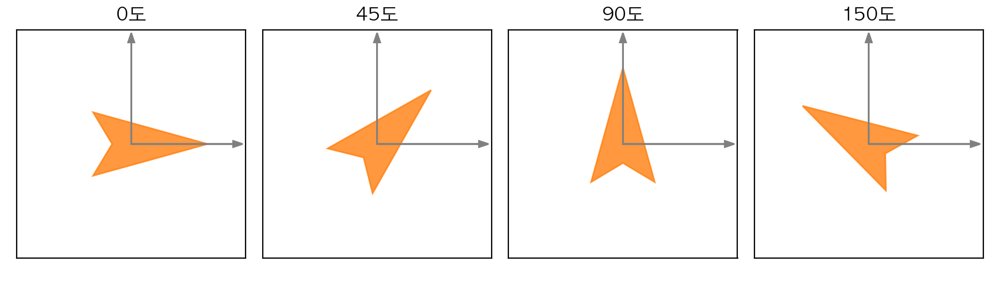
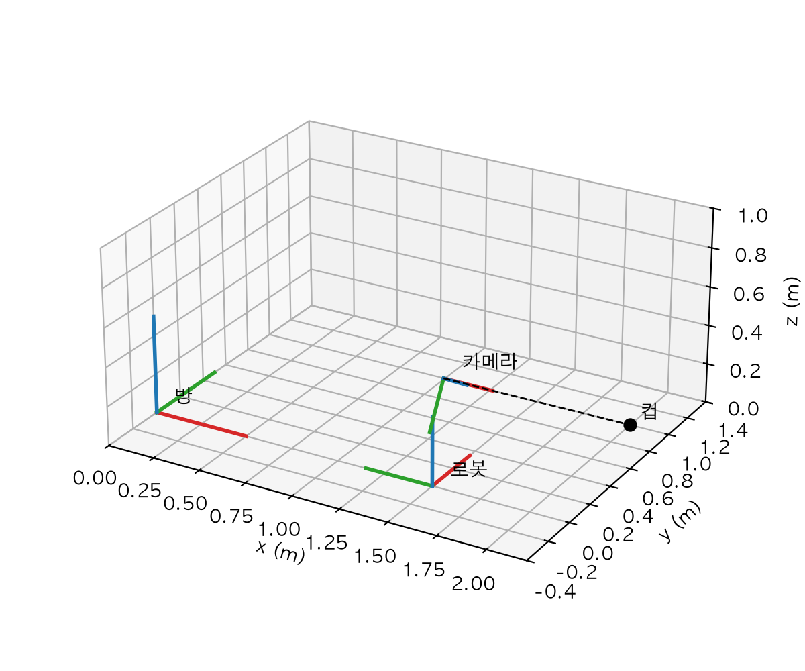
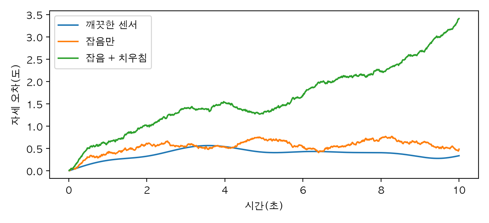

# Chapter 2. 좌표계와 회전: 로봇은 세상을 어떻게 재나

> **학습 목표**  
> - 좌표계가 무엇이고, 같은 물건의 위치가 기준에 따라 왜 다르게 적히는지 설명하기
> - 로봇 세계의 좌표 약속(몸 좌표, 카메라 좌표)을 알고 축을 바꿔 적기
> - 2차원·3차원 회전 행렬을 만들고, 회전 순서가 결과를 바꾼다는 것을 확인하기
> - 자세를 나타내는 네 가지 방법(회전 행렬, 오일러 각, 회전 벡터, 쿼터니언)의 장단점 비교하기
> - 짐벌 락과 쿼터니언 순서 혼동처럼 로봇 코드에서 자주 나는 실수를 알아보기
> - 동차 변환 행렬로 "카메라가 본 컵은 방의 어디인가"를 계산하고, MuJoCo로 검산하기
> - 자이로 센서의 각속도를 쌓아 자세를 추적하고, 오차가 쌓이는 모습을 직접 보기

---

## 들어가며: "컵 좀 집어 줘"의 컵은 어디에 있을까요?

로봇에게 "탁자 위의 컵 좀 집어 줘"라고 말했다고 해 봅시다. 사람은 고개를 돌려 컵을 보고 손을 뻗으면 끝이지만, 로봇은 먼저 숫자로 답해야 합니다. **컵이 어디에 있는가?**

그런데 "어디"라는 말에는 늘 **어디를 기준으로**가 숨어 있어요. 길을 물어보는 사람에게 "학교 정문에서 동쪽으로 200m"라고 답하는 것과 "우리 집에서 북쪽으로 50m"라고 답하는 것은, 같은 가게를 가리켜도 숫자가 전혀 다르죠. 로봇도 똑같습니다. 방 구석을 기준으로 한 컵의 위치와 로봇이 서 있는 자리를 기준으로 한 컵의 위치는 다른 숫자예요.

```python
import numpy as np

# 방 한쪽 구석을 원점으로 잡은 '방 좌표'(단위: m)
컵_방 = np.array([2.0, 1.0])       # 컵이 있는 곳
로봇_방 = np.array([1.5, 0.0])     # 로봇이 서 있는 곳

# 원점을 로봇이 선 자리로 옮겨서 다시 재기
컵_로봇 = 컵_방 - 로봇_방
print("방 기준 컵 위치  :", 컵_방)
print("로봇 기준 컵 위치:", 컵_로봇)
```

```text
방 기준 컵 위치  : [2. 1.]
로봇 기준 컵 위치: [0.5 1. ]
```

방 기준으로 (2, 1)에 있던 컵이 로봇 기준으로는 (0.5, 1)이 됐습니다. 원점을 로봇 자리로 옮겼으니 로봇의 위치만큼 빼 준 거예요. 여기까지는 쉽습니다.

그런데 이 답은 사실 반쪽짜리예요. 로봇이 **어느 쪽을 보고** 서 있는지를 빼먹었거든요. 로봇이 방의 x축 방향을 보고 있다면 컵은 "앞으로 0.5m, 왼쪽으로 1m"에 있습니다. 하지만 로봇이 왼쪽으로 90도 돌아 방의 y축 방향을 보고 있다면? 같은 컵이 "앞으로 1m, 오른쪽으로 0.5m"가 돼요. 로봇이 팔을 어느 쪽으로 뻗을지는 이 두 번째 답에 달려 있습니다.

그래서 로봇 공학에서는 물체의 상태를 두 가지로 적습니다. **어디에 있는가(위치, position)** 와 **어느 쪽을 향하는가(자세, orientation)** 예요. 둘을 합쳐 **포즈(pose)** 라고 부릅니다. 위치는 숫자 세 개(x, y, z)면 충분하지만, 자세는 생각보다 까다로워서 이 장의 대부분을 자세를 다루는 데 씁니다. 회전 행렬, 오일러 각, 회전 벡터, 쿼터니언이라는 네 가지 표현을 차례로 만나고, 각각이 언제 편하고 언제 사고를 치는지 코드로 확인할 거예요.

이 장이 끝나면 처음 질문에 정확히 답할 수 있습니다. 로봇 머리에 달린 카메라가 컵을 봤을 때, 그 컵이 방의 어디에 있는지를 계산하고, 4장에서 쓸 시뮬레이터 MuJoCo가 같은 답을 내는지 검산까지 해 보겠습니다.

> **Q. 수학이 많이 나오나요?**
> 행렬과 삼각 함수(sin, cos)가 나오지만, 공식을 외우는 것이 목표가 아닙니다. 공식은 꼭 필요한 것만 보여 주고, 매번 코드로 "정말 그런지" 확인하는 방식으로 갑니다. 행렬 곱 `@`은 2권 4장에서 텐서로 해 본 것과 같고, 이 장에서는 NumPy 배열로 씁니다. 예제는 파이썬 3.12, NumPy 2.5, SciPy 1.18, MuJoCo 3.17에서 실행해 확인했어요.

## 2.1 좌표계: 원점과 세 개의 축

### 좌표계를 정한다는 것

좌표계(coordinate frame)를 정한다는 건 세 가지를 약속하는 일입니다.

1. **원점**: 어디를 0으로 볼 것인가
2. **축의 방향**: 어느 쪽을 x, y, z로 볼 것인가
3. **단위**: 1이 얼마만큼인가

지도에서 "학교 정문, 동쪽이 x, 북쪽이 y, 단위는 m"라고 정하는 것과 같아요. 셋 중 하나라도 다르면 같은 숫자가 다른 곳을 가리킵니다. 로봇 코드에서는 단위를 거의 언제나 **미터(m)와 라디안(rad)** 으로 통일합니다. 센티미터와 도(°)가 섞여 들어오는 순간부터 버그가 시작되거든요.

### 오른손 좌표계

3차원에서는 축 세 개를 정해야 하는데, 방향을 고르는 방법이 두 가지 있습니다. 오른손을 펴서 손가락을 x축 방향으로 두고 y축 쪽으로 감아쥐었을 때, 엄지가 가리키는 쪽이 z축이면 **오른손 좌표계**예요. 로봇 공학, 물리 엔진, 대부분의 수학 라이브러리는 오른손 좌표계를 씁니다.

코드로 확인하는 방법은 벡터의 **외적(cross product)** 입니다. 오른손 좌표계에서는 x축과 y축의 외적이 z축이 돼요.

```python
import numpy as np

x축 = np.array([1, 0, 0])
y축 = np.array([0, 1, 0])
z축 = np.array([0, 0, 1])

# 오른손 좌표계라면 x에서 y로 감아쥔 엄지가 z를 가리킨다
print("x × y =", np.cross(x축, y축))
print("y × z =", np.cross(y축, z축))
print("z × x =", np.cross(z축, x축))
print("y × x =", np.cross(y축, x축))     # 순서를 바꾸면 반대쪽
```

```text
x × y = [0 0 1]
y × z = [1 0 0]
z × x = [0 1 0]
y × x = [ 0  0 -1]
```

x × y = z, y × z = x, z × x = y로 세 축이 돌아가며 맞물립니다. 순서를 뒤집은 y × x는 -z가 나왔죠? 외적은 순서를 바꾸면 방향이 반대가 됩니다. 나중에 회전에서도 "순서를 바꾸면 결과가 달라진다"는 이야기가 계속 나오니, 여기서 미리 감을 잡아 두세요.

### 로봇 세계의 약속

오른손 좌표계라는 것만으로는 아직 부족합니다. "x가 앞이냐 오른쪽이냐"도 정해야 하니까요. 로봇 분야에는 널리 쓰는 약속이 있습니다(ROS의 표준 문서 REP 103이 이 약속을 정리해 두었어요).

| 좌표계 | x축 | y축 | z축 | 쓰는 곳 |
|---|---|---|---|---|
| 몸 좌표(body) | 앞 | 왼쪽 | 위 | 로봇 몸체, 바퀴 달린 로봇, 드론 |
| 카메라 광학 좌표(optical) | 화면 오른쪽 | 화면 아래 | 렌즈가 보는 앞 | 카메라 영상, 9장 로봇 비전 |
| 세계 좌표(world) | 정하기 나름 | 정하기 나름 | 위 | 방, 지도, 시뮬레이션 바닥 |

몸 좌표와 카메라 좌표가 다르다는 점에 주의하세요. 같은 "앞"이 몸 좌표에서는 x축이고 카메라 좌표에서는 z축입니다. 카메라 좌표가 이렇게 생긴 건 사진의 픽셀 번호가 왼쪽 위에서 시작해 오른쪽(x)과 아래(y)로 늘어나기 때문이에요. 2.3절에서 이 둘을 바꿔 적는 방법을 봅니다.

### 이름에 기준을 적는 습관

앞의 코드에서 변수 이름을 `컵_방`, `컵_로봇`처럼 지었죠. **무엇을 어느 기준으로 쟀는지**를 이름에 적는 습관입니다. 좌표계가 셋, 넷으로 늘어나면 `컵_위치` 같은 이름으로는 어느 기준의 값인지 금방 헷갈려요. 이 장 내내 이 규칙을 쓰고, 회전과 변환 행렬에도 같은 규칙을 적용합니다.

## 2.2 평면에서 돌리기

### 회전 의자에 앉아 돌기

회전 의자에 앉아서 팔을 앞으로 쭉 뻗었다고 상상해 보세요. 의자를 30도 돌리면 손끝은 어디로 갈까요? 팔 길이는 그대로이고, 방향만 30도 바뀌겠죠. 원점에서 1만큼 떨어진 점 (1, 0)을 반시계 방향으로 θ만큼 돌리면 (cos θ, sin θ)에 도착합니다. 삼각 함수가 원래 이 "원 위의 점"을 나타내는 함수예요.

그럼 아무 점이나 돌리는 규칙은 어떻게 될까요? 비밀은 **축 두 개가 어디로 가는지만 알면 된다**는 데 있습니다. x축 방향의 (1, 0)은 (cos θ, sin θ)로 가고, y축 방향의 (0, 1)은 그보다 90도 앞선 (-sin θ, cos θ)로 가요. 이 두 결과를 열로 세운 것이 **회전 행렬**입니다.

```python
import numpy as np


def 회전2d(각도_도: float) -> np.ndarray:
    """평면에서 원점을 중심으로 반시계 방향으로 돌리는 2×2 회전 행렬."""
    라디안 = np.deg2rad(각도_도)
    c, s = np.cos(라디안), np.sin(라디안)
    return np.array([[c, -s],
                     [s,  c]])


점 = np.array([1.0, 0.0])                 # x축 위, 원점에서 1만큼 떨어진 점
for 각도 in [30, 90, 180]:
    돌린_점 = 회전2d(각도) @ 점
    print(f"{각도:3d}도 돌리면 → {np.round(돌린_점, 3) + 0.0}")
```

```text
 30도 돌리면 → [0.866 0.5  ]
 90도 돌리면 → [0. 1.]
180도 돌리면 → [-1.  0.]
```

30도 돌린 점은 (0.866, 0.5), 즉 (cos 30°, sin 30°)입니다. 90도면 y축 위로, 180도면 반대편으로 갔어요. 출력에 `np.round(..., 3) + 0.0`을 쓴 건 화면을 깔끔하게 하려는 것뿐입니다. 컴퓨터의 cos 90°는 정확히 0이 아니라 0.00000000000000006 같은 아주 작은 수라서, 반올림하지 않으면 `6.123e-17`이나 `-0.`처럼 보기 싫은 값이 찍히거든요. `+ 0.0`은 `-0.0`을 `0.0`으로 바꿔 주는 작은 요령이에요.

### 회전 행렬의 성질

회전 행렬은 아무 행렬이 아니라 몇 가지 특별한 성질을 가집니다. 이 성질들이 나중에 계산을 아주 편하게 해 줘요.

```python
import numpy as np


def 회전2d(각도_도: float) -> np.ndarray:
    라디안 = np.deg2rad(각도_도)
    c, s = np.cos(라디안), np.sin(라디안)
    return np.array([[c, -s], [s, c]])


R = 회전2d(30)
print("R의 전치 @ R =\n", np.round(R.T @ R, 6) + 0.0)
print("행렬식:", round(float(np.linalg.det(R)), 6))
print("역행렬과 전치가 같은가?", np.allclose(np.linalg.inv(R), R.T))

점 = np.array([3.0, 4.0])
돌린_점 = R @ 점
print("돌리기 전 길이:", np.linalg.norm(점), "/ 돌린 뒤 길이:", round(float(np.linalg.norm(돌린_점)), 6))
print("전치로 되돌리면:", np.round(R.T @ 돌린_점, 6) + 0.0)
print("30도를 두 번 == 60도 한 번?", np.allclose(R @ R, 회전2d(60)))
```

```text
R의 전치 @ R =
 [[1. 0.]
 [0. 1.]]
행렬식: 1.0
역행렬과 전치가 같은가? True
돌리기 전 길이: 5.0 / 돌린 뒤 길이: 5.0
전치로 되돌리면: [3. 4.]
30도를 두 번 == 60도 한 번? True
```

하나씩 읽어 볼게요.

- **전치 곱하기 자기 자신이 단위 행렬**입니다. 두 열(돌린 x축과 돌린 y축)이 길이 1이고 서로 직각이라는 뜻이에요. 이런 행렬을 **직교 행렬**이라고 합니다.
- **행렬식이 1**입니다. 직교 행렬 중에서도 거울에 비춘 것처럼 뒤집지 않는, 진짜 회전이라는 표시예요. 행렬식이 -1이면 좌우가 뒤바뀐 것입니다.
- **역행렬이 곧 전치**입니다. 되돌리는 행렬을 구하려고 복잡한 역행렬 계산을 할 필요 없이, 행과 열만 바꾸면 돼요. 로봇 코드에서 아주 자주 쓰는 성질입니다.
- **길이가 그대로**입니다. 3-4-5 직각삼각형의 빗변 5가 돌린 뒤에도 5예요. 회전은 모양을 찌그러뜨리지 않습니다.
- **30도 두 번은 60도 한 번**입니다. 평면에서는 회전을 합치면 각도가 더해져요. 3차원에서는 이게 그렇게 간단하지 않다는 걸 곧 보게 됩니다.

### 여러 점을 한꺼번에 돌리기

로봇 모양처럼 점이 여러 개라면 하나씩 돌릴 필요가 없습니다. 점들을 열로 나란히 세워 2×N 배열로 만들면, 회전 행렬 한 번 곱으로 전부 돌아가요. 2권에서 행렬 곱의 모양 규칙 (a, b) @ (b, c) → (a, c)를 봤다면 (2×2) @ (2×4) → (2×4)가 바로 읽힐 겁니다.

```python
import matplotlib.pyplot as plt
import numpy as np

plt.rcParams["font.family"] = "AppleGothic"      # macOS 한글 글꼴
plt.rcParams["axes.unicode_minus"] = False


def 회전2d(각도_도: float) -> np.ndarray:
    라디안 = np.deg2rad(각도_도)
    c, s = np.cos(라디안), np.sin(라디안)
    return np.array([[c, -s], [s, c]])


# 앞(+x)을 가리키는 화살표 모양 로봇. 점 4개를 열로 세워 한 번에 돌린다
로봇_모양 = np.array([[0.6, -0.3, -0.15, -0.3],
                    [0.0,  0.25, 0.0,  -0.25]])

그림, 칸들 = plt.subplots(1, 4, figsize=(9, 2.6))
for 칸, 각도 in zip(칸들, [0, 45, 90, 150]):
    돌린_모양 = 회전2d(각도) @ 로봇_모양          # (2×2) @ (2×4) → (2×4)
    칸.fill(돌린_모양[0], 돌린_모양[1], color="tab:orange", alpha=0.8)
    칸.arrow(0, 0, 0.8, 0, head_width=0.05, color="gray")    # 바닥에 그린 x축
    칸.arrow(0, 0, 0, 0.8, head_width=0.05, color="gray")    # 바닥에 그린 y축
    칸.set_title(f"{각도}도")
    칸.set_xlim(-0.9, 0.9)
    칸.set_ylim(-0.9, 0.9)
    칸.set_aspect("equal")
    칸.set_xticks([])
    칸.set_yticks([])
그림.tight_layout()
그림.savefig("rot2d.png", dpi=200)
print("저장: rot2d.png")
```

```text
저장: rot2d.png
```



모양은 그대로이고 방향만 바뀌었습니다. 회색 화살표는 바닥에 그려 둔 좌표축이라 움직이지 않아요. 반시계 방향이 양(+)의 각도라는 점도 그림에서 확인해 두세요.

### 도와 라디안

회전 코드에서 가장 흔한 실수 하나를 먼저 보고 가겠습니다.

```python
import numpy as np

print("np.cos(90)             =", round(float(np.cos(90)), 4))      # 90을 라디안으로 읽는다
print("np.cos(np.deg2rad(90)) =", round(float(np.cos(np.deg2rad(90))), 4))
print("180도 =", np.deg2rad(180), "라디안")
print("1라디안 =", round(float(np.rad2deg(1)), 2), "도")
```

```text
np.cos(90)             = -0.4481
np.cos(np.deg2rad(90)) = 0.0
180도 = 3.141592653589793 라디안
1라디안 = 57.3 도
```

`np.cos(90)`은 0이 아니라 -0.4481입니다. NumPy와 파이썬의 삼각 함수는 각도를 **라디안**으로 받기 때문에, 90을 "90라디안(약 5157도)"으로 읽은 거예요. 오류도 경고도 없이 엉뚱한 숫자가 나오니 찾기가 정말 어렵습니다. 그래서 이 장의 함수는 사람이 읽기 쉬운 **도**를 받고 안에서 `np.deg2rad`로 바꾸도록 만들고, 이름에도 `각도_도`라고 단위를 적었어요. 함수 안팎으로 오가는 각도는 라디안으로 통일하고, 사람에게 보여 줄 때만 도로 바꾸는 것이 안전합니다.

> **Q. 왜 반시계 방향이 양(+)의 각도인가요?**
> 오른손 법칙 때문입니다. 오른손 엄지를 z축(화면에서 나를 향하는 쪽)에 맞추고 손가락을 감아쥐면, 손가락이 감기는 방향이 반시계예요. 3차원에서도 "축을 엄지로 가리킬 때 손가락이 감기는 쪽이 +"라는 규칙이 그대로 이어집니다.

## 2.3 3차원에서 돌리기

### 축 하나를 붙잡고 돌리기

3차원 회전의 가장 쉬운 경우는 축 하나를 고정하고 도는 것입니다. 지구가 자전축을 중심으로 돌 듯, z축을 중심으로 돌면 z 성분은 그대로이고 x, y만 평면에서처럼 돌아요. 그래서 z축 회전 행렬은 2×2 회전 행렬을 3×3 안에 끼워 넣은 모양이 됩니다. x축, y축 회전도 같은 방식이에요.

이 세 함수는 이 장 내내 쓰니 `회전도구.py`라는 파일로 저장해 두겠습니다. 출력을 정리하는 `깔끔` 함수도 함께 넣었어요.

```python
"""3차원 기본 회전 행렬과 출력 정리 도구."""
import numpy as np


def Rx(각도_도: float) -> np.ndarray:
    """x축을 중심으로 돌리는 회전 행렬."""
    c, s = np.cos(np.deg2rad(각도_도)), np.sin(np.deg2rad(각도_도))
    return np.array([[1, 0, 0],
                     [0, c, -s],
                     [0, s, c]])


def Ry(각도_도: float) -> np.ndarray:
    """y축을 중심으로 돌리는 회전 행렬."""
    c, s = np.cos(np.deg2rad(각도_도)), np.sin(np.deg2rad(각도_도))
    return np.array([[c, 0, s],
                     [0, 1, 0],
                     [-s, 0, c]])


def Rz(각도_도: float) -> np.ndarray:
    """z축을 중심으로 돌리는 회전 행렬."""
    c, s = np.cos(np.deg2rad(각도_도)), np.sin(np.deg2rad(각도_도))
    return np.array([[c, -s, 0],
                     [s, c, 0],
                     [0, 0, 1]])


def 깔끔(배열: np.ndarray, 자리: int = 3) -> np.ndarray:
    """출력용: 반올림하고 -0.0을 0.0으로 바꾼다."""
    return np.round(배열, 자리) + 0.0
```

`Ry`만 sin의 부호 위치가 다른 게 눈에 띄죠? 오타가 아닙니다. y축을 엄지로 가리키고 손가락을 감으면 z에서 x로 가는 방향이 +라서 그래요. 직접 외우기보다는 이렇게 한 번 만들어 두고 가져다 쓰는 것이 안전합니다.

로봇 몸 좌표에서 "앞"을 가리키는 x축 방향 벡터를 각 축으로 90도씩 돌려 봅시다.

```python
import numpy as np

from 회전도구 import Rx, Ry, Rz, 깔끔

앞 = np.array([1.0, 0.0, 0.0])        # 로봇의 '앞' 방향(x축)
print("z축으로 90도:", 깔끔(Rz(90) @ 앞))   # 왼쪽으로 고개 돌리기
print("y축으로 90도:", 깔끔(Ry(90) @ 앞))   # 고개 숙이기
print("x축으로 90도:", 깔끔(Rx(90) @ 앞))   # 제자리에서 갸웃
```

```text
z축으로 90도: [0. 1. 0.]
y축으로 90도: [ 0.  0. -1.]
x축으로 90도: [1. 0. 0.]
```

몸 좌표 약속(x 앞, y 왼쪽, z 위)으로 읽어 보면 동작이 그려집니다. z축으로 90도 돌리면 앞이 왼쪽(+y)이 돼요. 제자리에서 왼쪽으로 고개를 돌린 거죠. y축으로 90도 돌리면 앞이 아래(-z)를 향합니다. 고개를 숙인 거예요. x축으로 돌리면 앞 방향은 그대로입니다. 앞을 축으로 삼아 돌았으니까요. 고개를 갸웃하는 동작이라 시선은 변하지 않습니다.

### 순서가 결과를 바꾼다

평면에서는 30도 + 60도나 60도 + 30도나 같았습니다. 3차원에서도 그럴까요? 책 한 권으로 직접 해 보면 금방 압니다. 책을 앞으로 눕힌 다음 왼쪽으로 돌린 것과, 왼쪽으로 먼저 돌린 다음 앞으로 눕힌 것은 책이 놓인 모양이 달라요.

```python
import numpy as np

from 회전도구 import Rx, Rz, 깔끔

앞 = np.array([1.0, 0.0, 0.0])

# 행렬 곱은 오른쪽부터 적용된다: Rz(90) @ Rx(90) @ v 는 'x축으로 먼저, 그다음 z축으로'
가 = Rz(90) @ Rx(90) @ 앞
나 = Rx(90) @ Rz(90) @ 앞
print("x 먼저, z 나중:", 깔끔(가))
print("z 먼저, x 나중:", 깔끔(나))
print("두 행렬이 같은가?", np.allclose(Rz(90) @ Rx(90), Rx(90) @ Rz(90)))
```

```text
x 먼저, z 나중: [0. 1. 0.]
z 먼저, x 나중: [0. 0. 1.]
두 행렬이 같은가? False
```

같은 두 회전을 순서만 바꿨는데 앞 방향이 한 번은 왼쪽(+y), 한 번은 위(+z)로 갔습니다. 3차원 회전은 **순서를 바꾸면 결과가 달라집니다**. 행렬 곱이 원래 순서를 바꾸면 값이 달라지는 연산이라서 그래요.

여기서 읽는 순서를 꼭 기억하세요. `Rz(90) @ Rx(90) @ v`는 **오른쪽부터** 적용됩니다. 벡터 바로 옆의 `Rx(90)`이 먼저, 그다음 `Rz(90)`이에요. 수식은 왼쪽에서 오른쪽으로 쓰지만 동작은 오른쪽에서 왼쪽으로 일어난다는 점이 처음에는 어색합니다. 이 장의 실수 대부분이 여기서 나와요.

### 행렬의 열은 새 축이다

2.2절에서 회전 행렬의 열이 "돌린 x축, 돌린 y축"이라고 했습니다. 3차원도 같아요. 회전 행렬의 세 열은 **새 좌표계의 x, y, z축을 원래 좌표계에서 본 방향**입니다. 이 성질을 이용하면 2.1절의 숙제였던 카메라 좌표와 몸 좌표 사이를 쉽게 오갈 수 있어요.

카메라는 로봇 머리에서 정면을 보고 있다고 합시다. 카메라 좌표의 x축(화면 오른쪽)은 몸 좌표로 보면 오른쪽, 즉 -y 방향(0, -1, 0)입니다. 카메라의 y축(화면 아래)은 몸의 아래 (0, 0, -1), 카메라의 z축(렌즈가 보는 앞)은 몸의 앞 (1, 0, 0)이에요. 이 셋을 열로 세우면 됩니다.

```python
import numpy as np

from 회전도구 import 깔끔

# 카메라 좌표(x 오른쪽, y 아래, z 앞)로 잰 값을 로봇 몸 좌표(x 앞, y 왼쪽, z 위)로 옮기는 행렬.
# 각 열은 카메라의 x, y, z축이 몸 좌표에서 어느 방향인지를 적은 것이다.
R_몸_카메라 = np.array([[ 0,  0, 1],
                     [-1,  0, 0],
                     [ 0, -1, 0]])
print("행렬식:", round(float(np.linalg.det(R_몸_카메라)), 6))
print("직교 행렬인가?", np.allclose(R_몸_카메라.T @ R_몸_카메라, np.eye(3)))

# 카메라가 본 컵: 화면 가운데에서 오른쪽 0.1m, 위쪽 0.05m, 앞으로 0.8m
컵_카메라 = np.array([0.1, -0.05, 0.8])
print("몸 기준 컵 위치:", 깔끔(R_몸_카메라 @ 컵_카메라))
```

```text
행렬식: 1.0
직교 행렬인가? True
몸 기준 컵 위치: [ 0.8  -0.1   0.05]
```

행렬식이 1이고 직교 행렬이니, 축을 바꿔 적는 것도 회전의 한 가지라는 뜻입니다. 카메라가 "오른쪽 0.1m, 위쪽 0.05m, 앞 0.8m"라고 알려 준 컵이 몸 기준으로 "앞 0.8m, 오른쪽 0.1m(-y), 위 0.05m"로 바뀌었어요.

변수 이름 `R_몸_카메라`도 2.1절의 습관을 따른 것입니다. **"카메라 기준 값을 받아 몸 기준 값으로 바꾸는 행렬"** 이라고 읽어요. 그래서 `R_몸_카메라 @ 컵_카메라`처럼 행렬 이름의 끝(카메라)과 벡터 이름의 끝(카메라)이 맞닿으면 계산이 맞는 것이고, 결과는 `컵_몸`이 됩니다. 반대로 몸 기준 값을 카메라 기준으로 바꾸려면 전치를 쓰면 돼요. `R_카메라_몸 = R_몸_카메라.T`입니다.

> **Q. 점을 돌리는 것과 좌표계를 돌리는 것은 다른 건가요?**
> 같은 행렬을 두 가지로 읽는 것입니다. 앞 방향을 돌려 본 2.3절 첫 예제처럼 "벡터를 돌렸다"고 읽을 수도 있고, 카메라 축을 바꿔 적은 예제처럼 "같은 벡터를 다른 좌표계로 다시 적었다"고 읽을 수도 있어요. 로봇 코드에서는 두 번째 읽기가 훨씬 자주 필요합니다. 헷갈릴 때는 이름 규칙(`R_무엇_기준`)으로 돌아가면 계산 방향이 정해져요.

## 2.4 오일러 각: 롤·피치·요

### 비행기 조종사의 세 숫자

회전 행렬은 숫자가 아홉 개라서 사람이 보고 "아, 이런 자세구나"를 떠올리기 어렵습니다. 그래서 사람에게 자세를 보여 줄 때는 비행기 조종사처럼 세 각도로 말해요.

- **롤(roll)**: 앞쪽 축(x)을 중심으로 기울기. 비행기가 날개를 한쪽으로 기울이는 것
- **피치(pitch)**: 옆쪽 축(y)을 중심으로 기울기. 비행기 코가 들리거나 숙여지는 것
- **요(yaw)**: 위쪽 축(z)을 중심으로 돌기. 비행기 코가 좌우로 도는 것

이렇게 축 세 개에 대한 각도로 자세를 나타내는 것을 **오일러 각(Euler angles)** 이라고 부릅니다. 숫자 세 개로 끝나고 머릿속에 그리기 쉬워서, 설정 파일이나 화면 표시에서 아주 많이 써요. 6장에서 만들 로봇 설명 파일(URDF)도 부품의 자세를 `rpy`(롤·피치·요) 세 숫자로 적습니다.

### 그런데 어떤 순서로?

2.3절에서 회전은 순서가 중요하다고 했죠. 그러니 "롤 10도, 피치 20도, 요 30도"라는 말만으로는 자세가 하나로 정해지지 않습니다. 어느 축을 먼저 돌리는지, 그리고 축이 **고정되어 있는지(세계에 박힌 축)** 아니면 **물체와 함께 움직이는지(몸에 붙은 축)** 까지 정해야 해요. 조합이 많다 보니 라이브러리마다, 분야마다 약속이 다릅니다.

SciPy의 `Rotation.from_euler`는 이 차이를 글자의 대소문자로 구분합니다. **소문자는 고정 축(외재 회전), 대문자는 움직이는 축(내재 회전)** 이에요.

```python
import numpy as np
from scipy.spatial.transform import Rotation

from 회전도구 import Rx, Ry, Rz

롤, 피치, 요 = 10, 20, 30
직접 = Rz(요) @ Ry(피치) @ Rx(롤)          # 롤 → 피치 → 요 순서로 고정 축을 따라 돌리기

외재_xyz = Rotation.from_euler("xyz", [롤, 피치, 요], degrees=True).as_matrix()
내재_ZYX = Rotation.from_euler("ZYX", [요, 피치, 롤], degrees=True).as_matrix()
내재_XYZ = Rotation.from_euler("XYZ", [롤, 피치, 요], degrees=True).as_matrix()

print("소문자 'xyz'(고정 축)  == Rz@Ry@Rx ?", np.allclose(외재_xyz, 직접))
print("대문자 'ZYX'(움직이는 축) == Rz@Ry@Rx ?", np.allclose(내재_ZYX, 직접))
print("대문자 'XYZ'(움직이는 축) == Rz@Ry@Rx ?", np.allclose(내재_XYZ, 직접))
print("행렬에서 다시 읽은 요·피치·롤:", np.round(Rotation.from_matrix(직접).as_euler("ZYX", degrees=True), 3))
```

```text
소문자 'xyz'(고정 축)  == Rz@Ry@Rx ? True
대문자 'ZYX'(움직이는 축) == Rz@Ry@Rx ? True
대문자 'XYZ'(움직이는 축) == Rz@Ry@Rx ? False
행렬에서 다시 읽은 요·피치·롤: [30. 20. 10.]
```

결과가 재미있습니다. "고정 축으로 롤 → 피치 → 요"(소문자 `xyz`)와 "움직이는 축으로 요 → 피치 → 롤"(대문자 `ZYX`)이 **같은 행렬** `Rz @ Ry @ Rx`가 됐어요. 고정 축으로 돌리는 순서와 움직이는 축으로 돌리는 순서는 정확히 거꾸로라는 성질 때문입니다. 반면 대문자 `XYZ`는 다른 자세예요.

로봇 분야에서 "롤·피치·요"라고 하면 대개 이 `Rz(요) @ Ry(피치) @ Rx(롤)`을 뜻합니다. ROS와 URDF의 `rpy`도 이 약속이에요. 하지만 다른 라이브러리나 남이 쓴 코드를 가져다 쓸 때는 반드시 어떤 순서인지 확인하세요. 이 장 2.9절에서 MuJoCo가 또 다른 약속을 쓴다는 걸 보게 됩니다.

### 짐벌 락: 자유도 하나가 사라지는 순간

오일러 각에는 유명한 약점이 있습니다. 고개를 완전히 뒤로 젖혀 하늘을 정면으로 본다고 해 볼게요(피치 90도). 이 상태에서 "고개를 좌우로 돌리기(요)"와 "고개를 갸웃하기(롤)"를 해 보면, 둘 다 하늘을 본 채로 시야가 빙글 도는 **같은 동작**이 됩니다. 세 개였던 돌리는 방법이 두 개로 줄어든 거예요. 이것을 **짐벌 락(gimbal lock)** 이라고 부릅니다.

```python
import warnings

import numpy as np
from scipy.spatial.transform import Rotation

from 회전도구 import Rx, Ry, Rz


def 자세(요: float, 피치: float, 롤: float) -> np.ndarray:
    return Rz(요) @ Ry(피치) @ Rx(롤)


# 피치가 정확히 90도이면, 롤과 요가 같은 일을 한다
가 = 자세(0, 90, 30)
나 = 자세(-30, 90, 0)
다 = 자세(20, 90, 50)
print("요 0, 롤 30  == 요 -30, 롤 0 ?", np.allclose(가, 나))
print("요 0, 롤 30  == 요 20, 롤 50 ?", np.allclose(가, 다))

# 피치가 89도만 돼도 셋은 다른 자세다
print("피치 89도에서도 같은가?", np.allclose(자세(0, 89, 30), 자세(-30, 89, 0)))

with warnings.catch_warnings(record=True) as 경고들:
    warnings.simplefilter("always")
    되읽기 = Rotation.from_matrix(가).as_euler("ZYX", degrees=True)
print("되읽은 요·피치·롤:", np.round(되읽기, 3) + 0.0)
print("경고:", 경고들[0].message)
```

```text
요 0, 롤 30  == 요 -30, 롤 0 ? True
요 0, 롤 30  == 요 20, 롤 50 ? True
피치 89도에서도 같은가? False
되읽은 요·피치·롤: [-30.  90.   0.]
경고: Gimbal lock detected. Setting third angle to zero since it is not possible to uniquely determine all angles.
```

피치가 정확히 90도일 때 (요 0, 롤 30), (요 -30, 롤 0), (요 20, 롤 50)이 모두 같은 자세입니다. 셋 모두 "롤 - 요"가 30도라는 점만 같아요. 롤과 요가 따로 구분되지 않고 둘의 차이만 의미가 있는 상태죠. 피치가 89도만 돼도 셋은 다른 자세로 돌아옵니다.

그래서 행렬에서 오일러 각을 다시 읽으려 하면 답이 하나로 정해지지 않습니다. SciPy는 경고를 띄우고 셋째 각도(롤)를 0으로 정해 버렸어요. 우리가 넣은 (0, 90, 30)이 아니라 (-30, 90, 0)이 돌아왔습니다. 자세는 같지만 숫자가 달라졌죠. 로봇 팔이 이 근처를 지나가면 각도 값이 갑자기 튀어서, 그 값으로 모터를 움직이는 코드가 있다면 팔이 확 돌아가는 사고가 납니다.

짐벌 락은 계산 실수가 아니라 **세 숫자로 3차원 자세를 빈틈없이 나타낼 수 없다**는 수학적 사실에서 옵니다. 순서를 바꿔도 어딘가에 같은 문제가 생겨요. 그래서 오일러 각은 사람에게 보여 주고 사람에게 입력받을 때만 쓰고, 계산은 회전 행렬이나 다음에 볼 쿼터니언으로 하는 것이 원칙입니다.

## 2.5 축과 각도: 회전 벡터

### 어떤 회전이든 축 하나로

문을 열 때를 떠올려 보세요. 문은 경첩이라는 축 하나를 중심으로 돌 뿐인데, 문짝의 모든 점이 함께 움직입니다. 놀랍게도 3차원의 **어떤 자세 변화든** 이렇게 "축 하나를 중심으로 한 번 돌리기"로 나타낼 수 있어요. 아무리 복잡하게 이리저리 돌렸어도, 처음과 끝만 보면 어떤 축을 중심으로 한 번 돈 것과 같습니다. 오일러가 증명한 정리예요.

그래서 회전을 **축 방향**(단위 벡터)과 **각도**로 적을 수 있고, 이 둘을 합쳐 "축 방향 × 각도(라디안)"인 벡터 하나로 적은 것을 **회전 벡터(rotation vector)** 라고 부릅니다. 숫자 세 개인데, 방향은 축이고 길이는 각도예요. 축과 각도로 회전 행렬을 만드는 공식이 **로드리게스 공식**입니다.

```python
import numpy as np
from scipy.spatial.transform import Rotation

from 회전도구 import 깔끔


def 축각_행렬(축: np.ndarray, 각도_도: float) -> np.ndarray:
    """로드리게스 공식: 단위 축 k를 중심으로 각도만큼 돌리는 회전 행렬."""
    k = 축 / np.linalg.norm(축)
    라디안 = np.deg2rad(각도_도)
    K = np.array([[0, -k[2], k[1]],
                  [k[2], 0, -k[0]],
                  [-k[1], k[0], 0]])        # K @ v == np.cross(k, v)
    return np.eye(3) + np.sin(라디안) * K + (1 - np.cos(라디안)) * (K @ K)


축 = np.array([1.0, 1.0, 1.0])               # 정육면체의 대각선 방향
R = 축각_행렬(축, 120)
print("(1,1,1)축으로 120도:\n", 깔끔(R))
print("x축은 어디로?", 깔끔(R @ np.array([1.0, 0.0, 0.0])))

회전벡터 = 축 / np.linalg.norm(축) * np.deg2rad(120)    # 방향 = 축, 길이 = 각도(라디안)
print("scipy와 같은가?", np.allclose(R, Rotation.from_rotvec(회전벡터).as_matrix()))

되읽기 = Rotation.from_matrix(R).as_rotvec()
print("행렬에서 읽은 회전 벡터:", 깔끔(되읽기), "/ 길이:", round(float(np.rad2deg(np.linalg.norm(되읽기))), 3), "도")
```

```text
(1,1,1)축으로 120도:
 [[0. 0. 1.]
 [1. 0. 0.]
 [0. 1. 0.]]
x축은 어디로? [0. 1. 0.]
scipy와 같은가? True
행렬에서 읽은 회전 벡터: [1.209 1.209 1.209] / 길이: 120.0 도
```

정육면체를 대각선 꼭짓점 두 개를 잡고 120도 돌리면 어떻게 될까요? x축이 y축 자리로, y축이 z축 자리로, z축이 x축 자리로 옮겨 갑니다. 행렬이 0과 1로만 된 "자리 바꾸기" 모양이 된 게 바로 그 뜻이에요. 우리가 짠 공식과 SciPy의 `from_rotvec`이 같은 행렬을 냈고, 거꾸로 행렬에서 회전 벡터를 읽으니 (1, 1, 1) 방향에 길이 120도가 그대로 돌아왔습니다.

공식 안의 `K`는 "k와 외적하기"를 행렬로 바꾼 것입니다. `K @ v`가 `np.cross(k, v)`와 같아요. 공식을 외울 필요는 없고, "축과 각도만 있으면 회전 행렬을 만들 수 있다"는 것만 기억하면 됩니다.

회전 벡터는 2.11절 실습에서 다시 나옵니다. 자이로 센서가 알려 주는 **각속도**가 바로 "초당 회전 벡터"거든요. 각속도에 시간을 곱하면 그동안 돈 회전 벡터가 됩니다.

## 2.6 쿼터니언

### 왜 또 다른 표현이 필요할까요?

지금까지 본 세 가지 표현을 정리해 볼게요.

| 표현 | 숫자 개수 | 좋은 점 | 아쉬운 점 |
|---|---|---|---|
| 회전 행렬 | 9 | 벡터에 바로 곱한다, 합성이 행렬 곱 | 숫자가 많고, 오차가 쌓이면 회전이 아니게 된다 |
| 오일러 각 | 3 | 사람이 읽기 쉽다 | 순서 약속이 제각각, 짐벌 락 |
| 회전 벡터 | 3 | 축과 각도가 바로 보인다 | 두 회전을 합치는 계산이 번거롭다 |

로봇 소프트웨어와 시뮬레이터 대부분은 자세를 저장하고 계산할 때 네 번째 표현인 **쿼터니언(quaternion, 사원수)** 을 씁니다. 숫자 네 개로 짐벌 락이 없고, 합치는 계산이 싸고, 오차가 쌓여도 고치기 쉽고, 두 자세 사이를 부드럽게 잇기도 좋아요. 2.9절에서 볼 MuJoCo도 장면 파일과 계산 결과에서 자세를 쿼터니언으로 주고받습니다.

### 축과 반각

쿼터니언은 원래 복소수를 넓힌 4차원의 수지만, 회전에 쓸 때는 그 배경을 몰라도 됩니다. 만드는 규칙 하나만 알면 돼요. 단위 축 k를 중심으로 θ만큼 도는 회전의 쿼터니언은 이렇습니다.

> q = (cos(θ/2), sin(θ/2)·kx, sin(θ/2)·ky, sin(θ/2)·kz)

앞의 숫자 하나를 **실수부 w**, 뒤의 셋을 **허수부 x, y, z**라고 불러요. 회전 벡터와 거의 같은 정보인데, 각도 대신 **각도의 절반(반각)** 의 cos과 sin을 쓴다는 점이 핵심입니다. 이렇게 만든 쿼터니언은 길이가 항상 1이라서 **단위 쿼터니언**이라고 해요.

필요한 계산 몇 가지를 `쿼터니언도구.py`에 모아 두겠습니다. 두 쿼터니언의 곱(해밀턴 곱), 반대 회전을 만드는 켤레, 벡터 돌리기, 두 자세 사이의 각도, 길이 맞추기예요.

```python
"""쿼터니언을 [w, x, y, z] 순서(실수부 먼저)로 다루는 작은 도구 모음."""
import numpy as np


def 축각_쿼터니언(축, 각도_도: float) -> np.ndarray:
    """축을 중심으로 각도만큼 돌리는 단위 쿼터니언."""
    k = np.asarray(축, dtype=float)
    k = k / np.linalg.norm(k)
    반각 = np.deg2rad(각도_도) / 2
    return np.concatenate([[np.cos(반각)], np.sin(반각) * k])


def 곱(q1: np.ndarray, q2: np.ndarray) -> np.ndarray:
    """해밀턴 곱. 곱(q1, q2)는 'q2 먼저, 그다음 q1'으로 돌린 것과 같다."""
    w1, x1, y1, z1 = q1
    w2, x2, y2, z2 = q2
    return np.array([
        w1 * w2 - x1 * x2 - y1 * y2 - z1 * z2,
        w1 * x2 + x1 * w2 + y1 * z2 - z1 * y2,
        w1 * y2 - x1 * z2 + y1 * w2 + z1 * x2,
        w1 * z2 + x1 * y2 - y1 * x2 + z1 * w2,
    ])


def 켤레(q: np.ndarray) -> np.ndarray:
    """허수부의 부호를 바꾼 것. 단위 쿼터니언에서는 반대 회전이다."""
    return np.array([q[0], -q[1], -q[2], -q[3]])


def 벡터_돌리기(q: np.ndarray, v) -> np.ndarray:
    """q로 3차원 벡터 v를 돌린다: q · (0, v) · q의 켤레."""
    순허수 = np.concatenate([[0.0], np.asarray(v, dtype=float)])
    return 곱(곱(q, 순허수), 켤레(q))[1:]


def 사이각(q1: np.ndarray, q2: np.ndarray) -> float:
    """두 자세가 몇 도 차이 나는지. q와 -q는 같은 자세라서 내적의 절댓값을 쓴다."""
    내적 = abs(float(np.dot(q1, q2)))
    return float(np.rad2deg(2 * np.arccos(min(내적, 1.0))))


def 정규화(q: np.ndarray) -> np.ndarray:
    """길이를 1로 맞춘다."""
    return q / np.linalg.norm(q)
```

곱의 공식은 외울 필요가 없습니다. 중요한 건 사용법이에요. 쿼터니언 두 개를 곱하면 회전 두 개를 이어 붙인 것이 되고, 벡터를 돌릴 때는 "q · (0, v) · q의 켤레"처럼 앞뒤로 감싸서 곱합니다.

### 처음 만나는 쿼터니언

z축으로 90도 도는 쿼터니언을 만들어 봅시다.

```python
import numpy as np
from scipy.spatial.transform import Rotation

from 쿼터니언도구 import 벡터_돌리기, 축각_쿼터니언
from 회전도구 import 깔끔

q = 축각_쿼터니언([0, 0, 1], 90)            # z축으로 90도
print("z축 90도 쿼터니언 [w x y z]:", np.round(q, 4))
print("길이:", round(float(np.linalg.norm(q)), 6))
print("x축을 돌리면:", 깔끔(벡터_돌리기(q, [1, 0, 0])))

r = Rotation.from_rotvec([0, 0, np.pi / 2])
print("scipy as_quat()                 :", np.round(r.as_quat(), 4))
print("scipy as_quat(scalar_first=True):", np.round(r.as_quat(scalar_first=True), 4))
```

```text
z축 90도 쿼터니언 [w x y z]: [0.7071 0.     0.     0.7071]
길이: 1.0
x축을 돌리면: [0. 1. 0.]
scipy as_quat()                 : [0.     0.     0.7071 0.7071]
scipy as_quat(scalar_first=True): [0.7071 0.     0.     0.7071]
```

90도의 반각은 45도라서 w = cos 45° = 0.7071, z = sin 45° = 0.7071입니다. 길이는 1이고, 이 쿼터니언으로 x축을 돌리니 y축이 됐어요. 2.3절의 `Rz(90)`과 같은 결과입니다.

그런데 아래 두 줄을 보세요. SciPy의 `as_quat()`은 같은 회전을 `[0, 0, 0.7071, 0.7071]`로 내놓았습니다. **w를 맨 뒤에 둔** `[x, y, z, w]` 순서예요. `scalar_first=True`를 주면 우리처럼 w를 앞에 둔 `[w, x, y, z]`가 나옵니다. 숫자 네 개의 순서가 라이브러리마다 다르다는 것, 이것이 쿼터니언을 다룰 때 가장 흔한 사고 원인입니다.

| 어디서 | 순서 |
|---|---|
| 이 책의 `쿼터니언도구.py` | `[w, x, y, z]` |
| SciPy `Rotation` (기본값) | `[x, y, z, w]` |
| SciPy `Rotation` (`scalar_first=True`) | `[w, x, y, z]` |
| MuJoCo (`quat` 속성, `xquat`) | `[w, x, y, z]` |
| ROS 메시지 | 이름 붙은 칸 `x`, `y`, `z`, `w` |

쿼터니언을 주고받는 곳마다 순서를 확인하세요. 순서가 틀리면 어떤 일이 생기는지는 2.10절에서 직접 봅니다.

### 합치기는 곱하기

두 회전을 이어 붙이는 건 쿼터니언의 곱입니다. 행렬처럼 순서가 중요하고, 읽는 방향도 행렬과 같아요.

```python
import numpy as np
from scipy.spatial.transform import Rotation

from 쿼터니언도구 import 곱, 벡터_돌리기, 축각_쿼터니언
from 회전도구 import Rx, Rz, 깔끔

q_z = 축각_쿼터니언([0, 0, 1], 90)
q_x = 축각_쿼터니언([1, 0, 0], 90)

합성 = 곱(q_z, q_x)                          # x축 먼저, 그다음 z축
R_합성 = Rotation.from_quat(합성, scalar_first=True).as_matrix()
print("곱(q_z, q_x) == Rz(90) @ Rx(90) ?", np.allclose(R_합성, Rz(90) @ Rx(90)))
print("곱(q_x, q_z) == 곱(q_z, q_x) ?", np.allclose(곱(q_x, q_z), 합성))

앞 = [1.0, 0.0, 0.0]
print("쿼터니언으로 돌린 앞:", 깔끔(벡터_돌리기(합성, 앞)))
print("행렬로 돌린 앞    :", 깔끔(Rz(90) @ Rx(90) @ 앞))
```

```text
곱(q_z, q_x) == Rz(90) @ Rx(90) ? True
곱(q_x, q_z) == 곱(q_z, q_x) ? False
쿼터니언으로 돌린 앞: [0. 1. 0.]
행렬로 돌린 앞    : [0. 1. 0.]
```

`곱(q_z, q_x)`는 행렬 `Rz(90) @ Rx(90)`과 같은 회전입니다. 오른쪽의 `q_x`가 먼저 적용돼요. 순서를 바꾼 `곱(q_x, q_z)`는 다른 값이고, 벡터를 돌린 결과도 행렬과 쿼터니언이 똑같이 나왔습니다. 행렬 곱은 곱셈 27번에 덧셈 18번이 필요하지만, 쿼터니언 곱은 곱셈 16번에 덧셈 12번이면 됩니다. 자세를 수백, 수천 번 이어 붙이는 시뮬레이션에서는 이 차이도 무시할 수 없어요.

### q와 -q는 같은 자세

쿼터니언에는 처음 보면 당황스러운 성질이 하나 있습니다. 모든 부호를 뒤집은 -q도 q와 **똑같은 회전**이에요.

```python
import numpy as np

from 쿼터니언도구 import 벡터_돌리기, 사이각, 축각_쿼터니언
from 회전도구 import 깔끔

q = 축각_쿼터니언([0, 0, 1], 90)
print("q  :", np.round(q, 4) + 0.0)
print("-q :", np.round(-q, 4) + 0.0)
print("q로 돌린 앞 :", 깔끔(벡터_돌리기(q, [1, 0, 0])))
print("-q로 돌린 앞:", 깔끔(벡터_돌리기(-q, [1, 0, 0])))
print("내적:", round(float(np.dot(q, -q)), 4), "/ 사이각:", 사이각(q, -q), "도")

q10 = 축각_쿼터니언([0, 0, 1], 10)
q370 = 축각_쿼터니언([0, 0, 1], 370)
print("10도 :", np.round(q10, 4) + 0.0)
print("370도:", np.round(q370, 4) + 0.0)
```

```text
q  : [0.7071 0.     0.     0.7071]
-q : [-0.7071  0.      0.     -0.7071]
q로 돌린 앞 : [0. 1. 0.]
-q로 돌린 앞: [0. 1. 0.]
내적: -1.0 / 사이각: 0.0 도
10도 : [0.9962 0.     0.     0.0872]
370도: [-0.9962  0.      0.     -0.0872]
```

q와 -q로 돌린 결과가 같고, 두 쿼터니언의 내적은 -1인데 자세 차이는 0도입니다. 10도 회전과 370도 회전도 부호만 다른 쿼터니언이 됐어요. 370도는 한 바퀴 돌고 10도 더 간 것이니 같은 자세인데, 반각이 185도라서 cos과 sin의 부호가 모두 뒤집힌 겁니다.

그래서 **같은 자세에 쿼터니언이 두 개** 있습니다. 두 쿼터니언이 같은 자세인지 비교할 때 `np.allclose(q1, q2)`로 비교하면 같은 자세를 다르다고 판단할 수 있어요. 도구의 `사이각` 함수가 내적에 절댓값을 씌운 것도 이 때문입니다. 이 성질은 2.7절의 보간에서도 중요합니다. q와 -q 중 가까운 쪽을 골라야 먼 길로 돌아가지 않거든요.

### 오차가 쌓일 때

로봇은 자세를 계속 조금씩 고쳐 나갑니다. 1초에 수백 번씩 작은 회전을 곱하다 보면 컴퓨터 실수(부동소수점)의 작은 오차가 쌓이는데, 이때 두 표현의 차이가 드러나요.

```python
import numpy as np
from scipy.spatial.transform import Rotation

from 쿼터니언도구 import 곱, 정규화, 축각_쿼터니언

# 아주 작은 회전(0.01도)을 10만 번 이어 붙인다. 32비트 실수로 계산해 오차를 키워 본다
작은_q = 축각_쿼터니언([1, 2, 3], 0.01).astype(np.float32)
작은_R = Rotation.from_quat(작은_q, scalar_first=True).as_matrix().astype(np.float32)

q = np.array([1, 0, 0, 0], dtype=np.float32)
R = np.eye(3, dtype=np.float32)
for _ in range(100_000):
    q = 곱(q, 작은_q).astype(np.float32)
    R = R @ 작은_R

print(f"쿼터니언 길이        : {np.linalg.norm(q):.6f}  (1이어야 함)")
print(f"회전 행렬 직교성 오차: {np.abs(R.T @ R - np.eye(3)).max():.6f}  (0이어야 함)")
print(f"정규화한 뒤 길이     : {np.linalg.norm(정규화(q)):.6f}")
```

```text
쿼터니언 길이        : 1.000397  (1이어야 함)
회전 행렬 직교성 오차: 0.002233  (0이어야 함)
정규화한 뒤 길이     : 1.000000
```

0.01도짜리 회전을 10만 번 이어 붙이니, 쿼터니언의 길이는 1에서 조금 벗어났고 회전 행렬도 직교 행렬에서 벗어났습니다. 오차가 생기는 건 둘 다 마찬가지예요. 차이는 **고치는 방법**입니다. 쿼터니언은 길이로 나누기만 하면 다시 올바른 회전이 돼요. 회전 행렬은 아홉 개 숫자를 다시 서로 직각이고 길이 1인 열로 맞추는 계산(직교화)을 해야 합니다. 그래서 자세를 쌓아 가는 코드에서는 쿼터니언을 쓰고, 가끔 `정규화`를 불러 주는 것이 표준적인 방법이에요.

여기서는 차이를 크게 보이려고 32비트 실수를 썼습니다. 64비트에서는 오차가 훨씬 작지만, 몇 시간씩 도는 로봇이라면 결국 쌓입니다.

> **Q. 4차원 수를 머릿속에 그릴 수 있어야 하나요?**
> 아니요. 로봇 공학자 대부분도 쿼터니언을 4차원 공간에서 상상하지 않습니다. "축과 반각으로 만든다, 곱하면 이어 붙는다, q와 -q는 같다, 순서를 확인한다", 이 네 가지만 알면 충분해요. 사람에게 보여 줄 때는 오일러 각이나 회전 벡터로 바꿔서 보여 주면 됩니다.

## 2.7 자세 사이를 부드럽게: slerp

### 숫자를 섞으면 생기는 일

로봇 팔의 손목을 지금 자세에서 목표 자세로 1초 동안 부드럽게 돌리고 싶다고 해 봅시다. 위치라면 간단해요. 시작점과 끝점 사이를 일정한 비율로 섞으면(선형 보간) 일정한 속도로 직선을 따라 움직입니다. 자세도 오일러 각 세 숫자를 같은 방식으로 섞으면 될까요?

SciPy에는 쿼터니언용 보간인 **slerp(구면 선형 보간, spherical linear interpolation)** 가 있습니다. 두 방법으로 같은 두 자세 사이를 10걸음으로 나눠 보고, 한 걸음마다 몇 도씩 도는지 재 보겠습니다.

```python
import numpy as np
from scipy.spatial.transform import Rotation, Slerp

시작 = Rotation.from_euler("ZYX", [0, 0, 0], degrees=True)
끝 = Rotation.from_euler("ZYX", [170, 60, -120], degrees=True)
비율 = np.linspace(0, 1, 11)

# 방법 1: 요·피치·롤 숫자를 그냥 나눠서 섞기
오일러_경로 = Rotation.from_euler("ZYX", np.outer(비율, [170, 60, -120]), degrees=True)
# 방법 2: 구면 선형 보간(slerp)
slerp_경로 = Slerp([0, 1], Rotation.concatenate([시작, 끝]))(비율)


def 걸음_각도(경로: Rotation) -> np.ndarray:
    """이웃한 두 자세 사이가 몇 도인지."""
    return np.rad2deg((경로[:-1].inv() * 경로[1:]).magnitude())


print("시작에서 끝까지 최단 회전:", round(float(np.rad2deg((시작.inv() * 끝).magnitude())), 1), "도")
for 이름, 경로 in [("오일러 섞기", 오일러_경로), ("slerp", slerp_경로)]:
    걸음 = 걸음_각도(경로)
    print(f"{이름:6s}: 걸음마다 {걸음.min():5.1f}~{걸음.max():5.1f}도, 모두 더하면 {걸음.sum():6.1f}도")
```

```text
시작에서 끝까지 최단 회전: 133.6 도
오일러 섞기: 걸음마다  22.1~ 28.5도, 모두 더하면  256.6도
slerp : 걸음마다  13.4~ 13.4도, 모두 더하면  133.6도
```

두 자세 사이의 최단 회전은 133.6도입니다. slerp는 모든 걸음이 정확히 13.4도로 같고, 다 더하면 최단 회전 그대로예요. 반면 오일러 각 숫자를 섞은 쪽은 걸음마다 22~28도로 들쭉날쭉하고, 모두 더하면 256.6도나 됩니다. 최단 거리의 두 배 가까이 빙 돌아간 거예요. 손목이 불필요하게 크게 휘돌고 속도도 일정하지 않으니, 실제 로봇이라면 물건을 놓치거나 케이블이 감길 수 있습니다.

지구본으로 생각하면 쉽습니다. 서울에서 뉴욕까지 가장 짧은 길은 지구본 위에 실을 팽팽하게 당긴 곡선(대원)이에요. 위도와 경도 숫자를 따로따로 섞어서 가면 그보다 먼 길로 돌게 됩니다. slerp는 쿼터니언의 "지구본"(4차원 공 표면) 위에서 이 최단 곡선을 따라가는 방법이에요. 2.6절에서 말한 q와 -q 문제도 SciPy의 `Slerp`가 알아서 가까운 쪽을 골라 줍니다.

## 2.8 동차 변환: 위치와 자세를 한 행렬에

### 회전과 이동을 함께

이제 들어가며의 질문으로 돌아갈 수 있습니다. 로봇이 방의 (1.5, 0)에 서서 왼쪽으로 90도 돌아 있을 때, 방의 (2, 1)에 있는 컵은 로봇 기준으로 어디일까요? 필요한 건 회전(로봇이 향한 방향)과 이동(로봇이 선 자리) 두 가지예요.

회전은 행렬 곱, 이동은 덧셈이라 둘을 따로 하면 순서를 헷갈리기 쉽습니다. 그래서 로봇 공학에서는 둘을 **4×4 행렬 하나**로 묶어요. 왼쪽 위 3×3에 회전을, 오른쪽 열에 이동을 넣고, 맨 아래 줄은 (0, 0, 0, 1)로 둡니다. 점에는 끝에 1을 하나 붙여 숫자 네 개로 만들어요. 이렇게 하면 "돌리고 옮기기"가 행렬 곱 한 번이 됩니다. 이 행렬을 **동차 변환 행렬(homogeneous transformation matrix)** 이라고 부릅니다.

```python
import numpy as np

from 회전도구 import Rz, 깔끔


def 변환(R: np.ndarray, p) -> np.ndarray:
    """회전 R과 이동 p를 4×4 동차 변환 행렬 하나로 묶는다."""
    T = np.eye(4)
    T[:3, :3] = R
    T[:3, 3] = p
    return T


def 역변환(T: np.ndarray) -> np.ndarray:
    """T의 반대 방향 변환. 회전은 전치, 이동은 -Rᵀp."""
    R, p = T[:3, :3], T[:3, 3]
    return 변환(R.T, -R.T @ p)


# 로봇은 방의 (1.5, 0)에 서서 왼쪽으로 90도 돌아 있다(앞이 방의 +y 쪽)
T_방_로봇 = 변환(Rz(90), [1.5, 0.0, 0.0])
print("T_방_로봇 =\n", 깔끔(T_방_로봇))

컵_방 = np.array([2.0, 1.0, 0.0, 1.0])           # 동차 좌표: 끝에 1을 붙인다
컵_로봇 = 역변환(T_방_로봇) @ 컵_방
print("로봇 기준 컵:", 깔끔(컵_로봇[:3]))
print("다시 방 기준:", 깔끔((T_방_로봇 @ 컵_로봇)[:3]))
print("np.linalg.inv와 같은가?", np.allclose(역변환(T_방_로봇), np.linalg.inv(T_방_로봇)))
```

```text
T_방_로봇 =
 [[ 0.  -1.   0.   1.5]
 [ 1.   0.   0.   0. ]
 [ 0.   0.   1.   0. ]
 [ 0.   0.   0.   1. ]]
로봇 기준 컵: [ 1.  -0.5  0. ]
다시 방 기준: [2. 1. 0.]
np.linalg.inv와 같은가? True
```

로봇 기준으로 컵은 (1, -0.5, 0), 즉 **앞으로 1m, 오른쪽으로 0.5m**입니다. 들어가며에서 말로 따져 본 답과 같아요. 다시 방 기준으로 돌리면 (2, 1, 0)이 그대로 돌아옵니다.

`역변환` 함수는 2.2절의 성질을 활용합니다. 회전의 역은 전치이니, 4×4 역행렬을 일반 공식으로 계산할 필요 없이 회전은 `R.T`, 이동은 `-R.T @ p`로 바로 만들 수 있어요. `np.linalg.inv`와 같은 결과이면서 더 빠르고, 오차도 덜 쌓입니다.

변환 행렬의 이름도 같은 규칙을 따릅니다. `T_방_로봇`은 **"로봇 기준 값을 받아 방 기준 값으로 바꾸는 변환"** 이고, 동시에 "방에서 본 로봇의 포즈"이기도 해요. 오른쪽 열은 방에서 본 로봇의 위치(1.5, 0, 0), 왼쪽 위 3×3의 열들은 방에서 본 로봇의 축 방향입니다.

### 변환의 사슬

이제 처음 질문을 제대로 풀어 봅시다. 로봇 머리에 카메라가 달려 있어요. 카메라는 로봇 몸 앞쪽 0.1m, 높이 0.5m에 있고, 바닥을 보려고 30도 숙여져 있습니다. 이 카메라가 컵을 보고 "카메라 기준으로 (0.5, -0.017, 1.029)"라고 알려 줬어요. 컵은 방의 어디에 있을까요?

변환 행렬은 **이름의 안쪽 글자가 맞물리도록** 곱하면 이어집니다. `T_방_로봇 @ T_로봇_카메라`는 가운데 "로봇"이 맞물려서 `T_방_카메라`가 돼요. 기차 칸을 연결하는 것과 같습니다.

```python
import numpy as np

from 회전도구 import Ry, Rz, 깔끔


def 변환(R: np.ndarray, p) -> np.ndarray:
    T = np.eye(4)
    T[:3, :3] = R
    T[:3, 3] = p
    return T


R_몸_카메라 = np.array([[0, 0, 1], [-1, 0, 0], [0, -1, 0]])     # 2.3절의 축 바꾸기

T_방_로봇 = 변환(Rz(90), [1.5, 0.0, 0.0])                    # 로봇: 방의 (1.5, 0)에서 왼쪽으로 90도
T_로봇_카메라 = 변환(Ry(30) @ R_몸_카메라, [0.1, 0.0, 0.5])  # 카메라: 앞 0.1m, 높이 0.5m, 30도 숙임

컵_카메라 = np.array([0.5, -0.017, 1.029, 1.0])   # 카메라가 알려 준 컵 위치(동차 좌표)

T_방_카메라 = T_방_로봇 @ T_로봇_카메라         # 이름의 안쪽 글자(로봇)가 맞물린다
print("방 기준 카메라 위치:", 깔끔(T_방_카메라[:3, 3]))
print("방 기준 카메라가 보는 방향:", 깔끔(T_방_카메라[:3, 2]))   # 카메라 z축 = 3번째 열
print("방 기준 컵 위치    :", 깔끔((T_방_카메라 @ 컵_카메라)[:3]))
print("로봇 기준 컵 위치  :", 깔끔((T_로봇_카메라 @ 컵_카메라)[:3]))
```

```text
방 기준 카메라 위치: [1.5 0.1 0.5]
방 기준 카메라가 보는 방향: [ 0.     0.866 -0.5  ]
방 기준 컵 위치    : [2. 1. 0.]
로봇 기준 컵 위치  : [ 1.  -0.5  0. ]
```

카메라는 방의 (1.5, 0.1, 0.5)에 있고, 보는 방향은 (0, 0.866, -0.5)입니다. 방의 +y 쪽(로봇이 향한 쪽)을 보면서 아래로 30도 숙인 방향이에요(cos 30° = 0.866, sin 30° = 0.5). 그리고 카메라가 본 컵은 방의 (2, 1, 0)입니다. 들어가며의 그 컵이 맞네요. 로봇 기준으로는 역시 앞 1m, 오른쪽 0.5m입니다.

`T_로봇_카메라`를 만들 때 회전을 `Ry(30) @ R_몸_카메라`로 쓴 부분도 읽어 보세요. 오른쪽부터 읽으면, 먼저 카메라 축을 몸 축으로 바꿔 적고(2.3절), 그다음 몸 좌표의 y축으로 30도 돌려 숙인 것입니다. y축으로 +30도 돌리면 앞(x)이 아래(-z) 쪽으로 기울어진다는 것은 2.3절에서 앞 방향을 돌려 보며 확인했죠.

세 좌표계를 그림으로 그려 보겠습니다. 축은 x를 빨강, y를 초록, z를 파랑으로 그리는 것이 로봇 분야의 관례예요.

```python
import matplotlib.pyplot as plt
import numpy as np

from 회전도구 import Ry, Rz

plt.rcParams["font.family"] = "AppleGothic"
plt.rcParams["axes.unicode_minus"] = False


def 변환(R: np.ndarray, p) -> np.ndarray:
    T = np.eye(4)
    T[:3, :3] = R
    T[:3, 3] = p
    return T


R_몸_카메라 = np.array([[0, 0, 1], [-1, 0, 0], [0, -1, 0]])
T_방_로봇 = 변환(Rz(90), [1.5, 0.0, 0.0])
T_방_카메라 = T_방_로봇 @ 변환(Ry(30) @ R_몸_카메라, [0.1, 0.0, 0.5])
컵_방 = T_방_카메라 @ np.array([0.5, -0.017, 1.029, 1.0])

그림 = plt.figure(figsize=(6, 5))
칸 = 그림.add_subplot(projection="3d")
for 이름, T, 길이 in [("방", np.eye(4), 0.5), ("로봇", T_방_로봇, 0.35), ("카메라", T_방_카메라, 0.25)]:
    원점 = T[:3, 3]
    for 열, 색 in zip(range(3), ["tab:red", "tab:green", "tab:blue"]):   # x 빨강, y 초록, z 파랑
        끝 = 원점 + 길이 * T[:3, 열]
        칸.plot(*zip(원점, 끝), color=색, linewidth=2)
    칸.text(*(원점 + [0.06, 0.06, 0.04]), 이름)
칸.scatter(*컵_방[:3], color="black", s=40)
칸.text(*(컵_방[:3] + [0.05, 0, 0.05]), "컵")
칸.plot(*zip(T_방_카메라[:3, 3], 컵_방[:3]), "k--", linewidth=1)
칸.set_xlabel("x (m)")
칸.set_ylabel("y (m)")
칸.set_zlabel("z (m)")
칸.set_xlim(0, 2.2)
칸.set_ylim(-0.4, 1.4)
칸.set_zlim(0, 1.0)
칸.set_box_aspect((2.2, 1.8, 1.0))
칸.view_init(elev=25, azim=-60)
그림.tight_layout()
그림.savefig("frames.png", dpi=200)
print("저장: frames.png")
```

```text
저장: frames.png
```



로봇의 빨간 x축(앞)이 방의 y축 쪽을 향하고, 카메라의 파란 z축(렌즈가 보는 방향)이 앞쪽 아래를 향해 컵 쪽으로 기울어 있습니다. 카메라에서 컵까지 이어진 점선이 카메라가 잰 1m 남짓한 거리예요.

3장 기구학에서는 이 사슬이 로봇 팔로 이어집니다. 어깨, 팔꿈치, 손목마다 좌표계를 하나씩 붙이고 `T_몸_어깨 @ T_어깨_팔꿈치 @ T_팔꿈치_손목 @ ...`처럼 곱해 나가면 손끝의 포즈가 나와요. 이 장에서 익힌 곱셈 규칙이 그대로 쓰입니다.

> **Q. 위치가 아니라 방향(벡터)을 변환할 때도 끝에 1을 붙이나요?**
> 방향에는 1이 아니라 0을 붙입니다. 끝이 0이면 4×4 행렬의 이동 부분이 곱해지지 않아서 회전만 적용돼요. "카메라가 보는 방향"이나 "속도"처럼 위치가 아닌 화살표는 로봇이 어디로 옮겨 가든 방향만 바뀌어야 하니까요. 위 코드에서 카메라가 보는 방향을 행렬의 열에서 바로 꺼낸 것도 같은 이유입니다.

## 2.9 MuJoCo로 검산하기

손으로 짠 계산이 정말 맞는지, 물리 시뮬레이터에게 같은 장면을 맡겨 확인해 보겠습니다. MuJoCo는 4장부터 이 책의 실험실이 될 시뮬레이터예요. 사용법은 4장에서 자세히 배우니 여기서는 "XML로 장면을 적으면 MuJoCo가 각 부품의 위치와 자세를 계산해 준다"는 것만 알면 됩니다.

MuJoCo 장면에서는 몸체(body) 안에 몸체를 넣으면 **부모 기준으로** 놓입니다. 2.8절의 사슬을 그대로 옮길 수 있다는 뜻이에요. 로봇 몸체 안에 카메라 몸체를, 그 안에 컵 위치를 표시하는 점(site)을 넣겠습니다.

```python
import mujoco
import numpy as np
from scipy.spatial.transform import Rotation

from 회전도구 import Ry, Rz, 깔끔

R_몸_카메라 = np.array([[0, 0, 1], [-1, 0, 0], [0, -1, 0]])
q_카메라 = Rotation.from_matrix(Ry(30) @ R_몸_카메라).as_quat(scalar_first=True)   # MuJoCo는 w x y z

# 2.8절의 장면을 MuJoCo 모델로: 몸체(body) 안에 몸체를 넣으면 부모 기준으로 놓인다
xml = f"""
<mujoco>
  <worldbody>
    <body name="robot" pos="1.5 0 0" euler="0 0 90">
      <body name="camera" pos="0.1 0 0.5" quat="{' '.join(map(str, q_카메라))}">
        <site name="cup" pos="0.5 -0.017 1.029"/>
      </body>
    </body>
  </worldbody>
</mujoco>
"""
모델 = mujoco.MjModel.from_xml_string(xml)
데이터 = mujoco.MjData(모델)
mujoco.mj_forward(모델, 데이터)                 # 시간은 흐르지 않고, 위치만 계산한다

print("MuJoCo가 계산한 컵 위치:", 깔끔(데이터.site("cup").xpos))
print("로봇 몸체 자세 xquat   :", 깔끔(데이터.body("robot").xquat, 4))
print("같은 자세, scipy 순서  :", 깔끔(Rotation.from_matrix(Rz(90)).as_quat(), 4))

# MuJoCo의 euler="..." 기본 순서는 움직이는 축 기준(scipy의 대문자)이다
xml2 = '<mujoco><worldbody><body name="b" euler="10 20 30"/></worldbody></mujoco>'
모델2 = mujoco.MjModel.from_xml_string(xml2)
데이터2 = mujoco.MjData(모델2)
mujoco.mj_forward(모델2, 데이터2)
행렬 = 데이터2.body("b").xmat.reshape(3, 3)
for 순서 in ["xyz", "XYZ"]:
    같음 = np.allclose(행렬, Rotation.from_euler(순서, [10, 20, 30], degrees=True).as_matrix())
    print(f"MuJoCo euler='10 20 30' == scipy '{순서}' ? {같음}")
```

```text
MuJoCo가 계산한 컵 위치: [2. 1. 0.]
로봇 몸체 자세 xquat   : [0.7071 0.     0.     0.7071]
같은 자세, scipy 순서  : [0.     0.     0.7071 0.7071]
MuJoCo euler='10 20 30' == scipy 'xyz' ? False
MuJoCo euler='10 20 30' == scipy 'XYZ' ? True
```

MuJoCo가 계산한 컵 위치도 (2, 1, 0)입니다. 우리 계산과 정확히 같아요. 이 결과에서 두 가지를 더 확인할 수 있습니다.

첫째, MuJoCo의 `xquat`은 `[w, x, y, z]` 순서입니다. z축 90도인 로봇 몸체가 MuJoCo에서는 `[0.7071, 0, 0, 0.7071]`, SciPy 기본값으로는 `[0, 0, 0.7071, 0.7071]`이에요. 코드에서도 카메라의 자세를 MuJoCo에 넘길 때 `scalar_first=True`로 순서를 맞췄습니다.

둘째, MuJoCo의 `euler="10 20 30"`은 SciPy의 소문자 `"xyz"`가 아니라 **대문자 `"XYZ"`(움직이는 축)** 와 같았습니다. MuJoCo 장면 파일에서 `xyz`라는 글자를 보고 SciPy의 소문자 `"xyz"`(고정 축)로 옮겨 쓰면 다른 자세가 돼요. 같은 글자도 라이브러리마다 뜻이 다를 수 있으니, 이렇게 직접 비교해서 확인하는 습관이 가장 확실합니다. 이 차이를 피하려고 이 장의 장면은 로봇 몸체처럼 축 하나로만 도는 경우에만 `euler`를 쓰고, 나머지는 `quat`로 적었어요.

## 2.10 자주 하는 실수

좌표와 회전 코드의 버그는 오류 메시지 없이 "엉뚱한 곳으로 팔을 뻗는" 모습으로 나타납니다. 그래서 흔한 실수를 미리 알아 두는 것이 특히 중요해요. 이 장에서 이미 만난 것까지 한 번에 모아 보겠습니다.

```python
import numpy as np
from scipy.spatial.transform import Rotation

from 회전도구 import Rz, 깔끔

# 실수 1: [w, x, y, z] 쿼터니언을 순서 확인 없이 scipy에 넣기
q_wxyz = np.array([np.cos(np.pi / 4), 0.0, 0.0, np.sin(np.pi / 4)])    # z축 90도
틀림 = Rotation.from_quat(q_wxyz)                       # scipy 기본은 [x, y, z, w]
맞음 = Rotation.from_quat(q_wxyz, scalar_first=True)
print("순서를 틀리면 회전 벡터(도):", 깔끔(np.rad2deg(틀림.as_rotvec()), 1))
print("순서를 맞추면 회전 벡터(도):", 깔끔(np.rad2deg(맞음.as_rotvec()), 1))


# 실수 2: 변환을 곱하는 순서 바꾸기
def 변환(R: np.ndarray, p) -> np.ndarray:
    T = np.eye(4)
    T[:3, :3] = R
    T[:3, 3] = p
    return T


T_방_로봇 = 변환(Rz(90), [1.5, 0.0, 0.0])
T_로봇_손 = 변환(np.eye(3), [0.3, 0.0, 0.4])              # 손은 로봇 앞 0.3m, 높이 0.4m
print("T_방_로봇 @ T_로봇_손:", 깔끔((T_방_로봇 @ T_로봇_손)[:3, 3]))
print("T_로봇_손 @ T_방_로봇:", 깔끔((T_로봇_손 @ T_방_로봇)[:3, 3]))
```

```text
순서를 틀리면 회전 벡터(도): [90.  0.  0.]
순서를 맞추면 회전 벡터(도): [ 0.  0. 90.]
T_방_로봇 @ T_로봇_손: [1.5 0.3 0.4]
T_로봇_손 @ T_방_로봇: [1.8 0.  0.4]
```

`[w, x, y, z]` 순서의 쿼터니언을 SciPy 기본 순서로 읽히자, z축 90도 회전이 **x축 90도 회전**이 돼 버렸습니다. 오류 없이 그럴듯한 다른 회전이 나오니 눈치채기 어려워요. 변환 곱의 순서를 바꾼 경우도 마찬가지입니다. 손 위치가 (1.5, 0.3, 0.4) 대신 (1.8, 0, 0.4)라는 그럴듯한 숫자로 나왔어요. 이름 규칙으로 보면 `T_로봇_손 @ T_방_로봇`은 안쪽 글자 "손"과 "방"이 맞물리지 않으니 틀린 식이라는 걸 바로 알 수 있습니다.

| 실수 | 증상 | 예방법 |
|---|---|---|
| 도를 라디안 자리에 넣기 | 엉뚱한 각도로 돈다 | 함수 안팎은 라디안, 이름에 단위 적기(`각도_도`) |
| 쿼터니언 순서 혼동 | 다른 축으로 돈다 | 주고받는 곳마다 `[w,x,y,z]`/`[x,y,z,w]` 확인, `scalar_first` 명시 |
| 변환 곱 순서 바꾸기 | 위치가 그럴듯하게 틀린다 | 이름의 안쪽 글자가 맞물리는지 보기 |
| `R_A_B`와 `R_B_A` 혼동 | 반대 방향으로 돈다 | 반대 방향은 전치(`.T`), 변환은 `역변환` |
| 오일러 각 순서·축 약속 혼동 | 특정 각도에서만 틀린다 | 라이브러리의 약속 확인, 작은 예로 직접 비교 |
| 짐벌 락 근처에서 오일러 각으로 계산 | 각도가 갑자기 튄다 | 계산은 행렬이나 쿼터니언으로 |
| 쿼터니언을 `allclose`로 비교 | 같은 자세를 다르다고 판단 | 내적의 절댓값(`사이각`)으로 비교 |
| 쿼터니언 정규화를 잊음 | 오래 돌수록 조금씩 찌그러진다 | 이어 붙인 뒤 `정규화` |

표의 마지막 열을 한 줄로 줄이면 이렇습니다. **이름에 기준과 단위를 적고, 작은 예로 직접 확인한다.** 2.3절처럼 앞 방향 벡터 하나를 돌려 보거나 2.9절처럼 다른 도구와 비교해 보는 데는 1분이면 충분해요.

## 2.11 실습: 자이로로 자세 추적하기

### 휴대폰은 어떻게 기울기를 알까?

휴대폰을 옆으로 눕히면 화면이 따라 돌고, 드론은 바람에 흔들려도 수평을 유지합니다. 둘 다 안에 든 **IMU(관성 측정 장치)** 덕분이에요. IMU에는 여러 센서가 들어 있는데, 그중 **자이로스코프(gyroscope, 줄여서 자이로)** 는 몸이 지금 **얼마나 빠르게 돌고 있는지**를 잽니다. 단위는 초당 라디안(rad/s)이고, 몸 좌표 기준 세 축의 값이에요. 2.5절에서 말한 "초당 회전 벡터"입니다.

자이로는 자세 자체가 아니라 **회전 속도**를 알려 주니, 자세를 알려면 속도를 계속 쌓아 나가야 합니다. 자동차 속도계만 보고 지금까지 간 거리를 계산하는 것과 같아요. 1초에 100번씩 각속도를 받아서 "이번 0.01초 동안 이만큼 돌았다"를 이어 붙이면 됩니다. 이 실습에서는 이 이어 붙이기를 세 가지 방법으로 해 보고, 어떤 방법이 맞는지, 그리고 센서가 완벽하지 않을 때 무슨 일이 생기는지 확인하겠습니다.

### 실습 데이터

진짜 센서 대신 움직임을 수식으로 정한 **예제용 데이터**를 씁니다. 각속도를 수식으로 알고 있으니 아주 잘게(0.0001초 간격으로) 쪼개 쌓은 정확한 자세를 "참값"으로 삼아 비교할 수 있어요. 다음 내용을 `자이로데이터.py`로 저장하세요.

```python
"""2.11절 실습: 예제용으로 만든 자이로(각속도) 신호와 그 참값 자세."""
import numpy as np

from 쿼터니언도구 import 곱

주기 = 0.01                         # 100Hz: 1초에 100번 잰다
시간 = np.arange(0, 10, 주기)       # 10초 동안 1000번


def 각속도(t: float) -> np.ndarray:
    """몸 좌표 기준 각속도(rad/s). 실제 센서 값이 아니라 예제용으로 만든 움직임이다."""
    return np.array([0.8 * np.sin(1.3 * t),
                     0.6 * np.cos(0.9 * t),
                     0.5 + 0.3 * np.sin(0.5 * t)])


def 증분_쿼터니언(각속도_값: np.ndarray, 간격: float) -> np.ndarray:
    """각속도로 간격(초)만큼 돌았을 때의 회전. 회전 벡터 = 각속도 × 시간."""
    회전벡터 = 각속도_값 * 간격
    각 = np.linalg.norm(회전벡터)
    if 각 < 1e-12:
        return np.array([1.0, 0.0, 0.0, 0.0])
    return np.concatenate([[np.cos(각 / 2)], np.sin(각 / 2) * 회전벡터 / 각])


def 참_자세(세분: int = 100) -> np.ndarray:
    """한 주기를 다시 세분 조각으로 잘게 나눠 적분한 기준 자세. 시작 자세 포함 1001개."""
    q = np.array([1.0, 0.0, 0.0, 0.0])
    결과 = [q]
    작은_간격 = 주기 / 세분
    for t in 시간:
        for i in range(세분):
            q = 곱(q, 증분_쿼터니언(각속도(t + (i + 0.5) * 작은_간격), 작은_간격))
        결과.append(q)
    return np.array(결과)
```

`증분_쿼터니언`은 2.5절과 2.6절을 합친 것입니다. 각속도 × 시간으로 회전 벡터를 만들고, 그 축과 각도로 쿼터니언을 만들어요. `참_자세`는 이걸 한 주기마다 100조각으로 나눠서 쌓기 때문에 오차가 거의 없습니다.

### 세 가지 방법 비교

1. **(가) 오일러 각에 그냥 더하기**: 롤·피치·요에 각속도 × 시간을 더한다. 가장 쉽게 떠오르는 방법
2. **(나) 쿼터니언 1차 근사**: 쿼터니언이 변하는 속도 공식(q · (0, ω) / 2)에 시간을 곱해 더하고 길이를 맞춘다
3. **(다) 쿼터니언 증분 곱**: 한 주기 동안 돈 회전을 쿼터니언으로 만들어 곱해 나간다

비교를 위해 (다)와 똑같이 하되 각속도를 주기 시작이 아니라 **주기 한가운데** 값으로 쓴 (라)도 함께 돌려 보겠습니다.

```python
import numpy as np
from scipy.spatial.transform import Rotation

from 자이로데이터 import 각속도, 시간, 주기, 증분_쿼터니언, 참_자세
from 쿼터니언도구 import 곱, 사이각, 정규화

참값 = 참_자세()

롤피치요 = np.zeros(3)                       # (가) 오일러 각에 각속도를 그냥 더하기
q_근사 = np.array([1.0, 0.0, 0.0, 0.0])      # (나) 쿼터니언 미분 식을 한 걸음씩(1차 근사)
q_증분 = np.array([1.0, 0.0, 0.0, 0.0])      # (다) 한 주기 동안 돈 회전을 곱해 나가기
q_가운데 = np.array([1.0, 0.0, 0.0, 0.0])    # (라) (다)와 같되, 주기 한가운데의 각속도를 쓴다면?
오차 = {"(가) 오일러 각에 더하기": [], "(나) 쿼터니언 1차 근사": [],
        "(다) 쿼터니언 증분 곱": [], "(라) 가운데 값으로 증분 곱": []}

for k, t in enumerate(시간):
    w = 각속도(t)                            # 센서가 이번에 알려 준 각속도
    롤피치요 = 롤피치요 + w * 주기
    q_근사 = 정규화(q_근사 + 0.5 * 곱(q_근사, np.concatenate([[0.0], w])) * 주기)
    q_증분 = 곱(q_증분, 증분_쿼터니언(w, 주기))
    q_가운데 = 곱(q_가운데, 증분_쿼터니언(각속도(t + 주기 / 2), 주기))

    q_가 = Rotation.from_euler("ZYX", 롤피치요[::-1]).as_quat(scalar_first=True)
    for 이름, q in zip(오차, [q_가, q_근사, q_증분, q_가운데]):
        오차[이름].append(사이각(q, 참값[k + 1]))

for 이름, 값들 in 오차.items():
    print(f"{이름:16s}: 10초 뒤 {값들[-1]:7.3f}도, 가장 클 때 {max(값들):7.3f}도")
```

```text
(가) 오일러 각에 더하기  : 10초 뒤 100.982도, 가장 클 때 168.895도
(나) 쿼터니언 1차 근사  : 10초 뒤   0.341도, 가장 클 때   0.568도
(다) 쿼터니언 증분 곱   : 10초 뒤   0.340도, 가장 클 때   0.567도
(라) 가운데 값으로 증분 곱: 10초 뒤   0.001도, 가장 클 때   0.001도
```

(가)는 10초 만에 100도 넘게 틀렸습니다. 완전히 엉뚱한 자세예요. 자이로가 재는 각속도는 **몸에 붙은 축** 기준인데, 오일러 각의 각도는 2.4절에서 본 것처럼 축마다 다른 기준(요는 세계의 위쪽 축, 롤은 몸의 앞쪽 축)으로 정의되어 있어서 그냥 더하면 안 됩니다. 몸이 기울어진 상태에서 몸의 z축으로 돈 것은 요가 늘어난 것과 다른 회전이거든요. 이 장에서 가장 기억해 둘 결과입니다. 오일러 각은 더하는 수가 아니에요.

(나)와 (다)는 둘 다 0.34도 정도로, 10초 동안 이리저리 돈 것치고는 아주 작습니다. 그런데 0.001도까지 줄어든 (라)를 보면, 남은 0.34도는 쌓는 방법 탓이 아니라 **센서가 주기 시작 순간의 값만 알려 준 탓**이라는 걸 알 수 있어요. 0.01초 사이에도 각속도는 변하는데 그 변화를 모르는 거죠. 실제 센서는 한가운데 값을 미리 알 수 없으니, 이 오차는 센서를 더 자주 읽어서(예: 100Hz 대신 1000Hz) 줄입니다. 이 책에서는 계산이 정확하고 길이도 저절로 유지되는 (다)를 기본으로 씁니다.

### 진짜 센서는 완벽하지 않다

진짜 자이로에는 두 가지 오차가 있습니다. 잴 때마다 위아래로 흔들리는 **잡음**, 그리고 가만히 있어도 늘 같은 쪽으로 조금씩 틀리게 재는 **치우침(bias)** 이에요. 둘을 각각 넣어 (다) 방법으로 쌓아 보겠습니다. 잡음은 표준편차 0.02rad/s, 치우침은 z축에 0.01rad/s로 정했어요(값은 예제용이지만, 값싼 MEMS 센서에서 볼 수 있는 크기입니다).

```python
import matplotlib.pyplot as plt
import numpy as np

from 자이로데이터 import 각속도, 시간, 주기, 증분_쿼터니언, 참_자세
from 쿼터니언도구 import 곱, 사이각

plt.rcParams["font.family"] = "AppleGothic"
plt.rcParams["axes.unicode_minus"] = False

참값 = 참_자세()
생성기 = np.random.default_rng(0)
잡음 = 생성기.normal(0, 0.02, size=(len(시간), 3))     # 잴 때마다 흔들리는 값(rad/s)
치우침 = np.array([0.0, 0.0, 0.01])                    # 늘 같은 쪽으로 틀리는 값(rad/s)

경우들 = {"깨끗한 센서": (0, 0), "잡음만": (1, 0), "잡음 + 치우침": (1, 1)}
그림, 칸 = plt.subplots(figsize=(7, 3.2))
for 이름, (잡음_켜기, 치우침_켜기) in 경우들.items():
    q = np.array([1.0, 0.0, 0.0, 0.0])
    오차 = []
    for k, t in enumerate(시간):
        잰_값 = 각속도(t) + 잡음_켜기 * 잡음[k] + 치우침_켜기 * 치우침
        q = 곱(q, 증분_쿼터니언(잰_값, 주기))
        오차.append(사이각(q, 참값[k + 1]))
    칸.plot(시간 + 주기, 오차, label=이름)
    print(f"{이름:8s}: " + ", ".join(f"{초}초 {오차[초 * 100 - 1]:.2f}도" for 초 in [1, 2, 5, 10]))
칸.set_xlabel("시간(초)")
칸.set_ylabel("자세 오차(도)")
칸.legend()
그림.tight_layout()
그림.savefig("gyro_drift.png", dpi=200)
print("저장: gyro_drift.png")
```

```text
깨끗한 센서  : 1초 0.24도, 2초 0.33도, 5초 0.42도, 10초 0.34도
잡음만     : 1초 0.40도, 2초 0.61도, 5초 0.71도, 10초 0.49도
잡음 + 치우침: 1초 0.63도, 2초 1.01도, 5초 1.32도, 10초 3.41도
저장: gyro_drift.png
```



잡음만 있을 때는 오차가 조금 커졌지만 1도를 넘지 않고 오르내립니다. 잡음은 위로 틀렸다 아래로 틀렸다 하니 쌓아도 서로 어느 정도 상쇄되거든요. 치우침은 다릅니다. 늘 같은 쪽으로 틀리니 시간이 갈수록 계속 쌓여서, 10초 뒤에는 3.41도가 됐어요. 1분, 10분이 지나면 자세를 전혀 믿을 수 없게 됩니다. 이렇게 오차가 시간에 따라 쌓여 기준에서 멀어지는 현상을 **드리프트(drift)** 라고 해요.

그래서 실제 로봇은 자이로만 쓰지 않습니다. IMU 안의 **가속도계**는 중력 방향(어느 쪽이 아래인지)을 알려 주는데, 이 값은 순간순간 흔들림이 심하지만 오래 두어도 쌓이는 오차가 없어요. 자이로는 짧은 시간에 정확하고, 가속도계는 긴 시간에 믿을 만합니다. 성격이 반대인 두 센서를 잘 섞으면 둘의 장점만 남길 수 있고, 그 방법이 8장에서 배울 **칼만 필터**입니다.

## 2.12 정리와 다음 장 미리보기

이 장에서 로봇이 세상을 재는 기본 도구를 손에 익혔습니다.

- **좌표계**: 원점, 축 방향, 단위의 약속. 오른손 좌표계, 몸 좌표(x 앞, y 왼쪽, z 위)와 카메라 광학 좌표(x 오른쪽, y 아래, z 앞). 이름에 기준을 적는 습관(`컵_방`, `R_몸_카메라`, `T_방_로봇`)
- **회전 행렬**: 열은 새 축의 방향, 전치가 역, 행렬식 1, 길이 보존. 3차원에서는 순서가 결과를 바꾸고 `@`는 오른쪽부터 적용된다
- **오일러 각**: 사람에게 보여 주기 좋은 세 숫자(롤·피치·요). 순서·축 약속이 제각각이고(SciPy 소문자는 고정 축, 대문자는 움직이는 축, MuJoCo `euler`는 움직이는 축), 짐벌 락이 있다. 더하는 수가 아니다
- **회전 벡터**: 축 방향 × 각도. 로드리게스 공식으로 행렬을 만든다. 각속도 × 시간이 회전 벡터
- **쿼터니언**: 축과 반각으로 만드는 네 숫자. 곱하면 이어 붙고, q와 -q는 같은 자세, 정규화로 오차를 고친다. 순서(`[w,x,y,z]`와 `[x,y,z,w]`)를 늘 확인한다
- **보간**: 오일러 각 숫자를 섞으면 먼 길로 돈다. 자세 사이는 slerp로
- **동차 변환**: 회전과 이동을 4×4 하나로. 이름의 안쪽 글자가 맞물리게 곱하면 사슬이 이어지고, 역변환은 `R.T`와 `-R.T @ p`
- **센서 적분**: 자이로 각속도는 쿼터니언 증분 곱으로 쌓는다. 잡음은 오르내리고 치우침은 쌓인다(드리프트)

다음 3장에서는 이 도구로 로봇 팔을 움직입니다. 관절마다 좌표계를 붙이고 변환을 곱해 나가면 "관절을 이만큼 돌렸을 때 손끝이 어디에 가는가"(순기구학)를 계산할 수 있어요. 그리고 그 반대인 "손끝을 저기에 두려면 관절을 얼마나 돌려야 하는가"(역기구학)라는 훨씬 어려운 질문에 도전합니다. 2.8절의 `T_방_로봇 @ T_로봇_카메라`가 `T_몸_어깨 @ T_어깨_팔꿈치 @ ...`로 길어지는 것뿐이니, 이 장의 곱셈 규칙을 손에 쥐고 넘어가세요.
