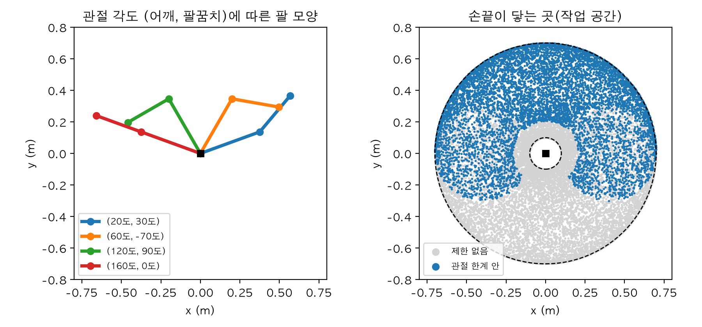
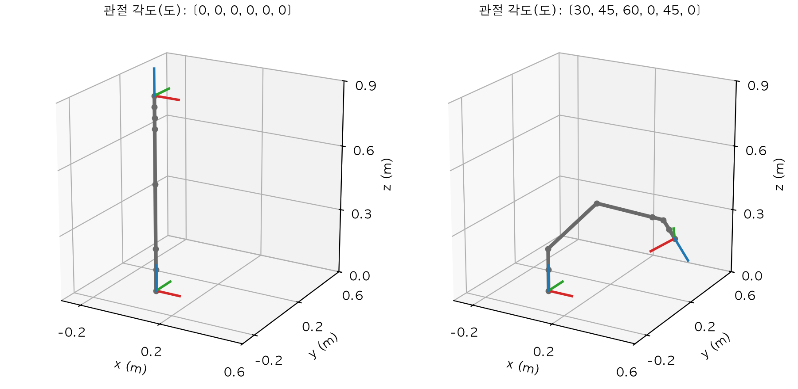
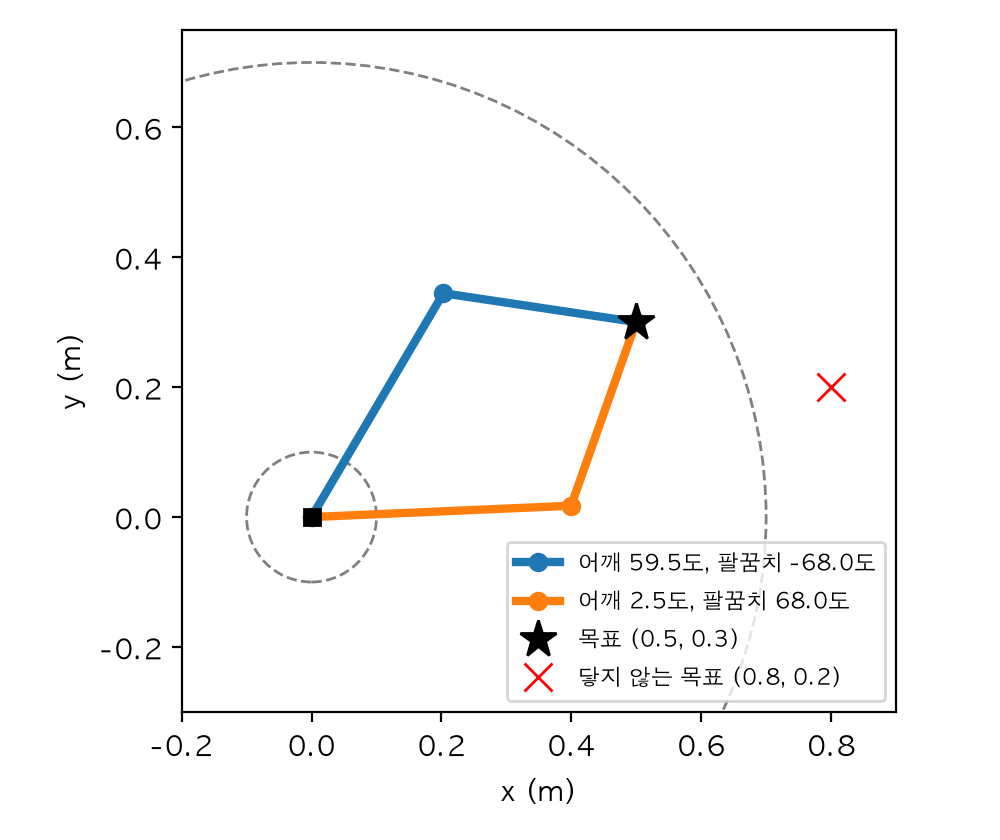
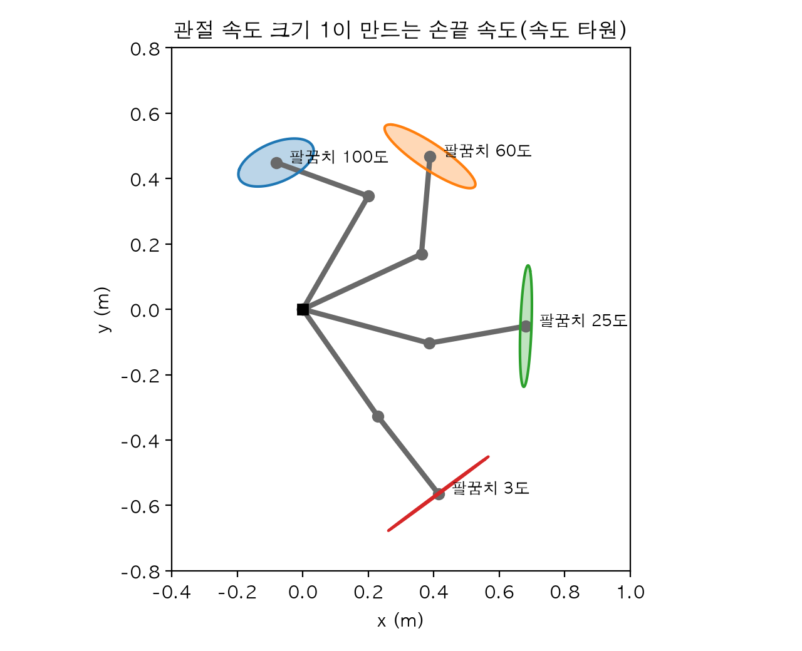
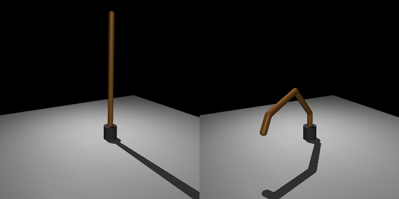
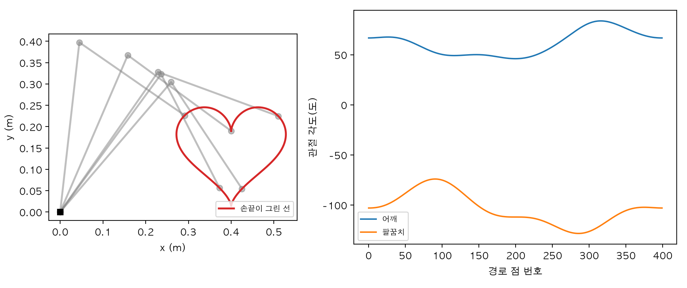
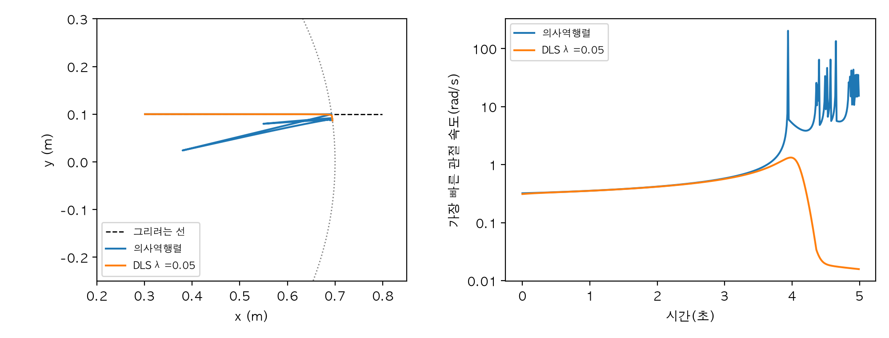

# Chapter 3. 기구학: 관절을 돌리면 손끝은 어디로 갈까

> **학습 목표**  
> - 관절과 링크, 회전 관절과 직선 관절, 자유도, 관절 공간과 작업 공간이 무엇인지 설명하기
> - 2링크 팔의 손끝 위치를 삼각 함수와 동차 변환 사슬 두 가지로 계산하고, 팔이 닿는 영역을 그리기
> - "관절마다 고정 변환 × 관절 회전"을 곱해 나가는 순기구학 함수로 6자유도 팔의 손끝 포즈 구하기
> - 2링크 팔의 역기구학을 공식으로 풀고, 답이 둘이거나 없는 경우 알아보기
> - 야코비안을 유한 차분과 공식으로 구하고, 관절 속도와 손끝 속도의 관계 확인하기
> - 의사역행렬과 감쇠 최소제곱(DLS)으로 수치 역기구학을 풀고, 특이점에서 생기는 일을 수치로 보기
> - 같은 팔을 MuJoCo로 만들어 손끝 위치와 야코비안을 검산하고, 팔로 그림 그리기

---

## 들어가며: 컵을 향해 팔을 뻗을 때

책상 위의 컵을 집으려고 팔을 뻗는 순간을 떠올려 보세요. 우리는 "어깨를 몇 도, 팔꿈치를 몇 도"라고 생각하지 않습니다. 그냥 손을 컵 쪽으로 가져갈 뿐이죠. 그런데 몸 안에서는 누군가 그 계산을 하고 있습니다. 손이 저기에 가려면 어깨와 팔꿈치를 각각 얼마나 굽혀야 하는지를요.

로봇 팔은 이 계산을 모두 코드로 해야 합니다. 로봇이 직접 움직일 수 있는 것은 모터가 달린 **관절의 각도**뿐이고, 우리가 원하는 것은 **손끝의 위치**이기 때문이에요. 그래서 로봇 팔에게는 늘 두 가지 질문이 따라다닙니다.

1. 관절을 이만큼 돌리면 손끝은 어디에 갈까? (**순기구학**, forward kinematics)
2. 손끝을 저기에 두려면 관절을 얼마나 돌려야 할까? (**역기구학**, inverse kinematics)

팔 길이가 0.4m, 0.3m인 간단한 팔로 두 질문을 한 번씩 던져 보겠습니다. 손끝 공식은 3.2절에서 만들 테니 지금은 결과만 보세요.

```python
import numpy as np

위팔, 아래팔 = 0.4, 0.3          # 링크 길이(m)


def 손끝(어깨: float, 팔꿈치: float) -> np.ndarray:
    """관절 각도(rad) → 손끝 위치. 이 공식은 3.2절에서 만든다."""
    return np.array([위팔 * np.cos(어깨) + 아래팔 * np.cos(어깨 + 팔꿈치),
                     위팔 * np.sin(어깨) + 아래팔 * np.sin(어깨 + 팔꿈치)])


# 질문 1: 관절을 이만큼 돌리면 손끝은 어디? → 계산 한 번
print("어깨 30도, 팔꿈치 45도 → 손끝", np.round(손끝(np.deg2rad(30), np.deg2rad(45)), 3))

# 질문 2: 손끝을 (0.5, 0.3)에 두려면? → 1도 간격으로 모든 조합을 다 넣어 보기
목표 = np.array([0.5, 0.3])
각도들 = np.deg2rad(np.arange(-180, 180))
답 = [(a, b) for a in 각도들 for b in 각도들 if np.linalg.norm(손끝(a, b) - 목표) < 0.005]
print("시험한 조합:", len(각도들) ** 2, "개 / 5mm 안에 든 조합:", len(답), "개")
for 이름, 조건 in [("팔꿈치 +", lambda b: b > 0), ("팔꿈치 -", lambda b: b < 0)]:
    무리 = np.rad2deg([(a, b) for a, b in 답 if 조건(b)])
    print(f"{이름} 쪽 답 {len(무리)}개, 평균: 어깨 {무리[:, 0].mean():.1f}도, 팔꿈치 {무리[:, 1].mean():.1f}도")
```

```text
어깨 30도, 팔꿈치 45도 → 손끝 [0.424 0.49 ]
시험한 조합: 129600 개 / 5mm 안에 든 조합: 6 개
팔꿈치 + 쪽 답 3개, 평균: 어깨 2.3도, 팔꿈치 68.0도
팔꿈치 - 쪽 답 3개, 평균: 어깨 59.3도, 팔꿈치 -68.0도
```

첫 번째 질문은 계산 한 번으로 끝났습니다. 어깨 30도, 팔꿈치 45도면 손끝은 (0.424, 0.49)예요. 두 번째 질문은 사정이 다릅니다. 공식이 없으니 1도 간격으로 각도 조합 129,600개를 전부 넣어 보는 수밖에 없었고, 목표에서 5mm 안에 든 조합은 6개였어요. 그런데 이 6개가 두 무리로 나뉩니다. 어깨를 거의 수평(2.3도)으로 두고 팔꿈치를 +68도 굽힌 답과, 어깨를 59.3도 들고 팔꿈치를 -68도 굽힌 답이에요. **같은 손끝 위치에 답이 둘** 있다는 뜻입니다.

순기구학은 답이 늘 하나이고 계산도 쉽습니다. 역기구학은 답이 여럿일 수도, 하나도 없을 수도 있고, 이렇게 다 넣어 보는 방법은 관절이 여섯 개만 돼도 쓸 수 없어요(1도 간격이면 360의 6제곱, 2조 개가 넘습니다). 이 장에서는 2장에서 만든 동차 변환으로 순기구학을 짜고, 역기구학을 공식과 반복 계산 두 가지로 푸는 방법을 배웁니다. 그 과정에서 **야코비안**이라는 행렬과 팔을 쭉 폈을 때 생기는 **특이점** 문제를 만나요. 마지막에는 4장에서 쓸 MuJoCo로 우리 계산을 검산하고, 팔이 손끝으로 그림을 그리게 해 보겠습니다.

> **Q. 왜 '기구학'이라고 부르나요?**
> 기구학(kinematics)은 **힘은 빼고 움직임의 모양만** 다루는 분야입니다. 관절 각도와 손끝 위치·속도의 관계만 보고, 모터가 얼마나 센 힘을 내야 하는지는 묻지 않아요. 힘과 질량까지 다루면 동역학(dynamics)이 되는데, 4장의 물리 시뮬레이션부터는 MuJoCo가 이 계산을 맡아 줍니다.

## 3.1 관절과 링크

### 뼈와 마디

로봇 팔은 단단한 막대와 그 막대를 잇는 마디로 되어 있습니다. 막대를 **링크(link)**, 마디를 **관절(joint)** 이라고 불러요. 사람으로 치면 위팔뼈와 아래팔뼈가 링크, 어깨와 팔꿈치가 관절입니다. 링크는 모양이 변하지 않으니, 관절이 어떻게 움직였는지만 알면 팔 전체의 모양이 정해져요.

관절에는 크게 두 종류가 있습니다.

| 종류 | 움직임 | 관절 값 | 예 |
|---|---|---|---|
| 회전 관절(revolute) | 축 하나를 중심으로 돈다 | 각도(rad) | 팔꿈치, 산업용 로봇 팔 대부분 |
| 직선 관절(prismatic) | 축 하나를 따라 미끄러진다 | 거리(m) | 서랍, 3D 프린터의 축, 엘리베이터 |

2장의 동차 변환으로 쓰면 둘의 차이가 바로 보입니다. 회전 관절은 회전 행렬 자리만, 직선 관절은 이동 자리만 바뀌어요.

```python
import numpy as np

from 회전도구 import Rz, 깔끔


def 변환(R: np.ndarray, p) -> np.ndarray:
    """2장의 동차 변환: 회전 R과 이동 p를 4×4 하나로."""
    T = np.eye(4)
    T[:3, :3] = R
    T[:3, 3] = p
    return T


손끝_관절 = np.array([0.3, 0.0, 0.0, 1.0])     # 관절 좌표계에서 본 손끝(동차 좌표)

print("회전 관절: z축으로 돌리기")
for 각도_도 in [0, 45, 90]:
    손끝 = 변환(Rz(각도_도), [0, 0, 0]) @ 손끝_관절
    print(f"  {각도_도:3d}도 → 손끝 {깔끔(손끝[:3])}, 관절까지 거리 {np.linalg.norm(손끝[:3]):.2f}m")

print("직선 관절: z축을 따라 밀기")
for 거리 in [0.0, 0.1, 0.2]:
    손끝 = 변환(np.eye(3), [0, 0, 거리]) @ 손끝_관절
    print(f"  {거리:.1f}m → 손끝 {깔끔(손끝[:3])}")
```

```text
회전 관절: z축으로 돌리기
    0도 → 손끝 [0.3 0.  0. ], 관절까지 거리 0.30m
   45도 → 손끝 [0.212 0.212 0.   ], 관절까지 거리 0.30m
   90도 → 손끝 [0.  0.3 0. ], 관절까지 거리 0.30m
직선 관절: z축을 따라 밀기
  0.0m → 손끝 [0.3 0.  0. ]
  0.1m → 손끝 [0.3 0.  0.1]
  0.2m → 손끝 [0.3 0.  0.2]
```

회전 관절을 돌리면 손끝이 관절을 중심으로 원을 그리고, 관절까지의 거리는 늘 0.30m로 그대로입니다. 직선 관절을 밀면 손끝이 축을 따라 곧게 올라가요. 이 장의 팔은 모두 회전 관절로 만들지만, 직선 관절이 섞여도 "관절 값에 따라 변환 행렬 하나가 바뀐다"는 틀은 같습니다.

### 자유도, 관절 공간과 작업 공간

1장에서 로봇의 **자유도**를 이야기했죠. 독립적으로 움직일 수 있는 방향의 수예요. 관절이 사슬처럼 한 줄로 이어진 팔에서는 관절 하나가 자유도 하나라서, 관절 수가 곧 자유도입니다.

여기서 같은 팔을 보는 두 가지 눈을 구분해 두면 이 장이 훨씬 쉬워집니다.

- **관절 공간(joint space)**: 관절 값들을 늘어놓은 것. 2링크 팔이라면 (어깨 각도, 팔꿈치 각도) 두 숫자
- **작업 공간(task space)**: 손끝이 실제로 있는 곳. 평면이라면 (x, y), 3차원이라면 위치 셋과 자세 셋

모터는 관절 공간에서 명령을 받고, 사람이 원하는 일("컵 위 5cm")은 작업 공간에서 말해집니다. 순기구학은 관절 공간에서 작업 공간으로 가는 길, 역기구학은 그 반대 길이에요. 3차원에서 손끝을 아무 위치에 아무 자세로나 두려면 숫자 여섯 개(위치 3, 자세 3)를 맞춰야 하니, 관절도 적어도 여섯 개가 필요합니다. 산업용 로봇 팔이 대부분 6자유도인 이유예요.

## 3.2 2링크 팔의 순기구학

### 삼각 함수로 한 번

가장 간단한 팔부터 시작합니다. 평면 위에 링크 두 개가 이어진 팔이에요. 바닥에 어깨 관절이 있고, 길이 0.4m의 위팔 끝에 팔꿈치 관절, 그 끝에 길이 0.3m의 아래팔이 붙어 있습니다. 각도는 둘 다 반시계 방향이 +이고, 팔꿈치 각도는 **위팔을 기준으로** 잰다는 점이 중요해요. 팔꿈치 0도는 팔을 쭉 편 상태입니다.

그러면 위팔은 바닥 기준으로 θ1 방향을 향하고, 아래팔은 θ1 + θ2 방향을 향합니다. 각 링크 끝의 위치는 2장 2.2절의 (cos, sin)에 길이를 곱한 것이니, 손끝은 두 화살표를 이어 붙인 곳이에요.

> 손끝 x = 0.4·cos θ1 + 0.3·cos(θ1 + θ2)  
> 손끝 y = 0.4·sin θ1 + 0.3·sin(θ1 + θ2)

```python
import numpy as np

위팔, 아래팔 = 0.4, 0.3          # 링크 길이(m)


def 순기구학2(어깨: float, 팔꿈치: float) -> tuple[np.ndarray, np.ndarray]:
    """2링크 평면 팔. 관절 각도(rad) → (팔꿈치 위치, 손끝 위치)."""
    팔꿈치_위치 = 위팔 * np.array([np.cos(어깨), np.sin(어깨)])
    손끝_위치 = 팔꿈치_위치 + 아래팔 * np.array([np.cos(어깨 + 팔꿈치), np.sin(어깨 + 팔꿈치)])
    return 팔꿈치_위치, 손끝_위치


for 어깨_도, 팔꿈치_도 in [(0, 0), (90, 0), (30, 45), (0, 90), (0, 180)]:
    팔꿈치_위치, 손끝_위치 = 순기구학2(np.deg2rad(어깨_도), np.deg2rad(팔꿈치_도))
    print(f"어깨 {어깨_도:3d}도, 팔꿈치 {팔꿈치_도:3d}도 → "
          f"팔꿈치 {np.round(팔꿈치_위치, 3) + 0.0}, 손끝 {np.round(손끝_위치, 3) + 0.0}")
```

```text
어깨   0도, 팔꿈치   0도 → 팔꿈치 [0.4 0. ], 손끝 [0.7 0. ]
어깨  90도, 팔꿈치   0도 → 팔꿈치 [0.  0.4], 손끝 [0.  0.7]
어깨  30도, 팔꿈치  45도 → 팔꿈치 [0.346 0.2  ], 손끝 [0.424 0.49 ]
어깨   0도, 팔꿈치  90도 → 팔꿈치 [0.4 0. ], 손끝 [0.4 0.3]
어깨   0도, 팔꿈치 180도 → 팔꿈치 [0.4 0. ], 손끝 [0.1 0. ]
```

몇 가지 자세로 맞는지 확인해 볼까요? 둘 다 0도면 팔을 x축으로 쭉 편 것이라 손끝이 0.4 + 0.3 = 0.7m에 있습니다. 어깨만 90도 들면 같은 길이로 y축 위에 있고요. 어깨 0도에 팔꿈치 90도면 위팔은 x축을 따라 0.4m 가고 아래팔이 위로 꺾여 (0.4, 0.3)이 됩니다. 팔꿈치를 180도 접으면 아래팔이 위팔 위로 되돌아와서 손끝이 (0.1, 0)이에요.

### 동차 변환 사슬로 한 번

삼각 함수 식은 링크가 둘일 때는 쓸 만하지만, 3차원에서 관절이 여섯 개가 되면 손으로 쓰기 어렵습니다. 그래서 2장 2.8절의 변환 사슬로 다시 풀어 보겠습니다. 팔을 이렇게 읽는 거예요.

1. 어깨 관절에서 θ1만큼 돈다
2. 돌아간 x축을 따라 위팔 길이 0.4m만큼 나아간다(팔꿈치 도착)
3. 팔꿈치 관절에서 θ2만큼 돈다
4. 다시 돌아간 x축을 따라 아래팔 길이 0.3m만큼 나아간다(손끝 도착)

단계마다 변환 행렬이 하나씩이고, 2장에서 배운 대로 이름의 안쪽 글자가 맞물리게 곱하면 됩니다.

```python
import numpy as np

from 회전도구 import Rz, 깔끔

위팔, 아래팔 = 0.4, 0.3


def 변환(R: np.ndarray, p) -> np.ndarray:
    T = np.eye(4)
    T[:3, :3] = R
    T[:3, 3] = p
    return T


def 이동(p) -> np.ndarray:
    return 변환(np.eye(3), p)


어깨_도, 팔꿈치_도 = 30, 45

# 관절마다 "돌리고, 링크 길이만큼 x축으로 나아가기"를 곱해 나간다
T_바닥_위팔 = 변환(Rz(어깨_도), [0, 0, 0])                 # 어깨 관절이 돌린 위팔 좌표계
T_위팔_아래팔 = 이동([위팔, 0, 0]) @ 변환(Rz(팔꿈치_도), [0, 0, 0])
T_아래팔_손끝 = 이동([아래팔, 0, 0])
T_바닥_손끝 = T_바닥_위팔 @ T_위팔_아래팔 @ T_아래팔_손끝

print("T_바닥_손끝 =\n", 깔끔(T_바닥_손끝))
a, ab = np.deg2rad(어깨_도), np.deg2rad(어깨_도 + 팔꿈치_도)
삼각함수_답 = [위팔 * np.cos(a) + 아래팔 * np.cos(ab), 위팔 * np.sin(a) + 아래팔 * np.sin(ab)]
print("삼각 함수로 구한 손끝:", 깔끔(np.array(삼각함수_답)))
x축 = T_바닥_손끝[:3, 0]
print("손끝이 향한 각도:", round(float(np.rad2deg(np.arctan2(x축[1], x축[0]))), 3), "도")
```

```text
T_바닥_손끝 =
 [[ 0.259 -0.966  0.     0.424]
 [ 0.966  0.259  0.     0.49 ]
 [ 0.     0.     1.     0.   ]
 [ 0.     0.     0.     1.   ]]
삼각 함수로 구한 손끝: [0.424 0.49 ]
손끝이 향한 각도: 75.0 도
```

변환 사슬로 구한 손끝 위치(오른쪽 열의 0.424, 0.49)가 삼각 함수의 답과 같습니다. 덤으로 얻은 것도 있어요. 왼쪽 위 회전 부분을 보면 손끝 좌표계의 x축이 바닥 기준으로 75도를 향하고 있습니다. 30 + 45 = 75도, 즉 손끝의 **자세**도 함께 나온 거예요. 삼각 함수 식은 위치만 알려 줬지만 변환 사슬은 포즈 전체를 줍니다. 손끝에 집게가 달려 있다면 집게가 어느 쪽을 향하는지도 알아야 하니, 이 차이가 3차원에서 중요해집니다.

`T_위팔_아래팔 = 이동([위팔, 0, 0]) @ 변환(Rz(팔꿈치_도), ...)`을 오른쪽부터 읽어 보세요. "팔꿈치에서 돌고, 그 결과를 위팔 길이만큼 옮겨 놓는다"입니다. 관절 하나가 "고정된 위치로 옮기기 × 관절 값만큼 돌리기"로 이루어진다는 이 모양이 3.3절의 일반 순기구학으로 그대로 이어져요.

### 팔이 닿는 곳: 작업 공간

순기구학이 있으면 팔이 닿을 수 있는 영역을 그려 볼 수 있습니다. 관절 각도를 무작위로 많이 뽑아 손끝 위치를 찍어 보면 돼요. 관절이 끝없이 돌 수 있는 경우와, 실제 팔처럼 관절에 한계가 있는 경우(어깨 0~180도, 팔꿈치 -150~150도)를 함께 보겠습니다.

```python
import matplotlib.pyplot as plt
import numpy as np

plt.rcParams["font.family"] = "AppleGothic"
plt.rcParams["axes.unicode_minus"] = False

위팔, 아래팔 = 0.4, 0.3


def 팔_점들(어깨: np.ndarray, 팔꿈치: np.ndarray) -> np.ndarray:
    """(바닥, 팔꿈치, 손끝) 세 점. 각도 배열을 넣으면 한꺼번에 계산된다."""
    팔꿈치_위치 = 위팔 * np.stack([np.cos(어깨), np.sin(어깨)])
    손끝_위치 = 팔꿈치_위치 + 아래팔 * np.stack([np.cos(어깨 + 팔꿈치), np.sin(어깨 + 팔꿈치)])
    return np.stack([np.zeros_like(손끝_위치), 팔꿈치_위치, 손끝_위치])


생성기 = np.random.default_rng(0)
표본 = 생성기.uniform(-np.pi, np.pi, size=(2, 20000))      # 관절 공간에서 고르게 뽑은 각도
손끝들 = 팔_점들(표본[0], 표본[1])[2]
거리 = np.linalg.norm(손끝들, axis=0)
print(f"제한 없음: 손끝 거리 {거리.min():.3f} ~ {거리.max():.3f}m")

# 관절 한계: 어깨 0~180도, 팔꿈치 -150~150도
제한 = (표본[0] >= 0) & (np.abs(표본[1]) <= np.deg2rad(150))
print(f"관절 한계 안: 표본 {제한.sum()}개, 손끝 거리 {거리[제한].min():.3f} ~ {거리[제한].max():.3f}m")

그림, (왼쪽, 오른쪽) = plt.subplots(1, 2, figsize=(9, 4.2))
for 어깨_도, 팔꿈치_도 in [(20, 30), (60, -70), (120, 90), (160, 0)]:
    점 = 팔_점들(np.deg2rad(어깨_도), np.deg2rad(팔꿈치_도))
    왼쪽.plot(점[:, 0], 점[:, 1], "o-", linewidth=3, label=f"({어깨_도}도, {팔꿈치_도}도)")
왼쪽.set_title("관절 각도 (어깨, 팔꿈치)에 따른 팔 모양")
왼쪽.legend(fontsize=8, loc="lower left")
오른쪽.scatter(*손끝들, s=1, color="lightgray", label="제한 없음")
오른쪽.scatter(*손끝들[:, 제한], s=1, color="tab:blue", label="관절 한계 안")
for 반지름 in [위팔 - 아래팔, 위팔 + 아래팔]:
    오른쪽.add_patch(plt.Circle((0, 0), 반지름, fill=False, color="k", linestyle="--"))
오른쪽.set_title("손끝이 닿는 곳(작업 공간)")
오른쪽.legend(fontsize=8, loc="lower left", markerscale=6)
for 칸 in (왼쪽, 오른쪽):
    칸.plot(0, 0, "ks")
    칸.set_xlim(-0.8, 0.8)
    칸.set_ylim(-0.8, 0.8)
    칸.set_aspect("equal")
    칸.set_xlabel("x (m)")
    칸.set_ylabel("y (m)")
그림.tight_layout()
그림.savefig("workspace2.png", dpi=200)
print("저장: workspace2.png")
```

```text
제한 없음: 손끝 거리 0.100 ~ 0.700m
관절 한계 안: 표본 8426개, 손끝 거리 0.205 ~ 0.700m
저장: workspace2.png
```



관절에 제한이 없으면 손끝은 반지름 0.1m와 0.7m 사이의 **고리** 모양 영역에 닿습니다. 바깥 원은 팔을 쭉 편 길이 0.4 + 0.3, 안쪽 원은 팔을 완전히 접은 길이 0.4 - 0.3이에요. 안쪽 원 안은 위팔이 아래팔보다 길어서 절대 닿을 수 없는 구멍입니다.

관절 한계를 넣으면 파란 영역만 남습니다. 어깨가 0~180도라 아래쪽 절반은 대부분 닿지 않고, 팔꿈치가 150도까지만 접히니 손끝이 어깨에 0.205m보다 가까이 오지 못해요. 실제 로봇 팔의 설명서에 그려진 작업 공간 그림도 이렇게 만든 것입니다. 로봇을 책상 어디에 놓을지 정할 때 가장 먼저 보는 그림이에요.

## 3.3 일반 순기구학: 관절마다 곱해 나가기

### 고정 변환 × 관절 회전

3차원 팔도 3.2절과 똑같이 풀립니다. 관절마다 두 가지 정보만 있으면 돼요.

- **고정 위치**: 앞 관절 좌표계에서 본 이 관절의 위치. 링크의 생김새로 정해지고 변하지 않는다
- **회전축**: 이 관절이 어느 축을 중심으로 도는지(자기 좌표계 기준)

그러면 관절 하나의 변환은 `이동(고정 위치) @ 축_회전(축, 관절 각도)`이고, 손끝의 포즈는 이것을 바닥에서부터 차례로 곱한 것입니다. 6장에서 볼 로봇 설명 파일 URDF와 4장의 MuJoCo도 관절을 이렇게 "부모 기준 위치와 축"으로 적어요(URDF는 부모 기준 고정 자세도 함께 적을 수 있는데, 이 장의 예제 팔은 고정 자세가 없도록 만들었습니다). 이 장의 코드가 곧 그 도구들이 안에서 하는 계산이에요.

필요한 함수를 `팔도구.py`에 모으겠습니다. `변환`과 `역변환`은 2장 2.8절의 것을 그대로 옮겼고, 아무 축으로나 도는 `축_회전`은 2장 2.5절의 로드리게스 공식을 라디안으로 받게 고친 것이에요. 관절 각도는 계산 속에서 늘 라디안으로 다루기로 합니다. 3.5절의 야코비안이 "관절이 1rad 돌 때"를 기준으로 하기 때문이에요.

```python
"""3장 기구학 도구: 2장의 변환·역변환에 관절 회전과 순기구학을 더한다."""
import numpy as np


def 변환(R: np.ndarray, p) -> np.ndarray:
    """회전 R과 이동 p를 4×4 동차 변환 행렬 하나로 묶는다(2장 2.8절)."""
    T = np.eye(4)
    T[:3, :3] = R
    T[:3, 3] = p
    return T


def 역변환(T: np.ndarray) -> np.ndarray:
    """T의 반대 방향 변환. 회전은 전치, 이동은 -Rᵀp(2장 2.8절)."""
    R, p = T[:3, :3], T[:3, 3]
    return 변환(R.T, -R.T @ p)


def 이동(p) -> np.ndarray:
    """돌지 않고 p만큼 옮기는 변환."""
    return 변환(np.eye(3), p)


def 축_회전(축, 각: float) -> np.ndarray:
    """단위 축을 중심으로 각(rad)만큼 도는 변환. 2장 2.5절의 로드리게스 공식."""
    k = np.asarray(축, dtype=float)
    K = np.array([[0, -k[2], k[1]],
                  [k[2], 0, -k[0]],
                  [-k[1], k[0], 0]])
    R = np.eye(3) + np.sin(각) * K + (1 - np.cos(각)) * (K @ K)
    return 변환(R, [0.0, 0.0, 0.0])


# 예제용 6자유도 팔. 관절마다 (이름, 앞 관절 기준 고정 위치(m), 회전축)
예제_팔 = [
    ("허리", [0, 0, 0.10], [0, 0, 1]),
    ("어깨", [0, 0, 0.10], [0, 1, 0]),
    ("팔꿈치", [0, 0, 0.30], [0, 1, 0]),
    ("손목1", [0, 0, 0.25], [0, 0, 1]),
    ("손목2", [0, 0, 0.05], [0, 1, 0]),
    ("손목3", [0, 0, 0.05], [0, 0, 1]),
]
손끝_위치 = [0, 0, 0.05]             # 마지막 관절 기준 손끝(도구 끝)


def 순기구학(관절각, 팔=예제_팔, 손끝=손끝_위치) -> list[np.ndarray]:
    """바닥 기준 좌표계 목록: [T_바닥_관절1, ..., T_바닥_관절n, T_바닥_손끝]."""
    T = np.eye(4)
    좌표계들 = []
    for (_, 위치, 축), 각 in zip(팔, 관절각):
        T = T @ 이동(위치) @ 축_회전(축, 각)      # 고정 변환 × 관절 회전
        좌표계들.append(T)
    좌표계들.append(T @ 이동(손끝))
    return 좌표계들
```

예제용 6자유도 팔은 바닥에서 위로 쌓아 올린 모양입니다. 허리(z축)가 팔 전체를 좌우로 돌리고, 어깨와 팔꿈치(y축)가 팔을 앞뒤로 굽히고, 손목 세 개(z, y, z축)가 손끝의 자세를 맞춰요. 링크 길이는 예제용으로 정한 값이고, 모든 관절이 0도이면 팔이 위로 똑바로 섭니다.

`순기구학` 함수의 핵심은 반복문 안의 한 줄 `T = T @ 이동(위치) @ 축_회전(축, 각)`입니다. 관절을 하나 지날 때마다 "앞 관절 기준으로 옮기고, 이 관절만큼 돈다"를 곱해 나가요. 손끝만이 아니라 모든 관절의 좌표계를 목록으로 돌려주는 건, 3.5절의 야코비안과 그림 그리기에 관절 위치가 필요하기 때문입니다.

### 6자유도 팔의 손끝 포즈

먼저 모든 관절이 0도일 때 손끝이 링크 길이를 다 더한 높이에 있는지 확인하고, 그다음 관절을 이리저리 돌려 보겠습니다.

```python
import numpy as np

from 팔도구 import 순기구학, 예제_팔
from 회전도구 import 깔끔

영점 = np.zeros(6)
T_바닥_손끝 = 순기구학(영점)[-1]
print("모든 관절 0도 → 손끝 위치:", 깔끔(T_바닥_손끝[:3, 3]))

관절각_도 = np.array([30, 45, 60, 0, 45, 0])           # 사람이 읽는 값은 도
좌표계들 = 순기구학(np.deg2rad(관절각_도))
for (이름, _, _), T in zip(예제_팔, 좌표계들):
    print(f"{이름} 관절 위치:", 깔끔(T[:3, 3]))
T_바닥_손끝 = 좌표계들[-1]
print("손끝 위치:", 깔끔(T_바닥_손끝[:3, 3]))
print("손끝 z축(도구가 향한 방향):", 깔끔(T_바닥_손끝[:3, 2]))
```

```text
모든 관절 0도 → 손끝 위치: [0.  0.  0.9]
허리 관절 위치: [0.  0.  0.1]
어깨 관절 위치: [0.  0.  0.2]
팔꿈치 관절 위치: [0.184 0.106 0.412]
손목1 관절 위치: [0.393 0.227 0.347]
손목2 관절 위치: [0.435 0.251 0.334]
손목3 관절 위치: [0.456 0.263 0.291]
손끝 위치: [0.478 0.276 0.248]
손끝 z축(도구가 향한 방향): [ 0.433  0.25  -0.866]
```

0도일 때 손끝은 (0, 0, 0.9)입니다. 링크 길이 0.1 + 0.1 + 0.3 + 0.25 + 0.05 + 0.05 + 0.05를 다 더한 높이예요.

관절을 돌린 쪽도 읽어 볼게요. 허리와 어깨는 위치가 0도일 때와 같습니다. 허리는 제자리에서 돌고, 어깨는 허리 위에 있으니 허리가 돌아도 위치가 변하지 않죠. 팔꿈치부터는 x, y가 함께 생기는데, y/x 비율이 0.106/0.184 = tan 30°입니다. 허리를 30도 돌렸으니 팔 전체가 바닥에서 30도 방향의 세로 평면 안에 있는 거예요. 손끝의 z축(도구가 향한 방향)은 (0.433, 0.25, -0.866)으로 아래쪽을 비스듬히 향합니다. 어깨 45 + 팔꿈치 60 + 손목2 45 = 150도만큼 앞으로 숙였으니, 똑바로 아래(180도)에서 30도 덜 숙인 방향이에요(cos 30° = 0.866).

숫자만으로는 모양이 잘 그려지지 않으니 그림으로 보겠습니다. 바닥과 손끝 좌표계도 2장처럼 빨강·초록·파랑으로 그렸어요.

```python
import matplotlib.pyplot as plt
import numpy as np

from 팔도구 import 순기구학

plt.rcParams["font.family"] = "AppleGothic"
plt.rcParams["axes.unicode_minus"] = False

그림 = plt.figure(figsize=(9, 4.4))
for 번호, 관절각_도 in enumerate([[0, 0, 0, 0, 0, 0], [30, 45, 60, 0, 45, 0]]):
    칸 = 그림.add_subplot(1, 2, 번호 + 1, projection="3d")
    좌표계들 = 순기구학(np.deg2rad(관절각_도))
    점들 = np.array([[0, 0, 0]] + [T[:3, 3] for T in 좌표계들])     # 바닥 → 관절들 → 손끝
    칸.plot(*점들.T, "o-", color="dimgray", linewidth=3, markersize=4)
    for T in [np.eye(4), 좌표계들[-1]]:                          # 바닥과 손끝 좌표계
        for 열, 색 in zip(range(3), ["tab:red", "tab:green", "tab:blue"]):
            칸.plot(*zip(T[:3, 3], T[:3, 3] + 0.12 * T[:3, 열]), color=색, linewidth=2)
    칸.set_title(f"관절 각도(도): {관절각_도}", fontsize=10)
    칸.set_xlim(-0.3, 0.6)
    칸.set_ylim(-0.3, 0.6)
    칸.set_zlim(0, 0.9)
    칸.set_box_aspect((1, 1, 1))
    칸.set_xticks([-0.2, 0.2, 0.6])
    칸.set_yticks([-0.2, 0.2, 0.6])
    칸.set_zticks([0, 0.3, 0.6, 0.9])
    칸.set_xlabel("x (m)")
    칸.set_ylabel("y (m)")
    칸.set_zlabel("z (m)")
    칸.view_init(elev=20, azim=-60)
그림.tight_layout()
그림.savefig("arm6.png", dpi=200)
print("저장: arm6.png")
```

```text
저장: arm6.png
```



오른쪽 그림에서 손끝의 파란 z축이 아래쪽 바닥을 향하고 있죠? 컵을 위에서 집으려는 자세와 비슷합니다. 관절 각도 여섯 개라는 관절 공간의 점 하나가, 위치와 자세라는 작업 공간의 포즈 하나로 바뀌었어요.

### DH 파라미터라는 관례

로봇 팔 교과서나 제조사 문서를 보면 **DH 파라미터(Denavit-Hartenberg parameters)** 라는 표를 자주 만납니다. 관절마다 숫자 네 개(θ, d, a, α)로 좌표계를 붙이는 1955년의 관례예요. "z축으로 θ 돌고 d만큼 올라간 뒤, x축으로 a만큼 나아가고 α만큼 돈다"를 관절마다 곱합니다. 숫자 네 개로 관절 하나를 빈틈없이 적을 수 있어서 오랫동안 표준처럼 쓰였어요.

3.2절의 2링크 팔을 DH 표로 적으면 이렇습니다.

| 관절 | θ (관절 값) | d | a | α |
|---|---|---|---|---|
| 1 (어깨) | θ1 | 0 | 0.4 | 0 |
| 2 (팔꿈치) | θ2 | 0 | 0.3 | 0 |

```python
import numpy as np

from 회전도구 import Rx, Rz, 깔끔


def 변환(R: np.ndarray, p) -> np.ndarray:
    T = np.eye(4)
    T[:3, :3] = R
    T[:3, 3] = p
    return T


def DH(세타_도: float, d: float, a: float, 알파_도: float) -> np.ndarray:
    """DH 관례 한 줄: z축으로 θ 돌고 d 올라간 뒤, x축으로 a 나아가고 α 돈다."""
    return (변환(Rz(세타_도), [0, 0, d]) @ 변환(Rx(알파_도), [a, 0, 0]))


# 2링크 평면 팔의 DH 표: (θ, d, a, α)
어깨_도, 팔꿈치_도 = 30, 45
DH_표 = [(어깨_도, 0.0, 0.4, 0.0),
        (팔꿈치_도, 0.0, 0.3, 0.0)]
T = np.eye(4)
for 줄 in DH_표:
    T = T @ DH(*줄)
print("DH로 구한 손끝 위치:", 깔끔(T[:3, 3]))
```

```text
DH로 구한 손끝 위치: [0.424 0.49  0.   ]
```

같은 (0.424, 0.49)가 나왔습니다. 다만 DH는 좌표계를 붙이는 규칙이 엄격해서, 관절 축이 서로 비틀려 있는 3차원 팔에서는 표를 만드는 것부터가 꽤 까다롭고, 같은 팔도 사람마다 다른 표를 만들기 쉽습니다. 이 책에서는 URDF와 MuJoCo가 쓰는 "고정 위치 + 회전축" 방식을 기본으로 쓰고, DH는 "이런 관례도 있다"는 정도로 알아 두면 충분해요. 남이 준 DH 표를 받았다면 위 예제처럼 한 줄씩 곱해서 손끝 위치를 확인해 보면 됩니다.

> **Q. 관절 좌표계를 어디에 붙이든 손끝 위치는 같나요?**
> 네, 같습니다. 좌표계를 어디에 붙이느냐는 계산을 적는 방식일 뿐이고, 팔의 실제 모양은 변하지 않으니까요. 3.3절의 방식과 DH 방식은 관절 좌표계가 서로 다르지만, 바닥과 손끝의 관계(T_바닥_손끝)는 같은 값이 나옵니다. 다만 관절 각도 0도가 어떤 자세인지는 방식마다 달라질 수 있어서, 남의 표를 쓸 때는 "모든 관절 0도"의 손끝 위치부터 맞춰 보는 것이 좋습니다.

## 3.4 역기구학: 공식으로 풀기

### 삼각형으로 팔꿈치 각도 구하기

이제 거꾸로 갑니다. 손끝을 (x, y)에 두려면 θ1과 θ2가 얼마여야 할까요? 2링크 팔은 다행히 공식으로 풀립니다. 비밀은 **삼각형**이에요.

어깨, 팔꿈치, 손끝 세 점을 이으면 삼각형이 생깁니다. 두 변은 위팔 0.4m와 아래팔 0.3m이고, 남은 한 변은 어깨에서 손끝까지의 거리 r = √(x² + y²)이에요. 세 변을 모두 아니까 **코사인 법칙**으로 팔꿈치 각도를 구할 수 있습니다.

> cos θ2 = (r² - 0.4² - 0.3²) / (2 × 0.4 × 0.3)

cos 값이 하나 나오면 각도는 +θ2와 -θ2 두 개가 됩니다. 팔꿈치를 한쪽으로 굽히든 반대쪽으로 굽히든 삼각형의 모양은 같으니까요. θ2를 정하고 나면 θ1은 "손끝 방향의 각도"에서 "삼각형 때문에 어긋난 만큼"을 빼서 구합니다. 각도를 구할 때는 `np.arctan2(y, x)`를 써요. `np.arctan(y / x)`와 달리 x가 0이거나 음수여도 네 사분면을 올바르게 구분해 줍니다.

```python
import numpy as np

위팔, 아래팔 = 0.4, 0.3


def 손끝(어깨: float, 팔꿈치: float) -> np.ndarray:
    return np.array([위팔 * np.cos(어깨) + 아래팔 * np.cos(어깨 + 팔꿈치),
                     위팔 * np.sin(어깨) + 아래팔 * np.sin(어깨 + 팔꿈치)])


def 역기구학2(x: float, y: float) -> list[tuple[float, float]]:
    """손끝 목표 (x, y) → 가능한 (어깨, 팔꿈치) 각도(rad) 목록. 0개, 1개, 2개일 수 있다."""
    c2 = (x**2 + y**2 - 위팔**2 - 아래팔**2) / (2 * 위팔 * 아래팔)    # 코사인 법칙
    if abs(c2) > 1:
        return []                                                 # 닿지 않는 곳
    각 = np.arccos(c2)
    팔꿈치들 = [각] if np.isclose(abs(c2), 1) else [-각, 각]       # 팔을 다 펴거나 접으면 답이 하나
    답 = []
    for 팔꿈치 in 팔꿈치들:
        어깨 = np.arctan2(y, x) - np.arctan2(아래팔 * np.sin(팔꿈치), 위팔 + 아래팔 * np.cos(팔꿈치))
        어깨 = (어깨 + np.pi) % (2 * np.pi) - np.pi                # -180~180도로 맞추기
        답.append((어깨, 팔꿈치))
    return 답


for 목표 in [(0.5, 0.3), (0.7, 0.0), (0.8, 0.2), (0.05, 0.0)]:
    답 = 역기구학2(*목표)
    print(f"목표 {목표}: 답 {len(답)}개")
    for 어깨, 팔꿈치 in 답:
        검산 = np.linalg.norm(손끝(어깨, 팔꿈치) - 목표)
        print(f"   어깨 {round(np.rad2deg(어깨), 1) + 0.0:6.1f}도, 팔꿈치 {round(np.rad2deg(팔꿈치), 1) + 0.0:6.1f}도 (검산 오차 {검산:.1e}m)")
```

```text
목표 (0.5, 0.3): 답 2개
   어깨   59.5도, 팔꿈치  -68.0도 (검산 오차 4.0e-16m)
   어깨    2.5도, 팔꿈치   68.0도 (검산 오차 0.0e+00m)
목표 (0.7, 0.0): 답 1개
   어깨    0.0도, 팔꿈치    0.0도 (검산 오차 5.0e-17m)
목표 (0.8, 0.2): 답 0개
목표 (0.05, 0.0): 답 0개
```

목표 (0.5, 0.3)에는 답이 두 개입니다. (59.5도, -68.0도)와 (2.5도, 68.0도)로, 들어가며에서 1도 간격으로 다 넣어 보고 찾은 두 무리(59.3도와 2.3도)와 같은 답이에요. 그때는 1도 간격이라 0.2도쯤 어긋났지만, 공식은 정확한 값을 단번에 줍니다. 순기구학으로 검산한 오차도 0에 가까워요.

나머지 목표도 보세요. (0.7, 0)은 팔을 쭉 펴야만 닿는 곳이라 답이 하나뿐입니다. 이때는 +θ2와 -θ2가 둘 다 0이 되어 두 답이 하나로 합쳐져요. (0.8, 0.2)는 0.7m보다 멀고, (0.05, 0)은 0.1m보다 가까워서 cos θ2의 절댓값이 1을 넘습니다. 그런 각도는 없으니 답이 0개예요. 3.2절의 고리 바깥이나 구멍 안에 있는 목표입니다.

### 팔꿈치 위, 팔꿈치 아래

두 답을 그림으로 보면 차이가 분명합니다.

```python
import matplotlib.pyplot as plt
import numpy as np

plt.rcParams["font.family"] = "AppleGothic"
plt.rcParams["axes.unicode_minus"] = False

위팔, 아래팔 = 0.4, 0.3
목표 = np.array([0.5, 0.3])

# 앞에서 역기구학2가 낸 두 답(도)
그림, 칸 = plt.subplots(figsize=(5, 4.2))
for (어깨_도, 팔꿈치_도), 색 in [((59.5, -68.0), "tab:blue"), ((2.5, 68.0), "tab:orange")]:
    a, b = np.deg2rad(어깨_도), np.deg2rad(팔꿈치_도)
    팔꿈치_위치 = 위팔 * np.array([np.cos(a), np.sin(a)])
    손끝_위치 = 팔꿈치_위치 + 아래팔 * np.array([np.cos(a + b), np.sin(a + b)])
    점 = np.array([[0, 0], 팔꿈치_위치, 손끝_위치])
    칸.plot(점[:, 0], 점[:, 1], "o-", color=색, linewidth=3, label=f"어깨 {어깨_도}도, 팔꿈치 {팔꿈치_도}도")
칸.plot(*목표, "k*", markersize=14, label="목표 (0.5, 0.3)")
칸.plot(0.8, 0.2, "rx", markersize=10, label="닿지 않는 목표 (0.8, 0.2)")
for 반지름 in [위팔 - 아래팔, 위팔 + 아래팔]:
    칸.add_patch(plt.Circle((0, 0), 반지름, fill=False, color="gray", linestyle="--"))
칸.plot(0, 0, "ks")
칸.set_xlim(-0.2, 0.9)
칸.set_ylim(-0.3, 0.75)
칸.set_aspect("equal")
칸.set_xlabel("x (m)")
칸.set_ylabel("y (m)")
칸.legend(fontsize=8, loc="lower right")
그림.tight_layout()
그림.savefig("ik2_two.png", dpi=200)
print("저장: ik2_two.png")
```

```text
저장: ik2_two.png
```



파란 팔은 팔꿈치를 위로 든 자세(**팔꿈치 위**, elbow-up), 주황 팔은 아래로 내린 자세(**팔꿈치 아래**, elbow-down)입니다. 두 팔이 어깨-손끝 선을 기준으로 거울에 비친 모양이죠. 실제 로봇에서는 이 둘 중 하나를 골라야 하는데, 기준은 상황에 따라 다릅니다. 책상 아래로 팔꿈치가 내려가면 부딪히니 팔꿈치 위를 고르고, 지금 자세에서 더 가까운 답을 골라 관절이 덜 움직이게 하기도 해요.

공식으로 푸는 역기구학(**해석해**, analytic solution)은 빠르고 정확하며 답을 모두 찾아 줍니다. 하지만 공식을 만들 수 있는 팔은 많지 않아요. 6자유도 팔은 손목 세 축이 한 점에서 만나는 것 같은 특별한 구조여야 공식이 깔끔하게 나오고, 그래도 공식이 몇 쪽에 이릅니다. 그래서 어떤 팔에든 쓸 수 있는 방법이 필요하고, 그 열쇠가 다음 절의 야코비안이에요.

## 3.5 야코비안: 관절 속도와 손끝 속도

### 조금 움직이면 얼마나 움직일까

자동차 운전대를 조금 돌리면 차가 조금 돌죠. 많이 돌리면 많이 돌고요. 그런데 로봇 팔은 그렇게 단순하지 않습니다. 팔을 접고 있을 때 어깨를 1도 돌리면 손끝이 조금 움직이지만, 팔을 쭉 펴고 있을 때 같은 1도를 돌리면 손끝이 훨씬 많이 움직여요. 팔이 길어진 만큼 원의 반지름이 커졌으니까요.

"지금 자세에서 관절 i를 조금 돌리면 손끝이 어느 쪽으로 얼마나 움직이는가"를 관절마다 모아 놓은 행렬이 **야코비안(Jacobian)** 입니다. 2링크 팔이라면 손끝 (x, y) 두 개 × 관절 두 개라서 2×2 행렬이고, **열 i는 관절 i만 1rad/s로 돌릴 때의 손끝 속도**예요.

3.2절과 3.4절의 함수에 야코비안 공식을 더해 `두링크.py`로 모아 두겠습니다. 이제부터 2링크 팔의 각도는 `q = [어깨, 팔꿈치]` 배열(rad)로 다룹니다.

```python
"""2링크 평면 팔: 3.2절 순기구학, 3.4절 역기구학에 야코비안을 더해 모은 것. 각도는 rad."""
import numpy as np

위팔, 아래팔 = 0.4, 0.3          # 링크 길이(m)


def 팔_점들(q) -> np.ndarray:
    """관절 각도 q = [어깨, 팔꿈치] → 바닥, 팔꿈치, 손끝 세 점(3×2)."""
    팔꿈치_위치 = 위팔 * np.array([np.cos(q[0]), np.sin(q[0])])
    손끝_위치 = 팔꿈치_위치 + 아래팔 * np.array([np.cos(q[0] + q[1]), np.sin(q[0] + q[1])])
    return np.array([[0.0, 0.0], 팔꿈치_위치, 손끝_위치])


def 순기구학2(q) -> np.ndarray:
    """관절 각도 → 손끝 위치."""
    return 팔_점들(q)[2]


def 역기구학2(목표) -> list[np.ndarray]:
    """손끝 목표 → 가능한 관절 각도 목록(0~2개). 3.4절의 해석해."""
    x, y = 목표
    c2 = (x**2 + y**2 - 위팔**2 - 아래팔**2) / (2 * 위팔 * 아래팔)
    if abs(c2) > 1:
        return []
    각 = np.arccos(c2)
    답 = []
    for 팔꿈치 in ([각] if np.isclose(abs(c2), 1) else [-각, 각]):
        어깨 = np.arctan2(y, x) - np.arctan2(아래팔 * np.sin(팔꿈치), 위팔 + 아래팔 * np.cos(팔꿈치))
        답.append(np.array([(어깨 + np.pi) % (2 * np.pi) - np.pi, 팔꿈치]))
    return 답


def 야코비안2(q) -> np.ndarray:
    """2×2 야코비안. 열 i는 '관절 i만 1rad/s로 돌 때의 손끝 속도'."""
    s1, c1 = np.sin(q[0]), np.cos(q[0])
    s12, c12 = np.sin(q[0] + q[1]), np.cos(q[0] + q[1])
    return np.array([[-위팔 * s1 - 아래팔 * s12, -아래팔 * s12],
                     [위팔 * c1 + 아래팔 * c12, 아래팔 * c12]])
```

`야코비안2`의 공식은 3.2절의 손끝 식을 θ1과 θ2로 각각 미분한 것입니다. 미분을 몰라도 괜찮아요. 공식이 맞는지 **직접 움직여 보고 재는 방법**으로 확인할 수 있으니까요.

### 유한 차분으로 재기

2권 5장에서 기울기를 재는 수치 미분, 그중에서도 양쪽으로 조금씩 움직여 보는 **중앙 차분**을 배웠습니다. 야코비안도 똑같이 잴 수 있어요. 관절 하나만 +h와 -h만큼 돌려 보고 손끝이 움직인 거리를 2h로 나누면, 그 관절의 열이 나옵니다. 다른 관절은 그대로 두고 하나씩만 움직이니 2권 5장의 편미분과 같은 방법이에요.

```python
import numpy as np

from 두링크 import 순기구학2, 야코비안2
from 회전도구 import 깔끔


def 수치_야코비안(함수, q: np.ndarray, h: float = 1e-6) -> np.ndarray:
    """관절을 하나씩 ±h만큼 움직여 손끝이 얼마나 변하는지 잰다(중앙 차분)."""
    열들 = []
    for i in range(len(q)):
        dq = np.zeros(len(q))
        dq[i] = h
        열들.append((함수(q + dq) - 함수(q - dq)) / (2 * h))
    return np.column_stack(열들)


q = np.deg2rad([30.0, 45.0])
print("수치 야코비안:\n", 깔끔(수치_야코비안(순기구학2, q), 4))
print("공식 야코비안:\n", 깔끔(야코비안2(q), 4))
print("가장 큰 차이:", f"{np.abs(수치_야코비안(순기구학2, q) - 야코비안2(q)).max():.1e}")
```

```text
수치 야코비안:
 [[-0.4898 -0.2898]
 [ 0.4241  0.0776]]
공식 야코비안:
 [[-0.4898 -0.2898]
 [ 0.4241  0.0776]]
가장 큰 차이: 3.7e-11
```

두 행렬이 소수 넷째 자리까지 같고, 가장 큰 차이가 3.7e-11입니다. 공식이 맞다는 뜻이에요. 수치 야코비안은 순기구학 함수만 있으면 어떤 팔에든 쓸 수 있어서, 공식을 새로 만들었을 때 검산용으로 아주 유용합니다.

### 속도 기구학: v = J q̇

야코비안의 진짜 쓸모는 속도를 바꿔 주는 데 있습니다. 관절들이 각각 어떤 속도로 돌고 있을 때 손끝의 속도는 **야코비안 × 관절 속도**예요. 관절 속도를 q̇(큐 닷, q 위의 점은 시간에 대한 변화율이라는 표시)라고 쓰면 v = J q̇입니다. 각 관절이 만드는 손끝 속도(열)를 관절 속도만큼씩 더한 것이죠.

```python
import numpy as np

from 두링크 import 순기구학2, 야코비안2
from 회전도구 import 깔끔

q = np.deg2rad([30.0, 45.0])
관절_속도 = np.array([0.5, -0.2])               # 어깨 0.5rad/s, 팔꿈치 -0.2rad/s

손끝_속도 = 야코비안2(q) @ 관절_속도             # 속도 기구학: v = J q̇
print("J @ q̇로 구한 손끝 속도 :", 깔끔(손끝_속도, 4), "m/s")

간격 = 0.001                                   # 0.001초 동안 실제로 움직여 보기
움직인_거리 = 순기구학2(q + 관절_속도 * 간격) - 순기구학2(q)
print("실제로 움직여 잰 속도   :", 깔끔(움직인_거리 / 간격, 4), "m/s")

# 첫 열: 어깨만 1rad/s로 돌 때. 손끝은 어깨를 중심으로 원을 그리니 방향은 반지름에 수직
첫_열, 손끝 = 야코비안2(q)[:, 0], 순기구학2(q)
print("첫 열과 손끝 방향의 내적:", round(float(첫_열 @ 손끝), 6) + 0.0)
print("첫 열의 길이:", round(float(np.linalg.norm(첫_열)), 4), "/ 어깨~손끝 거리:", round(float(np.linalg.norm(손끝)), 4))
```

```text
J @ q̇로 구한 손끝 속도 : [-0.1869  0.1965] m/s
실제로 움직여 잰 속도   : [-0.187   0.1965] m/s
첫 열과 손끝 방향의 내적: 0.0
첫 열의 길이: 0.6478 / 어깨~손끝 거리: 0.6478
```

어깨를 0.5rad/s, 팔꿈치를 -0.2rad/s로 돌리면 손끝은 (-0.187, 0.197)m/s로 움직입니다. 0.001초 동안 실제로 움직여 보고 잰 속도도 같아요.

아래 두 줄은 야코비안의 열이 무엇인지 보여 줍니다. 첫 열은 어깨만 돌 때의 손끝 속도인데, 손끝 위치와의 내적이 0입니다. 어깨를 중심으로 원을 그리니 속도가 반지름에 수직인 거예요. 그 길이 0.6478은 어깨에서 손끝까지의 거리와 같습니다. 1rad/s로 도는 원 위의 점은 반지름만큼의 속력으로 움직이니까요. 앞에서 말한 "팔을 펼수록 같은 회전에 손끝이 많이 움직인다"가 바로 이것입니다.

### 3차원 팔의 야코비안

6자유도 팔은 손끝의 위치 속도(3개)와 각속도(3개)를 함께 다루니 6×6 야코비안이 됩니다. 수치 미분으로도 구할 수 있지만, 회전 관절이라면 훨씬 간단한 방법이 있어요. 앞에서 어깨 관절로 본 것처럼 관절 하나가 돌면 손끝은 그 관절의 축을 중심으로 원을 그립니다. 그러니 관절 i의 열은 이렇게 바로 적을 수 있어요.

- **위치 속도**: 관절 축 방향 z와 "관절에서 손끝까지의 화살표"의 외적 z × (p_손끝 - p_관절)
- **각속도**: 관절 축 방향 z 그대로(관절이 1rad/s로 돌면 손끝도 그 축으로 1rad/s 돈다)

축 방향과 관절 위치는 순기구학이 이미 계산해 둔 관절 좌표계에서 꺼내면 되니, 순기구학 한 번으로 야코비안 전체가 나옵니다. 2장 2.1절의 외적이 여기서 다시 등장했어요.

```python
"""6자유도 팔의 야코비안(3.5절). 팔도구.py의 순기구학을 쓴다."""
import numpy as np

from 팔도구 import 손끝_위치, 순기구학, 예제_팔


def 야코비안(관절각, 팔=예제_팔, 손끝=손끝_위치) -> np.ndarray:
    """바닥 기준 6×n 야코비안. 위 세 줄은 손끝 속도, 아래 세 줄은 손끝 각속도."""
    좌표계들 = 순기구학(관절각, 팔, 손끝)
    p_끝 = 좌표계들[-1][:3, 3]
    J = np.zeros((6, len(팔)))
    for i, (_, _, 축) in enumerate(팔):
        z = 좌표계들[i][:3, :3] @ np.asarray(축, dtype=float)   # 바닥에서 본 관절 축
        p = 좌표계들[i][:3, 3]                                  # 바닥에서 본 관절 위치
        J[:3, i] = np.cross(z, p_끝 - p)      # 축을 중심으로 돌면 손끝은 원을 그린다
        J[3:, i] = z                          # 손끝은 그 축을 중심으로 함께 돈다
    return J
```

이번에도 수치 야코비안과 비교해 보겠습니다. 위치 부분은 2링크 팔에서처럼 중앙 차분으로 재면 되고, 자세 부분은 "조금 돌린 자세와 반대로 조금 돌린 자세의 차이"를 2장 2.5절의 회전 벡터로 바꿔서 잽니다.

```python
import numpy as np
from scipy.spatial.transform import Rotation

from 야코비안도구 import 야코비안
from 팔도구 import 순기구학
from 회전도구 import 깔끔

q = np.deg2rad([30, 45, 60, 0, 45, 0])
J = 야코비안(q)
print("야코비안 모양:", J.shape)
print("허리 관절 열(손끝 속도 | 각속도):", 깔끔(J[:, 0]))

# 수치 야코비안: 관절 하나를 ±h 돌렸을 때 손끝 위치와 자세가 얼마나 변하는가
h = 1e-6
수치 = np.zeros((6, 6))
for i in range(6):
    dq = np.zeros(6)
    dq[i] = h
    T_앞, T_뒤 = 순기구학(q + dq)[-1], 순기구학(q - dq)[-1]
    수치[:3, i] = (T_앞[:3, 3] - T_뒤[:3, 3]) / (2 * h)
    자세_변화 = T_앞[:3, :3] @ T_뒤[:3, :3].T                 # 바닥 기준으로 돈 만큼
    수치[3:, i] = Rotation.from_matrix(자세_변화).as_rotvec() / (2 * h)
print(f"위치 부분 최대 차이: {np.abs(수치[:3] - J[:3]).max():.1e}")
print(f"자세 부분 최대 차이: {np.abs(수치[3:] - J[3:]).max():.1e}")
```

```text
야코비안 모양: (6, 6)
허리 관절 열(손끝 속도 | 각속도): [-0.276  0.478  0.     0.     0.     1.   ]
위치 부분 최대 차이: 6.4e-11
자세 부분 최대 차이: 8.2e-11
```

위치와 자세 부분 모두 차이가 1e-10보다 작습니다. 허리 관절의 열을 읽어 보면, 아래 세 칸 (0, 0, 1)은 허리가 z축으로 돈다는 뜻이고, 위 세 칸 (-0.276, 0.478, 0)은 손끝 (0.478, 0.276, 0.248)을 z축으로 돌릴 때 생기는 수평 방향 속도입니다. 손끝의 x와 y가 자리를 바꾸고 부호 하나가 뒤집힌 모양이죠. 2장의 `Rz(90)`이 (x, y)를 (-y, x)로 보내는 것과 같은 모양이에요.

> **Q. 수치 미분의 h는 얼마로 잡나요?**
> 2권 5장에서 본 것처럼 너무 크면 근사가 거칠고, 너무 작으면 실수 오차가 커집니다. 64비트 실수로 중앙 차분을 할 때는 1e-6 근처가 무난해서 이 장에서는 그 값을 썼어요. 확인하는 방법도 같습니다. h를 몇 가지로 바꿔 보고 결과가 안정된 값을 고르면 됩니다.

## 3.6 수치 역기구학: 조금씩 다가가기

### 손끝을 목표로 한 걸음씩

야코비안은 "관절을 조금 움직이면 손끝이 얼마나 움직이는가"였습니다. 거꾸로 쓰면 "손끝을 이만큼 움직이려면 관절을 얼마나 움직여야 하는가"가 되죠. 역기구학을 이 방법으로 풀어 봅시다.

1. 지금 관절 각도에서 손끝 위치를 구한다(순기구학)
2. 목표까지 남은 거리 e = 목표 - 손끝을 잰다
3. J Δq = e가 되는 관절 변화 Δq를 구해 관절에 더한다
4. 남은 거리가 충분히 작아질 때까지 1~3을 되풀이한다

3단계는 "야코비안이 이 근처에서는 거의 그대로"라고 가정하고 한 걸음에 목표로 뛰는 것입니다. 실제로는 팔이 움직이면 야코비안도 변하니 한 번에 맞지는 않지만, 가까워질수록 가정이 정확해져서 금방 수렴해요. 산에서 안개 속을 내려갈 때 발밑 경사만 보고 한 걸음씩 내딛는 것과 비슷합니다.

3단계의 Δq는 J의 역행렬로 구할 수 있지만, J가 정사각 행렬이 아닐 수도 있고(관절이 손끝 숫자보다 많거나 적을 때) 역행렬이 없을 수도 있어서 **의사역행렬(pseudo-inverse)** `np.linalg.pinv`를 씁니다. 역행렬이 있으면 역행렬과 같고, 없으면 "가장 그럴듯한" 답을 주는 일반화된 역행렬이에요.

```python
import numpy as np

from 두링크 import 순기구학2, 야코비안2

목표 = np.array([0.5, 0.3])

for 시작_도 in [(90.0, -30.0), (0.0, 30.0)]:
    q = np.deg2rad(시작_도)
    print(f"시작 (어깨, 팔꿈치) = {시작_도}도")
    for 반복 in range(8):
        오차 = 목표 - 순기구학2(q)                       # 손끝이 가야 할 남은 거리
        print(f"  {반복}회: 남은 거리 {np.linalg.norm(오차):.2e}m")
        if np.linalg.norm(오차) < 1e-9:
            break
        q = q + np.linalg.pinv(야코비안2(q)) @ 오차      # 직선으로 가정하고 한 걸음
    print(f"  → 어깨 {np.rad2deg(q[0]):.1f}도, 팔꿈치 {np.rad2deg(q[1]):.1f}도")
```

```text
시작 (어깨, 팔꿈치) = (90.0, -30.0)도
  0회: 남은 거리 5.02e-01m
  1회: 남은 거리 7.43e-01m
  2회: 남은 거리 2.65e-01m
  3회: 남은 거리 6.44e-02m
  4회: 남은 거리 5.42e-03m
  5회: 남은 거리 4.95e-05m
  6회: 남은 거리 4.99e-09m
  7회: 남은 거리 5.55e-17m
  → 어깨 59.5도, 팔꿈치 -68.0도
시작 (어깨, 팔꿈치) = (0.0, 30.0)도
  0회: 남은 거리 2.19e-01m
  1회: 남은 거리 1.77e-01m
  2회: 남은 거리 2.27e-02m
  3회: 남은 거리 9.22e-04m
  4회: 남은 거리 1.43e-06m
  5회: 남은 거리 4.24e-12m
  → 어깨 2.5도, 팔꿈치 68.0도
```

첫 번째 시작점 (90도, -30도)에서는 처음에 0.502m 떨어져 있던 손끝이 1회째에 오히려 0.743m로 멀어졌습니다. 시작 자세가 목표에서 멀어서 "야코비안이 거의 그대로"라는 가정이 크게 틀린 거예요. 하지만 그다음부터는 0.265, 0.064, 0.0054, 0.00005m로 빠르게 줄고, 7회 만에 1e-16m 수준까지 맞습니다. 남은 거리의 자릿수가 매번 두 배씩 늘어나는(1e-3 → 1e-5 → 1e-9 → 1e-17) 것이 이 방법의 특징이에요. 목표 근처에 오면 수렴이 아주 빠릅니다.

두 번째 시작점 (0도, 30도)에서는 5회 만에 수렴했는데, 도착한 답이 다릅니다. 첫 번째는 (59.5도, -68.0도), 두 번째는 (2.5도, 68.0도)로, 3.4절의 팔꿈치 위·아래 답과 각각 같아요. 수치 역기구학은 답을 하나만 찾고, **어느 답을 찾을지는 시작점이 정합니다**. 그래서 실제 로봇에서는 보통 지금 자세를 시작점으로 써요. 지금 자세에서 가까운 답이 나오니 관절이 덜 움직입니다.

### 6자유도 팔로: 위치와 자세를 함께

같은 방법을 6자유도 팔에 써 보겠습니다. 이번에는 손끝의 위치뿐 아니라 자세까지 맞춥니다. 위치 오차는 빼기로 구하면 되고, 자세 오차는 "지금 자세에서 목표 자세까지 얼마나 더 돌아야 하는가"를 2장의 회전 벡터로 적어요. 둘을 이어 붙인 숫자 여섯 개가 오차 e이고, 야코비안의 위 세 줄(위치)과 아래 세 줄(자세)에 그대로 대응합니다.

여기서는 의사역행렬 대신 **감쇠 최소제곱(DLS, damped least squares)** 을 씁니다. Δq = Jᵀ(JJᵀ + λ²I)⁻¹ e라는 식인데, 의사역행렬 식에 작은 수 λ²을 더해 "관절을 너무 크게 움직이는 답"에 벌점을 주는 것입니다. 왜 필요한지는 3.7절에서 수치로 보고, 여기서는 λ 값과 한 걸음의 크기에 따라 무슨 일이 생기는지부터 보겠습니다. 목표는 관절을 (30, 45, 60, 0, 45, 0)도로 두었을 때의 손끝 포즈로 정해서, 정답 하나를 미리 알고 시작합니다.

```python
import numpy as np
from scipy.spatial.transform import Rotation

from 야코비안도구 import 야코비안
from 팔도구 import 순기구학

# 목표 포즈: 어떤 관절 각도에서 손끝이 있던 위치와 자세를 그대로 목표로 삼는다
정답_도 = np.array([30, 45, 60, 0, 45, 0])
T_목표 = 순기구학(np.deg2rad(정답_도))[-1]


def 포즈_오차(T_지금: np.ndarray) -> np.ndarray:
    """[위치 오차(m) 3개, 자세 오차(회전 벡터, rad) 3개]. 둘 다 바닥 기준."""
    위치 = T_목표[:3, 3] - T_지금[:3, 3]
    자세 = Rotation.from_matrix(T_목표[:3, :3] @ T_지금[:3, :3].T).as_rotvec()
    return np.concatenate([위치, 자세])


def 역기구학(최대_걸음: float | None, λ: float, 출력: bool = False) -> np.ndarray:
    q = np.deg2rad([0.0, 20.0, 20.0, 10.0, 20.0, 10.0])       # 아무렇게나 고른 시작 자세
    for 반복 in range(100):
        e = 포즈_오차(순기구학(q)[-1])
        끝 = np.linalg.norm(e) < 1e-8
        if 출력 and (반복 % 4 == 0 or 끝):
            print(f"  {반복:2d}회: 위치 오차 {np.linalg.norm(e[:3]) * 1000:8.3f}mm, "
                  f"자세 오차 {np.rad2deg(np.linalg.norm(e[3:])):7.3f}도")
        if 끝:
            break
        if 최대_걸음 is not None and np.linalg.norm(e) > 최대_걸음:
            e = e * 최대_걸음 / np.linalg.norm(e)                 # 한 번에 너무 멀리 가지 않게
        J = 야코비안(q)
        q = q + J.T @ np.linalg.solve(J @ J.T + λ**2 * np.eye(6), e)   # 감쇠 최소제곱 한 걸음
    return q


print("(가) 걸음 제한 없음, λ = 0.01")
q = 역기구학(None, 0.01)
print("  찾은 관절 각도(도):", np.round(np.rad2deg(q), 1) + 0.0)
print("  -180~180도로 정리:", np.round(np.rad2deg((q + np.pi) % (2 * np.pi) - np.pi), 1) + 0.0)
e = 포즈_오차(순기구학(q)[-1])
print(f"  남은 오차: 위치 {np.linalg.norm(e[:3]) * 1000:.6f}mm, 자세 {np.rad2deg(np.linalg.norm(e[3:])):.6f}도")
print("(나) 걸음 0.2로 제한, λ = 0.05")
q = 역기구학(0.2, 0.05, 출력=True)
print("  찾은 관절 각도(도):", np.round(np.rad2deg(q), 1) + 0.0)
```

```text
(가) 걸음 제한 없음, λ = 0.01
  찾은 관절 각도(도): [ -330.   765. -2100.  1260.  -405. -3060.]
  -180~180도로 정리: [  30.   45.   60. -180.  -45.  180.]
  남은 오차: 위치 0.000000mm, 자세 0.000000도
(나) 걸음 0.2로 제한, λ = 0.05
   0회: 위치 오차  588.692mm, 자세 오차  95.732도
   4회: 위치 오차  332.099mm, 자세 오차  52.193도
   8회: 위치 오차   60.816mm, 자세 오차   9.279도
  12회: 위치 오차    0.028mm, 자세 오차   0.000도
  16회: 위치 오차    0.000mm, 자세 오차   0.000도
  17회: 위치 오차    0.000mm, 자세 오차   0.000도
  찾은 관절 각도(도): [30. 45. 60.  0. 45.  0.]
```

(가)는 λ를 아주 작게 두고 오차 전체를 한 번에 줄이려 한 경우입니다. 결국 수렴은 했는데 관절 각도가 -2100도, -3060도처럼 몇 바퀴씩 돌아간 값이에요. 시작점이 목표에서 멀어 처음 몇 걸음이 엉뚱하게 크게 튀었기 때문입니다. -180~180도로 정리해 보면 (30, 45, 60, -180, -45, 180)도로, 목표를 만든 각도와도 다른 답이에요. 그런데 남은 오차는 위치도 자세도 0입니다. 손목1을 180도 돌리고, 손목2를 반대로 꺾고, 손목3을 다시 180도 돌리면 손끝이 같은 포즈로 돌아오는 **손목 뒤집기** 답이에요. 6자유도 팔에도 이렇게 답이 여럿 있습니다.

(나)는 한 걸음에 줄일 오차를 0.2로 제한하고 λ를 0.05로 키운 경우입니다. 오차가 588.7mm, 332.1mm, 60.8mm, 0.028mm로 차근차근 줄어 17회 만에 수렴했고, 관절 각도도 목표를 만든 (30, 45, 60, 0, 45, 0)도로 돌아왔어요. 실제 팔이라면 (가)처럼 관절이 몇 바퀴씩 감기는 답은 쓸 수 없습니다(케이블이 버티지 못하고 관절 한계에 걸려요). 그래서 수치 역기구학에서는 **한 걸음의 크기를 제한하고, 적당한 감쇠를 주는 것**이 기본입니다.

> **Q. λ는 얼마로 정하나요?**
> 정해진 값은 없습니다. λ가 0이면 의사역행렬과 같아서 수렴이 빠르지만 특이점 근처에서 관절이 크게 튀고, 크면 안정적이지만 수렴이 느려지고 목표를 덜 정확히 따라갑니다. 손끝 오차를 m 단위로 쓰는 팔이라면 0.01~0.1 사이에서 시작해 앞의 예제처럼 수렴 과정을 출력해 보며 고르는 것이 보통이에요. 특이점에 가까울 때만 λ를 키우는 방법도 많이 씁니다.

## 3.7 특이점: 팔을 쭉 폈을 때

### 움직일 수 없는 방향이 생긴다

팔을 앞으로 쭉 펴 보세요. 이 상태에서 손끝을 **더 앞으로** 내밀 수 있나요? 어깨를 앞으로 빼지 않는 한 불가능합니다. 팔이 이미 다 펴졌으니까요. 반면 위아래로는 얼마든지 움직일 수 있죠. 이렇게 관절을 어떻게 움직여도 손끝이 갈 수 없는 방향이 생기는 자세를 **특이점(singularity)** 이라고 부릅니다.

야코비안으로 보면 특이점에서는 열들이 같은 방향을 향합니다. 2링크 팔을 쭉 펴면 어깨를 돌릴 때와 팔꿈치를 돌릴 때 손끝이 모두 팔에 수직인 방향으로만 움직이니, 두 열이 평행해져요. 이것을 숫자로 확인하는 방법이 세 가지 있습니다.

- **행렬식**: 정사각 야코비안의 행렬식이 0이면 특이점. 2링크 팔에서는 0.4 × 0.3 × sin θ2라서 θ2가 0이나 180도일 때 0이 된다
- **특이값**: 야코비안이 관절 속도를 손끝 속도로 바꿀 때 방향마다 몇 배로 늘리는지를 나타내는 값(`np.linalg.svd`). 가장 작은 특이값이 0이면 그 방향으로는 움직일 수 없다
- **조건수**: 가장 큰 특이값 ÷ 가장 작은 특이값. 클수록 특이점에 가깝다

팔꿈치를 90도에서 0도까지 점점 펴면서 세 값을 보겠습니다.

```python
import numpy as np

from 두링크 import 야코비안2

print("팔꿈치   행렬식    조건수      특이값")
for 팔꿈치_도 in [90, 45, 10, 1, 0]:
    J = 야코비안2(np.deg2rad([0.0, 팔꿈치_도]))
    특이값 = np.linalg.svd(J, compute_uv=False)
    조건수 = 특이값[0] / 특이값[1] if 특이값[1] > 1e-12 else np.inf
    print(f"{팔꿈치_도:4d}도  {np.linalg.det(J):8.5f}  {조건수:9.1f}   {np.round(특이값, 5) + 0.0}")
```

```text
팔꿈치   행렬식    조건수      특이값
  90도   0.12000        2.4   [0.5389  0.22267]
  45도   0.08485        5.8   [0.70368 0.12058]
  10도   0.02084       27.6   [0.75868 0.02747]
   1도   0.00209      276.9   [0.76155 0.00275]
   0도   0.00000        inf   [0.76158 0.     ]
```

팔꿈치가 90도일 때 행렬식은 0.12이고 조건수는 2.4로 건강합니다. 팔을 펼수록 큰 특이값은 0.76 근처에서 거의 그대로인데, 작은 특이값이 0.22, 0.12, 0.027, 0.0027로 빠르게 줄어요. 0도에서는 정확히 0이 되고 조건수는 무한대입니다. 한 방향(팔과 나란한 방향)의 움직임이 사라진 거예요.

### 의사역행렬이 내놓는 무서운 답

특이점 근처에서 역기구학 식을 쓰면 무슨 일이 생길까요? 팔꿈치가 1도만 굽은 거의 다 편 자세에서, 손끝을 0.1m/s로 옆(y)과 바깥(x)으로 움직이려고 관절 속도를 구해 보겠습니다. 3.6절의 감쇠 최소제곱도 함께 비교해요.

```python
import numpy as np

from 두링크 import 야코비안2
from 회전도구 import 깔끔


def 감쇠_역(J: np.ndarray, λ: float) -> np.ndarray:
    """감쇠 최소제곱(DLS): Jᵀ(JJᵀ + λ²I)⁻¹. λ = 0이면 의사역행렬과 같다."""
    return J.T @ np.linalg.inv(J @ J.T + λ**2 * np.eye(J.shape[0]))


J = 야코비안2(np.deg2rad([0.0, 1.0]))            # 팔을 거의 다 편 자세(팔꿈치 1도)
for 이름, 원하는_속도 in [("옆으로(y) 0.1m/s", [0.0, 0.1]), ("바깥으로(x) 0.1m/s", [0.1, 0.0])]:
    print(f"원하는 손끝 속도: {이름}")
    for 방법, 역 in [("의사역행렬", np.linalg.pinv(J)), ("DLS λ=0.05", 감쇠_역(J, 0.05))]:
        관절_속도 = 역 @ np.array(원하는_속도)
        print(f"  {방법}: 관절 속도 {깔끔(관절_속도, 2)} rad/s → 실제 손끝 속도 {깔끔(J @ 관절_속도)}")
```

```text
원하는 손끝 속도: 옆으로(y) 0.1m/s
  의사역행렬: 관절 속도 [ 0.25 -0.25] rad/s → 실제 손끝 속도 [0.  0.1]
  DLS λ=0.05: 관절 속도 [0.12 0.05] rad/s → 실제 손끝 속도 [-0.001  0.1  ]
원하는 손끝 속도: 바깥으로(x) 0.1m/s
  의사역행렬: 관절 속도 [ 14.32 -33.42] rad/s → 실제 손끝 속도 [0.1 0. ]
  DLS λ=0.05: 관절 속도 [ 0.04 -0.1 ] rad/s → 실제 손끝 속도 [ 0.    -0.001]
```

옆으로 움직이는 건 문제가 없습니다. 의사역행렬은 0.25rad/s 정도의 얌전한 관절 속도로 정확히 0.1m/s를 냈고, DLS도 거의 같은 손끝 속도를 냈어요.

바깥으로는 이야기가 완전히 다릅니다. 의사역행렬은 어깨 14.32rad/s, 팔꿈치 -33.42rad/s를 내놓았어요. 팔꿈치가 1초에 다섯 바퀴 넘게 도는 속도입니다. 계산상으로는 손끝이 정확히 0.1m/s로 바깥으로 가지만, 실제 모터는 이런 속도를 낼 수 없고 낸다고 해도 위험하죠. 팔꿈치를 1도에서 0도로 펴는 아주 작은 여유를 쥐어짜려다 생긴 일입니다. 반면 DLS는 0.04, -0.1rad/s만 내고, 손끝은 바깥으로 거의 움직이지 않았어요. "그 방향은 비싸니 포기한다"는 선택을 한 겁니다. 정확도를 조금 내주고 안전을 얻는 이 맞바꿈이 DLS의 핵심이에요.

λ가 하는 일을 특이값으로 보면 더 분명합니다. 의사역행렬은 특이값 σ로 나누는 계산이라 σ가 0.0027이면 약 360배로 부풀리지만, DLS는 σ / (σ² + λ²)를 곱해서 σ가 λ보다 훨씬 작아지면 오히려 0으로 줄여 버립니다.

### 속도 타원으로 보기

자세마다 손끝이 어느 쪽으로 잘 움직이는지 그림으로 볼 수도 있습니다. 관절 속도의 크기를 1로 고정하고 방향만 한 바퀴 돌려 가며 J를 곱하면 손끝 속도들이 타원을 그려요. 이 타원을 **속도 타원(조작성 타원)** 이라고 부릅니다.

```python
import matplotlib.pyplot as plt
import numpy as np

from 두링크 import 야코비안2, 팔_점들

plt.rcParams["font.family"] = "AppleGothic"
plt.rcParams["axes.unicode_minus"] = False

원 = np.stack([np.cos(np.linspace(0, 2 * np.pi, 100)), np.sin(np.linspace(0, 2 * np.pi, 100))])
그림, 칸 = plt.subplots(figsize=(6.4, 5.2))
for 어깨_도, 팔꿈치_도 in [(60, 100), (25, 60), (-15, 25), (-55, 3)]:
    q = np.deg2rad([어깨_도, 팔꿈치_도])
    점 = 팔_점들(q)
    칸.plot(점[:, 0], 점[:, 1], "o-", color="dimgray", linewidth=3)
    타원 = 점[2][:, None] + 0.25 * 야코비안2(q) @ 원      # 길이 1인 관절 속도들이 만드는 손끝 속도
    선 = 칸.plot(타원[0], 타원[1], linewidth=1.5)[0]
    칸.fill(타원[0], 타원[1], color=선.get_color(), alpha=0.3)
    칸.text(*(점[2] + [0.04, 0.0]), f"팔꿈치 {팔꿈치_도}도", fontsize=9)
칸.plot(0, 0, "ks")
칸.set_xlim(-0.4, 1.0)
칸.set_ylim(-0.8, 0.8)
칸.set_aspect("equal")
칸.set_xlabel("x (m)")
칸.set_ylabel("y (m)")
칸.set_title("관절 속도 크기 1이 만드는 손끝 속도(속도 타원)")
그림.tight_layout()
그림.savefig("ellipse.png", dpi=200)
print("저장: ellipse.png")
```

```text
저장: ellipse.png
```



팔을 굽힌 자세에서는 타원이 통통해서 어느 방향으로든 비슷하게 움직일 수 있습니다. 팔을 펼수록 타원이 팔과 나란한 방향으로 납작해지고, 팔꿈치 3도에서는 거의 선분이 돼요. 타원의 긴 반지름과 짧은 반지름이 바로 앞에서 구한 특이값이에요(그림에서는 보기 좋게 0.25배로 줄였고, 특이값은 어깨 각도와 상관없이 팔꿈치 각도로만 정해집니다). 로봇이 일을 할 때는 타원이 통통한 자세, 즉 팔을 적당히 굽힌 자세에서 하는 것이 좋다는 걸 알 수 있어요.

### 6자유도 팔의 특이점

6자유도 팔에도 특이점이 있습니다. 야코비안의 **계수(rank)**, 즉 서로 다른 방향을 가리키는 열이 몇 개인지를 세어 보면 바로 드러나요.

```python
import numpy as np

from 야코비안도구 import 야코비안

for 이름, 관절각_도 in [("구부린 자세", [30, 45, 60, 0, 45, 0]),
                     ("손목만 편 자세", [30, 45, 60, 0, 0, 0]),
                     ("모두 0도(쭉 편 자세)", [0, 0, 0, 0, 0, 0])]:
    J = 야코비안(np.deg2rad(관절각_도))
    특이값 = np.linalg.svd(J, compute_uv=False)
    print(f"{이름}: 계수 {np.linalg.matrix_rank(J)}, 특이값 {np.round(특이값, 3) + 0.0}")
```

```text
구부린 자세: 계수 6, 특이값 [1.822 1.53  0.954 0.353 0.243 0.121]
손목만 편 자세: 계수 5, 특이값 [1.845 1.472 1.092 0.347 0.122 0.   ]
모두 0도(쭉 편 자세): 계수 3, 특이값 [1.872 1.732 0.392 0.    0.    0.   ]
```

구부린 자세는 계수가 6이라 여섯 방향 모두 움직일 수 있습니다. 손목2만 0도로 편 자세는 계수가 5예요. 손목1과 손목3의 축이 한 줄로 겹쳐서 두 관절이 같은 일을 하게 되었거든요. 2장의 짐벌 락과 똑같은 현상이고, 이것을 **손목 특이점**이라고 부릅니다. 모든 관절이 0도인 쭉 편 자세는 계수가 3까지 떨어져요. 허리·손목1·손목3의 축이 모두 한 줄로 겹치고, 팔도 위로 다 펴져 있으니 잃는 방향이 셋이나 됩니다.

우리 예제 팔은 "모두 0도"가 최악의 특이점이라는 점을 기억해 두세요. 수치 역기구학을 이 자세에서 시작하면 첫 걸음부터 크게 튈 수 있습니다. 3.6절의 6자유도 역기구학에서 시작 자세를 0도가 아닌 값으로 고른 것도 그 때문이에요.

> **Q. 특이점은 무조건 피해야 하나요?**
> 움직임에서는 피하는 게 좋지만, 힘에서는 오히려 유리할 때도 있습니다. 무거운 짐을 들 때 팔을 쭉 펴서 매달리듯 들면 팔꿈치에 힘이 덜 드는 것처럼, 팔을 편 방향으로 오는 힘은 관절이 거의 힘을 쓰지 않고 버틸 수 있어요. 움직일 수 없는 방향이 곧 힘을 버티기 좋은 방향입니다. 다만 그 근처를 지나가며 움직여야 할 때는 이 절에서 본 문제가 생기니, 경로를 짤 때 특이점을 비켜 가는 것이 보통입니다.

## 3.8 관절 한계와 여유 자유도

### 관절에는 한계가 있다

수치 역기구학은 관절 각도에 아무 제한이 없다고 가정합니다. 하지만 실제 관절은 케이블과 몸체 때문에 정해진 범위에서만 돌아요. 사람 팔꿈치가 한쪽으로만 굽는 것처럼요. 가장 간단한 처리법은 **한 걸음 갈 때마다 범위를 넘은 관절을 한계에 붙여 두는 것**입니다(`np.clip`). 팔꿈치가 0~150도로만 굽는 2링크 팔로 해 보겠습니다. 시작 자세는 팔꿈치를 10도만 굽힌, 특이점에 가까운 자세예요.

```python
import numpy as np

from 두링크 import 순기구학2, 야코비안2

목표 = np.array([0.5, 0.3])
하한 = np.deg2rad([-90.0, 0.0])            # 어깨 -90~90도, 팔꿈치 0~150도(한쪽으로만 굽는 팔)
상한 = np.deg2rad([90.0, 150.0])


def 역기구학(q: np.ndarray, 한계_지키기: bool) -> np.ndarray:
    for _ in range(50):
        J = 야코비안2(q)
        q = q + J.T @ np.linalg.solve(J @ J.T + 0.01**2 * np.eye(2), 목표 - 순기구학2(q))
        if 한계_지키기:
            q = np.clip(q, 하한, 상한)        # 한계를 넘으면 한계에 붙여 둔다
    return q


for 한계_지키기 in [False, True]:
    q = 역기구학(np.deg2rad([90.0, 10.0]), 한계_지키기)
    거리 = np.linalg.norm(목표 - 순기구학2(q))
    안 = bool(np.all((q >= 하한 - 1e-9) & (q <= 상한 + 1e-9)))
    print(f"한계 지키기 {한계_지키기!s:5s}: 어깨 {np.rad2deg(q[0]):6.1f}도, 팔꿈치 {np.rad2deg(q[1]):6.1f}도, "
          f"남은 거리 {거리:.1e}m, 한계 안? {안}")
```

```text
한계 지키기 False: 어깨 -357.5도, 팔꿈치  428.0도, 남은 거리 2.0e-16m, 한계 안? False
한계 지키기 True : 어깨    2.5도, 팔꿈치   68.0도, 남은 거리 0.0e+00m, 한계 안? True
```

한계를 무시하면 남은 거리는 0이지만 어깨 -357.5도, 팔꿈치 428.0도라는 답이 나왔습니다. 360도를 더하고 빼 보면 (2.5도, 68.0도)와 같은 자세예요. 손끝은 맞지만, 특이점 근처에서 시작한 첫 걸음이 크게 튀면서 관절이 한 바퀴 넘게 감긴 겁니다. 실제 팔이라면 그동안 팔이 크게 휘둘렸겠죠. 한계를 지키게 하면 같은 반복에서 (2.5도, 68.0도)를 바로 찾습니다. 범위를 벗어나려는 걸음이 한계에서 멈추니, 팔꿈치가 허용된 쪽으로만 굽은 답으로 수렴한 거예요.

이 방법은 간단하지만 한계에 붙은 관절이 꼼짝 못 하게 되어 다른 답을 놓칠 수도 있습니다. 더 정교한 방법은 한계를 제약 조건으로 넣은 최적화 문제로 푸는 것인데, 이 장에서는 "매 걸음 범위를 확인한다"는 원칙만 기억해 두면 충분해요.

### 관절이 남을 때: 여유 자유도

이번에는 반대 상황입니다. 평면 팔에 링크가 세 개(0.4, 0.3, 0.2m) 있는데, 맞추고 싶은 건 손끝 위치 (x, y) 두 개뿐이라면? 관절이 할 일보다 하나 많죠. 이렇게 남는 자유도를 **여유 자유도(redundancy)** 라고 부릅니다. 사람 팔도 어깨 3, 팔꿈치 1, 손목 3으로 7자유도라서, 손끝을 한곳에 둔 채 팔꿈치를 위아래로 움직일 수 있어요. 컵을 쥔 채로 팔꿈치를 들어 보세요.

여유가 있으면 같은 손끝 위치에 답이 무수히 많습니다. 그리고 손끝은 그대로 둔 채 관절만 움직이는 방향도 생기는데, 이 방향들을 야코비안의 **영공간(null space)** 이라고 해요. 의사역행렬로 만든 `I - J⁺J`라는 행렬을 아무 관절 속도에나 곱하면, 손끝을 움직이는 성분은 지워지고 영공간 성분만 남습니다.

```python
import numpy as np

길이 = np.array([0.4, 0.3, 0.2])            # 3링크 평면 팔: 관절 3개로 손끝 위치(2개)만 맞춘다


def 손끝(q: np.ndarray) -> np.ndarray:
    누적 = np.cumsum(q)                        # 각 링크가 바닥에서 본 방향
    return np.array([길이 @ np.cos(누적), 길이 @ np.sin(누적)])


def 야코비안3(q: np.ndarray) -> np.ndarray:
    누적 = np.cumsum(q)
    J = np.zeros((2, 3))
    for i in range(3):                         # 관절 i는 자기 뒤의 링크를 모두 돌린다
        J[0, i] = -(길이[i:] @ np.sin(누적[i:]))
        J[1, i] = 길이[i:] @ np.cos(누적[i:])
    return J


목표 = np.array([0.5, 0.3])
print("같은 목표, 다른 시작 → 다른 답")
for 시작_도 in [(0, 30, 30), (90, -60, -60), (-30, 90, 60)]:
    q = np.deg2rad(시작_도)
    for _ in range(100):
        q = q + np.linalg.pinv(야코비안3(q)) @ (목표 - 손끝(q))
    print(f"  시작 {시작_도} → 관절 {np.round(np.rad2deg(q), 1) + 0.0}도, 손끝 {np.round(손끝(q), 4) + 0.0}")

# 영공간 움직임: 손끝은 그대로 두고 관절만 움직이기
print("손끝을 붙잡은 채 관절만 움직이기")
for 걸음 in range(301):
    if 걸음 % 100 == 0:
        print(f"  {걸음:3d}걸음: 관절 {np.round(np.rad2deg(q), 1) + 0.0}도, 손끝 {np.round(손끝(q), 4) + 0.0}")
    J = 야코비안3(q)
    영공간 = np.eye(3) - np.linalg.pinv(J) @ J        # 손끝을 움직이지 않는 관절 속도만 남기는 행렬
    q = q + 영공간 @ np.array([0.0, 0.0, 0.002])     # 손목(세 번째 관절)을 조금씩 돌리고 싶다
    q = q + np.linalg.pinv(야코비안3(q)) @ (목표 - 손끝(q))   # 쌓이는 작은 오차는 바로 고친다
```

```text
같은 목표, 다른 시작 → 다른 답
  시작 (0, 30, 30) → 관절 [-16.7  66.8  62.2]도, 손끝 [0.5 0.3]
  시작 (90, -60, -60) → 관절 [ 78.8 -67.1 -61.7]도, 손끝 [0.5 0.3]
  시작 (-30, 90, 60) → 관절 [-20.5  75.5  48.6]도, 손끝 [0.5 0.3]
손끝을 붙잡은 채 관절만 움직이기
    0걸음: 관절 [-20.5  75.5  48.6]도, 손끝 [0.5 0.3]
  100걸음: 관절 [-18.4  70.6  56.4]도, 손끝 [0.5 0.3]
  200걸음: 관절 [-16.2  65.6  64. ]도, 손끝 [0.5 0.3]
  300걸음: 관절 [-13.8  60.6  71.2]도, 손끝 [0.5 0.3]
```

같은 목표 (0.5, 0.3)에 시작점 세 개가 서로 다른 답 세 개를 찾았습니다. 손끝은 셋 다 정확히 (0.5, 0.3)이에요. 아래쪽은 영공간 움직임입니다. "손목(세 번째 관절)을 돌리고 싶다"는 관절 속도에 영공간 행렬을 곱해 300걸음 움직였더니, 손목이 48.6도에서 71.2도로 22.6도나 돌았는데 손끝은 (0.5, 0.3)에 그대로 있어요. 대신 어깨와 팔꿈치가 함께 움직여 손목이 돈 만큼을 메웠습니다.

이 여유는 아주 쓸모가 있습니다. 손끝으로 일을 하는 동안 남는 자유도로 장애물을 피하거나, 관절을 한계에서 멀리 두거나, 특이점을 비켜 갈 수 있거든요. 7자유도 협동 로봇 팔이 많이 쓰이는 이유가 이것이고, 15장처럼 물건을 잡을 때도 이 여유가 쓸모 있습니다.

## 3.9 MuJoCo로 검산하기

### 같은 팔을 MuJoCo로

2장에서 카메라와 컵 계산을 MuJoCo로 검산했듯이, 이번에는 6자유도 팔 전체를 MuJoCo에 맡겨 보겠습니다. 순기구학과 야코비안을 직접 짠 코드가 정말 맞는지 확인하는 가장 확실한 방법이에요.

MuJoCo 장면 파일(MJCF)에서는 `<body>` 안에 `<body>`를 넣으면 부모 기준으로 놓이고, 몸체 안에 `<joint type="hinge" axis="...">`를 넣으면 그 몸체가 부모에 대해 그 축으로 돕니다. 3.3절의 "고정 위치(pos) + 회전축(axis)"과 정확히 같은 구조라서, `예제_팔` 목록을 그대로 XML 글로 옮길 수 있어요. 막대 모양 `<geom>`은 그림에 보이는 모양이고, 손끝에는 위치만 표시하는 점 `<site>`를 둡니다. MJCF의 자세한 문법은 4장에서 배우니 여기서는 이 정도만 알면 됩니다.

```python
"""팔도구.py의 예제_팔을 MuJoCo 모델 글(MJCF)로 옮긴다. MJCF 문법은 4장에서 자세히 배운다."""
from 팔도구 import 손끝_위치, 예제_팔


def 글(벡터) -> str:
    return " ".join(str(float(값)) for 값 in 벡터)


def MJCF(팔=예제_팔, 손끝=손끝_위치) -> str:
    """관절마다 body 하나: 부모 기준 위치(pos), 회전축(joint), 다음 관절까지 막대(geom)."""
    몸체들 = []
    for i, (_, 위치, 축) in enumerate(팔):
        다음 = 팔[i + 1][1] if i + 1 < len(팔) else 손끝
        몸체들.append(f'<body name="link{i + 1}" pos="{글(위치)}">'
                    f'<joint name="joint{i + 1}" type="hinge" axis="{글(축)}"/>'
                    f'<geom type="capsule" fromto="0 0 0 {글(다음)}" size="0.02" rgba="0.8 0.5 0.2 1"/>')
    끝 = f'<site name="tip" pos="{글(손끝)}" size="0.015" rgba="0.1 0.3 0.9 1"/>'
    return f"""
<mujoco>
  <worldbody>
    <light pos="0 -1 2" dir="0 0.5 -1"/>
    <geom type="plane" size="1 1 0.1" rgba="0.9 0.9 0.9 1"/>
    <geom type="cylinder" fromto="0 0 0 {글(팔[0][1])}" size="0.05" rgba="0.3 0.3 0.3 1"/>
    {"".join(몸체들)}{끝}{"</body>" * len(팔)}
  </worldbody>
</mujoco>"""
```

이 글로 모델을 만들고, 무작위 관절 각도 100개에서 MuJoCo의 답과 우리 답을 비교하겠습니다. 손끝 위치는 `데이터.site("tip").xpos`, 자세는 `xmat`(3×3 회전 행렬을 한 줄로 편 것)에 들어 있고, 야코비안은 `mujoco.mj_jacSite` 함수가 위치 부분(`jacp`)과 회전 부분(`jacr`)으로 나눠 채워 줍니다.

```python
import mujoco
import numpy as np

from 야코비안도구 import 야코비안
from 팔도구 import 순기구학
from 팔모델 import MJCF

모델 = mujoco.MjModel.from_xml_string(MJCF())
데이터 = mujoco.MjData(모델)
print("관절 수(nq):", 모델.nq, "/ 속도 수(nv):", 모델.nv)

생성기 = np.random.default_rng(0)
위치_차이, 자세_차이, 야코비안_차이 = [], [], []
for _ in range(100):                                  # 아무 관절 각도 100개로 비교
    q = 생성기.uniform(-np.pi, np.pi, size=6)
    데이터.qpos[:] = q
    mujoco.mj_forward(모델, 데이터)                    # 순기구학을 포함한 계산
    T = 순기구학(q)[-1]
    위치_차이.append(np.abs(데이터.site("tip").xpos - T[:3, 3]).max())
    자세_차이.append(np.abs(데이터.site("tip").xmat.reshape(3, 3) - T[:3, :3]).max())

    jacp, jacr = np.zeros((3, 모델.nv)), np.zeros((3, 모델.nv))
    mujoco.mj_jacSite(모델, 데이터, jacp, jacr, 데이터.site("tip").id)
    야코비안_차이.append(np.abs(np.vstack([jacp, jacr]) - 야코비안(q)).max())

print(f"손끝 위치 최대 차이  : {max(위치_차이):.1e} m")
print(f"손끝 자세 최대 차이  : {max(자세_차이):.1e}")
print(f"야코비안 최대 차이   : {max(야코비안_차이):.1e}")
```

```text
관절 수(nq): 6 / 속도 수(nv): 6
손끝 위치 최대 차이  : 3.3e-16 m
손끝 자세 최대 차이  : 5.6e-16
야코비안 최대 차이   : 7.8e-16
```

관절 각도 100개 모두에서 손끝 위치, 자세, 야코비안의 차이가 모두 1e-15보다 작습니다. 컴퓨터 실수의 반올림 오차만 남았으니 사실상 완전히 같아요. 이 결과에서 두 가지를 확인할 수 있습니다. 첫째, MuJoCo의 `pos` + `hinge axis` 구조가 우리의 `이동(위치) @ 축_회전(축, 각)`과 같은 계산입니다. 둘째, `mj_jacSite`가 주는 야코비안은 우리 것과 같은 바닥(세계) 기준이고, 위치 3줄과 회전 3줄로 나뉜 모양도 같아요.

`nq`와 `nv`는 MuJoCo가 관절 값(위치)과 관절 속도를 담는 칸의 수입니다. 회전 관절만 있는 팔이라 둘 다 6이에요. 1장 1.5절에서 본 것처럼, 공 관절이나 자유롭게 떠다니는 물체가 있으면 자세를 쿼터니언(4칸)으로, 각속도를 3칸으로 담아서 둘이 달라집니다.

### 눈으로 보기

숫자가 맞으니 이제 모양도 보겠습니다. MuJoCo는 화면 없이 그림을 그리는 `mujoco.Renderer`를 제공해요. 카메라를 정하고, 관절 각도를 넣고, `mj_forward`로 계산한 뒤 장면을 그리면 됩니다.

```python
import mujoco
import numpy as np
from PIL import Image

from 팔모델 import MJCF

모델 = mujoco.MjModel.from_xml_string(MJCF())
데이터 = mujoco.MjData(모델)
카메라 = mujoco.MjvCamera()
카메라.lookat[:] = [0.15, 0.1, 0.35]        # 카메라가 바라볼 점
카메라.distance, 카메라.azimuth, 카메라.elevation = 1.6, -120, -15

사진들 = []
with mujoco.Renderer(모델, 400, 400) as 그리개:
    for 관절각_도 in [[0, 0, 0, 0, 0, 0], [30, 45, 60, 0, 45, 0]]:
        데이터.qpos[:] = np.deg2rad(관절각_도)
        mujoco.mj_forward(모델, 데이터)
        그리개.update_scene(데이터, camera=카메라)
        사진들.append(그리개.render())
        print(f"{관절각_도} → 손끝(site) 위치 {np.round(데이터.site('tip').xpos, 3) + 0.0}")
Image.fromarray(np.hstack(사진들)).save("arm6_mujoco.png")
print("저장: arm6_mujoco.png")
```

```text
[0, 0, 0, 0, 0, 0] → 손끝(site) 위치 [0.  0.  0.9]
[30, 45, 60, 0, 45, 0] → 손끝(site) 위치 [0.478 0.276 0.248]
저장: arm6_mujoco.png
```



3.3절에서 matplotlib으로 그린 것과 같은 자세가 그림자까지 달린 입체로 보입니다. 손끝 위치도 3.3절에서 계산한 (0.478, 0.276, 0.248)과 같아요. 화면이 있는 컴퓨터라면 `MJCF()`가 만든 글을 `arm6.xml`로 저장한 뒤 `uv run python -m mujoco.viewer --mjcf=arm6.xml`로 대화형 창을 띄워, 마우스로 관절을 직접 돌려 볼 수도 있습니다. 뷰어 사용법은 4장에서 자세히 다뤄요.

> **Q. MuJoCo가 다 해 주는데 왜 직접 짰나요?**
> 두 가지 이유가 있습니다. 하나는 이해입니다. 순기구학과 야코비안이 무엇인지 알아야 특이점에서 팔이 튀거나 역기구학이 엉뚱한 답을 낼 때 원인을 찾을 수 있어요. 다른 하나는 검산입니다. 시뮬레이터, ROS의 기구학 라이브러리, 실제 로봇 제조사의 소프트웨어가 서로 다른 약속(각도 0의 자세, 축 방향, 단위)을 쓰는 일이 흔한데, 직접 짠 작은 코드가 있으면 이 절에서처럼 숫자로 맞춰 볼 수 있습니다.

## 3.10 실습: 손끝으로 그림 그리기

### 하트 그리기

지금까지 배운 것을 모아 2링크 팔이 손끝으로 그림을 그리게 해 보겠습니다. 그릴 것은 하트예요. 하트 모양의 곡선을 점 400개로 나눠 경로를 만들고, 손끝이 점을 하나씩 따라가도록 점마다 역기구학을 풉니다.

요령은 **바로 앞 점의 관절 각도에서 출발하는 것**입니다. 이웃한 두 점은 아주 가까우니 앞 점의 답이 훌륭한 시작점이 되고, 3.6절에서 본 것처럼 목표 가까이에서는 몇 번만 반복해도 정확해져요. 이렇게 하면 관절이 매끄럽게 이어지고, 팔꿈치 위에서 아래로 갑자기 뒤집히는 일도 없습니다. 첫 점만은 3.4절의 해석해로 팔꿈치 위 답을 골라 시작하겠습니다.

```python
import matplotlib.pyplot as plt
import numpy as np

from 두링크 import 순기구학2, 야코비안2, 역기구학2, 팔_점들

plt.rcParams["font.family"] = "AppleGothic"
plt.rcParams["axes.unicode_minus"] = False

# 그릴 그림: 하트 곡선(가로 약 0.26m)을 팔 앞쪽 (0.4, 0.15)에 놓는다
t = np.linspace(0, 2 * np.pi, 400)
하트 = 0.008 * np.stack([16 * np.sin(t)**3,
                       13 * np.cos(t) - 5 * np.cos(2 * t) - 2 * np.cos(3 * t) - np.cos(4 * t)])
경로 = 하트.T + [0.4, 0.15]

q = 역기구학2(경로[0])[0]                   # 첫 점만 해석해(팔꿈치 위 답)로 시작
관절_기록, 손끝_기록 = [], []
for 목표 in 경로:
    for _ in range(3):                      # 바로 앞 자세에서 출발하니 몇 번이면 충분하다
        J = 야코비안2(q)
        q = q + J.T @ np.linalg.solve(J @ J.T + 0.01**2 * np.eye(2), 목표 - 순기구학2(q))
    관절_기록.append(q.copy())
    손끝_기록.append(순기구학2(q))
관절_기록, 손끝_기록 = np.array(관절_기록), np.array(손끝_기록)

오차 = np.linalg.norm(손끝_기록 - 경로, axis=1)
print(f"경로 점 {len(경로)}개, 가장 큰 손끝 오차 {오차.max():.1e}m")
print(f"어깨 {np.rad2deg(관절_기록[:, 0]).min():.1f}~{np.rad2deg(관절_기록[:, 0]).max():.1f}도, "
      f"팔꿈치 {np.rad2deg(관절_기록[:, 1]).min():.1f}~{np.rad2deg(관절_기록[:, 1]).max():.1f}도")

그림, (왼쪽, 오른쪽) = plt.subplots(1, 2, figsize=(10, 4.2), gridspec_kw={"width_ratios": [1, 1.3]})
for k in range(0, len(경로), 80):
    점 = 팔_점들(관절_기록[k])
    왼쪽.plot(점[:, 0], 점[:, 1], "o-", color="gray", alpha=0.5, linewidth=2)
왼쪽.plot(*손끝_기록.T, color="tab:red", linewidth=2, label="손끝이 그린 선")
왼쪽.plot(0, 0, "ks")
왼쪽.set_aspect("equal")
왼쪽.set_xlabel("x (m)")
왼쪽.set_ylabel("y (m)")
왼쪽.legend(fontsize=8, loc="lower right")
오른쪽.plot(np.rad2deg(관절_기록[:, 0]), label="어깨")
오른쪽.plot(np.rad2deg(관절_기록[:, 1]), label="팔꿈치")
오른쪽.set_xlabel("경로 점 번호")
오른쪽.set_ylabel("관절 각도(도)")
오른쪽.legend(fontsize=8)
그림.tight_layout()
그림.savefig("draw_heart.png", dpi=200)
print("저장: draw_heart.png")
```

```text
경로 점 400개, 가장 큰 손끝 오차 6.5e-11m
어깨 46.0~83.7도, 팔꿈치 -128.4~-74.0도
저장: draw_heart.png
```



점 400개 내내 손끝 오차가 6.5e-11m 아래로, 하트를 정확히 그렸습니다. 오른쪽 그래프를 보면 어깨는 46.0~83.7도, 팔꿈치는 -128.4~-74.0도 사이에서 매끄럽게 오르내려요. 왼쪽 그림의 회색 팔들이 모두 팔꿈치를 위로 든 같은 모양을 유지하는 것도 확인하세요. 앞 점의 답에서 출발했기 때문입니다. 관절 각도가 이렇게 매끄럽게 이어져야 실제 모터가 따라갈 수 있어요.

### 특이점을 지나는 선

이번에는 일부러 곤란한 경로를 골라 보겠습니다. (0.3, 0.1)에서 x 방향으로 0.1m/s로 5초 동안 곧게 나아가는 선이라, 끝에서는 x = 0.8 가까이까지 가요. 팔이 닿는 0.7m를 넘어가는 선이죠. 손끝이 선을 따라 바깥으로 나아갈수록 팔이 점점 펴지고, 약 3.9초에 팔을 다 편 특이점에 닿습니다.

이번에는 점마다 역기구학을 끝까지 푸는 대신, 실제 로봇 제어기처럼 **0.01초마다 관절 속도를 정해** 움직이겠습니다. 3.5절의 v = J q̇를 거꾸로 써서, 원하는 손끝 속도(선을 따라가는 속도 + 밀린 거리를 메우는 속도)를 관절 속도로 바꾸는 거예요. 이렇게 속도 단계에서 푸는 역기구학을 **속도 기반 역기구학**이라고 하는데, 의사역행렬과 DLS로 각각 해 보겠습니다.

```python
import matplotlib.pyplot as plt
import numpy as np

from 두링크 import 순기구학2, 야코비안2, 역기구학2

plt.rcParams["font.family"] = "AppleGothic"
plt.rcParams["axes.unicode_minus"] = False

주기 = 0.01                                    # 0.01초마다 관절 속도를 정한다
시간 = np.arange(0, 5, 주기)
시작, 속도 = np.array([0.3, 0.1]), np.array([0.1, 0.0])    # (0.3, 0.1)에서 x쪽으로 0.1m/s
목표들 = 시작 + np.outer(시간, 속도)                         # 끝에서는 x가 0.8 가까이: 팔이 닿지 않는 곳


def 따라가기(λ: float) -> tuple[np.ndarray, np.ndarray]:
    """매 순간 v = 원하는 속도 + 5 × 남은 오차를 관절 속도로 바꿔 움직인다(λ = 0이면 의사역행렬)."""
    q = 역기구학2(시작)[0]
    손끝들, 관절_빠르기 = [], []
    for 목표 in 목표들:
        v = 속도 + 5.0 * (목표 - 순기구학2(q))
        J = 야코비안2(q)
        관절_속도 = J.T @ np.linalg.solve(J @ J.T + λ**2 * np.eye(2), v)
        q = q + 관절_속도 * 주기
        손끝들.append(순기구학2(q))
        관절_빠르기.append(np.abs(관절_속도).max())
    return np.array(손끝들), np.array(관절_빠르기)


그림, (왼쪽, 오른쪽) = plt.subplots(1, 2, figsize=(10, 3.8))
왼쪽.plot(*목표들.T, "k--", linewidth=1, label="그리려는 선")
왼쪽.add_patch(plt.Circle((0, 0), 0.7, fill=False, color="gray", linestyle=":"))
for 이름, λ in [("의사역행렬", 0.0), ("DLS λ=0.05", 0.05)]:
    손끝들, 빠르기 = 따라가기(λ)
    print(f"{이름}: 가장 빠른 관절 속도 {빠르기.max():7.1f}rad/s, "
          f"선(y = 0.1)에서 가장 멀리 벗어난 거리 {np.abs(손끝들[:, 1] - 0.1).max() * 1000:5.1f}mm")
    왼쪽.plot(*손끝들.T, linewidth=1.5, label=이름)
    오른쪽.plot(시간, 빠르기, label=이름)
왼쪽.set_xlim(0.2, 0.85)
왼쪽.set_ylim(-0.25, 0.3)
왼쪽.set_aspect("equal")
왼쪽.set_xlabel("x (m)")
왼쪽.set_ylabel("y (m)")
왼쪽.legend(fontsize=8, loc="lower left")
오른쪽.set_yscale("log")
오른쪽.set_yticks([0.01, 0.1, 1, 10, 100], ["0.01", "0.1", "1", "10", "100"])     # 눈금 글자를 보통 숫자로
오른쪽.minorticks_off()
오른쪽.set_xlabel("시간(초)")
오른쪽.set_ylabel("가장 빠른 관절 속도(rad/s)")
오른쪽.legend(fontsize=8)
그림.tight_layout()
그림.savefig("draw_line.png", dpi=200)
print("저장: draw_line.png")
```

```text
의사역행렬: 가장 빠른 관절 속도   202.7rad/s, 선(y = 0.1)에서 가장 멀리 벗어난 거리  76.1mm
DLS λ=0.05: 가장 빠른 관절 속도     1.3rad/s, 선(y = 0.1)에서 가장 멀리 벗어난 거리  13.4mm
저장: draw_line.png
```



처음 3초 남짓은 두 방법이 똑같이 선을 잘 따라갑니다. 문제는 팔이 다 펴질 무렵부터예요. 의사역행렬은 원하는 속도를 끝까지 내려고 관절 속도를 키우다가 202.7rad/s까지 치솟았고, 그 뒤로는 팔이 이리저리 휘둘리면서 손끝이 선에서 76.1mm나 벗어났습니다. 왼쪽 그림에서 파란 선이 원 근처에서 갑자기 안쪽으로 튀어 들어가는 부분이에요. 실제 팔이었다면 모터가 한계에 걸리거나 주변을 치는 사고가 났을 겁니다.

DLS는 가장 빠른 관절 속도가 1.3rad/s에 그쳤습니다. 팔이 다 펴지자 더 나아가기를 포기하고, 닿을 수 있는 원 위에서 목표에 가장 가까운 점에 머물렀어요. 선에서 13.4mm 벗어난 것은 이 "포기한 자리"가 원 위에 있어서입니다. 마지막 목표는 (0.8, 0.1) 가까이인데, 원 위에서 거기에 가장 가까운 점은 어깨에서 목표를 바라보는 방향의 (0.695, 0.087) 근처라 선보다 조금 아래거든요. 따라가지 못한 것은 같지만, 의사역행렬은 위험하게 실패했고 DLS는 얌전하게 실패했습니다.

이 실습에서 얻을 교훈은 두 가지입니다. 첫째, 손끝 경로는 작업 공간 **안쪽**, 그리고 특이점에서 **떨어진 곳**에 잡아야 합니다. 이건 13장 경로 계획의 출발점이에요. 둘째, 그래도 특이점 근처를 지날 수 있으니 역기구학에는 DLS 같은 안전장치를 넣어 둡니다. 0.01초마다 오차를 보고 관절 속도를 고치는 방식은 12장의 제어에서 본격적으로 다룹니다.

## 3.11 정리와 다음 장 미리보기

이 장에서 관절 각도와 손끝 위치 사이를 오가는 방법을 익혔습니다.

- **관절과 링크**: 회전 관절은 각도, 직선 관절은 거리. 사슬처럼 이어진 팔은 관절 수가 자유도. 모터가 다루는 관절 공간과 사람이 말하는 작업 공간을 구분한다
- **순기구학**: 관절마다 `이동(고정 위치) @ 축_회전(축, 각)`을 바닥부터 곱해 나가면 손끝의 위치와 자세가 나온다. URDF와 MuJoCo도 같은 구조. DH 파라미터는 숫자 넷으로 관절을 적는 오래된 관례
- **작업 공간**: 2링크 팔은 반지름 |L1 - L2|와 L1 + L2 사이의 고리. 관절 한계가 있으면 더 좁아진다
- **해석적 역기구학**: 2링크 팔은 코사인 법칙과 `arctan2`로 푼다. 답은 둘(팔꿈치 위·아래), 하나(다 폈을 때), 없음(닿지 않을 때)
- **야코비안**: 열 i는 관절 i만 1rad/s로 돌 때의 손끝 속도. 유한 차분으로 재거나, 회전 관절이면 z × (p_손끝 - p_관절)과 z로 바로 적는다. v = J q̇
- **수치 역기구학**: 오차를 보고 의사역행렬이나 DLS로 한 걸음씩. 시작점이 어느 답을 찾을지 정하고, 걸음 크기 제한과 감쇠가 엉뚱한 답을 막는다
- **특이점**: 팔을 쭉 펴거나 축이 겹치면 움직일 수 없는 방향이 생긴다(행렬식 0, 가장 작은 특이값 0, 조건수 무한대). 의사역행렬은 이때 관절 속도를 폭발시키고, DLS는 정확도를 조금 내주고 안전을 지킨다
- **관절 한계와 여유 자유도**: 매 걸음 범위를 지키게 하고, 관절이 남으면 `I - J⁺J`로 손끝을 붙잡은 채 관절만 움직일 수 있다
- **검산**: MuJoCo의 `site_xpos`, `site_xmat`, `mj_jacSite`가 우리 계산과 1e-15보다 작은 차이로 같았다

이 장의 팔은 관절 각도를 "그냥 그 값으로 바꿔 놓을 수 있는" 팔이었습니다. 실제 팔은 그렇지 않아요. 관절에는 모터가 있고, 링크에는 무게가 있고, 손끝은 물건에 부딪힙니다. 관절 각도를 원하는 값으로 만들려면 모터에 힘을 줘야 하고, 그 힘이 중력과 관성을 이겨야 하죠. 다음 4장에서는 MuJoCo를 본격적으로 배우며 이 물리의 세계로 들어갑니다. MJCF로 팔과 물체를 만들고, 중력과 접촉이 있는 세상에서 시간을 흘려 보내고, 모터(액추에이터)와 센서를 달아 볼 거예요. 이 장에서 `mj_forward`로 위치만 계산했다면, 4장에서는 `mj_step`으로 시간을 움직입니다.
