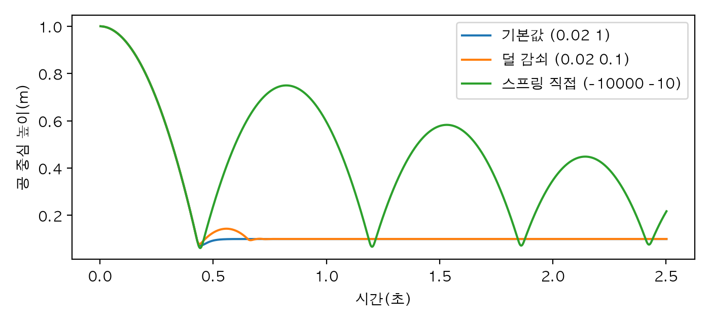
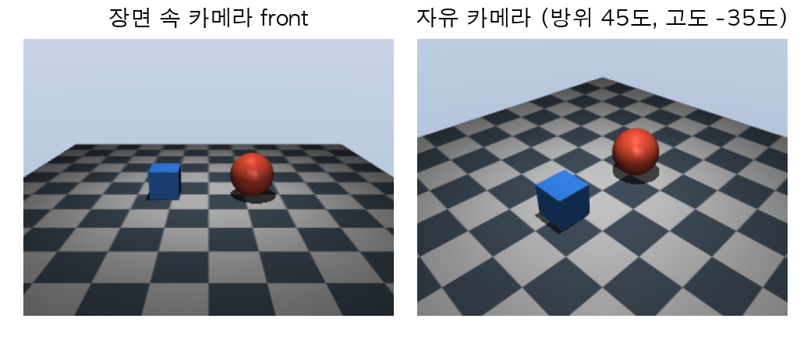
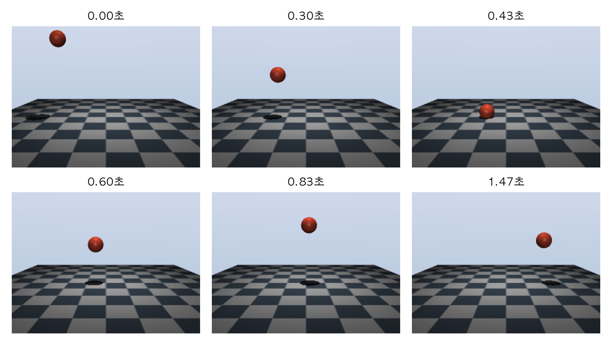
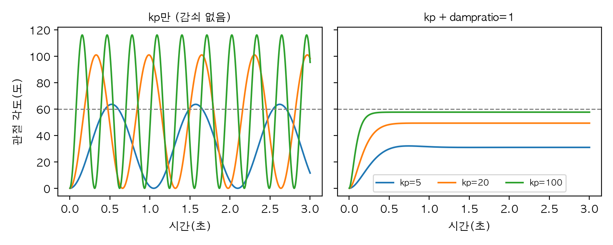
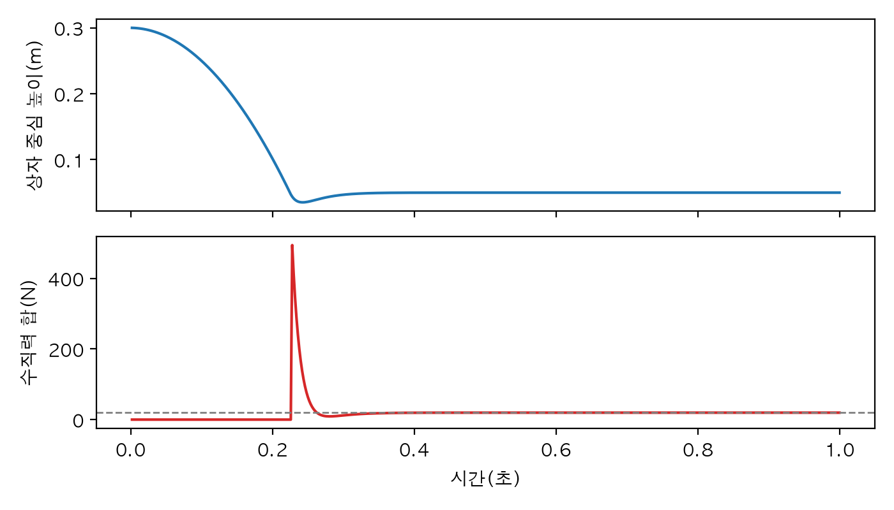
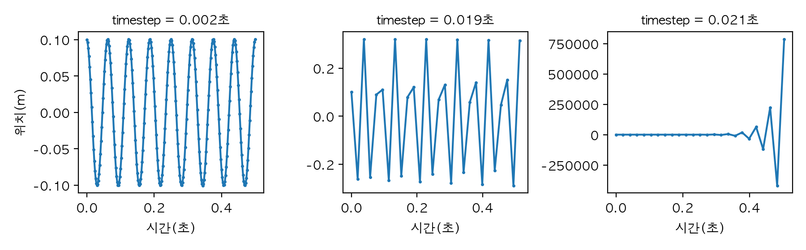
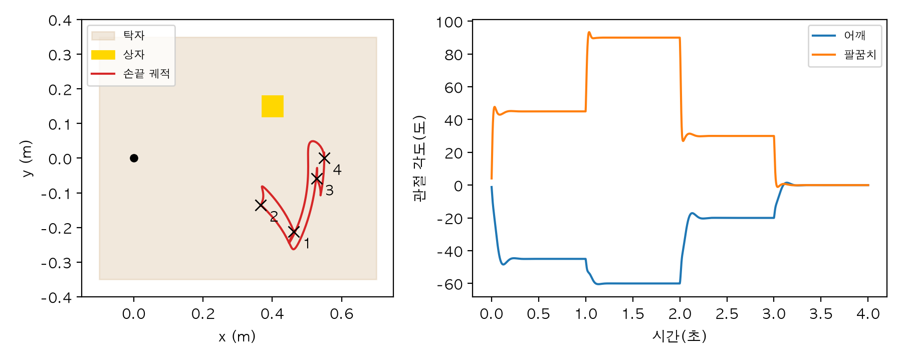
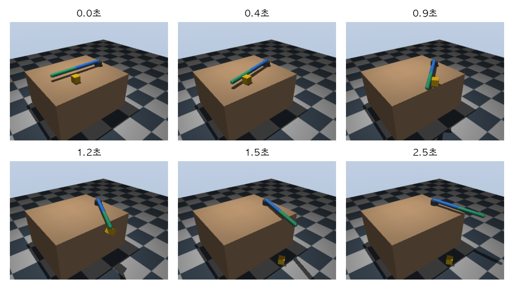

# Chapter 4. MuJoCo 입문: 컴퓨터 속 로봇 실험실

> **학습 목표**  
> - 물리 시뮬레이터가 로봇 공부에 왜 필요한지 설명하기
> - MJCF(XML)로 바닥, 몸체, 관절, 모양을 적어 장면을 만들고, MjModel과 MjData의 차이 구분하기
> - `mj_step`으로 시간을 흐르게 하고, 자유 낙하·마찰을 물리 식과 비교해 검산하기
> - 화면 없이 장면을 그림으로 찍고, 여러 프레임을 한 그림에 모으기
> - 액추에이터로 관절을 움직이고, 센서로 상태를 읽고, 접촉을 들여다보기
> - 시간 간격을 키우면 시뮬레이션이 왜 폭발하는지 직접 보고, 적분기를 고르기
> - 2관절 팔을 만들어 목표 자세를 차례로 보내고 상자를 탁자 밖으로 밀어 떨어뜨리기

---

## 들어가며: 사진에서 동영상으로

2장 2.9절에서 MuJoCo에게 장면을 맡겨 컵의 위치를 검산했죠. 그때 MuJoCo가 한 일은 **사진 한 장**을 찍은 것과 같습니다. 몸체들이 지금 어디에 어떤 자세로 놓여 있는지 계산했을 뿐, 시간은 0초에 멈춰 있었어요. 이 장에서는 시간을 흐르게 해서 **동영상**을 찍습니다. 공을 놓으면 떨어지고, 바닥에 닿으면 튀고, 모터에 힘을 주면 팔이 돌아가요.

1장에서 왜 진짜 로봇보다 시뮬레이터로 먼저 연습하는지(비용, 안전, 반복, 속도, 보이지 않는 것 보기) 이야기했고, 상자를 떨어뜨려 사진도 찍어 봤습니다. 그때는 맛보기였어요. 이 장에서는 MuJoCo를 연구실 도구처럼 제대로 다뤄 봅니다. 장면 파일을 요소별로 읽고 쓰고, 계산 결과가 물리 식과 얼마나 맞는지 채점하고, 모터와 센서를 달고, 계산이 어떤 조건에서 망가지는지까지 직접 확인해요. 실험실 장비를 쓰기 전에 장비가 얼마나 정확한지 먼저 재 보는 것과 같습니다.

워밍업으로 1장의 상자 대신 진자를 하나 매달아 봅시다. 0.5m 줄 끝에 공을 달고, 옆으로 90도 들었다가 놓습니다.

```python
import mujoco
import numpy as np

# 천장에 매달린 0.5m 진자를 옆으로 90도 들었다가 놓는다
xml = """
<mujoco>
  <worldbody>
    <body pos="0 0 1">
      <joint type="hinge" axis="0 1 0"/>
      <geom type="sphere" pos="0 0 -0.5" size="0.05"/>
    </body>
  </worldbody>
</mujoco>
"""
모델 = mujoco.MjModel.from_xml_string(xml)
데이터 = mujoco.MjData(모델)
데이터.qpos[0] = np.deg2rad(90)                   # 처음 각도

for _ in range(6):
    print(f"{데이터.time:.1f}초: 각도 {np.rad2deg(데이터.qpos[0]):6.1f}도")
    for _ in range(100):                         # 한 걸음 0.002초 × 100 = 0.2초
        mujoco.mj_step(모델, 데이터)
```

```text
0.0초: 각도   90.0도
0.2초: 각도   67.5도
0.4초: 각도    6.6도
0.6초: 각도  -58.7도
0.8초: 각도  -89.2도
1.0초: 각도  -75.3도
```

0.2초마다 각도를 찍었더니 90도에서 출발해 0.4초를 조금 넘겨 맨 아래(0도)를 지나고, 0.8초에는 반대편 -89.2도까지 올라갔습니다. 마찰이 없으니 거의 처음 높이만큼 반대로 올라간 거예요. 1장의 상자는 자유 관절 하나였지만, 진자는 경첩 관절(`hinge`) 하나로 매달려 있고 `qpos[0]`이 곧 각도(rad)입니다. 코드에서 한 일은 장면을 XML로 적고, `MjModel`과 `MjData`를 만들고, `mj_step`을 부른 것뿐이죠. 이 장은 이 세 가지를 하나씩 풀어 보고, 그 위에 카메라, 모터, 센서, 접촉을 얹어 갑니다. 마지막에는 탁자 위의 2관절 팔이 정해 준 자세를 차례로 찍은 뒤 상자를 밀어 떨어뜨리는 장면까지 만들어요.

> **Q. 로봇 시뮬레이터는 MuJoCo 하나뿐인가요?**
> 아니요. ROS와 짝을 이루는 Gazebo, NVIDIA의 Isaac Sim, 파이썬으로 쓰기 쉬운 PyBullet 등이 있습니다. MuJoCo(Multi-Joint dynamics with Contact)는 관절이 많은 몸과 접촉을 빠르고 정확하게 계산하는 데 강해서 로봇 제어와 강화 학습 연구에서 널리 쓰여요. 1장에서 말한 대로 구글 딥마인드가 무료 오픈 소스로 공개했고, `pip install mujoco`(이 책의 예제 폴더에서는 `uv sync`)로 설치됩니다. 이 장의 예제는 파이썬 3.12, MuJoCo 3.17, NumPy 2.5, matplotlib 3.11에서 실행해 확인했어요.

## 4.1 장면 파일 MJCF

### 연극 대본처럼 적는 장면

1장에서 맛본 대로 MuJoCo의 장면은 **MJCF**라는 XML 형식으로 적습니다. 이번에는 요소 하나하나를 뜯어 볼게요. 연극 대본을 떠올리면 쉬워요. 대본 맨 앞에는 "무대: 거실, 중력은 지구와 같음" 같은 설정이 있고, 그다음에 무대 위의 소품과 배우가 나오죠. MJCF도 같은 순서입니다.

```python
import mujoco

xml = """
<mujoco model="첫 장면">
  <option timestep="0.002" gravity="0 0 -9.81"/>
  <worldbody>
    <light pos="0 0 3" dir="0 0 -1"/>
    <geom name="floor" type="plane" size="2 2 0.1" rgba="0.8 0.8 0.8 1"/>
    <body name="ball" pos="0 0 1">
      <freejoint/>
      <geom name="ball_geom" type="sphere" size="0.1" rgba="0.9 0.3 0.2 1"/>
    </body>
  </worldbody>
</mujoco>
"""
모델 = mujoco.MjModel.from_xml_string(xml)
print("시간 간격  :", 모델.opt.timestep, "초")
print("중력       :", 모델.opt.gravity)
print("몸체 수    :", 모델.nbody, "(world 포함)")
print("모양 수    :", 모델.ngeom)
print("관절 수    :", 모델.njnt)
print("qpos 길이  :", 모델.nq, "/ qvel 길이:", 모델.nv)
print("공의 질량  :", round(float(모델.body("ball").mass[0]), 3), "kg")
```

```text
시간 간격  : 0.002 초
중력       : [ 0.    0.   -9.81]
몸체 수    : 2 (world 포함)
모양 수    : 2
관절 수    : 1
qpos 길이  : 7 / qvel 길이: 6
공의 질량  : 4.189 kg
```

XML의 뼈대를 위에서부터 읽어 볼게요.

| 요소 | 하는 일 | 이 장면에서 |
|---|---|---|
| `<mujoco>` | 전체를 감싸는 맨 바깥 태그 | 모델 이름 "첫 장면" |
| `<option>` | 물리 설정 | 한 걸음 0.002초, 중력 -9.81m/s² |
| `<worldbody>` | 무대. 움직이지 않는 세계 그 자체 | 조명, 바닥, 공 |
| `<light>` | 조명(그림을 찍을 때만 쓰인다) | 3m 위에서 아래로 |
| `<geom>` | 모양. 충돌과 질량과 겉모습을 정한다 | 바닥 평면, 공 |
| `<body>` | 몸체. 위치와 자세를 가진 물체 | 1m 높이의 공 |
| `<freejoint/>` | 관절. 몸체가 어떻게 움직일 수 있는지 | 공은 어디로든 자유롭게 |

**몸체(body)** 와 **모양(geom)** 이 따로 있다는 점이 중요합니다. 몸체는 "위치와 자세를 가진 무언가"이고, 모양은 그 몸체에 붙은 실제 형태예요. 사람으로 치면 몸체는 뼈대, 모양은 살입니다. 한 몸체에 모양을 여러 개 붙일 수도 있어요(4.6절의 진자는 막대와 추 두 모양을 한 몸체에 붙입니다). 바닥처럼 `<worldbody>`에 바로 놓인 모양은 세계에 고정돼서 움직이지 않습니다.

출력에서 공의 질량이 4.189kg으로 나왔죠? 우리는 질량을 적지 않았는데요. MuJoCo는 질량을 안 적으면 **물의 밀도(1000kg/m³)** 로 모양의 부피에서 질량을 계산합니다. 반지름 0.1m 공의 부피는 약 0.0042m³이니 4.189kg이에요. 가벼운 볼링공만큼 무거운 공입니다.

`qpos` 길이 7과 `qvel` 길이 6은 1장에서 본 자유 관절의 숫자 그대로입니다. 위치 3개에 자세를 쿼터니언 4개로 적고, 속도는 이동 3개와 회전 3개예요. 2장을 거쳤으니 이제 그 4개가 2장의 `[w, x, y, z]` 쿼터니언이라는 것, 그리고 자세는 숫자 넷인데 회전 속도는 숫자 셋인 이유(각속도는 회전 벡터)도 읽힐 거예요.

### 설계도와 지금 상태: MjModel과 MjData

MuJoCo 코드에서 늘 짝으로 다니는 두 객체가 있습니다. 보드게임으로 비유해 볼게요. 게임 상자 안에는 **규칙서와 게임판**이 들어 있습니다. 판의 모양, 말의 종류, 주사위 규칙은 게임을 하는 동안 바뀌지 않아요. 반면 **지금 말들이 어느 칸에 있는지, 몇 번째 턴인지**는 게임이 진행될수록 계속 바뀌죠. 같은 게임을 친구와 동시에 두 판 벌일 수도 있고, 판을 엎고 처음부터 다시 시작할 수도 있습니다.

- **MjModel** = 규칙서와 게임판. 모양, 질량, 관절 종류, 시간 간격, 중력. XML에서 한 번 만들어진다
- **MjData** = 지금 판의 상황. 시간(`time`), 위치(`qpos`), 속도(`qvel`), 계산 결과들. 한 걸음마다 바뀐다

```python
import mujoco

xml = """
<mujoco>
  <worldbody>
    <body name="ball" pos="0 0 1">
      <freejoint/>
      <geom type="sphere" size="0.1"/>
    </body>
  </worldbody>
</mujoco>
"""
모델 = mujoco.MjModel.from_xml_string(xml)       # 설계도: 모양, 질량, 규칙
가 = mujoco.MjData(모델)                          # 판 하나
나 = mujoco.MjData(모델)                          # 같은 설계도로 만든 다른 판

for _ in range(250):                              # 판 '가'만 0.5초(250걸음) 진행
    mujoco.mj_step(모델, 가)
print(f"가: {가.time:.1f}초, 높이 {가.qpos[2]:.3f}m")
print(f"나: {나.time:.1f}초, 높이 {나.qpos[2]:.3f}m")

mujoco.mj_resetData(모델, 가)                     # 판을 처음 상태로
print(f"되돌린 가: {가.time:.1f}초, 높이 {가.qpos[2]:.3f}m")

모델.opt.gravity[2] = -1.62                       # 규칙을 바꾸면(달의 중력) 모든 판에 적용된다
for _ in range(250):
    mujoco.mj_step(모델, 가)
print(f"달에서 0.5초 뒤 가: 높이 {가.qpos[2]:.3f}m")
```

```text
가: 0.5초, 높이 -0.231m
나: 0.0초, 높이 1.000m
되돌린 가: 0.0초, 높이 1.000m
달에서 0.5초 뒤 가: 높이 0.797m
```

같은 모델로 만든 `가`와 `나`는 서로 다른 판입니다. `가`만 0.5초 진행했으니 `나`는 여전히 0초, 1m에 있어요. (이 장면에는 바닥이 없어서 `가`의 공은 땅 밑 -0.231m까지 떨어졌습니다.) `mj_resetData`는 판을 처음 상태로 되돌려요. 위에서 말한 "되감기"가 이 함수 한 줄입니다.

마지막 부분은 규칙서를 고친 경우입니다. `모델.opt.gravity`를 달의 중력(-1.62m/s²)으로 바꾸자 같은 0.5초 동안 0.2m 남짓만 떨어졌어요. 모델의 값은 실행 중에도 바꿀 수 있고, 바꾸면 그 모델을 쓰는 모든 데이터에 적용됩니다. 17장 강화 학습이나 20장 sim2real에서 마찰이나 질량을 조금씩 바꿔 가며 학습시키는 방법이 바로 이 원리를 씁니다.

## 4.2 몸체, 관절, 모양 더 보기

### 관절이 여럿일 때 qpos의 자리

관절은 몸체가 부모(바깥쪽 몸체)에 대해 **어떻게 움직일 수 있는지**를 정합니다. 1장에서 관절 네 종류(hinge, slide, ball, free)의 nq와 nv를 하나씩 따로 세어 봤죠. 실제 로봇에는 관절이 여러 개 섞여 있고, 그 값들이 `qpos`와 `qvel`이라는 배열 하나에 이어 붙습니다. 문의 경첩, 서랍의 레일, 눈알, 던진 주사위를 한 장면에 모아 각 관절이 배열의 어디를 차지하는지 보겠습니다.

```python
import mujoco

xml = """
<mujoco>
  <worldbody>
    <body name="문" pos="0 0 1">
      <joint name="경첩" type="hinge" axis="0 0 1"/><geom type="box" size="0.3 0.02 0.5"/></body>
    <body name="서랍" pos="1 0 1">
      <joint name="레일" type="slide" axis="1 0 0"/><geom type="box" size="0.2 0.2 0.1"/></body>
    <body name="눈알" pos="2 0 1">
      <joint name="구관절" type="ball"/><geom type="sphere" size="0.1"/></body>
    <body name="주사위" pos="3 0 1">
      <freejoint name="자유"/><geom type="box" size="0.05 0.05 0.05"/></body>
    <body name="선반" pos="4 0 1"><geom type="box" size="0.3 0.1 0.02"/></body>
  </worldbody>
</mujoco>
"""
모델 = mujoco.MjModel.from_xml_string(xml)
for j in range(모델.njnt):
    관절 = 모델.joint(j)
    종류 = mujoco.mjtJoint(int(관절.type[0])).name          # 예: 'mjJNT_HINGE'
    시작 = int(관절.qposadr[0])
    끝 = int(모델.jnt_qposadr[j + 1]) if j + 1 < 모델.njnt else 모델.nq
    print(f"{종류:12s} qpos[{시작}:{끝}] ({끝 - 시작}칸), qvel {int(관절.dofadr[0])}번부터 ← {관절.name}")
print("전체 nq =", 모델.nq, "/ nv =", 모델.nv)
print("선반의 관절 수:", int(모델.body("선반").jntnum[0]))
```

```text
mjJNT_HINGE  qpos[0:1] (1칸), qvel 0번부터 ← 경첩
mjJNT_SLIDE  qpos[1:2] (1칸), qvel 1번부터 ← 레일
mjJNT_BALL   qpos[2:6] (4칸), qvel 2번부터 ← 구관절
mjJNT_FREE   qpos[6:13] (7칸), qvel 5번부터 ← 자유
전체 nq = 13 / nv = 11
선반의 관절 수: 0
```

관절마다 `qpos`와 `qvel`에서 차지하는 자리가 정해져 있고, 앞에서부터 차례로 붙습니다. 구관절이 qpos는 4칸, qvel은 3칸이라 그 뒤로는 qpos와 qvel의 번호가 어긋나죠. 그래서 "3번 관절의 위치"를 `qpos[3]`처럼 번호로 꺼내면 틀리기 쉽습니다. 출력처럼 `qposadr`(qpos 시작 번호)와 `dofadr`(qvel 시작 번호)를 쓰거나, 4.5절에서 볼 것처럼 이름으로 꺼내는 게 안전해요.

선반처럼 관절이 **없는** 몸체는 부모에 용접된 것처럼 붙어서 움직이지 않습니다. 여기서는 부모가 세계라서 바닥처럼 고정돼요. 3장에서 본 로봇 팔은 몸체 안에 몸체를 넣고 각 몸체에 경첩 관절을 하나씩 단 모양이 됩니다. 4.10절 실습에서 이렇게 만들어요.

### 모양의 크기와 질량

모양(`geom`)의 `size`는 종류마다 뜻이 다릅니다. 여기서 실수가 많이 나와요.

| type | size의 뜻 |
|---|---|
| `sphere` | 반지름 |
| `capsule` | 반지름, 반 길이(또는 `fromto`로 양 끝점을 주고 반지름만) |
| `cylinder` | 반지름, 반 높이 |
| `box` | x, y, z 방향의 **반 길이** |
| `plane` | x, y 방향 반 길이, 그림에 그릴 격자 간격 |

```python
import mujoco

xml = """
<mujoco>
  <worldbody>
    <body name="상자"><geom type="box" size="0.1 0.1 0.1"/></body>
    <body name="공"><geom type="sphere" size="0.1"/></body>
    <body name="막대"><geom type="capsule" fromto="0 0 0 0 0 0.5" size="0.02"/></body>
    <body name="스티로폼"><geom type="box" size="0.1 0.1 0.1" density="20"/></body>
    <body name="쇠공"><geom type="sphere" size="0.1" mass="30"/></body>
  </worldbody>
</mujoco>
"""
모델 = mujoco.MjModel.from_xml_string(xml)
for 이름 in ["상자", "공", "막대", "스티로폼", "쇠공"]:
    print(f"질량 {모델.body(이름).mass[0]:7.3f} kg ← {이름}")
print("상자 geom의 size:", 모델.geom(0).size, "→ 한 변", 2 * 모델.geom(0).size[0], "m")
```

```text
질량   8.000 kg ← 상자
질량   4.189 kg ← 공
질량   0.662 kg ← 막대
질량   0.160 kg ← 스티로폼
질량  30.000 kg ← 쇠공
상자 geom의 size: [0.1 0.1 0.1] → 한 변 0.2 m
```

`box`의 `size="0.1 0.1 0.1"`은 한 변이 0.1m가 아니라 **0.2m**인 정육면체입니다. 반 길이를 적는 것이라서요. 부피가 0.008m³이니 물의 밀도로 8kg이 나왔어요. 한 변 10cm짜리 상자를 만들려다 8배 무거운 상자를 만드는 실수를 조심하세요. 캡슐(양 끝이 둥근 막대)은 원기둥 부분과 반구 두 개를 합친 부피로 0.662kg이 됐습니다.

질량을 정하는 방법은 둘입니다. `density`로 밀도를 바꾸거나(스티로폼은 20kg/m³쯤이라 0.16kg), `mass`로 질량을 바로 적는 거예요(쇠공 30kg). MuJoCo는 모양에서 질량뿐 아니라 **관성**(돌리기 어려운 정도)까지 계산해 줍니다. 실제 로봇을 흉내 낼 때는 제조사가 알려 준 질량을 `mass`로 적는 경우가 많아요.

한 가지 더, **사이트(site)** 라는 요소가 있습니다. 모양처럼 몸체에 붙지만 충돌도 질량도 없는 "표시점"이에요. 2장에서 컵 위치를 표시할 때 썼죠. 센서를 달 자리, 손끝 위치를 읽을 자리처럼 "여기"를 가리키는 데 씁니다.

### 기본값과 재질

모양이 수십 개가 되면 마찰 계수나 색을 하나하나 적기 번거롭습니다. `<default>`에 기본값을 적어 두면 모든 요소에 적용되고, `class`로 이름 붙인 묶음을 만들면 골라서 적용할 수 있어요. CSS의 스타일 묶음과 비슷합니다.

```python
import mujoco

xml = """
<mujoco>
  <default>
    <geom friction="0.8 0.005 0.0001" rgba="0.6 0.6 0.6 1"/>
    <default class="얼음">
      <geom friction="0.05 0.005 0.0001" rgba="0.7 0.9 1 1"/>
    </default>
  </default>
  <asset>
    <texture name="격자" type="2d" builtin="checker" rgb1="0.2 0.3 0.4" rgb2="0.8 0.8 0.8" width="256" height="256"/>
    <material name="바닥재" texture="격자" texrepeat="4 4"/>
  </asset>
  <worldbody>
    <geom name="바닥" type="plane" size="2 2 0.1" material="바닥재"/>
    <body name="나무상자" pos="0 0 0.1"><geom name="나무" type="box" size="0.1 0.1 0.1"/></body>
    <body name="얼음상자" pos="0.5 0 0.1"><geom name="얼음" class="얼음" type="box" size="0.1 0.1 0.1"/></body>
  </worldbody>
</mujoco>
"""
모델 = mujoco.MjModel.from_xml_string(xml)
for 이름 in ["바닥", "나무", "얼음"]:
    g = 모델.geom(이름)
    print(f"{이름}: 마찰 {g.friction[0]:.2f}, 색 {g.rgba.round(2)}, 재질 번호 {int(g.matid[0])}")
```

```text
바닥: 마찰 0.80, 색 [0.6 0.6 0.6 1. ], 재질 번호 0
나무: 마찰 0.80, 색 [0.6 0.6 0.6 1. ], 재질 번호 -1
얼음: 마찰 0.05, 색 [0.7 0.9 1.  1. ], 재질 번호 -1
```

바닥과 나무 상자는 맨 바깥 기본값(마찰 0.8, 회색)을 받았고, `class="얼음"`을 단 상자만 마찰 0.05와 하늘색을 받았습니다. 묶음 안의 묶음은 바깥 값을 물려받고 적은 값만 덮어써요. 이름에 한글을 써도 잘 동작하는 것도 볼 수 있습니다.

마찰 숫자가 세 개인 이유는 미끄러짐, 비틀림(제자리에서 돌기), 굴림에 대한 마찰을 각각 정하기 때문입니다. 기본값은 `1 0.005 0.0001`이고, 보통은 첫째 값만 바꿔요. 1장에서 본 것처럼, 두 모양이 닿으면 둘 중 **큰 값**을 씁니다.

`<asset>`에는 여러 곳에서 함께 쓰는 재료를 넣어요. 여기서는 체크무늬 텍스처를 만들고, 그 텍스처를 4×4번 반복해 까는 재질(`material`)을 바닥에 입혔습니다. 겉모습만 바꾸는 것이라 물리 계산에는 영향이 없어요. 실제 로봇 모델은 여기에 3D 모델 파일(mesh)도 넣습니다. Google DeepMind가 공개한 **MuJoCo Menagerie**라는 저장소에 유명한 로봇 팔, 사족 보행 로봇, 휴머노이드의 MJCF가 이런 식으로 정리되어 있으니, 이 장을 마치고 둘러보면 읽을 수 있을 거예요.

## 4.3 시간 흐르게 하기

### mj_step과 mj_forward

2장에서 쓴 `mj_forward`와 이 장에서 쓰는 `mj_step`은 무엇이 다를까요? 사진기와 캠코더의 차이입니다.

```python
import mujoco

xml = """
<mujoco>
  <worldbody>
    <body pos="0 0 1"><freejoint/><geom type="sphere" size="0.1"/></body>
  </worldbody>
</mujoco>
"""
모델 = mujoco.MjModel.from_xml_string(xml)
데이터 = mujoco.MjData(모델)

for _ in range(3):
    mujoco.mj_forward(모델, 데이터)              # 지금 상태로 계산만: 시간은 그대로
print(f"mj_forward 3번: 시간 {데이터.time}, 높이 {데이터.qpos[2]}, z 가속도 {데이터.qacc[2]:.2f}")

for _ in range(100):
    mujoco.mj_step(모델, 데이터)                 # 계산하고 한 걸음 나아간다
print(f"mj_step 100번: 시간 {데이터.time:.3f}")
print(f"  상태 qpos z  : {데이터.qpos[2]:.4f}")
print(f"  계산값 xpos z: {데이터.body(1).xpos[2]:.4f}  ← 한 걸음 전 위치")
mujoco.mj_forward(모델, 데이터)                  # 지금 상태로 다시 계산하면
print(f"  forward 뒤   : {데이터.body(1).xpos[2]:.4f}")

데이터.qpos[2] = 0.3                             # 상태를 직접 바꿔도 마찬가지
print("qpos를 바꾼 직후 xpos z:", round(float(데이터.body(1).xpos[2]), 4))
mujoco.mj_forward(모델, 데이터)
print("forward 뒤 xpos z     :", round(float(데이터.body(1).xpos[2]), 4))
```

```text
mj_forward 3번: 시간 0.0, 높이 1.0, z 가속도 -9.81
mj_step 100번: 시간 0.200
  상태 qpos z  : 0.8018
  계산값 xpos z: 0.8058  ← 한 걸음 전 위치
  forward 뒤   : 0.8018
qpos를 바꾼 직후 xpos z: 0.8018
forward 뒤 xpos z     : 0.3
```

`mj_forward`는 세 번을 불러도 시간이 0초, 높이 1m 그대로입니다. 지금 상태에서 계산할 수 있는 것(각 몸체의 위치와 자세, 가속도, 접촉, 센서 값)만 계산해서 `MjData`에 채워 넣어요. 그래서 가속도 `qacc`는 -9.81로 채워졌습니다. `mj_step`은 그 계산을 한 다음 **한 걸음(0.002초) 앞으로 나아갑니다**. 100번 부르니 0.2초가 됐어요.

그다음 세 줄이 이 절에서 가장 중요합니다. 0.2초 뒤 상태인 `qpos`의 높이는 0.8018m인데, 몸체의 세계 위치 `xpos`는 0.8058m로 **한 걸음 전 위치**예요. `mj_step` 안에서는 먼저 지금 상태로 위치·센서·접촉을 계산하고(`mj_forward`와 같은 일), 그 결과로 가속도를 구한 다음, 마지막에 시간을 적분해 `qpos`와 `qvel`을 새로 고칩니다. 적분이 맨 끝이라서 걸음이 끝난 직후의 `xpos`, `xquat`, 센서 값, 접촉 목록은 모두 걸음을 **시작할 때**의 상태로 계산된 값이에요. 1장에서 사진을 찍기 전에 `mj_forward`를 부른 이유가 이것입니다. `mj_forward`를 한 번 부르자 `xpos`도 0.8018m로 따라왔죠.

`qpos`를 직접 0.3으로 바꾼 마지막 부분도 같은 이야기입니다. `xpos`는 `qpos`에서 **계산해 낸** 값이라, 다시 계산하기 전에는 따라오지 않아요. 그래서 이 장의 코드는 다음 규칙을 지킵니다. **지금 상태는 `qpos`와 `qvel`에서 읽고, `xpos`나 센서 값을 읽거나 그림을 찍기 전에는 `mj_forward`를 부른다.** 한 걸음은 0.002초라서 대부분의 그림에서는 차이가 눈에 안 보이지만, 4.7절에서 보듯 값을 쌓아 가는 계산에서는 이 한 걸음이 오차로 쌓입니다.

| 하고 싶은 일 | 부를 함수 |
|---|---|
| 시간을 한 걸음 진행 | `mj_step` |
| `mj_step` 뒤나 `qpos`를 직접 바꾼 뒤, 위치·센서를 읽거나 그림을 찍기 전(시간은 그대로) | `mj_forward` |
| 처음 상태로 되돌리기 | `mj_resetData` |

### 자유 낙하 검산

시뮬레이터를 믿기 전에 답을 아는 문제로 채점해 봅시다. 물체를 가만히 놓으면 t초 뒤 떨어진 거리는 ½gt², 속도는 gt입니다. 높이 10m에서 공을 놓고, 걸음 간격(`timestep`)을 세 가지로 바꿔 가며 1초 뒤를 비교해 볼게요.

```python
import mujoco

g = 9.81
xml = """
<mujoco>
  <option timestep="{간격}"/>
  <worldbody>
    <body pos="0 0 10"><freejoint/><geom type="sphere" size="0.1"/></body>
  </worldbody>
</mujoco>
"""
for 간격 in [0.002, 0.001, 0.0005]:
    모델 = mujoco.MjModel.from_xml_string(xml.replace("{간격}", str(간격)))
    데이터 = mujoco.MjData(모델)
    while 데이터.time < 1.0 - 간격 / 2:         # 1초까지
        mujoco.mj_step(모델, 데이터)
    t = 데이터.time
    높이_차이_mm = (데이터.qpos[2] - (10 - 0.5 * g * t**2)) * 1000
    속도_차이 = 데이터.qvel[2] - (-g * t)
    print(f"간격 {간격}초: 높이 차이 {높이_차이_mm:6.3f}mm (예측 {-0.5 * g * 간격 * t * 1000:6.3f}mm), "
          f"속도 차이 {abs(속도_차이):.1e}m/s")
```

```text
간격 0.002초: 높이 차이 -9.810mm (예측 -9.810mm), 속도 차이 6.4e-14m/s
간격 0.001초: 높이 차이 -4.905mm (예측 -4.905mm), 속도 차이 9.8e-14m/s
간격 0.0005초: 높이 차이 -2.453mm (예측 -2.452mm), 속도 차이 7.6e-13m/s
```

세 경우 모두 1초 뒤 속도는 식과 10조분의 1m/s도 차이 나지 않습니다. 그런데 높이는 식보다 조금씩 낮아요. 간격 0.002초에서 9.810mm, 0.001초에서 4.905mm, 0.0005초에서 2.453mm로, **간격을 절반으로 줄이면 오차도 정확히 절반**이 됩니다.

1장에서 떨어지는 상자가 공식보다 2mm 낮았던 것과 같은 현상이고, 이번에는 그 크기를 예측까지 해 봤습니다. MuJoCo는 한 걸음마다 **속도를 먼저 새로 고치고, 그 새 속도로 위치를 옮겨요**. 계단을 내려갈 때 매 계단에서 "이번 계단 끝의 빠르기"로 한 칸을 간 셈이라, 실제보다 조금씩 더 갑니다. 이렇게 쌓인 차이를 계산하면 ½·g·간격·t가 되고, 출력의 예측값과 소수점 셋째 자리까지 맞아요. 이런 계산 방법을 **반암시적 오일러(semi-implicit Euler)** 라고 부르고, MuJoCo의 기본 적분기인 `Euler`가 이 방법입니다. 오차가 간격에 비례하니 1cm가 문제라면 `timestep`을 줄이면 되지만, 그만큼 걸음 수가 늘어 계산이 느려져요. 4.9절에서는 반대로 간격을 **키우면** 무슨 일이 나는지 봅니다.

### 비탈면의 마찰

1장에서는 평평한 바닥에서 상자를 밀어 마찰 계수에 따라 미끄러지는 거리를 확인했습니다. 이번에는 조금 더 까다로운 문제, **비탈면 위의 상자**입니다. 경사가 θ인 비탈에 상자를 놓으면 중력은 비탈을 따라 mg·sinθ로 끌어내리고, 마찰은 최대 μ·mg·cosθ까지 버팁니다. 그래서 μ가 tanθ보다 작으면 a = g(sinθ - μcosθ)로 미끄러져 내려가고, 크면 멈춰 있어야 해요. 20도 비탈에 상자를 놓고 마찰 계수를 바꿔 보겠습니다.

```python
import mujoco
import numpy as np

g, 기울기_도 = 9.81, 20
θ = np.deg2rad(기울기_도)
아래쪽 = np.array([np.cos(θ), 0, -np.sin(θ)])      # 비탈을 따라 내려가는 방향
법선 = np.array([np.sin(θ), 0, np.cos(θ)])         # 비탈면에 수직인 방향
print(f"tan {기울기_도}도 = {np.tan(θ):.3f} (마찰 계수가 이보다 크면 미끄러지지 않는다)")

for 마찰 in [0.1, 0.3, 0.4, 0.6]:
    시작 = 0.1 * 법선                                # 상자 중심을 면에서 0.1m(반 길이) 띄운다
    xml = f"""
    <mujoco>
      <default><geom friction="{마찰} 0.005 0.0001"/></default>
      <worldbody>
        <geom type="plane" size="5 5 0.1" euler="0 {기울기_도} 0"/>
        <body pos="{시작[0]} 0 {시작[2]}" euler="0 {기울기_도} 0">
          <freejoint/><geom type="box" size="0.1 0.1 0.1"/>
        </body>
      </worldbody>
    </mujoco>
    """
    모델 = mujoco.MjModel.from_xml_string(xml)
    데이터 = mujoco.MjData(모델)
    while 데이터.time < 1.0 - 1e-9:
        mujoco.mj_step(모델, 데이터)
    간_거리 = float((데이터.qpos[:3] - 시작) @ 아래쪽)
    식_가속도 = max(g * (np.sin(θ) - 마찰 * np.cos(θ)), 0.0)   # 미끄러질 때 a = g(sinθ - μcosθ)
    print(f"마찰 {마찰}: 1초 동안 {간_거리:.3f}m 내려감 (식 ½at² = {0.5 * 식_가속도:.3f}m)")
```

```text
tan 20도 = 0.364 (마찰 계수가 이보다 크면 미끄러지지 않는다)
마찰 0.1: 1초 동안 1.219m 내려감 (식 ½at² = 1.217m)
마찰 0.3: 1초 동안 0.297m 내려감 (식 ½at² = 0.295m)
마찰 0.4: 1초 동안 0.004m 내려감 (식 ½at² = 0.000m)
마찰 0.6: 1초 동안 0.002m 내려감 (식 ½at² = 0.000m)
```

비탈면은 바닥 평면을 `euler="0 20 0"`으로 y축을 중심으로 20도 기울여 만들었고, 상자도 같은 각도로 기울여 면 위에 올렸습니다. 2장에서 확인한 대로 y축으로 +20도 돌리면 x축이 아래로 기울어서, 비탈은 +x 쪽으로 내려가요. 이동 거리는 상자 위치의 변화를 비탈 방향 벡터 `아래쪽`과 내적해서 쟀습니다.

tan 20° = 0.364보다 마찰이 작은 0.1과 0.3은 식과 2mm 안쪽으로 맞게 미끄러져 내려갔습니다. 마찰이 0.4와 0.6인 상자는 멈춰 있어야 하는데, 1초 동안 4mm와 2mm를 **기어 내려갔어요**. 시간을 더 주면 계속 같은 빠르기로 내려갑니다. 바로 다음에 볼 부드러운 접촉 때문에 MuJoCo의 정지 마찰이 완벽하게 붙잡지 못하는 거예요. 물건을 오래 쥐고 있어야 하는 로봇 손이라면 이 미끄러짐이 문제가 됩니다. 이 장면에서 `<option cone="elliptic" impratio="10"/>`을 더하면 0.4와 0.6 모두 0.000m로 줄어드는 것을 확인했어요. 마찰을 원뿔 모양으로 더 정확히 계산하고 마찰 쪽 제약을 더 단단하게 다루는 설정입니다. 시뮬레이터는 넣은 숫자와 설정만큼만 맞는다는 1장의 이야기를 이렇게 숫자로 다시 보게 됩니다.

### 튀는 공과 부드러운 접촉

맨 처음 1m에서 떨어뜨린 공은 바닥에 닿으면 얼마나 튈까요? 고무공처럼 튀어 오를까요, 찰흙처럼 붙어 버릴까요? MuJoCo의 접촉은 아주 짧고 단단한 **용수철과 완충기**처럼 계산됩니다. 그 성질을 정하는 것이 `solref`(solver reference) 속성이에요. 기본값 `"0.02 1"`은 "0.02초 안에 파고든 만큼을 되돌리되, 감쇠비 1(튀지 않고 가장 빨리 멈춤)로"라는 뜻입니다. 감쇠비를 1보다 작게 하거나, 음수로 적어 용수철 강성과 감쇠를 직접 주면 튀는 정도가 달라져요.

```python
import matplotlib.pyplot as plt
import mujoco
import numpy as np

plt.rcParams["font.family"] = "AppleGothic"
plt.rcParams["axes.unicode_minus"] = False

경우들 = {"기본값 (0.02 1)": "0.02 1", "덜 감쇠 (0.02 0.1)": "0.02 0.1", "스프링 직접 (-10000 -10)": "-10000 -10"}
그림, 칸 = plt.subplots(figsize=(7, 3.2))
for 이름, solref in 경우들.items():
    xml = f"""
    <mujoco>
      <worldbody>
        <geom type="plane" size="2 2 0.1"/>
        <body pos="0 0 1"><freejoint/><geom type="sphere" size="0.1" solref="{solref}"/></body>
      </worldbody>
    </mujoco>
    """
    모델 = mujoco.MjModel.from_xml_string(xml)
    데이터 = mujoco.MjData(모델)
    시각, 높이 = [], []
    while 데이터.time < 2.5:
        mujoco.mj_step(모델, 데이터)
        시각.append(데이터.time)
        높이.append(데이터.qpos[2])
    높이 = np.array(높이)
    처음_닿음 = int(np.argmax(높이 < 0.1))                 # 공 반지름 0.1m 아래로 내려간 첫 순간
    다시_뜬_높이 = 높이[처음_닿음:].max() - 0.1                # 닿은 뒤 공 아랫면이 가장 높이 뜬 높이
    print(f"{이름}: 가장 깊이 파고듦 {0.1 - 높이.min():.3f}m, 다시 뜬 높이 {max(다시_뜬_높이, 0):.3f}m")
    칸.plot(시각, 높이, label=이름)
칸.set_xlabel("시간(초)")
칸.set_ylabel("공 중심 높이(m)")
칸.legend()
그림.tight_layout()
그림.savefig("bounce.png", dpi=200)
print("저장: bounce.png")
```

```text
기본값 (0.02 1): 가장 깊이 파고듦 0.027m, 다시 뜬 높이 0.000m
덜 감쇠 (0.02 0.1): 가장 깊이 파고듦 0.021m, 다시 뜬 높이 0.043m
스프링 직접 (-10000 -10): 가장 깊이 파고듦 0.039m, 다시 뜬 높이 0.650m
저장: bounce.png
```



기본값에서는 공이 전혀 튀지 않고(다시 뜬 높이 0) 바로 바닥에 자리를 잡습니다. 감쇠비 0.1은 4.3cm 튀어 오르고, 강성을 직접 준 공은 0.65m나 다시 떠올라 여러 번 튀어요. 로봇 시뮬레이션에서는 물체가 쓸데없이 튀지 않는 게 대개 더 좋아서 기본값이 이렇게 정해져 있습니다.

"가장 깊이 파고듦"도 보세요. 공이 바닥 속으로 2~4cm나 들어갔습니다. 현실의 단단한 공은 이렇게 파고들지 않죠. MuJoCo는 계산을 안정적으로 하려고 접촉을 일부러 **조금 말랑하게** 다루고, 4.2kg짜리 무거운 공을 1m에서 떨어뜨렸으니 많이 파고든 겁니다. 접촉의 단단함은 `solref`와 `solimp`로 조절할 수 있지만, 너무 단단하게 하면 4.9절에서 볼 불안정 문제가 생겨요. 시뮬레이션의 접촉이 현실과 조금 다르다는 사실은 20장 sim2real에서 다시 중요한 주제가 됩니다.

## 4.4 장면을 그림으로 찍기

### 렌더러와 카메라

숫자만 보면 장면이 머릿속에 잘 그려지지 않습니다. 1장에서 `mujoco.Renderer`로 화면 창 없이 떨어지는 상자를 찍어 봤죠. 이번에는 카메라를 골라 찍는 법을 봅니다. 찍을 때는 두 가지 카메라를 쓸 수 있습니다. XML 안에 `<camera>`로 박아 둔 **장면 속 카메라**, 그리고 코드에서 바라볼 점과 거리, 각도를 정하는 **자유 카메라**예요.

```python
import mujoco

from 그림도구 import 프레임격자

xml = """
<mujoco>
  <asset>
    <texture type="skybox" builtin="gradient" rgb1="0.95 0.95 1" rgb2="0.6 0.7 0.8" width="256" height="256"/>
    <texture name="격자" type="2d" builtin="checker" rgb1="0.25 0.3 0.35" rgb2="0.75 0.75 0.75"
             width="256" height="256"/>
    <material name="바닥재" texture="격자" texrepeat="6 6"/>
  </asset>
  <worldbody>
    <light pos="0 0 3" dir="0 0 -1"/>
    <geom type="plane" size="1.5 1.5 0.1" material="바닥재"/>
    <camera name="front" pos="0 -2.2 0.9" xyaxes="1 0 0 0 0.35 1"/>
    <body pos="-0.3 0 0.1"><geom type="box" size="0.1 0.1 0.1" rgba="0.2 0.5 0.9 1"/></body>
    <body pos="0.3 0 0.15"><geom type="sphere" size="0.15" rgba="0.9 0.3 0.2 1"/></body>
  </worldbody>
</mujoco>
"""
모델 = mujoco.MjModel.from_xml_string(xml)
데이터 = mujoco.MjData(모델)
mujoco.mj_forward(모델, 데이터)                    # 렌더 전에 위치를 계산해 둔다

with mujoco.Renderer(모델, 240, 320) as 렌더러:    # 높이 240, 너비 320 픽셀
    렌더러.update_scene(데이터, camera="front")    # 장면에 넣어 둔 카메라로
    앞 = 렌더러.render()
    print("이미지:", 앞.shape, 앞.dtype)

    자유 = mujoco.MjvCamera()                      # 장면 밖에서 자유롭게 움직이는 카메라
    자유.lookat[:] = [0, 0, 0.1]                   # 바라볼 점
    자유.distance = 2.0                            # 그 점에서 떨어진 거리(m)
    자유.azimuth = 45                              # 수평으로 돈 각도(도)
    자유.elevation = -35                           # 내려다보는 각도(도)
    렌더러.update_scene(데이터, camera=자유)
    비스듬히 = 렌더러.render()

제목들 = ["장면 속 카메라 front", "자유 카메라 (방위 45도, 고도 -35도)"]
프레임격자([앞, 비스듬히], 제목들, "render_cameras.png", 열=2)
print("저장: render_cameras.png")
```

```text
이미지: (240, 320, 3) uint8
저장: render_cameras.png
```



`render()`가 돌려주는 이미지는 (높이, 너비, 3) 모양의 `uint8` 배열입니다. 픽셀마다 빨강, 초록, 파랑 세 값이 0~255로 들어 있어요. 2권 9장의 CNN이 받던 이미지와 같은 정보라서, 텐서로 바꾸면 신경망에 넣을 수 있습니다. 9장 로봇 비전과 17장 강화 학습에서 카메라 이미지를 이렇게 얻어요.

장면 속 카메라의 `xyaxes`는 카메라의 x축(화면 오른쪽)과 y축(화면 위)을 세계 좌표로 적은 여섯 숫자입니다. 2장에서 "회전 행렬의 열은 새 축의 방향"이라고 했던 것과 같은 생각이에요. 카메라는 자기 -z축 방향을 봅니다. 자유 카메라의 `azimuth`(방위)와 `elevation`(고도)은 도 단위라는 점도 기억해 두세요. 그 밖의 대부분은 라디안을 쓰는데, 사람이 마우스로 돌리는 값이라 도를 씁니다.

1장처럼 `Renderer`는 `with` 문으로 썼습니다. 1권 11장의 컨텍스트 매니저라서, 블록이 끝나면 그래픽 자원을 알아서 정리해 줘요. 렌더 전에 `mj_forward`를 부른 것도 4.3절의 규칙 그대로입니다. 기본으로 찍을 수 있는 크기는 640×480까지이고, 더 크게 찍으려 하면 XML의 `<visual><global offwidth="..."/></visual>`로 늘리라는 오류가 납니다.

### 프레임을 모아 한 그림으로

책에는 동영상을 넣을 수 없으니, 시간에 따라 찍은 프레임 몇 장을 한 그림에 나란히 놓겠습니다. 이 장에서 여러 번 쓸 테니 `그림도구.py`로 만들어 둘게요.

```python
"""4장: 렌더링한 프레임 여러 장을 한 그림에 나란히 놓는 도구."""
import matplotlib.pyplot as plt
import numpy as np

plt.rcParams["font.family"] = "AppleGothic"
plt.rcParams["axes.unicode_minus"] = False


def 프레임격자(프레임들: list[np.ndarray], 제목들: list[str], 파일: str, 열: int = 3) -> None:
    """이미지 여러 장을 행×열 격자로 배치해 파일로 저장한다."""
    행 = (len(프레임들) + 열 - 1) // 열
    높이, 너비 = 프레임들[0].shape[:2]
    그림, 칸들 = plt.subplots(행, 열, figsize=(2.6 * 열, 2.6 * 행 * 높이 / 너비 + 0.3 * 행))
    for 칸, 프레임, 제목 in zip(np.ravel(칸들), 프레임들, 제목들):
        칸.imshow(프레임)
        칸.set_title(제목, fontsize=10)
    for 칸 in np.ravel(칸들):
        칸.axis("off")
    그림.tight_layout()
    그림.savefig(파일, dpi=200)
    plt.close(그림)
```

공을 오른쪽으로 굴리면서 떨어뜨려, 1/30초마다 한 장씩 찍어 봅시다. 4.3절의 강성을 직접 준 `solref`를 써서 잘 튀게 했어요.

```python
import mujoco
from PIL import Image

from 그림도구 import 프레임격자

xml = """
<mujoco>
  <asset>
    <texture type="skybox" builtin="gradient" rgb1="0.95 0.95 1" rgb2="0.6 0.7 0.8" width="256" height="256"/>
    <texture name="격자" type="2d" builtin="checker" rgb1="0.25 0.3 0.35" rgb2="0.75 0.75 0.75"
             width="256" height="256"/>
    <material name="바닥재" texture="격자" texrepeat="6 6"/>
  </asset>
  <worldbody>
    <light pos="0 0 3" dir="0 0 -1"/>
    <geom type="plane" size="1.5 1.5 0.1" material="바닥재"/>
    <camera name="front" pos="0 -2.2 0.6" xyaxes="1 0 0 0 0.15 1"/>
    <body pos="-0.6 0 1">
      <freejoint/>
      <geom type="sphere" size="0.1" rgba="0.9 0.3 0.2 1" solref="-10000 -10"/>
    </body>
  </worldbody>
</mujoco>
"""
모델 = mujoco.MjModel.from_xml_string(xml)
데이터 = mujoco.MjData(모델)
데이터.qvel[0] = 0.8                               # 오른쪽으로 0.8m/s 굴려 보낸다

초당_프레임 = 30
프레임들, 시각들 = [], []
with mujoco.Renderer(모델, 240, 320) as 렌더러:
    while 데이터.time < 1.5:
        mujoco.mj_step(모델, 데이터)
        if len(프레임들) < 데이터.time * 초당_프레임:    # 1/30초마다 한 장씩 찍는다
            mujoco.mj_forward(모델, 데이터)              # 지금 상태의 위치로 맞춘 뒤 찍는다
            렌더러.update_scene(데이터, camera="front")
            프레임들.append(렌더러.render())
            시각들.append(데이터.time)
print("찍은 프레임 수:", len(프레임들))

고른_번호 = [0, 9, 13, 18, 25, 44]
프레임격자([프레임들[i] for i in 고른_번호], [f"{시각들[i]:.2f}초" for i in 고른_번호], "bounce_frames.png")
print("저장: bounce_frames.png")

그림들 = [Image.fromarray(f) for f in 프레임들]
그림들[0].save("bounce.gif", save_all=True, append_images=그림들[1:], duration=1000 // 초당_프레임, loop=0)
print("저장: bounce.gif")
```

```text
찍은 프레임 수: 46
저장: bounce_frames.png
저장: bounce.gif
```



시뮬레이션은 0.002초 걸음으로 돌리고, 사진은 30장/초로만 찍었습니다. 걸음마다 찍으면 1초에 500장이라 쓸데없이 무거워요. `len(프레임들) < 데이터.time * 초당_프레임` 조건이 "지금까지 찍었어야 할 장수보다 적게 찍었으면 한 장 찍는다"는 뜻이고, 찍기 직전에 `mj_forward`로 그림 속 위치를 지금 상태에 맞췄어요. 모은 프레임은 Pillow로 GIF 파일(`bounce.gif`)로도 저장했어요. 책에서는 움직이지 않지만 여러분 컴퓨터에서 열면 공이 튀는 동영상이 보입니다.

### 대화형 뷰어

화면이 있는 컴퓨터라면 마우스로 장면을 돌려 보고 물체를 잡아끌 수 있는 **대화형 뷰어**도 있습니다. 터미널에서 이렇게 엽니다. 이 명령은 맥, 윈도우, 리눅스 어디서나 같아요.

```bash
# 빈 뷰어를 열고 XML 파일을 끌어다 놓는다
uv run python -m mujoco.viewer

# XML 파일을 바로 연다
uv run python -m mujoco.viewer --mjcf=arm.xml
```

자기 코드에서 시뮬레이션을 돌리면서 그 모습을 창에 보여 주려면 `mujoco.viewer.launch_passive(모델, 데이터)`를 쓰고, 한 걸음마다 `뷰어.sync()`를 불러 창을 새로 그립니다. 이 함수만은 macOS에서 `python` 대신 MuJoCo와 함께 설치되는 `mjpython`으로 실행해야 동작해요(`uv run mjpython 내코드.py`). 윈도우와 리눅스에서는 평소처럼 `python`으로 됩니다. 이 책은 결과를 그림으로 실어야 해서 `Renderer`를 쓰지만, 장면을 처음 만들 때는 뷰어로 돌려 보며 고치는 게 훨씬 빠릅니다.

## 4.5 위치와 자세 읽기: 2장과 다시 만나기

시뮬레이션을 돌린 뒤에는 "지금 저 물체가 어디에, 어떤 자세로 있는가"를 꺼내 읽어야 합니다. 2장에서 배운 표현들이 MuJoCo 안에서 어떤 이름으로 들어 있는지 정리해 볼게요. 경첩으로 도는 문을 30도 열어 보겠습니다.

```python
import mujoco
import numpy as np
from scipy.spatial.transform import Rotation

from 회전도구 import Rz, 깔끔

xml = """
<mujoco>
  <worldbody>
    <body name="door" pos="1 0 0">
      <joint name="hinge" type="hinge" axis="0 0 1"/>
      <geom type="box" pos="0.4 0 1" size="0.4 0.02 1"/>
      <site name="knob" pos="0.7 -0.05 1"/>
    </body>
  </worldbody>
</mujoco>
"""
모델 = mujoco.MjModel.from_xml_string(xml)
데이터 = mujoco.MjData(모델)

# 이름으로 번호 찾기: 두 가지 방법
번호 = mujoco.mj_name2id(모델, mujoco.mjtObj.mjOBJ_BODY, "door")
print("mj_name2id:", 번호, "/ model.body('door').id:", 모델.body("door").id)
print("없는 이름이면:", mujoco.mj_name2id(모델, mujoco.mjtObj.mjOBJ_BODY, "window"))

데이터.joint("hinge").qpos[0] = np.deg2rad(30)    # 문을 30도 연다
mujoco.mj_forward(모델, 데이터)

문 = 데이터.body("door")
print("문 xpos :", 깔끔(문.xpos))
print("문 xquat:", 깔끔(문.xquat, 4), "(w x y z)")
print("xmat == Rz(30)?", np.allclose(문.xmat.reshape(3, 3), Rz(30)))
print("xquat == scipy?", np.allclose(문.xquat, Rotation.from_matrix(Rz(30)).as_quat(scalar_first=True)))

손잡이_방 = 데이터.site("knob").xpos
손잡이_문 = 모델.site("knob").pos                  # 문 기준으로 적어 둔 위치(설계도)
직접 = 문.xpos + 문.xmat.reshape(3, 3) @ 손잡이_문     # 2장의 T_방_문 @ 손잡이_문
print("손잡이 site xpos:", 깔끔(손잡이_방), "/ 직접 계산:", 깔끔(직접))
```

```text
mj_name2id: 1 / model.body('door').id: 1
없는 이름이면: -1
문 xpos : [1. 0. 0.]
문 xquat: [0.9659 0.     0.     0.2588] (w x y z)
xmat == Rz(30)? True
xquat == scipy? True
손잡이 site xpos: [1.631 0.307 1.   ] / 직접 계산: [1.631 0.307 1.   ]
```

먼저 이름으로 찾는 두 가지 방법입니다. `mj_name2id`는 C 함수를 그대로 옮긴 것으로, 없는 이름이면 -1을 돌려줘요. `모델.body("door")`처럼 이름으로 바로 꺼내는 방식은 더 짧고, 없는 이름이면 `KeyError`가 나면서 있는 이름 목록을 보여 줍니다. 이 장의 코드는 대부분 두 번째 방식을 썼어요. `데이터.body("door")`, `데이터.joint("hinge")`, `데이터.site("knob")`처럼 데이터 쪽에도 같은 방식이 있어서, 관절 번호를 몰라도 `데이터.joint("hinge").qpos`로 그 관절의 각도를 읽고 쓸 수 있습니다.

| 읽을 것 | MuJoCo 이름 | 2장의 표현 |
|---|---|---|
| 몸체 원점의 세계 위치 | `데이터.body(이름).xpos` | `T_방_몸`의 오른쪽 열 |
| 몸체의 세계 자세(쿼터니언) | `데이터.body(이름).xquat` | `[w, x, y, z]` 쿼터니언 |
| 몸체의 세계 자세(회전 행렬) | `데이터.body(이름).xmat` | 3×3을 9칸으로 편 것 |
| 사이트·모양의 세계 위치 | `데이터.site(이름).xpos`, `데이터.geom(이름).xpos` | 사슬 끝의 위치 |
| XML에 적은 부모 기준 위치 | `모델.body(이름).pos`, `모델.site(이름).pos` | `p_부모_자식` |

문을 30도 연 자세가 `xmat`으로는 2장의 `Rz(30)`과 같고, `xquat`은 `[0.9659, 0, 0, 0.2588]`, 즉 (cos 15°, 0, 0, sin 15°)입니다. 2장에서 말한 반각이죠. `xmat`은 숫자 9개짜리 1차원 배열이라 `reshape(3, 3)`으로 펴서 써야 한다는 점도 보세요.

마지막 줄은 2장의 변환 사슬을 손으로 해 본 것입니다. 손잡이 사이트는 XML에서 문 기준 (0.7, -0.05, 1)에 적혀 있어요. 이 값은 설계도에 적힌 것이니 `모델` 쪽에 있습니다. 문의 세계 위치에 문의 회전 행렬을 곱한 손잡이 위치를 더하면 MuJoCo가 계산한 `xpos`와 똑같이 (1.631, 0.307, 1)이 나와요. MuJoCo가 `mj_forward` 안에서 하는 일이 바로 2장의 `T_방_문 @ 손잡이_문`입니다.

## 4.6 액추에이터: 관절에 힘 주기

### 세 가지 기본 액추에이터

지금까지는 중력과 처음 속도만으로 움직였습니다. 로봇이 스스로 움직이려면 관절에 힘을 주는 **액추에이터**가 필요해요. MJCF의 `<actuator>`에 적고, 파이썬에서는 `데이터.ctrl`에 명령을 넣습니다. 자동차로 비유하면 세 가지 운전 방식이에요.

- **motor**: 가속 페달을 일정하게 밟는다. 명령 = 토크(N·m)
- **position**: "저 표지판 앞에 세워 줘". 명령 = 목표 각도(rad). 목표와의 차이에 비례해 힘을 준다
- **velocity**: 정속 주행 장치. 명령 = 목표 각속도(rad/s)

중력이 영향을 주지 않게 바닥에 누운 막대 세 개를 z축 경첩에 달고, 액추에이터를 하나씩 붙여 비교해 봅시다.

```python
import mujoco
import numpy as np

# 바닥에 누운 막대 세 개(z축 경첩이라 중력이 돌리지 않는다)에 액추에이터를 하나씩 단다
막대 = """
    <body name="{0}" pos="{1} 0 0.1">
      <joint name="{0}" type="hinge" axis="0 0 1"/>
      <geom type="capsule" fromto="0 0 0 0.3 0 0" size="0.02" mass="0.5"/>
    </body>"""
xml = f"""
<mujoco>
  <worldbody>{막대.format("m", 0)}{막대.format("p", 1)}{막대.format("v", 2)}
  </worldbody>
  <actuator>
    <motor    name="motor"    joint="m" gear="1"/>
    <position name="position" joint="p" kp="2"/>
    <velocity name="velocity" joint="v" kv="0.5"/>
  </actuator>
</mujoco>
"""
모델 = mujoco.MjModel.from_xml_string(xml)
데이터 = mujoco.MjData(모델)
for 이름 in ["motor", "position", "velocity"]:
    a = 모델.actuator(이름)
    print(f"{이름:8s}: gain {a.gainprm[0]:4.1f}, bias {a.biasprm[:3]}")

데이터.ctrl[:] = [0.05, 1.0, 1.0]               # 토크 0.05N·m / 목표 각도 1rad / 목표 속도 1rad/s
for 목표 in [0.5, 1.0, 2.0]:
    while 데이터.time < 목표 - 1e-9:
        mujoco.mj_step(모델, 데이터)
    각도 = 데이터.qpos
    속도 = 데이터.qvel
    print(f"{목표:.1f}초 | motor 각도 {각도[0]:5.2f} 속도 {속도[0]:5.2f} | "
          f"position 각도 {각도[1]:5.2f} | velocity 속도 {속도[2]:5.2f} | 힘 {np.round(데이터.actuator_force, 3)}")
```

```text
motor   : gain  1.0, bias [0. 0. 0.]
position: gain  2.0, bias [ 0. -2.  0.]
velocity: gain  0.5, bias [ 0.   0.  -0.5]
0.5초 | motor 각도  0.40 속도  1.59 | position 각도  0.20 | velocity 속도  1.00 | 힘 [0.05  1.579 0.   ]
1.0초 | motor 각도  1.59 속도  3.17 | position 각도  0.72 | velocity 속도  1.00 | 힘 [0.05  0.514 0.   ]
2.0초 | motor 각도  6.35 속도  6.35 | position 각도  1.85 | velocity 속도  1.00 | 힘 [ 0.05  -1.725  0.   ]
```

세 액추에이터는 사실 같은 식 하나를 씁니다. **힘 = gain × ctrl + bias[0] + bias[1] × 각도 + bias[2] × 각속도.** 출력의 숫자를 넣어 읽어 보면 이렇습니다.

- motor: 힘 = 1 × ctrl. 명령이 그대로 토크다
- position: 힘 = 2 × ctrl - 2 × 각도 = **kp × (목표 - 각도)**. 목표보다 덜 갔으면 밀고, 더 갔으면 당긴다
- velocity: 힘 = 0.5 × ctrl - 0.5 × 각속도 = **kv × (목표 속도 - 각속도)**

결과도 비유대로입니다. motor는 토크를 계속 주니 각속도가 1.59 → 3.17 → 6.35로 시간에 비례해 커져요. 마찰이 없으니 끝없이 빨라집니다. velocity는 0.5초 만에 목표 1rad/s에 도달해 그대로 유지해요. 목표 속도에 이미 도달했으니 힘이 0입니다. 흥미로운 건 position이에요. 목표가 1rad인데 2초 뒤 1.85rad까지 **지나쳐** 버렸습니다. 이 이야기를 진자로 더 자세히 봅시다.

### position 액추에이터의 kp

position 액추에이터는 관절과 목표 사이에 **용수철**을 단 것과 같습니다. kp는 용수철의 단단함이에요. 용수철에 매단 추를 당겼다 놓으면 어떻게 되죠? 목표 자리를 지나쳐 출렁출렁 흔들립니다. 막아 주는 것이 없으면 영원히요. 그래서 position 액추에이터에는 흔들림을 잡는 감쇠 `kv`도 줄 수 있고, `dampratio="1"`로 적으면 MuJoCo가 그 관절에 딱 맞는 kv를 계산해 넣어 줍니다.

0.5m 막대 끝에 1kg 추를 단 진자에 목표 60도를 주고, kp를 바꿔 보겠습니다. 이번에는 중력이 진자를 아래로 당겨요.

```python
import matplotlib.pyplot as plt
import mujoco
import numpy as np

plt.rcParams["font.family"] = "AppleGothic"
plt.rcParams["axes.unicode_minus"] = False

# 매달린 진자(y축 경첩): 0.5m 막대 끝에 1kg 추
xml = """
<mujoco>
  <worldbody>
    <body pos="0 0 1">
      <joint name="pivot" type="hinge" axis="0 1 0"/>
      <geom type="capsule" fromto="0 0 0 0 0 -0.5" size="0.01" mass="0.01"/>
      <geom type="sphere" pos="0 0 -0.5" size="0.04" mass="1"/>
    </body>
  </worldbody>
  <actuator><position name="servo" joint="pivot" {설정}/></actuator>
</mujoco>
"""


def 응답(설정: str, 목표_도: float, 시간: float = 3.0) -> tuple[list[float], np.ndarray]:
    """목표 각도를 주고 시간 동안 관절 각도(도)를 기록한다."""
    모델 = mujoco.MjModel.from_xml_string(xml.replace("{설정}", 설정))
    데이터 = mujoco.MjData(모델)
    데이터.ctrl[0] = np.deg2rad(목표_도)
    시각, 각도 = [], []
    while 데이터.time < 시간:
        mujoco.mj_step(모델, 데이터)
        시각.append(데이터.time)
        각도.append(데이터.qpos[0])
    return 시각, np.rad2deg(각도)


목표_도 = 60
그림, 칸들 = plt.subplots(1, 2, figsize=(8, 3.2), sharey=True)
for kp in [5, 20, 100]:
    시각, 그냥 = 응답(f'kp="{kp}"', 목표_도)
    _, 감쇠 = 응답(f'kp="{kp}" dampratio="1"', 목표_도)
    print(f"kp={kp:3d}: 감쇠 없음 → {round(그냥.min(), 1) + 0.0:5.1f}~{그냥.max():5.1f}도 사이를 오감 / "
          f"dampratio=1 → 3초 뒤 {감쇠[-1]:5.1f}도 (목표와 {목표_도 - 감쇠[-1]:4.1f}도 차이)")
    칸들[0].plot(시각, 그냥, label=f"kp={kp}")
    칸들[1].plot(시각, 감쇠, label=f"kp={kp}")
for 칸, 제목 in zip(칸들, ["kp만 (감쇠 없음)", "kp + dampratio=1"]):
    칸.axhline(목표_도, color="gray", linestyle="--", linewidth=1)
    칸.set_title(제목, fontsize=10)
    칸.set_xlabel("시간(초)")
칸들[0].set_ylabel("관절 각도(도)")
칸들[1].legend(fontsize=8, loc="lower center", ncol=3)   # 색은 두 칸이 같다
그림.tight_layout()
그림.savefig("position_kp.png", dpi=200)
print("저장: position_kp.png")
```

```text
kp=  5: 감쇠 없음 →   0.0~ 63.5도 사이를 오감 / dampratio=1 → 3초 뒤  30.9도 (목표와 29.1도 차이)
kp= 20: 감쇠 없음 →   0.0~100.9도 사이를 오감 / dampratio=1 → 3초 뒤  49.3도 (목표와 10.7도 차이)
kp=100: 감쇠 없음 →   0.0~116.0도 사이를 오감 / dampratio=1 → 3초 뒤  57.6도 (목표와  2.4도 차이)
저장: position_kp.png
```



왼쪽 그림부터 봅시다. 감쇠가 없으면 세 경우 모두 0도에서 출발해 목표를 지나쳤다 돌아오기를 끝없이 반복합니다. kp가 클수록 더 빨리, 더 크게 흔들려요(kp=100이면 116도까지). 목표에 세우려고 준 액추에이터가 진자를 그네처럼 타고 있습니다.

오른쪽은 `dampratio="1"`을 준 경우입니다. 흔들림 없이 부드럽게 멈춰요. 그런데 멈춘 자리가 목표 60도가 아닙니다. kp=5는 30.9도, kp=20은 49.3도, kp=100은 57.6도에 멈췄어요. 중력이 진자를 계속 아래로 당기니, 용수철이 "목표와의 차이 × kp"만큼 힘을 내서 중력과 비길 때까지 처진 겁니다. kp를 키우면 처짐은 줄지만 0이 되지는 않아요. 이 남는 차이를 없애는 방법(적분 제어)과 kp, kv를 고르는 원리는 12장 PID 제어에서 제대로 배웁니다. 지금은 **position 액추에이터는 용수철이고, kp는 단단함, 감쇠가 없으면 흔들린다**는 것만 손에 쥐고 가세요.

> **Q. 진짜 로봇의 모터도 이렇게 명령을 받나요?**
> 비슷합니다. 취미용 서보 모터는 목표 각도를 받아 안에서 position 액추에이터처럼 움직이고, 산업용 로봇 팔도 대개 관절마다 목표 위치나 속도를 받아요. 다만 진짜 모터는 낼 수 있는 힘에 한계가 있어서, MJCF에서도 `forcerange`(힘 한계)와 `ctrlrange`(명령 한계)를 적어 비슷하게 만듭니다. 7장에서 진짜 서보 모터를 다룰 때 이 대응을 다시 보게 됩니다.

## 4.7 센서: 로봇이 느끼는 것

### sensordata 읽기

4.5절에서 `xpos`나 `qpos`를 바로 읽었는데, 이건 시뮬레이터의 "정답지"를 본 것입니다. 진짜 로봇은 정답지가 없고 센서로 재야만 알 수 있어요. 그래서 로봇 코드를 시뮬레이터에서 연습할 때는 진짜 로봇에 달린 것과 같은 센서를 MJCF의 `<sensor>`에 달고, 그 값만 쓰는 습관이 좋습니다.

1kg 상자를 0.4m 높이에서 떨어뜨리고, 상자 가운데에 IMU(가속도계와 자이로), 바닥면에 접촉 센서를 달았습니다. 옆에는 어깨 관절 하나짜리 팔을 놓고 관절 센서를 달았어요.

```python
import mujoco
import numpy as np

xml = """
<mujoco>
  <worldbody>
    <geom type="plane" size="2 2 0.1"/>
    <body name="box" pos="0 0 0.4">
      <freejoint/>
      <geom type="box" size="0.1 0.1 0.05" mass="1"/>
      <site name="imu" pos="0 0 0"/>
      <site name="bottom" pos="0 0 -0.05" type="box" size="0.1 0.1 0.01"/>
    </body>
    <body name="arm" pos="1 0 1">
      <joint name="shoulder" type="hinge" axis="0 1 0"/>
      <geom type="capsule" fromto="0 0 0 0.4 0 0" size="0.02" mass="0.5"/>
    </body>
  </worldbody>
  <sensor>
    <accelerometer name="가속도" site="imu"/>
    <gyro          name="자이로" site="imu"/>
    <touch         name="접촉"   site="bottom"/>
    <framepos      name="상자위치" objtype="body" objname="box"/>
    <jointpos      name="어깨각도" joint="shoulder"/>
    <jointvel      name="어깨속도" joint="shoulder"/>
  </sensor>
</mujoco>
"""
모델 = mujoco.MjModel.from_xml_string(xml)
데이터 = mujoco.MjData(모델)
print("센서 수:", 모델.nsensor, "/ sensordata 길이:", 모델.nsensordata)
print("센서별 칸 수:", 모델.sensor_dim, "/ 시작 위치:", 모델.sensor_adr)


def 읽기(이름: str) -> np.ndarray:
    return np.round(데이터.sensor(이름).data, 2) + 0.0


for 목표 in [0.1, 1.0]:
    while 데이터.time < 목표 - 1e-9:
        mujoco.mj_step(모델, 데이터)
    print(f"--- {목표}초 ---")
    for 이름 in ["가속도", "자이로", "접촉", "상자위치", "어깨각도", "어깨속도"]:
        print(f"{이름}: {읽기(이름)}")
```

```text
센서 수: 6 / sensordata 길이: 12
센서별 칸 수: [3 3 1 3 1 1] / 시작 위치: [ 0  3  6  7 10 11]
--- 0.1초 ---
가속도: [0. 0. 0.]
자이로: [0. 0. 0.]
접촉: [0.]
상자위치: [0.   0.   0.35]
어깨각도: [0.17]
어깨속도: [3.47]
--- 1.0초 ---
가속도: [0.   0.   9.81]
자이로: [0. 0. 0.]
접촉: [9.81]
상자위치: [0.   0.   0.05]
어깨각도: [1.03]
어깨속도: [-7.83]
```

| 센서 | 재는 것 | 칸 수 | 붙이는 곳 |
|---|---|---|---|
| `accelerometer` | 선가속도(m/s²), 사이트 좌표 기준 | 3 | site |
| `gyro` | 각속도(rad/s), 사이트 좌표 기준 | 3 | site |
| `touch` | 사이트 부피 안 접촉의 수직력 합(N) | 1 | site |
| `framepos` | 몸체·사이트 등의 세계 위치(m) | 3 | objtype, objname |
| `jointpos` | 관절 각도(rad) 또는 위치(m) | 1 | joint |
| `jointvel` | 관절 각속도 또는 속도 | 1 | joint |

모든 센서 값은 `데이터.sensordata`라는 긴 배열 하나에 차례로 이어 붙습니다. 칸 수가 [3, 3, 1, 3, 1, 1]이라 시작 위치가 [0, 3, 6, 7, 10, 11]이에요. 4.2절의 qpos와 같은 이야기라, 번호로 자르기보다 `데이터.sensor("가속도").data`처럼 이름으로 꺼내는 편이 안전합니다.

출력에서 가장 신기한 건 가속도계입니다. 0.1초, 상자가 떨어지는 중에는 **0**이고, 1초에 바닥에 가만히 놓여 있을 때는 위쪽으로 **+9.81**이에요. 거꾸로 된 것 같죠? 가속도계는 "중력을 뺀 나머지 힘이 주는 가속도"를 잽니다. 떨어지는 엘리베이터 안에서 몸이 붕 뜨는 것처럼, 자유 낙하 중에는 아무것도 느끼지 못해요. 바닥에 놓이면 바닥이 위로 떠받치는 힘을 느껴서 +9.81이 나옵니다. 진짜 휴대폰의 가속도계도 똑같아서, 책상 위에 놓인 휴대폰은 위쪽으로 9.8m/s²를 잽니다. 2장 2.11절 끝에서 "가속도계는 중력 방향을 알려 준다"고 한 게 이 뜻이에요. 8장 칼만 필터에서 이 값으로 기울기를 알아냅니다.

옆의 팔은 액추에이터가 없어서 중력에 늘어지며 진자처럼 흔들립니다. 관절 센서가 그 각도와 각속도(1초에 1.03rad, -7.83rad/s)를 재고 있어요. 접촉 센서는 1초에 9.81N, 1kg 상자의 무게를 그대로 잽니다. 접촉 센서는 사이트의 **부피 안**에서 일어난 접촉만 세기 때문에, 상자 바닥면을 덮는 납작한 상자 모양 사이트를 따로 만들어 달았어요. 사이트를 크기 없이 상자 가운데에 두면 바닥과의 접촉을 하나도 세지 못합니다.

### 2장 방식으로 자이로 쌓기

2.11절에서 자이로 값을 쿼터니언 증분 곱으로 쌓아 자세를 추적했죠. 그때는 수식으로 만든 예제 데이터였는데, 이번에는 MuJoCo의 자이로 센서로 해 봅시다. 무중력에서 길쭉한 상자를 비스듬히 돌려 던지면 각속도가 계속 바뀌며 뒤뚱거리는데, 그 자이로 값을 쌓은 자세가 MuJoCo가 계산한 진짜 자세 `xquat`과 맞는지 채점하는 거예요. 쿼터니언 곱과 사이각은 2장의 `쿼터니언도구.py`에서, 각속도로 한 걸음치 회전을 만드는 `증분_쿼터니언`은 2장의 `자이로데이터.py`에서 가져옵니다. 두 파일을 이 장의 폴더로 복사해 두세요.

```python
import mujoco
import numpy as np

from 자이로데이터 import 증분_쿼터니언       # 2장 실습의 함수를 그대로 쓴다
from 쿼터니언도구 import 곱, 사이각

# 무중력에서 비스듬히 던진 길쭉한 상자: 각속도가 계속 바뀌며 뒤뚱거린다
xml = """
<mujoco>
  <option gravity="0 0 0"/>
  <worldbody>
    <body name="box">
      <freejoint/>
      <geom type="box" size="0.2 0.1 0.05" mass="1"/>
      <site name="imu"/>
    </body>
  </worldbody>
  <sensor><gyro name="gyro" site="imu"/></sensor>
</mujoco>
"""
모델 = mujoco.MjModel.from_xml_string(xml)
간격 = 모델.opt.timestep
for 언제 in ["걸음 전", "걸음 뒤"]:
    데이터 = mujoco.MjData(모델)
    데이터.qvel[3:6] = [0.3, 4.0, 0.5]           # 처음 각속도(rad/s)
    mujoco.mj_forward(모델, 데이터)
    q = 데이터.body("box").xquat.copy()          # 처음 자세에서 출발
    for _ in range(5000):                        # 0.002초 × 5000 = 10초
        전 = 데이터.sensor("gyro").data.copy()
        mujoco.mj_step(모델, 데이터)
        if 언제 == "걸음 전":
            각속도 = 전
        else:
            mujoco.mj_forward(모델, 데이터)       # 걸음을 마친 상태로 센서를 다시 계산
            각속도 = 데이터.sensor("gyro").data
        q = 곱(q, 증분_쿼터니언(각속도, 간격))      # 2장 (다) 방법으로 쌓기
    print(f"{언제} 자이로로 쌓은 자세 vs MuJoCo xquat: {사이각(q, 데이터.body('box').xquat):.5f}도")
print("10초 뒤 자이로 값:", np.round(데이터.sensor("gyro").data, 3))
```

```text
걸음 전 자이로로 쌓은 자세 vs MuJoCo xquat: 0.47769도
걸음 뒤 자이로로 쌓은 자세 vs MuJoCo xquat: 0.00001도
10초 뒤 자이로 값: [ 2.056 -3.229  2.091]
```

결과가 두 가지로 갈렸습니다. 걸음 전에 읽은 자이로로 쌓으면 10초 뒤 0.478도가 틀리고, 걸음 뒤에 다시 계산한 자이로로 쌓으면 0.00001도, 사실상 똑같아요.

비밀은 4.3절에 있습니다. MuJoCo는 한 걸음마다 **속도를 먼저 고치고 그 새 속도로 자세를 옮기고**, `mj_step` 뒤에 `sensordata`에 남아 있는 값은 `xpos`처럼 걸음을 **시작할 때** 계산한 값이라고 했죠. 그래서 그 값으로 쌓으면 MuJoCo가 실제로 자세를 옮길 때 쓴 각속도와 한 걸음씩 어긋나요. 걸음을 마친 상태로 `mj_forward`를 불러 센서를 새로 계산하면 MuJoCo가 실제로 쓴 각속도를 얻게 되고, 2장의 방법으로 쌓은 자세가 MuJoCo와 일치합니다. 2장의 쿼터니언 증분 곱이 정확하다는 것을 물리 엔진으로 한 번 더 확인한 셈이에요.

진짜 로봇에서는 이런 "한 걸음 어긋남"이 더 흔합니다. 센서가 잰 시각과 프로그램이 값을 받은 시각이 다르고, 센서마다 재는 시각도 제각각이에요. 시뮬레이터에서 0.5도 차이의 원인을 찾을 수 있었던 건 정답지가 있었기 때문입니다. 이것이 시뮬레이터에서 먼저 연습하는 이유 중 하나예요.

## 4.8 접촉: 닿는 순간 들여다보기

로봇이 물건을 잡고, 걷고, 밀려면 결국 무언가에 **닿아야** 합니다. MuJoCo는 매 걸음 어떤 모양들이 닿아 있는지 찾아서 `데이터.contact`에 담아 둬요. 2kg 상자를 0.3m에서 떨어뜨려 닿는 순간을 잡아 보겠습니다.

```python
import matplotlib.pyplot as plt
import mujoco
import numpy as np

plt.rcParams["font.family"] = "AppleGothic"
plt.rcParams["axes.unicode_minus"] = False

xml = """
<mujoco>
  <worldbody>
    <geom name="floor" type="plane" size="2 2 0.1"/>
    <body name="box" pos="0 0 0.3">
      <freejoint/>
      <geom name="box_geom" type="box" size="0.1 0.1 0.05" mass="2"/>
    </body>
  </worldbody>
</mujoco>
"""
모델 = mujoco.MjModel.from_xml_string(xml)
데이터 = mujoco.MjData(모델)
힘 = np.zeros(6)
시각, 높이, 수직력 = [], [], []
while 데이터.time < 1.0:
    mujoco.mj_step(모델, 데이터)
    if 데이터.ncon > 0 and not any(수직력):          # 처음 닿은 순간의 접촉을 들여다본다
        print(f"처음 닿은 시각 {데이터.time:.3f}초, 접촉 수 {데이터.ncon}")
        for c in 데이터.contact[:데이터.ncon]:
            이름1 = mujoco.mj_id2name(모델, mujoco.mjtObj.mjOBJ_GEOM, c.geom1)
            이름2 = mujoco.mj_id2name(모델, mujoco.mjtObj.mjOBJ_GEOM, c.geom2)
            print(f"  {이름1}-{이름2}: 위치 {np.round(c.pos, 3) + 0.0}, 거리 {c.dist:+.4f}m, 법선 {c.frame[:3]}")
    합 = 0.0
    for i in range(데이터.ncon):
        mujoco.mj_contactForce(모델, 데이터, i, 힘)   # 접촉 좌표계 기준 [수직, 접선1, 접선2, 토크 3개]
        합 += 힘[0]
    시각.append(데이터.time)
    높이.append(데이터.qpos[2])
    수직력.append(합)

가장_큰 = int(np.argmax(수직력))
무게 = 2 * 9.81
print(f"가장 큰 수직력 {수직력[가장_큰]:.0f}N ({시각[가장_큰]:.3f}초), 무게의 {수직력[가장_큰] / 무게:.0f}배")
print(f"1초 뒤 접촉 수 {데이터.ncon}, 수직력 합 {수직력[-1]:.3f}N, 무게 mg = {무게:.3f}N")

그림, (위, 아래) = plt.subplots(2, 1, figsize=(7, 4), sharex=True)
위.plot(시각, 높이)
위.set_ylabel("상자 중심 높이(m)")
아래.plot(시각, 수직력, color="tab:red")
아래.axhline(무게, color="gray", linestyle="--", linewidth=1)
아래.set_ylabel("수직력 합(N)")
아래.set_xlabel("시간(초)")
그림.tight_layout()
그림.savefig("impact.png", dpi=200)
print("저장: impact.png")
```

```text
처음 닿은 시각 0.228초, 접촉 수 4
  floor-box_geom: 위치 [-0.1   -0.1   -0.001], 거리 -0.0027m, 법선 [0. 0. 1.]
  floor-box_geom: 위치 [ 0.1   -0.1   -0.001], 거리 -0.0027m, 법선 [0. 0. 1.]
  floor-box_geom: 위치 [-0.1    0.1   -0.001], 거리 -0.0027m, 법선 [0. 0. 1.]
  floor-box_geom: 위치 [ 0.1    0.1   -0.001], 거리 -0.0027m, 법선 [0. 0. 1.]
가장 큰 수직력 494N (0.228초), 무게의 25배
1초 뒤 접촉 수 4, 수직력 합 19.620N, 무게 mg = 19.620N
저장: impact.png
```



처음 닿은 순간 접촉이 4개 생겼습니다. 상자 바닥의 네 모서리예요. 각 접촉에서 읽은 값을 보면 이렇습니다.

- `ncon`: 지금 접촉 수
- `contact[i].geom1`, `geom2`: 닿은 두 모양의 번호(`mj_id2name`으로 이름을 얻는다)
- `pos`: 접촉 위치. 네 모서리 (±0.1, ±0.1)
- `dist`: 두 모양 사이 거리. **음수면 파고든 깊이**. 이미 2.7mm 파고든 뒤에 발견됐다
- `frame[:3]`: 접촉 법선. 바닥에서 위로 (0, 0, 1)
- `mj_contactForce`: 접촉 좌표계 기준 힘 6개. 첫째가 법선 방향으로 미는 수직력

처음 닿은 시각 0.228초는 식으로 계산한 √(2 × 0.25 / 9.81) = 0.226초보다 한 걸음(0.002초) 늦습니다. 4.3절에서 본 이유 그대로예요. `mj_step` 뒤의 접촉 목록은 걸음을 **시작할 때** 찾은 것인데, `데이터.time`은 이미 한 걸음 지난 값이거든요. 그리고 MuJoCo는 걸음 단위로만 접촉을 찾으니, 걸음과 걸음 사이에 상자가 이미 바닥 속으로 들어간 뒤에 발견됩니다. `dist`가 음수인 이유예요.

그림의 수직력이 재미있습니다. 닿는 순간 494N, 상자 무게의 25배까지 치솟았다가 0.04초도 안 돼 무게(19.62N, 점선) 근처로 내려오고, 조금 출렁인 뒤 자리를 잡아요. 떨어지던 상자를 멈추려면 그만큼 큰 힘이 잠깐 필요한 겁니다. 로봇 발이 땅을 디딜 때, 그리퍼가 물건을 잡을 때도 이런 순간적인 힘이 생기고, 이 힘이 센서나 기구를 망가뜨리기도 해요. 1초 뒤에는 네 접촉의 수직력 합이 19.620N으로 상자 무게 mg와 정확히 같아졌습니다. 바닥이 상자를 딱 무게만큼 떠받치고 있다는 뜻이에요.

## 4.9 시간 간격과 안정성

### timestep을 키우면

시뮬레이션을 더 빨리 돌리고 싶으면 걸음 간격 `timestep`을 키우면 될 것 같습니다. 0.002초 대신 0.02초로 하면 같은 1초를 10배 적은 걸음으로 가니까요. 정말 그럴까요?

용수철에 매단 1kg 공을 10cm 당겼다 놓는 장면으로 실험해 봅시다. 용수철 강성은 10000N/m로 꽤 단단해서, 1초에 16번쯤 떨어요.

```python
import matplotlib.pyplot as plt
import mujoco
import numpy as np

plt.rcParams["font.family"] = "AppleGothic"
plt.rcParams["axes.unicode_minus"] = False

# 용수철에 매달린 1kg 공(무중력). 강성 10000N/m라 1초에 약 16번 떤다
xml = """
<mujoco>
  <option timestep="{dt}" gravity="0 0 0"/>
  <worldbody>
    <body>
      <joint type="slide" axis="1 0 0" stiffness="10000"/>
      <geom type="sphere" size="0.05" mass="1"/>
    </body>
  </worldbody>
</mujoco>
"""
고유_각진동수 = np.sqrt(10000 / 1)                # √(k/m) = 100 rad/s
print(f"한 번 떠는 시간: {2 * np.pi / 고유_각진동수:.4f}초, 2/ω = {2 / 고유_각진동수:.3f}초")

그림, 칸들 = plt.subplots(1, 3, figsize=(9, 2.8))
for 칸, dt in zip(칸들, [0.002, 0.019, 0.021]):
    모델 = mujoco.MjModel.from_xml_string(xml.replace("{dt}", str(dt)))
    데이터 = mujoco.MjData(모델)
    데이터.qpos[0] = 0.1                           # 10cm 당겼다 놓는다
    시각, 위치 = [0.0], [0.1]
    while 데이터.time < 0.5:
        mujoco.mj_step(모델, 데이터)
        시각.append(데이터.time)
        위치.append(데이터.qpos[0])
    print(f"timestep {dt}: 0.5초 동안 가장 멀리 {np.max(np.abs(위치)):.3g}m")
    칸.plot(시각, 위치, marker=".", markersize=3)
    칸.set_title(f"timestep = {dt}초", fontsize=10)
    칸.set_xlabel("시간(초)")
칸들[0].set_ylabel("위치(m)")
그림.tight_layout()
그림.savefig("timestep.png", dpi=200)
print("저장: timestep.png")
```

```text
한 번 떠는 시간: 0.0628초, 2/ω = 0.020초
timestep 0.002: 0.5초 동안 가장 멀리 0.101m
timestep 0.019: 0.5초 동안 가장 멀리 0.32m
timestep 0.021: 0.5초 동안 가장 멀리 7.86e+05m
저장: timestep.png
```



0.002초 걸음은 진폭 0.1m를 그대로 지키며 매끄럽게 떱니다. 0.019초가 되면 한 번 떠는 시간(0.0628초)에 점이 3개 남짓밖에 안 찍혀서 지그재그 모양이 되고, 진폭도 0.32m로 부풀었어요. 숫자가 이미 엉터리지만 그래도 버팁니다. 그런데 겨우 0.002초 더 키운 0.021초에서는 **폭발**합니다. 걸음마다 진폭이 커져서 0.5초 만에 78만 미터가 됐어요.

경계가 왜 0.02초일까요? 출력 첫 줄에 답이 있습니다. 용수철의 고유 각진동수 ω = √(k/m) = 100rad/s이고, MuJoCo의 기본 적분기는 걸음 간격이 **2/ω = 0.02초**를 넘으면 불안정해져요. 그네를 밀 때 박자를 잘못 맞추면 그네가 점점 크게 흔들리는 것처럼, 걸음이 너무 크면 매 걸음의 계산이 진동을 줄이는 대신 키우는 쪽으로 어긋납니다.

실제 장면에서는 이 "가장 빠른 떨림"이 어디에 숨어 있는지 알기 어렵습니다. 단단한 접촉, 가벼운 부품에 센 액추에이터, 큰 kp가 모두 빠른 떨림을 만들어요. 그래서 실전 규칙은 이렇습니다. **기본값 0.002초에서 시작하고, 키울 때는 조금씩 키우며 결과가 그대로인지 확인한다.** 결과가 갑자기 출렁이거나 MuJoCo가 경고를 내면 줄이세요.

### 적분기 고르기

MuJoCo에는 다음 걸음을 계산하는 방법, 즉 **적분기**가 여럿 있고 `<option integrator="...">`로 고릅니다.

| 적분기 | 특징 |
|---|---|
| `Euler` (기본값) | 반암시적 오일러. 빠르고 단순하다 |
| `implicitfast` | 속도에 비례하는 힘(감쇠, 액추에이터의 kv)을 안정적으로 다룬다. 비용은 거의 같다 |
| `RK4` | 한 걸음에 네 번 계산하는 4차 룽게-쿠타. 매끄러운 움직임에서 정확하지만 4배 무겁다 |

차이가 드러나는 장면을 보겠습니다. 1kg 공을 position 액추에이터로 0.1m에 세우는데, 감쇠 kv를 크게 주고 걸음은 0.01초로 크게 잡았어요.

```python
import mujoco

# 1kg 공을 위치 액추에이터로 0.1m에 세운다. kv(속도 감쇠)가 크고 timestep이 0.01초로 크다
xml = """
<mujoco>
  <option timestep="0.01" integrator="{적분기}" gravity="0 0 0"/>
  <worldbody>
    <body>
      <joint name="slide" type="slide" axis="1 0 0"/>
      <geom type="sphere" size="0.05" mass="1"/>
    </body>
  </worldbody>
  <actuator><position joint="slide" kp="100" kv="{kv}"/></actuator>
</mujoco>
"""
for kv in [20, 300]:
    for 적분기 in ["Euler", "implicitfast", "RK4"]:
        모델 = mujoco.MjModel.from_xml_string(xml.replace("{적분기}", 적분기).replace("{kv}", str(kv)))
        데이터 = mujoco.MjData(모델)
        데이터.ctrl[0] = 0.1
        while 데이터.time < 2:
            mujoco.mj_step(모델, 데이터)
        경고 = 데이터.warning[mujoco.mjtWarning.mjWARN_BADQACC].number    # 불안정 경고 횟수
        print(f"kv={kv:3d}, {적분기:12s}: 2초 뒤 위치 {데이터.qpos[0]:.4f}m, 불안정 경고 {경고}번")
```

```text
kv= 20, Euler       : 2초 뒤 위치 0.1000m, 불안정 경고 0번
kv= 20, implicitfast: 2초 뒤 위치 0.1000m, 불안정 경고 0번
kv= 20, RK4         : 2초 뒤 위치 0.1000m, 불안정 경고 0번
kv=300, Euler       : 2초 뒤 위치 0.0000m, 불안정 경고 1번
kv=300, implicitfast: 2초 뒤 위치 0.0487m, 불안정 경고 0번
kv=300, RK4         : 2초 뒤 위치 0.0000m, 불안정 경고 1번
```

kv=20일 때는 세 적분기 모두 목표 0.1m에 잘 섰습니다. kv=300이 되자 `Euler`와 `RK4`는 불안정 경고를 내고 위치가 0이 됐어요. MuJoCo는 계산이 터지면 경고를 남기고 상태를 처음으로 되돌리기 때문에 0이 찍힌 겁니다(터미널에는 `WARNING: Nan, Inf or huge value in QACC` 같은 메시지가 보이고, 같은 내용이 작업 폴더의 `MUJOCO_LOG.TXT` 파일에도 쌓여요). `implicitfast`만 끝까지 버텼습니다. 2초 뒤 0.0487m로 아직 목표에 덜 간 건, 감쇠가 너무 세서 원래 천천히 다가가는 설정이기 때문이에요.

정확도로 유명한 RK4가 터졌다는 점이 눈여겨볼 부분입니다. "정확한" 방법과 "안정적인" 방법은 다릅니다. 로봇 시뮬레이션에는 큰 감쇠와 센 액추에이터가 흔하니, 요즘 MuJoCo 문서와 공개된 로봇 모델은 `implicitfast`를 많이 권하고 씁니다. 이 장의 실습 팔도 `implicitfast`를 쓰겠습니다.

### 실제 시간보다 몇 배 빠를까?

들어가며에서 시뮬레이터의 장점으로 "빨리 감기"를 꼽았습니다. 이 맥(Apple M4 Max)에서 직접 재 보겠습니다.

```python
import time

import mujoco


def 실시간_배수(xml: str, 걸음_수: int = 5000) -> float:
    """시뮬레이션 시간 ÷ 계산에 걸린 실제 시간."""
    모델 = mujoco.MjModel.from_xml_string(xml)
    데이터 = mujoco.MjData(모델)
    시작 = time.perf_counter()
    for _ in range(걸음_수):
        mujoco.mj_step(모델, 데이터)
    return 데이터.time / (time.perf_counter() - 시작)


진자 = """<mujoco><worldbody><body pos="0 0 1"><joint type="hinge" axis="0 1 0"/>
<geom type="capsule" fromto="0 0 0 0 0 -0.5" size="0.02"/></body></worldbody></mujoco>"""

# 상자 20개를 쏟아붓는 장면: 접촉이 많아 계산이 무거운 편이다
상자들 = "".join(
    f'<body pos="{(i % 5) * 0.25 - 0.5} {(i // 5) * 0.25 - 0.4} {0.3 + 0.1 * i}"><freejoint/>'
    f'<geom type="box" size="0.08 0.08 0.08" mass="0.5"/></body>'
    for i in range(20)
)
상자_장면 = f'<mujoco><worldbody><geom type="plane" size="3 3 0.1"/>{상자들}</worldbody></mujoco>'

print(f"진자 하나      : 실제 시간의 약 {실시간_배수(진자):,.0f}배")
print(f"상자 20개 쏟기 : 실제 시간의 약 {실시간_배수(상자_장면):,.0f}배")
```

```text
진자 하나      : 실제 시간의 약 1,997배
상자 20개 쏟기 : 실제 시간의 약 65배
```

관절 하나짜리 진자는 실제 시간의 2천 배 정도로 돕니다. 1장에서 "6초어치가 1초 안에" 끝난 것을 봤는데, 이렇게 재 보면 1초짜리 실험을 0.5밀리초에 끝내는 셈이에요. 상자 20개가 쏟아져 서로 부딪히는 장면은 접촉 계산이 많아서 확 느려지지만, 그래도 실제보다 수십 배 빠릅니다. 이 숫자는 컴퓨터와 그때의 부하에 따라 달라지니 여러분 컴퓨터에서 직접 재 보세요. 렌더링은 이보다 훨씬 무거워서, 4.4절처럼 필요한 프레임만 찍는 것이 중요합니다. 17장에서 강화 학습으로 로봇을 수백만 걸음 학습시킬 수 있는 것도 이 빨리 감기 덕분이에요.

## 4.10 실습: 2관절 팔로 점 찍고 상자 밀기

### 장면 만들기

이 장에서 배운 것을 모두 모아 작은 로봇 실험실을 만들어 봅시다. 탁자 위에 받침이 있고, 거기에 위팔(0.30m)과 아래팔(0.25m) 두 마디짜리 팔이 수평으로 달려 있습니다. 두 관절 모두 z축 경첩이라 팔은 탁자 위 5cm 높이의 평면에서만 움직여요. 3장에서 본 것과 같은 구조의 평면 2관절 팔이에요(길이는 이 장 장면에 맞춰 0.30m, 0.25m로 줄였어요). 탁자 위에는 노란 상자가 하나 놓여 있어요.

장면은 여러 블록에서 함께 쓰니 `팔장면.py`로 저장하겠습니다.

```python
"""4장 실습: 탁자 위의 평면 2관절 팔과 작은 상자."""
import numpy as np

L1, L2 = 0.30, 0.25                 # 위팔·아래팔 길이(m)
팔_높이 = 0.45                      # 팔이 움직이는 평면의 높이(탁자 윗면 0.4m보다 5cm 위)

XML = f"""
<mujoco model="평면 2관절 팔">
  <option timestep="0.002" integrator="implicitfast"/>
  <asset>
    <texture type="skybox" builtin="gradient" rgb1="0.95 0.95 1" rgb2="0.6 0.7 0.8" width="256" height="256"/>
    <texture name="격자" type="2d" builtin="checker" rgb1="0.25 0.3 0.35" rgb2="0.75 0.75 0.75"
             width="256" height="256"/>
    <material name="바닥재" texture="격자" texrepeat="8 8"/>
  </asset>
  <default>
    <joint type="hinge" axis="0 0 1" damping="0.05"/>
    <geom friction="0.6 0.005 0.0001"/>
    <position kp="50" dampratio="1" ctrlrange="-3.14 3.14"/>
  </default>
  <worldbody>
    <light pos="0.3 -0.5 2.5" dir="0 0.2 -1"/>
    <camera name="overview" pos="1.0 1.1 1.05" xyaxes="-0.785 0.62 0 -0.31 -0.393 0.866"/>
    <geom name="floor" type="plane" size="2 2 0.1" material="바닥재"/>
    <geom name="table" type="box" pos="0.3 0 0.2" size="0.4 0.35 0.2" rgba="0.75 0.6 0.45 1"/>
    <body name="base" pos="0 0 {팔_높이}">
      <geom type="cylinder" pos="0 0 -0.025" size="0.04 0.025" rgba="0.3 0.3 0.3 1" contype="0" conaffinity="0"/>
      <body name="upper">
        <joint name="shoulder"/>
        <geom type="capsule" fromto="0 0 0 {L1} 0 0" size="0.02" mass="0.3" rgba="0.2 0.5 0.9 1"/>
        <body name="lower" pos="{L1} 0 0">
          <joint name="elbow"/>
          <geom type="capsule" fromto="0 0 0 {L2} 0 0" size="0.018" mass="0.2" rgba="0.2 0.7 0.5 1"/>
          <site name="tip" pos="{L2} 0 0" size="0.012" rgba="1 0.2 0.2 1"/>
        </body>
      </body>
    </body>
    <body name="block" pos="0.4 0.15 0.43">
      <freejoint name="block"/>
      <geom name="block" type="box" size="0.03 0.03 0.03" mass="0.1" rgba="0.95 0.75 0.1 1"/>
    </body>
  </worldbody>
  <actuator>
    <position name="shoulder" joint="shoulder"/>
    <position name="elbow" joint="elbow"/>
  </actuator>
</mujoco>
"""


def 손끝_계산(어깨: float, 팔꿈치: float) -> np.ndarray:
    """3장의 순기구학: 관절 각도(rad)로 손끝의 (x, y)를 계산한다(팔 받침 기준)."""
    return np.array([L1 * np.cos(어깨) + L2 * np.cos(어깨 + 팔꿈치),
                     L1 * np.sin(어깨) + L2 * np.sin(어깨 + 팔꿈치)])
```

지금까지 배운 것이 다 들어 있습니다. `<default>`에 관절 종류와 감쇠, 마찰, 액추에이터 설정을 모아 뒀고(4.2절), 몸체 안에 몸체를 넣어 팔 사슬을 만들었어요(2장, 3장). 손끝에는 위치를 읽을 사이트를 달았고(4.5절), 관절마다 `kp="50" dampratio="1"`인 position 액추에이터를 붙였습니다(4.6절). 적분기는 `implicitfast`입니다(4.9절). 파이썬의 f-string으로 팔 길이 `L1`, `L2`를 XML에 끼워 넣었기 때문에, 길이를 바꾸고 싶으면 파이썬 변수 하나만 고치면 돼요.

받침 원기둥에 붙은 `contype="0" conaffinity="0"`은 이 모양이 **아무것과도 충돌하지 않게** 하는 설정입니다. 받침 원기둥은 팔 높이까지 올라와 있어서 위팔 캡슐과 2cm쯤 겹쳐요. MuJoCo는 부모와 자식 몸체 사이의 충돌을 알아서 거르는데, 받침처럼 관절 없는 몸체는 세계와 한 덩어리로 취급돼서 이 거르기가 적용되지 않습니다. 그래서 이 설정이 없으면 시작하자마자 받침과 위팔 사이에 접촉이 생기고, 그 마찰이 어깨를 붙잡아 움직임이 눈에 띄게 굼떠집니다. 겉모습만을 위한 모양에는 `contype="0" conaffinity="0"`을 주고, 장면을 만들면 `mj_forward` 직후 `ncon`이 0인지 한 번 확인하는 습관을 들이세요.

`손끝_계산`은 3장의 순기구학 식입니다. 어깨 각도와 팔꿈치 각도로 손끝의 (x, y)를 계산해요. MuJoCo가 같은 답을 내는지부터 확인합시다.

```python
import mujoco
import numpy as np

from 팔장면 import XML, 손끝_계산
from 회전도구 import 깔끔

모델 = mujoco.MjModel.from_xml_string(XML)
데이터 = mujoco.MjData(모델)
print("관절:", [모델.joint(i).name for i in range(모델.njnt)], "/ nq =", 모델.nq)
print("액추에이터:", [모델.actuator(i).name for i in range(모델.nu)])
어깨 = 모델.actuator("shoulder")
print("어깨 액추에이터 kp:", 어깨.gainprm[0], "/ kv:", round(-float(어깨.biasprm[2]), 3))

for 어깨_도, 팔꿈치_도 in [(0, 0), (30, 60), (-45, 90)]:
    데이터.joint("shoulder").qpos[0] = np.deg2rad(어깨_도)
    데이터.joint("elbow").qpos[0] = np.deg2rad(팔꿈치_도)
    mujoco.mj_forward(모델, 데이터)                       # 시간은 그대로, 위치만 계산
    시뮬 = 데이터.site("tip").xpos[:2] - 데이터.body("base").xpos[:2]
    식 = 손끝_계산(np.deg2rad(어깨_도), np.deg2rad(팔꿈치_도))
    print(f"({어깨_도:3d}도, {팔꿈치_도:2d}도) 손끝: MuJoCo {깔끔(시뮬)}, 순기구학 {깔끔(식)}")
```

```text
관절: ['shoulder', 'elbow', 'block'] / nq = 9
액추에이터: ['shoulder', 'elbow']
어깨 액추에이터 kp: 50.0 / kv: 1.712
(  0도,  0도) 손끝: MuJoCo [0.55 0.  ], 순기구학 [0.55 0.  ]
( 30도, 60도) 손끝: MuJoCo [0.26 0.4 ], 순기구학 [0.26 0.4 ]
(-45도, 90도) 손끝: MuJoCo [ 0.389 -0.035], 순기구학 [ 0.389 -0.035]
```

관절은 어깨, 팔꿈치, 그리고 상자의 자유 관절까지 셋이고, qpos는 1 + 1 + 7 = 9칸입니다. `dampratio="1"`로 MuJoCo가 계산해 넣은 어깨의 kv는 1.712예요. 팔 전체를 돌리는 어깨의 관성에 맞춘 값입니다. 세 자세 모두 MuJoCo가 계산한 손끝과 순기구학 식이 같습니다. 여기서도 `mj_forward`로 시간은 멈춘 채 자세만 바꿔 가며 확인했어요.

### 목표 자세를 차례로 보내기

이제 시간을 흐르게 합니다. 목표 관절 각도 네 쌍을 1초 간격으로 차례로 보내고, 손끝이 어디를 지나가는지 기록해 볼게요. 마지막 목표 (0, 0)은 출발 자세와 같아서, 손끝은 네 점을 찍고 제자리로 돌아옵니다.

```python
import matplotlib.pyplot as plt
import mujoco
import numpy as np

from 팔장면 import XML, 손끝_계산

plt.rcParams["font.family"] = "AppleGothic"
plt.rcParams["axes.unicode_minus"] = False

모델 = mujoco.MjModel.from_xml_string(XML)
데이터 = mujoco.MjData(모델)
받침 = 데이터.body("base").xpos[:2].copy()          # 팔 받침의 (x, y): 순기구학 식의 원점

목표들_도 = [(-45, 45), (-60, 90), (-20, 30), (0, 0)]  # (어깨, 팔꿈치) 목표 각도
머무는_시간 = 1.0
시각, 손끝, 관절_도 = [], [], []
for 어깨_도, 팔꿈치_도 in 목표들_도:
    데이터.ctrl[:] = np.deg2rad([어깨_도, 팔꿈치_도])    # 위치 액추에이터에 목표 각도를 준다
    끝 = 데이터.time + 머무는_시간
    while 데이터.time < 끝 - 1e-9:
        mujoco.mj_step(모델, 데이터)
        mujoco.mj_forward(모델, 데이터)                # 사이트 위치를 지금 상태로 맞춘다
        시각.append(데이터.time)
        손끝.append(데이터.site("tip").xpos[:2].copy())
        관절_도.append(np.rad2deg(데이터.qpos[:2]))
    목표_손끝 = 받침 + 손끝_계산(*np.deg2rad([어깨_도, 팔꿈치_도]))
    오차_mm = np.linalg.norm(손끝[-1] - 목표_손끝) * 1000
    print(f"목표 ({어깨_도:3d}도, {팔꿈치_도:2d}도) → 손끝 목표 {np.round(목표_손끝, 3) + 0.0}, "
          f"도착 {np.round(손끝[-1], 3) + 0.0}, 차이 {오차_mm:.1f}mm")
손끝, 관절_도 = np.array(손끝), np.array(관절_도)
print("상자 위치:", np.round(데이터.body("block").xpos, 3), "(처음 0.4 0.15 0.43)")

그림, (왼쪽, 오른쪽) = plt.subplots(1, 2, figsize=(9, 3.6), gridspec_kw={"width_ratios": [1, 1.3]})
왼쪽.add_patch(plt.Rectangle((-0.1, -0.35), 0.8, 0.7, color="tan", alpha=0.3, label="탁자"))
왼쪽.add_patch(plt.Rectangle((0.37, 0.12), 0.06, 0.06, color="gold", label="상자"))
왼쪽.plot(손끝[:, 0], 손끝[:, 1], color="tab:red", label="손끝 궤적")
for i, (어깨_도, 팔꿈치_도) in enumerate(목표들_도, start=1):
    x, y = 받침 + 손끝_계산(*np.deg2rad([어깨_도, 팔꿈치_도]))
    왼쪽.plot(x, y, "kx", markersize=8)
    왼쪽.annotate(str(i), (x, y), textcoords="offset points", xytext=(6, -12))
왼쪽.plot(*받침, "ko", markersize=5)                    # 팔 받침(어깨)
왼쪽.set_xlim(-0.15, 0.75)
왼쪽.set_ylim(-0.4, 0.4)
왼쪽.set_aspect("equal")
왼쪽.set_xlabel("x (m)")
왼쪽.set_ylabel("y (m)")
왼쪽.legend(fontsize=8, loc="upper left")
오른쪽.plot(시각, 관절_도[:, 0], label="어깨")
오른쪽.plot(시각, 관절_도[:, 1], label="팔꿈치")
오른쪽.set_xlabel("시간(초)")
오른쪽.set_ylabel("관절 각도(도)")
오른쪽.legend(fontsize=8)
그림.tight_layout()
그림.savefig("arm_points.png", dpi=200)
print("저장: arm_points.png")
```

```text
목표 (-45도, 45도) → 손끝 목표 [ 0.462 -0.212], 도착 [ 0.462 -0.212], 차이 0.0mm
목표 (-60도, 90도) → 손끝 목표 [ 0.367 -0.135], 도착 [ 0.367 -0.135], 차이 0.0mm
목표 (-20도, 30도) → 손끝 목표 [ 0.528 -0.059], 도착 [ 0.528 -0.059], 차이 0.0mm
목표 (  0도,  0도) → 손끝 목표 [0.55 0.  ], 도착 [0.55 0.  ], 차이 0.0mm
상자 위치: [0.4  0.15 0.43] (처음 0.4 0.15 0.43)
저장: arm_points.png
```



네 목표 모두 1초 안에 손끝이 0.1mm 이내로 도착했습니다. 오른쪽 그림을 보면 두 관절 모두 목표가 바뀌는 순간 목표를 살짝 지나쳤다가 곧 자리를 잡아요. `dampratio="1"`은 관절마다 따로 계산한 값인데, 실제로는 한 관절이 돌면 그 반동이 사슬로 이어진 다른 관절을 흔들기 때문입니다. 탁자 위 상자는 그대로입니다.

그런데 왼쪽 그림의 궤적이 이상하죠? 점에서 점으로 곧게 가지 않고 크게 휘어서 돌아갑니다. 출발점에서 1번으로 갈 때는 1번이 아래(-y)쪽인데도 손끝이 먼저 위로 y = 0.05m 근처까지 올라갔다가, 1번을 지나쳐 y = -0.25m 근처까지 내려간 뒤 돌아와요. 오른쪽 그림에 이유가 있습니다. 팔꿈치(주황)는 목표가 바뀐 뒤 0.03초 안에 목표 1도 이내로 들어오는데, 어깨(파랑)는 0.09초쯤 걸려요. 어깨는 팔 전체를 돌려야 해서 무겁고, 팔꿈치는 아래팔만 돌리면 되니 가볍거든요. 팔꿈치가 먼저 꺾이면 손끝은 일단 위쪽으로 돌아요. 두 관절이 따로따로 목표에 다가가니 손끝은 그 합인 엉뚱한 곡선을 그립니다.

**관절 각도로 목표를 주면 손끝의 길은 정해지지 않는다**는 것, 이게 이 실습의 첫째 교훈입니다. 손끝이 곧은 선을 따라가야 한다면(컵을 들고 옮길 때처럼) 목표를 한 번에 주는 대신 길을 잘게 나눈 점들을 차례로 줘야 해요. 그 점들을 고르는 일이 13장 경로 계획과 15장 매니퓰레이션의 주제입니다.

### 상자를 밀어 떨어뜨리기

마지막으로 접촉이 들어간 장면입니다. 팔을 쭉 편 채 어깨를 0도에서 100도까지 돌려서, 길목에 있는 상자를 탁자 가장자리(y = 0.35m) 밖으로 밀어 떨어뜨릴 거예요. 목표를 100도로 한 번에 주면 팔이 휙 휘둘러져 상자가 멀리 날아가니, 2초 동안 목표를 조금씩 키워서 천천히 밉니다. 언제 팔이 상자에 닿고, 언제 상자가 바닥에 떨어지는지는 4.8절의 접촉 정보로 알아내요.

```python
import mujoco
import numpy as np

from 그림도구 import 프레임격자
from 팔장면 import XML

모델 = mujoco.MjModel.from_xml_string(XML)
데이터 = mujoco.MjData(모델)
상자 = 모델.geom("block").id
바닥_탁자 = {모델.geom("floor").id, 모델.geom("table").id}


def 상자와_닿은_것() -> set[int]:
    """지금 상자와 맞닿아 있는 geom 번호들."""
    짝들 = ({c.geom1, c.geom2} for c in 데이터.contact[:데이터.ncon])
    return {g for 짝 in 짝들 if 상자 in 짝 for g in 짝 - {상자}}


사건 = {}
찍을_시각 = [0.0, 0.4, 0.9, 1.2, 1.5, 2.5]
프레임들 = []
with mujoco.Renderer(모델, 240, 320) as 렌더러:
    while 데이터.time < 2.5 + 1e-9:
        if len(프레임들) < len(찍을_시각) and 데이터.time >= 찍을_시각[len(프레임들)] - 1e-9:
            mujoco.mj_forward(모델, 데이터)
            렌더러.update_scene(데이터, camera="overview")
            프레임들.append(렌더러.render())
        비율 = min(데이터.time / 2.0, 1.0)                    # 2초 동안 목표를 0도 → 100도로 조금씩
        데이터.ctrl[:] = [np.deg2rad(100 * 비율), 0.0]
        mujoco.mj_step(모델, 데이터)
        닿은_것 = 상자와_닿은_것()
        if 닿은_것 - 바닥_탁자:                              # 바닥·탁자가 아닌 것 = 팔
            사건.setdefault("팔", 데이터.time)
        if 모델.geom("floor").id in 닿은_것:
            사건.setdefault("바닥", 데이터.time)

print(f"팔이 상자에 처음 닿은 시각: {사건['팔']:.3f}초")
print(f"상자가 바닥에 처음 닿은 시각: {사건['바닥']:.3f}초")
print("상자 마지막 위치:", np.round(데이터.body("block").xpos, 3))
프레임격자(프레임들, [f"{t:.1f}초" for t in 찍을_시각], "arm_push_frames.png")
print("저장: arm_push_frames.png")
```

```text
팔이 상자에 처음 닿은 시각: 0.304초
상자가 바닥에 처음 닿은 시각: 1.362초
상자 마지막 위치: [0.194 0.461 0.03 ]
저장: arm_push_frames.png
```



팔은 0.304초에 상자에 처음 닿았고, 상자는 1.362초에 바닥에 떨어졌습니다. 마지막 위치의 높이 0.03m는 한 변 6cm 상자가 바닥에 놓인 높이고, y = 0.46m는 탁자 가장자리 0.35m 바깥이에요. 프레임 격자를 보면 팔이 상자를 밀면서 탁자 가장자리까지 끌고 가고, 상자가 떨어진 뒤에도 팔은 계속 돌아 100도에서 멈춥니다.

`상자와_닿은_것` 함수는 접촉 목록에서 상자가 들어간 짝만 골라, 상대 모양의 번호를 모읍니다. 그중에 바닥과 탁자가 아닌 것이 있으면 팔이 닿은 거예요. 이렇게 "누가 누구와 닿았나"를 묻는 코드는 15장에서 그리퍼가 물건을 제대로 잡았는지 확인할 때도 그대로 씁니다.

여기서 더 해 볼 만한 것들을 적어 둘게요. 코드 한두 줄만 바꾸면 됩니다.

- `팔장면.py`의 `kp`를 10이나 200으로 바꾸고 위의 손끝 궤적이 어떻게 달라지는지 보기
- 2초 동안 키우던 목표를 한 번에 100도로 주고 상자가 어디까지 날아가는지 재기
- 상자의 `mass`나 탁자의 `friction`을 바꾸고 팔이 상자를 미는 시각이 달라지는지 보기
- `dampratio="1"`을 빼고 팔이 목표 근처에서 흔들리는 모습을 프레임 격자로 찍기

## 4.11 정리와 다음 장 미리보기

이 장에서 컴퓨터 속 로봇 실험실을 직접 차렸습니다.

- **MJCF**: `<option>`(시간 간격, 중력), `<worldbody>` 안의 `<body>`(몸체), `<geom>`(모양·질량·마찰), `<joint>`(hinge, slide, ball, free), `<site>`(표시점), `<default>`(기본값 묶음), `<asset>`(텍스처·재질). box의 size는 반 길이, 질량을 안 적으면 물의 밀도
- **MjModel과 MjData**: 바뀌지 않는 설계도와 계속 바뀌는 지금 상태. qpos와 qvel은 관절마다 자리가 정해져 있고, 자유·구관절은 쿼터니언을 쓴다
- **시간**: `mj_step`은 한 걸음 진행, `mj_forward`는 계산만. `mj_step` 직후의 `xpos`·센서·접촉은 한 걸음 전 상태의 값이니, 상태는 `qpos`로 읽고 그 밖의 값을 읽거나 찍기 전에는 `mj_forward`. 기본 적분기는 반암시적 오일러라서 낙하 거리에 ½·g·간격·t의 오차가 생기고 간격에 비례한다. 비탈의 미끄러짐은 식과 맞지만, 멈춰야 할 상자가 부드러운 접촉 때문에 조금씩 기어 내려간다
- **렌더링**: `mujoco.Renderer`로 화면 없이 찍고, 장면 속 카메라나 자유 카메라를 고른다. 프레임은 필요한 만큼만 찍어 격자 그림이나 GIF로 모은다. 대화형 뷰어는 `python -m mujoco.viewer`(macOS의 `launch_passive`는 `mjpython`)
- **위치와 자세**: `xpos`, `xquat`(`[w, x, y, z]`), `xmat`(9칸), 이름으로 꺼내는 `모델.body("이름")`, `데이터.joint("이름")`
- **액추에이터**: 힘 = gain × ctrl + bias. motor는 토크, position은 kp 용수철(감쇠 없으면 흔들리고 중력에 처진다), velocity는 kv
- **센서**: `sensordata` 한 줄에 이어 붙는다. 가속도계는 자유 낙하에서 0, 정지 상태에서 +9.81. 자이로를 2장 방식으로 쌓으면 MuJoCo 자세와 일치한다(센서를 읽는 시점에 주의)
- **접촉**: `ncon`, `contact[i]`의 위치·거리·법선, `mj_contactForce`의 수직력. 닿는 순간 무게의 25배 힘이 잠깐 생겼다
- **안정성**: 걸음 간격이 가장 빠른 떨림에 비해 너무 크면 폭발한다(용수철에서 2/ω). 큰 감쇠에는 `implicitfast`
- **실습**: 관절 목표를 주면 손끝은 목표에 정확히 가지만 그 사이의 길은 휘어진다

지금까지는 파이썬 프로그램 하나가 장면을 만들고, 명령을 넣고, 센서를 읽고, 그림까지 모두 혼자 했습니다. 하지만 진짜 로봇의 소프트웨어는 이렇게 생기지 않았어요. 카메라를 읽는 프로그램, 팔을 움직이는 프로그램, 경로를 계획하는 프로그램이 따로 돌면서 서로 메시지를 주고받습니다. 한 프로그램이 죽어도 나머지는 살아 있고, 다른 사람이 만든 프로그램을 끼워 넣을 수도 있죠. 5장에서는 이렇게 로봇 소프트웨어를 여러 조각으로 나누고 이어 주는 **ROS 2**를 배웁니다. 이 장에서 만든 시뮬레이션은 나중에 그 조각 중 하나, "진짜 로봇 대신 서 있는 가짜 로봇"으로 다시 등장할 거예요.
