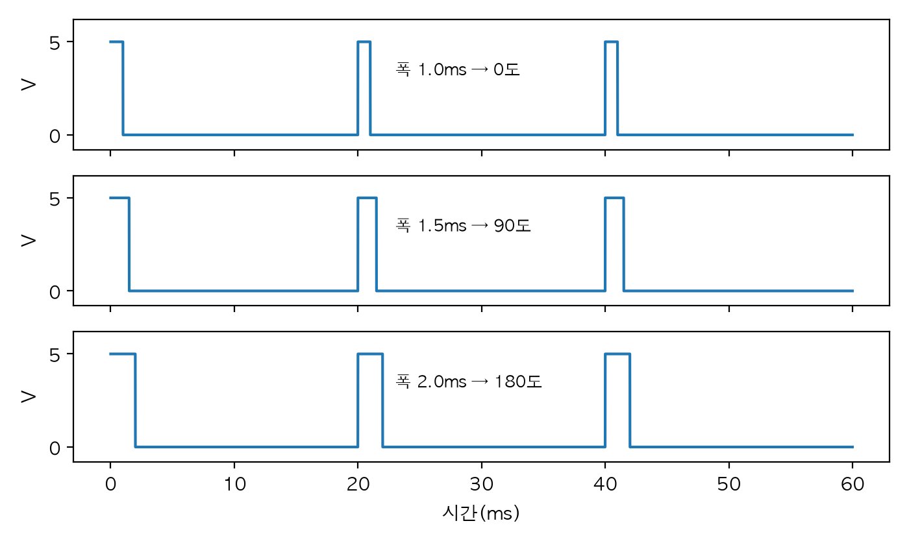
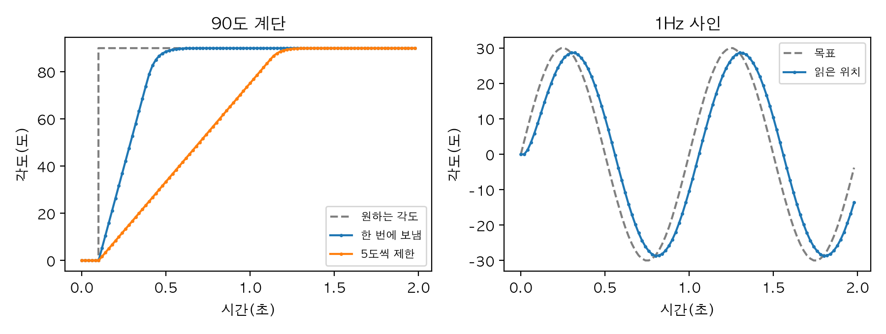
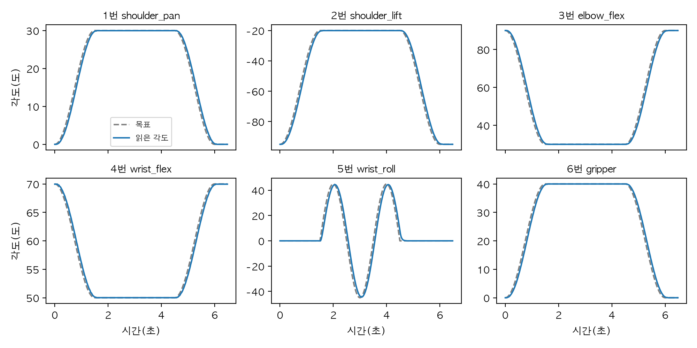
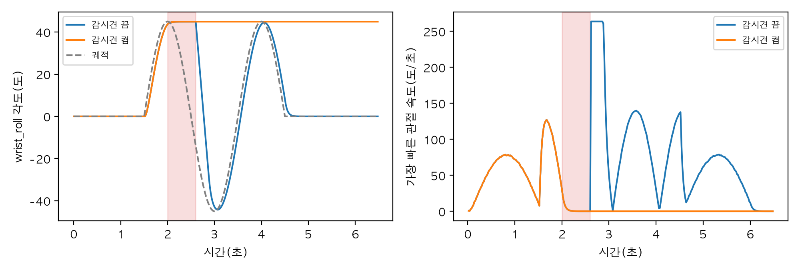

# Chapter 7. 하드웨어: 서보·센서·직렬 통신·작은 컴퓨터

> **학습 목표**  
> - 전압·전류·전력으로 서보 전원을 고르고, 전원을 나누고 접지를 묶는 이유 설명하기
> - PWM 서보, DC 모터 드라이버, 버스 서보가 명령을 받는 방식 비교하기
> - UART 직렬 통신의 바이트·보드레이트·패킷·체크섬을 이해하고 pyserial로 가상 포트와 주고받기
> - Feetech 서보 프로토콜의 패킷을 직접 만들고 풀어서 PING, READ, WRITE, SYNC_WRITE, SYNC_READ 다루기
> - 서보의 눈금과 관절 각도를 오가고, 영점·방향·관절 한계를 맞추는 보정 절차 따라 하기
> - 통신이 끊기거나 깨질 때 재시도와 감시견으로 로봇을 안전하게 멈추기
> - 가상 버스 위의 SO-101 서보 6개를 찾고, 보정하고, 궤적대로 움직이기

---

## 들어가며: `데이터.ctrl` 한 줄 뒤에는 무엇이 있을까요?

4장에서 팔을 움직일 때는 `데이터.ctrl[0] = 0.5` 한 줄이면 충분했습니다. 숫자를 넣고 `mj_step`을 부르면 관절이 그 각도로 갔죠. 그런데 책상 위의 진짜 로봇 팔에는 `데이터.ctrl`이 없습니다. 파이썬이 정한 숫자는 USB 선을 타고 작은 변환 보드로 가고, 거기서 전선 한 가닥을 따라 서보 모터 안의 작은 컴퓨터에 도착해야 해요. 그 작은 컴퓨터가 숫자를 읽고 나서야 모터에 전기가 흐릅니다.

택배를 떠올려 보세요. "이 물건을 저 집에 보내 줘"라는 마음만으로는 아무것도 가지 않습니다. 상자에 넣고, 주소를 정해진 칸에 적고, 송장 번호를 붙여야 하죠. 로봇에게 보내는 명령도 똑같이 **정해진 모양의 상자(패킷)** 에 담겨야 합니다. 30도로 가라는 명령이 실제로 어떤 모양이 되는지 먼저 보고 시작하겠습니다.

```python
import numpy as np

# 시뮬레이션이라면: 데이터.ctrl[0] = np.deg2rad(30) 한 줄로 끝난다
각도_rad = np.deg2rad(30)

# 진짜 서보에게는: 각도를 서보의 눈금으로 바꾸고(한 바퀴 = 4096눈금, 가운데 = 2047)
눈금 = round(2047 + 각도_rad * 4096 / (2 * np.pi))
# '1번 서보야, 42번 칸(목표 위치)에 이 값을 써라'를 바이트로 적는다
몸통 = bytes([1, 5, 0x03, 42]) + 눈금.to_bytes(2, "little")
패킷 = b"\xff\xff" + 몸통 + bytes([~sum(몸통) & 0xFF])

print("눈금:", 눈금)
print("전선으로 나가는 바이트:", 패킷.hex(" "), f"({len(패킷)}바이트)")
```

```text
눈금: 2388
전선으로 나가는 바이트: ff ff 01 05 03 2a 54 09 6f (9바이트)
```

시뮬레이션에서 한 줄이던 명령이 전선 위에서는 바이트 9개가 됐습니다. 30도는 서보가 쓰는 눈금으로 2388이고, 그 값이 `54 09`라는 두 바이트로 쪼개져 들어갔어요. 앞의 `ff ff`는 "여기서부터 패킷"이라는 표시, 맨 끝의 `6f`는 오는 길에 바이트가 상하지 않았는지 확인하는 값입니다. 이 장을 마치면 이 9바이트를 한 글자도 빠짐없이 읽을 수 있어요.

이 장에서는 시뮬레이션과 진짜 로봇 사이의 이 틈을 메웁니다. 전기를 얼마나 줘야 하는지, 모터는 명령을 어떻게 받는지, 바이트는 전선 위에서 어떻게 오가는지, 서보의 눈금을 관절 각도로 어떻게 맞추는지, 선이 빠지면 무슨 일이 생기는지를 차례로 봐요. 그리고 1장에서 약속한 저가 로봇 팔 키트 **SO-101**을 소개하고, 그 팔의 서보 6개를 파이썬으로 다루는 실습으로 마무리합니다.

> **Q. 로봇 팔 키트가 없어도 이 장을 따라올 수 있나요?**
> 네. 이 장의 모든 예제는 컴퓨터 안에 만든 **가상 직렬 포트**와, 그 건너편에서 서보처럼 대답하는 **가짜 서보 버스**로 끝까지 돕니다. 키트를 사면 바뀌는 것은 포트 이름 한 줄이에요. 키트로만 할 수 있는 조립·배선 명령은 "실제 키트가 있을 때"로 따로 모아 두었습니다. 예제는 파이썬 3.12, NumPy 2.5, matplotlib 3.11, pyserial 3.5에서 실행해 확인했어요.

## 7.1 전기 기초: 전압, 전류, 전력

### 물길로 생각하기

모터를 고르기 전에 전기의 숫자 세 개를 알아야 합니다. 수도관의 물에 빗대면 쉬워요.

- **전압(V, 볼트)**: 물을 미는 압력. 어댑터에 적힌 5V, 12V가 이것이다
- **전류(A, 암페어)**: 실제로 흐르는 물의 양. 모터가 힘을 쓸수록 많이 흐른다
- **전력(W, 와트)**: 압력 × 물의 양. 1초에 하는 일의 양이다. 전력 = 전압 × 전류

전압은 공급하는 쪽이 정하고, 전류는 쓰는 쪽이 정한다는 점이 중요합니다. 5V 어댑터에 서보를 꽂으면 전압은 5V로 같지만, 서보가 가볍게 움직일 때와 무거운 것을 들고 버틸 때 흐르는 전류는 열 배 넘게 차이가 나요. 특히 모터가 무언가에 막혀서 돌지 못하고 버티는 순간 가장 많은 전류가 흐르는데, 이것을 **정지 전류(stall current)** 라고 합니다. 전원은 이 최악의 경우를 기준으로 골라야 해요.

```python
# 전력(W) = 전압(V) × 전류(A)
전압 = 5.0                         # 서보 전원 어댑터의 전압(V)

# 아래 전류 값은 계산 연습용 예시다. 실제 값은 서보의 데이터시트에서 확인한다
평소_전류 = 0.15                   # 서보 하나가 가볍게 움직일 때(A)
정지_전류 = 2.0                    # 서보 하나가 꽉 막혀 버틸 때(stall, A)
서보_수 = 6

print(f"평소: {서보_수 * 평소_전류:.1f}A, {전압 * 서보_수 * 평소_전류:.1f}W")
print(f"모두 막혔을 때: {서보_수 * 정지_전류:.1f}A, {전압 * 서보_수 * 정지_전류:.0f}W")

for 어댑터_전류 in [2.0, 4.0, 10.0]:
    버티는_서보 = int(어댑터_전류 // 정지_전류)
    print(f"{어댑터_전류:4.1f}A 어댑터: 동시에 막혀도 버티는 서보 {버티는_서보}개")

# 배터리로 돌리면 얼마나 갈까: 용량(mAh) ÷ 평균 전류(mA)
용량_mAh = 2200
평균_전류_mA = 1500                 # 팔이 쉬지 않고 움직일 때의 평균이라고 치자
print(f"{용량_mAh}mAh 배터리: 약 {용량_mAh / 평균_전류_mA * 60:.0f}분")
```

```text
평소: 0.9A, 4.5W
모두 막혔을 때: 12.0A, 60W
 2.0A 어댑터: 동시에 막혀도 버티는 서보 1개
 4.0A 어댑터: 동시에 막혀도 버티는 서보 2개
10.0A 어댑터: 동시에 막혀도 버티는 서보 5개
2200mAh 배터리: 약 88분
```

코드의 전류 값은 계산 연습용 예시입니다(실제 값은 쓰려는 서보의 데이터시트에서 확인하세요). 평소에는 6개를 다 합쳐도 0.9A, 4.5W 정도지만, 팔이 책상을 누르거나 손가락이 물건을 꽉 쥔 채 서보가 모두 버티면 12A, 60W까지 치솟습니다. 2A 어댑터는 서보 하나만 버텨도 한계예요. 전원이 감당하지 못하면 전압이 순간적으로 떨어지고, 서보가 힘없이 처지거나 서보 안의 작은 컴퓨터가 리셋됩니다. 배터리로 돌린다면 평균 1.5A로 2200mAh 배터리는 약 88분을 버팁니다. 실제로는 배터리를 끝까지 다 쓰면 전압이 떨어지므로 이보다 짧게 잡아요.

### 전원을 나누고 접지를 묶는다

두 번째로 알아야 할 것은 **전선도 저항**이라는 사실입니다. 옴의 법칙(전압 = 전류 × 저항)대로, 전류가 많이 흐를수록 전선에서 잃는 전압도 커져요.

```python
# 옴의 법칙: 전선에 걸리는 전압 = 전류 × 전선의 저항
어댑터_전압 = 5.0
전선_저항 = 0.1                    # 가늘고 긴 전선 왕복의 저항(Ω, 예시)
컴퓨터_최저_전압 = 4.75             # 이보다 낮으면 컴퓨터가 꺼졌다 켜진다고 치자(예시)

for 전류 in [0.5, 2.0, 6.0, 12.0]:
    남은_전압 = 어댑터_전압 - 전류 * 전선_저항
    상태 = "[O]" if 남은_전압 >= 컴퓨터_최저_전압 else "[X] 컴퓨터 재부팅"
    print(f"전류 {전류:4.1f}A → 끝에 남는 전압 {남은_전압:.2f}V {상태}")
```

```text
전류  0.5A → 끝에 남는 전압 4.95V [O]
전류  2.0A → 끝에 남는 전압 4.80V [O]
전류  6.0A → 끝에 남는 전압 4.40V [X] 컴퓨터 재부팅
전류 12.0A → 끝에 남는 전압 3.80V [X] 컴퓨터 재부팅
```

전선 저항이 0.1Ω밖에 안 돼도, 서보가 6A를 끌어 쓰는 순간 끝에 남는 전압은 4.40V로 떨어집니다. 이 전선에 컴퓨터까지 함께 매달려 있었다면 컴퓨터는 꺼졌다 켜졌을 거예요. 팔이 무거운 것을 드는 순간마다 컴퓨터가 재부팅된다면 원인을 찾기도 아주 어렵습니다. 그래서 로봇 배선에는 두 가지 규칙이 있어요.

1. **모터 전원과 컴퓨터 전원을 나눈다.** 서보는 서보 전용 어댑터나 배터리에서, 컴퓨터는 USB나 자기 어댑터에서 전기를 받는다. 모터가 전류를 확 끌어 써도 컴퓨터 쪽 전압은 흔들리지 않는다
2. **접지(GND, 0V 기준)는 묶는다.** 신호선의 "5V냐 0V냐"는 접지를 기준으로 잰 값이다. 두 장치의 0V가 서로 다르면 같은 신호를 다르게 읽는다. 전원은 나눠도 접지선은 서로 이어 준다

SO-101 같은 버스 서보 팔에 쓰는 USB 서보 제어 보드는 보통 서보 전원을 별도의 전원 단자로 받고, 컴퓨터와는 USB로 통신합니다. 첫 번째 규칙을 보드 구조가 지켜 주는 셈이에요. 다른 보드나 마이크로컨트롤러를 직접 배선할 때는 두 규칙을 스스로 챙겨야 합니다.

1장 1.7절에서 "로봇 프로그램의 버그는 물건을 움직인다"고 했습니다. 전기는 여기에 한 가지를 더해요. 배선 실수는 연기를 냅니다. 처음 전원을 넣을 때는 극성(+와 -)을 두 번 확인하고, 팔이 닿는 범위에 손과 물건을 두지 말고, 전원 플러그를 바로 뽑을 수 있는 곳에 두세요. 부록의 "로봇 안전"에 전원과 배터리를 다루는 수칙을 모아 두었으니 처음 모터를 돌리기 전에 꼭 읽기를 권합니다.

> **Q. 서보를 컴퓨터 USB 전원으로 돌리면 안 되나요?**
> 서보 한두 개가 가볍게 움직이는 정도라면 돌아가는 것처럼 보이지만 권하지 않습니다. 컴퓨터의 USB 포트가 주는 전류는 보통 1A가 안 되는 경우가 많아서 서보 하나의 정지 전류에도 못 미치는 경우가 많아요. 전류가 모자라면 서보가 힘을 못 쓰거나, 컴퓨터가 포트를 꺼 버립니다. 서보에는 서보 전용 전원을 쓰세요.

## 7.2 모터에게 명령하는 세 가지 방법

1장 1.3절에서 DC 모터, 서보, 스테핑 모터를 숫자로 맛봤습니다. 이번에는 컴퓨터가 그 모터들에게 **어떤 신호로** 말하는지 봐요.

### PWM 서보: 펄스의 폭이 곧 각도

장난감 자동차나 작은 로봇에 흔한 취미용 서보는 선이 세 가닥입니다. 전원(+), 접지(-), 그리고 신호선이에요. 신호선으로는 숫자가 아니라 **펄스**가 갑니다. 20ms(1초에 50번)마다 전압을 잠깐 켰다 끄는데, **켜져 있는 시간(펄스 폭)** 이 목표 각도를 뜻해요. 이렇게 켜짐 시간의 폭으로 정보를 전하는 방식을 **PWM(펄스 폭 변조)** 이라고 합니다.

```python
# 취미용 서보에 흔한 약속(제품마다 다르니 데이터시트로 확인한다):
# 20ms(50Hz)마다 펄스 하나, 폭 1.0ms = 0도, 1.5ms = 90도, 2.0ms = 180도
주기_ms = 20.0
최소_폭_ms, 최대_폭_ms, 각도_범위_도 = 1.0, 2.0, 180.0


def 펄스_폭(각도_도: float) -> float:
    """각도를 펄스 폭(ms)으로."""
    return 최소_폭_ms + (최대_폭_ms - 최소_폭_ms) * 각도_도 / 각도_범위_도


for 각도 in [0, 45, 90, 180]:
    폭 = 펄스_폭(각도)
    print(f"{각도:3d}도 → 펄스 {폭:.3f}ms, 듀티 {폭 / 주기_ms:.1%}")

# 마이크로컨트롤러의 타이머가 1μs 단위로 폭을 조절한다면 각도 해상도는?
print(f"1μs 차이 = {각도_범위_도 / ((최대_폭_ms - 최소_폭_ms) * 1000):.2f}도")
```

```text
  0도 → 펄스 1.000ms, 듀티 5.0%
 45도 → 펄스 1.250ms, 듀티 6.2%
 90도 → 펄스 1.500ms, 듀티 7.5%
180도 → 펄스 2.000ms, 듀티 10.0%
1μs 차이 = 0.18도
```

흔한 약속으로는 1.0ms가 0도, 1.5ms가 90도, 2.0ms가 180도입니다(제품마다 범위가 다르니 데이터시트를 확인해야 해요). 20ms 중에 1~2ms만 켜지니 켜진 비율(듀티)은 5~10%예요. 마이크로컨트롤러가 펄스 폭을 1μs 단위로 조절한다면 0.18도씩 움직일 수 있습니다. 그림으로 보면 이렇습니다.

```python
import matplotlib.pyplot as plt
import numpy as np

plt.rcParams["font.family"] = "AppleGothic"
plt.rcParams["axes.unicode_minus"] = False

시간_ms = np.arange(0, 60, 0.01)                   # 60ms 동안
그림, 칸들 = plt.subplots(3, 1, figsize=(7, 4.2), sharex=True)
for 칸, (각도, 폭) in zip(칸들, [(0, 1.0), (90, 1.5), (180, 2.0)]):
    신호 = (시간_ms % 20.0) < 폭                   # 20ms마다 '폭'만큼만 켜진다
    칸.plot(시간_ms, 신호 * 5.0, color="tab:blue")
    칸.set_ylim(-0.8, 6.2)
    칸.set_yticks([0, 5])
    칸.set_ylabel("V")
    칸.text(23.0, 3.2, f"폭 {폭}ms → {각도}도", fontsize=9)
칸들[-1].set_xlabel("시간(ms)")
그림.tight_layout()
그림.savefig("pwm_servo.png", dpi=200)
print("저장: pwm_servo.png")
```

```text
저장: pwm_servo.png
```



세 줄 모두 20ms마다 펄스가 한 번씩 나가지만 폭이 다릅니다. 서보 안의 회로는 이 폭을 재서 목표 각도로 바꾸고, 1장 1.3절에서 흉내 낸 것처럼 안에서 작은 닫힌 고리를 돌려 그 각도로 가요. PWM 서보는 싸고 쉽지만 **한 방향 통신**이라는 큰 약점이 있습니다. 컴퓨터는 "가라"고만 할 뿐, 서보가 정말 갔는지, 얼마나 힘을 쓰고 있는지, 뜨거워지고 있는지는 알 수 없어요. 서보마다 신호선이 하나씩 필요하니 관절이 6개면 선도 6개입니다.

### DC 모터와 모터 드라이버

바퀴를 돌리는 DC 모터는 전압을 주면 계속 돕니다. 그런데 컴퓨터의 핀은 약한 신호만 낼 수 있어서 모터를 직접 돌리지 못해요. 그래서 **모터 드라이버**라는 부품이 중간에서 큰 전류를 대신 켰다 끕니다. 드라이버 안에는 스위치 네 개를 H 모양으로 배치한 **H 브리지**가 있어서, 어느 쪽 스위치 쌍을 켜느냐에 따라 모터에 걸리는 전압의 방향, 즉 도는 방향이 바뀌어요.

속도는 여기서도 PWM으로 조절합니다. 12V를 아주 빠르게 켰다 껐다 하면 모터는 그 평균을 느끼거든요. 1장의 DC 모터 흉내(시간 상수 0.05초)에 20kHz PWM을 넣어 보겠습니다.

```python
import numpy as np

# DC 모터 + 모터 드라이버: 12V를 아주 빠르게 켰다 껐다 하며 '켜진 비율(듀티)'로 세기를 정한다
전원 = 12.0                     # V
PWM_주파수 = 20_000             # Hz. 사람 귀에 들리지 않게 20kHz로 흔히 고른다
속도_상수 = 25.0                # 1V에 25rad/s(예시)
시간_상수 = 0.05                # 1장 1.3절의 DC 모터와 같은 0.05초
간격 = 1 / PWM_주파수 / 20      # 펄스 하나를 20조각으로 나눠 흉내

for 듀티 in [0.25, 0.5, 0.75]:
    속도, 기록 = 0.0, []
    for k in range(round(0.3 / 간격)):          # 0.3초 동안
        켜짐 = (k % 20) < 듀티 * 20              # 한 펄스 안에서 켜진 조각인가
        전압 = 전원 if 켜짐 else 0.0
        속도 += (속도_상수 * 전압 - 속도) * 간격 / 시간_상수
        기록.append(속도)
    끝 = np.array(기록[-2000:])                  # 마지막 0.005초
    print(f"듀티 {듀티:.0%}: 평균 전압 {듀티 * 전원:4.1f}V → 속도 {끝.mean():6.1f}rad/s "
          f"(흔들림 {np.ptp(끝):.2f}rad/s)")
```

```text
듀티 25%: 평균 전압  3.0V → 속도   74.8rad/s (흔들림 0.08rad/s)
듀티 50%: 평균 전압  6.0V → 속도  149.6rad/s (흔들림 0.11rad/s)
듀티 75%: 평균 전압  9.0V → 속도  224.4rad/s (흔들림 0.11rad/s)
```

듀티 25%면 평균 3V, 50%면 6V, 75%면 9V가 걸린 것과 같아서 속도도 74.8, 149.6, 224.4rad/s로 듀티에 비례합니다. 전압은 0V와 12V 사이를 1초에 2만 번 오가는데도, 속도의 흔들림은 0.1rad/s 정도로 아주 작아요. 모터의 회전 부분이 무거워서 빠른 깜빡임을 따라가지 못하고 평균만 남기는 거예요. 1장에서 본 "명령을 서서히 따라가는" 성질이 여기서는 고마운 거름망이 됩니다.

### 버스 서보: 한 줄에 여럿, 그리고 대답하는 서보

SO-101이 쓰는 Feetech STS3215는 **버스 서보**입니다. PWM 서보와 겉모습은 비슷하지만 말하는 방식이 완전히 달라요.

| | PWM 서보 | 버스 서보(STS3215 등) |
|---|---|---|
| 명령 | 펄스 폭 | 숫자를 담은 패킷 |
| 연결 | 서보마다 신호선 하나 | 한 줄에 여러 개를 줄줄이(데이지 체인) |
| 누구에게? | 선이 곧 주소 | 서보마다 ID 번호 |
| 대답 | 없음 | 현재 위치, 속도, 부하, 전압, 온도를 읽을 수 있다 |
| 설정 | 거의 없음 | 위치 한계, 영점, 제어 이득 등을 서보 안 메모리에 쓴다 |

버스 서보는 서보마다 커넥터가 두 개 있어서 앞 서보에서 다음 서보로 선을 이어 갑니다. 반 학생들이 한 줄로 앉아 있고 선생님이 "3번, 일어나"라고 부르는 것과 같아요. 모두가 같은 말을 듣지만 자기 번호가 불린 학생만 움직이고 대답합니다. 그래서 같은 버스에 있는 서보는 **ID가 모두 달라야** 해요. 새 서보는 공장에서 ID가 모두 1로 나오기 때문에, 조립 전에 한 개씩 연결해 ID를 바꿔 주는 단계가 있습니다(7.11절).

무엇보다 큰 차이는 **대답**입니다. 컴퓨터가 서보의 실제 위치를 읽을 수 있으니, 1장의 감지·판단·행동 고리를 서보 바깥에서도 닫을 수 있어요. 이 장의 나머지는 이 대화를 어떻게 하는지에 대한 이야기입니다.

## 7.3 직렬 통신: 바이트가 한 줄로 지나가는 길

### UART와 보드레이트

버스 서보와 컴퓨터는 **UART**라는 직렬 통신으로 이야기합니다. "직렬"은 비트를 한 줄로 세워 한 번에 하나씩 보낸다는 뜻이에요. 모스 부호처럼 신호선의 전압을 높였다 낮췄다 하며 0과 1을 차례로 보냅니다. 받는 쪽이 비트를 제대로 자르려면 둘이 미리 **속도**를 맞춰 둬야 하는데, 이 약속이 **보드레이트(baud rate)** 예요. 1,000,000bps면 1초에 100만 비트를 보냅니다. STS3215는 공장 설정이 1,000,000bps이고, LeRobot도 이 속도를 기본으로 씁니다.

UART는 바이트 하나를 보낼 때 앞에 "시작한다"는 비트 하나, 뒤에 "끝났다"는 비트 하나를 붙여서 모두 10비트를 씁니다. 그러면 서보 6개를 다루는 데 시간이 얼마나 걸릴까요?

```python
# UART는 바이트 하나를 보낼 때 시작 비트 1 + 데이터 8 + 정지 비트 1 = 10비트를 쓴다
비트_per_바이트 = 10
서보_수 = 6


def 전송_시간_us(바이트_수: int, 보드레이트: int) -> float:
    return 바이트_수 * 비트_per_바이트 / 보드레이트 * 1e6


# 한 주기에 '서보 6개에 목표 쓰기 + 현재 위치 읽기'를 하는 두 가지 방법(바이트 수)
따로따로 = 서보_수 * (9 + 6) + 서보_수 * (8 + 8)     # WRITE와 응답, READ와 응답을 서보마다
함께 = (7 + 서보_수 * 3 + 1) + (7 + 서보_수 + 1) + 서보_수 * 8   # SYNC_WRITE 하나, SYNC_READ와 응답 6개

for 보드레이트 in [115_200, 1_000_000]:
    print(f"{보드레이트:>9,}bps: 바이트 하나 {전송_시간_us(1, 보드레이트):5.1f}μs")
    for 이름, 바이트 in [("따로따로", 따로따로), ("함께", 함께)]:
        시간 = 전송_시간_us(바이트, 보드레이트)
        print(f"   {이름:4s} {바이트:3d}바이트 = {시간 / 1000:5.2f}ms → 선만 보면 최대 {1e6 / 시간:5.0f}Hz")
```

```text
  115,200bps: 바이트 하나  86.8μs
   따로따로 186바이트 = 16.15ms → 선만 보면 최대    62Hz
   함께    88바이트 =  7.64ms → 선만 보면 최대   131Hz
1,000,000bps: 바이트 하나  10.0μs
   따로따로 186바이트 =  1.86ms → 선만 보면 최대   538Hz
   함께    88바이트 =  0.88ms → 선만 보면 최대  1136Hz
```

1,000,000bps에서 바이트 하나는 10μs입니다. 서보마다 목표를 쓰고 위치를 읽는 패킷을 따로따로 주고받으면 한 주기에 186바이트, 1.86ms가 들어요. 7.4절에서 볼 SYNC_WRITE와 SYNC_READ로 여러 서보를 한 패킷에 묶으면 88바이트, 0.88ms로 절반 아래가 됩니다. 115,200bps로 느리게 설정하면 같은 일에 7.64ms가 걸리니, 서보 수와 제어 주기를 생각하면 보드레이트가 왜 중요한지 보이죠.

다만 이 숫자는 "선 위를 지나는 시간"만 센 것입니다. 실제로는 서보가 명령을 받고 대답하기까지 잠깐 쉬는 시간, 그리고 USB 변환기가 바이트를 모아서 보내는 지연이 더해져요. LeRobot 소스의 주석에는 USB 변환기의 지연 타이머가 16ms라고 적혀 있고, 응답을 기다리는 기본 시간도 그보다 긴 50ms로 잡혀 있습니다. 선만 보면 1000Hz도 가능해 보이지만 실제 팔은 이보다 훨씬 느린 수십 Hz로 돌리는 이유예요.

STS3215의 통신선은 하나로 **보내기와 받기를 번갈아** 합니다. 이것을 **반이중(half-duplex)** 이라고 해요. 무전기처럼 한쪽이 말하는 동안 다른 쪽은 듣기만 해야 하니, 컴퓨터가 묻고 서보가 대답하는 순서를 꼭 지켜야 합니다. 서보 둘이 동시에 대답하면 신호가 겹쳐 둘 다 망가져요.

### 바이트 순서와 음수

0~4095 사이의 위치 값은 한 바이트(0~255)에 들어가지 않으니 두 바이트로 쪼개야 합니다. 이때 **어느 자리를 먼저 보내느냐**가 장치마다 달라요.

```python
눈금 = 2388
print("작은 자리 먼저(little):", 눈금.to_bytes(2, "little").hex(" "))
print("큰 자리 먼저(big)   :", 눈금.to_bytes(2, "big").hex(" "))
print("거꾸로 읽으면       :", int.from_bytes(눈금.to_bytes(2, "little"), "big"))

# 음수 -100을 16비트로 적는 두 가지 방법
부호_크기 = 0x8000 | 100                          # 맨 위 비트는 부호, 나머지는 크기(Feetech 위치)
이의_보수 = -100 & 0xFFFF                         # 대부분의 칩과 파이썬 struct가 쓰는 방식
print(f"부호-크기 : {부호_크기:016b} = 0x{부호_크기:04x}")
print(f"2의 보수  : {이의_보수:016b} = 0x{이의_보수:04x}")
print("부호-크기를 2의 보수로 읽으면:", int.from_bytes(부호_크기.to_bytes(2, "little"), "little", signed=True))
```

```text
작은 자리 먼저(little): 54 09
큰 자리 먼저(big)   : 09 54
거꾸로 읽으면       : 21513
부호-크기 : 1000000001100100 = 0x8064
2의 보수  : 1111111110011100 = 0xff9c
부호-크기를 2의 보수로 읽으면: -32668
```

2388은 16진수로 `0x0954`입니다. 작은 자리를 먼저 보내는 **리틀 엔디언**이면 `54 09`, 큰 자리를 먼저 보내는 **빅 엔디언**이면 `09 54`예요. STS3215는 리틀 엔디언을 씁니다(Feetech SDK에서 STS 계열은 낮은 바이트가 앞 주소에 오도록 처리해요). 순서를 거꾸로 읽으면 2388이 21513이 되는데, 오류 없이 엉뚱한 숫자가 나오니 2장의 쿼터니언 순서 혼동과 똑같은 종류의 함정입니다.

음수도 함정이 있어요. 대부분의 칩과 파이썬은 음수를 **2의 보수**로 적지만, Feetech 서보의 위치와 영점 보정 값은 **부호-크기** 방식을 씁니다. 맨 위 비트 하나가 부호이고, 나머지는 크기 그대로예요. -100이 부호-크기로는 `0x8064`, 2의 보수로는 `0xff9c`입니다. 부호-크기 값을 2의 보수로 읽으면 -100이 -32668로 둔갑해요. 그래서 레지스터마다 "몇 바이트, 어느 순서, 어떤 음수 표현"인지를 표로 정리해 두고 코드로 처리해야 합니다. 7.4절의 `페테크.py`가 그 일을 해요.

### pyserial과 가상 직렬 포트

파이썬에서 직렬 포트는 **pyserial** 패키지로 엽니다(`import serial`). 포트 이름과 보드레이트를 주면 파일처럼 `write`와 `read`를 할 수 있어요. 진짜 서보 보드를 꽂으면 리눅스에서는 `/dev/ttyACM0`, 맥에서는 `/dev/tty.usbmodem...`, 윈도우에서는 `COM3` 같은 이름이 생깁니다.

보드가 없으니 운영 체제의 **pty(가상 터미널) 한 쌍**을 씁니다. 한쪽 끝에 쓴 바이트가 다른 쪽 끝에서 읽히는 가상의 전선이에요. 한쪽은 pyserial로 열어 진짜 포트처럼 쓰고, 다른 쪽에는 7.5절에서 가짜 서보를 앉힐 겁니다.

```python
import os

import serial

주, 부 = os.openpty()                     # 가상 직렬 포트 한 쌍: 한쪽에 쓰면 다른 쪽에서 읽힌다
이름 = os.ttyname(부)
print("가상 포트 이름이 생겼다:", 이름.startswith("/dev/tty"))

포트 = serial.Serial(이름, baudrate=115_200, timeout=0.05)   # 실물이면 '/dev/ttyACM0', 'COM3' 같은 이름
포트.write(bytes([0xFF, 0xFF, 0x01, 0x02, 0x01, 0xFB]))
print("건너편이 받은 것:", os.read(주, 100).hex(" "))

os.write(주, bytes([0xFF, 0xFF, 0x01, 0x02, 0x00, 0xFC]))   # 건너편이 답장을 쓴다
print("포트에서 읽은 것:", 포트.read(6).hex(" "))
print("기다려도 안 오면:", 포트.read(6), "← timeout 뒤 빈 바이트")
```

```text
가상 포트 이름이 생겼다: True
건너편이 받은 것: ff ff 01 02 01 fb
포트에서 읽은 것: ff ff 01 02 00 fc
기다려도 안 오면: b'' ← timeout 뒤 빈 바이트
```

pyserial로 쓴 6바이트가 건너편에 그대로 도착했고, 건너편이 쓴 6바이트도 포트에서 그대로 읽혔습니다. 마지막 줄이 중요해요. 아무도 대답하지 않으면 `read`는 영원히 기다리지 않고 `timeout`(0.05초)이 지나면 **빈 바이트**를 돌려줍니다. 서보가 대답하지 않는 상황을 알아채는 방법이 바로 이것이에요.

> **Q. 가상 포트에서는 왜 보드레이트를 115,200으로 열었나요?**
> 가상 포트는 전기 신호가 아니라서 보드레이트를 무시합니다. 그런데 맥에서 pyserial로 가상 포트를 1,000,000bps로 열면, 표준 목록에 없는 속도를 설정하는 과정에서 `OSError: [Errno 25] Inappropriate ioctl for device` 오류가 났어요. 그래서 가상 포트에는 표준 속도인 115,200을 주었습니다. 진짜 보드는 1,000,000으로 엽니다. 하나 더, 맥의 가상 포트에서는 pyserial의 `flush()`가 건너편이 읽을 때까지 멈춰 버려서 이 장의 코드에서는 쓰지 않았어요.

## 7.4 Feetech 프로토콜: 패킷 읽고 쓰기

### 패킷의 생김새

이제 들어가며의 9바이트를 해부할 차례입니다. STS3215의 패킷은 Dynamixel 서보의 프로토콜 1.0과 같은 생김새입니다. 실제로 LeRobot이 쓰는 서보 통신 라이브러리 rustypot은 STS3215를 Dynamixel 프로토콜 1.0 구현 위에 올려 다뤄요.

| 자리 | 머리 | ID | 길이 | 명령 | 매개변수 | 체크섬 |
|---|---|---|---|---|---|---|
| 바이트 | `FF FF` | 0~253, 254는 모두에게 | 매개변수 수 + 2 | 아래 표 | 명령마다 다름 | 아래 설명 |

서보가 돌려주는 **응답(상태 패킷)** 도 생김새가 같고, 명령 자리에 **오류 바이트**가 들어갑니다. 0이면 정상이고, 전압·과열·과부하 같은 문제가 있으면 해당 비트가 켜져요. **체크섬**은 ID부터 마지막 매개변수까지 모두 더한 값의 아래 8비트를 뒤집은 것입니다. 받는 쪽도 같은 계산을 해서 맞지 않으면 패킷을 버려요.

| 명령 | 번호 | 매개변수 | 응답 |
|---|---|---|---|
| PING | `0x01` | 없음 | 빈 응답(살아 있다) |
| READ | `0x02` | 주소, 바이트 수 | 그 주소의 값 |
| WRITE | `0x03` | 주소, 값... | 빈 응답 |
| SYNC_READ | `0x82` | 주소, 바이트 수, ID... | ID 순서대로 서보마다 하나씩 |
| SYNC_WRITE | `0x83` | 주소, 바이트 수, (ID, 값...)... | 없음 |

서보 안에는 번지가 붙은 작은 메모리(**레지스터**)가 있고, READ와 WRITE는 "몇 번지부터 몇 바이트"를 읽고 쓰는 명령입니다. 이 장에서 쓰는 STS3215의 레지스터는 다음과 같아요. 주소는 LeRobot의 Feetech 레지스터 표, rustypot의 STS3215 정의, Feetech의 공식 파이썬 SDK가 모두 같은 값을 적고 있는 것만 골랐습니다.

| 이름 | 주소 | 바이트 | 뜻 |
|---|---|---|---|
| 모델 번호 | 3 | 2 | 읽기 전용. STS3215는 777 |
| ID | 5 | 1 | 버스 위의 번호 |
| 최소·최대 위치 | 9, 11 | 2, 2 | 위치 모드에서 움직일 수 있는 범위 |
| 영점 보정(Homing_Offset) | 31 | 2 | 읽히는 위치를 이만큼 옮긴다. 부호-크기(11번 비트) |
| 토크 켜기 | 40 | 1 | 1이면 목표를 향해 힘을 쓰고, 0이면 손으로 돌릴 수 있다 |
| 목표 위치 | 42 | 2 | 가야 할 눈금 |
| 잠금 | 55 | 1 | 꺼져 있을 때만 ID·한계·영점 같은 설정이 저장된다 |
| 현재 위치 | 56 | 2 | 지금 눈금(읽기 전용) |

앞쪽(40번 전까지)은 전원을 꺼도 남는 **EEPROM** 영역, 뒤쪽은 전원을 끄면 사라지는 **RAM** 영역입니다. ID나 위치 한계, 영점처럼 한 번 정해 두고 계속 쓸 값은 EEPROM에 들어가요. 실제 서보에서는 잠금 레지스터가 EEPROM 쓰기를 막고 있어서, LeRobot은 토크를 끈 상태에서 잠금을 풀고 설정을 쓴 뒤, 토크를 켤 때 다시 잠급니다.

이 내용을 모듈로 만들어 두겠습니다. 다음 내용을 `페테크.py`로 저장하세요.

```python
"""Feetech STS 서보 프로토콜: 패킷 만들기·풀기와 STS3215의 주요 레지스터."""

# 명령(instruction) 번호
PING, READ, WRITE, SYNC_READ, SYNC_WRITE = 0x01, 0x02, 0x03, 0x82, 0x83
방송_ID = 0xFE                    # 버스 위의 모든 서보에게 보낼 때 쓰는 ID

# STS3215 레지스터: (주소, 바이트 수)
모델번호 = (3, 2)
아이디 = (5, 1)
최소_위치 = (9, 2)
최대_위치 = (11, 2)
영점_보정 = (31, 2)               # Homing_Offset
토크_켜기 = (40, 1)
목표_위치 = (42, 2)
잠금 = (55, 1)
현재_위치 = (56, 2)

# 음수를 '부호-크기'로 적는 레지스터와 그 부호 비트 번호
부호_비트 = {영점_보정: 11, 목표_위치: 15, 현재_위치: 15}


class 패킷오류(Exception):
    """머리나 체크섬이 맞지 않는 패킷."""


def 체크섬(몸통: bytes) -> int:
    """ID부터 마지막 매개변수까지 더한 값의 아래 8비트를 뒤집는다."""
    return ~sum(몸통) & 0xFF


def 명령_패킷(서보_id: int, 명령: int, 매개변수: bytes = b"") -> bytes:
    """FF FF | ID | 길이 | 명령 | 매개변수... | 체크섬. 길이 = 매개변수 수 + 2."""
    몸통 = bytes([서보_id, len(매개변수) + 2, 명령]) + bytes(매개변수)
    return b"\xff\xff" + 몸통 + bytes([체크섬(몸통)])


def 응답_풀기(패킷: bytes) -> tuple[int, int, bytes]:
    """서보의 응답(상태 패킷)에서 (ID, 오류 바이트, 매개변수)를 꺼낸다."""
    if len(패킷) < 6 or 패킷[:2] != b"\xff\xff":
        raise 패킷오류("머리가 틀렸다")
    if 체크섬(패킷[2:-1]) != 패킷[-1]:
        raise 패킷오류("체크섬이 틀렸다")
    return 패킷[2], 패킷[4], bytes(패킷[5:-1])


def 값_바이트(레지스터: tuple[int, int], 값: int) -> bytes:
    """정수를 레지스터 크기의 바이트로. 작은 자리가 먼저(little-endian)."""
    비트 = 부호_비트.get(레지스터)
    if 비트 is not None and 값 < 0:
        값 = -값 | 2 ** 비트                   # 부호-크기: 부호 비트만 켜고 크기는 그대로
    return int(값).to_bytes(레지스터[1], "little")


def 바이트_값(레지스터: tuple[int, int], 데이터: bytes) -> int:
    """값_바이트의 반대."""
    값 = int.from_bytes(데이터, "little")
    비트 = 부호_비트.get(레지스터)
    if 비트 is not None and 값 & 2 ** 비트:
        값 = -(값 & (2 ** 비트 - 1))
    return 값
```

`값_바이트`와 `바이트_값`이 7.3절의 두 함정(바이트 순서와 부호-크기)을 처리합니다. 레지스터를 (주소, 바이트 수) 튜플로 적었기 때문에 `bytes(ft.현재_위치)`가 곧 READ의 매개변수 `38 02`가 돼요.

### 공개된 값과 맞춰 보기

직접 만든 패킷이 정말 맞는지는 어떻게 알까요? 2장에서 MuJoCo와 비교해 검산했던 것처럼, 믿을 만한 다른 구현과 비교하면 됩니다. rustypot의 소스에는 패킷을 만들었을 때 나와야 할 바이트가 시험 코드로 적혀 있어요.

```python
import 페테크 as ft


def 보기(패킷: bytes) -> str:
    return 패킷.hex(" ").upper()


# 공개 구현(rustypot)의 시험에 적힌 기대 바이트와 비교한다
시험들 = [
    ("PING ID 1", ft.명령_패킷(1, ft.PING), "FF FF 01 02 01 FB"),
    ("READ ID 1, 주소 0x2B, 1바이트", ft.명령_패킷(1, ft.READ, bytes([0x2B, 1])), "FF FF 01 04 02 2B 01 CC"),
    ("SYNC_WRITE ID 11·12, 주소 30, 2바이트",
     ft.명령_패킷(ft.방송_ID, ft.SYNC_WRITE, bytes([30, 2, 11, 0x00, 0x00, 12, 0x0A, 0x14])),
     "FF FF FE 0A 83 1E 02 0B 00 00 0C 0A 14 1F"),
]
for 이름, 패킷, 기대 in 시험들:
    print(f"{이름}: {보기(패킷)} {'[O]' if 보기(패킷) == 기대 else '[X]'}")

# 이 장에서 자주 쓸 두 가지: 목표 위치 쓰기, 현재 위치 읽기
print("ID 1 목표 위치 ← 2388:", 보기(ft.명령_패킷(1, ft.WRITE, bytes([42]) + ft.값_바이트(ft.목표_위치, 2388))))
print("ID 1 현재 위치 읽기  :", 보기(ft.명령_패킷(1, ft.READ, bytes(ft.현재_위치))))

# 서보의 응답 풀기: ID 1, 오류 0, 매개변수 2바이트(현재 위치)
응답 = bytes.fromhex("FF FF 01 04 00 50 08 A2")
서보_id, 오류, 데이터 = ft.응답_풀기(응답)
print(f"응답: ID {서보_id}, 오류 {오류}, 현재 위치 {ft.바이트_값(ft.현재_위치, 데이터)}")
```

```text
PING ID 1: FF FF 01 02 01 FB [O]
READ ID 1, 주소 0x2B, 1바이트: FF FF 01 04 02 2B 01 CC [O]
SYNC_WRITE ID 11·12, 주소 30, 2바이트: FF FF FE 0A 83 1E 02 0B 00 00 0C 0A 14 1F [O]
ID 1 목표 위치 ← 2388: FF FF 01 05 03 2A 54 09 6F
ID 1 현재 위치 읽기  : FF FF 01 04 02 38 02 BE
응답: ID 1, 오류 0, 현재 위치 2128
```

세 시험 모두 바이트 하나까지 같습니다. 들어가며에서 손으로 만든 목표 위치 패킷 `FF FF 01 05 03 2A 54 09 6F`도 이제 읽을 수 있어요. 1번 서보에게(`01`), 매개변수 3개짜리(`05`) 쓰기 명령(`03`)으로, 42번지(`2A`)에 2388(`54 09`)을 쓰라는 뜻이고, `6F`가 체크섬입니다. 마지막 줄은 서보의 응답을 풀어 현재 위치 2128을 꺼낸 것이에요.

### 체크섬이 잡는 것과 놓치는 것

체크섬은 얼마나 믿을 만할까요? 응답 패킷을 일부러 망가뜨려 보겠습니다.

```python
import 페테크 as ft

응답 = bytes.fromhex("FF FF 01 04 00 50 08 A2")


def 통과하나(패킷: bytes) -> bool:
    try:
        ft.응답_풀기(패킷)
        return True
    except ft.패킷오류:
        return False


# 1) 비트 하나가 뒤집힌 경우: 머리 뒤의 모든 비트를 하나씩 뒤집어 본다
놓친 = 0
for 자리 in range(2, len(응답)):
    for 비트 in range(8):
        깨진 = bytearray(응답)
        깨진[자리] ^= 2 ** 비트
        놓친 += 통과하나(bytes(깨진))
print(f"비트 하나 오류 {(len(응답) - 2) * 8}가지 중 체크섬이 놓친 것: {놓친}")

# 2) 바이트 두 개의 자리가 바뀐 경우: 위치 0x0850(2128)이 0x5008이 된다
바뀐 = bytearray(응답)
바뀐[5], 바뀐[6] = 바뀐[6], 바뀐[5]
print("두 바이트 자리 바꿈 통과?", 통과하나(bytes(바뀐)),
      "→ 읽힌 위치", ft.바이트_값(ft.현재_위치, bytes(바뀐[5:7])))

# 3) 한 바이트는 +1, 다른 바이트는 -1
상쇄 = bytearray(응답)
상쇄[5] += 1
상쇄[6] -= 1
print("+1과 -1이 겹친 오류 통과?", 통과하나(bytes(상쇄)))
```

```text
비트 하나 오류 48가지 중 체크섬이 놓친 것: 0
두 바이트 자리 바꿈 통과? True → 읽힌 위치 20488
+1과 -1이 겹친 오류 통과? True
```

비트 하나가 뒤집힌 오류는 48가지 모두 잡아냈습니다. 하나만 바뀌면 합이 반드시 달라지니까요. 하지만 두 바이트의 **자리가 바뀌면** 합은 그대로라서 그냥 통과합니다. 그 결과 위치가 20488이라는, 0~4095 범위를 한참 벗어난 값으로 읽혔어요. 한 바이트가 1 커지고 다른 바이트가 1 작아지는 오류도 마찬가지로 통과합니다.

그래서 체크섬은 마지막 방어선이 아니라 **첫 번째 거름망**입니다. 받은 값이 말이 되는지(위치가 0~4095 안인지, 한 주기 만에 너무 많이 변하지 않았는지)를 한 번 더 보는 습관이 필요해요. 다행히 실제 전선의 잡음은 대부분 비트 몇 개를 뒤집는 모양이라서, 체크섬만으로도 상당 부분을 걸러 냅니다.

> **Q. Dynamixel 서보도 같은 코드로 다룰 수 있나요?**
> 패킷 생김새가 같은 Dynamixel 프로토콜 1.0 서보라면 `명령_패킷` 같은 함수는 그대로 쓸 수 있습니다. 하지만 레지스터 주소와 바이트 순서, 음수 표현은 서보 계열마다 달라요. 더 새로운 Dynamixel 프로토콜 2.0은 머리와 체크섬(CRC) 방식부터 다릅니다. 그래서 LeRobot도 서보 모델마다 레지스터 표를 따로 두고 있어요.

## 7.5 가짜 서보 버스 만들기

### 가상 포트 건너편의 서보

이제 7.3절의 가상 포트 건너편에 서보를 앉힐 차례입니다. 가짜 서보가 할 일은 세 가지예요.

1. 레지스터 메모리를 갖고, READ와 WRITE에 진짜 서보처럼 대답한다
2. 토크가 켜져 있으면 목표 위치를 향해 움직인다. 1장 1.3절의 모터처럼 **서서히 따라가고(1차 지연)**, 최대 속도를 넘지 않는다
3. 일부러 응답을 잃어버리거나, 비트를 뒤집거나, 선이 빠진 척할 수 있다(7.8절)

시간을 다루는 방법에 한 가지 꾀를 냈습니다. 진짜 시간(`time.sleep`)으로 돌리면 컴퓨터가 바쁠 때마다 결과가 조금씩 달라져요. 그래서 제어 고리가 `시계.진행(0.02)`라고 부를 때만 시간이 흐르는 **가상 시계**를 만들고, 가짜 서보는 그 시계에 맞춰 1ms씩 움직이게 했습니다. 그러면 몇 번을 돌려도 결과가 같아요. 다음 내용을 `가짜서보.py`로 저장하세요. 길지만 이 장의 실험실 장비이니 한 번 훑어보고 넘어가도 됩니다.

```python
"""가상 직렬 포트(pty) 건너편에서 도는 가짜 Feetech 서보 버스. 키트 없이 7장 예제를 돌린다."""
import os
import select
import threading
import time

import numpy as np

import 페테크 as ft

물리_간격 = 0.001                     # 가짜 모터를 1ms씩 움직인다


class 가상시계:
    """제어 고리가 진행()을 부를 때만 흐르는 시계. 그래서 실행할 때마다 결과가 같다."""

    def __init__(self) -> None:
        self.지금 = 0.0
        self.버스들: list["가짜버스"] = []

    def 진행(self, 초: float) -> None:
        for 버스 in self.버스들:
            버스.따라잡기(초)
        self.지금 += 초


class 가짜서보:
    """레지스터 메모리 + 목표를 서서히 따라가는 모터(1차 지연과 속도 한계, 값은 예시)."""

    def __init__(self, 서보_id: int, 실제_위치: float = 2048.0,
                 시간_상수: float = 0.05, 최대_속도: float = 3000.0) -> None:
        self.id = 서보_id
        self.메모리 = bytearray(70)
        self.실제_위치 = 실제_위치          # 축이 실제로 놓인 곳(눈금). 영점 보정과 상관없다
        self.시간_상수, self.최대_속도 = 시간_상수, 최대_속도   # 초, 눈금/초
        self.쓰기(ft.모델번호, 777)          # LeRobot 표에 적힌 STS3215의 모델 번호
        self.쓰기(ft.아이디, 서보_id)
        self.쓰기(ft.최대_위치, 4095)
        self.현재_갱신()
        self.쓰기(ft.목표_위치, self.읽기(ft.현재_위치))

    def 읽기(self, 레지스터: tuple[int, int]) -> int:
        주소, 크기 = 레지스터
        return ft.바이트_값(레지스터, self.메모리[주소:주소 + 크기])

    def 쓰기(self, 레지스터: tuple[int, int], 값: int) -> None:
        주소, 크기 = 레지스터
        self.메모리[주소:주소 + 크기] = ft.값_바이트(레지스터, 값)

    def 현재_갱신(self) -> None:
        # 서보가 알려 주는 위치 = 실제 위치 - 영점 보정 (한 바퀴 4096눈금 안으로)
        self.쓰기(ft.현재_위치, round(self.실제_위치 - self.읽기(ft.영점_보정)) % 4096)

    def 움직이기(self, 간격: float) -> None:
        if self.읽기(ft.토크_켜기):
            목표 = np.clip(self.읽기(ft.목표_위치), self.읽기(ft.최소_위치), self.읽기(ft.최대_위치))
            남은 = 목표 + self.읽기(ft.영점_보정) - self.실제_위치
            속도 = np.clip(남은 / self.시간_상수, -self.최대_속도, self.최대_속도)
            self.실제_위치 += 속도 * 간격
        self.현재_갱신()

    def 손으로_돌리기(self, 실제_위치: float) -> None:
        """토크가 꺼진 서보를 사람이 손으로 돌려 놓는 것을 흉내 낸다."""
        assert not self.읽기(ft.토크_켜기), "토크가 켜진 서보는 손으로 돌릴 수 없다"
        self.실제_위치 = 실제_위치
        self.현재_갱신()


class 가짜버스:
    """pty 한쪽 끝에서 패킷을 받아 서보들에게 나눠 주고, 응답을 돌려보낸다."""

    def __init__(self, 서보들: list[가짜서보], 시계: 가상시계, 손실률: float = 0.0,
                 깨짐률: float = 0.0, 끊김: tuple[float, float] | None = None, 씨앗: int = 0) -> None:
        self.서보들 = {서보.id: 서보 for 서보 in 서보들}
        self.시계 = 시계
        시계.버스들.append(self)
        self.손실률, self.깨짐률, self.끊김 = 손실률, 깨짐률, 끊김
        self.생성기 = np.random.default_rng(씨앗)
        self._주, self._부 = os.openpty()      # 가상 직렬 포트 한 쌍
        self.포트_이름 = os.ttyname(self._부)  # 파이썬 프로그램은 이 이름을 연다
        self._잠금 = threading.Lock()
        self._받은 = bytearray()
        threading.Thread(target=self._돌기, daemon=True).start()

    def _돌기(self) -> None:
        while True:
            select.select([self._주], [], [])
            with self._잠금:
                self._받은 += os.read(self._주, 4096)
                while len(self._받은) >= 4 and len(self._받은) >= 4 + self._받은[3]:
                    길이 = 4 + self._받은[3]
                    패킷, self._받은 = bytes(self._받은[:길이]), self._받은[길이:]
                    if 응답 := self._처리(패킷):
                        os.write(self._주, 응답)          # 응답들은 한 번에 내보낸다

    def _처리(self, 패킷: bytes) -> bytes:
        if self.끊김 and self.끊김[0] <= self.시계.지금 < self.끊김[1]:
            return b""                                # 선이 빠졌다: 아무것도 닿지 않는다
        서보_id, 명령, 인자 = 패킷[2], 패킷[4], 패킷[5:-1]
        응답 = b""
        if 명령 == ft.SYNC_WRITE:                       # 주소, 크기, (ID, 데이터...)...
            주소, 크기 = 인자[0], 인자[1]
            for i in range(2, len(인자), 크기 + 1):
                if 인자[i] in self.서보들:
                    self.서보들[인자[i]].메모리[주소:주소 + 크기] = 인자[i + 1:i + 1 + 크기]
        elif 명령 == ft.SYNC_READ:                      # 주소, 크기, ID...: ID 순서대로 답한다
            for i in 인자[2:]:
                if i in self.서보들:
                    응답 += self._답(i, self.서보들[i].메모리[인자[0]:인자[0] + 인자[1]])
        elif 서보_id in self.서보들:                   # 없는 ID에는 아무도 답하지 않는다
            서보 = self.서보들[서보_id]
            if 명령 == ft.READ:
                return self._답(서보_id, 서보.메모리[인자[0]:인자[0] + 인자[1]])
            if 명령 == ft.WRITE:
                서보.메모리[인자[0]:인자[0] + len(인자) - 1] = 인자[1:]
            응답 = self._답(서보_id, b"")                # PING과 WRITE는 빈 응답
        for 서보 in self.서보들.values():
            서보.현재_갱신()                            # 영점 보정을 바꿨다면 바로 반영된다
        return 응답

    def _답(self, 서보_id: int, 데이터: bytes) -> bytes:
        응답 = bytearray(ft.명령_패킷(서보_id, 0, 데이터))   # 생김새가 같다. 명령 자리에 오류 바이트 0
        주사위 = self.생성기.random()
        if 주사위 < self.손실률:
            return b""                                # 응답이 사라졌다
        if 주사위 < self.손실률 + self.깨짐률:
            응답[-2] ^= 0x10                           # 잡음으로 비트 하나가 뒤집혔다
        return bytes(응답)

    def 따라잡기(self, 초: float) -> None:
        """도착한 명령을 모두 처리한 뒤, 서보들을 '초'만큼 움직인다."""
        while True:
            with self._잠금:
                if not select.select([self._주], [], [], 0)[0]:
                    for _ in range(round(초 / 물리_간격)):
                        for 서보 in self.서보들.values():
                            서보.움직이기(물리_간격)
                    return
            time.sleep(0.0002)                         # 아직 읽지 않은 명령이 있다: 잠깐 양보
```

`가짜서보`의 위치는 두 가지입니다. `실제_위치`는 축이 정말로 놓인 곳이고, 레지스터의 현재 위치는 거기서 **영점 보정을 뺀 값**이에요. 7.6절의 보정이 바로 이 영점을 맞추는 일입니다. `움직이기`에서 목표를 위치 한계 안으로 자르고, 남은 거리를 시간 상수로 나눈 속도를 최대 속도로 자르는 두 줄이 모터 흉내의 전부예요. 시간 상수 0.05초와 최대 속도 초당 3000눈금(약 264도)은 흉내를 위한 예시 값이고, 진짜 STS3215의 성능표 값이 아닙니다.

`가짜버스`는 별도 스레드에서 가상 포트를 지켜보다가 패킷이 도착하면 서보에게 나눠 주고, 응답을 돌려보냅니다. 없는 ID를 부르면 아무도 대답하지 않는 것도 진짜와 같아요. `따라잡기`는 시계가 흐르기 전에 도착한 명령을 모두 처리했는지 확인하는 장치입니다. 대답이 없는 SYNC_WRITE를 보낸 직후에 시계를 돌려도 명령이 늦게 반영되는 일이 없게 해 줘요.

### 컴퓨터 쪽: 서보버스

컴퓨터 쪽에서 쓸 클라이언트도 만들어 둡니다. 묻고, 응답을 받고, 실패하면 다시 묻는 일을 맡아요. 다음 내용을 `서보통신.py`로 저장하세요.

```python
"""pyserial로 Feetech 서보 버스와 이야기하는 작은 클라이언트."""
import serial

import 페테크 as ft


class 통신실패(Exception):
    """재시도까지 다 했는데도 응답을 받지 못했다."""


class 서보버스:
    def __init__(self, 포트: str, 속도: int = 1_000_000, 시간_한계: float = 0.05, 재시도: int = 2) -> None:
        self.포트 = serial.Serial(포트, 속도, timeout=시간_한계)
        self.재시도 = 재시도
        self.통계 = {"시간 초과": 0, "체크섬 오류": 0}

    def _받기(self, 서보_id: int) -> bytes:
        머리 = self.포트.read(4)                         # FF FF ID 길이
        나머지 = self.포트.read(머리[3]) if len(머리) == 4 else b""
        if len(머리) < 4 or len(나머지) < 머리[3]:
            self.통계["시간 초과"] += 1
            raise 통신실패("시간 초과")
        try:
            응답_id, _, 데이터 = ft.응답_풀기(머리 + 나머지)
        except ft.패킷오류:
            self.통계["체크섬 오류"] += 1
            raise
        if 응답_id != 서보_id:
            raise ft.패킷오류("다른 서보의 응답")
        return 데이터

    def _주고받기(self, 서보_ids: list[int], 패킷: bytes) -> list[bytes]:
        """패킷을 보내고 서보마다 응답 하나씩 받는다. 하나라도 틀리면 통째로 다시 보낸다."""
        for _ in range(self.재시도 + 1):
            self.포트.reset_input_buffer()               # 지난번에 남은 찌꺼기를 버린다
            self.포트.write(패킷)
            try:
                return [self._받기(i) for i in 서보_ids]
            except (통신실패, ft.패킷오류):
                continue
        raise 통신실패(f"ID {서보_ids}: {self.재시도 + 1}번 보냈지만 응답이 없다")

    def 핑(self, 서보_id: int) -> bool:
        try:
            self._주고받기([서보_id], ft.명령_패킷(서보_id, ft.PING))
            return True
        except 통신실패:
            return False

    def 읽기(self, 서보_id: int, 레지스터: tuple[int, int]) -> int:
        [데이터] = self._주고받기([서보_id], ft.명령_패킷(서보_id, ft.READ, bytes(레지스터)))
        return ft.바이트_값(레지스터, 데이터)

    def 쓰기(self, 서보_id: int, 레지스터: tuple[int, int], 값: int) -> None:
        인자 = bytes([레지스터[0]]) + ft.값_바이트(레지스터, 값)
        self._주고받기([서보_id], ft.명령_패킷(서보_id, ft.WRITE, 인자))

    def 함께_쓰기(self, 레지스터: tuple[int, int], 값들: dict[int, int]) -> None:
        """SYNC_WRITE: 여러 서보에 한 패킷으로 쓴다. 서보는 답하지 않는다."""
        인자 = bytes(레지스터) + b"".join(bytes([i]) + ft.값_바이트(레지스터, v) for i, v in 값들.items())
        self.포트.write(ft.명령_패킷(ft.방송_ID, ft.SYNC_WRITE, 인자))

    def 함께_읽기(self, 레지스터: tuple[int, int], 서보_ids: list[int]) -> dict[int, int]:
        """SYNC_READ: 한 번 물으면 서보들이 ID 순서대로 답한다."""
        패킷 = ft.명령_패킷(ft.방송_ID, ft.SYNC_READ, bytes(레지스터) + bytes(서보_ids))
        답들 = self._주고받기(서보_ids, 패킷)
        return {i: ft.바이트_값(레지스터, 답) for i, 답 in zip(서보_ids, 답들)}
```

`_주고받기`가 핵심입니다. 보내기 전에 입력 버퍼를 비워 지난번의 찌꺼기를 버리고, 응답이 시간 안에 오지 않거나 체크섬이 틀리면 정해진 횟수만큼 다시 보내요. 기다림 시간 50ms는 LeRobot의 기본값과 같고, 재시도 2번은 이 장에서 정한 값이에요. 이 클라이언트는 가짜 서보에 대해 아무것도 모릅니다. 포트 이름만 진짜 보드로 바꾸면 그대로 진짜 서보와 이야기할 수 있어요.

### 첫 대화

서보 하나를 버스에 올려 놓고 말을 걸어 봅시다.

```python
import 페테크 as ft
from 가짜서보 import 가상시계, 가짜버스, 가짜서보
from 서보통신 import 서보버스

시계 = 가상시계()
가짜 = 가짜버스([가짜서보(1, 실제_위치=1500)], 시계)    # 실물이라면 USB에 꽂은 서보 한 개
버스 = 서보버스(가짜.포트_이름, 속도=115_200)           # 실물이라면 '/dev/ttyACM0' 같은 이름

print("ID 1 핑:", 버스.핑(1), "/ ID 2 핑:", 버스.핑(2))
print("모델 번호:", 버스.읽기(1, ft.모델번호))
print("현재 위치:", 버스.읽기(1, ft.현재_위치))

버스.쓰기(1, ft.목표_위치, 2500)
시계.진행(0.2)
print("토크가 꺼진 채 목표 2500을 주고 0.2초 뒤:", 버스.읽기(1, ft.현재_위치))

버스.쓰기(1, ft.목표_위치, 버스.읽기(1, ft.현재_위치))  # 켜기 전에 목표를 지금 위치로 맞춘다
버스.쓰기(1, ft.토크_켜기, 1)
버스.쓰기(1, ft.목표_위치, 2500)
for 단계 in range(1, 6):
    시계.진행(0.1)
    print(f"  토크를 켜고 {단계 * 0.1:.1f}초: {버스.읽기(1, ft.현재_위치)}")
```

```text
ID 1 핑: True / ID 2 핑: False
모델 번호: 777
현재 위치: 1500
토크가 꺼진 채 목표 2500을 주고 0.2초 뒤: 1500
  토크를 켜고 0.1초: 1800
  토크를 켜고 0.2초: 2100
  토크를 켜고 0.3초: 2393
  토크를 켜고 0.4초: 2486
  토크를 켜고 0.5초: 2498
```

1번은 핑에 대답했고, 버스에 없는 2번은 대답이 없어 `False`가 나왔습니다. 모델 번호 777로 STS3215라는 것도 확인했어요. 재미있는 건 그다음입니다. 토크가 꺼진 채 목표 2500을 보냈더니 0.2초가 지나도 1500 그대로예요. 서보는 명령을 받아 적었지만 힘을 쓰지 않았습니다.

토크를 켜기 **전에** 목표를 현재 위치로 먼저 맞춘 줄을 눈여겨보세요. 목표 레지스터에 예전 값이 남아 있는 채로 토크를 켜면, 켜는 순간 서보가 그 값으로 튀어 갑니다. 진짜 팔에서는 위험한 동작이에요. 토크를 켜고 목표 2500을 주자 0.1초마다 300눈금씩(최대 속도) 다가가다가, 가까워지면서 점점 느려져 2498에 닿았습니다. 1장 1.3절의 모터처럼 서서히 따라가는 모습이에요.

> **Q. 가상 시계 대신 진짜 시간으로 돌리려면 어떻게 하나요?**
> 진짜 서보는 진짜 시간 속에서 움직이니, 실물에서는 `시계.진행(주기)` 자리에 1장 1.4절의 박자 맞추기(다음 박자 시각까지 `time.sleep`)를 넣으면 됩니다. 나머지 코드는 그대로예요. 이렇게 "시간이 흐르는 방법"을 한곳에 모아 두면, 같은 제어 코드를 가짜로 시험하고 진짜로 돌리기가 쉬워집니다.

## 7.6 눈금과 각도: 단위 변환과 보정

### 4096눈금 한 바퀴

STS3215는 축이 한 바퀴 돌 때 위치를 0부터 4095까지 4096눈금으로 셉니다(12비트 엔코더). 로봇 코드는 2장부터 라디안으로 생각하니, 둘 사이를 오가는 함수가 필요해요. 관절의 한가운데를 2047눈금으로 맞춘다고 약속하겠습니다(이유는 곧 나와요).

```python
import numpy as np

한바퀴 = 4096                 # STS3215의 한 바퀴 눈금 수(12비트 엔코더)
가운데 = 2047                 # 보정 뒤 관절 한가운데가 될 눈금


def 라디안_눈금(각도_rad: float, 방향: int = 1) -> int:
    return round(가운데 + 방향 * 각도_rad * 한바퀴 / (2 * np.pi))


def 눈금_라디안(눈금: int, 방향: int = 1) -> float:
    return 방향 * (눈금 - 가운데) * 2 * np.pi / 한바퀴


print(f"눈금 하나 = {360 / 한바퀴:.4f}도")
for 각도_도 in [-90, 0, 30, 90]:
    눈금 = 라디안_눈금(np.deg2rad(각도_도))
    되돌림 = np.rad2deg(눈금_라디안(눈금))
    print(f"{각도_도:4d}도 → 눈금 {눈금:4d} → {되돌림:8.3f}도")
print("방향이 반대인 관절의 30도 →", 라디안_눈금(np.deg2rad(30), 방향=-1))

# 반올림 때문에 생기는 오차는 눈금 반 개를 넘지 않는다
각도들 = np.deg2rad(np.linspace(-90, 90, 10001))
오차_도 = np.rad2deg([abs(눈금_라디안(라디안_눈금(a)) - a) for a in 각도들])
print(f"가장 큰 반올림 오차: {오차_도.max():.4f}도")
```

```text
눈금 하나 = 0.0879도
 -90도 → 눈금 1023 →  -90.000도
   0도 → 눈금 2047 →    0.000도
  30도 → 눈금 2388 →   29.971도
  90도 → 눈금 3071 →   90.000도
방향이 반대인 관절의 30도 → 1706
가장 큰 반올림 오차: 0.0439도
```

눈금 하나는 0.0879도입니다. 30도는 2388눈금이 되는데, 되돌리면 29.971도예요. 30도가 눈금으로 딱 떨어지지 않아 반올림했기 때문입니다. 이런 반올림 오차는 아무리 커도 눈금 반 개, 0.0439도를 넘지 않아요. 1장 1.3절의 엔코더에서 본 **해상도**와 같은 이야기입니다. 방향이 반대인 관절은 같은 30도가 2047보다 **작은** 1706이 돼요. 서보를 관절에 거꾸로 달면 서보가 + 방향으로 돌 때 관절은 - 방향으로 돌기 때문입니다.

### 보정: 영점과 범위 맞추기

로봇 팔을 조립할 때 서보 축이 정확히 2047눈금에 놓여 있을 리가 없습니다. 어떤 서보는 관절 한가운데가 3100눈금일 수도, 900눈금일 수도 있어요. 1장 1.3절에서 "늘 같은 쪽으로 틀리는 **치우침**은 닫힌 고리도 고치지 못한다"고 했죠? 서보 안의 닫힌 고리는 눈금을 정확히 따라가지만, 그 눈금이 관절의 몇 도인지 모르면 팔은 정확하게 틀린 곳에 갑니다. 그래서 **보정(calibration)** 이 필요해요.

LeRobot의 SO-101 보정은 두 단계입니다. 먼저 모든 관절을 손으로 **움직일 수 있는 범위의 한가운데**에 두고 Enter를 누르면, 지금 위치가 2047이 되도록 영점 보정 값을 계산해 서보에 써요. 그다음 관절을 하나씩 끝에서 끝까지 돌리는 동안 읽은 값의 최소와 최대를 기록해 위치 한계로 씁니다. 한가운데를 2047로 맞추는 이유는, 그래야 관절이 양쪽으로 움직여도 눈금이 0이나 4095를 넘어 한 바퀴를 돌아가는(4095 다음이 0이 되는) 일이 없기 때문이에요. 같은 절차를 서보 하나로 해 보겠습니다.

```python
import 페테크 as ft
from 가짜서보 import 가상시계, 가짜버스, 가짜서보
from 서보통신 import 서보버스

# 이 관절은 한가운데에 있을 때 서보 축이 우연히 3100눈금에 놓이도록 조립됐다
관절_가운데_실제 = 3100
시계 = 가상시계()
서보 = 가짜서보(1, 실제_위치=2600)
가짜 = 가짜버스([서보], 시계)
버스 = 서보버스(가짜.포트_이름, 속도=115_200)

# 1) 토크를 끄고, 사람이 관절을 한가운데에 둔다
버스.쓰기(1, ft.토크_켜기, 0)
서보.손으로_돌리기(관절_가운데_실제)
읽은 = 버스.읽기(1, ft.현재_위치)
영점 = 읽은 - 2047                              # 이만큼 빼면 한가운데가 2047이 된다
버스.쓰기(1, ft.영점_보정, 영점)
print(f"한가운데에서 읽은 값 {읽은} → 영점 보정 {영점} → 다시 읽으면 {버스.읽기(1, ft.현재_위치)}")

# 2) 사람이 관절을 양 끝까지 돌리는 동안 읽은 값의 최소·최대를 기록한다
기록 = []
for 실제 in range(관절_가운데_실제 - 1100, 관절_가운데_실제 + 1201, 100):
    서보.손으로_돌리기(실제)
    기록.append(버스.읽기(1, ft.현재_위치))
최소, 최대 = min(기록), max(기록)
버스.쓰기(1, ft.최소_위치, 최소)
버스.쓰기(1, ft.최대_위치, 최대)
print(f"움직인 범위: {최소} ~ {최대}")

# 3) 한계 밖의 목표를 보내면?
버스.쓰기(1, ft.목표_위치, 버스.읽기(1, ft.현재_위치))
버스.쓰기(1, ft.토크_켜기, 1)
버스.쓰기(1, ft.목표_위치, 4000)
시계.진행(1.0)
print("목표 4000을 보냈더니 멈춘 곳:", 버스.읽기(1, ft.현재_위치))

음수_영점 = ft.명령_패킷(1, ft.WRITE, bytes([31]) + ft.값_바이트(ft.영점_보정, -300))
print("영점 보정 -300을 쓰는 패킷:", 음수_영점.hex(" "))
```

```text
한가운데에서 읽은 값 3100 → 영점 보정 1053 → 다시 읽으면 2047
움직인 범위: 947 ~ 3247
목표 4000을 보냈더니 멈춘 곳: 3247
영점 보정 -300을 쓰는 패킷: ff ff 01 05 03 1f 2c 09 a2
```

관절 한가운데에서 읽은 값이 3100이었으니, 영점 보정을 1053으로 쓰자 같은 자리가 2047로 읽혔습니다. 서보가 알려 주는 위치는 "실제 위치 - 영점 보정"이에요. 관절을 양 끝까지 돌리며 기록한 범위는 947~3247이고, 이 값을 서보의 최소·최대 위치에 써 두었습니다. 그다음 실수로 범위 밖의 목표 4000을 보냈더니, 서보는 최대 위치인 3247에서 멈췄어요. 가짜 서보는 위치 한계를 **서보 안에서** 지키도록 만들었어요. LeRobot이 보정에서 기록한 범위를 서보의 위치 한계 레지스터에 써 두는 것도, 파이썬 프로그램에 버그가 있어도 관절이 부품끼리 부딪히는 곳까지 돌지 않게 서보 안에 울타리를 세우기 위해서입니다.

마지막 줄은 음수 영점 보정 -300을 쓰는 패킷입니다. 300은 `0x012C`인데 11번 비트(부호)를 켜서 `0x092C`가 됐고, 리틀 엔디언이라 `2c 09`로 들어갔어요. 7.3절의 부호-크기 방식이 실제로 쓰이는 곳입니다.

> **Q. LeRobot에서 관절 각도를 읽으면 이 장의 각도와 같은 값이 나오나요?**
> 기준이 조금 다릅니다. 집필 시점의 LeRobot 소스에서 SO-101 팔로워는 관절 값을 도 단위로 쓰는 것이 기본인데, 0도를 **기록한 범위의 한가운데**(최소와 최대의 평균)로 잡고 한 바퀴를 4095로 나눠요. 이 장처럼 한가운데를 2047로 잡으면 범위가 대칭일 때 둘이 같아집니다. 그리퍼는 도가 아니라 0~100 사이의 비율로 씁니다. 어느 쪽이든 "영점과 방향과 한 바퀴의 눈금 수"를 약속한다는 점은 같아요.

### 보정이 어긋나면

보정을 대충 하면 얼마나 틀릴까요? 영점이 몇 눈금 어긋났을 때 0.25m 팔의 손끝이 빗나가는 거리를 계산해 보겠습니다.

```python
import numpy as np

눈금_각도_도 = 360 / 4096
팔_길이 = 0.25                   # 어깨에서 손끝까지(m, 예시)

# 보정을 대충 해서 영점이 몇 눈금 어긋났다면, 손끝은 얼마나 빗나갈까
for 어긋난_눈금 in [1, 10, 50]:
    각도_오차 = np.deg2rad(어긋난_눈금 * 눈금_각도_도)
    print(f"영점 {어긋난_눈금:2d}눈금 어긋남 = {np.rad2deg(각도_오차):.2f}도 → "
          f"손끝 약 {팔_길이 * 각도_오차 * 1000:.1f}mm 빗나감")
```

```text
영점  1눈금 어긋남 = 0.09도 → 손끝 약 0.4mm 빗나감
영점 10눈금 어긋남 = 0.88도 → 손끝 약 3.8mm 빗나감
영점 50눈금 어긋남 = 4.39도 → 손끝 약 19.2mm 빗나감
```

1눈금 어긋나면 손끝이 0.4mm, 10눈금이면 3.8mm, 50눈금(4.39도)이면 19.2mm 빗나갑니다. 2cm면 작은 블록을 집으려다 옆을 짚기에 충분해요. 게다가 관절 여러 개의 오차가 쌓이면 더 커집니다. 보정할 때 관절을 "대충 가운데"가 아니라 정말 가운데에 두려고 신경 써야 하는 이유예요. 그리고 리더 팔과 팔로워 팔을 같은 방식으로 보정해야, 사람이 리더 팔로 시연한 각도가 팔로워 팔에서 같은 자세가 됩니다. LeRobot 문서는 보정이 잘 돼 있어야 한 로봇에서 학습한 신경망이 다른 로봇에서도 동작한다고 강조해요(18장 모방 학습에서 이 이야기를 이어 갑니다).

## 7.7 제어 고리: 보내고, 기다리고, 읽기

### 50Hz로 세 서보 돌리기

이제 1장의 감지·판단·행동 고리를 서보 버스 위에서 돌려 봅시다. 한 주기에 하는 일은 셋이에요. **현재 위치를 읽고, 목표를 보내고, 다음 박자까지 기다린다.** 서보 세 개를 한 버스에 놓고 50Hz로 2초를 돌리면서, 1번에는 90도로 한 번에 가라는 계단 명령을, 2번에는 같은 목표를 주되 **현재 위치에서 5도 넘게 앞서지 않도록 자른** 명령을, 3번에는 1Hz 사인 궤적을 주겠습니다. 2번의 자르기는 LeRobot의 `max_relative_target` 설정과 같은 생각이에요. 목표가 현재 위치에서 너무 멀면 그만큼만 보내는 안전장치입니다.

```python
import matplotlib.pyplot as plt
import numpy as np

import 페테크 as ft
from 가짜서보 import 가상시계, 가짜버스, 가짜서보
from 서보통신 import 서보버스

plt.rcParams["font.family"] = "AppleGothic"
plt.rcParams["axes.unicode_minus"] = False

도_눈금 = 4096 / 360
주기 = 0.02                                       # 50Hz
한계_눈금 = round(5 * 도_눈금)                     # 한 번에 현재 위치에서 5도까지만 앞서게

시계 = 가상시계()
가짜 = 가짜버스([가짜서보(i, 실제_위치=2047) for i in (1, 2, 3)], 시계)
버스 = 서보버스(가짜.포트_이름, 속도=115_200)
for i in (1, 2, 3):
    버스.쓰기(i, ft.토크_켜기, 1)

기록 = []
for k in range(100):                              # 2초
    t = k * 주기
    현재 = 버스.함께_읽기(ft.현재_위치, [1, 2, 3])  # 1) 재고
    원하는_1_2 = 2047 + round(90 * 도_눈금) * (t >= 0.1)          # 0.1초에 90도로 한 번에
    제한된 = 현재[2] + np.clip(원하는_1_2 - 현재[2], -한계_눈금, 한계_눈금)
    원하는_3 = 2047 + round(30 * 도_눈금 * np.sin(2 * np.pi * 1.0 * t))  # 1Hz로 ±30도
    버스.함께_쓰기(ft.목표_위치, {1: 원하는_1_2, 2: int(제한된), 3: 원하는_3})   # 2) 보내고
    기록.append([t, 원하는_1_2, 현재[1], 현재[2], 원하는_3, 현재[3]])
    시계.진행(주기)                                # 3) 다음 박자까지

기록 = np.array(기록, dtype=float)
기록[:, 1:] = (기록[:, 1:] - 2047) / 도_눈금        # 눈금 → 도
시간 = 기록[:, 0]
for 이름, 열 in [("한 번에", 2), ("5도씩 제한", 3)]:
    도착 = 시간[np.argmax(기록[:, 열] >= 89)]
    최대_속도 = np.max(np.diff(기록[:, 열])) / 주기
    print(f"{이름}: 89도 도착 {도착 - 0.1:.2f}초 뒤, 가장 빠를 때 초당 {최대_속도:.0f}도")
# 뒤쪽 1초의 읽은 값을 A·sin(ωt - φ)로 맞춰 보면 늦음 φ/ω와 크기 A를 알 수 있다
ω = 2 * np.pi * 1.0
뒤 = 시간 >= 1.0
사인, 코사인 = np.linalg.lstsq(np.c_[np.sin(ω * 시간[뒤]), np.cos(ω * 시간[뒤])], 기록[뒤, 5], rcond=None)[0]
print(f"1Hz 사인: 크기 {np.hypot(사인, 코사인):.1f}도(목표 30도), 목표보다 {np.arctan2(-코사인, 사인) / ω * 1000:.0f}ms 늦다")

그림, 칸들 = plt.subplots(1, 2, figsize=(9, 3.4))
칸들[0].step(시간, 기록[:, 1], where="post", color="gray", linestyle="--", label="원하는 각도")
칸들[0].plot(시간, 기록[:, 2], ".-", markersize=3, label="한 번에 보냄")
칸들[0].plot(시간, 기록[:, 3], ".-", markersize=3, label="5도씩 제한")
칸들[1].plot(시간, 기록[:, 4], color="gray", linestyle="--", label="목표")
칸들[1].plot(시간, 기록[:, 5], ".-", markersize=3, label="읽은 위치")
for 칸, 제목 in zip(칸들, ["90도 계단", "1Hz 사인"]):
    칸.set_title(제목)
    칸.set_xlabel("시간(초)")
    칸.set_ylabel("각도(도)")
    칸.legend(fontsize=8)
그림.tight_layout()
그림.savefig("servo_loop.png", dpi=200)
print("저장: servo_loop.png")
```

```text
한 번에: 89도 도착 0.42초 뒤, 가장 빠를 때 초당 264도
5도씩 제한: 89도 도착 1.10초 뒤, 가장 빠를 때 초당 83도
1Hz 사인: 크기 28.7도(목표 30도), 목표보다 59ms 늦다
저장: servo_loop.png
```



왼쪽 그림부터 보세요. 한 번에 보낸 1번 서보는 0.42초 만에 89도에 도착했는데, 가는 동안 가짜 서보의 최대 속도인 초당 264도로 달렸습니다. 서보는 "가라"는 명령을 받으면 낼 수 있는 가장 빠른 속도로 가요. 진짜 팔이라면 휘청이며 무언가에 부딪힐 수 있는 움직임입니다. 5도씩 제한한 2번은 1.10초가 걸렸지만 초당 83도를 넘지 않았어요. 느린 대신 갑작스럽지 않습니다.

오른쪽의 사인 궤적은 읽은 위치가 목표보다 59ms 늦고, 크기도 30도가 아니라 28.7도로 조금 작습니다. 늦음의 대부분은 가짜 서보의 시간 상수(0.05초)에서 오고, 나머지는 "읽고 나서 보내는" 순서 때문에 생기는 한 주기 안의 어긋남이에요. 1장 1.4절에서 늦게 도착한 측정이 제어를 흔들었던 것을 기억하죠? 진짜 서보에서는 여기에 통신 지연까지 더해집니다. 빠른 궤적일수록 이 늦음이 커 보이니, 목표 궤적 자체를 부드럽게 만드는 것이 첫 번째 대책입니다.

코드에서 서보 셋에게 한 번의 `함께_쓰기`로 목표를 보내고 한 번의 `함께_읽기`로 위치를 받은 점도 보세요. 7.3절에서 계산한 대로 패킷 수가 줄면 한 주기가 짧아집니다. 실습의 SO-101 팔도 이 방식으로 돌려요.

## 7.8 통신이 틀릴 때: 재시도

### 나쁜 선 흉내 내기

진짜 전선은 완벽하지 않습니다. 커넥터가 헐겁거나, 모터의 전기 잡음이 신호선에 섞이거나, 서보가 바빠서 대답을 놓치기도 해요. 가짜 버스에 "응답의 10%는 사라지고 5%는 비트 하나가 깨진다"는 나쁜 선을 설정하고, 재시도 횟수를 바꿔 가며 1000번씩 위치를 읽어 보겠습니다.

```python
import 페테크 as ft
from 가짜서보 import 가상시계, 가짜버스, 가짜서보
from 서보통신 import 서보버스, 통신실패

# 응답의 10%가 사라지고 5%는 비트 하나가 깨지는 나쁜 선
for 재시도 in [0, 1, 2]:
    가짜 = 가짜버스([가짜서보(1)], 가상시계(), 손실률=0.10, 깨짐률=0.05, 씨앗=1)
    버스 = 서보버스(가짜.포트_이름, 속도=115_200, 재시도=재시도)
    실패 = 0
    for _ in range(1000):
        try:
            버스.읽기(1, ft.현재_위치)
        except 통신실패:
            실패 += 1
    print(f"재시도 {재시도}번: 1000번 중 실패 {실패:3d}번 "
          f"(시간 초과 {버스.통계['시간 초과']}, 체크섬 오류 {버스.통계['체크섬 오류']})")
```

```text
재시도 0번: 1000번 중 실패 143번 (시간 초과 92, 체크섬 오류 51)
재시도 1번: 1000번 중 실패  20번 (시간 초과 98, 체크섬 오류 54)
재시도 2번: 1000번 중 실패   4번 (시간 초과 99, 체크섬 오류 54)
```

재시도 없이 한 번만 물으면 1000번 중 143번 실패합니다. 사라진 응답은 시간 초과로, 깨진 응답은 체크섬 오류로 잡혔어요. 한 번 다시 물으면 실패가 20번, 두 번 다시 물으면 4번으로 줄었습니다. 한 번 실패할 확률이 약 15%라면 세 번 연속 실패할 확률은 0.15 × 0.15 × 0.15, 약 0.3%이니 계산과도 맞아요. 재시도는 아주 싸고 효과 좋은 약입니다.

하지만 공짜는 아닙니다. 사라진 응답은 기다림 시간(50ms)이 다 지나야 알아챌 수 있어요. 50Hz 고리의 한 주기가 20ms이니, 시간 초과 한 번이면 박자를 두 번 넘게 놓칩니다. 그래서 실제 팔에서는 기다림 시간을 주기에 맞게 짧게 잡거나, 실패한 주기는 건너뛰고 다음 박자에 다시 시도하기도 해요. 재시도 횟수와 기다림 시간은 늘 제어 주기와 함께 정해야 합니다.

> **Q. 쓰기 명령도 마음 놓고 재시도해도 되나요?**
> "목표 위치를 2500으로"처럼 몇 번을 보내도 결과가 같은 명령은 괜찮습니다. 응답만 사라지고 명령은 이미 도착했더라도, 다시 보내면 같은 값을 한 번 더 쓸 뿐이에요. 하지만 "지금 위치에서 100눈금 더"처럼 보낼 때마다 결과가 쌓이는 명령은 재시도하면 두 번 움직일 수 있습니다. 그래서 로봇 명령은 가능하면 **상대값이 아니라 절대값**으로 보내요. 이 장의 코드도 늘 목표 위치를 절대값으로 씁니다.

재시도로도 안 되는 경우가 있습니다. 선이 아예 빠진 경우예요. 이때 무엇을 해야 하는지는 1장 1.7절의 **감시견**이 답입니다. 7.12절 실습에서 SO-101 팔 전체로 확인해 볼게요.

## 7.9 센서 연결하기: I2C와 SPI

### 센서들이 쓰는 통신

서보만 전선으로 이야기하는 게 아닙니다. IMU, 거리 센서, 온도 센서 같은 작은 칩들도 컴퓨터와 이야기해야 해요. 이런 칩들은 UART보다 **I2C**나 **SPI**를 더 많이 씁니다.

| 방식 | 선 | 여러 장치를 다는 법 | 빠르기 | 주로 쓰는 곳 |
|---|---|---|---|---|
| UART | 보내기·받기(버스 서보는 한 가닥으로 번갈아) | 기본은 1:1, 버스 서보는 ID로 | 중간 | 버스 서보, GPS, 마이크로컨트롤러끼리 |
| I2C | 데이터·클럭 2가닥 | 칩마다 정해진 주소로 | 느림~중간 | IMU, 온도·거리 센서 |
| SPI | 데이터 2가닥·클럭·칩 선택 | 장치마다 칩 선택선 하나씩 | 빠름 | 빠른 IMU, 디스플레이, 메모리 |
| USB | 4가닥 | 허브로 | 빠름 | 카메라, 서보 제어 보드, 라이다 |
| CAN | 2가닥(차동) | ID로 | 중간 | 자동차, 큰 로봇의 모터 |

I2C를 쓰는 센서 칩도 서보처럼 **레지스터**를 갖고 있습니다. "칩 주소 몇 번의 레지스터 몇 번지부터 몇 바이트를 읽어 줘"라고 요청하면 바이트가 돌아와요. 서보에서 했던 일과 똑같습니다. 다만 바이트 순서와 음수 표현이 칩마다 달라요. 가속도를 재는 가짜 IMU로 확인해 보겠습니다. 이 가짜 IMU는 큰 자리를 먼저(빅 엔디언), 음수를 2의 보수로 적는다고 정했어요. 서보와 정반대죠.

```python
import numpy as np

# 가짜 IMU: 레지스터 0x3B부터 가속도 x, y, z가 2바이트씩, 큰 자리 먼저, 2의 보수로 들어 있다.
# 주소와 배치는 이 예제를 위해 정한 것이다. 실제 칩은 데이터시트의 레지스터 표를 따른다
_감도 = 16384                                      # ±2g를 16비트에 담으면 1g = 32768 / 2
_기울기 = np.deg2rad([20.0, -10.0])                  # 칩이 실제로 기운 각도(롤, 피치)
_참_가속도 = np.array([-np.sin(_기울기[1]),
                     np.sin(_기울기[0]) * np.cos(_기울기[1]),
                     np.cos(_기울기[0]) * np.cos(_기울기[1])])   # 가만히 있으면 중력만 잰다(g)
_메모리 = bytearray(0x80)
for i, 값 in enumerate(np.round(_참_가속도 * _감도).astype(int)):
    _메모리[0x3B + 2 * i:0x3D + 2 * i] = int(값).to_bytes(2, "big", signed=True)


def 레지스터_읽기(시작: int, 개수: int) -> bytes:
    """I2C의 '이 주소부터 몇 바이트 읽기'를 흉내 낸다."""
    return bytes(_메모리[시작:시작 + 개수])


원본 = 레지스터_읽기(0x3B, 6)
print("받은 바이트:", 원본.hex(" "))
가속도 = np.array([int.from_bytes(원본[i:i + 2], "big", signed=True) for i in (0, 2, 4)]) / _감도
print("가속도(g):", np.round(가속도, 4))

# 가만히 있을 때는 중력 방향으로 기울기를 알 수 있다(8장에서 자이로와 합친다)
롤 = np.arctan2(가속도[1], 가속도[2])
피치 = np.arctan2(-가속도[0], np.hypot(가속도[1], 가속도[2]))
print(f"롤 {np.rad2deg(롤):.2f}도, 피치 {np.rad2deg(피치):.2f}도")
```

```text
받은 바이트: 0b 1d 15 8f 3b 3a
가속도(g): [0.1736 0.3369 0.9254]
롤 20.00도, 피치 -10.00도
```

6바이트를 받아 두 바이트씩 2의 보수 정수로 읽고, 1g에 해당하는 16384로 나누니 가속도가 (0.1736, 0.3369, 0.9254)g가 됐습니다. 칩이 가만히 있으면 가속도계는 중력만 재므로, 중력이 어느 쪽을 향하는지로 칩이 기운 각도를 알 수 있어요. 계산한 롤 20.00도, 피치 -10.00도가 칩을 기울인 각도와 정확히 같습니다. 2장 2.11절의 자이로는 쌓을수록 오차가 쌓였는데, 가속도계는 오차가 쌓이지 않는 대신 움직이는 동안에는 중력과 움직임의 가속도가 섞여 버려요. 둘을 합쳐 서로의 약점을 메우는 방법이 8장의 주제입니다.

진짜 IMU를 라즈베리파이에 연결하면 리눅스에서는 I2C 장치가 `/dev/i2c-1` 같은 파일로 보이고, 파이썬에서는 `smbus2` 같은 패키지로 레지스터를 읽습니다. 칩 주소, 레지스터 번지, 감도는 반드시 그 칩의 데이터시트에서 확인하세요. 카메라는 데이터가 훨씬 커서 USB나 전용 카메라 선으로 연결하는데, 카메라를 다루는 방법은 9장에서 따로 배웁니다.

## 7.10 작은 컴퓨터: 무엇을 어디서 돌릴까

### 세 종류의 두뇌

1장 1.4절에서 "안쪽 고리일수록 빠르고, 바깥쪽 고리일수록 느리지만 똑똑한 일을 한다"고 했습니다. 로봇의 컴퓨터도 이 층을 따라 나뉘어요.

| | 마이크로컨트롤러(아두이노 류) | 라즈베리파이 류 단일 보드 컴퓨터 | Jetson 류 GPU 보드 |
|---|---|---|---|
| 운영 체제 | 없음(프로그램 하나만 돈다) | 리눅스 | 리눅스 |
| 잘하는 일 | 정확한 박자, PWM 만들기, 엔코더 세기 | ROS 2, 통신, 카메라 받기, 가벼운 계산 | 신경망 추론, 영상 처리 |
| 박자 | μs 단위로 일정 | 대체로 일정하지만 가끔 늦는다 | 대체로 일정하지만 가끔 늦는다 |
| 이 책에서 | 서보 안의 작은 컴퓨터가 이 역할 | ROS 2 노드(5장)를 돌리는 로봇 본체 | 2권의 신경망을 로봇에서 돌리기 |

마이크로컨트롤러에는 운영 체제가 없어서, 다른 프로그램이 끼어들 일이 없습니다. 그래서 "1ms마다 정확히"를 지키기 쉬워요. 리눅스 컴퓨터는 할 수 있는 일이 훨씬 많지만, 운영 체제가 다른 일을 처리하느라 우리 프로그램의 박자가 가끔 몇 ms씩 밀립니다. 1장 1.4절에서 "박자를 놓쳤다"를 알리게 했던 이유예요. 이렇게 **정해진 시간 안에 반드시 끝나야 하는 성질**을 **실시간성**이라고 부릅니다.

그래서 흔한 분담은 이렇습니다. 모터 전류와 위치를 1kHz 넘게 다루는 가장 안쪽 고리는 마이크로컨트롤러가 맡고(버스 서보는 이것이 서보 안에 들어 있어요), 수십 Hz로 관절 목표를 보내고 카메라를 받는 일은 리눅스 컴퓨터가, 무거운 신경망은 GPU가 맡아요. SO-101에서는 서보 6개가 각자의 안쪽 고리를 돌리고, 노트북이나 라즈베리파이가 USB로 50Hz 안팎의 목표를 보냅니다. 이 장의 7.7절이 바로 그 바깥쪽 고리였어요.

ROS 2에서는 하드웨어와 이야기하는 이 층을 **ros2_control**의 하드웨어 인터페이스로 만듭니다. 이 장의 `서보버스`처럼 "목표를 쓰고 상태를 읽는" 함수를 정해진 모양으로 만들어 두면, 5장에서 본 토픽과 노드의 세계가 그 위에서 같은 방식으로 돌아가요.

> **Q. 라즈베리파이 핀에 버스 서보를 바로 연결할 수 있나요?**
> 라즈베리파이에도 UART 핀이 있지만, 버스 서보는 한 가닥으로 보내기와 받기를 번갈아 하는 반이중 방식이라 그 전환을 해 주는 회로가 필요하고, 서보 전원도 따로 넣어야 합니다. 그래서 SO-101은 이 일을 해 주는 **서보 제어 보드**(부품표에는 Waveshare 보드가 올라 있어요)를 USB로 연결해요. 처음에는 이런 보드를 쓰는 것이 배선 실수를 줄이는 가장 쉬운 길입니다.

## 7.11 SO-101: 이 책의 실물 로봇 팔

### 어떤 팔인가

**SO-101**은 오픈 소스 로봇 팔입니다. 설계 파일과 부품표는 The Robot Studio의 SO-ARM100 저장소에, 조립·보정·학습 안내와 소프트웨어는 Hugging Face의 LeRobot에 공개되어 있어서 3D 프린터로 부품을 뽑아 직접 만들 수도 있고, 여러 판매처에서 부품 키트나 조립된 팔을 살 수도 있어요. 집필 시점(2026년 10월)에 저장소의 부품표 합계는 리더와 팔로워 한 쌍에 미국 기준 약 230달러(3D 프린트 부품 제외)였는데, 가격과 판매처는 자주 바뀌니 살 때 저장소의 목록을 확인하세요.

SO-101은 팔 두 개가 한 쌍입니다.

- **팔로워 팔(follower)**: 실제로 일하는 팔. STS3215 서보 6개(모두 1/345 기어)가 어깨 회전부터 그리퍼까지 움직인다
- **리더 팔(leader)**: 사람이 손으로 잡고 움직이는 팔. 리더의 관절 각도를 읽어 팔로워에게 그대로 보내면 팔로워가 따라 한다(원격 조작). 18장의 모방 학습은 이렇게 사람이 시연한 데이터를 모아 배운다

LeRobot 문서에 따르면 리더 팔은 자기 무게를 버티면서도 손으로 가볍게 움직일 수 있도록 관절마다 기어비가 다른 서보를 씁니다.

| 관절(LeRobot 이름) | ID | 팔로워 기어 | 리더 기어 |
|---|---|---|---|
| 어깨 좌우 회전(shoulder_pan) | 1 | 1/345 | 1/191 |
| 어깨 들기(shoulder_lift) | 2 | 1/345 | 1/345 |
| 팔꿈치(elbow_flex) | 3 | 1/345 | 1/191 |
| 손목 굽히기(wrist_flex) | 4 | 1/345 | 1/147 |
| 손목 돌리기(wrist_roll) | 5 | 1/345 | 1/147 |
| 그리퍼(gripper) | 6 | 1/345 | 1/147 |

STS3215에는 7.4V판과 12V판이 있습니다. SO-ARM100 저장소의 설명으로는 7.4V판은 5V 어댑터로 쓰고, 더 힘센 12V판을 쓰면 12V 5A 이상 어댑터가 필요해요. 리더 팔은 늘 7.4V판입니다. 7.1절에서 본 대로, 어떤 서보든 정지 전류를 생각해 넉넉한 전원을 고르세요.

### 준비부터 원격 조작까지의 흐름

LeRobot 문서의 SO-101 안내는 다음 순서로 진행됩니다.

1. **포트 찾기**: 서보 제어 보드를 USB로 꽂고 `lerobot-find-port`를 실행한 뒤, 안내에 따라 케이블을 뽑으면 어느 포트였는지 알려 준다
2. **서보 ID와 보드레이트 정하기**: `lerobot-setup-motors`가 그리퍼부터 거꾸로 서보를 **하나씩만** 보드에 연결하라고 안내하고, 연결할 때마다 그 서보에 6, 5, 4... 번 ID와 보드레이트를 EEPROM에 써 준다. 새 서보는 모두 ID 1이라 한 버스에 둘 이상 있으면 구분할 수 없기 때문이다(7.2절)
3. **조립**: 관절 1부터 차례로 서보를 끼우고 나사를 조인다. 서보끼리는 3핀 케이블로 줄줄이 잇고, 1번 서보를 보드에 연결한다
4. **보정**: `lerobot-calibrate`로 모든 관절을 범위의 한가운데에 두고 Enter, 그다음 관절마다 끝에서 끝까지 돌린다(7.6절). 손목 회전은 한 바퀴를 다 쓰는 관절이라 범위를 기록하지 않는다. 리더 팔도 같은 방법으로 보정한다
5. **원격 조작**: `lerobot-teleoperate`로 리더를 움직이면 팔로워가 따라 한다

집필 시점에 PyPI로 나온 LeRobot은 0.6.1판이고, GitHub에서 개발 중인 다음 판(0.6.2)은 서보 통신을 rustypot 라이브러리에 맡기는 `SerialMotorsBus`로 옮겨 가는 중입니다. 예전 이름인 `FeetechMotorsBus`는 한동안 남겨 두지만 앞으로 없어질 예정이라고 소스에 적혀 있어요. 명령과 이름은 바뀔 수 있으니 실제로 따라 할 때는 LeRobot 문서의 SO-101 안내를 함께 펼쳐 두세요.

### 실제 키트가 있을 때

아래 명령은 키트와 LeRobot이 설치된 환경에서만 의미가 있어서, 이 책의 예제 환경에서 실행한 출력은 싣지 않았습니다. 포트 이름은 `lerobot-find-port`가 알려 준 것으로 바꾸고, `id`는 팔마다 붙이는 이름(보정 값이 이 이름으로 저장돼요)입니다. LeRobot 설치는 공식 설치 안내를 따르고, Feetech 서보 지원(`feetech` 추가 기능)을 함께 설치해야 해요.

```bash
lerobot-find-port

lerobot-setup-motors --robot.type=so101_follower --robot.port=/dev/ttyACM0
lerobot-setup-motors --teleop.type=so101_leader --teleop.port=/dev/ttyACM1

lerobot-calibrate --robot.type=so101_follower --robot.port=/dev/ttyACM0 --robot.id=my_follower
lerobot-calibrate --teleop.type=so101_leader --teleop.port=/dev/ttyACM1 --teleop.id=my_leader

lerobot-teleoperate \
    --robot.type=so101_follower --robot.port=/dev/ttyACM0 --robot.id=my_follower \
    --teleop.type=so101_leader --teleop.port=/dev/ttyACM1 --teleop.id=my_leader
```

처음 토크를 켜기 전에는 팔 주변을 비우고, 전원 플러그를 바로 뽑을 수 있게 두세요. 리눅스에서는 포트 권한이 없다는 오류가 나면 LeRobot 문서의 안내대로 포트 권한을 열어 줘야 합니다. 7.12절의 실습 코드는 같은 일을 이 장의 `서보버스`로 직접 해 보는 것이라, 실물에서는 `가상팔.만들기()` 대신 `서보버스("/dev/ttyACM0")`로 포트를 열면 됩니다. 다만 가짜 버스의 `손으로_두기`가 하던 일은 이제 여러분의 손이 해야 해요. 이 장의 `서보버스`는 가상 버스로만 시험한 코드이니, 실물에 처음 쓸 때는 토크를 끈 채 PING과 위치 읽기부터 확인하고, 쓰기 명령은 서보 하나로 작은 움직임부터 시험하세요. 실제 작업에는 검증된 LeRobot을 쓰는 것이 안전합니다.

## 7.12 실습: 가상 SO-101 깨우기

### 무엇을 하나

실습에서는 SO-101 팔로워 팔과 같은 구성(ID 1~6, STS3215 6개)의 가상 팔을 다룹니다. 진짜 팔을 처음 받았을 때 하는 일을 그대로 따라가요.

1. 버스에서 서보를 찾는다(PING 스캔)
2. 보정한다(영점, 범위)
3. 관절 각도로 궤적을 보내고, 읽은 각도를 기록한다
4. 선이 나빠지고 끊길 때 감시견이 팔을 멈추는지 확인한다

가상 팔의 서보들은 조립할 때 축이 아무렇게나 놓여 있었고, 연습을 위해 2번 서보는 관절과 반대 방향으로 달았다고 정했습니다(LeRobot의 SO-101 팔로워 보정에는 방향을 뒤집는 관절이 없어요). 전원을 켰을 때 팔은 접혀서 쉬는 자세로 놓여 있어요. 다음 두 파일을 저장하세요. `가상팔.py`는 가상 팔을 만들고 보정과 단위 변환을 하는 도구이고,

```python
"""7.12절 실습: SO-101 팔로워 팔의 서보 6개를 흉내 낸 가상 버스와 보정·변환 도구."""
import numpy as np

import 페테크 as ft
from 가짜서보 import 가상시계, 가짜버스, 가짜서보
from 서보통신 import 서보버스

관절들 = ["shoulder_pan", "shoulder_lift", "elbow_flex", "wrist_flex", "wrist_roll", "gripper"]
아이디들 = [1, 2, 3, 4, 5, 6]                    # LeRobot의 SO-101과 같은 번호
방향들 = [1, -1, 1, 1, 1, 1]                      # 연습용으로 2번 서보를 반대로 달았다고 치자
도_눈금 = 4096 / 360
쉬는_자세 = [0, -95, 90, 70, 0, 0]               # 전원을 켰을 때 팔이 놓인 자세(도)

# 실물에서는 모르는 값: 관절이 한가운데일 때 서보 축의 실제 눈금, 관절이 움직이는 범위(도)
_조립_가운데 = [1980, 2210, 1830, 2105, 2048, 2390]
_관절_범위 = [110, 100, 95, 100, 180, 50]


def _실제_눈금(j: int, 각도_도: float) -> float:
    return _조립_가운데[j] + 방향들[j] * 각도_도 * 도_눈금


def 만들기(**오류) -> tuple[가상시계, 가짜버스, 서보버스]:
    """전원을 켠 직후의 가상 팔과 그 팔에 연결된 서보버스."""
    시계 = 가상시계()
    서보들 = [가짜서보(i, 실제_위치=_실제_눈금(j, 쉬는_자세[j])) for j, i in enumerate(아이디들)]
    가짜 = 가짜버스(서보들, 시계, **오류)
    return 시계, 가짜, 서보버스(가짜.포트_이름, 속도=115_200)


def 참_각도(가짜: 가짜버스) -> np.ndarray:
    """가짜 팔만 아는 진짜 관절 각도(도). 검산용."""
    return np.array([(가짜.서보들[i].실제_위치 - _조립_가운데[j]) * 방향들[j] / 도_눈금
                     for j, i in enumerate(아이디들)])


def 손으로_두기(가짜: 가짜버스, 각도들_도: list[float]) -> None:
    for j, i in enumerate(아이디들):
        가짜.서보들[i].손으로_돌리기(_실제_눈금(j, 각도들_도[j]))


def 보정하기(버스: 서보버스, 가짜: 가짜버스) -> None:
    """LeRobot과 같은 순서의 보정. 사람이 관절을 옮기는 일은 손으로_두기로 흉내 낸다."""
    for i in 아이디들:
        버스.쓰기(i, ft.토크_켜기, 0)
        버스.쓰기(i, ft.영점_보정, 0)
    손으로_두기(가짜, [0] * 6)                       # 1) 모든 관절을 한가운데에
    for i, 읽음 in 버스.함께_읽기(ft.현재_위치, 아이디들).items():
        버스.쓰기(i, ft.영점_보정, 읽음 - 2047)
    최소, 최대 = {i: 4095 for i in 아이디들}, {i: 0 for i in 아이디들}
    for 비율 in np.linspace(-1, 1, 21):              # 2) 관절을 끝에서 끝까지 돌려 본다
        손으로_두기(가짜, [비율 * 범위 for 범위 in _관절_범위])
        for i, 읽음 in 버스.함께_읽기(ft.현재_위치, 아이디들).items():
            최소[i], 최대[i] = min(최소[i], 읽음), max(최대[i], 읽음)
    최소[5], 최대[5] = 0, 4095                       # wrist_roll은 한 바퀴를 다 쓴다
    for i in 아이디들:                               # 3) 범위를 서보에 적는다
        버스.쓰기(i, ft.최소_위치, 최소[i])
        버스.쓰기(i, ft.최대_위치, 최대[i])
    손으로_두기(가짜, 쉬는_자세)                      # 보정을 마치고 팔을 내려놓는다


def 각도_눈금(각도들_도: np.ndarray) -> dict[int, int]:
    return {i: round(2047 + 방향들[j] * 각도들_도[j] * 도_눈금) for j, i in enumerate(아이디들)}


def 눈금_각도(읽음: dict[int, int]) -> np.ndarray:
    return np.array([방향들[j] * (읽음[i] - 2047) / 도_눈금 for j, i in enumerate(아이디들)])
```

`궤적.py`는 시각마다 팔이 있어야 할 관절 각도를 알려 줍니다. 쉬는 자세에서 준비 자세로 1.5초 동안 부드럽게 가고, 3초 동안 손목을 돌려 손을 흔든 뒤, 다시 쉬는 자세로 돌아와요.

```python
"""7.12절 실습: 시각 t(초)에 팔이 있어야 할 관절 각도(도)."""
import numpy as np

쉬는_자세 = np.array([0, -95, 90, 70, 0, 0], dtype=float)
준비_자세 = np.array([30, -20, 30, 50, 0, 40], dtype=float)


def _부드럽게(u: float) -> float:
    """0에서 1로 가는 동안 처음과 끝이 느린 S자 곡선."""
    u = min(max(u, 0.0), 1.0)
    return (1 - np.cos(np.pi * u)) / 2


def 목표_자세(t: float) -> np.ndarray:
    if t < 1.5:                                    # 쉬는 자세 → 준비 자세
        return 쉬는_자세 + (준비_자세 - 쉬는_자세) * _부드럽게(t / 1.5)
    if t < 4.5:                                    # 손목을 돌리며 손 흔들기
        자세 = 준비_자세.copy()
        자세[4] = 45 * np.sin(2 * np.pi * (t - 1.5) / 2.0)
        return 자세
    return 준비_자세 + (쉬는_자세 - 준비_자세) * _부드럽게((t - 4.5) / 1.5)
```

`보정하기`는 7.6절의 절차를 6개 관절에 한꺼번에 하는 함수예요. 사람이 관절을 옮기는 일만 `손으로_두기`로 흉내 냈고, 나머지는 모두 `서보버스`를 통해 패킷으로 합니다. 보정하는 동안에는 토크를 꺼 두고, 끝나면 팔을 쉬는 자세로 내려놓아요.

### 서보 찾고 보정하기

```python
import 페테크 as ft
import 가상팔

시계, 가짜, 버스 = 가상팔.만들기()

# 1) ID 찾기: 1번부터 12번까지 핑을 보내 답하는 서보를 찾는다
찾은 = [i for i in range(1, 13) if 버스.핑(i)]
print("답한 ID:", 찾은)
print("모델 번호:", {i: 버스.읽기(i, ft.모델번호) for i in 찾은})

# 2) 보정하고, 서보에 적힌 값을 다시 읽어 확인한다
가상팔.보정하기(버스, 가짜)
print(f"{'관절':14s} ID  영점보정  최소  최대  지금(도)")
지금 = 가상팔.눈금_각도(버스.함께_읽기(ft.현재_위치, 가상팔.아이디들))
for j, (이름, i) in enumerate(zip(가상팔.관절들, 가상팔.아이디들)):
    영점, 최소, 최대 = (버스.읽기(i, r) for r in (ft.영점_보정, ft.최소_위치, ft.최대_위치))
    print(f"{이름:14s} {i:2d} {영점:8d} {최소:5d} {최대:5d} {지금[j]:8.1f}")
```

```text
답한 ID: [1, 2, 3, 4, 5, 6]
모델 번호: {1: 777, 2: 777, 3: 777, 4: 777, 5: 777, 6: 777}
관절             ID  영점보정  최소  최대  지금(도)
shoulder_pan    1      -67   795  3299      0.0
shoulder_lift   2      163   909  3185    -95.0
elbow_flex      3     -217   966  3128     90.0
wrist_flex      4       58   909  3185     70.0
wrist_roll      5        1     0  4095      0.0
gripper         6      343  1478  2616      0.0
```

1번부터 12번까지 핑을 보내자 1~6번이 대답했고, 모두 모델 번호 777인 STS3215입니다. 진짜 팔에서 여기서 서보가 5개만 대답한다면 케이블이나 ID 설정을 먼저 의심해야 해요. 보정을 마치고 서보에 적힌 값을 다시 읽어 보면, 관절마다 영점 보정 값이 다릅니다. 조립할 때 축이 놓인 자리가 달랐으니까요. 손목 회전(wrist_roll)은 LeRobot처럼 한 바퀴 전체(0~4095)를 범위로 줬습니다. 마지막 열은 지금 읽은 각도인데, 쉬는 자세 `[0, -95, 90, 70, 0, 0]`이 그대로 읽혔어요. 2번 관절(-95도)은 방향이 반대로 달려 있지만 `방향들`로 뒤집어 읽었기 때문에 바른 부호가 나왔습니다.

### 궤적대로 움직이기

이제 토크를 켜고 50Hz로 6.5초 동안 궤적을 보냅니다. 7.7절과 같은 고리를 관절 6개로 돌리는 거예요. 매 주기 가짜 팔만 아는 **진짜 관절 각도**도 함께 기록해서, 보정이 맞았는지 검산하겠습니다.

```python
import matplotlib.pyplot as plt
import numpy as np

import 페테크 as ft
import 가상팔
from 궤적 import 목표_자세

plt.rcParams["font.family"] = "AppleGothic"
plt.rcParams["axes.unicode_minus"] = False

시계, 가짜, 버스 = 가상팔.만들기()
가상팔.보정하기(버스, 가짜)
아이디들 = 가상팔.아이디들
버스.함께_쓰기(ft.목표_위치, 버스.함께_읽기(ft.현재_위치, 아이디들))   # 켜기 전에 목표 = 지금 위치
for i in 아이디들:
    버스.쓰기(i, ft.토크_켜기, 1)

주기 = 0.02
시간, 목표들, 읽은들, 참들 = [], [], [], []
for k in range(round(6.5 / 주기)):
    t = k * 주기
    읽은 = 가상팔.눈금_각도(버스.함께_읽기(ft.현재_위치, 아이디들))
    목표 = 목표_자세(t)
    버스.함께_쓰기(ft.목표_위치, 가상팔.각도_눈금(목표))
    시간.append(t), 목표들.append(목표), 읽은들.append(읽은), 참들.append(가상팔.참_각도(가짜))
    시계.진행(주기)

시간, 목표들, 읽은들, 참들 = map(np.array, (시간, 목표들, 읽은들, 참들))
print(f"{len(시간)}주기 동안 실패 없이 돌았다. 통계: {버스.통계}")
print(f"읽은 각도와 참 각도의 최대 차이: {np.abs(읽은들 - 참들).max():.3f}도")
따라가기_오차 = np.abs(읽은들[1:] - 목표들[:-1]).max(axis=0)
for 이름, 오차 in zip(가상팔.관절들, 따라가기_오차):
    print(f"  {이름:14s} 한 주기 전 목표와의 최대 차이 {오차:5.1f}도")
print("마지막 자세(도):", np.round(읽은들[-1], 1) + 0.0)

그림, 칸들 = plt.subplots(2, 3, figsize=(10, 5), sharex=True)
for j, 칸 in enumerate(칸들.flat):
    칸.plot(시간, 목표들[:, j], color="gray", linestyle="--", label="목표")
    칸.plot(시간, 읽은들[:, j], color="tab:blue", label="읽은 각도")
    칸.set_title(f"{가상팔.아이디들[j]}번 {가상팔.관절들[j]}", fontsize=10)
for 칸 in 칸들[1]:
    칸.set_xlabel("시간(초)")
for 칸 in 칸들[:, 0]:
    칸.set_ylabel("각도(도)")
칸들[0, 0].legend(fontsize=8)
그림.tight_layout()
그림.savefig("so101_wave.png", dpi=200)
print("저장: so101_wave.png")
```

```text
325주기 동안 실패 없이 돌았다. 통계: {'시간 초과': 0, '체크섬 오류': 0}
읽은 각도와 참 각도의 최대 차이: 0.044도
  shoulder_pan   한 주기 전 목표와의 최대 차이   1.3도
  shoulder_lift  한 주기 전 목표와의 최대 차이   3.2도
  elbow_flex     한 주기 전 목표와의 최대 차이   2.5도
  wrist_flex     한 주기 전 목표와의 최대 차이   0.9도
  wrist_roll     한 주기 전 목표와의 최대 차이   5.6도
  gripper        한 주기 전 목표와의 최대 차이   1.7도
마지막 자세(도): [  0. -95.  90.  70.   0.   0.]
저장: so101_wave.png
```



325주기 동안 통신 실패는 한 번도 없었습니다. 가장 중요한 숫자는 두 번째 줄이에요. 서보에서 읽어 각도로 바꾼 값과 가짜 팔만 아는 진짜 관절 각도의 차이가 아무리 커도 0.044도, 즉 눈금 반 개였습니다. 보정과 단위 변환과 방향 처리가 모두 맞았다는 뜻이에요. 보정이 틀렸다면 그래프는 멀쩡해 보여도 이 숫자가 커졌을 겁니다. 그래프만 보고 안심하지 말고 이렇게 검산할 수 있는 숫자를 만들어 두는 것이 좋아요.

관절마다 "한 주기 전 목표와의 최대 차이"는 0.9~3.2도이고, 가장 빠르게 움직이는 손목 회전만 5.6도입니다. 7.7절에서 본 대로 서보는 목표를 조금 늦게 따라가니, 빠른 관절일수록 차이가 커요. 마지막 자세는 처음과 같은 쉬는 자세로 돌아왔습니다.

### 선이 나빠지고, 빠지면

마지막으로 선을 망가뜨려 보겠습니다. 보정을 마친 뒤부터 응답의 3%가 사라지고 2%가 깨지며, 2.0초부터 2.6초까지는 선이 아예 빠진다고 하죠. 선이 빠진 동안에는 명령도 서보에 닿지 않습니다. 같은 일을 감시견 없이 한 번, 감시견을 켜고 한 번 돌려요. 감시견은 1장 1.7절과 같은 규칙입니다. **새 측정 없이 0.1초가 지나면 멈춘다.** 여기서 "멈춘다"는 새 목표를 더 보내지 않는 것이고, 연결이 돌아오면 지금 자리를 목표로 다시 써서 그 자리에서 버티게 해요.

```python
import matplotlib.pyplot as plt
import numpy as np

import 페테크 as ft
import 가상팔
from 궤적 import 목표_자세
from 서보통신 import 통신실패

plt.rcParams["font.family"] = "AppleGothic"
plt.rcParams["axes.unicode_minus"] = False

주기, 감시_한계 = 0.02, 0.1                 # 새 측정 없이 0.1초가 지나면 멈춘다
아이디들 = 가상팔.아이디들


def 돌리기(감시견: bool) -> tuple[np.ndarray, np.ndarray, float | None]:
    시계, 가짜, 버스 = 가상팔.만들기(씨앗=7)
    가상팔.보정하기(버스, 가짜)
    # 보정을 마친 뒤 선이 나빠진다: 응답 3% 손실, 2% 깨짐, 2.0~2.6초에는 선이 아예 빠진다
    가짜.손실률, 가짜.깨짐률, 가짜.끊김 = 0.03, 0.02, (2.0, 2.6)
    버스.함께_쓰기(ft.목표_위치, 버스.함께_읽기(ft.현재_위치, 아이디들))
    for i in 아이디들:
        버스.쓰기(i, ft.토크_켜기, 1)
    마지막_성공, 멈춘_시각, 실패_주기, 참들 = 0.0, None, 0, []
    for k in range(round(6.5 / 주기)):
        t = k * 주기
        try:
            읽음 = 버스.함께_읽기(ft.현재_위치, 아이디들)
            마지막_성공 = t
        except 통신실패:
            읽음 = None
            실패_주기 += 1
        if 감시견 and 멈춘_시각 is None and t - 마지막_성공 >= 감시_한계:
            멈춘_시각 = t                           # 측정이 너무 오래됐다: 새 목표를 그만 보낸다
            print(f"  [!] {t:.2f}초: 마지막 측정({마지막_성공:.2f}초) 뒤 {감시_한계}초가 지나 멈춤")
        if 멈춘_시각 is None:
            버스.함께_쓰기(ft.목표_위치, 가상팔.각도_눈금(목표_자세(t)))
        elif 읽음 is not None:
            버스.함께_쓰기(ft.목표_위치, 읽음)       # 멈춘 뒤 연결이 돌아오면 지금 자리에서 버틴다
        참들.append(가상팔.참_각도(가짜))
        시계.진행(주기)
    print(f"  실패한 주기 {실패_주기}개, 통계 {버스.통계}")
    참들 = np.array(참들)
    속도 = np.abs(np.diff(참들, axis=0)).max(axis=1) / 주기   # 주기마다 가장 빨랐던 관절의 속도
    return 참들, 속도, 멈춘_시각


시간 = np.arange(round(6.5 / 주기)) * 주기
그림, 칸들 = plt.subplots(1, 2, figsize=(10, 3.4))
for 감시견 in [False, True]:
    print(f"감시견 {'켬' if 감시견 else '끔'}")
    참들, 속도, 멈춘_시각 = 돌리기(감시견)
    print(f"  가장 빠른 관절 속도: 끊기기 전 초당 {속도[시간[1:] < 2.0].max():.0f}도, "
          f"연결이 돌아온 뒤 초당 {속도[시간[1:] > 2.6].max():.0f}도")
    print(f"  마지막 wrist_roll {round(참들[-1, 4], 1) + 0.0}도")
    이름 = "감시견 켬" if 감시견 else "감시견 끔"
    칸들[0].plot(시간, 참들[:, 4], label=이름)
    칸들[1].plot(시간[1:], 속도, label=이름)
칸들[0].plot(시간, [목표_자세(t)[4] for t in 시간], color="gray", linestyle="--", label="궤적")
칸들[0].set_ylabel("wrist_roll 각도(도)")
칸들[1].set_ylabel("가장 빠른 관절 속도(도/초)")
for 칸 in 칸들:
    칸.axvspan(2.0, 2.6, color="tab:red", alpha=0.15)
    칸.set_xlabel("시간(초)")
    칸.legend(fontsize=8)
그림.tight_layout()
그림.savefig("so101_watchdog.png", dpi=200)
print("저장: so101_watchdog.png")
```

```text
감시견 끔
  실패한 주기 36개, 통계 {'시간 초과': 100, '체크섬 오류': 46}
  가장 빠른 관절 속도: 끊기기 전 초당 127도, 연결이 돌아온 뒤 초당 264도
  마지막 wrist_roll 0.0도
감시견 켬
  [!] 2.08초: 마지막 측정(1.98초) 뒤 0.1초가 지나 멈춤
  실패한 주기 36개, 통계 {'시간 초과': 100, '체크섬 오류': 46}
  가장 빠른 관절 속도: 끊기기 전 초당 127도, 연결이 돌아온 뒤 초당 0도
  마지막 wrist_roll 44.9도
저장: so101_watchdog.png
```



두 경우 모두 36주기가 실패했습니다. 30주기는 선이 빠진 0.6초 동안이고, 나머지 6주기는 나쁜 선 때문에 재시도로도 못 읽은 경우예요. 재시도가 있어도 6개 서보의 응답을 한 번에 다 받아야 하는 SYNC_READ는 가끔 실패해요. 그래도 실패한 주기가 띄엄띄엄 하나씩이면 감시 한계(0.1초, 5주기)에 걸리지 않아서 팔은 멈추지 않습니다. 감시견이 잡아야 할 것은 이런 작은 실패가 아니라 **오래 이어지는 침묵**이에요.

감시견이 없을 때를 보세요. 프로그램은 선이 빠진 동안에도 시간에 맞춰 궤적을 계속 계산하고 목표를 보냈지만, 그 명령은 서보에 닿지 않았습니다. 서보는 마지막으로 받은 목표에서 기다리고 있었어요. 2.6초에 선이 돌아오자 서보는 그동안 쌓인 0.6초어치의 차이를 한꺼번에 받았고, 가장 빠른 관절이 최대 속도인 초당 264도로 돌았습니다. 선이 빠지기 전 정상 궤적에서 가장 빨랐던 127도의 두 배가 넘어요. 프로그램 입장에서는 오류 없이 궤적을 잘 보낸 것뿐인데, 팔은 갑자기 휘둘렸습니다.

감시견을 켜면 2.08초에 멈춥니다. 마지막 측정이 1.98초였고 거기서 0.1초가 지났기 때문이에요. 그 뒤로는 새 목표를 보내지 않았고, 선이 돌아온 다음에는 지금 자리(손목 회전 44.9도)를 목표로 다시 써서 버텼습니다. 연결이 돌아온 뒤 가장 빠른 관절 속도는 0이에요. 궤적은 끝내지 못했지만, 아무것도 휘두르지 않았습니다.

두 가지를 더 생각해 볼 만합니다. 첫째, 멈출 때 **토크를 끄지 않았어요.** 바퀴 로봇이라면 모터를 끄는 것이 안전하지만, 팔은 토크를 끄는 순간 자기 무게로 털썩 떨어집니다. 1장에서 "날고 있는 드론은 멈추면 떨어진다"고 했던 것과 같은 이야기예요. 팔에게 안전한 멈춤은 **지금 자리에서 버티기**입니다. 둘째, 감시견은 연결이 돌아와도 **스스로 다시 출발하지 않았어요.** 왜 끊겼는지 모르는 채로 다시 움직이는 것보다, 사람이 원인을 확인하고 다시 시작하게 하는 편이 안전합니다. 그리고 선이 아예 빠지면 소프트웨어의 어떤 명령도 서보에 닿지 않으니, 진짜 팔 옆에는 언제든 **전원을 끊을 수 있는 수단**을 둬야 해요. 감시견은 소프트웨어 안전망이고, 전원 차단은 그 아래의 마지막 안전망입니다.

## 7.13 정리와 다음 장 미리보기

이 장에서 시뮬레이션의 `데이터.ctrl` 한 줄과 진짜 모터 사이의 길을 처음부터 끝까지 걸어 봤습니다.

- **전기**: 전력 = 전압 × 전류. 전원은 정지 전류(최악의 경우)를 기준으로 고르고, 모터 전원과 컴퓨터 전원은 나누되 접지는 묶는다. 전선도 저항이라 큰 전류에서 전압이 떨어진다
- **모터 구동**: PWM 서보는 펄스 폭이 각도(한 방향 통신), DC 모터는 드라이버와 PWM 듀티로 속도 조절, 버스 서보는 한 줄에 ID로 여럿을 잇고 상태를 대답한다
- **직렬 통신**: UART는 바이트당 10비트, 보드레이트로 속도를 맞추고 반이중으로 번갈아 말한다. 바이트 순서(리틀/빅 엔디언)와 음수 표현(부호-크기/2의 보수)을 레지스터마다 확인한다. pyserial의 `timeout`으로 침묵을 알아챈다
- **Feetech 프로토콜**: `FF FF | ID | 길이 | 명령 | 매개변수 | 체크섬`. PING, READ, WRITE, SYNC_READ, SYNC_WRITE와 주요 레지스터(목표 위치 42, 현재 위치 56, 토크 켜기 40, 영점 보정 31). 체크섬은 비트 하나 오류는 잡지만 자리 바뀜은 놓친다
- **보정**: 한 바퀴 4096눈금. 관절 한가운데를 2047로 맞추는 영점 보정, 끝에서 끝까지 돌려 얻는 위치 한계, 방향. 영점 오차는 닫힌 고리도 고치지 못하는 치우침이다
- **제어 고리**: 읽고, 보내고, 다음 박자까지. 서보는 목표를 늦게 따라가고, 큰 목표 변화는 잘라서 보낸다(`max_relative_target`). 시간을 한곳(가상 시계)에 모으면 같은 코드를 가짜와 진짜로 돌릴 수 있다
- **통신 오류**: 재시도는 싸고 효과 좋지만 기다림 시간만큼 박자를 잡아먹는다. 명령은 절대값으로. 긴 침묵은 감시견이 잡고, 팔에게 안전한 멈춤은 토크를 끄는 것이 아니라 버티기다
- **센서와 컴퓨터**: I2C·SPI 센서도 레지스터를 읽는다. 빠르고 일정한 안쪽 고리는 마이크로컨트롤러(서보 안), 바깥쪽 고리와 ROS 2는 리눅스 컴퓨터, 신경망은 GPU

이 장의 IMU 예제에서 가속도계로 기울기를 쟀습니다. 가만히 있을 때는 정확했지만, 로봇이 움직이면 가속도계는 흔들리고 자이로는 2장에서 본 대로 오차가 쌓여요. 다음 8장에서는 이 두 센서를 합쳐 서로의 약점을 메우는 방법을 배웁니다. 1장에서 예고한 **칼만 필터**가 그 주인공이에요. 잡음 섞인 측정과 움직임의 예측을 "얼마나 믿을 만한가"에 따라 섞는 방법인데, 이 장에서 서보 응답을 의심하며 받았던 감각이 그대로 이어집니다.
