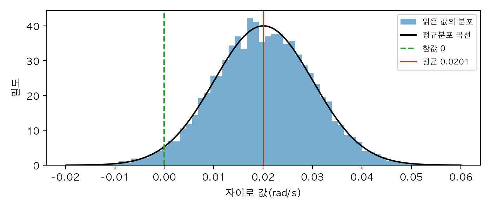
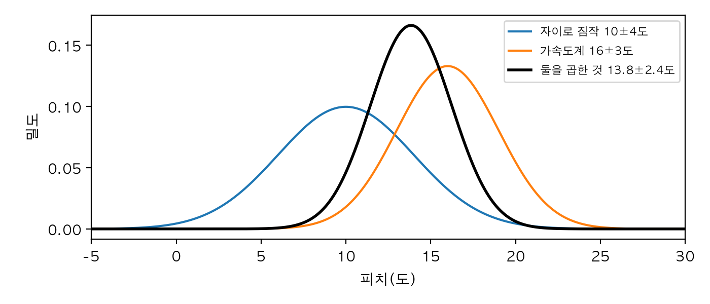
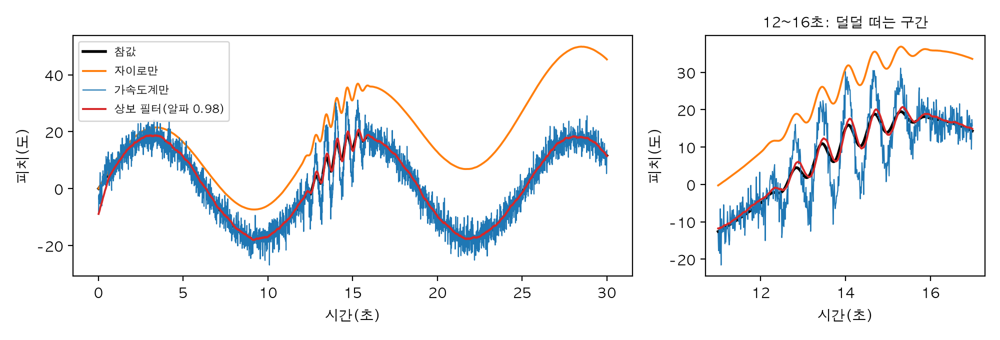
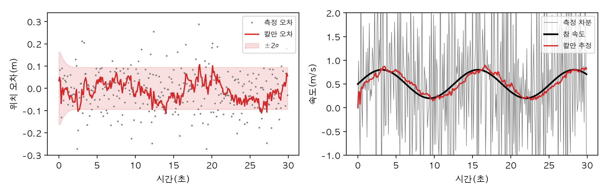
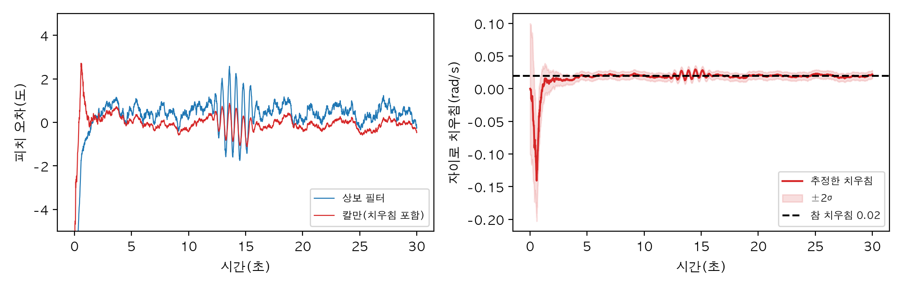
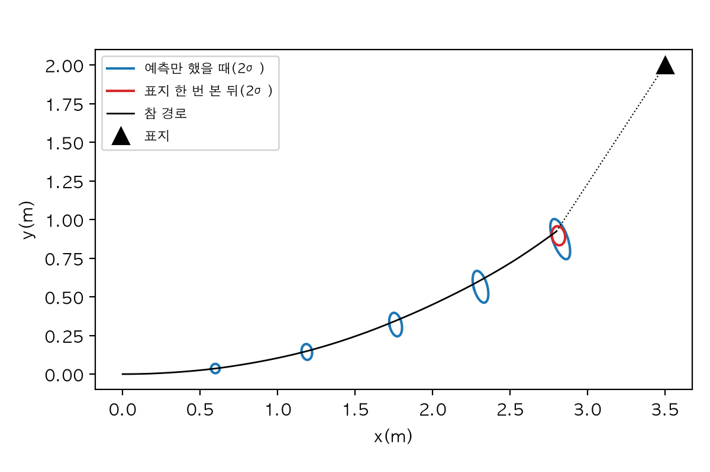
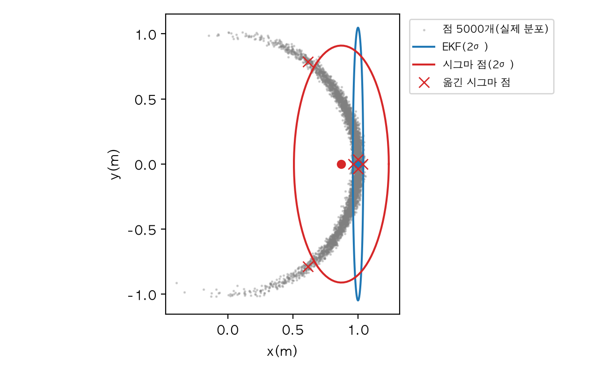
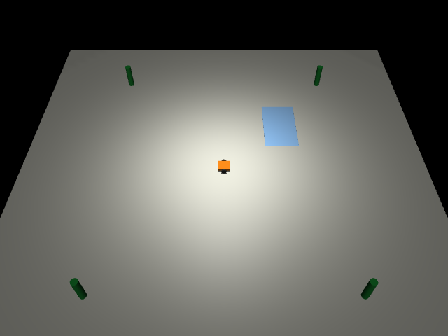
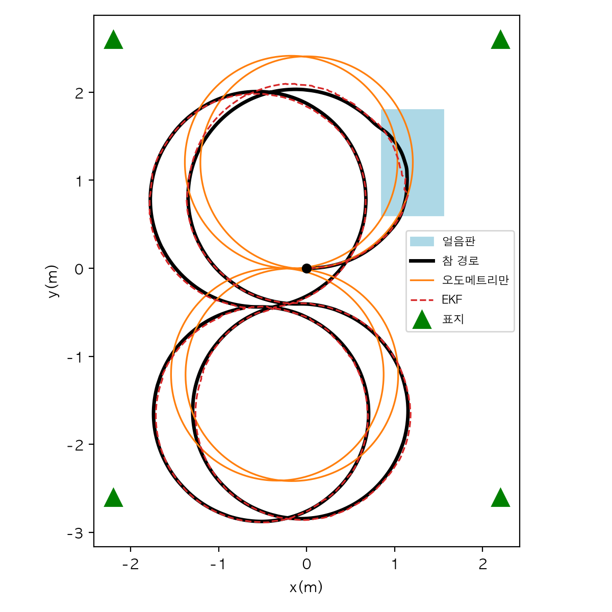
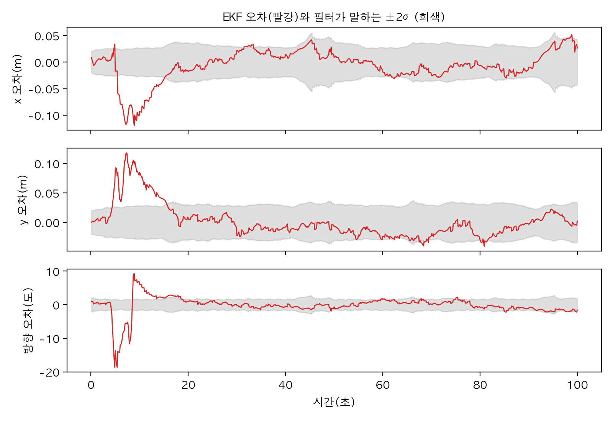

# Chapter 8. 센서와 칼만 필터: 흔들리는 숫자에서 진짜 값 찾기

> **학습 목표**  
> - 센서 오차를 잡음(분산·표준편차)과 치우침으로 나누고, 측정 모델 z = h(x) + 잡음으로 적기
> - 정규분포 두 개를 곱하면 더 좁아진다는 것을 그림과 계산으로 확인하기
> - 자이로와 가속도계를 비율로 섞는 상보 필터를 만들고, 섞는 비율의 뜻을 시간 상수로 읽기
> - 1차원 칼만 필터의 예측과 갱신을 손으로 짜고, 칼만 이득과 Q, R의 성격 알기
> - 행렬 칼만 필터로 속도를 추정하고, 자이로 치우침까지 상태에 넣어 2장의 드리프트 풀기
> - 확장 칼만 필터(EKF)로 바퀴 로봇의 위치와 방향을 표지 측정으로 고치고, UKF·파티클 필터와 비교하기
> - 혁신, NIS, NEES로 필터를 진단하고, 단위·각도 감싸기 같은 흔한 실수를 피하기

---

## 들어가며: 자이로와 가속도계, 누구 말을 믿을까요?

2장 2.11절 끝에서 자이로를 쌓아 자세를 추적했죠. 깨끗한 센서에서는 잘 맞았지만, 늘 같은 쪽으로 조금씩 틀리는 치우침이 섞이자 오차가 시간에 따라 계속 불어났습니다. 드리프트였어요. 반대로 7장 7.9절에서는 가속도계로 기울기를 쟀는데, 가만히 있을 때는 정확했지만 움직이는 동안에는 중력과 움직임의 가속도가 섞여 버린다고 했습니다.

두 센서를 같은 판에 달고 직접 비교해 보겠습니다. 경첩에 매달린 판이 앞뒤로 천천히 기우는데, 12초부터 16초 사이에는 덜덜 떨기도 합니다. IMU는 경첩에서 0.3m 위에 달려 있어서, 판이 기울 때마다 IMU가 앞뒤로 휘둘려요. 로봇 몸통 꼭대기에 달린 IMU를 떠올리면 됩니다. MuJoCo가 만든 깨끗한 값에, 값싼 IMU처럼 잡음과 치우침을 더해서 씁니다(장면 파일은 8.2절에서 보여 드려요).

```python
import numpy as np

from 흔들판 import 가속도_피치, 기록하기, 센서_더하기, 주기

기록 = 기록하기()
자이로, 가속도 = 센서_더하기(기록, np.random.default_rng(0))

자이로_피치 = np.cumsum(자이로) * 주기          # 2장 방식: 각속도를 쌓는다(1차원이라 더하기면 된다)
가속도_피치값 = 가속도_피치(가속도)              # 7장 방식: 중력 방향으로 읽는다
참값 = 기록["참_피치"]

print(" 시각 |  참 피치 | 자이로 쌓기 | 가속도계")
for 초 in [1, 5, 13, 20, 30]:
    i = round(초 / 주기) - 1
    print(f"{초:4d}초 | {np.rad2deg(참값[i]):6.1f}도 | {np.rad2deg(자이로_피치[i]):8.1f}도 | {np.rad2deg(가속도_피치값[i]):6.1f}도")
```

```text
 시각 |  참 피치 | 자이로 쌓기 | 가속도계
   1초 |    8.5도 |      9.7도 |    6.7도
   5초 |   10.7도 |     16.3도 |    9.6도
  13초 |    2.6도 |     17.2도 |   -2.0도
  20초 |   -9.7도 |     12.9도 |  -11.3도
  30초 |   11.6도 |     45.4도 |   13.5도
```

자이로를 쌓은 피치는 1초에는 참값과 1.2도 차이였는데 30초에는 45.4도로, 참값 11.6도보다 34도 가까이 위로 떠 버렸습니다. 치우침이 쌓인 거예요. 가속도계는 30초에도 13.5도로 참값 근처에 있지만, 매번 몇 도씩 틀리고 판이 덜덜 떠는 13초에는 참값 2.6도를 -2.0도로 읽었습니다.

한 사람은 방금 일은 잘 기억하는데 시간이 지날수록 이야기가 조금씩 부풀고, 다른 한 사람은 큰 줄기는 정확한데 말할 때마다 세부가 흔들린다고 해 봅시다. 둘의 이야기를 어떻게 합쳐야 진실에 가까워질까요? 이 장은 이 질문에 답하는 방법들을 차례로 만듭니다. 비율을 정해 섞는 **상보 필터**, 섞는 비율을 매 순간 스스로 계산하는 **칼만 필터**, 그리고 세상이 직선이 아닐 때 쓰는 **확장 칼만 필터(EKF)** 입니다. 마지막 실습에서는 MuJoCo 바퀴 로봇이 얼음판에서 미끄러지는 동안에도 위치를 놓치지 않게 만들어요.

> **Q. 칼만 필터는 로봇에서만 쓰나요?**
> 아닙니다. 1960년에 칼만(Rudolf Kálmán)이 발표한 뒤 아폴로 우주선의 항법에 쓰였고, 지금은 휴대폰의 자세 계산, 자동차 내비게이션의 GPS 보정, 드론의 비행 제어, 주가 같은 시계열 분석까지 곳곳에 있습니다. "움직임에 대한 짐작"과 "잡음 섞인 측정"이 함께 있는 곳이면 어디든 쓸 수 있어요. 이 장의 예제는 파이썬 3.12, NumPy 2.5, MuJoCo 3.17에서 실행해 확인했습니다.

## 8.1 센서는 어떻게 틀리나

### 잡음과 치우침, 그리고 정규분포

1장 1.3절에서 센서 오차를 두 가지로 나눴습니다. 잴 때마다 위아래로 흔들리는 **잡음**과 늘 같은 쪽으로 틀리는 **치우침**이었죠. 이번에는 그 흔들림의 **모양**을 보겠습니다. 바닥에 가만히 놓인 상자의 자이로를 10000번 읽어 볼 텐데, 하나 확인할 것이 있어요. MuJoCo의 MJCF에는 센서마다 `noise` 속성을 적을 수 있습니다. 여기에 0.01을 적으면 MuJoCo가 잡음을 섞어 줄까요?

```python
import matplotlib.pyplot as plt
import mujoco
import numpy as np

plt.rcParams["font.family"] = "AppleGothic"
plt.rcParams["axes.unicode_minus"] = False

# 바닥에 가만히 놓인 상자의 IMU. 자이로에 noise="0.01"을 적어 두었다
xml = """
<mujoco>
  <worldbody>
    <geom type="plane" size="1 1 0.1"/>
    <body pos="0 0 0.05"><freejoint/><geom type="box" size="0.1 0.1 0.05"/><site name="imu"/></body>
  </worldbody>
  <sensor><gyro name="자이로" site="imu" noise="0.01"/></sensor>
</mujoco>
"""
모델 = mujoco.MjModel.from_xml_string(xml)
데이터 = mujoco.MjData(모델)
읽기 = []
for _ in range(10000):
    mujoco.mj_step(모델, 데이터)
    읽기.append(데이터.sensor("자이로").data[1])
읽기 = np.array(읽기)
print(f"MJCF의 noise {모델.sensor_noise[0]} → MuJoCo 자이로 10000번의 표준편차 {읽기.std():.6f}")

# 잡음과 치우침은 직접 더한다(값싼 IMU를 흉내 낸 값, rad/s)
잰_값 = 읽기 + 0.02 + np.random.default_rng(0).normal(0, 0.01, len(읽기))
평균, 표준편차 = 잰_값.mean(), 잰_값.std()
print(f"더한 뒤: 평균 {평균:.4f}, 표준편차 {표준편차:.4f}")
for k in [1, 2, 3]:
    print(f"평균 ±{k}σ 안에 든 비율: {np.mean(np.abs(잰_값 - 평균) < k * 표준편차):.1%}")

그림, 칸 = plt.subplots(figsize=(7, 3))
칸.hist(잰_값, bins=60, density=True, alpha=0.6, label="읽은 값의 분포")
x = np.linspace(평균 - 4 * 표준편차, 평균 + 4 * 표준편차, 200)
칸.plot(x, np.exp(-0.5 * ((x - 평균) / 표준편차) ** 2) / (표준편차 * np.sqrt(2 * np.pi)), "k", label="정규분포 곡선")
칸.axvline(0, color="tab:green", ls="--", label="참값 0")
칸.axvline(평균, color="tab:red", label=f"평균 {평균:.4f}")
칸.set_xlabel("자이로 값(rad/s)")
칸.set_ylabel("밀도")
칸.legend(fontsize=8)
그림.tight_layout()
그림.savefig("gyro_hist.png", dpi=200)
print("저장: gyro_hist.png")
```

```text
MJCF의 noise 0.01 → MuJoCo 자이로 10000번의 표준편차 0.000000
더한 뒤: 평균 0.0201, 표준편차 0.0100
평균 ±1σ 안에 든 비율: 68.2%
평균 ±2σ 안에 든 비율: 95.4%
평균 ±3σ 안에 든 비율: 99.8%
저장: gyro_hist.png
```



첫 줄이 답입니다. `noise`를 0.01로 적었는데도 MuJoCo 자이로 값의 표준편차는 0이에요. MuJoCo는 이 값을 모델에 적어 두기만 하고 시뮬레이션에서 잡음을 더하지 않습니다. 그래서 이 장에서는 잡음과 치우침을 언제나 우리 손으로 더해요. 오히려 잘된 일입니다. 잡음이 얼마인지 정확히 알고 있으니 필터가 그걸 잘 알아맞히는지 채점할 수 있거든요.

잡음 0.01rad/s와 치우침 0.02rad/s를 더한 값의 분포는 가운데가 볼록한 종 모양입니다. 1권 20장에서 `np.random.normal`로 뽑아 본 **정규분포(가우스 분포)** 예요. 정규분포는 숫자 두 개로 모양이 다 정해집니다. 가운데를 나타내는 **평균**과, 얼마나 퍼졌는지를 나타내는 **표준편차** σ(시그마)입니다. 표준편차를 제곱한 것을 **분산**이라고 하는데, 칼만 필터의 계산은 대부분 분산으로 해요. 출력의 세 줄은 정규분포의 유명한 성질입니다. 평균 ±1σ 안에 약 68%, ±2σ 안에 약 95%, ±3σ 안에 99.7%가 들어가요. 8.7절에서 필터를 진단할 때 이 숫자를 다시 씁니다.

그림의 빨간 선(평균 0.0201)이 초록 점선(참값 0)에서 비켜 있는 것이 치우침이에요. 가만히 있을 때 평균을 재서 빼 주면 치우침을 없앨 수 있는데, 7장의 영점 보정과 같은 생각입니다. 문제는 IMU의 치우침이 온도나 시간에 따라 조금씩 변한다는 거예요. 켤 때 한 번 재서 빼도 금방 다시 틀어집니다. 그래서 이 장 8.4절에서는 치우침을 **움직이는 동안 계속 추정**하는 방법을 만들어요.

### 측정 모델: z = h(x) + 잡음

센서는 우리가 알고 싶은 값을 그대로 알려 주지 않습니다. 가속도계는 피치를 재는 게 아니라 가속도 두 개(x, z)를 재죠. 그래서 "알고 싶은 값(상태 x)이 이러면 센서는 이렇게 읽는다"를 식으로 적어 두는데, 이것을 **측정 모델**이라고 합니다.

> z = h(x) + v  (z: 센서가 읽은 값, x: 상태, h: 측정 모델, v: 잡음)

가만히 있는 IMU의 가속도계라면 h(피치) = (-g·sin 피치, g·cos 피치)입니다. 2장의 회전 행렬로 중력 방향을 몸 좌표로 옮긴 결과예요. 잡음이 가속도에 붙어 있을 때 피치는 얼마나 흔들리는지 확인해 봅시다.

```python
import numpy as np

g = 9.81


def h(피치: float) -> np.ndarray:
    """측정 모델: 가만히 있을 때 가속도계가 재는 [x, z](m/s²)."""
    return np.array([-g * np.sin(피치), g * np.cos(피치)])


생성기 = np.random.default_rng(0)
참_피치 = np.deg2rad(20.0)
가속도_잡음 = 0.5                                       # m/s²
잰_값 = h(참_피치) + 생성기.normal(0, 가속도_잡음, (10000, 2))    # z = h(x) + 잡음
읽은_피치 = np.arctan2(-잰_값[:, 0], 잰_값[:, 1])

print("h(20도) =", np.round(h(참_피치), 3))
print(f"읽은 피치: 평균 {np.rad2deg(읽은_피치.mean()):.2f}도, 표준편차 {np.rad2deg(읽은_피치.std()):.2f}도")
print(f"어림셈 잡음/g = {np.rad2deg(가속도_잡음 / g):.2f}도")
```

```text
h(20도) = [-3.355  9.218]
읽은 피치: 평균 19.98도, 표준편차 2.90도
어림셈 잡음/g = 2.92도
```

20도로 기운 판의 가속도계는 (-3.355, 9.218)m/s²를 읽어야 합니다. 여기에 표준편차 0.5m/s²의 잡음을 섞어 10000번 읽고 피치로 바꾸면 평균은 19.98도로 거의 맞지만 표준편차가 2.90도예요. 어림셈으로 "잡음 ÷ 중력" = 0.5 ÷ 9.81 ≈ 0.051rad = 2.92도와 잘 맞습니다. 센서의 잡음(m/s²)을 상태의 단위(rad)로 옮겨 생각하는 이 어림셈이 칼만 필터의 R을 정할 때 그대로 쓰입니다. 8.4절에서 R = (0.5 / 9.81)²으로 적은 것이 이 결과예요.

### 정규분포를 곱하면 더 좁아진다

이제 이 장의 핵심 그림을 하나 보겠습니다. 자이로를 쌓아 "피치는 10도쯤, 그런데 ±4도는 틀릴 수 있다"고 짐작했고, 가속도계는 "16도, ±3도"라고 읽었다고 해요. 둘 다 맞을 가능성을 함께 따지려면 두 분포를 칸마다 곱하면 됩니다. 두 증언이 동시에 그럴듯한 곳만 크게 남으니까요.

```python
import matplotlib.pyplot as plt
import numpy as np

plt.rcParams["font.family"] = "AppleGothic"
plt.rcParams["axes.unicode_minus"] = False


def 정규분포(x: np.ndarray, 평균: float, 표준편차: float) -> np.ndarray:
    return np.exp(-0.5 * ((x - 평균) / 표준편차) ** 2) / (표준편차 * np.sqrt(2 * np.pi))


평균1, 표준편차1 = 10.0, 4.0      # 자이로를 쌓아 짐작한 피치(도)
평균2, 표준편차2 = 16.0, 3.0      # 가속도계로 읽은 피치(도)

# 공식: 분산이 작은(더 믿을 만한) 쪽에 더 끌려간다
분산 = 1 / (1 / 표준편차1**2 + 1 / 표준편차2**2)
평균 = 분산 * (평균1 / 표준편차1**2 + 평균2 / 표준편차2**2)
print(f"공식: 평균 {평균:.2f}도, 표준편차 {np.sqrt(분산):.2f}도")

# 검산: 두 곡선을 칸마다 곱하고 넓이를 1로 맞춘 뒤 평균과 표준편차를 잰다
x = np.linspace(-10, 40, 50001)
곱 = 정규분포(x, 평균1, 표준편차1) * 정규분포(x, 평균2, 표준편차2)
곱 /= np.trapezoid(곱, x)
수치_평균 = np.trapezoid(x * 곱, x)
수치_표준편차 = np.sqrt(np.trapezoid((x - 수치_평균) ** 2 * 곱, x))
print(f"수치: 평균 {수치_평균:.2f}도, 표준편차 {수치_표준편차:.2f}도")

그림, 칸 = plt.subplots(figsize=(7, 3))
칸.plot(x, 정규분포(x, 평균1, 표준편차1), label=f"자이로 짐작 {평균1:.0f}±{표준편차1:.0f}도")
칸.plot(x, 정규분포(x, 평균2, 표준편차2), label=f"가속도계 {평균2:.0f}±{표준편차2:.0f}도")
칸.plot(x, 곱, color="black", lw=2, label=f"둘을 곱한 것 {평균:.1f}±{np.sqrt(분산):.1f}도")
칸.set_xlim(-5, 30)
칸.set_xlabel("피치(도)")
칸.set_ylabel("밀도")
칸.legend(fontsize=8)
그림.tight_layout()
그림.savefig("gauss_product.png", dpi=200)
print("저장: gauss_product.png")
```

```text
공식: 평균 13.84도, 표준편차 2.40도
수치: 평균 13.84도, 표준편차 2.40도
저장: gauss_product.png
```



곱한 분포(검은 선)는 두 가지 특징이 있습니다. 첫째, 가운데가 13.84도로 **더 믿을 만한 쪽(가속도계, ±3도)에 더 가깝습니다**. 각자의 분산의 역수로 무게를 매겨 평균한 값이에요. 둘째, 표준편차가 2.40도로 **둘 중 어느 것보다도 좁습니다**. 정보를 합치면 불확실성이 줄어든다는 뜻이에요. 공식으로 계산한 값과 칸마다 곱해서 잰 값이 똑같이 나왔으니, 두 정규분포를 곱하면 다시 정규분포가 된다는 것도 확인한 셈입니다.

칼만 필터는 사실 이 그림을 매 순간 되풀이하는 것뿐입니다. 짐작(예측)의 분포와 측정의 분포를 곱해서 더 좁은 분포를 얻고, 그 분포를 들고 다음 순간으로 넘어가요. 8.3절에서 이 이야기를 코드로 옮깁니다. 그 전에 더 단순한 방법부터 보겠습니다.

## 8.2 상보 필터: 비율을 정해 섞기

### 흔들판 장면

들어가며에서 쓴 장면을 먼저 보여 드리겠습니다. 경첩 하나로 매달린 판을 모터가 정해진 각도로 따라가게 만들고, 경첩에서 0.3m 위에 IMU 사이트를 달았어요. 4장 4.7절에서 배운 대로 걸음을 마친 상태로 `mj_forward`를 불러 센서를 다시 계산한 뒤 100Hz로 기록합니다. 다음 내용을 `흔들판.py`로 저장하세요.

```python
"""8장: 경첩에 매달려 앞뒤로 기우는 판. IMU는 경첩 위 0.3m에 달려 있다."""
import mujoco
import numpy as np

장면 = """
<mujoco>
  <worldbody>
    <body name="판" pos="0 0 0.5">
      <joint name="피치" type="hinge" axis="0 1 0"/>
      <geom type="box" size="0.15 0.1 0.02" mass="1"/>
      <geom type="capsule" fromto="0 0 0 0 0 0.3" size="0.015" mass="0.2"/>
      <site name="imu" pos="0 0 0.3"/>
    </body>
  </worldbody>
  <actuator><motor joint="피치"/></actuator>
  <sensor>
    <gyro name="자이로" site="imu"/>
    <accelerometer name="가속도" site="imu"/>
  </sensor>
</mujoco>
"""
주기 = 0.01                     # 센서를 읽는 간격(100Hz)


def 목표(t: float) -> tuple[float, float]:
    """판이 따라갈 피치 각도와 각속도. 12~16초에는 빠르게 덜덜 떤다."""
    각도 = 0.3 * np.sin(0.5 * t)
    각속도 = 0.15 * np.cos(0.5 * t)
    if 12 <= t < 16:                         # 떨림의 크기는 0에서 시작해 커졌다가 다시 0이 된다
        크기, 크기_변화 = 0.06 * np.sin(np.pi * (t - 12) / 4), 0.06 * np.pi / 4 * np.cos(np.pi * (t - 12) / 4)
        각도 += 크기 * np.sin(10 * (t - 12))
        각속도 += 크기_변화 * np.sin(10 * (t - 12)) + 10 * 크기 * np.cos(10 * (t - 12))
    return 각도, 각속도


def 기록하기(초: float = 30.0) -> dict[str, np.ndarray]:
    """판을 흔들며 100Hz로 참 피치, 자이로 y, 가속도 x·z를 기록한다(잡음 없는 값)."""
    모델 = mujoco.MjModel.from_xml_string(장면)
    데이터 = mujoco.MjData(모델)
    한번에 = round(주기 / 모델.opt.timestep)
    기록 = {"시간": [], "참_피치": [], "자이로": [], "가속도": []}
    for k in range(round(초 / 모델.opt.timestep)):
        각도, 각속도 = 목표(데이터.time)
        데이터.ctrl[0] = 8 * (각도 - 데이터.qpos[0]) + 0.8 * (각속도 - 데이터.qvel[0])
        mujoco.mj_step(모델, 데이터)
        if (k + 1) % 한번에 == 0:
            mujoco.mj_forward(모델, 데이터)          # 4장 4.7절: 걸음을 마친 상태로 센서를 다시 계산
            기록["시간"].append(데이터.time)
            기록["참_피치"].append(데이터.qpos[0])
            기록["자이로"].append(데이터.sensor("자이로").data[1])
            기록["가속도"].append(데이터.sensor("가속도").data[[0, 2]])
    return {이름: np.array(값) for 이름, 값 in 기록.items()}


def 센서_더하기(기록: dict, 생성기: np.random.Generator, 자이로_잡음: float = 0.01,
            자이로_치우침: float = 0.02, 가속도_잡음: float = 0.5) -> tuple[np.ndarray, np.ndarray]:
    """깨끗한 기록에 값싼 IMU의 잡음(표준편차)과 치우침을 더한다. 단위는 rad/s, m/s²."""
    n = len(기록["시간"])
    자이로 = 기록["자이로"] + 자이로_치우침 + 생성기.normal(0, 자이로_잡음, n)
    가속도 = 기록["가속도"] + 생성기.normal(0, 가속도_잡음, (n, 2))
    return 자이로, 가속도


def 가속도_피치(가속도: np.ndarray) -> np.ndarray:
    """중력 방향으로 읽은 피치(7장 7.9절의 식). 가속도는 [x, z] 열."""
    return np.arctan2(-가속도[..., 0], 가속도[..., 1])


def rms_도(오차_rad: np.ndarray) -> float:
    """오차의 제곱 평균 제곱근을 도 단위로."""
    return float(np.rad2deg(np.sqrt(np.mean(np.square(오차_rad)))))
```

판은 0.3rad(약 17도) 크기로 천천히 기울고, 12초부터 16초까지는 초당 10rad의 빠르기로 떨어요. 떨림의 크기를 0에서 시작해 키웠다가 다시 줄인 건 갑자기 덜컥 움직이지 않게 하려는 것입니다. `센서_더하기`의 기본값(자이로 잡음 0.01rad/s, 치우침 0.02rad/s, 가속도 잡음 0.5m/s²)은 값싼 MEMS IMU에서 볼 수 있는 크기로 정했어요. 2장보다 치우침을 두 배로 키워 드리프트가 잘 보이게 했습니다.

> **Q. 판을 움직이는 모터에 position 액추에이터를 쓰지 않은 이유가 있나요?**
> 4장 4.6절의 position 액추에이터나 관절의 `damping`을 쓰면 판이 부드럽게 움직이기는 합니다. 그런데 이 장면을 처음 만들 때 그렇게 했더니, 판이 천천히 기울 뿐인데도 가속도계 값이 위치를 두 번 미분해 얻은 가속도와 1m/s²가량 어긋났어요. 감쇠 같은 속도 비례 힘을 적분기가 따로 처리하면서 `mj_forward`가 다시 계산한 가속도와 실제 걸음 사이에 차이가 생긴 것으로 보입니다. 그래서 힘을 직접 주는 `motor` 액추에이터에 우리가 계산한 비례·미분 제어를 붙였어요. 센서를 채점할 때는 이렇게 정답지와 한 번 맞춰 보는 습관이 4장에 이어 여기서도 쓸모가 있었습니다.

### 높은 소리는 자이로, 낮은 소리는 가속도계

오디오의 스피커를 떠올려 보세요. 큰 스피커에는 낮은 소리를 잘 내는 우퍼와 높은 소리를 잘 내는 트위터가 함께 들어 있고, 각자 잘하는 음역만 맡아서 합칩니다. 센서도 마찬가지예요. 자이로는 **빠른 변화(높은 주파수)** 에 강하고 느린 변화(치우침의 누적)에 약합니다. 가속도계는 그 반대예요. 그러니 빠른 변화는 자이로에게, 느린 변화는 가속도계에게 맡기면 됩니다.

식으로는 한 줄이에요. 매 걸음마다 자이로로 한 걸음 예측한 값과 가속도계가 읽은 값을 정해진 비율 α(알파)로 섞습니다.

> 피치 = α × (피치 + 자이로 × Δt) + (1 - α) × 가속도계_피치

α가 0.98이면 "자이로 쪽 98%, 가속도계 쪽 2%"입니다. 한 걸음에 2%씩만 가속도계 쪽으로 끌어당기니, 가속도계의 순간적인 흔들림은 거의 반영되지 않고, 대신 자이로가 천천히 벗어나는 건 꾸준히 바로잡혀요. 두 비율의 합이 언제나 1이라서 서로를 보완(complement)한다는 뜻으로 **상보 필터(complementary filter)** 라고 부릅니다.

```python
import matplotlib.pyplot as plt
import numpy as np

from 흔들판 import rms_도, 가속도_피치, 기록하기, 센서_더하기, 주기

plt.rcParams["font.family"] = "AppleGothic"
plt.rcParams["axes.unicode_minus"] = False


def 상보_필터(자이로: np.ndarray, 가속도_피치값: np.ndarray, 알파: float) -> np.ndarray:
    """자이로로 한 걸음 예측하고, 가속도계 쪽으로 (1 - 알파)만큼 끌어당긴다."""
    피치 = 가속도_피치값[0]                       # 처음 값은 가속도계로 잡는다
    결과 = []
    for w, a in zip(자이로, 가속도_피치값):
        피치 = 알파 * (피치 + w * 주기) + (1 - 알파) * a
        결과.append(피치)
    return np.array(결과)


기록 = 기록하기()
자이로, 가속도 = 센서_더하기(기록, np.random.default_rng(0))
참값, 시간 = 기록["참_피치"], 기록["시간"]
추정들 = {
    "자이로만": np.cumsum(자이로) * 주기,
    "가속도계만": 가속도_피치(가속도),
    "상보 필터(알파 0.98)": 상보_필터(자이로, 가속도_피치(가속도), 0.98),
}
for 이름, 추정 in 추정들.items():
    print(f"{이름:14s}: 오차 RMS {rms_도(추정 - 참값):5.2f}도, 가장 클 때 {np.rad2deg(np.abs(추정 - 참값).max()):5.2f}도")

그림, 칸들 = plt.subplots(1, 2, figsize=(10, 3.4), gridspec_kw={"width_ratios": [2, 1]})
for 칸, (시작, 끝) in zip(칸들, [(0, 30), (11, 17)]):
    구간 = (시간 >= 시작) & (시간 <= 끝)
    칸.plot(시간[구간], np.rad2deg(참값[구간]), color="black", lw=2, label="참값")
    for (이름, 추정), 색 in zip(추정들.items(), ["tab:orange", "tab:blue", "tab:red"]):
        칸.plot(시간[구간], np.rad2deg(추정[구간]), color=색, lw=0.8 if 이름 == "가속도계만" else 1.4, label=이름)
    칸.set_xlabel("시간(초)")
    칸.set_ylabel("피치(도)")
칸들[0].legend(fontsize=8, loc="upper left")
칸들[1].set_title("12~16초: 덜덜 떠는 구간", fontsize=10)
그림.tight_layout()
그림.savefig("complementary.png", dpi=200)
print("저장: complementary.png")
```

```text
자이로만          : 오차 RMS 19.58도, 가장 클 때 33.76도
가속도계만         : 오차 RMS  3.64도, 가장 클 때 16.77도
상보 필터(알파 0.98): 오차 RMS  1.05도, 가장 클 때  8.91도
저장: complementary.png
```



세 줄의 숫자가 그림과 같은 이야기를 합니다. 자이로만 쓰면 오차 RMS(제곱 평균의 제곱근, 평균적인 오차 크기)가 19.58도, 가속도계만 쓰면 3.64도인데, 상보 필터는 1.05도예요. 두 센서 어느 쪽보다도 좋습니다. 오른쪽 확대 그림을 보면 떨림 구간에서 가속도계(파란 선)는 판이 휘둘리는 가속도에 속아 참값보다 훨씬 크게 출렁이지만, 상보 필터는 자이로 덕분에 참값의 떨림을 그대로 따라가요. 상보 필터의 "가장 클 때 8.91도"는 맨 처음 순간입니다. 첫 값을 가속도계 한 번 읽은 값으로 잡았는데 그게 9도 가까이 틀렸고, 약 1초에 걸쳐 따라잡았어요.

### 알파와 시간 상수

α는 어떻게 정할까요? 몇 가지를 넣어 비교해 보겠습니다.

```python
import numpy as np

from 흔들판 import rms_도, 가속도_피치, 기록하기, 센서_더하기, 주기

기록 = 기록하기()
자이로, 가속도 = 센서_더하기(기록, np.random.default_rng(0))
가속도_피치값 = 가속도_피치(가속도)
참값 = 기록["참_피치"]

print("  알파  | 시간 상수 | 오차 RMS | 떠는 구간 RMS")
for 알파 in [0.5, 0.9, 0.98, 0.995, 0.999]:
    피치, 결과 = 가속도_피치값[0], []
    for w, a in zip(자이로, 가속도_피치값):
        피치 = 알파 * (피치 + w * 주기) + (1 - 알파) * a
        결과.append(피치)
    오차 = np.array(결과) - 참값
    떠는_구간 = (기록["시간"] >= 12) & (기록["시간"] < 16)
    시간_상수 = 알파 * 주기 / (1 - 알파)
    print(f" {알파:.3f} | {시간_상수:6.2f}초 | {rms_도(오차):6.2f}도 | {rms_도(오차[떠는_구간]):6.2f}도")
```

```text
  알파  | 시간 상수 | 오차 RMS | 떠는 구간 RMS
 0.500 |   0.01초 |   2.74도 |   6.00도
 0.900 |   0.09초 |   1.74도 |   4.18도
 0.980 |   0.49초 |   1.05도 |   1.16도
 0.995 |   1.99초 |   2.36도 |   2.21도
 0.999 |   9.99초 |   7.06도 |   6.31도
```

α가 작으면(0.5) 가속도계를 너무 믿어서 떨림 구간에서 6.00도나 틀리고, α가 너무 크면(0.999) 자이로를 너무 믿어서 치우침이 쌓이는 걸 제때 바로잡지 못해 전체 RMS가 7.06도까지 커집니다. 이 데이터에서는 0.98이 가장 좋았어요.

α를 읽기 좋은 숫자로 바꾸는 방법이 **시간 상수** τ = α·Δt / (1 - α)입니다. α = 0.98, Δt = 0.01초면 0.49초예요. 대략 "τ보다 빠른 변화는 자이로를, τ보다 느린 변화는 가속도계를 믿는다"는 뜻입니다. 1장 1.3절의 모터 시간 상수와 같은 말이에요. 판의 큰 기울기는 12초에 한 번 출렁이는 느린 움직임이니 가속도계가, 떨림은 0.6초 주기이니 자이로가 맡게 되죠. 같은 α라도 센서를 읽는 간격이 바뀌면 τ가 달라지니, 다른 사람의 코드에서 α를 가져올 때는 Δt도 같이 확인하세요.

상보 필터는 몇 줄이면 되고 계산도 아주 가벼워서, 작은 마이크로컨트롤러로 도는 드론이나 밸런싱 로봇에서 지금도 많이 씁니다. 하지만 두 가지 아쉬움이 있어요. α를 사람이 손으로 정해야 하고, 자이로의 치우침이 τ만큼 늘 한쪽으로 결과를 밀어냅니다. 8.4절에서 이 밀림을 숫자로 확인하고 칼만 필터로 없애 보겠습니다.

## 8.3 1차원 칼만 필터: 예측하고, 고치고

### 벽까지의 거리를 재는 로봇

가장 단순한 경우부터 보겠습니다. 벽 앞에 가만히 서 있는 로봇이 거리 센서로 벽까지 거리를 계속 잽니다. 1장 1.3절과 같은 센서(잡음 표준편차 0.02m)예요. 칼만 필터는 두 단계를 번갈아 돕니다.

1. **예측**: 움직임에 대해 아는 것으로 다음 값을 짐작한다. 짐작에는 늘 오차가 붙으니 불확실성(분산 P)이 Q만큼 커진다
2. **갱신**: 측정(분산 R)과 짐작을 8.1절처럼 곱해서 합친다. 불확실성이 줄어든다

갱신을 식으로 쓰면 이렇습니다. 8.1절의 분포 곱하기 공식을 "짐작에서 측정 쪽으로 얼마나 옮길까"의 꼴로 다시 쓴 거예요.

> K = P / (P + R),  x = x + K × (z - x),  P = (1 - K) × P

K를 **칼만 이득(Kalman gain)** 이라고 부릅니다. 0과 1 사이의 값으로, 1이면 측정을 그대로 믿고 0이면 측정을 무시해요. 짐작이 불확실할수록(P가 클수록) 측정 쪽으로 많이 옮기고, 측정이 불확실할수록(R이 클수록) 조금만 옮깁니다. 벽도 로봇도 움직이지 않으니 Q는 0으로 두고, 처음에는 아무것도 모른다는 뜻으로 아무 값(0)에 아주 큰 분산(100)을 줍니다.

```python
import numpy as np

생성기 = np.random.default_rng(0)
참_거리, R = 1.0, 0.02**2          # 벽까지 1m, 거리 센서 잡음 표준편차 0.02m(분산 R)
Q = 0.0                             # 벽도 로봇도 움직이지 않는다

x, P = 0.0, 100.0                   # 처음에는 아무것도 모른다: 아무 값 + 아주 큰 분산
읽은_값들 = []
print("  n |  칼만 이득 K |   추정값  |  그냥 평균 | 추정의 표준편차")
for n in range(1, 101):
    x, P = x, P + Q                         # 예측: 값은 그대로, 불확실성은 Q만큼 커진다
    z = 참_거리 + 생성기.normal(0, 0.02)     # 측정
    K = P / (P + R)                         # 갱신: 얼마나 측정 쪽으로 옮길까
    x = x + K * (z - x)
    P = (1 - K) * P
    읽은_값들.append(z)
    if n in [1, 2, 3, 4, 10, 100]:
        print(f"{n:3d} | {K:10.4f} | {x:.5f} | {np.mean(읽은_값들):.5f} | {np.sqrt(P):.4f}m")
```

```text
  n |  칼만 이득 K |   추정값  |  그냥 평균 | 추정의 표준편차
  1 |     1.0000 | 1.00251 | 1.00251 | 0.0200m
  2 |     0.5000 | 0.99993 | 0.99994 | 0.0141m
  3 |     0.3333 | 1.00423 | 1.00423 | 0.0115m
  4 |     0.2500 | 1.00369 | 1.00369 | 0.0100m
 10 |     0.1000 | 1.00169 | 1.00169 | 0.0063m
100 |     0.0100 | 1.00162 | 1.00162 | 0.0020m
```

칼만 이득이 1, 1/2, 1/3, 1/4, ..., 1/100로 줄어듭니다. 그리고 추정값이 지금까지 읽은 값의 그냥 평균과 똑같아요(둘째 줄의 0.00001 차이는 처음에 준 "0, 분산 100"이 아주 조금 섞인 흔적입니다). 1장에서 잡음을 줄이려고 평균을 냈는데, 칼만 필터는 그 평균을 **한 번에 하나씩** 계산하고 있었던 거예요. 모든 값을 저장해 둘 필요 없이 x와 P 두 숫자만 들고 다니면 됩니다.

추정의 표준편차 √P도 0.02, 0.0141, 0.0115, 0.0100으로 줄어 100번째에 0.0020m가 됐습니다. 1장 1.3절에서 본 "횟수를 4배로 늘리면 흔들림이 절반"과 같은 숫자예요. 칼만 필터는 값만 추정하는 게 아니라 **그 값을 얼마나 믿어도 되는지**도 함께 알려 줍니다. 이 점이 로봇에게 아주 중요합니다. "벽까지 1m"와 "벽까지 1m, 오차는 2mm 이내"는 브레이크를 밟는 시점을 다르게 만드니까요.

### Q: 세상이 변한다고 믿는 정도

그런데 Q = 0에는 함정이 있습니다. K가 계속 작아져서 나중에는 새 측정을 거의 무시하게 돼요. 그사이 무언가 바뀌면 어떻게 될까요? 100번째 측정부터 벽이 0.2m 가까워진다고(로봇이 미끄러져 다가갔다고) 해 보겠습니다.

```python
import numpy as np

R = 0.02**2
참값 = np.where(np.arange(200) < 100, 1.0, 0.8)     # 100번째 측정부터 벽이 0.2m 가까워진다
측정 = 참값 + np.random.default_rng(0).normal(0, 0.02, 200)

print("    Q     | 1cm 안으로 들어오기 | 마지막 40번의 흔들림 | 안정된 K")
for Q in [0.0, 1e-6, 1e-5, 1e-4, 1e-3]:
    x, P, 추정 = 0.0, 100.0, []
    for z in 측정:
        P = P + Q
        K = P / (P + R)
        x = x + K * (z - x)
        P = (1 - K) * P
        추정.append(x)
    오차 = np.abs(np.array(추정[100:]) - 0.8)
    if (오차 < 0.01).any():
        따라잡기 = f"{np.argmax(오차 < 0.01) + 1:3d}번 만에"
        흔들림 = f"{np.std(추정[160:]) * 1000:5.1f}mm"
    else:
        따라잡기, 흔들림 = "못 들어옴", "-"
    print(f" {Q:8.0e} | {따라잡기:>12s} | {흔들림:>10s} | {K:.3f}")
```

```text
    Q     | 1cm 안으로 들어오기 | 마지막 40번의 흔들림 | 안정된 K
    0e+00 |        못 들어옴 |          - | 0.005
    1e-06 |       56번 만에 |      2.4mm | 0.049
    1e-05 |       24번 만에 |      4.6mm | 0.146
    1e-04 |        6번 만에 |      8.9mm | 0.390
    1e-03 |        3번 만에 |     14.5mm | 0.766
```

Q = 0이면 100번이 지나도록 새 거리 0.8m의 1cm 안으로 들어오지 못합니다. 칼만 이득이 0.005까지 줄어서, 지난 100번의 평균에 고집스럽게 매달린 거예요. Q를 키우면 "세상은 매 순간 이만큼 변할 수 있다"고 인정하는 셈이라 P가 0까지 줄지 않고, 칼만 이득이 일정한 값에서 멈춥니다. 그만큼 새 측정에 빨리 반응해서 Q = 10⁻⁴이면 6번 만에 따라잡아요. 대신 측정 잡음도 그만큼 따라 흔들려서, 따라잡은 뒤의 흔들림이 8.9mm로 커졌습니다.

| | Q를 작게 | Q를 크게 |
|---|---|---|
| 필터의 믿음 | 내 예측이 정확하다 | 세상이 예측과 다르게 변할 수 있다 |
| 칼만 이득 | 작다(측정을 조금만 반영) | 크다(측정을 많이 반영) |
| 장점 | 결과가 매끄럽다 | 변화를 빨리 따라간다 |
| 단점 | 변화에 늦다(심하면 영영 못 따라간다) | 측정 잡음까지 따라 흔들린다 |

R은 그 반대 방향으로 같은 일을 합니다. 결국 칼만 필터가 보는 것은 Q와 R의 **비율**이에요. 상보 필터의 α를 고르던 고민이 Q와 R을 고르는 고민으로 옮겨 온 것인데, 큰 차이가 하나 있습니다. Q와 R은 "자이로 잡음은 0.01rad/s", "거리 센서 잡음은 0.02m"처럼 **센서와 움직임의 성질에서** 정할 수 있는 물리량이라는 점이에요. 데이터시트나 8.1절처럼 가만히 놓고 잰 값에서 출발하면 됩니다.

## 8.4 행렬로 넓히기: 칼만 필터 일반형

### 상태가 여럿일 때

로봇이 알고 싶은 값은 보통 하나가 아닙니다. 위치와 속도, 피치와 치우침처럼 여러 값이 서로 얽혀 있죠. 그래서 숫자 하나였던 x를 벡터로, 분산 P를 **공분산 행렬**로 바꿉니다. 공분산 행렬의 대각선은 각 값의 분산이고, 대각선 밖은 "한 값이 틀리면 다른 값도 함께 틀리는 정도"예요. 이 대각선 밖의 칸이 칼만 필터의 마법을 만듭니다. 위치만 재도 속도가 고쳐지는 이유가 여기 있거든요.

| 기호 | 이름 | 크기(상태 n개, 측정 m개) | 뜻 |
|---|---|---|---|
| x | 상태 | n | 추정하려는 값들 |
| P | 공분산 | n × n | 상태를 얼마나 모르는지 |
| F | 상태 전이 행렬 | n × n | 다음 걸음의 상태 = F @ 지금 상태 |
| B, u | 입력 행렬, 입력 | n × k, k | 모터 명령이나 자이로처럼 밖에서 들어오는 값 |
| Q | 과정 잡음 공분산 | n × n | 예측이 한 걸음마다 얼마나 틀릴 수 있는지 |
| z | 측정 | m | 센서가 읽은 값 |
| H | 측정 행렬 | m × n | 상태가 x일 때 센서가 읽을 값 = H @ x |
| R | 측정 잡음 공분산 | m × m | 센서가 얼마나 흔들리는지 |
| K | 칼만 이득 | n × m | 측정의 차이를 상태 고치기로 바꾸는 행렬 |

1차원 식의 나눗셈은 역행렬로, 곱셈은 행렬 곱으로 바뀌는 것 말고는 똑같습니다. 예측에서 P가 `F @ P @ F.T`가 되는 건, 2장에서 회전 행렬로 벡터를 돌린 것처럼 불확실성의 모양도 F를 따라 옮겨 가기 때문이에요. 두 단계를 `칼만도구.py`로 저장해 두겠습니다.

```python
"""8장: 선형 칼만 필터의 예측과 갱신. 상태 x는 1차원 배열, 나머지는 행렬."""
import numpy as np


def 예측(x: np.ndarray, P: np.ndarray, F: np.ndarray, Q: np.ndarray,
       B: np.ndarray | None = None, u: np.ndarray | None = None) -> tuple[np.ndarray, np.ndarray]:
    """움직임 모델로 한 걸음 내다본다. 불확실성 P는 F로 옮겨지고 Q만큼 커진다."""
    x = F @ x if B is None else F @ x + B @ u
    P = F @ P @ F.T + Q
    return x, P


def 갱신(x: np.ndarray, P: np.ndarray, z: np.ndarray, H: np.ndarray,
       R: np.ndarray) -> tuple[np.ndarray, np.ndarray, np.ndarray, np.ndarray]:
    """측정 z로 고친다. 고친 상태, 공분산, 혁신(잰 값 - 예상한 값), 혁신의 공분산 S를 돌려준다."""
    혁신 = z - H @ x
    S = H @ P @ H.T + R
    K = P @ H.T @ np.linalg.inv(S)          # 칼만 이득
    x = x + K @ 혁신
    P = (np.eye(len(x)) - K @ H) @ P
    return x, P, 혁신, S
```

`갱신`은 **혁신(innovation)** 과 그 공분산 S도 함께 돌려줍니다. 혁신은 "잰 값 - 예상했던 측정"으로, 필터가 얼마나 놀랐는지를 나타내요. 지금은 쓰지 않지만 8.7절에서 필터를 진단하는 핵심 재료가 됩니다.

### 위치만 재서 속도 알아내기

직선 위를 달리는 로봇이 있고, 0.1초마다 위치를 잡음 0.1m로 잰다고 해 봅시다. 실내 무선 측위 장치 같은 센서예요. 속도는 재지 않는데, 속도도 알고 싶습니다. 상태를 [위치, 속도]로 잡으면 "다음 위치 = 위치 + 속도 × Δt, 다음 속도 = 속도"이니 F = [[1, Δt], [0, 1]]이고, 위치만 재니 H = [1, 0]입니다. 속도가 정말 일정하지는 않으니, 가속도가 아무렇게나 조금씩 바뀐다고 보고 그 세기 q로 Q를 만들어요.

```python
"""8.4절: 직선 위를 달리는 로봇과 10Hz 위치 센서(잡음 0.1m)."""
import numpy as np

주기 = 0.1
시간 = np.arange(0, 30, 주기)
참_속도 = 0.5 + 0.3 * np.sin(0.5 * 시간)                       # m/s
참_위치 = (0.5 * 시간 - 0.6 * np.cos(0.5 * 시간) + 0.6)         # 속도를 적분한 값(m)
측정 = 참_위치 + np.random.default_rng(1).normal(0, 0.1, len(시간))


def 등속_모델(q: float) -> tuple[np.ndarray, np.ndarray]:
    """상태 [위치, 속도]의 F와, 가속도가 세기 q로 아무렇게나 바뀐다고 본 Q."""
    F = np.array([[1, 주기], [0, 1]])
    Q = q * np.array([[주기**4 / 4, 주기**3 / 2], [주기**3 / 2, 주기**2]])
    return F, Q
```

```python
import matplotlib.pyplot as plt
import numpy as np

from 등속데이터 import 등속_모델, 시간, 주기, 참_속도, 참_위치, 측정
from 칼만도구 import 갱신, 예측

plt.rcParams["font.family"] = "AppleGothic"
plt.rcParams["axes.unicode_minus"] = False

F, Q = 등속_모델(q=0.1)
H = np.array([[1.0, 0.0]])                       # 위치만 잰다
R = np.array([[0.1**2]])
x, P = np.array([측정[0], 0.0]), np.diag([0.1**2, 1.0])
추정, 표준편차 = [], []
for z in 측정:
    x, P = 예측(x, P, F, Q)
    x, P, _, _ = 갱신(x, P, np.array([z]), H, R)
    추정.append(x)
    표준편차.append(np.sqrt(np.diag(P)))
추정, 표준편차 = np.array(추정), np.array(표준편차)
차분_속도 = np.diff(측정, prepend=측정[0]) / 주기    # 위치 측정을 그냥 빼서 얻은 속도


def rms(a: np.ndarray) -> float:
    return float(np.sqrt(np.mean(a[10:] ** 2)))     # 처음 1초는 빼고 잰다


print(f"위치 RMS: 측정 {rms(측정 - 참_위치):.3f}m → 칼만 {rms(추정[:, 0] - 참_위치):.3f}m")
print(f"속도 RMS: 차분 {rms(차분_속도 - 참_속도):.3f}m/s → 칼만 {rms(추정[:, 1] - 참_속도):.3f}m/s")
print(f"필터가 말하는 표준편차: 위치 {표준편차[-1, 0]:.3f}m, 속도 {표준편차[-1, 1]:.3f}m/s")

그림, 칸들 = plt.subplots(1, 2, figsize=(10, 3.2))
칸들[0].plot(시간, 측정 - 참_위치, ".", ms=2, color="gray", label="측정 오차")
칸들[0].plot(시간, 추정[:, 0] - 참_위치, color="tab:red", label="칼만 오차")
칸들[0].fill_between(시간, -2 * 표준편차[:, 0], 2 * 표준편차[:, 0], color="tab:red", alpha=0.15, label="±2σ")
칸들[0].set_ylabel("위치 오차(m)")
칸들[1].plot(시간, 차분_속도, color="gray", lw=0.6, label="측정 차분")
칸들[1].plot(시간, 참_속도, color="black", lw=2, label="참 속도")
칸들[1].plot(시간, 추정[:, 1], color="tab:red", label="칼만 추정")
칸들[1].set_ylim(-1, 2)
칸들[1].set_ylabel("속도(m/s)")
for 칸 in 칸들:
    칸.set_xlabel("시간(초)")
    칸.legend(fontsize=8, loc="upper right")
그림.tight_layout()
그림.savefig("cv_track.png", dpi=200)
print("저장: cv_track.png")
```

```text
위치 RMS: 측정 0.093m → 칼만 0.046m
속도 RMS: 차분 1.406m/s → 칼만 0.087m/s
필터가 말하는 표준편차: 위치 0.047m, 속도 0.086m/s
저장: cv_track.png
```



위치 오차가 측정 0.093m에서 0.046m로 절반이 됐습니다. 더 놀라운 건 속도예요. 한 번도 재지 않은 속도를 0.087m/s 오차로 알아냈습니다. 위치 측정을 그냥 빼서 Δt로 나누면 오차가 1.406m/s로 쓸 수 없는 값이 되는 것과 대조적이죠. 잡음 0.1m를 0.1초로 나누면 1m/s나 되니까요. 칼만 필터는 "위치가 예측보다 앞서 있다면 속도를 낮게 잡았던 것"이라는 연결(P의 대각선 밖)을 이용해 속도를 조금씩 고쳐 나갑니다.

셋째 줄도 보세요. 필터가 스스로 말한 표준편차가 위치 0.047m, 속도 0.086m/s인데, 실제로 잰 오차 RMS(0.046m, 0.087m/s)와 거의 같습니다. 모델과 잡음 크기를 맞게 알려 주면 칼만 필터는 자기가 얼마나 틀릴지도 정직하게 말해요. 왼쪽 그림의 ±2σ 띠 안에 빨간 선이 대부분 들어 있는 것도 같은 뜻입니다. 오른쪽 그림에서 추정 속도가 참 속도보다 조금 늦게 따라가는 건, 필터가 "속도는 거의 일정하다"는 모델을 믿고 있기 때문이에요. q를 키우면 덜 늦는 대신 더 흔들리는데, 8.3절의 Q 표와 같은 이야기입니다.

### 자이로 치우침까지 추정하기

이제 2장의 숙제를 풀 차례입니다. 상보 필터는 치우침 때문에 결과가 한쪽으로 밀린다고 했죠. 그렇다면 **치우침 자체를 상태에 넣어** 함께 추정하면 어떨까요? 상태를 [피치, 치우침]으로 잡으면 움직임 모델은 이렇게 됩니다.

> 피치 ← 피치 + (자이로 - 치우침) × Δt,  치우침 ← 치우침

자이로 값은 입력 u로 넣고(B = [Δt, 0]), 치우침을 빼는 부분은 F의 -Δt 칸이 맡아요. 측정은 가속도계로 읽은 피치 하나라서 H = [1, 0]이고, R은 8.1절에서 구한 대로 (0.5 / 9.81)²입니다. 치우침은 한 걸음에 0.0002rad/s 정도 변할 수 있다고 Q에 적었어요. 치우침을 재는 센서는 없는데, 과연 알아낼 수 있을까요?

```python
import matplotlib.pyplot as plt
import numpy as np

from 칼만도구 import 갱신, 예측
from 흔들판 import rms_도, 가속도_피치, 기록하기, 센서_더하기, 주기

plt.rcParams["font.family"] = "AppleGothic"
plt.rcParams["axes.unicode_minus"] = False

기록 = 기록하기()
자이로, 가속도 = 센서_더하기(기록, np.random.default_rng(0))
가속도_피치값 = 가속도_피치(가속도)
참값, 시간 = 기록["참_피치"], 기록["시간"]

# 상태 x = [피치, 자이로 치우침]. 입력 u = 자이로 값. 피치 += (자이로 - 치우침) × 주기
F = np.array([[1.0, -주기], [0.0, 1.0]])
B = np.array([[주기], [0.0]])
Q = np.diag([(0.01 * 주기) ** 2, (0.0002) ** 2])    # 자이로 잡음이 쌓이는 정도, 치우침이 천천히 변하는 정도
H = np.array([[1.0, 0.0]])                            # 가속도계는 피치만 잰다
R = np.array([[(0.5 / 9.81) ** 2]])                   # 8.1절: 가속도 잡음 0.5m/s² ≈ 피치 잡음 0.05rad

x, P = np.array([가속도_피치값[0], 0.0]), np.diag([0.1**2, 0.05**2])
추정, 치우침_표준편차 = [], []
for w, a in zip(자이로, 가속도_피치값):
    x, P = 예측(x, P, F, Q, B, np.array([w]))
    K = P @ H.T / (H @ P @ H.T + R)
    x, P, _, _ = 갱신(x, P, np.array([a]), H, R)
    추정.append(x)
    치우침_표준편차.append(np.sqrt(P[1, 1]))
추정 = np.array(추정)

# 비교: 8.2절의 상보 필터(알파 0.98)
피치, 상보 = 가속도_피치값[0], []
for w, a in zip(자이로, 가속도_피치값):
    피치 = 0.98 * (피치 + w * 주기) + 0.02 * a
    상보.append(피치)
상보 = np.array(상보)

뒤쪽 = 시간 >= 5                                       # 처음 5초는 빼고 비교
for 이름, 값 in [("상보 필터", 상보), ("칼만(치우침 포함)", 추정[:, 0])]:
    오차 = 값 - 참값
    print(f"{이름:10s}: 오차 RMS {rms_도(오차[뒤쪽]):.2f}도, 평균 오차 {np.rad2deg(오차[뒤쪽].mean()):+.2f}도")
print(f"추정한 치우침: {추정[-1, 1]:.4f}rad/s (참값 0.0200), 표준편차 {치우침_표준편차[-1]:.4f}")
print(f"끝의 칼만 이득: 피치 {K[0, 0]:.4f}, 치우침 {K[1, 0]:.4f}")

그림, 칸들 = plt.subplots(1, 2, figsize=(10, 3.2))
칸들[0].plot(시간, np.rad2deg(상보 - 참값), color="tab:blue", lw=0.8, label="상보 필터")
칸들[0].plot(시간, np.rad2deg(추정[:, 0] - 참값), color="tab:red", lw=0.8, label="칼만(치우침 포함)")
칸들[0].set_ylim(-5, 5)
칸들[0].set_ylabel("피치 오차(도)")
칸들[1].plot(시간, 추정[:, 1], color="tab:red", label="추정한 치우침")
칸들[1].fill_between(시간, 추정[:, 1] - 2 * np.array(치우침_표준편차), 추정[:, 1] + 2 * np.array(치우침_표준편차),
                   color="tab:red", alpha=0.15, label="±2σ")
칸들[1].axhline(0.02, color="black", ls="--", label="참 치우침 0.02")
칸들[1].set_ylabel("자이로 치우침(rad/s)")
for 칸 in 칸들:
    칸.set_xlabel("시간(초)")
    칸.legend(fontsize=8, loc="lower right")
그림.tight_layout()
그림.savefig("gyro_bias_kf.png", dpi=200)
print("저장: gyro_bias_kf.png")
```

```text
상보 필터     : 오차 RMS 0.69도, 평균 오차 +0.45도
칼만(치우침 포함): 오차 RMS 0.29도, 평균 오차 -0.10도
추정한 치우침: 0.0219rad/s (참값 0.0200), 표준편차 0.0030
끝의 칼만 이득: 피치 0.0090, 치우침 -0.0039
저장: gyro_bias_kf.png
```



치우침을 재는 센서가 없는데도 0.0219rad/s로, 참값 0.0200에 가깝게 찾아냈습니다. 필터가 말하는 표준편차가 0.0030이니 참값과의 차이 0.0019는 1σ 안이에요. 원리는 속도 추정과 같습니다. 자이로를 쌓은 피치가 가속도계보다 계속 위로 앞서 나가면, 필터는 "치우침을 작게 잡았구나" 하고 치우침 추정을 키워요. 오른쪽 그림의 처음 1초 동안 치우침 추정이 -0.14까지 내려갔다 돌아오는 건, 첫 가속도계 값이 9도 가까이 틀렸던 탓에 그 차이를 잠시 치우침 탓으로 착각한 것입니다.

결과도 보세요. 상보 필터는 평균 오차가 +0.45도로 한쪽으로 밀려 있습니다. 8.2절에서 말한 밀림이에요. 어림셈으로 "치우침 × 시간 상수" = 0.02 × 0.49 ≈ 0.0098rad = 0.56도이니 크기가 비슷하죠. 칼만 필터는 치우침을 빼고 쌓으니 평균 오차가 -0.10도로 줄었고, RMS도 0.69도에서 0.29도로 절반 아래가 됐습니다.

마지막 줄도 재미있습니다. 30초 끝의 칼만 이득 중 피치 칸이 0.0090이에요. 상보 필터에서 가속도계 쪽 비율 (1 - α)가 0.02였던 것과 비교하면, 칼만 필터는 스스로 α ≈ 0.991을 고른 셈입니다. 치우침을 빼고 나면 자이로를 더 오래 믿어도 되니까 가속도계를 덜 섞은 거예요. 실제로 상보 필터와 칼만 필터의 관계가 이렇습니다. Q와 R이 일정하면 칼만 이득은 곧 일정한 값에 머물고, 그때의 칼만 필터는 "물리량에서 비율을 계산해 준 상보 필터"와 비슷해져요.

## 8.5 확장 칼만 필터: 휘어진 세상에 곧은 자 대기

### 바퀴 로봇은 직선이 아니다

지금까지의 F와 H는 행렬, 즉 직선(선형) 관계였습니다. 그런데 바퀴 둘 달린 로봇을 생각해 보세요. 상태가 [x, y, θ](지도 기준 위치와 방향)일 때, 바퀴 엔코더가 "0.06m 갔다"고 알려 주면 x는 0.06 × cos θ만큼, y는 0.06 × sin θ만큼 바뀝니다. cos, sin이 들어가니 행렬 하나로는 적을 수 없어요. 위치를 아는 **표지(랜드마크)** 를 카메라로 보고 거리와 방향을 재는 측정도 √와 atan2가 들어간 비선형 함수입니다.

정규분포를 비선형 함수에 통과시키면 더 이상 정규분포가 아닙니다(8.6절에서 직접 봐요). 그러면 칼만 필터의 깔끔한 공식을 쓸 수 없죠. **확장 칼만 필터(EKF, Extended Kalman Filter)** 의 생각은 단순합니다. 휘어진 길도 아주 가까이서 보면 곧게 보이니, **지금 추정한 지점 근처에서만** 함수를 직선으로 근사하자는 거예요. 그 직선의 기울기가 3장 3.5절에서 만난 **야코비안**입니다. 3장에서는 "관절을 조금 움직이면 손끝이 얼마나 움직이나"였고, 여기서는 "상태가 조금 틀리면 다음 상태와 측정이 얼마나 틀리나"예요.

| 선형 칼만 필터 | 확장 칼만 필터 |
|---|---|
| 예측: x ← F @ x | 예측: x ← f(x, u) (원래 비선형 함수 그대로) |
| P ← F @ P @ F.T + Q | P ← F @ P @ F.T + Q, 단 F = ∂f/∂x (지금 x에서 잰 야코비안) |
| 혁신 = z - H @ x | 혁신 = z - h(x) (원래 함수 그대로) |
| K, P 계산에 H | K, P 계산에 H = ∂h/∂x (지금 x에서 잰 야코비안) |

값을 옮길 때는 원래 함수를, 불확실성(P)을 옮길 때만 야코비안을 쓴다는 점을 기억하세요.

### 바퀴 로봇의 부품

필요한 함수를 `바퀴로봇.py`에 모으겠습니다. 움직임 모델 f, 그 야코비안, 오도메트리 잡음, 표지 측정 모델 h와 그 야코비안, 그리고 EKF의 예측·갱신이에요.

```python
"""8장: 바퀴 둘 달린 로봇의 EKF 부품. 상태는 지도 기준 [x, y, θ](m, m, rad)."""
import numpy as np


def 각도_감싸기(각: float | np.ndarray) -> float | np.ndarray:
    """각도를 -π 이상 π 미만으로 접는다."""
    return (각 + np.pi) % (2 * np.pi) - np.pi


def 움직이기(상태: np.ndarray, 이동: float, 회전: float) -> np.ndarray:
    """움직임 모델 f: 오도메트리가 알려 준 이동 거리(m)와 회전(rad)만큼 옮긴다."""
    x, y, θ = 상태
    가운데 = θ + 회전 / 2                       # 도는 도중의 방향으로 이동했다고 본다
    return np.array([x + 이동 * np.cos(가운데), y + 이동 * np.sin(가운데), 각도_감싸기(θ + 회전)])


def 움직임_야코비안(상태: np.ndarray, 이동: float, 회전: float) -> tuple[np.ndarray, np.ndarray]:
    """F = ∂f/∂상태, V = ∂f/∂[이동, 회전]."""
    가운데 = 상태[2] + 회전 / 2
    c, s = np.cos(가운데), np.sin(가운데)
    F = np.array([[1, 0, -이동 * s],
                  [0, 1, 이동 * c],
                  [0, 0, 1]])
    V = np.array([[c, -이동 * s / 2],
                  [s, 이동 * c / 2],
                  [0, 1]])
    return F, V


def 움직임_잡음(상태: np.ndarray, 이동: float, 회전: float) -> np.ndarray:
    """오도메트리 잡음(이동의 5%, 회전의 5% + 1m당 0.05rad)을 상태 공간의 Q로 옮긴다."""
    M = np.diag([(0.05 * abs(이동) + 1e-4) ** 2, (0.05 * abs(회전) + 0.05 * abs(이동)) ** 2])
    _, V = 움직임_야코비안(상태, 이동, 회전)
    return V @ M @ V.T


def 표지_보기(상태: np.ndarray, 표지: np.ndarray) -> np.ndarray:
    """측정 모델 h: 로봇에서 본 표지까지의 [거리(m), 방향(rad)]."""
    dx, dy = 표지[0] - 상태[0], 표지[1] - 상태[1]
    return np.array([np.hypot(dx, dy), 각도_감싸기(np.arctan2(dy, dx) - 상태[2])])


def 표지_야코비안(상태: np.ndarray, 표지: np.ndarray) -> np.ndarray:
    """H = ∂h/∂상태."""
    dx, dy = 표지[0] - 상태[0], 표지[1] - 상태[1]
    q = dx**2 + dy**2
    r = np.sqrt(q)
    return np.array([[-dx / r, -dy / r, 0],
                     [dy / q, -dx / q, -1]])


def ekf_예측(x: np.ndarray, P: np.ndarray, 이동: float, 회전: float,
           Q_배율: float = 1.0) -> tuple[np.ndarray, np.ndarray]:
    F, _ = 움직임_야코비안(x, 이동, 회전)
    return 움직이기(x, 이동, 회전), F @ P @ F.T + Q_배율 * 움직임_잡음(x, 이동, 회전)


def ekf_갱신(x: np.ndarray, P: np.ndarray, z: np.ndarray, 표지: np.ndarray,
           R: np.ndarray) -> tuple[np.ndarray, np.ndarray, np.ndarray, np.ndarray]:
    H = 표지_야코비안(x, 표지)
    혁신 = z - 표지_보기(x, 표지)
    혁신[1] = 각도_감싸기(혁신[1])              # 방향 차이도 -π~π로 접어야 한다
    S = H @ P @ H.T + R
    K = P @ H.T @ np.linalg.inv(S)
    x = x + K @ 혁신
    x[2] = 각도_감싸기(x[2])
    P = (np.eye(3) - K @ H) @ P
    return x, P, 혁신, S


표지_R = np.diag([0.05**2, np.deg2rad(2.0) ** 2])     # 거리 잡음 0.05m, 방향 잡음 2도
```

몇 군데를 짚어 볼게요.

- `움직이기`는 이동한 방향을 "도는 도중의 방향"(θ + 회전/2)으로 잡았습니다. 0.1초 동안에도 방향이 바뀌니까, 시작 방향으로 직진했다고 보는 것보다 정확해요. 2장 2.11절에서 각속도를 주기 한가운데 값으로 쓰면 오차가 줄었던 것과 같은 생각입니다.
- `움직임_잡음`의 Q는 바로 만들지 않고 **오도메트리 공간에서 상태 공간으로 옮겨서** 만듭니다. 바퀴가 미끄러지면 "이동 거리"와 "회전"이 틀리는 것이니, 그 틀림 M(이동의 5%, 회전의 5%에 1m당 0.05rad)을 먼저 적고, 그것이 x, y, θ에 어떻게 퍼지는지를 V(입력에 대한 야코비안)로 옮겨 V @ M @ V.T를 만들어요. P를 F로 옮기는 것과 같은 꼴입니다.
- `표지_보기`는 표지까지의 거리와, 로봇 앞 방향에서 잰 표지의 방향을 돌려줍니다. 방향은 `각도_감싸기`로 -π~π 안에 접어요. `ekf_갱신`에서도 혁신의 방향 칸과 상태의 θ를 한 번 더 접습니다. 이 두 줄을 빼먹으면 무슨 일이 생기는지는 8.7절에서 봐요.
- `ekf_예측`의 `Q_배율`은 8.8절에서 Q를 일부러 틀리게 해 볼 때 씁니다.

### 야코비안 검산

야코비안을 손으로 미분해 적으면 부호 하나 틀리기 쉽고, 틀려도 오류 없이 필터가 조금 이상하게 돌 뿐이라 찾기 어렵습니다. 그래서 공식을 쓴 뒤에는 꼭 3장 3.5절의 중앙 차분으로 검산해요.

```python
import numpy as np

from 바퀴로봇 import 움직이기, 움직임_야코비안, 표지_보기, 표지_야코비안


def 수치_야코비안(함수, 상태: np.ndarray, h: float = 1e-6) -> np.ndarray:
    """3장 3.5절처럼 하나씩 ±h만큼 움직여 본다(중앙 차분)."""
    열들 = []
    for i in range(len(상태)):
        d = np.zeros(len(상태))
        d[i] = h
        열들.append((함수(상태 + d) - 함수(상태 - d)) / (2 * h))
    return np.column_stack(열들)


상태 = np.array([1.0, 2.0, np.deg2rad(30)])
이동, 회전 = 0.2, np.deg2rad(10)
표지 = np.array([3.0, 1.0])

F, _ = 움직임_야코비안(상태, 이동, 회전)
F_수치 = 수치_야코비안(lambda s: 움직이기(s, 이동, 회전), 상태)
H = 표지_야코비안(상태, 표지)
H_수치 = 수치_야코비안(lambda s: 표지_보기(s, 표지), 상태)
print("F 공식:\n", np.round(F, 4) + 0.0)
print("F 공식과 수치의 가장 큰 차이:", f"{np.abs(F - F_수치).max():.1e}")
print("H 공식:\n", np.round(H, 4) + 0.0)
print("H 공식과 수치의 가장 큰 차이:", f"{np.abs(H - H_수치).max():.1e}")
```

```text
F 공식:
 [[ 1.      0.     -0.1147]
 [ 0.      1.      0.1638]
 [ 0.      0.      1.    ]]
F 공식과 수치의 가장 큰 차이: 1.4e-10
H 공식:
 [[-0.8944  0.4472  0.    ]
 [-0.2    -0.4    -1.    ]]
H 공식과 수치의 가장 큰 차이: 2.1e-10
```

두 야코비안 모두 공식과 수치 미분의 차이가 10⁻¹⁰ 수준이니 맞게 적은 것입니다. F의 오른쪽 위 두 칸(-0.1147, 0.1638)을 보세요. "방향이 조금 틀리면 위치가 옆으로 틀린다"는 연결이에요. 방향 오차가 시간이 지나며 위치 오차로 번지는 이유가 이 칸에 있습니다. H의 둘째 줄 마지막 칸 -1은 "로봇 방향이 1rad 커지면 표지는 1rad 오른쪽에 보인다"는 뜻이고요.

### 예측하면 부풀고, 표지를 보면 줄어든다

이제 EKF가 실제로 하는 일을 그림으로 보겠습니다. 로봇이 원점에서 출발해 0.1초마다 오도메트리를 받으며 5초 동안 완만한 곡선을 달립니다. 참 움직임에는 오도메트리 잡음(이동 5%, 회전 0.004rad)을 섞었어요. 5초 동안은 예측만 하고, 마지막에 표지 하나를 딱 한 번 봅니다.

```python
import matplotlib.pyplot as plt
import numpy as np

from 바퀴로봇 import ekf_갱신, ekf_예측, 움직이기, 표지_R, 표지_보기

plt.rcParams["font.family"] = "AppleGothic"
plt.rcParams["axes.unicode_minus"] = False


def 타원(칸, 평균: np.ndarray, P: np.ndarray, 색: str, 이름: str | None = None) -> None:
    """위치 공분산 P[:2, :2]의 2σ 타원을 그린다."""
    값, 벡터 = np.linalg.eigh(P[:2, :2])
    각 = np.linspace(0, 2 * np.pi, 100)
    점 = 벡터 @ (2 * np.sqrt(값)[:, None] * np.array([np.cos(각), np.sin(각)]))
    칸.plot(평균[0] + 점[0], 평균[1] + 점[1], color=색, label=이름)


생성기 = np.random.default_rng(0)
참 = np.array([0.0, 0.0, 0.0])
x, P = 참.copy(), np.diag([0.01**2, 0.01**2, np.deg2rad(1) ** 2])
그림, 칸 = plt.subplots(figsize=(6, 4))
참_경로 = [참]
for k in range(1, 51):                                # 0.1초마다 오도메트리, 5초 동안
    이동, 회전 = 0.06, 0.012
    참 = 움직이기(참, 이동 * 생성기.normal(1, 0.05), 회전 + 생성기.normal(0, 0.004))
    참_경로.append(참)
    x, P = ekf_예측(x, P, 이동, 회전)
    if k % 10 == 0:
        타원(칸, x, P, "tab:blue", "예측만 했을 때(2σ)" if k == 10 else None)
print(f"5초 예측 뒤: 위치 표준편차 축 {np.round(np.sqrt(np.linalg.eigvalsh(P[:2, :2])), 3)}m, "
      f"방향 표준편차 {np.rad2deg(np.sqrt(P[2, 2])):.2f}도, 실제 오차 {np.linalg.norm(x[:2] - 참[:2]):.3f}m")

표지 = np.array([3.5, 2.0])
z = 표지_보기(참, 표지) + 생성기.normal(0, np.sqrt(np.diag(표지_R)))
x, P, 혁신, _ = ekf_갱신(x, P, z, 표지, 표지_R)
타원(칸, x, P, "tab:red", "표지 한 번 본 뒤(2σ)")
print(f"혁신: 거리 {혁신[0]:+.3f}m, 방향 {np.rad2deg(혁신[1]):+.2f}도")
print(f"갱신 뒤:   위치 표준편차 축 {np.round(np.sqrt(np.linalg.eigvalsh(P[:2, :2])), 3)}m, "
      f"방향 표준편차 {np.rad2deg(np.sqrt(P[2, 2])):.2f}도, 실제 오차 {np.linalg.norm(x[:2] - 참[:2]):.3f}m")

칸.plot(*np.array(참_경로)[:, :2].T, color="black", lw=1, label="참 경로")
칸.plot(*표지, "k^", ms=10, label="표지")
칸.plot([참[0], 표지[0]], [참[1], 표지[1]], "k:", lw=0.8)
칸.set_aspect("equal")
칸.set_xlabel("x(m)")
칸.set_ylabel("y(m)")
칸.legend(fontsize=8, loc="upper left")
그림.tight_layout()
그림.savefig("ekf_ellipse.png", dpi=200)
print("저장: ekf_ellipse.png")
```

```text
5초 예측 뒤: 위치 표준편차 축 [0.024 0.068]m, 방향 표준편차 1.77도, 실제 오차 0.056m
혁신: 거리 -0.004m, 방향 -2.11도
갱신 뒤:   위치 표준편차 축 [0.021 0.031]m, 방향 표준편차 0.89도, 실제 오차 0.031m
저장: ekf_ellipse.png
```



파란 타원(2σ, 실제 위치가 약 86%의 확률로 들어갈 영역)이 1초마다 커집니다. 예측만 하면 불확실성이 쌓이니까요. 타원이 진행 방향의 **옆으로** 길쭉해지는 것도 보세요. 앞뒤 방향의 불확실성은 이동 거리의 5%만큼 늘지만, 옆 방향은 방향 오차가 F의 그 칸을 통해 번지면서 더 빨리 늘어나요. 5초 뒤 타원의 긴 축 표준편차가 0.068m, 짧은 축이 0.024m입니다.

표지를 한 번 보자 긴 축이 0.068m에서 0.031m로, 방향 표준편차가 1.77도에서 0.89도로 줄었습니다. 실제 위치 오차도 0.056m에서 0.031m로 줄었어요. 혁신이 거리 -0.004m, 방향 -2.11도였으니, 필터는 주로 방향을 고쳤고 그 덕분에 위치도 고쳐졌습니다. 표지까지의 거리는 표지 쪽 방향의 위치를, 표지의 방향은 그와 직각인 쪽의 위치와 로봇의 방향을 알려 주기 때문에 측정 한 번으로 타원 전체가 줄어든 거예요.

## 8.6 다른 방법들: UKF와 파티클 필터

### EKF의 직선 근사가 무너질 때

EKF의 "가까이서 보면 곧다"는 가정은 불확실성이 작을 때만 맞습니다. 방향을 30도(표준편차)나 모르는 로봇이 1m 앞으로 가면 어디에 있을까요? 세 가지 방법으로 계산해 보겠습니다. 점을 5000개 뽑아 하나하나 옮겨 보는 방법(실제 분포), EKF, 그리고 대표 점 몇 개만 옮기는 **UKF(무향 칼만 필터, Unscented Kalman Filter)** 의 방법입니다.

```python
import matplotlib.pyplot as plt
import numpy as np

from 바퀴로봇 import 움직이기, 움직임_야코비안

plt.rcParams["font.family"] = "AppleGothic"
plt.rcParams["axes.unicode_minus"] = False

# 방향을 잘 모르는(표준편차 30도) 로봇이 앞으로 1m 간다
평균 = np.zeros(3)
P = np.diag([0.02**2, 0.02**2, np.deg2rad(30) ** 2])

# (1) 점 5000개를 뽑아 하나하나 옮긴다(파티클 필터의 방식). 실제 분포를 보여 준다
옮긴_점 = np.array([움직이기(p, 1.0, 0.0) for p in np.random.default_rng(0).multivariate_normal(평균, P, 5000)])

# (2) EKF: 평균은 그대로 옮기고, 공분산은 야코비안으로 옮긴다
F, _ = 움직임_야코비안(평균, 1.0, 0.0)
ekf = (움직이기(평균, 1.0, 0.0)[:2], (F @ P @ F.T)[:2, :2])

# (3) UKF의 방식: 대표 점(시그마 점) 7개만 옮긴 뒤 평균과 공분산을 다시 잰다
L = np.linalg.cholesky(3 * P)
시그마 = np.array([움직이기(평균 + 부호 * L[:, i], 1.0, 0.0) for 부호 in [1, -1] for i in range(3)])[:, :2]
ukf = (시그마.mean(axis=0), np.cov(시그마.T, bias=True))     # 가운데 점의 가중치는 0으로 둔 경우

그림, 칸 = plt.subplots(figsize=(6.4, 4))
칸.scatter(옮긴_점[:, 0], 옮긴_점[:, 1], s=1, color="gray", alpha=0.3, label="점 5000개(실제 분포)")
print("             | 평균 x  | x 표준편차 | y 표준편차")
for 이름, (m, C), 색 in [("점 5000개", (옮긴_점[:, :2].mean(axis=0), np.cov(옮긴_점[:, :2].T)), None),
                       ("EKF", ekf, "tab:blue"), ("시그마 점", ukf, "tab:red")]:
    print(f" {이름:10s} | {m[0]:.3f}m | {np.sqrt(C[0, 0]):.3f}m   | {np.sqrt(C[1, 1]):.3f}m")
    if 색:
        값, 벡터 = np.linalg.eigh(C)
        각 = np.linspace(0, 2 * np.pi, 100)
        점 = 벡터 @ (2 * np.sqrt(값)[:, None] * np.array([np.cos(각), np.sin(각)]))
        칸.plot(m[0] + 점[0], m[1] + 점[1], color=색, label=f"{이름}(2σ)")
        칸.plot(m[0], m[1], "o", color=색)
칸.plot(시그마[:, 0], 시그마[:, 1], "x", color="tab:red", ms=8, label="옮긴 시그마 점")
칸.set_aspect("equal")
칸.set_xlabel("x(m)")
칸.set_ylabel("y(m)")
칸.legend(fontsize=8, loc="upper left", bbox_to_anchor=(1.02, 1))
그림.tight_layout()
그림.savefig("banana.png", dpi=200)
print("저장: banana.png")
```

```text
             | 평균 x  | x 표준편차 | y 표준편차
 점 5000개    | 0.870m | 0.175m   | 0.463m
 EKF        | 1.000m | 0.020m   | 0.524m
 시그마 점      | 0.872m | 0.182m   | 0.455m
저장: banana.png
```



점 5000개는 원점을 중심으로 휜 **바나나 모양**이 됐습니다. 방향만 달라서 모두 반지름 1m 원 위에 놓이니까요. 그 평균은 x = 0.870m입니다. 그런데 EKF는 평균을 x = 1.000m로 답했어요. 평균 상태(방향 0)를 그대로 옮겼으니 "똑바로 1m"가 된 거죠. x 방향 표준편차도 0.020m로, 실제 0.175m보다 훨씬 자신만만합니다. 휜 바나나를 직선으로 근사하면서 앞뒤 방향의 퍼짐을 놓친 거예요.

UKF는 다른 길을 갑니다. 함수를 직선으로 펴는 대신, 분포를 대표하는 점(**시그마 점**)을 상태 수의 두 배쯤 골라 원래 함수로 옮기고, 옮긴 점들로 평균과 공분산을 다시 재요. 여기서는 7개 중 가운데 점에 무게 0을 준 가장 단순한 형태라 6개 점만 쓰였는데, 평균 x = 0.872m, x 표준편차 0.182m로 실제 분포와 거의 같은 답을 냈습니다. 야코비안을 구할 필요가 없다는 것도 장점이에요.

**파티클 필터**는 처음 방법을 필터로 만든 것입니다. 점 수백~수천 개(파티클)를 들고 다니며, 예측 때는 하나하나 움직임 모델로 옮기고, 측정이 오면 측정과 잘 맞는 파티클에 큰 무게를 줘서 다시 뽑아요. 분포가 바나나든 봉우리가 둘이든 그대로 표현할 수 있어서, "이 복도인지 저 복도인지 모르겠다" 같은 상황도 다룹니다. 대신 계산이 파티클 수만큼 무겁습니다. 파티클 필터는 11장 SLAM에서 다시 만나니, 여기서는 성격만 비교해 두겠습니다.

| | EKF | UKF | 파티클 필터 |
|---|---|---|---|
| 분포 표현 | 평균 + 공분산(정규분포) | 평균 + 공분산(정규분포) | 점 수백~수천 개 |
| 비선형 다루기 | 야코비안으로 직선 근사 | 시그마 점을 원래 함수로 옮김 | 점을 원래 함수로 옮김 |
| 계산량 | 가장 가볍다 | EKF의 몇 배 | 파티클 수에 비례(가장 무겁다) |
| 잘 맞는 때 | 불확실성이 작고 함수가 완만할 때 | 비선형이 심하거나 야코비안을 구하기 어려울 때 | 분포가 휘거나 봉우리가 여럿일 때(어디인지 아예 모를 때) |
| 약점 | 직선 근사가 틀리면 과신하거나 발산 | 여전히 봉우리 하나만 표현 | 상태가 많으면 필요한 점이 폭발적으로 는다 |
| 쓰는 곳 | 드론·휴대폰의 자세 추정, 로봇 위치 추정 | 자세 추정, 위성 항법 | ROS 2 내비게이션(Nav2)의 AMCL 위치 추정 |

실제 로봇에서는 EKF가 여전히 가장 많이 쓰입니다. 센서가 자주 들어오면 한 걸음 사이의 불확실성이 작아서 직선 근사가 잘 맞거든요. 이 장의 실습에서도 0.5초마다 표지를 봐서 방향 불확실성을 몇 도 안에 묶어 둘 수 있으니 EKF로 충분합니다. ROS 2에서 널리 쓰는 `robot_localization` 패키지도 EKF와 UKF 노드를 함께 제공해요.

## 8.7 필터 튜닝과 진단

### 혁신이 알려 주는 것

칼만 필터는 Q나 R을 틀리게 넣어도 오류 없이 돌아갑니다. 그럴듯한 숫자를 내면서 조용히 나빠질 뿐이에요. 시뮬레이션에서는 참값과 비교하면 되지만, 진짜 로봇에는 참값이 없습니다. 그럼 무엇으로 필터를 채점할까요? 답은 **혁신**입니다. 필터가 맞게 설정됐다면 혁신은 평균이 0이고, 그 흔들림이 필터가 예상한 S와 맞아야 해요. 혁신을 S로 나눠 잰 크기 **NIS(Normalized Innovation Squared, 혁신ᵀ S⁻¹ 혁신)** 의 평균은 측정 개수(여기서는 1)와 같아야 합니다. 8.4절의 등속 추적을 네 가지 설정으로 돌려 보겠습니다.

```python
import numpy as np

from 등속데이터 import 등속_모델, 참_위치, 측정
from 칼만도구 import 갱신, 예측

H = np.array([[1.0, 0.0]])
print(" 설정                | 혁신 평균 | NIS 평균 | ±2√S 밖 | 실제 위치 RMS | 필터가 말하는 σ")
for 이름, q, R값 in [("맞게(q 0.1, R 0.1²)", 0.1, 0.1**2), ("R을 너무 작게", 0.1, 0.02**2),
                    ("R을 너무 크게", 0.1, 0.5**2), ("q를 너무 작게", 1e-4, 0.1**2)]:
    F, Q = 등속_모델(q)
    R = np.array([[R값]])
    x, P = np.array([측정[0], 0.0]), np.diag([0.1**2, 1.0])
    혁신들, nis들, 추정 = [], [], []
    for z in 측정:
        x, P = 예측(x, P, F, Q)
        x, P, 혁신, S = 갱신(x, P, np.array([z]), H, R)
        혁신들.append(혁신[0])
        nis들.append(float(혁신 @ np.linalg.inv(S) @ 혁신))    # 혁신을 S로 잰 크기
        추정.append(x[0])
    혁신들, nis들 = np.array(혁신들[10:]), np.array(nis들[10:])
    밖 = np.mean(nis들 > 4)                                      # |혁신| > 2√S 와 같다
    rms = np.sqrt(np.mean((np.array(추정[10:]) - 참_위치[10:]) ** 2))
    print(f" {이름:18s} | {혁신들.mean():+.3f}m | {nis들.mean():7.2f} | {밖:6.1%} | {rms:.3f}m | {np.sqrt(P[0, 0]):.3f}m")
```

```text
 설정                | 혁신 평균 | NIS 평균 | ±2√S 밖 | 실제 위치 RMS | 필터가 말하는 σ
 맞게(q 0.1, R 0.1²)  | +0.003m |    0.95 |   4.5% | 0.046m | 0.047m
 R을 너무 작게           | +0.000m |   20.02 |  67.9% | 0.049m | 0.013m
 R을 너무 크게           | +0.017m |    0.13 |   0.0% | 0.148m | 0.163m
 q를 너무 작게           | -0.048m |   15.76 |  65.9% | 0.371m | 0.021m
```

맞게 설정한 첫 줄은 NIS 평균이 0.95로 1 근처이고, 혁신이 ±2√S 밖으로 나간 비율이 4.5%로 8.1절의 "±2σ 밖은 약 5%"와 맞습니다. 필터가 말하는 σ(0.047m)도 실제 RMS(0.046m)와 같아요.

나머지 세 줄은 각자 다른 병을 보여 줍니다.

- **R을 너무 작게**(센서를 과신): NIS가 20.02, 밖으로 나간 비율이 67.9%입니다. 필터는 자기 위치 오차가 0.013m라고 믿지만 실제로는 0.049m예요. 필터가 자기 실력을 4배 가까이 부풀리고 있습니다.
- **R을 너무 크게**(센서를 불신): NIS가 0.13으로 너무 작습니다. 측정을 거의 안 반영하니 실제 RMS가 0.148m로 나빠졌어요.
- **q를 너무 작게**(움직임 모델을 과신): NIS가 15.76이고, 혁신 평균이 -0.048m로 0에서 멀어졌습니다. 필터가 로봇의 속도 변화를 늘 늦게 따라가서 측정이 계속 한쪽으로 어긋나는 거예요. 실제 RMS는 0.371m로 가장 나쁜데 필터는 0.021m라고 믿습니다. 이게 가장 위험한 상태입니다. 필터가 측정을 무시하며 엉뚱한 곳을 자신 있게 가리키니까요. 이런 상태를 흔히 "필터가 발산했다"거나 "잠들었다"고 말해요.

혁신 평균과 NIS 두 숫자만 기록해 둬도 진짜 로봇에서 이런 병을 알아챌 수 있습니다. 시뮬레이션처럼 참값을 아는 곳에서는 혁신 대신 **실제 오차**를 P로 잰 **NEES(Normalized Estimation Error Squared)** 를 쓸 수 있는데, 평균이 상태 개수와 같아야 해요. 8.8절에서 써 봅니다.

### 각도 감싸기를 잊으면

로봇의 방향은 -180도와 +180도가 같은 곳입니다. 그런데 컴퓨터에게 -179.5와 179.1은 358.6만큼 떨어진 숫자예요. 표지가 로봇 바로 뒤에 있어서, 예상한 방향은 +179.1도인데 센서가 -179.5도로 알려 준 경우를 보겠습니다. 실제 차이는 1.4도뿐이에요.

```python
import numpy as np

from 바퀴로봇 import 각도_감싸기, 표지_R, 표지_야코비안, 표지_보기

# 로봇은 (0, 0)에서 동쪽을 보고, 표지는 거의 바로 뒤에 있다
x = np.array([0.0, 0.0, 0.0])
P = np.diag([0.05**2, 0.05**2, np.deg2rad(3.0) ** 2])
표지 = np.array([-2.0, 0.03])
예상 = 표지_보기(x, 표지)
z = np.array([2.0, np.deg2rad(-179.5)])              # 센서는 -180~180도로 알려 준다
print(f"예상한 방향 {np.rad2deg(예상[1]):+.1f}도, 잰 방향 {np.rad2deg(z[1]):+.1f}도")

H = 표지_야코비안(x, 표지)
K = P @ H.T @ np.linalg.inv(H @ P @ H.T + 표지_R)
for 감싸기 in [False, True]:
    혁신 = z - 예상
    if 감싸기:
        혁신[1] = 각도_감싸기(혁신[1])
    새_x = x + K @ 혁신
    print(f"감싸기 {'O' if 감싸기 else 'X'}: 방향 혁신 {np.rad2deg(혁신[1]):+7.1f}도 → 고친 방향 "
          f"{np.rad2deg(각도_감싸기(새_x[2])):+7.1f}도, 위치 ({새_x[0]:+.2f}, {새_x[1]:+.2f})m")
```

```text
예상한 방향 +179.1도, 잰 방향 -179.5도
감싸기 X: 방향 혁신  -358.6도 → 고친 방향  -145.5도, 위치 (-0.03, -1.71)m
감싸기 O: 방향 혁신    +1.4도 → 고친 방향    -0.8도, 위치 (-0.00, +0.01)m
```

감싸기를 빼먹으면 혁신이 -358.6도가 되고, 필터는 이 엄청난 차이를 진지하게 받아들여 방향을 -145.5도로, 위치를 y = -1.71m로 옮겨 버립니다. 1.4도 차이 때문에 로봇이 1.7m 순간 이동한 거예요. 감싸기를 하면 혁신은 +1.4도이고 방향은 -0.8도로 조금만 고쳐집니다. 이 버그는 표지가 뒤쪽에 있을 때만, 그것도 ±180도 근처일 때만 나타나기 때문에 짧은 시험에서는 잘 드러나지 않아요. 그래서 각도를 빼는 곳마다 습관처럼 감싸야 합니다.

### 흔한 실수 모음

| 실수 | 증상 | 예방법 |
|---|---|---|
| R, Q에 도와 라디안, cm와 m를 섞기 | 한쪽을 수천 배 과신 | 이름에 단위, R은 측정의 단위로 계산(`np.deg2rad(2.0) ** 2`) |
| 표준편차를 분산 자리에 넣기 | 잡음이 1보다 작은 단위면 R이 커져 측정을 무시하고, 1보다 크면 반대로 과신 | Q, R에는 표준편차의 **제곱** |
| Q를 너무 작게 | 변화에 늦고, 측정을 무시하며 발산 | 혁신 평균과 NIS를 기록해 확인 |
| 각도 차이를 감싸지 않기 | 특정 방향에서만 순간 이동 | 각도 빼기마다 `각도_감싸기` |
| 야코비안 부호·칸 실수 | 조금씩 이상하게 돈다 | 수치 미분과 비교(8.5절) |
| 실제 Δt와 모델의 Δt가 다름 | 예측이 계속 앞서거나 뒤처진다 | 센서의 타임스탬프로 Δt 계산(4장 4.7절의 "한 걸음 어긋남"도 같은 문제) |
| 엉뚱한 측정(다른 물체를 표지로 착각) 그대로 쓰기 | 한 번에 크게 튄다 | NIS가 문턱(예: 측정 2개일 때 13.8, 0.1%)을 넘으면 그 측정을 버린다 |
| P가 대칭이 아니게 됨 | 오래 돌면 수치가 이상해진다 | 가끔 `(P + P.T) / 2`로 대칭 맞추기 |

## 8.8 실습: 얼음판을 지나는 바퀴 로봇의 위치 추정

### 장면과 기록

이제 모든 것을 MuJoCo 로봇에 모아 보겠습니다. 바퀴 둘(반지름 0.05m, 간격 0.26m)과 뒤쪽의 마찰 없는 공 바퀴로 된 로봇이 8자 경로를 두 번 달립니다. 경로 오른쪽 위에는 마찰 계수 0.02짜리 **얼음판**이 있고, 방의 네 귀퉁이에는 위치를 아는 표지 기둥이 서 있어요.

로봇이 아는 것은 세 가지입니다. 바퀴 엔코더(7장 STS3215처럼 한 바퀴 4096눈금)로 센 0.1초마다의 이동과 회전, 0.5초마다 카메라로 본 표지의 거리와 방향(4m 안, 앞쪽 ±60도 안에 있는 것만, 잡음 0.05m와 2도), 그리고 지도에 적힌 표지 위치입니다. 카메라로 표지를 찾아내는 방법은 9장의 주제라서, 여기서는 MuJoCo의 정답지(참 위치)에서 잡음을 섞어 측정을 만들었어요. 다음 내용을 `바퀴장면.py`로 저장하세요.

```python
"""8.8절 실습: 바퀴 둘 달린 로봇, 얼음판, 위치를 아는 표지 네 개가 있는 MuJoCo 장면."""
import mujoco
import numpy as np

from 바퀴로봇 import 각도_감싸기, 표지_R, 표지_보기

표지들 = np.array([[-2.2, 2.6], [2.2, 2.6], [-2.2, -2.6], [2.2, -2.6]])   # 지도에 적힌 표지 위치(m)
바퀴_반지름, 바퀴_간격 = 0.05, 0.26           # 로봇이 알고 있는 치수(m)
한바퀴_눈금 = 4096                            # 바퀴 엔코더(7장의 STS3215와 같은 눈금 수)
주기, 표지_주기 = 0.1, 0.5                    # 오도메트리 10Hz, 표지 측정 2Hz
보는_거리, 보는_각 = 4.0, np.deg2rad(60)       # 카메라가 표지를 알아보는 범위

장면 = """
<mujoco>
  <option timestep="0.002" integrator="implicitfast"/>
  <worldbody>
    <light pos="0 0 5"/>
    <geom type="plane" size="4 4 0.1" rgba="0.85 0.85 0.8 1"/>
    <geom name="얼음" type="box" pos="1.2 1.2 0.0005" size="0.35 0.6 0.0005"
          friction="0.02 0.005 0.0001" priority="1" rgba="0.6 0.8 1 1"/>
    {표지}
    <body name="로봇" pos="0 0 0.05">
      <freejoint/>
      <geom type="box" size="0.12 0.1 0.03" pos="0 0 0.02" mass="2" rgba="0.9 0.5 0.1 1"/>
      <geom type="sphere" size="0.02" pos="-0.1 0 -0.04" condim="1" mass="0.05"/>
      <body name="왼바퀴" pos="0 0.13 0">
        <joint name="왼쪽" type="hinge" axis="0 1 0" armature="0.001"/>
        <geom type="cylinder" size="0.05 0.01" euler="90 0 0" mass="0.2" rgba="0.2 0.2 0.2 1"/>
      </body>
      <body name="오른바퀴" pos="0 -0.13 0">
        <joint name="오른쪽" type="hinge" axis="0 1 0" armature="0.001"/>
        <geom type="cylinder" size="0.05 0.01" euler="90 0 0" mass="0.2" rgba="0.2 0.2 0.2 1"/>
      </body>
    </body>
  </worldbody>
  <actuator>
    <velocity name="왼쪽" joint="왼쪽" kv="2"/>
    <velocity name="오른쪽" joint="오른쪽" kv="2"/>
  </actuator>
  <sensor>
    <jointpos name="왼쪽" joint="왼쪽"/>
    <jointpos name="오른쪽" joint="오른쪽"/>
  </sensor>
</mujoco>
"""


def 모델_만들기() -> mujoco.MjModel:
    """표지 기둥(부딪히지 않는 장식)을 넣어 모델을 만든다."""
    기둥 = "".join(f'<geom type="cylinder" pos="{x} {y} 0.25" size="0.06 0.25" contype="0" '
                 f'conaffinity="0" rgba="0.1 0.6 0.2 1"/>' for x, y in 표지들)
    return mujoco.MjModel.from_xml_string(장면.replace("{표지}", 기둥))


def 명령(t: float) -> tuple[float, float]:
    """8자 경로: 25초마다 왼쪽 원과 오른쪽 원(반지름 1.2m)을 번갈아 돈다. 속도는 출렁인다."""
    v = 0.3 + 0.15 * np.sin(3 * t)
    return v, (1 if (t // 25) % 2 == 0 else -1) * v / 1.2


def 방향(데이터: mujoco.MjData) -> float:
    w, x, y, z = 데이터.body("로봇").xquat
    return float(np.arctan2(2 * (w * z + x * y), 1 - 2 * (y * y + z * z)))


def 달리기(초: float, 생성기: np.random.Generator) -> dict:
    """로봇을 몰며 참 상태, 엔코더로 센 이동·회전, 표지 측정을 기록한다."""
    모델 = 모델_만들기()
    데이터 = mujoco.MjData(모델)
    mujoco.mj_forward(모델, 데이터)
    한번에 = round(주기 / 모델.opt.timestep)
    이전_눈금 = np.zeros(2)
    기록 = {"시간": [], "참": [], "오도": [], "표지": []}
    for k in range(round(초 / 모델.opt.timestep)):
        v, w = 명령(데이터.time)
        데이터.ctrl[:] = [(v - w * 바퀴_간격 / 2) / 바퀴_반지름, (v + w * 바퀴_간격 / 2) / 바퀴_반지름]
        mujoco.mj_step(모델, 데이터)
        if (k + 1) % 한번에:
            continue
        mujoco.mj_forward(모델, 데이터)
        각 = np.array([데이터.sensor("왼쪽").data[0], 데이터.sensor("오른쪽").data[0]])
        눈금 = np.floor(각 / (2 * np.pi) * 한바퀴_눈금)          # 엔코더는 다 채운 눈금만 센다
        왼, 오른 = (눈금 - 이전_눈금) * 2 * np.pi / 한바퀴_눈금 * 바퀴_반지름
        이전_눈금 = 눈금
        참 = np.array([*데이터.body("로봇").xpos[:2], 방향(데이터)])
        본_표지 = []
        if round(데이터.time / 주기) % round(표지_주기 / 주기) == 0:
            for i, 표지 in enumerate(표지들):
                z = 표지_보기(참, 표지) + 생성기.normal(0, np.sqrt(np.diag(표지_R)))
                if z[0] < 보는_거리 and abs(z[1]) < 보는_각:
                    본_표지.append((i, np.array([z[0], 각도_감싸기(z[1])])))
        기록["시간"].append(데이터.time)
        기록["참"].append(참)
        기록["오도"].append(((왼 + 오른) / 2, (오른 - 왼) / 바퀴_간격))
        기록["표지"].append(본_표지)
    기록["참"] = np.array(기록["참"])
    return 기록
```

얼음판에 `priority="1"`을 붙인 데는 이유가 있습니다. 두 물체가 닿을 때 MuJoCo는 기본적으로 두 마찰 계수 중 **큰 쪽**을 씁니다. 그래서 처음에 얼음판의 마찰만 0.02로 낮췄을 때는 바퀴의 마찰 1이 쓰여서 로봇이 전혀 미끄러지지 않았어요. `priority`가 높은 쪽의 값을 쓰게 하자 비로소 얼음판이 미끄러워졌습니다. 이 장면을 만들면서 실행으로 확인한 사실이에요. 로봇의 속도는 0.15~0.45m/s 사이에서 출렁여서, 얼음판 위에서 속도를 바꿀 때 바퀴가 헛돌거나 밀립니다.

장면을 한 장 찍어 보겠습니다.

```python
import matplotlib.pyplot as plt
import mujoco

from 바퀴장면 import 모델_만들기

모델 = 모델_만들기()
데이터 = mujoco.MjData(모델)
mujoco.mj_forward(모델, 데이터)
print("관절 수:", 모델.njnt, "/ 액추에이터:", [모델.actuator(i).name for i in range(모델.nu)])
print("센서:", [모델.sensor(i).name for i in range(모델.nsensor)])

카메라 = mujoco.MjvCamera()
카메라.lookat[:] = [0, 0, 0]
카메라.distance, 카메라.azimuth, 카메라.elevation = 8.0, 90, -50
with mujoco.Renderer(모델, 480, 640) as 렌더러:
    렌더러.update_scene(데이터, 카메라)
    plt.imsave("wheel_scene.png", 렌더러.render())
print("저장: wheel_scene.png")
```

```text
관절 수: 3 / 액추에이터: ['왼쪽', '오른쪽']
센서: ['왼쪽', '오른쪽']
저장: wheel_scene.png
```



센서는 바퀴 관절 각도 두 개뿐이고, 표지 측정은 장면 밖에서 만듭니다. 이 로봇의 위치를 알아내는 것이 실습의 목표예요.

### 오도메트리만 쓰면 vs EKF

EKF를 돌리는 부분은 8.5절의 `ekf_예측`과 `ekf_갱신`을 순서대로 부르는 것뿐입니다. 뒤의 비교 실험에서도 쓰도록 `실습도구.py`로 저장하세요.

```python
"""8.8절 실습: 기록을 받아 EKF를 돌리고 오차를 재는 도구."""
import numpy as np

from 바퀴로봇 import 각도_감싸기, ekf_갱신, ekf_예측, 표지_R
from 바퀴장면 import 표지들


def ekf_돌리기(기록: dict, 쓸_표지: tuple[int, ...] = (0, 1, 2, 3), Q_배율: float = 1.0,
            R_배율: float = 1.0) -> tuple[np.ndarray, np.ndarray]:
    """오도메트리로 예측하고 보이는 표지마다 갱신한다. 추정 경로와 걸음마다의 공분산을 돌려준다."""
    x, P = np.zeros(3), np.diag([0.01**2, 0.01**2, np.deg2rad(1.0) ** 2])
    추정, 공분산 = [], []
    for (이동, 회전), 본_표지 in zip(기록["오도"], 기록["표지"]):
        x, P = ekf_예측(x, P, 이동, 회전, Q_배율)
        for i, z in 본_표지:
            if i in 쓸_표지:
                x, P, _, _ = ekf_갱신(x, P, z, 표지들[i], R_배율 * 표지_R)
        추정.append(x)
        공분산.append(P)
    return np.array(추정), np.array(공분산)


def 오차(추정: np.ndarray, 참: np.ndarray) -> tuple[np.ndarray, np.ndarray]:
    """걸음마다의 위치 오차(m)와 방향 오차(rad)."""
    return np.linalg.norm(추정[:, :2] - 참[:, :2], axis=1), 각도_감싸기(추정[:, 2] - 참[:, 2])
```

이제 100초 동안 달리며 기록하고, 오도메트리만 쌓은 경로(**추측 항법**, dead reckoning)와 EKF 경로를 참 경로와 비교합니다.

```python
import matplotlib.pyplot as plt
import numpy as np

from 바퀴로봇 import 움직이기
from 바퀴장면 import 달리기, 표지들
from 실습도구 import ekf_돌리기, 오차

plt.rcParams["font.family"] = "AppleGothic"
plt.rcParams["axes.unicode_minus"] = False

기록 = 달리기(100.0, np.random.default_rng(0))
참 = 기록["참"]
상태, 오도_경로 = np.zeros(3), []
for 이동, 회전 in 기록["오도"]:
    상태 = 움직이기(상태, 이동, 회전)
    오도_경로.append(상태)
오도_경로 = np.array(오도_경로)
ekf_경로, _ = ekf_돌리기(기록)

print("            | 위치 평균 | 위치 최대 | 위치 끝  | 방향 평균 | 방향 최대")
for 이름, 경로 in [("오도메트리만", 오도_경로), ("EKF", ekf_경로)]:
    위치, 방향 = 오차(경로, 참)
    방향_도 = np.rad2deg(np.abs(방향))
    print(f" {이름:10s} | {위치.mean():.3f}m | {위치.max():.3f}m | {위치[-1]:.3f}m | "
          f"{방향_도.mean():5.2f}도 | {방향_도.max():5.2f}도")

그림, 칸 = plt.subplots(figsize=(6, 6))
얼음 = plt.Rectangle((1.2 - 0.35, 1.2 - 0.6), 0.7, 1.2, color="lightblue", label="얼음판")
칸.add_patch(얼음)
칸.plot(참[:, 0], 참[:, 1], color="black", lw=2.5, label="참 경로")
칸.plot(오도_경로[:, 0], 오도_경로[:, 1], color="tab:orange", lw=1.2, label="오도메트리만")
칸.plot(ekf_경로[:, 0], ekf_경로[:, 1], color="tab:red", lw=1.2, ls="--", label="EKF")
칸.plot(표지들[:, 0], 표지들[:, 1], "g^", ms=12, label="표지")
칸.plot(0, 0, "ko", ms=6)
칸.set_aspect("equal")
칸.set_xlabel("x(m)")
칸.set_ylabel("y(m)")
칸.legend(fontsize=8, loc="center right")
그림.tight_layout()
그림.savefig("ekf_paths.png", dpi=200)
print("저장: ekf_paths.png")
```

```text
            | 위치 평균 | 위치 최대 | 위치 끝  | 방향 평균 | 방향 최대
 오도메트리만     | 0.473m | 0.721m | 0.602m |  7.94도 | 29.43도
 EKF        | 0.030m | 0.166m | 0.027m |  1.51도 | 18.65도
저장: ekf_paths.png
```



그림이 흥미롭습니다. 주황색 오도메트리 경로는 명령대로 그린 듯 깔끔한 원이에요. 그런데 진짜 로봇(검은 선)은 4.4초부터 8.1초까지 얼음판을 지나며 미끄러져 방향이 틀어졌고, 그 뒤로는 오도메트리가 생각하는 곳과 전혀 다른 곳을 달렸습니다. 바퀴 엔코더는 바퀴가 돈 만큼만 셀 뿐, 바퀴가 헛돌았는지 옆으로 밀렸는지 모르니까요. 1장 1.3절의 센서 표에서 "엔코더는 미끄러짐은 모른다"고 했던 그대로입니다. 얼음판이 없는 곳에서도 MuJoCo의 부드러운 접촉이 아주 조금씩 미끄러지는 몫이 쌓여요.

숫자로 보면 오도메트리만 쓴 경로는 평균 0.473m, 가장 클 때 0.721m 틀렸고 방향은 가장 클 때 29.43도까지 틀어졌습니다. EKF는 평균 위치 오차 0.030m, 100초 끝에 0.027m예요. 위치 오차가 15분의 1로 줄었습니다. 로봇 몸통 길이가 0.24m이니 몸통의 8분의 1 정도 오차로 계속 자기 위치를 아는 셈이에요.

### 필터는 정직했나

EKF의 방향 오차는 가장 클 때 18.65도나 됩니다. 언제, 왜 그랬을까요? 필터가 스스로 말한 불확실성(P)과 실제 오차를 시간에 따라 나란히 그려 보겠습니다.

```python
import matplotlib.pyplot as plt
import numpy as np

from 바퀴로봇 import 각도_감싸기
from 바퀴장면 import 달리기
from 실습도구 import ekf_돌리기

plt.rcParams["font.family"] = "AppleGothic"
plt.rcParams["axes.unicode_minus"] = False

기록 = 달리기(100.0, np.random.default_rng(0))
참, 시간 = 기록["참"], np.array(기록["시간"])
추정, 공분산 = ekf_돌리기(기록)
오차 = 추정 - 참
오차[:, 2] = 각도_감싸기(오차[:, 2])
표준편차 = np.sqrt(np.diagonal(공분산, axis1=1, axis2=2))

nees = np.array([e @ np.linalg.solve(P, e) for e, P in zip(오차, 공분산)])   # 오차를 P로 잰 크기
for i, 이름 in enumerate(["x", "y", "방향"]):
    print(f"{이름}: 오차가 ±2σ 안에 든 비율 {np.mean(np.abs(오차[:, i]) < 2 * 표준편차[:, i]):.1%}")
print(f"NEES 평균 {nees.mean():.2f} (상태가 3개이니 3 근처면 정직하다), 20초 이후만 보면 {nees[시간 > 20].mean():.2f}")

그림, 칸들 = plt.subplots(3, 1, figsize=(8, 5.5), sharex=True)
for 칸, i, 이름, 배율 in zip(칸들, range(3), ["x 오차(m)", "y 오차(m)", "방향 오차(도)"], [1, 1, 180 / np.pi]):
    칸.plot(시간, 오차[:, i] * 배율, color="tab:red", lw=1)
    칸.fill_between(시간, -2 * 표준편차[:, i] * 배율, 2 * 표준편차[:, i] * 배율, color="gray", alpha=0.25)
    칸.set_ylabel(이름)
칸들[0].set_title("EKF 오차(빨강)와 필터가 말하는 ±2σ(회색)", fontsize=10)
칸들[-1].set_xlabel("시간(초)")
그림.tight_layout()
그림.savefig("ekf_consistency.png", dpi=200)
print("저장: ekf_consistency.png")
```

```text
x: 오차가 ±2σ 안에 든 비율 86.6%
y: 오차가 ±2σ 안에 든 비율 85.0%
방향: 오차가 ±2σ 안에 든 비율 81.8%
NEES 평균 26.83 (상태가 3개이니 3 근처면 정직하다), 20초 이후만 보면 3.52
저장: ekf_consistency.png
```



그림 왼쪽, 5초 무렵에 사건이 있습니다. 얼음판에서 로봇이 미끄러지며 방향이 순식간에 틀어졌는데, EKF의 움직임 모델은 "이동의 5%, 회전의 5% + 1m당 0.05rad" 정도만 틀릴 수 있다고 믿고 있었어요. 모델이 상상하지 못한 크기의 미끄러짐이라 오차가 ±2σ 띠를 크게 벗어났고, 0.5초마다 들어오는 표지 측정이 그것을 조금씩 끌어와서 약 18초 무렵에야 띠 안으로 돌아왔습니다.

숫자도 같은 이야기를 합니다. 오차가 ±2σ 안에 든 비율이 81.8~86.6%로 정규분포의 95%보다 낮고, NEES 평균은 26.83으로 상태 개수 3보다 훨씬 큽니다. 그런데 20초 이후만 보면 NEES가 3.52예요. 얼음판 사건만 빼면 필터가 거의 정직했다는 뜻입니다. 진짜 로봇이라면 여기서 할 수 있는 일이 두 가지 있어요. 하나는 미끄러질 수 있는 상황(가속이 크거나 바닥이 미끄러울 때)에 Q를 키우는 것이고, 다른 하나는 IMU의 자이로처럼 바퀴와 상관없이 회전을 재는 센서를 함께 넣어 "바퀴는 돌았다는데 몸은 안 돌았다"를 알아채는 것입니다. 후자는 이 장의 상보 필터·칼만 필터와 똑같은 섞기 문제예요.

### 조건을 바꿔 보기

마지막으로 같은 기록에 설정만 바꿔 EKF를 다시 돌려 보겠습니다. 표지를 몇 개 보는지, Q와 R을 틀리게 주면 어떻게 되는지를 한 표로 봅니다.

```python
import numpy as np

from 바퀴장면 import 달리기
from 실습도구 import ekf_돌리기, 오차

기록 = 달리기(100.0, np.random.default_rng(0))
경우들 = {
    "기본(표지 4개)": {},
    "표지 2개(위쪽)": {"쓸_표지": (0, 1)},
    "표지 1개": {"쓸_표지": (0,)},
    "Q를 100배 작게": {"Q_배율": 0.01},
    "Q를 100배 크게": {"Q_배율": 100.0},
    "R을 100배 작게": {"R_배율": 0.01},
}
print(" 경우              | 위치 평균 | 위치 최대 | 방향 평균 | 방향 최대")
for 이름, 설정 in 경우들.items():
    추정, _ = ekf_돌리기(기록, **설정)
    위치, 방향 = 오차(추정, 기록["참"])
    방향_도 = np.rad2deg(np.abs(방향))
    print(f" {이름:14s} | {위치.mean():.3f}m | {위치.max():.3f}m | {방향_도.mean():5.2f}도 | {방향_도.max():5.2f}도")
```

```text
 경우              | 위치 평균 | 위치 최대 | 방향 평균 | 방향 최대
 기본(표지 4개)      | 0.030m | 0.166m |  1.51도 | 18.65도
 표지 2개(위쪽)      | 0.079m | 0.184m |  2.07도 | 18.57도
 표지 1개          | 0.246m | 0.554m |  4.58도 | 18.45도
 Q를 100배 작게     | 0.146m | 0.266m |  2.45도 | 23.22도
 Q를 100배 크게     | 0.046m | 0.159m |  1.49도 | 14.09도
 R을 100배 작게     | 0.046m | 0.149m |  1.49도 | 14.76도
```

표에서 읽을 점이 세 가지입니다.

- **표지 수**: 위쪽 표지 2개만 쓰면 평균 위치 오차가 0.030m에서 0.079m로, 1개만 쓰면 0.246m로 커졌습니다. 표지 하나는 로봇이 그쪽을 바라볼 때만 보이니(앞쪽 ±60도) 측정이 드문드문 들어오고, 그사이에는 오도메트리만으로 버텨야 하거든요. 그래도 오도메트리만 쓴 0.473m보다는 훨씬 낫습니다.
- **Q를 100배 작게**: 평균 오차가 0.146m로 다섯 배 가까이 나빠지고 방향 최대 오차도 23.22도로 가장 큽니다. 오도메트리를 과신해서 표지 측정을 조금만 반영하니, 얼음판의 미끄러짐을 바로잡는 데 오래 걸린 거예요. 8.7절의 "q를 너무 작게"와 같은 병입니다.
- **Q를 100배 크게, R을 100배 작게**: 둘 다 측정을 더 많이 믿게 만드는 쪽이라 결과가 비슷합니다. 미끄러짐에서는 오히려 빨리 회복해서 방향 최대 오차가 14도대로 줄었지만, 평소에는 측정 잡음까지 따라 흔들려서 평균 위치 오차가 0.046m로 기본보다 나빠요. 8.3절의 Q 표 그대로입니다.

어떤 설정이든 오도메트리만 쓴 것보다는 좋았다는 점도 기억해 두세요. Q나 R을 100배 틀려도 칼만 필터는 무너지지 않고 꽤 버팁니다. 다만 얼마나 잘하고 있는지를 알려면 혁신과 NEES 같은 진단 숫자를 함께 봐야 해요.

## 8.9 정리와 다음 장 미리보기

이 장에서 흔들리고 틀리는 센서 숫자들을 모아 믿을 만한 값을 만드는 방법을 손에 익혔습니다.

- **센서 모델**: 오차는 잡음(정규분포, 평균과 표준편차, 분산은 표준편차의 제곱)과 치우침으로 나눈다. 측정 모델 z = h(x) + v로 센서가 읽을 값을 적고, 잡음을 상태의 단위로 옮겨 R을 정한다. MuJoCo의 센서 `noise` 속성은 적어 두기만 하고 더해 주지 않는다
- **분포 곱하기**: 두 정규분포를 곱하면 더 믿을 만한 쪽에 가깝고 둘보다 좁은 정규분포가 된다. 칼만 필터의 갱신이 바로 이것이다
- **상보 필터**: 자이로로 예측하고 가속도계 쪽으로 (1 - α)만큼 당긴다. 시간 상수 τ = α·Δt / (1 - α)보다 빠른 변화는 자이로, 느린 변화는 가속도계가 맡는다. 치우침 × τ만큼 결과가 밀린다
- **칼만 필터**: 예측(P가 Q만큼 커진다)과 갱신(K = P / (P + R)만큼 측정 쪽으로)을 되풀이한다. Q = 0이면 평균과 같아지고 변화를 못 따라간다. 행렬 형태(F, H, Q, R, P)로 넓히면 재지 않은 속도나 자이로 치우침까지 추정한다
- **EKF**: 값은 원래 비선형 함수로 옮기고, 불확실성은 지금 추정 지점의 야코비안으로 옮긴다. 야코비안은 수치 미분으로 검산한다. 예측하면 불확실성 타원이 부풀고, 표지를 보면 줄어든다
- **UKF와 파티클 필터**: 직선 근사가 무너질 만큼 불확실하면 시그마 점(UKF)이나 수많은 점(파티클 필터)으로 분포를 옮긴다
- **진단**: 혁신 평균은 0, NIS 평균은 측정 개수, NEES 평균은 상태 개수 근처여야 정직한 필터다. 각도 차이는 늘 -π~π로 감싼다. 모델이 상상하지 못한 미끄러짐은 필터도 한동안 놓친다

이 장의 실습에서 표지의 거리와 방향은 MuJoCo의 정답지에서 만들었습니다. 진짜 로봇은 그 숫자를 카메라 영상에서 직접 뽑아내야 하죠. 다음 9장에서는 **로봇 비전**을 배웁니다. 3차원 세상의 점이 카메라 사진의 어느 픽셀에 찍히는지(카메라 모델), 렌즈의 휘어짐을 어떻게 재서 바로잡는지(보정), 사진 한 장에서 잃어버린 깊이를 어떻게 되찾는지를 다뤄요. 2장의 카메라 광학 좌표(x 오른쪽, y 아래, z 앞)가 드디어 제 역할을 합니다. 그리고 지도에 위치가 적힌 표지 대신 로봇이 표지의 위치까지 함께 알아내야 한다면? 그 이야기는 11장 SLAM에서 이 장의 EKF를 다시 꺼내 이어 갑니다.
