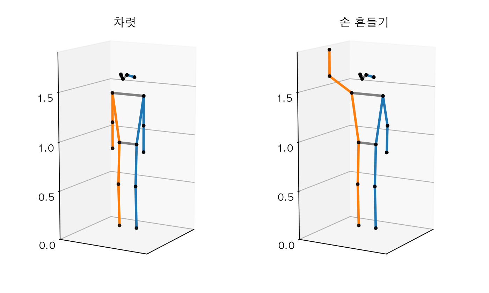
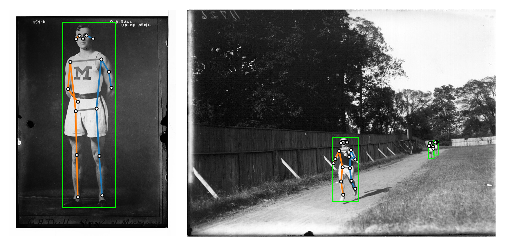
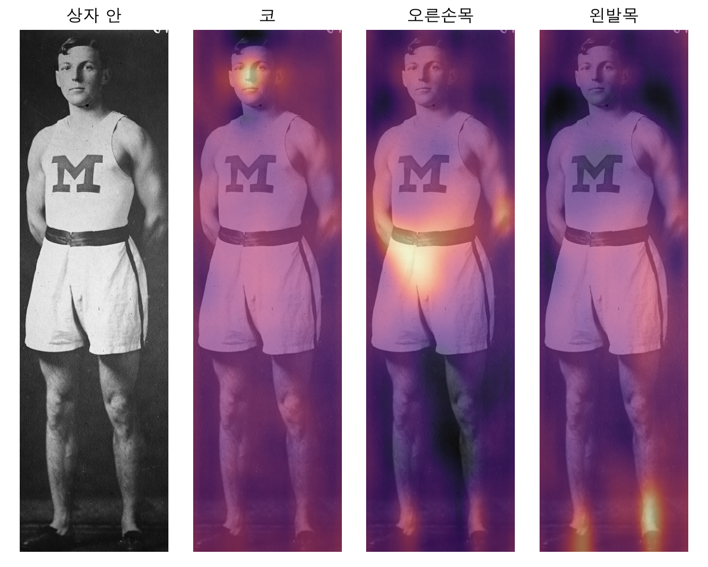
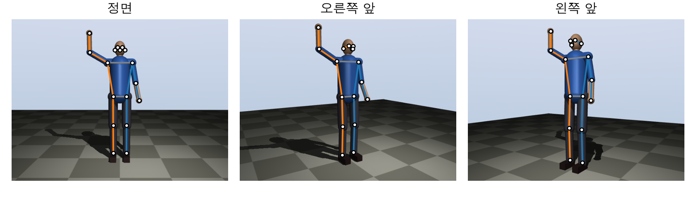
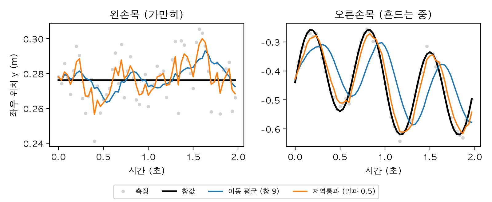
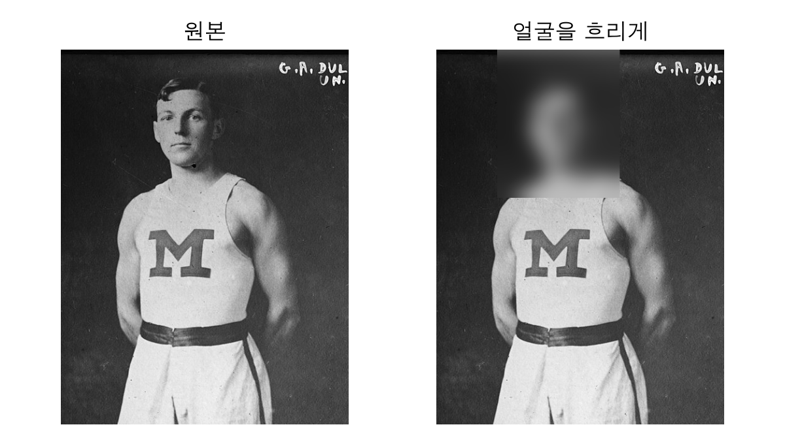
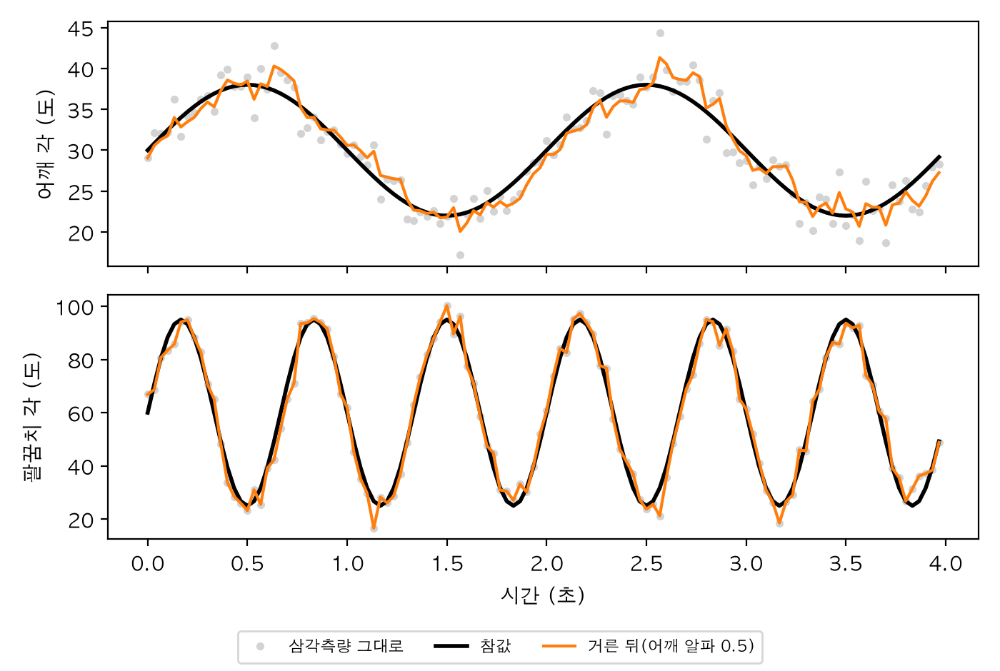
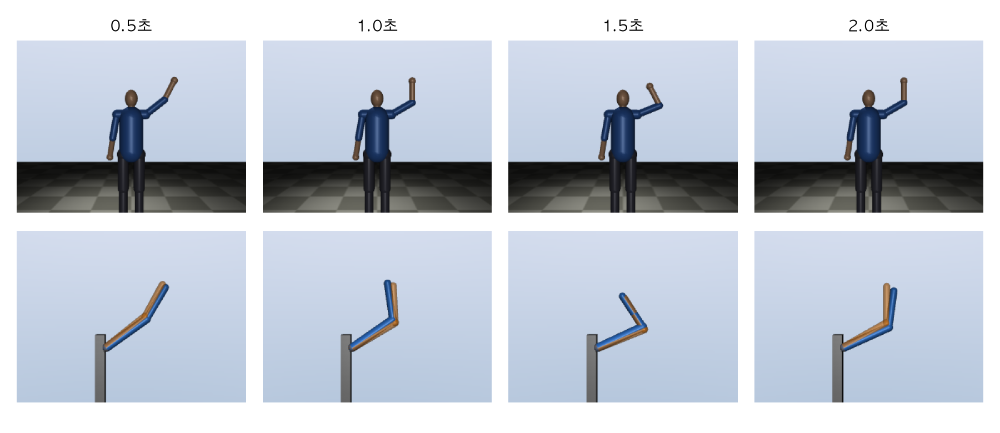

# Chapter 10. 사람 자세와 동작 추정: 로봇이 사람을 읽는 법

> **학습 목표**  
> - 사람 몸을 키포인트(관절)와 뼈(링크)로 된 기구학 사슬로 보고, COCO 17 키포인트 골격과 3장의 순기구학으로 사람 팔 모델을 만들기
> - 사전학습 모델(Keypoint R-CNN)로 사진에서 사람의 2D 키포인트를 찾고, 신뢰도 점수와 가려진 관절을 읽기
> - 히트맵 방식과 회귀 방식의 차이를 알고, 모델 속 히트맵을 직접 꺼내 보기
> - 정답을 아는 합성 이미지로 모델을 시험하고, 학습 데이터와 다른 그림에서 생기는 일을 확인하기
> - 두 카메라의 2D 키포인트를 삼각측량해 3D로 복원하고, 사진 한 장으로는 깊이가 모호하다는 것을 계산으로 보기
> - 이동 평균과 1차 저역통과로 키포인트 떨림을 줄이고, 그 대가인 늦음을 재기
> - 키포인트에서 관절 각도를 계산하고, 사람 팔 동작을 로봇 팔 관절 각도로 옮기기(리타게팅)
> - 사람 영상을 다룰 때 지켜야 할 개인정보·안전 원칙 알기

---

## 들어가며: 로봇은 사람을 어떻게 볼까요?

공장의 큰 로봇 팔은 오랫동안 철창 안에서 혼자 일했습니다. 사람이 다가오면 위험하니까 아예 떼어 놓은 거예요. 그런데 요즘 로봇은 사람 곁으로 나오고 있습니다. 사람과 같은 작업대에서 부품을 건네는 **협동 로봇**, 노인의 걷기를 돕는 로봇, 사람이 하는 동작을 보고 따라 배우는 로봇이 그렇죠. 이런 로봇에게는 새로운 감각이 하나 필요합니다. **지금 저 사람이 어떤 자세로 무엇을 하고 있는가**를 읽는 눈이에요.

사람끼리는 이 일을 너무 쉽게 합니다. 친구가 손을 들면 "부르는구나", 동료가 팔을 뻗으면 "그 공구를 달라는구나" 하고 바로 알아채죠. 로봇은 이것을 숫자로 바꿔야 합니다. 사진 속 사람의 어깨, 팔꿈치, 손목이 어디에 있는지를 점으로 찍는 것이 시작이에요. 점 세 개만 있어도 꽤 많은 것을 알 수 있습니다. 10.2절에서 모델이 사진에서 찾아 줄 어떤 사람의 왼팔 세 점으로 팔꿈치를 얼마나 굽혔는지 계산해 볼게요.

```python
import numpy as np

# 사진 속 한 사람의 왼팔 키포인트 세 개(픽셀 좌표). 10.2절에서 모델이 찾아 준 값이다
어깨 = np.array([528.0, 285.0])
팔꿈치 = np.array([571.0, 357.0])
손목 = np.array([585.0, 450.0])

위팔 = 어깨 - 팔꿈치                     # 팔꿈치에서 어깨로 가는 벡터
아래팔 = 손목 - 팔꿈치                   # 팔꿈치에서 손목으로 가는 벡터
코사인 = 위팔 @ 아래팔 / (np.linalg.norm(위팔) * np.linalg.norm(아래팔))
사이각_도 = np.rad2deg(np.arccos(코사인))
print(f"팔꿈치 사이각: {사이각_도:.1f}도 (180도면 쭉 편 팔)")
print(f"굽힌 정도: {180 - 사이각_도:.1f}도")
```

```text
팔꿈치 사이각: 157.7도 (180도면 쭉 편 팔)
굽힌 정도: 22.3도
```

픽셀 좌표 세 쌍과 벡터 두 개, 내적 한 번으로 "팔꿈치를 22.3도쯤 굽혔다"는 답이 나왔습니다. 두 벡터의 내적을 길이로 나누면 사이각의 코사인이 된다는, 학교에서 배운 계산 그대로예요. 로봇이 사람을 읽는 일은 결국 이렇게 **사람 몸 위의 점을 찾고, 점 사이의 관계를 계산하는 일**입니다.

물론 실제로는 훨씬 많은 질문이 따라옵니다. 그 점은 누가 어떻게 찾을까요? 사진 속 각도가 진짜 3차원 각도와 같을까요? 팔이 몸 뒤로 숨으면? 점이 매 프레임 덜덜 떨리면? 그리고 그렇게 읽은 사람의 팔 동작을 로봇 팔이 따라 하게 하려면? 이 장에서 이 질문들을 차례로 풀어 갑니다. 사람 몸을 3장의 기구학 사슬로 보는 것에서 시작해, 사전학습 모델로 사진 속 자세를 찾고, 카메라 두 대로 3D를 복원하고, 마지막 실습에서는 손을 흔드는 사람을 3장의 2링크 로봇 팔이 따라 하게 만들어요. 18장에서 배울 모방 학습도 사람의 시연을 이렇게 읽는 데서 출발합니다.

> **Q. 사람 자세 추정에 딥러닝을 직접 학습시키나요?**
> 이 장에서는 학습시키지 않습니다. 사진에서 키포인트를 찾는 일은 수십만 명의 사람에게 점을 찍어 둔 데이터로 오래 학습해야 해서, 이미 학습된 모델(2권 10장의 사전학습 모델)을 가져다 씁니다. 이 장의 중심은 그다음, 모델이 내놓은 점을 로봇이 쓸 수 있는 3D 위치와 관절 각도로 바꾸는 계산이에요. 예제는 2권과 같은 PyTorch 2.14, torchvision 0.29에 3권 환경(NumPy 2.5, MuJoCo 3.17)을 더해 실행했습니다.

## 10.1 사람 몸은 기구학 사슬

### 키포인트와 뼈

3장에서 로봇 팔을 링크(막대)와 관절(마디)로 봤죠. 사람 몸도 똑같이 볼 수 있습니다. 어깨, 팔꿈치, 손목, 엉덩이, 무릎, 발목이 관절이고, 그 사이의 위팔, 아래팔, 허벅지, 정강이가 링크예요. 자세 추정에서는 관절 자리에 찍는 점을 **키포인트(keypoint)**, 점을 잇는 선을 **뼈(bone)** 라고 부릅니다. 진짜 해부학의 뼈와는 조금 다르게, "선으로 이어 그리면 사람 모양이 되는 짝"이라는 뜻이에요.

어떤 점을 몇 개 찍을지는 약속하기 나름인데, 가장 널리 쓰는 약속이 **COCO 17 키포인트**입니다. COCO는 사진 수십만 장에 사람·물체 정보를 달아 둔 공개 데이터셋으로, 사람 약 25만 명에게 아래 17개 점을 찍어 두었어요. 이 장에서 쓸 모델도 이 데이터로 학습했습니다. 이름과 순서, 그리고 어느 점끼리 이을지를 `골격도구.py`에 모아 두겠습니다.

```python
"""10장: COCO 17 키포인트 골격의 이름, 뼈 연결, 그리기 도구."""
import numpy as np

# COCO 데이터셋의 키포인트 17개. 순서가 곧 번호다(모델 출력의 줄 순서와 같다)
키포인트_이름 = ["코", "왼눈", "오른눈", "왼귀", "오른귀",
              "왼어깨", "오른어깨", "왼팔꿈치", "오른팔꿈치", "왼손목", "오른손목",
              "왼엉덩이", "오른엉덩이", "왼무릎", "오른무릎", "왼발목", "오른발목"]
번호 = {이름: i for i, 이름 in enumerate(키포인트_이름)}

# 어느 키포인트끼리 선으로 이을지(뼈). 링크에 해당한다
뼈 = [("코", "왼눈"), ("코", "오른눈"), ("왼눈", "왼귀"), ("오른눈", "오른귀"),
     ("왼어깨", "오른어깨"), ("왼엉덩이", "오른엉덩이"),
     ("왼어깨", "왼엉덩이"), ("오른어깨", "오른엉덩이"),
     ("왼어깨", "왼팔꿈치"), ("왼팔꿈치", "왼손목"),
     ("오른어깨", "오른팔꿈치"), ("오른팔꿈치", "오른손목"),
     ("왼엉덩이", "왼무릎"), ("왼무릎", "왼발목"),
     ("오른엉덩이", "오른무릎"), ("오른무릎", "오른발목")]


def 뼈_색(가: str, 나: str) -> str:
    """사람의 왼쪽은 파랑, 오른쪽은 주황, 가운데는 회색으로 칠한다."""
    if 가.startswith("왼") and 나.startswith("왼"):
        return "tab:blue"
    if 가.startswith("오른") and 나.startswith("오른"):
        return "tab:orange"
    return "gray"


def 골격_그리기(칸, 점들: np.ndarray, 보임=None, 굵기: float = 2.5) -> None:
    """2D 키포인트(17×2)를 뼈로 이어 그린다. 보임[i]가 False인 점과 그 뼈는 건너뛴다."""
    보임 = np.ones(len(점들), bool) if 보임 is None else np.asarray(보임)
    for 가, 나 in 뼈:
        i, j = 번호[가], 번호[나]
        if 보임[i] and 보임[j]:
            칸.plot(점들[[i, j], 0], 점들[[i, j], 1], color=뼈_색(가, 나), linewidth=굵기)
    칸.scatter(점들[보임, 0], 점들[보임, 1], s=12, color="white", edgecolors="black", zorder=3)
```

`키포인트_이름`의 순서가 중요합니다. 모델은 이름 없이 17줄짜리 배열만 내놓기 때문에, 몇 번째 줄이 어느 관절인지는 이 순서로만 알 수 있거든요. 이름은 **사진 속 사람 기준의 왼쪽·오른쪽**입니다. 우리를 보고 선 사람의 왼손은 사진의 오른쪽에 찍혀요. 그리기 함수는 사람의 왼쪽을 파랑, 오른쪽을 주황으로 칠해서 이 혼동을 눈으로 잡을 수 있게 했습니다.

순서가 정말 모델과 같은지는 확인해 봐야겠죠? torchvision의 가중치 정보에 영어 이름 목록이 들어 있으니 비교해 봅시다. 가중치 파일은 아직 내려받지 않고 정보만 읽어요.

```python
from torchvision.models.detection import KeypointRCNN_ResNet50_FPN_Weights

from 골격도구 import 뼈, 키포인트_이름

# 가중치 정보(meta)만 읽는다. 가중치 파일은 아직 내려받지 않는다
영어_이름 = KeypointRCNN_ResNet50_FPN_Weights.COCO_V1.meta["keypoint_names"]
for i in range(0, 17, 4):
    print("  ".join(f"{j:2d} {영어_이름[j]:14s}" for j in range(i, min(i + 4, 17))).rstrip())

# 영어 이름을 우리말로 옮겨 골격도구.py의 순서와 같은지 확인
낱말 = {"left": "왼", "right": "오른", "nose": "코", "eye": "눈", "ear": "귀", "shoulder": "어깨",
      "elbow": "팔꿈치", "wrist": "손목", "hip": "엉덩이", "knee": "무릎", "ankle": "발목"}
옮김 = ["".join(낱말[조각] for 조각 in 이름.split("_")) for 이름 in 영어_이름]
print("순서가 같은가?", 옮김 == 키포인트_이름)
print("키포인트", len(키포인트_이름), "개 / 뼈", len(뼈), "개")
```

```text
 0 nose             1 left_eye         2 right_eye        3 left_ear
 4 right_ear        5 left_shoulder    6 right_shoulder   7 left_elbow
 8 right_elbow      9 left_wrist      10 right_wrist     11 left_hip
12 right_hip       13 left_knee       14 right_knee      15 left_ankle
16 right_ankle
순서가 같은가? True
키포인트 17 개 / 뼈 16 개
```

0번 코부터 16번 오른발목까지, 얼굴 다섯 점과 몸 열두 점입니다. 우리말로 옮긴 이름이 `골격도구.py`의 순서와 똑같아요. 뼈는 얼굴 네 개, 어깨·엉덩이 가로선 두 개, 몸통 옆선 두 개, 팔다리 여덟 개를 합쳐 16개로 정했습니다. 모델이 정하는 것이 아니라 그림을 그리기 위한 약속이라, 다른 책이나 라이브러리와 조금 다를 수 있어요.

### 사람 팔을 순기구학으로

키포인트가 기구학 사슬 위의 점이라면, 3장의 순기구학으로 사람 몸을 만들 수도 있습니다. 관절 각도를 넣으면 키포인트 위치가 나오는 모델이에요. 이런 모델이 있으면 정답을 아는 자세를 얼마든지 만들 수 있어서, 뒤에서 삼각측량과 리타게팅을 시험할 때 아주 쓸모가 있습니다.

사람 팔은 로봇 팔과 무엇이 다를까요? 가장 큰 차이는 어깨입니다. 어깨는 공 모양 관절이라 팔을 옆으로 들기, 앞으로 들기, 위팔을 비틀기의 세 방향으로 돌아요. 팔꿈치는 경첩처럼 한 방향으로만 굽고, 손목은 다시 두세 방향으로 돕니다. 어깨 셋, 팔꿈치 하나만 쳐도 팔 하나에 관절 축이 넷이에요. 손목 위치는 숫자 세 개인데 축이 넷이니, 3장 3.8절에서 본 **여유 자유도**가 있는 팔입니다. 손을 컵에 댄 채로 팔꿈치를 위아래로 움직일 수 있는 게 바로 그 여유 덕분이에요.

3장의 `팔도구.py`는 관절마다 (이름, 앞 관절 기준 고정 위치, 회전축)을 적은 목록을 받아 순기구학을 계산했죠. 사람 팔도 이 형식으로 적으면 그대로 쓸 수 있습니다. 몸통과 다리는 이 장에서 움직이지 않으니 고정된 점으로 두고, 두 팔만 관절 각도로 움직이는 `사람모델.py`를 만들겠습니다. 3장 폴더의 `팔도구.py`를 이 장 폴더로 복사해 두세요.

```python
"""10장: 서 있는 사람의 3D 키포인트를 순기구학으로 만드는 예제용 모델(단위 m, rad).

사람은 원점에 서서 +x 쪽을 본다(몸 좌표: x 앞, y 왼쪽, z 위).
"""
import numpy as np

from 골격도구 import 번호
from 팔도구 import 순기구학

위팔_길이, 아래팔_길이 = 0.30, 0.27          # 어깨~팔꿈치, 팔꿈치~손목(m)

# 몸통과 머리의 고정된 점들. 오른쪽은 y가 음수다
고정점 = {"코": [0.10, 0.0, 1.62], "왼눈": [0.08, 0.035, 1.66], "오른눈": [0.08, -0.035, 1.66],
        "왼귀": [0.0, 0.075, 1.63], "오른귀": [0.0, -0.075, 1.63],
        "왼어깨": [0.0, 0.18, 1.45], "오른어깨": [0.0, -0.18, 1.45],
        "왼엉덩이": [0.0, 0.10, 0.95], "오른엉덩이": [0.0, -0.10, 0.95],
        "왼무릎": [0.02, 0.10, 0.52], "오른무릎": [0.02, -0.10, 0.52],
        "왼발목": [0.0, 0.10, 0.08], "오른발목": [0.0, -0.10, 0.08]}


def 사람_팔(쪽: int) -> list:
    """3장 팔도구.py 형식의 팔 사슬. 쪽 = +1이면 왼팔, -1이면 오른팔."""
    return [("어깨_옆들기", [0, 0, 0], [쪽, 0, 0]),       # 팔을 옆으로 벌리기
            ("어깨_앞들기", [0, 0, 0], [0, -1, 0]),       # 팔을 앞으로 들기
            ("어깨_비틀기", [0, 0, 0], [0, 0, 1]),        # 위팔을 길이 방향 축으로 비틀기
            ("팔꿈치", [0, 0, -위팔_길이], [0, -1, 0])]    # 팔꿈치 굽히기(앞쪽으로)


def 팔_점들(쪽: int, 관절각) -> tuple[np.ndarray, np.ndarray]:
    """어깨 기준 팔꿈치·손목 위치. 관절각 = [옆들기, 앞들기, 비틀기, 팔꿈치](rad)."""
    좌표계들 = 순기구학(관절각, 팔=사람_팔(쪽), 손끝=[0, 0, -아래팔_길이])
    return 좌표계들[3][:3, 3], 좌표계들[4][:3, 3]


def 키포인트_3d(오른팔_각=(0, 0, 0, 0), 왼팔_각=(0, 0, 0, 0)) -> np.ndarray:
    """COCO 순서의 17×3 키포인트(세계 좌표, m)."""
    점들 = np.zeros((17, 3))
    for 이름, 위치 in 고정점.items():
        점들[번호[이름]] = 위치
    for 쪽, 이름, 각 in [(-1, "오른", 오른팔_각), (+1, "왼", 왼팔_각)]:
        어깨 = 점들[번호[이름 + "어깨"]]
        팔꿈치, 손목 = 팔_점들(쪽, 각)
        점들[번호[이름 + "팔꿈치"]] = 어깨 + 팔꿈치
        점들[번호[이름 + "손목"]] = 어깨 + 손목
    return 점들
```

좌표는 2장의 몸 좌표 약속(x 앞, y 왼쪽, z 위)을 따랐고 단위는 m입니다. 사람은 원점에 서서 +x 쪽을 봐요. 위팔 0.30m, 아래팔(팔꿈치에서 손목까지) 0.27m, 어깨 높이 1.45m는 키 175cm 안팎인 어른을 어림한 값입니다. 오른팔과 왼팔은 거울에 비친 모양이라, 옆으로 들기 축만 `쪽`으로 부호를 바꿨어요. 팔꿈치의 축은 `[0, -1, 0]`이라서 팔을 내린 자세에서 굽히면 아래팔이 앞(+x)으로 올라옵니다. 진짜 팔꿈치처럼요.

몇 가지 자세를 넣어 손목이 어디로 가는지 봅시다.

```python
import numpy as np

from 사람모델 import 팔_점들

도 = np.deg2rad
자세들 = {"차렷": [0, 0, 0, 0],
        "팔꿈치만 90도": [0, 0, 0, 도(90)],
        "옆으로 90도 들기": [도(90), 0, 0, 0],
        "앞으로 90도 들기": [0, 도(90), 0, 0],
        "손 흔들기 자세": [도(120), 0, 도(-90), 도(60)]}
print("오른팔 [옆들기, 앞들기, 비틀기, 팔꿈치](도) → 어깨 기준 손목 위치(m)")
for 이름, 각 in 자세들.items():
    _, 손목 = 팔_점들(-1, 각)
    print(f"  {str(np.rad2deg(각).round().astype(int)):16s} → {np.round(손목, 3) + 0.0}  {이름}")

# 팔을 옆으로 든 채 팔꿈치를 90도 굽힐 때, 위팔을 비튼 정도에 따라 손목이 가는 곳
for 비틀기 in [-90, 0, 90]:
    팔꿈치, 손목 = 팔_점들(-1, [도(90), 0, 도(비틀기), 도(90)])
    print(f"비틀기 {비틀기:3d}도 → 팔꿈치 {np.round(팔꿈치, 3) + 0.0}, 손목 {np.round(손목, 3) + 0.0}")
```

```text
오른팔 [옆들기, 앞들기, 비틀기, 팔꿈치](도) → 어깨 기준 손목 위치(m)
  [0 0 0 0]        → [ 0.    0.   -0.57]  차렷
  [ 0  0  0 90]    → [ 0.27  0.   -0.3 ]  팔꿈치만 90도
  [90  0  0  0]    → [ 0.   -0.57  0.  ]  옆으로 90도 들기
  [ 0 90  0  0]    → [0.57 0.   0.  ]  앞으로 90도 들기
  [120   0 -90  60] → [ 0.   -0.26  0.42]  손 흔들기 자세
비틀기 -90도 → 팔꿈치 [ 0.  -0.3  0. ], 손목 [ 0.   -0.3   0.27]
비틀기   0도 → 팔꿈치 [ 0.  -0.3  0. ], 손목 [ 0.27 -0.3   0.  ]
비틀기  90도 → 팔꿈치 [ 0.  -0.3  0. ], 손목 [ 0.   -0.3  -0.27]
```

차렷 자세에서 손목은 어깨 아래 0.57m(위팔 + 아래팔)에 있고, 팔꿈치만 90도 굽히면 손목이 앞으로 0.27m 나옵니다. 옆으로 90도 들면 바깥쪽(오른팔이니 -y)으로, 앞으로 90도 들면 +x로 0.57m 뻗어요. 손 흔들기 자세에서는 손목이 어깨보다 0.42m 높이 올라갔습니다.

아래 세 줄이 사람 팔의 특징을 잘 보여 줍니다. 팔을 옆으로 든 채 팔꿈치를 똑같이 90도 굽혀도, 위팔을 얼마나 비틀었느냐에 따라 손목이 위(+z), 앞(+x), 아래(-z)로 갑니다. 팔꿈치 위치는 셋 다 같은데 말이에요. 손을 흔들 때 아래팔이 위를 향하는 건 위팔을 -90도 비틀었기 때문입니다. 사진에서 어깨, 팔꿈치, 손목 세 점만 보면 이 비틀기는 직접 보이지 않고, 세 점의 배치로 미루어 짐작할 수밖에 없어요.

### 온몸을 그려 보기

17개 점을 모두 3D로 그려 보겠습니다. 차렷 자세와, 오른손을 들어 흔드는 자세예요.

```python
import matplotlib.pyplot as plt
import numpy as np

from 골격도구 import 번호, 뼈, 뼈_색
from 사람모델 import 키포인트_3d

plt.rcParams["font.family"] = "AppleGothic"
plt.rcParams["axes.unicode_minus"] = False

도 = np.deg2rad
자세들 = {"차렷": 키포인트_3d(),
        "손 흔들기": 키포인트_3d(오른팔_각=[도(120), 0, 도(-90), 도(60)], 왼팔_각=[도(10), 0, 0, 도(20)])}
그림 = plt.figure(figsize=(7, 4.2))
for k, (제목, 점들) in enumerate(자세들.items()):
    칸 = 그림.add_subplot(1, 2, k + 1, projection="3d")
    for 가, 나 in 뼈:
        선 = 점들[[번호[가], 번호[나]]]
        칸.plot(선[:, 0], 선[:, 1], 선[:, 2], color=뼈_색(가, 나), linewidth=2.5)
    칸.scatter(점들[:, 0], 점들[:, 1], 점들[:, 2], color="black", s=8)
    # 바닥 눈금은 지우고 높이(m)만 남긴다
    칸.set(title=제목, xlim=(-0.5, 0.5), ylim=(-0.5, 0.5), zlim=(0, 1.9), xticks=[], yticks=[])
    칸.set_box_aspect((1, 1, 1.9))
    칸.view_init(elev=12, azim=30)
그림.tight_layout()
그림.savefig("body3d.png", dpi=200)
print("저장: body3d.png")
print("손 흔들기 오른손목(m):", np.round(자세들["손 흔들기"][번호["오른손목"]], 3) + 0.0)
```

```text
저장: body3d.png
손 흔들기 오른손목(m): [ 0.   -0.44  1.87]
```



정면에서 약간 비스듬히 본 그림이라 사람의 오른쪽(주황)이 화면 왼쪽에 보입니다. 손 흔들기 자세의 오른손목은 높이 1.87m로, 머리(코 1.62m)보다 높이 올라갔어요. 이 손 흔들기 자세가 이 장의 단골 예제입니다. 10.10절 실습에서는 이 자세를 시간에 따라 움직여 손을 흔드는 동영상 데이터를 만들어요.

## 10.2 사진에서 2D 자세 찾기

### 사전학습 모델 고르기

이제 진짜 사진으로 갑니다. 사진에서 키포인트를 찾는 모델은 여럿 있는데, 이 장에서는 torchvision에 들어 있는 **Keypoint R-CNN**을 씁니다. 2권 10장에서 ResNet18을 불러 쓴 것과 같은 방법으로 불러올 수 있고, 따로 설치할 것이 없어요. 이름 그대로 R-CNN 계열의 물체 검출 모델에 키포인트를 찾는 머리를 붙인 구조입니다. 먼저 사진에서 사람 상자를 찾고, 상자마다 17개 키포인트를 찾아요.

가중치 정보에 따르면 COCO 검증 데이터에서 사람 상자의 정확도 지표(box mAP)는 54.6, 키포인트 정확도 지표(keypoint mAP)는 65.0이고, 매개변수는 약 5,900만 개, 파일은 약 226MB입니다. 요즘 나온 모델보다 느리고 정확도도 조금 낮지만, 설치 없이 바로 쓸 수 있고 구조를 들여다보기 좋아서 골랐어요.

> **Q. 사전학습 가중치는 아무 데나 써도 되나요?**
> 코드의 라이선스와 가중치의 조건은 따로 확인해야 합니다. torchvision의 코드는 BSD 라이선스이지만, torchvision 문서는 사전학습 가중치가 학습에 쓴 데이터셋에서 비롯된 별도의 조건을 가질 수 있으니 쓰려는 용도에 맞는지 스스로 확인하라고 안내해요. 인기 있는 자세 추정 모델 가운데는 상업적 사용을 막는 라이선스(AGPL이나 비상업 전용)를 단 것도 많습니다. 제품에 넣을 모델이라면 코드, 가중치, 학습 데이터의 조건을 모두 읽어 보세요.

모델을 불러오고, 사진을 내려받고, 자세를 찾는 일을 `자세모델.py`에 모아 두겠습니다.

```python
"""10장: 사진 내려받기와 사전학습 자세 추정 모델(torchvision Keypoint R-CNN) 다루기."""
import os
import urllib.request
from pathlib import Path

import numpy as np
import torch
from torchvision.models.detection import KeypointRCNN_ResNet50_FPN_Weights, keypointrcnn_resnet50_fpn

데이터_폴더 = Path(os.environ.get("BOOK_DATA_DIR", "data")) / "ch10"

# 위키미디어 공용의 퍼블릭 도메인 사진(1910년대 미국 신문사·대학 사진)
사진_주소 = {
    "athlete_1913.jpg": "https://upload.wikimedia.org/wikipedia/commons/thumb/5/57/"
                        "G.A._Dull%2C_Univ._of_Michigan%2C_athlete_LCCN2014680908.jpg/"
                        "960px-G.A._Dull%2C_Univ._of_Michigan%2C_athlete_LCCN2014680908.jpg",
    "runners_1912.jpg": "https://upload.wikimedia.org/wikipedia/commons/thumb/5/5d/"
                        "Runners_on_track_at_high_school_track_meet_1912_%283191653538%29.jpg/"
                        "960px-Runners_on_track_at_high_school_track_meet_1912_%283191653538%29.jpg",
}


def 사진_경로(이름: str) -> Path:
    """사진이 없으면 한 번 내려받고 경로를 돌려준다."""
    경로 = 데이터_폴더 / 이름
    if not 경로.exists():
        데이터_폴더.mkdir(parents=True, exist_ok=True)
        요청 = urllib.request.Request(사진_주소[이름], headers={"User-Agent": "python-book-example/1.0"})
        with urllib.request.urlopen(요청, timeout=60) as 응답:
            경로.write_bytes(응답.read())
    return 경로


def 장치_고르기() -> torch.device:
    """쓸 수 있는 가장 빠른 장치를 고른다(2권 4장)."""
    if torch.cuda.is_available():
        return torch.device("cuda")
    if torch.backends.mps.is_available():
        return torch.device("mps")
    return torch.device("cpu")


def 모델_불러오기(장치: torch.device) -> torch.nn.Module:
    """COCO로 학습한 Keypoint R-CNN. 처음 한 번은 가중치(약 226MB)를 내려받는다."""
    가중치 = KeypointRCNN_ResNet50_FPN_Weights.COCO_V1
    return keypointrcnn_resnet50_fpn(weights=가중치).eval().to(장치)


def 자세_찾기(모델: torch.nn.Module, 이미지: np.ndarray, 장치: torch.device) -> dict[str, np.ndarray]:
    """(높이, 너비, 3) uint8 이미지 → 사람마다 상자·점수·키포인트(17×2)·키포인트 점수."""
    텐서 = torch.from_numpy(이미지).permute(2, 0, 1).float().div(255).to(장치)
    with torch.no_grad():
        결과 = 모델([텐서])[0]
    return {"상자": 결과["boxes"].cpu().numpy(), "점수": 결과["scores"].cpu().numpy(),
            "키포인트": 결과["keypoints"][:, :, :2].cpu().numpy(),
            "키포인트_점수": 결과["keypoints_scores"].cpu().numpy()}
```

사진은 위키미디어 공용(Wikimedia Commons)에 올라 있는 **퍼블릭 도메인** 사진 두 장입니다. 하나는 1913년 무렵 미국 미시간 대학의 육상 선수를 찍은 신문사 사진(미국 의회도서관 소장)이고, 다른 하나는 1912년 오하이오의 고등학교 육상 대회에서 달리는 선수들을 찍은 사진(마이애미 대학 도서관 소장)이에요. 저작권이 끝난 백 년도 더 된 사진이라 책에 그대로 실을 수 있습니다. 처음 실행할 때 한 번만 내려받아 `BOOK_DATA_DIR` 환경 변수의 폴더(정하지 않으면 지금 폴더의 `data`) 아래 `ch10`에 저장해요. 2권 2장과 같은 방식입니다. 위키미디어는 프로그램이 파일을 받을 때 자기 이름을 밝히도록 요구해서, 요청 머리글에 `User-Agent`를 넣었어요.

`자세_찾기`는 이미지를 0~1 사이 실수 텐서로 바꿔 모델에 넣습니다. torchvision의 검출 모델은 이미지 **목록**을 받아 이미지마다 결과 사전 하나를 돌려줘요. 그 안에 상자(`boxes`), 사람 점수(`scores`), 키포인트(`keypoints`, 사람마다 17×3), 키포인트 점수(`keypoints_scores`)가 들어 있습니다. 키포인트의 셋째 칸은 "보임" 표시라서 x, y만 잘라 썼어요. 장치는 2권 4장의 `장치_고르기`로 고릅니다.

### 첫 번째 사진

육상 선수 사진을 넣어 봅시다.

```python
import numpy as np
from PIL import Image

from 골격도구 import 키포인트_이름
from 자세모델 import 모델_불러오기, 사진_경로, 자세_찾기, 장치_고르기

장치 = 장치_고르기()
모델 = 모델_불러오기(장치)
이미지 = np.array(Image.open(사진_경로("athlete_1913.jpg")).convert("RGB"))
print("장치:", 장치, "/ 이미지:", 이미지.shape)

결과 = 자세_찾기(모델, 이미지, 장치)
print("찾은 사람 후보:", len(결과["점수"]), "명, 점수", np.round(결과["점수"], 3))
print("1번 사람 상자(x0, y0, x1, y1):", np.round(결과["상자"][0]).astype(int))
for i in range(0, 17, 3):
    print("  ".join(f"{키포인트_이름[j]} ({결과['키포인트'][0, j, 0]:.0f}, {결과['키포인트'][0, j, 1]:.0f}) "
                    f"{결과['키포인트_점수'][0, j]:.1f}" for j in range(i, min(i + 3, 17))))
```

```text
장치: mps / 이미지: (1308, 960, 3)
찾은 사람 후보: 2 명, 점수 [1.    0.283]
1번 사람 상자(x0, y0, x1, y1): [ 305   71  610 1142]
코 (421, 166) 16.6  왼눈 (443, 148) 17.4  오른눈 (402, 149) 16.9
왼귀 (480, 166) 14.5  오른귀 (381, 169) 14.0  왼어깨 (528, 285) 7.9
오른어깨 (349, 301) 7.8  왼팔꿈치 (571, 357) 7.9  오른팔꿈치 (336, 458) 8.9
왼손목 (585, 450) 13.2  오른손목 (392, 530) 6.9  왼엉덩이 (500, 570) 12.0
오른엉덩이 (380, 584) 10.1  왼무릎 (516, 843) 14.4  오른무릎 (386, 837) 14.0
왼발목 (532, 1071) 6.3  오른발목 (392, 1081) 6.3
```

사람 후보가 둘 나왔습니다. 첫째는 점수 1.0으로 확실한 사람이고, 둘째는 0.283이에요. torchvision의 Keypoint R-CNN은 점수 0.05가 넘는 후보를 모두 내놓기 때문에, 이런 애매한 후보는 쓰는 쪽에서 문턱을 정해 걸러야 합니다. 1번 사람의 상자는 (305, 71)에서 (610, 1142)까지로 사진 속 선수를 머리부터 발끝까지 감쌌어요.

키포인트를 보면 왼어깨가 (528, 285), 오른어깨가 (349, 301)입니다. 선수의 **왼어깨가 사진의 오른쪽**에 있죠? 우리를 보고 서 있으니까요. 들어가며에서 쓴 왼팔 세 점이 바로 이 값입니다.

그런데 키포인트 점수가 이상합니다. 16.6, 17.4, 7.9... 확률이라면 0과 1 사이여야 할 텐데요. 이 점수는 확률이 아니라 다음 절에서 볼 **히트맵의 가장 높은 값**이라서 범위가 정해져 있지 않습니다. 그래서 "몇 점 이상이면 믿는다"는 문턱도 모델마다 따로 정해야 해요. 이 사진에서는 얼굴 점들이 14~17로 가장 높고, 발목이 6.3으로 가장 낮습니다.

### 여러 사람과 작은 사람

두 사진의 결과를 그림으로 겹쳐 보겠습니다. 사람 점수 0.9 미만인 후보는 버리고, 키포인트는 점수가 2를 넘는 것만 그려요. 2라는 문턱은 이 장의 예제에서 쓰려고 정한 값입니다.

```python
import matplotlib.pyplot as plt
import numpy as np
from PIL import Image

from 골격도구 import 골격_그리기
from 자세모델 import 모델_불러오기, 사진_경로, 자세_찾기, 장치_고르기

plt.rcParams["font.family"] = "AppleGothic"
plt.rcParams["axes.unicode_minus"] = False

사람_문턱 = 0.9              # 사람 상자 점수가 이보다 낮으면 버린다
키포인트_문턱 = 2.0          # 키포인트 점수가 이보다 낮으면 그리지 않는다

장치 = 장치_고르기()
모델 = 모델_불러오기(장치)
그림, 칸들 = plt.subplots(1, 2, figsize=(8, 3.9), gridspec_kw={"width_ratios": [0.73, 1.36]})
for 칸, 파일 in zip(칸들, ["athlete_1913.jpg", "runners_1912.jpg"]):
    이미지 = np.array(Image.open(사진_경로(파일)).convert("RGB"))
    결과 = 자세_찾기(모델, 이미지, 장치)
    칸.imshow(이미지)
    for 상자, 점수, 점들, 점_점수 in zip(결과["상자"], 결과["점수"], 결과["키포인트"], 결과["키포인트_점수"]):
        if 점수 < 사람_문턱:
            continue
        골격_그리기(칸, 점들, 보임=점_점수 > 키포인트_문턱, 굵기=1.8)
        x0, y0, x1, y1 = 상자
        칸.add_patch(plt.Rectangle((x0, y0), x1 - x0, y1 - y0, fill=False, color="lime", linewidth=1))
        print(f"{파일}: 상자 높이 {y1 - y0:4.0f}px, 사람 점수 {점수:.3f}, "
              f"문턱을 넘은 키포인트 {int((점_점수 > 키포인트_문턱).sum()):2d}개")
    칸.axis("off")
그림.tight_layout()
그림.savefig("photo_pose.png", dpi=200)
print("저장: photo_pose.png")
```

```text
athlete_1913.jpg: 상자 높이 1071px, 사람 점수 1.000, 문턱을 넘은 키포인트 17개
runners_1912.jpg: 상자 높이  199px, 사람 점수 1.000, 문턱을 넘은 키포인트 17개
runners_1912.jpg: 상자 높이   50px, 사람 점수 0.978, 문턱을 넘은 키포인트 10개
runners_1912.jpg: 상자 높이   44px, 사람 점수 0.934, 문턱을 넘은 키포인트  5개
저장: photo_pose.png
```



왼쪽 선수는 17개 점이 모두 문턱을 넘었습니다. 오른쪽 사진에서는 세 명이 잡혔어요. 높이 199픽셀인 가까운 선수는 17개 점을 모두 찾았지만, 높이 50픽셀, 44픽셀인 먼 선수 둘은 사람 점수는 0.978, 0.934로 높은데도 문턱을 넘은 키포인트가 10개, 5개뿐입니다. 사람이 있다는 건 알아도 팔다리가 어디인지는 확신하지 못하는 거예요. 사람이 작게 찍히면 관절 하나가 몇 픽셀밖에 안 되니 당연한 일입니다. 로봇이 사람의 자세를 제대로 읽으려면 카메라가 사람을 충분히 크게 담아야 한다는 뜻이기도 해요.

왼쪽 선수의 손목도 눈여겨보세요. 선수는 두 손을 등 뒤로 모으고 있어서 손목이 보이지 않는데, 모델은 허리띠 근처에 손목 점을 찍었고 점수도 왼손목 13.2, 오른손목 6.9로 문턱을 넉넉히 넘었습니다. 모델은 "보이지 않으니 모르겠다"고 말하지 않고, 사람 몸의 생김새로 짐작한 그럴듯한 자리를 내놓아요. 이 짐작이 이번처럼 대체로 맞을 때도 있지만, 로봇이 이 점을 진짜 손목으로 믿고 움직이면 곤란할 수 있습니다.

## 10.3 히트맵과 신뢰도, 가려짐

### 모델 속 히트맵 꺼내 보기

모델은 키포인트의 좌표를 어떻게 정할까요? Keypoint R-CNN은 키포인트마다 사람 상자를 56×56 칸으로 나눈 **히트맵(heatmap)** 을 만듭니다. 각 칸의 값은 "키포인트가 여기 있을 만한 정도"이고, 가장 높은 칸이 키포인트 자리, 그 값이 앞에서 본 점수가 돼요. 지도에 비가 올 확률을 색으로 칠한 일기 예보 그림을 떠올리면 됩니다.

이 히트맵은 모델 안에서 쓰이고 버려지지만, PyTorch의 **갈고리(hook)** 로 꺼내 볼 수 있습니다. `register_forward_hook`으로 층에 함수를 걸어 두면, 그 층이 계산을 마칠 때마다 우리 함수가 출력을 받아 봐요. 1권 10장의 `lambda`로 받은 출력을 사전에 담아 두기만 하면 됩니다.

```python
import cv2
import matplotlib.pyplot as plt
import numpy as np
from PIL import Image

from 골격도구 import 번호
from 자세모델 import 모델_불러오기, 사진_경로, 자세_찾기, 장치_고르기

plt.rcParams["font.family"] = "AppleGothic"
plt.rcParams["axes.unicode_minus"] = False

장치 = 장치_고르기()
모델 = 모델_불러오기(장치)

# 키포인트 머리의 마지막 층이 내놓는 히트맵을 갈고리(hook)로 받아 둔다
담기 = {}
모델.roi_heads.keypoint_predictor.register_forward_hook(lambda 층, 입력, 출력: 담기.update(히트맵=출력))
이미지 = np.array(Image.open(사진_경로("athlete_1913.jpg")).convert("RGB"))
결과 = 자세_찾기(모델, 이미지, 장치)
히트맵 = 담기["히트맵"][0].cpu().numpy()          # 1번 사람: (17, 56, 56)
print("히트맵 모양:", 히트맵.shape)

x0, y0, x1, y1 = np.round(결과["상자"][0]).astype(int)
상자_안 = 이미지[y0:y1, x0:x1]
그림, 칸들 = plt.subplots(1, 4, figsize=(7, 5.6))
칸들[0].imshow(상자_안)
칸들[0].set_title("상자 안")
for 칸, 이름 in zip(칸들[1:], ["코", "오른손목", "왼발목"]):
    맵 = 히트맵[번호[이름]]
    칸.imshow(상자_안)
    칸.imshow(cv2.resize(맵, (x1 - x0, y1 - y0)), cmap="magma", alpha=0.6)   # 56×56을 상자 크기로 늘려 겹친다
    칸.set_title(이름)
    높은_칸 = int((맵 > 맵.max() / 2).sum())
    print(f"{이름}: 가장 높은 값 {맵.max():.1f}, 그 절반을 넘는 칸 {높은_칸}개, 최종 점수 {결과['키포인트_점수'][0, 번호[이름]]:.1f}")
for 칸 in 칸들:
    칸.axis("off")
그림.tight_layout()
그림.savefig("heatmaps.png", dpi=200)
print("저장: heatmaps.png")
```

```text
히트맵 모양: (17, 56, 56)
코: 가장 높은 값 14.4, 그 절반을 넘는 칸 12개, 최종 점수 16.6
오른손목: 가장 높은 값 6.7, 그 절반을 넘는 칸 49개, 최종 점수 6.9
왼발목: 가장 높은 값 6.1, 그 절반을 넘는 칸 11개, 최종 점수 6.3
저장: heatmaps.png
```



세 히트맵의 모양이 확연히 다릅니다.

- **코**: 얼굴 한가운데 작은 점 하나만 밝습니다. 가장 높은 값이 14.4이고, 그 절반을 넘는 칸이 12개뿐이에요. 모델이 확신하는 모양입니다
- **오른손목**: 등 뒤로 숨은 손목이라 허리 둘레에 넓고 흐린 덩어리가 생겼습니다. 가장 높은 값은 6.7로 낮고, 절반을 넘는 칸이 49개나 돼요. "이 근처 어딘가"라는 뜻입니다
- **왼발목**: 진짜 왼발목(사진 오른쪽) 자리가 가장 밝지만, 오른발목 자리에도 밝은 점이 하나 더 있습니다. 왼쪽과 오른쪽은 생김새가 똑같아서 모델이 자주 헷갈리는 부분이에요

출력의 "최종 점수"가 히트맵의 가장 높은 값보다 조금 큰 것은, torchvision이 56×56 히트맵을 상자 크기로 부드럽게 늘린 뒤 다시 가장 높은 값을 찾기 때문입니다. 이렇게 하면 칸보다 잘게 위치를 정할 수 있어요. 그래도 한계는 있습니다. 이 선수의 상자는 305×1071픽셀인데 56칸으로 나눴으니, 세로로 한 칸이 약 19픽셀이에요. 키포인트 위치가 몇 픽셀씩 흔들리는 데는 이런 이유도 있습니다.

### 히트맵 방식과 회귀 방식

키포인트를 찾는 방법은 크게 두 가지입니다. 하나는 지금 본 **히트맵 방식**, 다른 하나는 신경망이 좌표 숫자 두 개를 바로 내놓게 하는 **회귀 방식**이에요. 2권에서 집값을 예측하던 회귀와 같은 말입니다.

| 방식 | 출력 | 좋은 점 | 아쉬운 점 |
|---|---|---|---|
| 히트맵 | 키포인트마다 2D 지도 | 위치를 "어디쯤"의 모양으로 배워 학습이 안정적, 퍼진 모양에서 불확실성이 보인다 | 지도 크기만큼 계산·메모리가 들고, 칸 크기보다 잘게 정하려면 후처리가 필요하다 |
| 회귀 | 키포인트마다 좌표 (x, y) | 출력이 작고 빠르다, 후처리가 간단하다 | 학습이 까다롭고, 애매할 때 두 후보의 가운데처럼 엉뚱한 곳을 내기 쉽다 |

회귀 방식의 마지막 칸이 중요합니다. 왼발목 히트맵처럼 후보가 두 군데일 때, 히트맵은 둘 다 밝게 보여 주고 더 밝은 쪽을 고르면 됩니다. 회귀는 좌표 하나만 내야 하니, 오차를 줄이려다 두 발목 **사이의 허공**을 고를 수 있어요. 그래서 오랫동안 정확도가 중요한 모델은 대부분 히트맵 방식이었습니다. 요즘은 둘의 장점을 섞어, 히트맵으로 학습을 돕고 좌표는 회귀나 분류로 내는 모델도 많아요. 휴대폰처럼 계산이 빠듯한 곳에서는 가벼운 회귀형 모델을 자주 씁니다.

또 하나 나눠 볼 기준은 **사람을 먼저 찾느냐**입니다. Keypoint R-CNN처럼 사람 상자를 먼저 찾고 상자마다 키포인트를 찾으면 **하향식(top-down)**, 사진 전체에서 모든 키포인트를 한꺼번에 찾은 뒤 사람별로 묶으면 **상향식(bottom-up)** 이라고 해요. 하향식은 사람마다 따로 보니 정확하지만 사람이 많을수록 느려지고, 상향식은 사람 수와 상관없이 일정하게 빠르지만 붙어 선 사람들의 점을 잘못 묶을 수 있습니다.

### 신뢰도 점수를 쓰는 법

정리하면, 키포인트 점수는 "이 점을 얼마나 믿어도 되나"를 알려 주는 유일한 단서지만 그대로 믿기는 어렵습니다. 로봇 코드에서는 보통 이렇게 씁니다.

1. **문턱 아래는 버린다**: 사람 점수, 키포인트 점수에 각각 문턱을 둔다. 문턱 값은 모델마다, 카메라마다 실제 데이터로 정한다
2. **버린 점은 비워 둔다**: 0이나 이전 값으로 채우지 말고 "없음"으로 표시해, 뒤의 계산(각도, 3D 복원)이 그 점을 쓰지 않게 한다
3. **가려짐을 의심한다**: 몸 뒤, 물건 뒤, 화면 밖의 관절은 점수가 높아도 짐작일 수 있다. 카메라를 둘 이상 두면 한쪽에서 가려진 관절을 다른 쪽이 볼 수 있다
4. **시간으로 거른다**: 한 프레임만 튀는 점은 앞뒤 프레임과 비교해 걸러 낸다(10.7절)

## 10.4 합성 사람으로 시험하기

### 정답을 아는 그림

사진으로 시험하면 한 가지 아쉬움이 있습니다. **정답을 모른다**는 거예요. 앞의 사진에서 모델이 찍은 왼어깨 (528, 285)가 몇 픽셀 틀렸는지 알려면 누군가 사진에 정답 점을 손으로 찍어야 합니다. 9장에서 MuJoCo로 탁자 장면을 찍어 물체의 정답 위치를 알고 시험했던 것처럼, 사람도 MuJoCo로 그려 보면 어떨까요? 10.1절의 `사람모델.py`가 정답 3D 키포인트를 주니까, 키포인트 사이에 캡슐을 끼워 사람 모양 인형을 만들면 됩니다.

```python
"""10장: 3D 키포인트에 캡슐을 입혀 MuJoCo로 '합성 사람'을 그리는 장면."""
import numpy as np

from 골격도구 import 번호

피부, 셔츠, 바지 = "0.85 0.65 0.5 1", "0.2 0.4 0.75 1", "0.25 0.25 0.3 1"


def 캡슐(점들: np.ndarray, 가: str, 나: str, 굵기: float, 색: str) -> str:
    a, b = 점들[번호[가]], 점들[번호[나]]
    return (f'<geom type="capsule" fromto="{a[0]:.4f} {a[1]:.4f} {a[2]:.4f} {b[0]:.4f} {b[1]:.4f} {b[2]:.4f}" '
            f'size="{굵기}" rgba="{색}"/>')


def 사람_xml(점들: np.ndarray, 카메라_위치, 카메라_x축, 카메라_위축, 시야각_도: float) -> str:
    """키포인트 17×3을 받아 사람 모양 장면을 만든다. 카메라는 위치와 x축·위쪽 축으로 놓는다."""
    어깨_가운데 = (점들[번호["왼어깨"]] + 점들[번호["오른어깨"]]) / 2
    엉덩이_가운데 = (점들[번호["왼엉덩이"]] + 점들[번호["오른엉덩이"]]) / 2
    머리 = (점들[번호["왼귀"]] + 점들[번호["오른귀"]]) / 2 + [0.0, 0.0, 0.02]
    몸 = [캡슐(점들, "왼어깨", "오른어깨", 0.06, 셔츠), 캡슐(점들, "왼엉덩이", "오른엉덩이", 0.08, 바지)]
    몸.append(f'<geom type="capsule" fromto="{엉덩이_가운데[0]} 0 {엉덩이_가운데[2] + 0.05} '
             f'{어깨_가운데[0]} 0 {어깨_가운데[2] - 0.05}" size="0.15" rgba="{셔츠}"/>')
    몸.append(f'<geom type="capsule" fromto="0 0 {어깨_가운데[2]} 0 0 {머리[2] - 0.08}" size="0.045" rgba="{피부}"/>')
    몸.append(f'<geom type="ellipsoid" pos="{머리[0]} {머리[1]} {머리[2]}" size="0.095 0.08 0.11" rgba="{피부}"/>')
    for 쪽 in ["왼", "오른"]:
        몸.append(캡슐(점들, 쪽 + "어깨", 쪽 + "팔꿈치", 0.045, 셔츠))
        몸.append(캡슐(점들, 쪽 + "팔꿈치", 쪽 + "손목", 0.035, 피부))
        몸.append(캡슐(점들, 쪽 + "엉덩이", 쪽 + "무릎", 0.07, 바지))
        몸.append(캡슐(점들, 쪽 + "무릎", 쪽 + "발목", 0.055, 바지))
        손 = 점들[번호[쪽 + "손목"]]
        몸.append(f'<geom type="sphere" pos="{손[0]} {손[1]} {손[2]}" size="0.045" rgba="{피부}"/>')
        발 = 점들[번호[쪽 + "발목"]]
        몸.append(f'<geom type="box" pos="{발[0] + 0.06} {발[1]} 0.04" size="0.11 0.045 0.04" rgba="0.15 0.1 0.1 1"/>')
    x, 위 = 카메라_x축, 카메라_위축
    return f"""
<mujoco>
  <visual><global offwidth="640" offheight="480"/></visual>
  <asset>
    <texture type="skybox" builtin="gradient" rgb1="0.95 0.95 1" rgb2="0.6 0.7 0.8" width="256" height="256"/>
    <texture name="격자" type="2d" builtin="checker" rgb1="0.55 0.55 0.5" rgb2="0.75 0.75 0.7" width="256" height="256"/>
    <material name="바닥재" texture="격자" texrepeat="8 8"/>
  </asset>
  <worldbody>
    <light pos="2 1 4" dir="-0.4 -0.2 -1"/>
    <geom type="plane" size="5 5 0.1" material="바닥재"/>
    <camera name="cam" pos="{카메라_위치[0]} {카메라_위치[1]} {카메라_위치[2]}" fovy="{시야각_도}"
            xyaxes="{x[0]} {x[1]} {x[2]} {위[0]} {위[1]} {위[2]}"/>
    {chr(10).join(몸)}
  </worldbody>
</mujoco>"""
```

뼈마다 캡슐 하나, 몸통에 굵은 캡슐, 머리에 타원체, 손에 공, 발에 상자를 놓았습니다. 사람이 움직일 필요는 없어서 관절 없이 모양(geom)만 세계에 바로 붙였어요. 캡슐의 `fromto`는 4장에서 본 대로 양 끝점을 적는 방법이라, 키포인트 두 개를 그대로 넣으면 됩니다. 셔츠, 바지, 피부 색도 칠했어요.

카메라는 이 장의 `카메라도구.py`(10.5절에서 봅니다)가 만드는 카메라와 똑같이 놓았습니다. 그래야 정답 3D 키포인트를 우리 투영 함수로 옮긴 픽셀이 MuJoCo가 찍은 그림과 정확히 겹쳐요. 9장에서 본 대로 MuJoCo 카메라는 x 오른쪽, y **위**를 쓰고 -z 방향을 보니, 광학 좌표(y 아래)의 y축을 뒤집어서 넘겼습니다. 시야각은 초점 거리 600픽셀, 높이 480픽셀에서 계산한 세로 시야각이에요.

### 모델은 인형을 사람으로 볼까요?

인형을 세 방향에서 찍어 모델에 넣어 보겠습니다. 그림에는 모델의 결과가 아니라 **정답** 골격을 겹쳐 그려요.

```python
import matplotlib.pyplot as plt
import mujoco
import numpy as np

from 골격도구 import 골격_그리기
from 사람모델 import 키포인트_3d
from 사람장면 import 사람_xml
from 자세모델 import 모델_불러오기, 자세_찾기, 장치_고르기
from 카메라도구 import 바라보기, 카메라_만들기, 투영

plt.rcParams["font.family"] = "AppleGothic"
plt.rcParams["axes.unicode_minus"] = False

도 = np.deg2rad
점들 = 키포인트_3d(오른팔_각=[도(120), 0, 도(-90), 도(60)], 왼팔_각=[도(10), 0, 0, 도(20)])
초점_px, 너비, 높이 = 600.0, 640, 480
시야각_도 = np.rad2deg(2 * np.arctan(높이 / 2 / 초점_px))     # MuJoCo는 세로 시야각(fovy)을 받는다

장치 = 장치_고르기()
모델 = 모델_불러오기(장치)
그림, 칸들 = plt.subplots(1, 3, figsize=(9, 2.6))
for 칸, (이름, 위치) in zip(칸들, {"정면": [3, 0, 1.2], "오른쪽 앞": [2.5, -1.5, 1.3],
                                   "왼쪽 앞": [2.2, 1.5, 1.0]}.items()):
    R_세계_카메라 = 바라보기(위치, [0, 0, 0.9])
    # MuJoCo 카메라는 x 오른쪽, y 위를 쓰므로 광학 좌표의 y(아래)를 뒤집어 넘긴다
    장면 = mujoco.MjModel.from_xml_string(사람_xml(점들, 위치, R_세계_카메라[:, 0], -R_세계_카메라[:, 1], 시야각_도))
    상태 = mujoco.MjData(장면)
    mujoco.mj_forward(장면, 상태)
    with mujoco.Renderer(장면, 높이, 너비) as 렌더러:
        렌더러.update_scene(상태, camera="cam")
        이미지 = 렌더러.render()
    결과 = 자세_찾기(모델, 이미지, 장치)
    최고 = 결과["점수"].max() if len(결과["점수"]) else 0.0
    print(f"{이름}: 사람 후보 {len(결과['점수'])}개, 가장 높은 사람 점수 {최고:.3f}")
    칸.imshow(이미지)
    골격_그리기(칸, 투영(카메라_만들기(위치, [0, 0, 0.9], 초점_px, 너비, 높이), 점들), 굵기=1.5)
    칸.set_title(이름)
    칸.axis("off")
그림.tight_layout()
그림.savefig("synth_person.png", dpi=200)
print("저장: synth_person.png")
```

```text
정면: 사람 후보 0개, 가장 높은 사람 점수 0.000
오른쪽 앞: 사람 후보 1개, 가장 높은 사람 점수 0.347
왼쪽 앞: 사람 후보 2개, 가장 높은 사람 점수 0.315
저장: synth_person.png
```



정답 골격은 인형의 관절에 딱 맞게 겹쳤습니다. 카메라와 투영이 제대로 맞았다는 뜻이에요. 그런데 모델의 결과는 실망스럽습니다. 정면에서는 사람 후보가 하나도 없었고(점수 0.05 넘는 후보조차 없다는 뜻), 비스듬한 두 방향에서도 가장 높은 사람 점수가 0.347, 0.315로 문턱 0.9에 한참 못 미쳤어요. 백 년 전 흐릿한 흑백 사진 속 선수는 점수 1.0으로 찾던 모델이, 사람이 보기에는 누가 봐도 손 흔드는 사람인 깨끗한 그림을 사람으로 보지 않는 겁니다.

9.8절에서 물체 검출기가 매끈한 도형을 신호등으로 본 것과 같은 일이에요. 이유는 모델이 배운 데이터에 있습니다. COCO는 진짜 사진만 모은 데이터라, 모델은 옷의 주름, 피부의 질감, 얼굴 생김새 같은 진짜 사람의 특징으로 사람을 알아보도록 학습됐어요. 매끈한 캡슐 인형은 그런 특징이 없으니 모델에게는 "사람과 비슷한 무언가"일 뿐입니다. 이렇게 학습 데이터와 실제로 넣는 데이터가 달라서 성능이 떨어지는 현상은 로봇 학습 곳곳에서 만나요. 시뮬레이터에서 학습한 로봇이 진짜 세상에서 헤매는 것도 같은 문제이고, 20장 sim2real에서 그 간격을 줄이는 방법(겉모습을 무작위로 바꾸며 학습하는 도메인 무작위화 등)을 다룹니다.

그렇다고 합성 사람이 쓸모없는 것은 아닙니다. 정답을 정확히 아니까, 모델 **다음 단계**의 계산(3D 복원, 거르기, 각도, 리타게팅)을 시험하기에는 이보다 좋은 재료가 없어요. 이 장의 나머지는 합성 데이터로 진행합니다. 모델이 내놓는 점에는 "몇 픽셀 흔들림"이라는 잡음을 넣어 흉내 내고요.

## 10.5 2D에서 3D로: 삼각측량

### 두 눈으로 보면 깊이가 보인다

사진 속 키포인트는 2D 픽셀입니다. 하지만 로봇이 사람 손에 물건을 건네려면 손이 **3D 공간의 어디에** 있는지 알아야 하죠. 한쪽 눈을 감고 바늘에 실을 꿰어 보면 깊이를 가늠하기가 얼마나 어려운지 알 수 있습니다. 두 눈을 뜨면 쉬워지는 건, 두 눈이 같은 점을 조금 다른 방향에서 보기 때문이에요. 카메라도 두 대를 두면 됩니다.

9장에서 세계의 점을 카메라 광학 좌표로 옮긴 뒤 내부 행렬 K를 곱하고 깊이 Z로 나눠 픽셀을 얻었죠. 두 단계를 3×4 행렬 하나로 묶은 것을 **투영 행렬** P = K[R | t]라고 합니다. R과 t는 세계 좌표를 카메라 좌표로 옮기는 회전과 이동이에요. 그리고 9.2절에서 본 대로 픽셀 하나는 카메라에서 뻗어 나간 **광선 하나**에 해당합니다. 카메라 두 대가 같은 손목을 봤다면 두 광선이 손목에서 만나니, 그 만나는 점을 계산하면 3D 위치가 나와요. 이것이 **삼각측량(triangulation)** 입니다.

잡음이 있으면 두 광선이 정확히 만나지 않습니다. 그래서 "투영했을 때 두 픽셀에 가장 가깝게 떨어지는 점"을 찾는데, 가장 널리 쓰는 방법이 **직접 선형 변환(DLT)** 이에요. 투영 식 u = (P₀·X) / (P₂·X)를 0 = u·P₂·X - P₀·X로 바꾸면, 카메라마다 X에 대한 일차식이 두 개(u, v) 생깁니다. 카메라 두 대면 식 네 개, 미지수는 동차 좌표 X의 네 칸이라, 3장에서 특이값을 구할 때 쓴 `np.linalg.svd`로 가장 그럴듯한 답을 구할 수 있어요. 카메라를 만들고, 투영하고, 삼각측량하는 함수를 `카메라도구.py`에 모았습니다.

```python
"""10장: 핀홀 카메라 만들기, 투영, 두 대 이상의 카메라로 삼각측량(DLT)."""
import numpy as np


def 바라보기(위치_세계, 바라볼점_세계) -> np.ndarray:
    """카메라를 놓은 자리에서 한 점을 보게 하는 R_세계_카메라. 열 = 카메라 축을 세계에서 본 방향."""
    z = np.asarray(바라볼점_세계, float) - np.asarray(위치_세계, float)   # 광학 좌표: z 앞
    z /= np.linalg.norm(z)
    x = np.cross(z, [0.0, 0.0, 1.0])                                     # x 오른쪽
    x /= np.linalg.norm(x)
    return np.column_stack([x, np.cross(z, x), z])                      # y 아래


def 카메라_만들기(위치_세계, 바라볼점_세계, 초점_px: float = 600.0,
              너비: int = 640, 높이: int = 480) -> np.ndarray:
    """세계 점을 픽셀로 옮기는 3×4 투영 행렬 P = K [R_카메라_세계 | t]."""
    R_카메라_세계 = 바라보기(위치_세계, 바라볼점_세계).T
    t = -R_카메라_세계 @ np.asarray(위치_세계, float)
    K = np.array([[초점_px, 0, (너비 - 1) / 2],          # 주점: 픽셀 가운데 약속(9장)
                  [0, 초점_px, (높이 - 1) / 2],
                  [0, 0, 1]])
    return K @ np.column_stack([R_카메라_세계, t])


def 투영(P: np.ndarray, 점들_세계: np.ndarray) -> np.ndarray:
    """N×3 세계 점 → N×2 픽셀. 동차 좌표로 곱한 뒤 깊이로 나눈다."""
    동차 = np.column_stack([점들_세계, np.ones(len(점들_세계))]) @ P.T
    return 동차[:, :2] / 동차[:, 2:3]


def 삼각측량(P들: list[np.ndarray], 픽셀들: list[np.ndarray]) -> np.ndarray:
    """카메라마다 한 픽셀씩 본 같은 점의 3D 위치. 직접 선형 변환(DLT)과 SVD로 푼다."""
    줄들 = []
    for P, (u, v) in zip(P들, 픽셀들):
        줄들.append(u * P[2] - P[0])          # u = (P0·X) / (P2·X) 를 0 = ... 꼴로
        줄들.append(v * P[2] - P[1])
    _, _, Vt = np.linalg.svd(np.array(줄들))
    X = Vt[-1]                                # A X = 0 의 가장 그럴듯한 답
    return X[:3] / X[3]
```

`바라보기`는 카메라를 놓을 자리와 바라볼 점을 받아 2장의 광학 좌표(z 앞, x 오른쪽, y 아래) 축 세 개를 세계 좌표로 계산합니다. 2장의 "회전 행렬의 열은 새 축의 방향"을 그대로 쓴 거예요. 이름도 2장 규칙대로 `R_세계_카메라`이고, 투영에 쓰는 것은 그 전치인 `R_카메라_세계`입니다. 내부 행렬 K는 초점 거리 600픽셀에, 주점은 9장에서 확인한 픽셀 가운데 약속대로 ((너비-1)/2, (높이-1)/2)로 단순하게 정했어요. 렌즈 왜곡은 없다고 봤고요. 진짜 카메라는 9.3절의 보정으로 K와 왜곡을 구해야 합니다.

`삼각측량`의 SVD에서 `Vt[-1]`은 A X = 0을 가장 잘 만족하는 길이 1인 X입니다. 마지막에 넷째 칸으로 나누면 보통 좌표가 돼요. 카메라가 세 대, 네 대여도 줄만 늘어날 뿐 같은 함수로 풀립니다.

### 손목 하나 복원하기

사람 앞 3m에 카메라 두 대를 좌우로 2.4m 벌려 세우고, 손 흔들기 자세의 오른손목을 복원해 봅시다. 픽셀에 잡음을 넣고 1,000번 되풀이해 오차가 어떻게 퍼지는지도 봐요.

```python
import numpy as np

from 카메라도구 import 삼각측량, 카메라_만들기, 투영

# 사람 앞 3m 떨어진 곳에 카메라 두 대를 좌우로 2.4m 벌려 세우고 가슴 높이를 보게 한다
P왼 = 카메라_만들기([3.0, 1.2, 1.3], [0, 0, 1.2])
P오 = 카메라_만들기([3.0, -1.2, 1.3], [0, 0, 1.2])
손목_세계 = np.array([0.0, -0.44, 1.87])                  # 손 흔들기 자세의 오른손목(10.1절)

픽셀왼, 픽셀오 = 투영(P왼, 손목_세계[None])[0], 투영(P오, 손목_세계[None])[0]
print("왼쪽 카메라 픽셀:", np.round(픽셀왼, 1), "/ 오른쪽 카메라 픽셀:", np.round(픽셀오, 1))
복원 = 삼각측량([P왼, P오], [픽셀왼, 픽셀오])
print("잡음 없이 복원:", np.round(복원, 4) + 0.0, "/ 오차", f"{np.linalg.norm(복원 - 손목_세계) * 1000:.4f}mm")

# 픽셀에 잡음을 넣고 1000번 되풀이해 오차를 잰다
생성기 = np.random.default_rng(0)
for 잡음_px in [0.5, 1, 2, 5]:
    오차_mm = []
    for _ in range(1000):
        흔들린 = [픽셀왼 + 생성기.normal(0, 잡음_px, 2), 픽셀오 + 생성기.normal(0, 잡음_px, 2)]
        오차_mm.append(np.linalg.norm(삼각측량([P왼, P오], 흔들린) - 손목_세계) * 1000)
    print(f"픽셀 잡음 {잡음_px:3}px → 3D 오차 평균 {np.mean(오차_mm):5.1f}mm, 95% {np.percentile(오차_mm, 95):5.1f}mm")
```

```text
왼쪽 카메라 픽셀: [246.9 119.6] / 오른쪽 카메라 픽셀: [239.1 108.7]
잡음 없이 복원: [ 0.   -0.44  1.87] / 오차 0.0000mm
픽셀 잡음 0.5px → 3D 오차 평균   5.2mm, 95%  10.4mm
픽셀 잡음   1px → 3D 오차 평균  10.4mm, 95%  21.6mm
픽셀 잡음   2px → 3D 오차 평균  20.1mm, 95%  41.2mm
픽셀 잡음   5px → 3D 오차 평균  50.6mm, 95% 108.5mm
```

잡음이 없으면 오차가 0.0000mm로, 식이 맞다는 걸 확인했습니다. 픽셀 잡음이 생기면 3D 오차도 생기는데, 잡음에 거의 정비례해요. 1픽셀이면 평균 10.4mm, 2픽셀이면 20.1mm, 5픽셀이면 50.6mm입니다. 3m 떨어진 곳을 초점 거리 600픽셀로 보면 1픽셀이 약 5mm에 해당하니, 깊이 방향까지 합쳐 1픽셀당 1cm 남짓의 오차가 나는 셈이에요. 앞에서 본 사진 속 키포인트가 몇 픽셀씩 흔들린다는 걸 생각하면, 사람 키포인트의 3D 위치는 cm 단위로 흔들린다고 봐야 합니다.

### 카메라를 얼마나 벌려야 할까

두 카메라를 가까이 붙이면 어떻게 될까요? 두 광선이 거의 나란해져서, 광선 방향이 조금만 흔들려도 만나는 점이 앞뒤로 크게 움직일 겁니다. 사람을 중심으로 두 카메라 사이의 각도를 바꿔 가며 재 보겠습니다.

```python
import numpy as np

from 카메라도구 import 삼각측량, 카메라_만들기, 투영

손목_세계 = np.array([0.0, -0.44, 1.87])
생성기 = np.random.default_rng(0)
print("두 카메라 사이 각도 → 3D 오차 평균(mm)과 축별 흔들림(표준편차, mm)  [픽셀 잡음 2px]")
for 사이각_도 in [5, 15, 30, 60, 90, 120]:
    반 = np.deg2rad(사이각_도 / 2)
    # 사람을 중심으로 반지름 3m 원 위에, 정면(+x)에서 좌우로 반씩 벌려 놓는다
    P들 = [카메라_만들기([3 * np.cos(부호 * 반), 3 * np.sin(부호 * 반), 1.3], [0, 0, 1.2]) for 부호 in (+1, -1)]
    픽셀들 = [투영(P, 손목_세계[None])[0] for P in P들]
    복원들 = np.array([삼각측량(P들, [p + 생성기.normal(0, 2.0, 2) for p in 픽셀들]) for _ in range(1000)])
    오차 = np.linalg.norm(복원들 - 손목_세계, axis=1) * 1000
    x, y, z = 복원들.std(axis=0) * 1000
    print(f"  {사이각_도:3d}도: 평균 {오차.mean():6.1f}  앞뒤(x) {x:6.1f}  좌우(y) {y:5.1f}  위아래(z) {z:5.1f}")
```

```text
두 카메라 사이 각도 → 3D 오차 평균(mm)과 축별 흔들림(표준편차, mm)  [픽셀 잡음 2px]
    5도: 평균  133.5  앞뒤(x)  161.7  좌우(y)  24.8  위아래(z)  31.6
   15도: 평균   46.1  앞뒤(x)   53.6  좌우(y)  10.3  위아래(z)  12.4
   30도: 평균   24.4  앞뒤(x)   26.0  좌우(y)   7.9  위아래(z)   8.3
   60도: 평균   15.8  앞뒤(x)   14.0  좌우(y)   7.9  위아래(z)   7.2
   90도: 평균   14.2  앞뒤(x)   10.1  좌우(y)   9.2  위아래(z)   7.3
  120도: 평균   15.4  앞뒤(x)    8.4  좌우(y)  13.2  위아래(z)   6.9
```

두 카메라가 5도밖에 벌어지지 않으면 평균 오차가 133.5mm로, 2px 잡음이 13cm의 오차가 됐습니다. 축별로 보면 앞뒤(x, 카메라가 보는 방향) 흔들림이 161.7mm로 좌우·위아래(25~32mm)보다 훨씬 커요. **깊이 방향이 가장 약하다**는 거죠. 각도를 벌릴수록 깊이 오차가 빠르게 줄어 60~90도에서 평균 14~16mm로 가장 작아지고, 120도에서는 앞뒤가 8.4mm로 더 줄지만 이번에는 좌우가 13.2mm로 커집니다. 두 카메라가 서로 마주 보는 쪽으로 갈수록 이번에는 좌우가 두 카메라 모두의 깊이 방향에 가까워지거든요.

실제로 사람 동작을 재는 스튜디오(모션 캡처)는 카메라 수십 대로 사람을 빙 둘러쌉니다. 어느 방향이든 잘 보는 카메라 짝이 있고, 한 카메라에서 가려진 관절을 다른 카메라가 보니까요. 로봇에 카메라를 달 때는 공간이 좁아 많이 벌리기 어려운데, 그만큼 깊이가 부정확해진다는 걸 염두에 둬야 합니다. 9.4절에서 스테레오 카메라의 기준선(두 눈 사이 거리)이 좁을수록, 거리가 멀수록 깊이 오차가 커진 것과 같은 이야기예요.

## 10.6 사진 한 장의 3D: 깊이 모호성과 HMR

### 같은 사진, 다른 자세

카메라가 한 대뿐이라면 어떨까요? 휴대폰 사진이나 로봇 머리의 카메라 하나처럼요. 픽셀 하나는 광선 하나라서, 광선 위의 어느 점이든 같은 픽셀에 찍힙니다. 정면 카메라 한 대로 손 흔들기 자세를 보고, 팔꿈치를 광선을 따라 30cm 밀어 보겠습니다. 그리고 위팔 길이를 안다면 후보가 얼마나 줄어드는지도 계산해 봐요.

```python
import numpy as np

from 골격도구 import 번호
from 사람모델 import 아래팔_길이, 위팔_길이, 키포인트_3d
from 카메라도구 import 카메라_만들기, 투영

도 = np.deg2rad
P = 카메라_만들기([3.0, 0.0, 1.3], [0, 0, 1.2])          # 정면 카메라 한 대
점들 = 키포인트_3d(오른팔_각=[도(120), 0, 도(-90), 도(60)])
어깨, 팔꿈치, 손목 = (점들[번호[이름]] for 이름 in ["오른어깨", "오른팔꿈치", "오른손목"])


def 광선(P: np.ndarray, 픽셀) -> tuple[np.ndarray, np.ndarray]:
    """픽셀 하나가 가리키는 3D 반직선: 카메라 중심과 단위 방향. P = [M | p] 에서 구한다."""
    M, p = P[:, :3], P[:, 3]
    방향 = np.linalg.solve(M, [픽셀[0], 픽셀[1], 1.0])
    return -np.linalg.solve(M, p), 방향 / np.linalg.norm(방향)


def 길이로_찾기(시작: np.ndarray, 중심: np.ndarray, 방향: np.ndarray, 길이: float) -> list[np.ndarray]:
    """광선 위에서 시작점과 거리가 '길이'인 점들. 이차방정식이라 답이 0~2개다."""
    b = 방향 @ (중심 - 시작)
    판별식 = b**2 - (np.sum((중심 - 시작) ** 2) - 길이**2)
    if 판별식 < 0:
        return []
    return [중심 + (-b + 부호 * np.sqrt(판별식)) * 방향 for 부호 in (-1, +1)]


# 1) 광선을 따라 앞뒤로 밀면 사진은 같다
중심, 방향 = 광선(P, 투영(P, 팔꿈치[None])[0])
밀린_팔꿈치 = 팔꿈치 + 0.3 * 방향                           # 카메라에서 30cm 더 멀리
print("팔꿈치 픽셀:", np.round(투영(P, 팔꿈치[None])[0], 2), "→ 30cm 밀어도", np.round(투영(P, 밀린_팔꿈치[None])[0], 2))
print(f"그때 위팔 길이: {np.linalg.norm(밀린_팔꿈치 - 어깨):.3f}m (진짜 {위팔_길이}m)")

# 2) 뼈 길이를 알면 후보가 둘로 줄어든다
후보들 = 길이로_찾기(어깨, 중심, 방향, 위팔_길이)
for k, 후보 in enumerate(후보들):
    _, 손목_방향 = 광선(P, 투영(P, 손목[None])[0])
    손목_후보들 = 길이로_찾기(후보, 중심, 손목_방향, 아래팔_길이)
    print(f"팔꿈치 후보 {k + 1}: {np.round(후보, 3) + 0.0}, 손목 후보 {len(손목_후보들)}개 →",
          ", ".join(str(np.round(w, 3) + 0.0) for w in 손목_후보들))
print("진짜 팔꿈치:", np.round(팔꿈치, 3) + 0.0, "/ 진짜 손목:", np.round(손목, 3) + 0.0)
```

```text
팔꿈치 픽셀: [231.2  159.23] → 30cm 밀어도 [231.2  159.23]
그때 위팔 길이: 0.460m (진짜 0.3m)
팔꿈치 후보 1: [ 0.103 -0.425  1.59 ], 손목 후보 2개 → [ 0.233 -0.406  1.826], [ 0.067 -0.43   1.857]
팔꿈치 후보 2: [ 0.   -0.44  1.6 ], 손목 후보 2개 → [ 0.097 -0.426  1.852], [ 0.   -0.44  1.87]
진짜 팔꿈치: [ 0.   -0.44  1.6 ] / 진짜 손목: [ 0.   -0.44  1.87]
```

`광선` 함수는 투영 행렬 P = [M | p]에서 카메라 중심(-M⁻¹p)과 픽셀이 가리키는 방향(M⁻¹[u, v, 1])을 구합니다. 팔꿈치를 카메라에서 30cm 멀리 밀어도 픽셀은 (231.2, 159.23)에서 한 치도 변하지 않았어요. 사진만으로는 두 자세를 구별할 수 없다는 뜻입니다. 대신 위팔 길이가 0.460m가 됐죠. 사람 위팔이 갑자기 16cm 늘어날 리는 없으니, **뼈 길이를 알면** 엉뚱한 답을 걸러 낼 수 있습니다.

어깨에서 0.3m 떨어진 점을 광선 위에서 찾는 것은 이차방정식이라 답이 최대 둘입니다. 하나는 진짜 팔꿈치 (0, -0.44, 1.6)이고, 다른 하나는 카메라 쪽으로 10cm 나온 (0.103, -0.425, 1.59)예요. 팔꿈치마다 손목도 다시 둘씩 나와서, 결국 **같은 사진에 들어맞는 팔이 네 개**입니다. 3장의 2링크 팔 역기구학에서 같은 손끝에 "팔꿈치 위, 팔꿈치 아래" 답이 둘이었던 것과 닮았죠. 뼈 하나마다 "앞으로 꺾였나, 뒤로 꺾였나"를 정해야 하니, 뼈가 많은 온몸에서는 후보가 기하급수적으로 늘어납니다.

### 학습으로 모호함 풀기: 리프팅과 HMR

사람은 사진 한 장만 봐도 자세를 3D로 떠올립니다. 사람 몸이 어떻게 생겼고 어떤 자세를 자주 취하는지 알기 때문이에요. 팔꿈치가 거꾸로 꺾이는 일은 없고, 손을 흔드는 사람은 대개 손바닥을 앞으로 향하죠. 이런 **사전 지식**을 데이터에서 배우게 하는 것이 사진 한 장 3D 자세 추정의 핵심입니다. 크게 두 갈래가 있어요.

- **리프팅(lifting)**: 2D 키포인트 17개(숫자 34개)를 받아 3D 키포인트(숫자 51개)를 내는 작은 신경망을 학습한다. 입력이 작아 가볍고, 2D 검출기는 이 장에서 쓴 것 같은 기존 모델을 그대로 쓸 수 있다. 앞뒤 프레임을 함께 넣으면 움직임에서 깊이를 더 잘 짐작한다
- **사람 몸 모델 맞추기(HMR)**: 사람 몸 전체를 수천 개의 점으로 된 3D 표면(메시)으로 나타내는 **몸 모델**을 두고, 사진에 맞는 몸 모델의 자세와 체형 숫자를 찾는다. 사진에서 이 숫자를 바로 내도록 학습한 방법을 HMR(Human Mesh Recovery)이라고 부른다

HMR에서 가장 많이 쓰는 몸 모델이 **SMPL**입니다. 체형 숫자 10개와 관절 24개의 회전(2장의 회전 벡터로 72개 숫자)을 넣으면 점 6,890개짜리 사람 표면이 나와요. 관절마다 회전을 곱해 나가는 3장의 순기구학 위에, 관절이 돌 때 살과 피부가 어떻게 따라 움직이는지까지 데이터로 배워 둔 모델이라고 보면 됩니다. 뼈 길이와 관절의 움직임 범위가 모델 안에 들어 있으니, 앞에서 본 "같은 사진에 맞는 팔 네 개" 중 사람다운 것을 고르기가 훨씬 쉬워져요. 이 분야는 지금도 빠르게 발전하고 있습니다.

다만 SMPL을 비롯한 많은 몸 모델은 **비상업 연구용 라이선스**로 배포되어, 제품이나 상업 출판물의 코드에 함부로 쓸 수 없습니다. 그래서 이 책에서는 개념만 소개하고 코드로는 쓰지 않아요. 직접 써 보고 싶다면 각 모델의 라이선스를 먼저 확인하세요.

> **Q. 깊이 카메라를 쓰면 이 문제가 없어지나요?**
> 상당 부분 줄어듭니다. 9.4절의 깊이 카메라는 픽셀마다 거리를 알려 주니, 키포인트 픽셀의 깊이를 읽으면 광선 위의 한 점이 정해져요. 다만 깊이 카메라가 재는 것은 **옷과 피부의 겉면**까지의 거리라서 관절 중심과는 몇 cm 차이가 나고, 관절이 가려지면 앞을 가린 물체의 깊이를 읽게 됩니다. 실제 시스템은 깊이, 여러 카메라, 학습된 사전 지식을 함께 써요.

## 10.7 시간 축: 떨림 줄이기

### 덜덜 떠는 키포인트

자세 추정 모델은 사진을 한 장씩 따로 봅니다. 그래서 가만히 있는 사람을 찍은 동영상에서도 키포인트가 프레임마다 몇 픽셀씩 덜덜 떨려요. 앞에서 2픽셀 잡음이 3D로 2cm 오차가 되는 걸 봤으니, 3D 손목 위치도 cm 단위로 떨릴 겁니다. 이 떨림을 그대로 로봇에 보내면 로봇 팔도 덜덜 떨겠죠.

1장 1.3절에서 "잡음은 평균으로 줄인다"고 했습니다. 시간 축으로 평균을 내면 되는데, 로봇은 **지금** 값이 필요하니 미래 프레임은 쓸 수 없어요. 그래서 지난 값들만 쓰는 두 가지 방법을 씁니다.

- **이동 평균**: 최근 N개 프레임의 평균. N을 "창"이라고 부른다
- **1차 저역통과**: 걸러 둔 값을 새 측정값 쪽으로 알파(0~1)만큼만 다가가게 한다. 알파가 작을수록 많이 거른다. 지수 이동 평균이라고도 한다

10.10절 실습에서 쓸 손 흔들기 데이터(`손흔들기데이터.py`, 10.10절에서 봅니다)의 손목 위치에 1.5cm 떨림을 넣고 두 방법을 시험해 보겠습니다. 가만히 있는 왼손목과 흔드는 오른손목을 함께 봐요.

```python
import matplotlib.pyplot as plt
import numpy as np

from 골격도구 import 번호
from 손흔들기데이터 import 시간, 참_키포인트, 초당_프레임

plt.rcParams["font.family"] = "AppleGothic"
plt.rcParams["axes.unicode_minus"] = False

생성기 = np.random.default_rng(0)
참값들 = {이름: 참_키포인트()[:, 번호[이름], 1] for 이름 in ["왼손목", "오른손목"]}    # 좌우(y) 위치(m)
잰값들 = {이름: 값 + 생성기.normal(0, 0.015, len(값)) for 이름, 값 in 참값들.items()}  # 1.5cm 떨림


def 이동_평균(값들: np.ndarray, 창: int) -> np.ndarray:
    """지금까지 들어온 최근 '창'개의 평균. 앞으로 올 값은 쓰지 않는다."""
    return np.array([값들[max(0, k - 창 + 1):k + 1].mean() for k in range(len(값들))])


def 저역통과(값들: np.ndarray, 알파: float) -> np.ndarray:
    """1차 저역통과: 새 값 쪽으로 알파만큼만 다가간다."""
    결과 = [값들[0]]
    for 값 in 값들[1:]:
        결과.append(결과[-1] + 알파 * (값 - 결과[-1]))
    return np.array(결과)


def 오차_mm(걸러진: np.ndarray, 참값: np.ndarray) -> float:
    return float(np.sqrt(np.mean((걸러진 - 참값) ** 2)) * 1000)


def 늦음_ms(걸러진: np.ndarray, 참값: np.ndarray) -> float:
    """몇 프레임 늦춰 겹쳤을 때 참값과 가장 잘 맞는지."""
    밀기 = min(range(8), key=lambda k: np.mean((걸러진[k:] - 참값[:len(참값) - k]) ** 2))
    return 밀기 * 1000 / 초당_프레임


거르개들 = {"걸러내기 전": lambda x: x,
         "이동 평균 창 3": lambda x: 이동_평균(x, 3), "이동 평균 창 9": lambda x: 이동_평균(x, 9),
         "저역통과 알파 0.5": lambda x: 저역통과(x, 0.5), "저역통과 알파 0.15": lambda x: 저역통과(x, 0.15)}
print("RMS 오차(mm): 가만히 있는 왼손목 / 흔드는 오른손목, 흔드는 손에서 잰 늦음")
for 이름, 거르개 in 거르개들.items():
    왼, 오른 = (거르개(잰값들[k]) for k in ["왼손목", "오른손목"])
    print(f"  {오차_mm(왼, 참값들['왼손목']):5.1f} / {오차_mm(오른, 참값들['오른손목']):5.1f}, "
          f"늦음 {늦음_ms(오른, 참값들['오른손목']):5.1f}ms  {이름}")

그림, 칸들 = plt.subplots(1, 2, figsize=(8, 3.3))
구간 = 시간 < 2
for 칸, 이름 in zip(칸들, ["왼손목", "오른손목"]):
    칸.plot(시간[구간], 잰값들[이름][구간], ".", color="lightgray", label="측정")
    칸.plot(시간[구간], 참값들[이름][구간], "k-", linewidth=2, label="참값")
    칸.plot(시간[구간], 이동_평균(잰값들[이름], 9)[구간], label="이동 평균 (창 9)")
    칸.plot(시간[구간], 저역통과(잰값들[이름], 0.5)[구간], label="저역통과 (알파 0.5)")
    칸.set(title=f"{이름} ({'가만히' if 이름 == '왼손목' else '흔드는 중'})", xlabel="시간 (초)")
칸들[0].set_ylabel("좌우 위치 y (m)")
그림.legend(*칸들[0].get_legend_handles_labels(), loc="lower center", ncol=4, fontsize=8)
그림.tight_layout(rect=(0, 0.08, 1, 1))
그림.savefig("smoothing.png", dpi=200)
print("저장: smoothing.png")
```

```text
RMS 오차(mm): 가만히 있는 왼손목 / 흔드는 오른손목, 흔드는 손에서 잰 늦음
   14.4 /  15.9, 늦음   0.0ms  걸러내기 전
    8.8 /  36.7, 늦음  33.3ms  이동 평균 창 3
    5.3 / 110.3, 늦음 133.3ms  이동 평균 창 9
    8.7 /  34.0, 늦음  33.3ms  저역통과 알파 0.5
    4.4 /  90.0, 늦음 100.0ms  저역통과 알파 0.15
저장: smoothing.png
```



결과가 두 갈래로 나뉩니다. **가만히 있는 손**에서는 거를수록 좋아졌어요. 14.4mm였던 오차가 이동 평균 창 9에서 5.3mm, 저역통과 알파 0.15에서 4.4mm로 3분의 1이 됐습니다. 그런데 **흔드는 손**에서는 거를수록 나빠졌어요. 15.9mm였던 오차가 창 9에서는 110.3mm로 일곱 배나 커졌습니다. 그림을 보면 이유가 분명해요. 거른 선(파랑)이 참값보다 한참 늦게 따라가고, 흔드는 폭도 줄었습니다. 늦음을 재 보니 창 9는 133.3ms, 알파 0.15는 100.0ms였어요. 손이 초속 1m 넘게 움직이는데 0.1초 늦으면 10cm가 어긋나죠.

이것이 거르기의 근본적인 맞바꿈입니다. **떨림을 줄이려면 과거를 오래 봐야 하고, 과거를 오래 보면 늦어진다.** 이동 평균 창 N은 대략 (N-1)/2 프레임 늦고(창 3이면 1프레임, 33.3ms), 저역통과도 알파를 줄이면 그만큼 늦어져요. 그래서 실제로는 상황에 맞춰 세기를 정합니다.

- **움직임의 빠르기에 맞춰 거른다**: 천천히 움직이는 관절(몸통, 어깨)은 세게, 빠른 관절(손목)은 약하게. 속도가 빠를 때 저절로 약하게 거르는 방법(속도에 따라 차단 주파수를 바꾸는 One Euro 필터가 유명하다)도 있다
- **움직임을 예측하며 거른다**: "손은 방금 이 속도로 움직였으니 다음에는 이쯤 있겠다"는 모델을 넣으면 늦지 않고도 떨림을 줄일 수 있다. 이것이 8장에서 본 **칼만 필터**의 생각이다
- **늦어도 되면 앞뒤를 다 본다**: 녹화한 시연 영상을 나중에 분석할 때(18장 모방 학습의 데이터처럼)는 미래 프레임도 쓸 수 있으니, 가운데에 맞춘 평균으로 늦음 없이 거를 수 있다

## 10.8 관절 각도와 리타게팅

### 사진 속 각도는 진짜 각도가 아니다

들어가며에서 사진 속 세 점으로 팔꿈치 각도를 쟀죠. 그 각도는 믿을 만할까요? 같은 3D 자세를 여러 방향에서 찍어, 사진에서 잰 2D 각도와 진짜 3D 각도를 비교해 보겠습니다. 각도를 재는 함수 `사이각_도`는 들어가며의 계산을 함수로 만든 것이고, 2D와 3D에 똑같이 쓸 수 있어요.

```python
import numpy as np

from 골격도구 import 번호
from 사람모델 import 키포인트_3d
from 카메라도구 import 카메라_만들기, 투영


def 사이각_도(가: np.ndarray, 중심: np.ndarray, 나: np.ndarray) -> float:
    """중심에서 가와 나를 향한 두 벡터 사이의 각도(도). 2D든 3D든 같은 식이다."""
    u, v = 가 - 중심, 나 - 중심
    코사인 = u @ v / (np.linalg.norm(u) * np.linalg.norm(v))
    return float(np.rad2deg(np.arccos(np.clip(코사인, -1, 1))))


도 = np.deg2rad
자세들 = {"손 흔들기(팔꿈치 60도)": [도(120), 0, 도(-90), 도(60)],
        "팔을 앞으로 뻗고 팔꿈치 90도": [도(10), 도(70), 0, 도(90)]}
카메라들 = {"정면": [3.0, 0.0, 1.3], "오른쪽 45도": [2.1, -2.1, 1.3], "위": [0.3, 0.0, 4.0]}
for 이름, 각 in 자세들.items():
    점들 = 키포인트_3d(오른팔_각=각)
    세_점 = [번호["오른어깨"], 번호["오른팔꿈치"], 번호["오른손목"]]
    참 = 사이각_도(*점들[세_점])
    줄 = [f"3D {참:5.1f}도"]
    for 카메라_이름, 위치 in 카메라들.items():
        픽셀 = 투영(카메라_만들기(위치, [0, 0, 1.3]), 점들[세_점])
        줄.append(f"{카메라_이름} {사이각_도(*픽셀):5.1f}도")
    print(f"{이름}\n   " + " / ".join(줄))
```

```text
손 흔들기(팔꿈치 60도)
   3D 120.0도 / 정면 120.0도 / 오른쪽 45도 129.8도 / 위 149.2도
팔을 앞으로 뻗고 팔꿈치 90도
   3D  90.0도 / 정면  13.3도 / 오른쪽 45도  84.3도 / 위 162.3도
```

손 흔들기 자세는 팔이 몸 앞쪽 평면 안에서 움직이니, 정면 카메라에서는 2D 각도가 3D와 같은 120.0도입니다. 하지만 오른쪽 45도에서는 129.8도, 위에서는 149.2도로 달라졌어요. 팔을 앞으로 뻗은 자세는 더 심합니다. 진짜 팔꿈치 각도는 90도인데 정면에서 보면 13.3도로 거의 접힌 팔처럼 보여요. 카메라 쪽으로 뻗은 팔은 사진에서 짧게 줄어 보이기(원근 단축) 때문입니다. 반대로 위에서 보면 162.3도로 거의 쭉 편 팔처럼 보이고요.

그래서 관절 각도는 **3D 키포인트에서 재야** 믿을 수 있습니다. 2D 각도는 카메라가 팔이 움직이는 평면을 정면으로 볼 때만 맞아요. 재활 운동 앱처럼 카메라 하나로 각도를 재는 경우에는 "카메라를 옆에 두고 팔을 카메라와 나란한 평면에서 움직이세요" 같은 촬영 규칙을 정해 이 문제를 피합니다.

### 사람 팔을 로봇 팔로: 리타게팅

사람의 동작을 다른 몸(로봇, 게임 캐릭터)에 옮기는 일을 **리타게팅(retargeting)** 이라고 합니다. 사람과 로봇은 팔 길이도, 관절 수도, 움직일 수 있는 범위도 다르니, "무엇을 똑같이 맞출지"를 먼저 정해야 해요. 방법은 크게 두 가지입니다.

- **관절 매핑**: 사람의 관절 각도를 로봇 관절에 그대로 넣는다. 팔 모양(굽힌 정도)이 같아진다
- **손끝 매핑**: 사람 손의 위치를 로봇 크기에 맞게 늘리거나 줄인 뒤, 3장의 역기구학으로 로봇 관절 각도를 구한다. 손이 가는 곳이 같아진다

10.10절 실습의 로봇은 3장의 평면 2링크 팔(위팔 0.4m, 아래팔 0.3m)입니다. 손 흔들기에서 사람 오른팔은 몸 앞쪽의 세로 평면(y-z)에서 움직이니, 그 평면의 2D 좌표를 로봇 팔이 움직이는 평면에 대응시키면 돼요. 가로축은 몸 바깥쪽(-y), 세로축은 위(+z)로 잡았습니다. 이 계산들을 `따라하기.py`에 모았어요. 3장 폴더의 `두링크.py`(3.4절의 `역기구학2`와 팔 점 계산이 들어 있는 모듈)를 이 장 폴더로 복사해 두세요. 실습에서 쓸 함수 두 개(`오른팔_복원`, `저역통과`)도 미리 넣어 두었습니다.

```python
"""10장: 사람 오른팔의 3D 키포인트를 평면 2링크 로봇 팔(3장 두링크.py)의 관절 각도로 옮기는 도구."""
import numpy as np

from 골격도구 import 번호
from 두링크 import 아래팔, 위팔, 역기구학2
from 사람모델 import 아래팔_길이, 위팔_길이
from 카메라도구 import 삼각측량

배율 = (위팔 + 아래팔) / (위팔_길이 + 아래팔_길이)      # 로봇 팔 길이 ÷ 사람 팔 길이


def 평면_좌표(점: np.ndarray, 어깨: np.ndarray) -> np.ndarray:
    """오른팔이 움직이는 몸 앞쪽 평면(y-z)의 2D 좌표. 가로 = 바깥쪽(-y), 세로 = 위(+z)."""
    d = np.asarray(점) - 어깨
    return np.array([-d[1], d[2]])


def 사람_팔_각(어깨: np.ndarray, 팔꿈치: np.ndarray, 손목: np.ndarray) -> np.ndarray:
    """관절 매핑: 평면에서 잰 [어깨 각, 팔꿈치 각](rad). 로봇 관절 각도와 같은 약속이다."""
    위 = 평면_좌표(팔꿈치, 어깨)
    아래 = 평면_좌표(손목, 어깨) - 위
    어깨_각 = np.arctan2(위[1], 위[0])
    팔꿈치_각 = np.arctan2(위[0] * 아래[1] - 위[1] * 아래[0], 위 @ 아래)    # 위팔에서 아래팔까지 돈 각
    return np.array([어깨_각, 팔꿈치_각])


def 손끝_매핑(어깨: np.ndarray, 손목: np.ndarray, 기준_각: np.ndarray) -> np.ndarray:
    """손끝 매핑: 손목 위치를 로봇 크기로 늘려 역기구학으로 푼다. 답이 둘이면 기준_각에 가까운 쪽."""
    목표 = 평면_좌표(손목, 어깨) * 배율
    답들 = 역기구학2(목표)
    if not 답들:                                   # 닿지 않으면 팔이 닿는 끝까지만
        목표 = 목표 / np.linalg.norm(목표) * (위팔 + 아래팔) * 0.999
        답들 = 역기구학2(목표)
    return min(답들, key=lambda q: np.linalg.norm(q - 기준_각))


def 오른팔_복원(P들: list[np.ndarray], 픽셀들: list[np.ndarray]) -> np.ndarray:
    """카메라마다 (프레임, 17, 2) 픽셀 → 프레임마다 오른어깨·팔꿈치·손목 3D 위치 (프레임, 3, 3)."""
    세_점 = [번호["오른어깨"], 번호["오른팔꿈치"], 번호["오른손목"]]
    return np.array([[삼각측량(P들, [픽셀[k, i] for 픽셀 in 픽셀들]) for i in 세_점]
                     for k in range(len(픽셀들[0]))])


def 저역통과(값들: np.ndarray, 알파: float) -> np.ndarray:
    """10.6절의 1차 저역통과를 첫 번째 축(시간)을 따라 배열 전체에 적용한다."""
    결과 = [값들[0]]
    for 값 in 값들[1:]:
        결과.append(결과[-1] + 알파 * (값 - 결과[-1]))
    return np.array(결과)
```

`사람_팔_각`은 평면에서 위팔의 방향으로 어깨 각을, 위팔에서 아래팔까지 돈 각도로 팔꿈치 각을 계산합니다. 2D 외적(`위[0] * 아래[1] - 위[1] * 아래[0]`)과 내적을 `arctan2`에 넣으면 부호까지 있는 각도가 나와요. 3장의 2링크 팔과 같은 약속(어깨는 가로축에서, 팔꿈치는 위팔에서 반시계로 잰다)이라 로봇에 그대로 넣을 수 있습니다. `손끝_매핑`은 손목 위치에 `배율`을 곱해 로봇 크기로 늘리고, 3장의 `역기구학2`가 내놓는 답 두 개(팔꿈치 위, 팔꿈치 아래) 중 관절 매핑 결과에 가까운 쪽을 고릅니다. 목표가 닿지 않는 곳이면 같은 방향의 닿는 끝까지만 뻗어요.

팔꿈치를 25도, 60도, 95도 굽힌 세 자세로 두 방법을 비교해 봅시다.

```python
import numpy as np

from 골격도구 import 번호
from 두링크 import 팔_점들
from 따라하기 import 배율, 사람_팔_각, 손끝_매핑, 평면_좌표
from 사람모델 import 키포인트_3d

도 = np.deg2rad
print(f"로봇 팔 0.7m ÷ 사람 팔 0.57m = 배율 {배율:.3f}")
for 팔꿈치_도 in [25, 60, 95]:
    점들 = 키포인트_3d(오른팔_각=[도(120), 0, 도(-90), 도(팔꿈치_도)])
    어깨, 팔꿈치, 손목 = (점들[번호[이름]] for 이름 in ["오른어깨", "오른팔꿈치", "오른손목"])
    관절_매핑 = 사람_팔_각(어깨, 팔꿈치, 손목)
    손끝 = 손끝_매핑(어깨, 손목, 관절_매핑)
    목표 = 평면_좌표(손목, 어깨) * 배율
    print(f"사람 팔꿈치 {팔꿈치_도}도, 손 목표 {np.round(목표, 3)}")
    for 이름, q in [("관절 매핑", 관절_매핑), ("손끝 매핑", 손끝)]:
        로봇_손 = 팔_점들(q)[2]
        print(f"   {이름}: 관절 {np.rad2deg(q).round(1) + 0.0}도 → 로봇 손 {np.round(로봇_손, 3) + 0.0}, "
              f"목표와 {np.linalg.norm(로봇_손 - 목표) * 1000:4.1f}mm")
```

```text
로봇 팔 0.7m ÷ 사람 팔 0.57m = 배율 1.228
사람 팔꿈치 25도, 손 목표 [0.509 0.456]
   관절 매핑: 관절 [30. 25.]도 → 로봇 손 [0.518 0.446], 목표와 13.7mm
   손끝 매핑: 관절 [31.  25.2]도 → 로봇 손 [0.509 0.456], 목표와  0.0mm
사람 팔꿈치 60도, 손 목표 [0.319 0.516]
   관절 매핑: 관절 [30. 60.]도 → 로봇 손 [0.346 0.5  ], 목표와 31.6mm
   손끝 매핑: 관절 [32.7 60.6]도 → 로봇 손 [0.319 0.516], 목표와  0.0mm
사람 팔꿈치 95도, 손 목표 [0.129 0.456]
   관절 매핑: 관절 [30. 95.]도 → 로봇 손 [0.174 0.446], 목표와 46.6mm
   손끝 매핑: 관절 [35.2 96.1]도 → 로봇 손 [0.129 0.456], 목표와  0.0mm
```

로봇 팔(0.7m)이 사람 팔(0.57m)보다 1.228배 깁니다. 관절 매핑은 사람의 어깨 30도, 팔꿈치 각도를 그대로 써서 팔 모양이 똑같지만, 손 위치가 목표에서 13.7~46.6mm 벗어났어요. 사람은 위팔과 아래팔이 거의 같은 길이(0.30, 0.27m)인데 로봇은 위팔이 더 길어서(0.4, 0.3m), 같은 각도라도 손이 조금 다른 곳에 가거든요. 손끝 매핑은 역기구학으로 풀었으니 목표와의 거리가 0.0mm이고, 대신 각도가 사람과 조금 다릅니다(팔꿈치 95도일 때 어깨 35.2도, 팔꿈치 96.1도).

어느 쪽이 맞을까요? 하려는 일에 달렸습니다. 손 흔들기처럼 **동작의 모양**이 중요하면 관절 매핑, 물건을 집거나 버튼을 누르는 것처럼 **손이 닿는 곳**이 중요하면 손끝 매핑이에요. 실제 리타게팅에서는 두 가지를 섞어 "손끝은 목표에 맞추되 관절 각도는 사람과 비슷하게"를 3장 3.8절의 여유 자유도로 함께 맞추기도 합니다. 그리고 어느 방법이든 마지막에는 로봇의 **관절 한계와 속도 한계**로 잘라야 해요. 사람 팔이 갈 수 있는 곳이라고 로봇 팔도 갈 수 있는 건 아니니까요.

## 10.9 개인정보와 안전

### 사람 영상은 개인정보다

로봇이 사물을 찍을 때와 사람을 찍을 때는 다르게 생각해야 합니다. 사람의 얼굴, 몸매, 걸음걸이는 그 사람을 알아볼 수 있는 정보라서, 영상 자체가 **개인정보**가 되기 때문이에요. 한국의 개인정보 보호법은 카메라 영상 처리에 대한 규정을 따로 두고 있고, 2023년 개정으로 드론이나 로봇처럼 **움직이며 찍는 기기**에 대한 규정도 생겼습니다. 제품을 만든다면 법령과 감독 기관의 안내서를 직접 확인해야 하지만, 개발자로서 지킬 기본 원칙은 이렇습니다.

- **알리고 동의받기**: 로봇이 사람을 찍는다는 것을 알 수 있게 표시하고, 시연 데이터처럼 저장할 영상은 동의를 받는다
- **필요한 만큼만 남기기**: 로봇에게 필요한 것이 관절 위치라면 영상은 버리고 키포인트만 남긴다
- **기기 안에서 처리하기**: 영상을 서버로 보내지 않고 로봇 안에서 키포인트로 바꾸면 새어 나갈 길이 줄어든다
- **알아볼 수 없게 하기**: 영상을 꼭 남겨야 하면 얼굴을 흐리게 하고, 보관 기간을 정해 지운다
- **어린이와 공공장소는 더 조심하기**

두 번째와 네 번째 원칙을 코드로 해 보겠습니다. 키포인트 모델이 얼굴 다섯 점(코, 눈, 귀)을 이미 찾아 주니, 그 점들을 감싸는 상자를 흐리게 하면 돼요.

```python
import cv2
import matplotlib.pyplot as plt
import numpy as np
from PIL import Image

from 골격도구 import 번호
from 자세모델 import 모델_불러오기, 사진_경로, 자세_찾기, 장치_고르기

plt.rcParams["font.family"] = "AppleGothic"
plt.rcParams["axes.unicode_minus"] = False

장치 = 장치_고르기()
모델 = 모델_불러오기(장치)
이미지 = np.array(Image.open(사진_경로("athlete_1913.jpg")).convert("RGB"))
결과 = 자세_찾기(모델, 이미지, 장치)
점들 = 결과["키포인트"][0]

# 얼굴 키포인트 다섯 개(코, 눈, 귀)를 감싸는 상자를 넉넉히 키워 흐리게 한다
얼굴 = 점들[[번호[이름] for 이름 in ["코", "왼눈", "오른눈", "왼귀", "오른귀"]]]
가운데 = 얼굴.mean(axis=0)
반폭 = max(np.ptp(얼굴[:, 0]), 1.0) * 1.0                 # 귀와 귀 사이 거리만큼 좌우로
x0, x1 = int(가운데[0] - 반폭), int(가운데[0] + 반폭)
y0, y1 = int(가운데[1] - 반폭 * 1.3), int(가운데[1] + 반폭 * 1.2)
가린 = 이미지.copy()
가린[y0:y1, x0:x1] = cv2.GaussianBlur(가린[y0:y1, x0:x1], (0, 0), sigmaX=15)
print("흐리게 한 얼굴 영역(x0, y0, x1, y1):", (x0, y0, x1, y1))

# 영상 대신 키포인트만 남기면 얼마나 작아질까
키포인트_기록 = np.column_stack([점들, 결과["키포인트_점수"][0]]).astype(np.float32)
print(f"사진 한 장 {이미지.nbytes:,}바이트 → 키포인트 {키포인트_기록.nbytes}바이트")

그림, 칸들 = plt.subplots(1, 2, figsize=(6, 3.4))
for 칸, 판, 제목 in zip(칸들, [이미지, 가린], ["원본", "얼굴을 흐리게"]):
    칸.imshow(판[40:640, 230:690])
    칸.set_title(제목)
    칸.axis("off")
그림.tight_layout()
그림.savefig("blur_face.png", dpi=200)
print("저장: blur_face.png")
```

```text
흐리게 한 얼굴 영역(x0, y0, x1, y1): (327, 31, 523, 277)
사진 한 장 3,767,040바이트 → 키포인트 204바이트
저장: blur_face.png
```



얼굴 다섯 점의 가운데에서 귀와 귀 사이 거리만큼 넉넉히 상자를 잡아 OpenCV의 `GaussianBlur`로 흐리게 했습니다. 머리카락까지 덮도록 위쪽은 조금 더 키웠어요. 얼굴은 알아볼 수 없지만 자세는 그대로 남죠. 그리고 사진 한 장은 3,767,040바이트인데 키포인트(17개 점 × x, y, 점수)는 204바이트입니다. 18,000분의 1 크기에, 얼굴도 옷도 배경도 없어요. 로봇이 "사람이 손을 들었다"를 알기 위해 필요한 건 이 204바이트뿐입니다.

### 자세 추정은 안전 장치가 아니다

1장 1.7절에서 로봇 안전의 기본(속도·힘 제한, 비상 정지, 감시견)을 봤습니다. 사람 자세를 읽는 로봇이라면 한 가지를 꼭 기억하세요. **자세 추정은 안전 장치가 아니다.** 10.4절에서 본 것처럼 모델은 학습 데이터와 다른 장면에서 사람을 통째로 놓칠 수 있고, 10.2절처럼 가려진 관절을 그럴듯하게 지어낼 수도 있어요. 조명이 나쁘거나, 사람이 특이한 옷을 입거나, 카메라 앞에 무언가 지나가면 언제든 틀립니다.

그래서 사람과 함께 일하는 로봇은 자세 추정과 별개로, 인증된 안전 센서(사람이 들어오면 멈추게 하는 레이저 스캐너, 매트 등)와 힘·속도 제한을 둡니다. 협동 로봇의 안전 요구 사항은 국제 표준(ISO/TS 15066 등)에 정리되어 있어요. 자세 추정은 "사람이 무엇을 하려는지 알아채서 더 잘 돕는" 데 쓰고, "사람을 다치게 하지 않는" 책임은 그것만으로 지게 하지 않는 것이 원칙입니다. 모델이 틀렸을 때 로봇이 어떻게 되는지, 늘 최악의 경우를 먼저 생각해 보세요.

## 10.10 실습: 손 흔드는 사람을 따라 하는 로봇 팔

### 무엇을 만드나

이 장의 조각을 모두 이어 붙일 차례입니다. 손을 흔드는 사람을 카메라 두 대가 보고 있고, 로봇 팔이 그 동작을 따라 하게 만들 거예요. 흐름은 이렇습니다.

1. **사람**: 손을 흔드는 사람의 3D 키포인트(정답)를 4초 동안 초당 30프레임으로 만든다
2. **카메라**: 두 카메라로 투영하고, 검출기의 떨림을 흉내 내 2픽셀 잡음을 넣는다
3. **3D 복원**: 프레임마다 오른팔 세 점을 삼각측량한다(10.5절)
4. **각도와 거르기**: 평면 관절 각도를 계산하고(10.8절), 떨림을 거른다(10.7절)
5. **로봇**: 각도를 MuJoCo 속 2링크 팔에 보내 따라 하게 한다(4장)

데이터부터 만듭니다. 오른팔은 옆으로 120도(어깨 높이보다 30도 위)를 중심으로 천천히 오르내리고, 팔꿈치는 60도를 중심으로 ±35도씩 초당 1.5번 흔들어요. 카메라는 10.5절처럼 사람 앞 3m에 좌우로 2.4m 벌려 세웠습니다.

```python
"""10장 실습: 손을 흔드는 사람의 참값 3D 키포인트와, 두 카메라가 잰 잡음 섞인 픽셀(예제용)."""
import numpy as np

from 사람모델 import 키포인트_3d
from 카메라도구 import 카메라_만들기, 투영

초당_프레임 = 30
시간 = np.arange(0, 4, 1 / 초당_프레임)          # 4초, 120프레임
카메라들 = [카메라_만들기([3.0, 1.2, 1.3], [0, 0, 1.2]),     # 사람의 왼쪽 앞
          카메라_만들기([3.0, -1.2, 1.3], [0, 0, 1.2])]    # 사람의 오른쪽 앞


def 오른팔_각(t: float) -> list[float]:
    """[옆들기, 앞들기, 비틀기, 팔꿈치](rad). 팔꿈치를 1.5Hz로 흔들고 어깨도 천천히 오르내린다."""
    return [np.deg2rad(120 + 8 * np.sin(2 * np.pi * 0.5 * t)), 0.0, np.deg2rad(-90),
            np.deg2rad(60 + 35 * np.sin(2 * np.pi * 1.5 * t))]


def 참_키포인트() -> np.ndarray:
    """프레임마다 17×3 키포인트. 모양 (120, 17, 3)."""
    return np.array([키포인트_3d(오른팔_각=오른팔_각(t), 왼팔_각=[np.deg2rad(10), 0, 0, np.deg2rad(20)])
                     for t in 시간])


def 잰_픽셀(잡음_px: float = 2.0, 씨앗: int = 0) -> list[np.ndarray]:
    """카메라마다 (120, 17, 2) 픽셀. 검출기의 떨림을 정규 분포 잡음으로 흉내 낸다."""
    생성기 = np.random.default_rng(씨앗)
    참값 = 참_키포인트()
    return [np.array([투영(P, 점들) for 점들 in 참값]) + 생성기.normal(0, 잡음_px, (len(시간), 17, 2))
            for P in 카메라들]
```

`잰_픽셀`은 카메라마다 (120프레임, 17점, 2) 배열을 돌려줍니다. 진짜 시스템이라면 이 자리에 10.2절의 모델이 들어가겠죠. 잡음 크기와 난수 씨앗을 인자로 받아, 같은 실험을 여러 번 되풀이할 수 있게 했어요.

### 삼각측량에서 관절 각도까지

1~4단계를 돌리고 각도가 얼마나 정확한지 재 봅시다. 거르는 세기(알파)를 바꿔 가며 어깨와 팔꿈치의 각도 오차를 비교해요.

```python
import matplotlib.pyplot as plt
import numpy as np

from 골격도구 import 번호
from 따라하기 import 사람_팔_각, 오른팔_복원, 저역통과
from 손흔들기데이터 import 시간, 잰_픽셀, 참_키포인트, 카메라들

plt.rcParams["font.family"] = "AppleGothic"
plt.rcParams["axes.unicode_minus"] = False

# 1) 두 카메라의 픽셀(잡음 2px) → 2) 삼각측량
참_팔 = 참_키포인트()[:, [번호["오른어깨"], 번호["오른팔꿈치"], 번호["오른손목"]]]
복원_팔 = 오른팔_복원(카메라들, 잰_픽셀(잡음_px=2.0))
오차 = np.linalg.norm(복원_팔 - 참_팔, axis=2) * 1000
print("3D 오차 평균(mm) 어깨·팔꿈치·손목:", 오차.mean(axis=0).round(1), "/ 가장 클 때", round(float(오차.max()), 1))

# 3) 관절 각도 → 4) 관절마다 다른 세기로 거르기
참_각 = np.rad2deg([사람_팔_각(*팔) for 팔 in 참_팔])
잰_각 = np.rad2deg([사람_팔_각(*팔) for 팔 in 복원_팔])
for 알파 in [1.0, 0.7, 0.5, 0.3]:
    걸러진 = np.column_stack([저역통과(잰_각[:, j], 알파) for j in range(2)])
    rms = np.sqrt(np.mean((걸러진 - 참_각) ** 2, axis=0))
    print(f"알파 {알파}: 각도 RMS 오차 어깨 {rms[0]:5.2f}도, 팔꿈치 {rms[1]:5.2f}도")
최종_각 = np.column_stack([저역통과(잰_각[:, 0], 0.5), 잰_각[:, 1]])     # 느린 어깨만 거른다

그림, 칸들 = plt.subplots(2, 1, figsize=(7, 4.7), sharex=True)
for j, (칸, 이름) in enumerate(zip(칸들, ["어깨 각", "팔꿈치 각"])):
    칸.plot(시간, 잰_각[:, j], ".", color="lightgray", label="삼각측량 그대로")
    칸.plot(시간, 참_각[:, j], "k-", linewidth=2, label="참값")
    칸.plot(시간, 최종_각[:, j], color="tab:orange", label="거른 뒤(어깨 알파 0.5)")
    칸.set_ylabel(f"{이름} (도)")
칸들[1].set_xlabel("시간 (초)")
그림.legend(*칸들[0].get_legend_handles_labels(), loc="lower center", ncol=3, fontsize=8)
그림.tight_layout(rect=(0, 0.06, 1, 1))
그림.savefig("practice_angles.png", dpi=200)
print("저장: practice_angles.png")
```

```text
3D 오차 평균(mm) 어깨·팔꿈치·손목: [21.  20.4 21.3] / 가장 클 때 62.6
알파 1.0: 각도 RMS 오차 어깨  2.16도, 팔꿈치  3.98도
알파 0.7: 각도 RMS 오차 어깨  1.69도, 팔꿈치  4.74도
알파 0.5: 각도 RMS 오차 어깨  1.55도, 팔꿈치  7.80도
알파 0.3: 각도 RMS 오차 어깨  1.84도, 팔꿈치 13.80도
저장: practice_angles.png
```



삼각측량한 세 점의 3D 오차는 평균 20~21mm로, 10.5절의 2픽셀 결과(20.1mm)와 같습니다. 각도로 바꾸면 거르기 전 RMS 오차가 어깨 2.16도, 팔꿈치 3.98도예요.

알파를 바꿔 가며 본 결과가 10.7절과 똑같은 이야기를 합니다. 천천히 오르내리는 어깨는 알파 0.5에서 1.55도로 가장 좋아졌지만, 초당 1.5번 흔드는 팔꿈치는 거를수록 나빠져서 알파 0.3에서는 13.80도가 됐어요. 그래서 **어깨만 알파 0.5로 거르고, 팔꿈치는 거르지 않기**로 했습니다. 관절마다 움직임의 빠르기가 다르니 거르는 세기도 달라야 하는 거죠. 그림에서 주황 선이 어깨 그래프에서는 회색 점보다 덜 들쭉날쭉하게 참값 곁을 지나가고, 팔꿈치 그래프에서는 측정을 그대로 따라가는 것을 볼 수 있습니다.

### 로봇 팔이 따라 하게 하기

마지막 단계입니다. 3장의 2링크 팔(0.4m, 0.3m)을 MuJoCo에 세로로 세우고, 4장 4.6절의 position 액추에이터로 관절 각도를 따라가게 하겠습니다. 사람 팔이 세로 평면에서 움직이니 로봇 팔도 세로 평면에서 움직여야 하는데, 그러면 중력이 팔을 아래로 끌어내려요. 여기서는 몸체에 `gravcomp="1"`을 줘서 MuJoCo가 중력만큼의 힘을 알아서 보태게 했습니다. 실제 로봇에서 제어기가 중력을 계산해 보태는 **중력 보상**을 흉내 낸 거예요. 목표 자세를 보여 주는 반투명한 주황 팔도 하나 더 세웠습니다. 이 팔은 다른 물체와 부딪히지 않게(`contype="0"`) 해 두고, 매 프레임 관절 값을 직접 넣어 목표 자세를 그대로 보여 줘요.

```python
"""10장 실습: 벽에 달린 세로 평면 2링크 팔(3장 두링크.py의 0.4m, 0.3m)과 목표를 보여 주는 반투명 팔."""
from 두링크 import 아래팔, 위팔


def 팔_몸체(이름: str, 색: str, 실물: bool) -> str:
    """관절 축은 -y: 정면(-y 쪽)에서 보면 x 오른쪽, z 위인 평면에서 반시계로 돈다."""
    접촉 = "" if 실물 else ' contype="0" conaffinity="0"'
    return f"""
    <body name="{이름}_위팔" pos="0 0 1.2" gravcomp="1">
      <joint name="{이름}_어깨" type="hinge" axis="0 -1 0" damping="0.5"/>
      <geom type="capsule" fromto="0 0 0 {위팔} 0 0" size="0.035" rgba="{색}"{접촉}/>
      <body name="{이름}_아래팔" pos="{위팔} 0 0" gravcomp="1">
        <joint name="{이름}_팔꿈치" type="hinge" axis="0 -1 0" damping="0.5"/>
        <geom type="capsule" fromto="0 0 0 {아래팔} 0 0" size="0.03" rgba="{색}"{접촉}/>
      </body>
    </body>"""


XML = f"""
<mujoco>
  <option timestep="0.002"/>
  <asset>
    <texture type="skybox" builtin="gradient" rgb1="0.95 0.95 1" rgb2="0.6 0.7 0.8" width="256" height="256"/>
  </asset>
  <worldbody>
    <light pos="0 -2 3" dir="0 0.5 -1"/>
    <camera name="정면" pos="0.2 -1.7 1.45" xyaxes="1 0 0 0 0 1"/>
    <geom type="box" pos="-0.06 0.05 1.0" size="0.04 0.04 0.3" rgba="0.4 0.4 0.4 1"/>
    {팔_몸체("로봇", "0.2 0.5 0.9 1", True)}
    {팔_몸체("목표", "1 0.55 0.1 0.45", False)}
  </worldbody>
  <actuator>
    <position joint="로봇_어깨" kp="100" dampratio="1"/>
    <position joint="로봇_팔꿈치" kp="100" dampratio="1"/>
  </actuator>
</mujoco>"""
```

관절 축을 `-y`로 둔 것은 정면 카메라(-y 쪽에서 +y를 보는)에서 볼 때 x가 오른쪽, z가 위인 평면에서 반시계 방향이 + 각도가 되게 하려는 겁니다. 3장의 2링크 팔 그림과 같은 방향이에요. 2장에서 본 대로 y축을 엄지로 가리키고 감아쥐면 z에서 x로 가는 쪽이 +라서, 축을 뒤집어 x에서 z로 가게 했습니다.

이제 30Hz로 새 목표를 보내며 시뮬레이션을 돌리고, 같은 순간의 사람과 로봇을 나란히 찍어 봅시다. 사람은 뒤에서 찍어요. 뒤에서 보면 사람의 오른팔이 화면 오른쪽에 와서 로봇 팔과 같은 쪽이 되거든요.

```python
import matplotlib.pyplot as plt
import mujoco
import numpy as np

from 따라하기 import 사람_팔_각, 오른팔_복원, 저역통과
from 로봇팔장면 import XML
from 사람장면 import 사람_xml
from 손흔들기데이터 import 시간, 잰_픽셀, 참_키포인트, 초당_프레임, 카메라들

plt.rcParams["font.family"] = "AppleGothic"
plt.rcParams["axes.unicode_minus"] = False

# 앞 블록과 같은 흐름: 픽셀 → 삼각측량 → 관절 각도 → 어깨만 거르기
잰_각 = np.array([사람_팔_각(*팔) for 팔 in 오른팔_복원(카메라들, 잰_픽셀(잡음_px=2.0))])
목표_각 = np.column_stack([저역통과(잰_각[:, 0], 0.5), 잰_각[:, 1]])

모델 = mujoco.MjModel.from_xml_string(XML)
데이터 = mujoco.MjData(모델)
데이터.qpos[:2] = 목표_각[0]                       # 첫 자세에서 출발
실제_각, 프레임들 = [], []
찍을_프레임 = [15, 30, 45, 60]
with mujoco.Renderer(모델, 240, 320) as 렌더러:
    for k in range(len(시간)):
        데이터.ctrl[:] = 목표_각[k]                 # 30Hz로 새 목표를 보낸다
        데이터.qpos[2:4] = 목표_각[k]               # 반투명 팔은 목표 자세를 그대로 보여 준다
        while 데이터.time < (k + 1) / 초당_프레임:
            mujoco.mj_step(모델, 데이터)
        실제_각.append(데이터.qpos[:2].copy())
        if k in 찍을_프레임:
            mujoco.mj_forward(모델, 데이터)
            렌더러.update_scene(데이터, camera="정면")
            프레임들.append(렌더러.render())
실제_각 = np.array(실제_각)

차이 = np.rad2deg(실제_각 - 목표_각)
print("로봇이 목표를 따라간 RMS 오차(도) 어깨·팔꿈치:", np.sqrt(np.mean(차이**2, axis=0)).round(2))
print("가장 크게 벌어졌을 때(도):", np.abs(차이).max(axis=0).round(2))

# 같은 순간의 사람을 뒤에서 찍는다(뒤에서 보면 사람의 오른팔이 화면 오른쪽에 온다)
참값 = 참_키포인트()
그림, 칸들 = plt.subplots(2, 4, figsize=(9, 3.9))
for j, (프레임, k) in enumerate(zip(프레임들, 찍을_프레임)):
    장면 = mujoco.MjModel.from_xml_string(사람_xml(참값[k], [-2.6, 0, 1.3], [0, -1, 0], [0, 0, 1], 45))
    상태 = mujoco.MjData(장면)
    mujoco.mj_forward(장면, 상태)
    with mujoco.Renderer(장면, 240, 320) as 렌더러:
        렌더러.update_scene(상태, camera="cam")
        칸들[0, j].imshow(렌더러.render())
    칸들[1, j].imshow(프레임)
    칸들[0, j].set_title(f"{시간[k]:.1f}초", fontsize=10)
for 칸 in 칸들.ravel():
    칸.axis("off")
그림.tight_layout()
그림.savefig("practice_robot.png", dpi=200)
print("저장: practice_robot.png")
```

```text
로봇이 목표를 따라간 RMS 오차(도) 어깨·팔꿈치: [3.29 2.8 ]
가장 크게 벌어졌을 때(도): [6.68 7.04]
저장: practice_robot.png
```



로봇 팔이 사람의 손 흔들기를 따라 합니다. 사람이 아래팔을 세우면 로봇도 세우고, 바깥으로 넘기면 로봇도 넘기죠. 목표와의 RMS 오차는 어깨 3.29도, 팔꿈치 2.8도이고, 가장 크게 벌어졌을 때 7도 남짓입니다. 그림에서도 아래팔이 빠르게 움직이는 1.0초와 2.0초에 파란 팔이 주황 팔보다 살짝 뒤처진 게 보여요. 4장에서 본 대로 position 액추에이터는 용수철처럼 목표를 당기기 때문에, 목표가 빠르게 움직이면 조금씩 늦습니다. 결국 이 시스템에는 늦음이 두 군데에서 생겨요. 거르기에서 한 번, 로봇 몸에서 한 번입니다. 팔꿈치를 거르지 않은 판단이 여기서도 도움이 됐죠.

전체를 돌아보면 놀랍게도 단순합니다. 픽셀 두 쌍 → 삼각측량 → 평면 좌표 → 각도 두 개 → 로봇. 이 흐름의 각 단계가 이 장의 각 절이었어요. 한 걸음 더 나가 보고 싶다면 이런 것들을 바꿔 보세요.

- `잰_픽셀(잡음_px=5.0)`으로 잡음을 키우거나 카메라 사이 각도를 줄이면 로봇 팔이 어떻게 떨리는지
- 10.8절의 `손끝_매핑`으로 바꿔 로봇의 손이 사람 손이 가는 곳을 따라가게 하기
- 어깨의 알파를 0.3, 0.7로 바꾸거나, 팔꿈치도 약하게(알파 0.8) 걸러 보기
- 로봇의 관절 한계(예: 팔꿈치 0~120도)를 정하고 목표를 그 안으로 자르기

## 10.11 정리와 다음 장 미리보기

이 장에서 로봇이 사람을 읽는 방법을 처음부터 끝까지 따라가 봤습니다.

- **사람 몸 = 기구학 사슬**: 관절은 키포인트, 링크는 뼈. COCO 17 키포인트가 표준 약속이고, 왼쪽·오른쪽은 사진 속 사람 기준. 어깨 셋, 팔꿈치 하나로 손목 위치보다 축이 많은 여유 자유도 팔이다
- **2D 자세 추정**: 사전학습 Keypoint R-CNN은 사람 상자를 찾고 상자마다 17개 점과 점수를 낸다(하향식). 점수는 확률이 아니라 히트맵의 최고값이라 문턱을 직접 정해야 한다. 가중치와 데이터의 라이선스를 확인한다
- **히트맵과 가려짐**: 확신하는 점은 뾰족하고, 가려진 점은 넓게 퍼지고, 좌우는 헷갈린다. 회귀 방식은 빠르지만 애매할 때 가운데를 고르기 쉽다. 가려진 관절도 그럴듯하게 지어낸다
- **합성 데이터**: MuJoCo 인형은 정답을 알려 주지만 진짜 사진으로 학습한 모델은 인형을 사람으로 보지 않았다(20장 sim2real)
- **삼각측량**: 두 카메라의 광선이 만나는 점을 DLT와 SVD로 구한다. 1픽셀 잡음이 3m 앞에서 약 1cm, 카메라를 좁게 벌리면 깊이 오차가 커진다
- **깊이 모호성**: 사진 한 장의 픽셀은 광선 하나라 깊이를 모른다. 뼈 길이를 알면 뼈마다 앞뒤 두 후보로 줄고, 리프팅과 HMR(SMPL 같은 몸 모델, 라이선스 주의)은 학습한 사전 지식으로 고른다
- **떨림 거르기**: 이동 평균과 1차 저역통과는 떨림을 줄이는 대신 늦어진다. 빠른 관절은 약하게, 느린 관절은 세게
- **관절 각도와 리타게팅**: 각도는 3D 키포인트에서 잰다(2D 각도는 원근 단축으로 틀린다). 관절 매핑은 모양을, 손끝 매핑은 닿는 곳을 맞추고, 마지막에는 로봇의 한계로 자른다
- **개인정보와 안전**: 영상은 개인정보다. 필요한 키포인트만 남기고 얼굴은 흐리게. 자세 추정은 안전 장치가 아니다

다음 11장에서는 카메라를 사람이 아니라 **세상**으로 돌립니다. 로봇이 처음 와 본 방을 돌아다니며 지도를 그리고, 동시에 그 지도 위에서 자기가 어디 있는지 알아내는 **SLAM** 입문이에요. 이 장에서 두 카메라로 손목의 3D 위치를 구한 삼각측량이, 거기서는 움직이는 카메라 하나가 시간 차를 두고 본 두 장면으로 주변 점들의 위치를 구하는 데 다시 쓰입니다.
