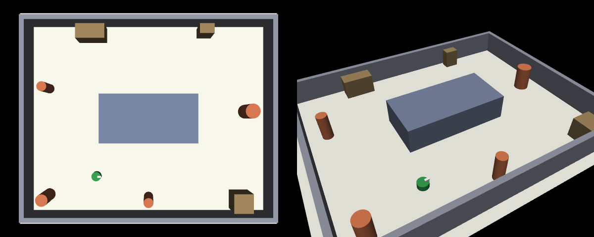
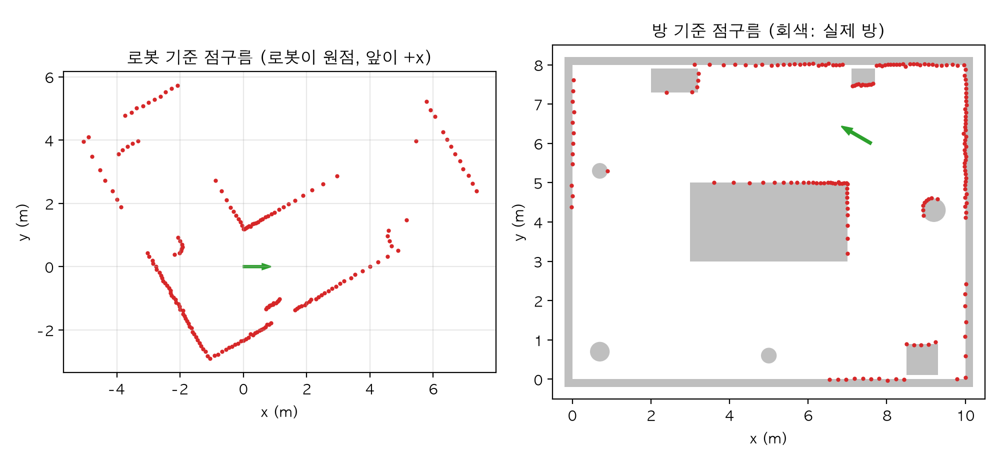
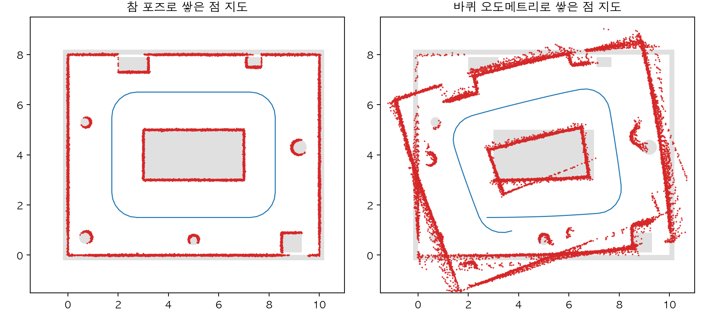
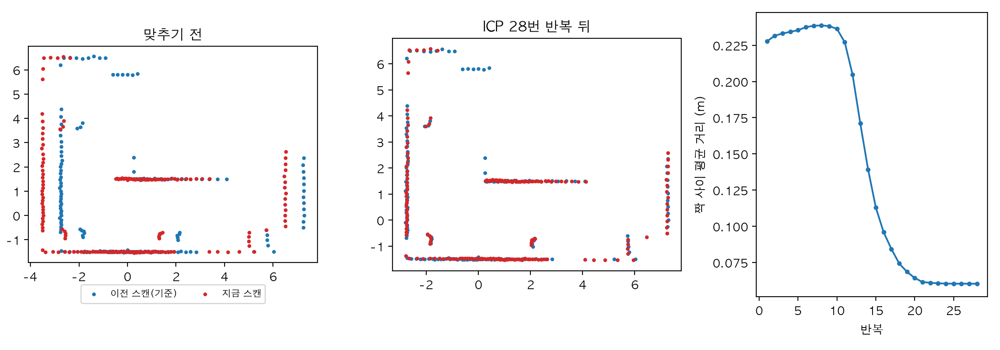
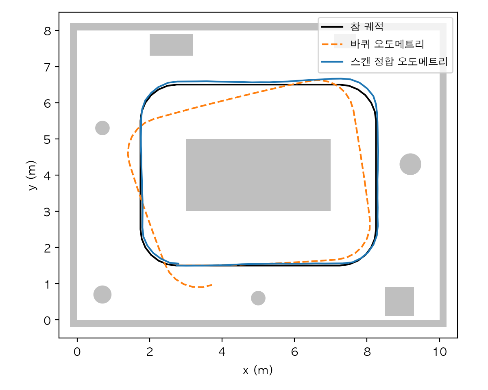
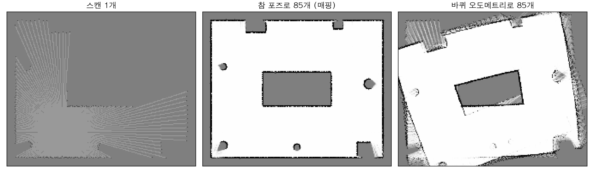
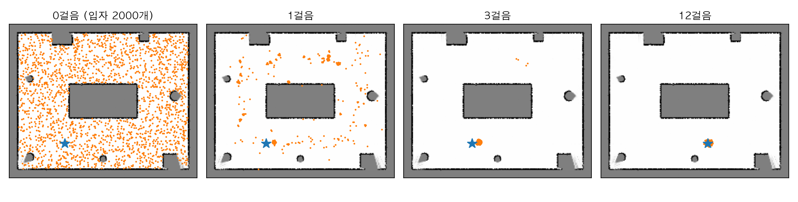
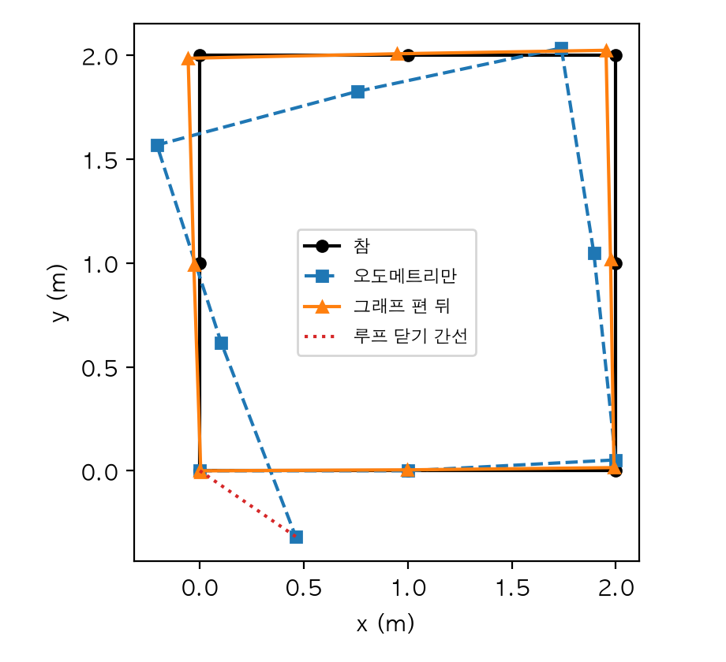
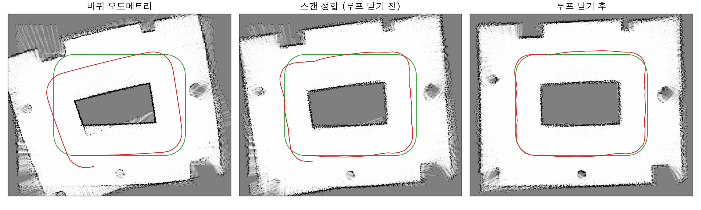

# Chapter 11. SLAM 입문: 지도를 그리며 내 위치 찾기

> **학습 목표**  
> - "지도가 있어야 위치를 알고, 위치를 알아야 지도를 그린다"는 SLAM의 닭과 달걀 문제 설명하기
> - MuJoCo 레이 캐스팅으로 2차원 라이다를 흉내 내고, 스캔을 2장의 동차 변환으로 점구름 지도에 옮기기
> - 바퀴 오도메트리만으로 그린 지도가 왜 번지는지 직접 보기
> - 점-점 ICP를 직접 짜서 두 스캔 사이의 이동을 찾고, 수렴과 처음 추측의 중요성 확인하기
> - 로그 오즈로 점유 격자 지도를 만들고, 파티클 필터(MCL)로 지도 위에서 위치 찾기
> - 한 바퀴 돌아 제자리에 왔을 때 쌓인 오차를 포즈 그래프 최적화로 나눠 고치기
> - 값싼 라이다를 단 로봇으로 스캔 정합 오도메트리, 루프 닫기, 점유 격자 지도를 한 번에 만들기

---

## 들어가며: 처음 온 건물에서 눈을 감고 걷는다면

처음 가 보는 건물에 들어섰는데 안내도가 없다고 해 봅시다. 사람은 어떻게 할까요? 걸으면서 "입구에서 열 걸음 와서 왼쪽에 계단이 있었지" 하고 머릿속에 대충 지도를 그립니다. 그리고 그 지도를 보며 "지금 계단에서 다섯 걸음쯤 왔으니 여기쯤이겠군" 하고 내 위치를 짐작하죠. 지도를 그리는 일과 위치를 찾는 일을 **동시에** 하고 있는 겁니다.

로봇 청소기가 처음 집에 오면 똑같은 문제를 풉니다. 이 일을 **SLAM**(Simultaneous Localization And Mapping, 동시적 위치 추정과 지도 작성)이라고 불러요. 이름이 길지만 뜻은 "지도를 그리면서 동시에 지도 위의 내 위치를 찾는다"입니다.

이게 왜 어려울까요? 거리 센서가 "앞으로 2m에 벽이 있다"고 알려 준 상황을 숫자로 보겠습니다.

```python
import numpy as np

거리 = 2.0          # 라이다가 로봇 앞쪽으로 잰 벽까지의 거리(m)

# 1) 위치를 알면 지도를 그린다: 내 포즈에서 2m 앞에 벽이 있다
for 이름, (x, y, 각_도) in [("맞는 포즈     ", (1.0, 1.0, 0)),
                          ("방향이 5도 틀림", (1.0, 1.0, 5)),
                          ("위치가 0.3m 틀림", (1.3, 1.0, 0))]:
    각 = np.deg2rad(각_도)
    벽_방 = np.array([x + 거리 * np.cos(각), y + 거리 * np.sin(각)])
    print(f"{이름}: 벽을 {np.round(벽_방, 3)}에 그린다")

# 2) 지도를 알면 위치를 안다: 벽이 x = 3m에 있다고 지도에 적혀 있다면
벽_x = 3.0
print("지도로 거꾸로 찾은 로봇의 x:", 벽_x - 거리)
```

```text
맞는 포즈     : 벽을 [3. 1.]에 그린다
방향이 5도 틀림: 벽을 [2.992 1.174]에 그린다
위치가 0.3m 틀림: 벽을 [3.3 1. ]에 그린다
지도로 거꾸로 찾은 로봇의 x: 1.0
```

내 포즈를 정확히 알면 벽을 (3, 1)에 제대로 그립니다. 그런데 방향을 5도만 잘못 알아도 벽이 0.17m 위로, 위치를 0.3m 잘못 알면 벽도 0.3m 옆으로 그려져요. **위치가 틀리면 지도가 틀립니다.** 거꾸로 마지막 줄처럼, 벽이 x = 3m에 있다고 적힌 지도가 있으면 "2m 앞에 벽"이라는 측정만으로 내가 x = 1m에 있다는 걸 압니다. **지도가 있어야 위치를 알아요.**

지도를 그리려면 위치가 필요하고, 위치를 알려면 지도가 필요합니다. 처음 온 로봇은 둘 다 모르고요. 이것이 SLAM의 **닭과 달걀 문제**입니다. 이 장에서는 이 문제를 한 조각씩 풀어 갑니다.

1. 라이다를 흉내 내서 로봇이 보는 세상을 점으로 얻고(11.1절)
2. 바퀴로 잰 움직임만 믿고 지도를 그렸을 때 무엇이 망가지는지 보고(11.2절)
3. 스캔끼리 맞춰서 움직임을 더 정확히 재고(11.3절)
4. 위치를 알 때 지도를 그리는 법(11.4절)과 지도를 알 때 위치를 찾는 법(11.5절)을 각각 익힌 뒤
5. 한 바퀴 돌아 제자리에 왔다는 사실로 쌓인 오차를 한꺼번에 고칩니다(11.6절)

마지막 실습에서는 이 조각을 모두 이어 방 한 바퀴를 도는 로봇의 지도를 만들어요.

> **Q. 8장의 칼만 필터로도 위치를 찾지 않나요?**
> 8장에서 본 확장 칼만 필터(EKF)는 위치를 알고 있는 표지 몇 개를 보며 내 위치를 고쳐 나가는 데 아주 좋습니다. 8장의 상태 [x, y, θ] 뒤에 표지들의 좌표까지 덧붙여 "표지의 위치도 같이 추정하자"고 넓힌 것이 EKF-SLAM으로, 초기 SLAM의 대표 방법이었어요. 표지가 늘어날수록 상태와 공분산 행렬이 커져 계산이 무거워진다는 약점이 있습니다. 이 장에서는 표지 대신 라이다가 잰 수많은 점을 쓰는 방법들을 다룹니다. 점구름 정합, 점유 격자, 파티클 필터, 포즈 그래프는 오늘날 2차원 라이다 SLAM 도구의 뼈대입니다. 예제는 파이썬 3.12, NumPy 2.5, SciPy 1.18, MuJoCo 3.17에서 실행해 확인했어요.

## 11.1 2차원 라이다 흉내 내기

### 빛으로 재는 줄자

**라이다(LiDAR)** 는 레이저 빛을 쏘고 반사되어 돌아오는 시간을 재서 거리를 알아내는 센서입니다. 1장 1.3절의 센서 표에서 "주변을 돌며 수천 점을 잰다"고 소개했죠. 로봇 청소기 위에 볼록 솟은 동그란 부분이 바로 2차원 라이다예요. 안에서 거울이나 센서가 빙글빙글 돌면서, 바닥과 나란한 한 평면 위로 사방의 거리를 잽니다. 한 바퀴 잰 거리 묶음을 **스캔(scan)** 이라고 불러요.

라이다가 없어도 괜찮습니다. 4장의 MuJoCo에는 **레이 캐스팅(ray casting)**, 즉 "이 점에서 이 방향으로 반직선을 쏘면 어느 물체에 몇 m 만에 닿는가"를 계산하는 함수가 있어요. `mujoco.mj_ray`는 레이 하나를, `mujoco.mj_multiRay`는 한 점에서 나가는 레이 여러 개를 한 번에 계산합니다. 닿은 물체가 없으면 -1을 돌려줘요. 진짜 라이다가 하는 일과 똑같죠.

### 방 장면과 라이다 함수

10m × 8m 방을 만들겠습니다. 가운데에 큰 섬(탁자나 진열대라고 생각하세요)이 있고, 벽 근처에 기둥과 상자를 흩어 두었어요. 로봇은 섬 둘레를 한 바퀴 돌 겁니다. 이 장 내내 쓸 장면과 라이다 함수를 `방장면.py`로 저장합니다.

```python
"""11장: 벽과 기둥이 있는 방, 그리고 MuJoCo 레이 캐스팅으로 흉내 낸 2차원 라이다."""
import mujoco
import numpy as np

# 안쪽 크기 10m × 8m인 방. 가운데 섬을 로봇이 한 바퀴 돈다
방_XML = """
<mujoco>
  <visual><headlight ambient="0.3 0.3 0.3" diffuse="0.3 0.3 0.3" specular="0 0 0"/></visual>
  <default><geom rgba="0.55 0.57 0.62 1"/></default>
  <worldbody>
    <light pos="5 4 10" dir="0 0 -1" directional="true" diffuse="0.45 0.45 0.45" specular="0 0 0"/>
    <geom type="plane" pos="5 4 0" size="5.6 4.6 0.1" rgba="0.92 0.92 0.88 1"/>
    <geom type="box" pos="5 -0.1 0.5" size="5.2 0.1 0.5"/>
    <geom type="box" pos="5 8.1 0.5" size="5.2 0.1 0.5"/>
    <geom type="box" pos="-0.1 4 0.5" size="0.1 4 0.5"/>
    <geom type="box" pos="10.1 4 0.5" size="0.1 4 0.5"/>
    <geom type="box" pos="5 4 0.5" size="2 1 0.5" rgba="0.45 0.5 0.6 1"/>
    <geom type="cylinder" pos="0.7 0.7 0.5" size="0.25 0.5" rgba="0.8 0.45 0.3 1"/>
    <geom type="cylinder" pos="5 0.6 0.5" size="0.2 0.5" rgba="0.8 0.45 0.3 1"/>
    <geom type="cylinder" pos="9.2 4.3 0.5" size="0.3 0.5" rgba="0.8 0.45 0.3 1"/>
    <geom type="cylinder" pos="0.7 5.3 0.5" size="0.2 0.5" rgba="0.8 0.45 0.3 1"/>
    <geom type="box" pos="2.6 7.6 0.4" size="0.6 0.3 0.4" rgba="0.6 0.5 0.35 1"/>
    <geom type="box" pos="8.9 0.5 0.4" size="0.4 0.4 0.4" rgba="0.6 0.5 0.35 1"/>
    <geom type="box" pos="7.4 7.7 0.4" size="0.3 0.2 0.4" rgba="0.6 0.5 0.35 1"/>
    <body name="robot" mocap="true">
      <geom type="cylinder" size="0.2 0.1" pos="0 0 0.1" rgba="0.2 0.6 0.3 1"/>
      <geom type="box" size="0.08 0.04 0.03" pos="0.14 0 0.22" rgba="0.95 0.95 0.95 1"/>
    </body>
  </worldbody>
</mujoco>
"""

레이_수 = 180                                   # 기본값: 한 바퀴를 2도 간격으로 잰다
최대_거리 = 8.0                                 # m. 이보다 먼 벽은 돌아오지 않는다
라이다_높이 = 0.3                               # m. 바닥과 나란히 쏜다


def 방_만들기() -> tuple[mujoco.MjModel, mujoco.MjData]:
    모델 = mujoco.MjModel.from_xml_string(방_XML)
    return 모델, mujoco.MjData(모델)


def 로봇_놓기(모델: mujoco.MjModel, 데이터: mujoco.MjData, 포즈) -> None:
    """mocap 몸체인 로봇을 포즈 (x, y, θ)에 옮겨 놓는다."""
    x, y, 각 = 포즈
    데이터.mocap_pos[0] = [x, y, 0.0]
    데이터.mocap_quat[0] = [np.cos(각 / 2), 0.0, 0.0, np.sin(각 / 2)]   # z축 회전, [w x y z]
    mujoco.mj_forward(모델, 데이터)


def 레이_각도(개수: int) -> np.ndarray:
    """레이 방향(rad): 로봇 앞(+x)에서 시작해 반시계로 같은 간격."""
    return np.arange(개수) * 2 * np.pi / 개수


def 라이다_스캔(모델: mujoco.MjModel, 데이터: mujoco.MjData, 포즈,
             생성기: np.random.Generator | None = None, 잡음: float = 0.0,
             개수: int = 레이_수) -> np.ndarray:
    """포즈 (x, y, θ)에서 한 바퀴 잰 거리(m). 돌아오지 않은 레이는 nan."""
    로봇_놓기(모델, 데이터, 포즈)
    x, y, 각 = 포즈
    각도들 = 각 + 레이_각도(개수)
    방향들 = np.stack([np.cos(각도들), np.sin(각도들), np.zeros(개수)], axis=1)
    거리 = np.zeros(개수)
    기하_번호 = np.zeros(개수, dtype=np.int32)              # 레이마다 맞은 모양의 번호가 담긴다
    mujoco.mj_multiRay(모델, 데이터, np.array([x, y, 라이다_높이]), 방향들.ravel(), None, True,
                       모델.body("robot").id, 기하_번호, 거리, None, 개수, 최대_거리)
    거리[(거리 < 0) | (거리 > 최대_거리)] = np.nan          # 닿은 곳이 없으면 -1이 돌아온다
    if 생성기 is not None and 잡음 > 0:
        거리 = 거리 + 생성기.normal(0, 잡음, 개수)
    return 거리


def 스캔_점들(거리: np.ndarray) -> np.ndarray:
    """거리 배열을 로봇 기준 (x, y) 점구름(N×2)으로. 돌아오지 않은 레이는 뺀다."""
    각도들 = 레이_각도(len(거리))
    있음 = ~np.isnan(거리)
    return np.stack([거리[있음] * np.cos(각도들[있음]), 거리[있음] * np.sin(각도들[있음])], axis=1)
```

몇 가지를 짚고 가겠습니다.

- 로봇 몸체에 붙은 `mocap="true"`는 이 장에서 처음 나오는 속성입니다. **mocap 몸체**는 물리 법칙을 따르지 않고, 코드에서 `데이터.mocap_pos`와 `데이터.mocap_quat`에 넣은 자리로 순간 이동해요. 이 장에서는 바퀴의 물리가 아니라 "이 포즈에서 무엇이 보이는가"가 궁금하니 로봇을 원하는 포즈에 그냥 옮겨 놓습니다. 쿼터니언 순서가 MuJoCo의 `[w, x, y, z]`인 것은 2장 2.6절에서 확인했죠.
- `mj_multiRay`에 로봇 몸체 번호를 넘겨서, 레이가 자기 몸에 맞는 일이 없게 했습니다.
- 8m보다 먼 곳과 닿은 것이 없는 레이는 `nan`(값 없음)으로 표시합니다. 진짜 라이다도 너무 멀거나 빛을 흡수하는 검은 물체에서는 값을 주지 못해요.
- `스캔_점들`은 거리와 각도를 (x, y) 점으로 바꿉니다. 각도 θ 방향으로 거리 r만큼 떨어진 점은 (r cos θ, r sin θ)이에요. 이 점들은 **로봇 기준**입니다.

장면을 찍어서 확인해 보겠습니다. 4장 4.4절의 자유 카메라를 바로 위와 비스듬한 곳에 두었어요.

```python
import matplotlib.pyplot as plt
import mujoco
import numpy as np

from 방장면 import 로봇_놓기, 방_만들기
from 주행데이터 import 시작_포즈

모델, 데이터 = 방_만들기()
로봇_놓기(모델, 데이터, 시작_포즈)
print("모양(geom) 수:", 모델.ngeom, "/ 몸체 수:", 모델.nbody, "/ mocap 몸체 수:", 모델.nmocap)

사진들 = []
with mujoco.Renderer(모델, 480, 600) as 렌더러:
    for 방위, 고도, 거리 in [(90, -90, 12.5), (60, -40, 11.5)]:    # 바로 위에서, 비스듬히
        카메라 = mujoco.MjvCamera()
        카메라.lookat[:] = [5, 4, 0]
        카메라.azimuth, 카메라.elevation, 카메라.distance = 방위, 고도, 거리
        렌더러.update_scene(데이터, camera=카메라)
        사진들.append(렌더러.render())
plt.imsave("room.png", np.hstack(사진들))
print("저장: room.png")
```

```text
모양(geom) 수: 15 / 몸체 수: 2 / mocap 몸체 수: 1
저장: room.png
```



초록 원기둥이 로봇이고, 흰 작은 상자가 로봇의 앞쪽(+x)을 표시합니다. 이제 이 자리에서 한 바퀴 재 보겠습니다.

```python
import numpy as np

from 방장면 import 라이다_스캔, 레이_각도, 레이_수, 방_만들기

모델, 데이터 = 방_만들기()
포즈 = (2.75, 1.5, 0.0)                      # 섬 아래쪽, 방의 +x를 보고 선 로봇
깨끗 = 라이다_스캔(모델, 데이터, 포즈)
생성기 = np.random.default_rng(0)
잡음섞인 = 라이다_스캔(모델, 데이터, 포즈, 생성기, 잡음=0.02)

print("레이 수:", 레이_수, "/ 간격:", np.rad2deg(레이_각도(레이_수)[1]), "도")
for 도 in [0, 90, 180, 270]:
    k = 도 // 2
    print(f"{도:3d}도 방향: 참 거리 {깨끗[k]:.3f}m, 잰 거리 {잡음섞인[k]:.3f}m")
print("가장 가까운 것:", round(float(np.nanmin(깨끗)), 3), "m /",
      "가장 먼 것:", round(float(np.nanmax(깨끗)), 3), "m")
print("잡음의 표준편차:", round(float(np.std(잡음섞인 - 깨끗)), 4), "m")

# 방 구석(0.5, 7.5)에 서면 8m보다 먼 벽은 돌아오지 않는다
구석 = 라이다_스캔(모델, 데이터, (0.5, 7.5, 0.0))
print("구석에서 돌아오지 않은 레이:", int(np.isnan(구석).sum()), "개")
```

```text
레이 수: 180 / 간격: 2.0 도
  0도 방향: 참 거리 7.250m, 잰 거리 7.253m
 90도 방향: 참 거리 5.800m, 잰 거리 5.794m
180도 방향: 참 거리 2.750m, 잰 거리 2.744m
270도 방향: 참 거리 1.500m, 잰 거리 1.521m
가장 가까운 것: 1.5 m / 가장 먼 것: 7.623 m
잡음의 표준편차: 0.0193 m
구석에서 돌아오지 않은 레이: 11 개
```

로봇은 (2.75, 1.5)에서 방의 +x를 보고 서 있습니다. 앞(0도)으로 오른쪽 벽(x = 10)까지 7.25m, 뒤(180도)로 왼쪽 벽까지 2.75m, 오른쪽(270도)으로 아래 벽까지 1.5m예요. 위치를 보고 계산한 값과 딱 맞습니다. 90도 방향은 섬에 막히지 않고 위쪽 벽 앞의 상자까지 5.8m를 쟀어요. 잡음을 넣은 값은 이 참값에서 표준편차 0.0193m, 약 2cm씩 흔들립니다.

방 구석 (0.5, 7.5)에서 재니 레이 11개가 돌아오지 않았습니다. 반대쪽 구석까지 대각선이 8m를 넘으니까요. 앞으로 만들 코드는 이렇게 **빠진 값이 있는 스캔**도 다룰 수 있어야 합니다.

### 스캔을 방 좌표로 옮기기

`스캔_점들`이 주는 점은 로봇 기준입니다. 지도를 그리려면 방 기준으로 옮겨야 하죠. 2장 2.8절의 동차 변환이 바로 그 도구예요. 이 장은 바닥 위의 평면 세상이라 포즈가 (x, y, θ) 세 숫자이고, 4×4 대신 3×3 행렬이면 충분합니다. 왼쪽 위 2×2에 회전을, 오른쪽 열에 이동을 넣어요. 평면 포즈를 다루는 함수들을 `포즈도구.py`로 모으겠습니다.

```python
"""11장: 평면 포즈 (x, y, θ)와 3×3 동차 변환을 오가는 도구."""
import numpy as np


def 각도_정리(각):
    """각도를 -π ~ π 사이로 맞춘다(359도와 -1도를 같은 값으로)."""
    return (np.asarray(각) + np.pi) % (2 * np.pi) - np.pi


def 포즈_행렬(포즈) -> np.ndarray:
    """포즈 (x, y, θ)를 3×3 동차 변환으로. 2장의 4×4를 평면으로 줄인 것."""
    x, y, 각 = 포즈
    c, s = np.cos(각), np.sin(각)
    return np.array([[c, -s, x],
                     [s, c, y],
                     [0, 0, 1.0]])


def 행렬_포즈(T: np.ndarray) -> np.ndarray:
    """3×3 동차 변환을 포즈 (x, y, θ)로."""
    return np.array([T[0, 2], T[1, 2], np.arctan2(T[1, 0], T[0, 0])])


def 점_옮기기(T: np.ndarray, 점들: np.ndarray) -> np.ndarray:
    """N×2 점들을 T로 옮긴다. T_방_로봇과 로봇 기준 점들이면 방 기준 점들이 된다."""
    return 점들 @ T[:2, :2].T + T[:2, 2]


def 상대_포즈(포즈_가, 포즈_나) -> np.ndarray:
    """가에서 본 나의 포즈. 2장의 역변환(가) @ 나를 평면에서."""
    return 행렬_포즈(np.linalg.inv(포즈_행렬(포즈_가)) @ 포즈_행렬(포즈_나))


def 포즈_잇기(포즈, 증분) -> np.ndarray:
    """포즈에서 자기 기준으로 증분만큼 움직인 다음 포즈."""
    return 행렬_포즈(포즈_행렬(포즈) @ 포즈_행렬(증분))


def 포즈_쌓기(시작_포즈, 증분들) -> np.ndarray:
    """시작 포즈에 증분들을 차례로 이어 붙인 포즈 열(N+1×3). 추측 항법."""
    포즈들 = [np.asarray(시작_포즈, dtype=float)]
    for 증분 in 증분들:
        포즈들.append(포즈_잇기(포즈들[-1], 증분))
    return np.array(포즈들)
```

`포즈_행렬`이 2장의 `변환`, `상대_포즈`가 2장의 `역변환`을 평면으로 줄인 것입니다. `포즈_잇기`는 "지금 포즈에서 내 기준으로 앞으로 0.25m, 왼쪽으로 3도 돌았다" 같은 **증분(increment)** 을 이어 붙여요. `T_방_로봇 @ T_로봇_다음`처럼 이름의 안쪽 글자가 맞물리는 2장의 곱셈 그대로입니다. `포즈_쌓기`는 증분 여러 개를 차례로 잇는 함수예요. `각도_정리`도 중요합니다. 359도와 -1도는 같은 방향인데, 그냥 빼면 360도 차이가 나 버리거든요.

이제 방의 오른쪽 위에서 왼쪽 위를 보는 로봇의 스캔을 방 기준으로 옮겨 봅시다.

```python
import matplotlib.pyplot as plt
import numpy as np

from 그림도구 import 방_그리기
from 방장면 import 라이다_스캔, 방_만들기, 스캔_점들
from 포즈도구 import 점_옮기기, 포즈_행렬

모델, 데이터 = 방_만들기()
생성기 = np.random.default_rng(0)
포즈 = np.array([7.6, 6.0, np.deg2rad(150)])     # 오른쪽 위에서 왼쪽 위(150도)를 보는 로봇
점들_로봇 = 스캔_점들(라이다_스캔(모델, 데이터, 포즈, 생성기, 0.02))
T_방_로봇 = 포즈_행렬(포즈)
점들_방 = 점_옮기기(T_방_로봇, 점들_로봇)          # 이름의 안쪽 글자(로봇)가 맞물린다
print("로봇 기준 첫 점:", np.round(점들_로봇[0], 3), "→ 방 기준:", np.round(점들_방[0], 3))

그림, (왼, 오) = plt.subplots(1, 2, figsize=(10, 4.6))
왼.scatter(점들_로봇[:, 0], 점들_로봇[:, 1], s=4, color="tab:red")
왼.arrow(0, 0, 0.6, 0, width=0.06, color="tab:green")      # 로봇의 앞(+x)
왼.set_title("로봇 기준 점구름 (로봇이 원점, 앞이 +x)")
왼.set_aspect("equal")
왼.grid(alpha=0.3)
방_그리기(오, 모델)
오.scatter(점들_방[:, 0], 점들_방[:, 1], s=4, color="tab:red")
오.arrow(포즈[0], 포즈[1], 0.6 * np.cos(포즈[2]), 0.6 * np.sin(포즈[2]), width=0.06, color="tab:green")
오.set_title("방 기준 점구름 (회색: 실제 방)")
for 칸 in (왼, 오):
    칸.set_xlabel("x (m)")
    칸.set_ylabel("y (m)")
그림.tight_layout()
그림.savefig("scan.png", dpi=200)
print("저장: scan.png")
```

```text
로봇 기준 첫 점: [4.003 0.   ] → 방 기준: [4.134 8.001]
저장: scan.png
```



왼쪽의 로봇 기준 점구름은 어디가 어딘지 알아보기 어렵지만, `T_방_로봇`으로 옮기니 오른쪽처럼 실제 방의 벽 위에 정확히 얹힙니다. 로봇 앞으로 4m에 있던 첫 점이 방의 (4.134, 8.001), 위쪽 벽 위로 갔어요.

그림에서 눈여겨볼 점이 두 가지 있습니다. 첫째, 라이다는 **보이는 면만** 잽니다. 섬 너머에 있는 아래쪽 벽의 왼쪽 절반과 아래쪽 두 기둥은 섬에 가려 점이 하나도 없어요. 둘째, 가까운 곳은 점이 촘촘하고 먼 곳은 듬성듬성합니다. 2도 간격으로 쏜 레이는 1m 앞에서 3.5cm, 7m 앞에서는 24cm 간격으로 벌어지거든요. 이 두 성질이 뒤에서 만날 어려움의 씨앗입니다.

## 11.2 오도메트리만으로 지도 그리기

### 바퀴로 잰 움직임

로봇이 움직이면서 스캔을 모으려면, 스캔마다 "그때 로봇이 어디 있었는가"를 알아야 합니다. 가장 손쉬운 방법은 바퀴를 보는 거예요. 바퀴 축에 달린 엔코더(1장 1.3절)로 바퀴가 몇 바퀴 돌았는지 세면, 이번에 얼마나 가고 얼마나 돌았는지 계산할 수 있습니다. 이렇게 움직임을 재서 위치를 쌓아 가는 것을 **오도메트리(odometry)** 라고 해요. 자동차 계기판의 주행 거리계(odometer)와 같은 말입니다.

바퀴 오도메트리에는 1장에서 본 두 가지 오차가 다 있습니다. 바퀴가 미끄러지거나 바닥이 울퉁불퉁하면 생기는 **잡음**, 그리고 두 바퀴 지름이 아주 조금만 달라도 늘 한쪽으로 더 돈다고 세는 **치우침**이에요.

섬 둘레를 한 바퀴 도는 주행 기록을 만드는 `주행데이터.py`입니다. 곧은 길에서는 0.25m씩, 모퉁이에서는 반지름 1m 호를 15도씩 나눠 돌아요. 바퀴는 거리에 1cm, 방향에 0.004rad(약 0.23도)의 잡음을 섞어 재고, 한 걸음마다 왼쪽으로 0.004rad씩 더 돌았다고 치우쳐 잽니다. 그리고 모든 참 포즈에서 라이다 스캔을 하나씩 찍어요.

```python
"""11장: 가운데 섬을 한 바퀴 도는 주행 기록(참 포즈, 바퀴 오도메트리, 라이다 스캔)을 만든다."""
import numpy as np

from 방장면 import 라이다_스캔, 레이_수, 방_만들기, 스캔_점들
from 포즈도구 import 포즈_잇기

시작_포즈 = np.array([2.75, 1.5, 0.0])     # 섬 아래쪽에서 +x를 보고 출발
걸음 = 0.25                               # m. 곧은 길에서 한 번에 가는 거리
회전_반지름 = 1.0                         # m. 모퉁이는 반지름 1m 호로 돈다
스캔_잡음 = 0.02                          # m. 라이다 거리 잡음
바퀴_잡음 = (0.01, 0.004)                 # 한 걸음마다 거리(m), 방향(rad) 잡음
바퀴_치우침 = 0.004                       # rad. 한 걸음마다 늘 왼쪽으로 더 돌았다고 센다


def 참_증분들() -> np.ndarray:
    """곧게 4.5m → 왼쪽 90도 호 → 곧게 3m → 호 … 로 한 바퀴. 로봇 기준 (앞, 왼쪽, 회전) 84개."""
    호_한걸음 = np.pi / 12                                 # 호 하나를 15도씩 6걸음에
    호 = [(2 * 회전_반지름 * np.sin(호_한걸음 / 2), 0.0, 호_한걸음)] * 6
    아래 = [(걸음, 0.0, 0.0)] * 18
    옆 = [(걸음, 0.0, 0.0)] * 12
    증분들 = []
    for 곧은길 in [아래, 옆, 아래, 옆]:
        증분들 += 곧은길 + 호
    # 호의 현을 따라 간 뒤 돌면 다음 방향이 맞도록, 회전 절반을 앞뒤로 나눠 준다
    return np.array([[d * np.cos(a / 2), d * np.sin(a / 2), a] for d, _, a in 증분들])


def 주행_기록(씨앗: int = 0, 레이_개수: int = 레이_수):
    """(참 포즈들 N×3, 바퀴 증분들 (N-1)×3, 로봇 기준 스캔 점구름 N개)를 돌려준다."""
    생성기 = np.random.default_rng(씨앗)
    모델, 데이터 = 방_만들기()
    참_포즈들 = [시작_포즈]
    for 증분 in 참_증분들():
        참_포즈들.append(포즈_잇기(참_포즈들[-1], 증분))
    참_포즈들 = np.array(참_포즈들)

    바퀴_증분들 = []
    for 앞, 왼쪽, 회전 in 참_증분들():
        잰_거리 = np.hypot(앞, 왼쪽) + 생성기.normal(0, 바퀴_잡음[0])
        잰_회전 = 회전 + 바퀴_치우침 + 생성기.normal(0, 바퀴_잡음[1])
        바퀴_증분들.append([잰_거리 * np.cos(잰_회전 / 2), 잰_거리 * np.sin(잰_회전 / 2), 잰_회전])

    스캔들 = [스캔_점들(라이다_스캔(모델, 데이터, 포즈, 생성기, 스캔_잡음, 레이_개수)) for 포즈 in 참_포즈들]
    return 참_포즈들, np.array(바퀴_증분들), 스캔들
```

`주행_기록`은 세 가지를 돌려줍니다. 시뮬레이션이라서 알 수 있는 **참 포즈**, 로봇이 실제로 받는 **바퀴 증분**과 **스캔**이에요. 로봇의 알고리즘은 뒤의 두 가지만 써야 하고, 참 포즈는 채점할 때만 씁니다. 진짜 로봇에는 참 포즈가 없으니까요.

### 번지는 지도

바퀴 증분을 이어 붙인 포즈로 스캔을 방 기준에 옮겨서 겹쳐 보겠습니다. 비교를 위해 참 포즈로 옮긴 지도도 함께 그려요.

```python
import matplotlib.pyplot as plt
import numpy as np

from 그림도구 import 방_그리기
from 방장면 import 방_만들기
from 주행데이터 import 주행_기록
from 포즈도구 import 각도_정리, 점_옮기기, 포즈_쌓기, 포즈_행렬

참_포즈들, 바퀴_증분들, 스캔들 = 주행_기록()
print("포즈 수:", len(참_포즈들), "/ 첫 바퀴 증분(앞, 왼쪽, 회전):", np.round(바퀴_증분들[0], 4))
바퀴_포즈들 = 포즈_쌓기(참_포즈들[0], 바퀴_증분들)     # 잰 증분을 차례로 이어 붙인다(추측 항법)

위치_오차 = np.linalg.norm(바퀴_포즈들[:, :2] - 참_포즈들[:, :2], axis=1)
방향_오차 = np.rad2deg(np.abs(각도_정리(바퀴_포즈들[:, 2] - 참_포즈들[:, 2])))
for k in [21, 42, 63, 84]:
    print(f"{k:2d}걸음 뒤: 위치 오차 {위치_오차[k]:.3f}m, 방향 오차 {방향_오차[k]:.1f}도")

모델 = 방_만들기()[0]
그림, 칸들 = plt.subplots(1, 2, figsize=(10, 4.4))
for 칸, 포즈들, 제목 in [(칸들[0], 참_포즈들, "참 포즈로 쌓은 점 지도"),
                     (칸들[1], 바퀴_포즈들, "바퀴 오도메트리로 쌓은 점 지도")]:
    방_그리기(칸, 모델, 색="0.88")
    # 스캔마다 '그때의 포즈'로 방 기준에 옮겨 한 장에 겹친다
    점_지도 = np.vstack([점_옮기기(포즈_행렬(포즈), 스캔) for 포즈, 스캔 in zip(포즈들, 스캔들)])
    칸.scatter(점_지도[:, 0], 점_지도[:, 1], s=0.3, color="tab:red")
    칸.plot(포즈들[:, 0], 포즈들[:, 1], "-", color="tab:blue", lw=1)
    칸.set_title(제목)
    칸.set_xlim(-1.5, 11)
    칸.set_ylim(-1.5, 9.5)
그림.tight_layout()
그림.savefig("odom_map.png", dpi=200)
print("저장: odom_map.png")
```

```text
포즈 수: 85 / 첫 바퀴 증분(앞, 왼쪽, 회전): [0.2513 0.0004 0.0035]
21걸음 뒤: 위치 오차 0.242m, 방향 오차 5.8도
42걸음 뒤: 위치 오차 0.792m, 방향 오차 10.8도
63걸음 뒤: 위치 오차 1.255m, 방향 오차 16.4도
84걸음 뒤: 위치 오차 1.112m, 방향 오차 21.0도
저장: odom_map.png
```



한 걸음에 0.004rad(약 0.23도)씩 더 돌았다고 잰 것뿐인데, 21걸음 뒤에 5.8도, 84걸음 뒤에는 21도나 틀어졌습니다. 위치 오차도 0.242m에서 1.255m까지 커졌다가, 섬을 한 바퀴 돌며 오차가 일부 되돌아와 끝에서는 1.112m예요. 2장 2.11절의 자이로가 치우침 때문에 자세가 계속 틀어진 것과 똑같은 **드리프트**입니다.

오른쪽 지도가 이 오차를 그대로 보여 줍니다. 처음 몇 걸음에 찍은 아래쪽 벽은 제자리에 있지만, 시간이 갈수록 방이 시계 반대 방향으로 돌아간 것처럼 그려지고 같은 벽이 여러 겹으로 번졌어요. 특히 아래쪽 벽은 처음 찍었을 때와 한 바퀴 돌아와 다시 찍었을 때가 크게 어긋나 X자로 겹쳤습니다. 이런 지도로는 길을 찾을 수 없죠.

방향 오차가 특히 무섭다는 점도 기억해 두세요. 방향이 0.1rad 틀리면 5m 앞의 벽은 0.5m 어긋나게 그려집니다. 먼 곳일수록 커지는 오차라서, 위치 오차보다 방향 오차가 지도를 더 크게 망가뜨려요.

## 11.3 스캔 정합: ICP

### 두 장의 투명 필름 맞추기

바퀴를 믿을 수 없다면 무엇을 믿을까요? 라이다 자신입니다. 0.25m 움직이기 전과 후에 찍은 두 스캔은 대부분 같은 벽을 보고 있어요. 두 스캔을 투명 필름에 그려 겹쳐 놓고, 벽이 딱 맞을 때까지 한 장을 밀고 돌려 보면 그 사이에 로봇이 얼마나 움직였는지 알 수 있습니다. 이것을 **스캔 정합(scan matching)** 이라고 해요.

가장 유명한 스캔 정합 방법이 **ICP(Iterative Closest Point, 반복 최근접점)** 입니다. 이름에 방법이 다 들어 있어요.

1. 지금 스캔의 점마다 이전 스캔에서 **가장 가까운 점**을 짝으로 정한다
2. 너무 멀리 떨어진 짝은 잘못된 짝이니 버린다
3. 짝들이 가장 잘 겹치도록 하는 회전과 이동을 **한 번에 계산**한다
4. 그만큼 옮긴 뒤 1)로 돌아가 **반복**한다

3단계가 핵심입니다. 짝이 정해져 있으면 "짝 사이 거리 제곱의 합을 가장 작게 하는 회전과 이동"은 공식으로 바로 풀려요. 두 점구름의 무게 중심을 맞추고, 중심을 뺀 점들로 만든 2×2 행렬을 **특잇값 분해(SVD)** 하면 회전이 나옵니다. 이 방법을 처음 정리한 사람들의 이름을 따 캅쉬(Kabsch) 알고리즘이라고도 불러요. 증명은 넘어가고, 코드로 정말 그런지 확인하겠습니다. 가장 가까운 점 찾기는 SciPy의 `KDTree`에 맡겨요. 점들을 나무 모양으로 정리해 두어서, 점 수천 개 사이에서도 가장 가까운 점을 빨리 찾아 주는 자료 구조입니다.

```python
"""11장: 점-점 ICP로 두 스캔을 맞춘다."""
import numpy as np
from scipy.spatial import KDTree

from 포즈도구 import 점_옮기기


def 최적_변환(원본: np.ndarray, 기준: np.ndarray) -> np.ndarray:
    """짝지은 두 점구름(N×2)에서 원본을 기준에 가장 잘 겹치는 회전과 이동(3×3)을 SVD로 구한다."""
    원본_중심, 기준_중심 = 원본.mean(axis=0), 기준.mean(axis=0)
    H = (원본 - 원본_중심).T @ (기준 - 기준_중심)          # 2×2 공분산
    U, _, Vt = np.linalg.svd(H)
    D = np.diag([1.0, np.sign(np.linalg.det(Vt.T @ U.T))])  # 거울에 비친 답(행렬식 -1)을 막는다
    R = Vt.T @ D @ U.T
    T = np.eye(3)
    T[:2, :2] = R
    T[:2, 2] = 기준_중심 - R @ 원본_중심
    return T


def icp(원본: np.ndarray, 기준: np.ndarray, 초기_T: np.ndarray | None = None,
        반복: int = 60, 짝_한계: float = 0.5, 멈춤: float = 1e-6):
    """원본 점들을 기준 점들에 맞추는 변환 T(3×3)와 반복마다의 평균 짝 거리를 돌려준다.

    원본이 '지금' 스캔, 기준이 '이전' 스캔이면 T는 T_이전_지금이다.
    """
    트리 = KDTree(기준)
    T = np.eye(3) if 초기_T is None else 초기_T.copy()
    기록 = []
    for _ in range(반복):
        옮긴 = 점_옮기기(T, 원본)
        거리, 번호 = 트리.query(옮긴)                     # 1) 가장 가까운 점을 짝으로
        좋은 = 거리 < 짝_한계                             # 2) 너무 먼 짝은 버린다
        기록.append(float(np.minimum(거리, 짝_한계).mean()))   # 먼 짝은 한계값으로 세어 평균
        변화 = 최적_변환(옮긴[좋은], 기준[번호[좋은]])    # 3) 짝을 가장 잘 겹치는 변환
        T = 변화 @ T                                      # 4) 쌓고 다시 1)로
        if np.abs(변화 - np.eye(3)).max() < 멈춤:
            break
    return T, 기록
```

`최적_변환`의 `D`는 거울에 비친 답을 막는 장치입니다. 2장 2.2절에서 행렬식이 -1이면 회전이 아니라 뒤집기라고 했죠. 짝이 이상하면 SVD가 가끔 그런 답을 내기 때문에, 행렬식의 부호를 보고 바로잡아요. `icp`는 반복마다 작은 변환 `변화`를 구해서 `T` 앞에 곱해 쌓습니다. `변화`가 단위 행렬과 거의 같아지면, 즉 더 움직일 게 없으면 멈춰요.

### 짝을 알 때와 모를 때

먼저 3단계만 시험해 봅시다. 짝이 확실한 점 50개를 25도 돌리고 옮긴 뒤, `최적_변환`이 그 변환을 찾아내는지 봅니다.

```python
import numpy as np

from 정합도구 import 최적_변환
from 포즈도구 import 점_옮기기, 포즈_행렬, 행렬_포즈

생성기 = np.random.default_rng(0)
기준 = 생성기.uniform(-3, 3, size=(50, 2))              # 아무렇게나 흩어진 점 50개
T_기준_원본 = 포즈_행렬([0.4, -0.2, np.deg2rad(25)])     # 참 변환: 0.4m, -0.2m, 25도
원본 = 점_옮기기(np.linalg.inv(T_기준_원본), 기준)       # 같은 점을 원본 기준으로 다시 적은 것
원본 = 원본 + 생성기.normal(0, 0.02, 원본.shape)          # 잴 때 생긴 잡음

# 짝(같은 번호끼리 같은 점)을 알 때는 한 번에 답이 나온다
T = 최적_변환(원본, 기준)
x, y, 각 = 행렬_포즈(T)
print(f"찾은 변환: x {x:.3f}m, y {y:.3f}m, 각 {np.rad2deg(각):.2f}도")
print("겹친 뒤 평균 거리:", round(float(np.linalg.norm(점_옮기기(T, 원본) - 기준, axis=1).mean()), 4), "m")

# 짝을 섞어 버리면? 같은 계산이 엉뚱한 답을 낸다
섞인_번호 = 생성기.permutation(50)
x, y, 각 = 행렬_포즈(최적_변환(원본, 기준[섞인_번호]))
print(f"짝이 틀리면  : x {x:.3f}m, y {y:.3f}m, 각 {np.rad2deg(각):.2f}도")
```

```text
찾은 변환: x 0.403m, y -0.198m, 각 25.09도
겹친 뒤 평균 거리: 0.0245 m
짝이 틀리면  : x 0.797m, y 0.237m, 각 79.92도
```

짝을 알 때는 잡음이 2cm 섞였는데도 (0.4, -0.2, 25도)를 (0.403, -0.198, 25.09도)로 거의 정확히, 반복 없이 한 번에 찾았습니다. 그런데 같은 점들의 짝을 마구 섞자 80도라는 엉뚱한 답이 나왔어요. 공식은 짝이 맞다고 믿고 계산할 뿐이니까요. **ICP의 어려움은 계산이 아니라 짝 찾기**에 있습니다. 진짜 스캔에서는 "이 점이 저 스캔의 어느 점과 같은 곳인가"를 아무도 알려 주지 않아서, 가장 가까운 점을 짝이라고 **추측**하고 고쳐 나가는 거예요.

### 두 스캔 맞추기

이번엔 진짜 스캔입니다. 출발 자리의 스캔과 세 걸음(0.75m) 뒤의 스캔을, "움직이지 않았다"는 추측에서 출발해 맞춰 보겠습니다.

```python
import matplotlib.pyplot as plt
import numpy as np

from 정합도구 import icp
from 주행데이터 import 주행_기록
from 포즈도구 import 상대_포즈, 점_옮기기, 행렬_포즈

plt.rcParams["font.family"] = "AppleGothic"
plt.rcParams["axes.unicode_minus"] = False

참_포즈들, 바퀴_증분들, 스캔들 = 주행_기록()
기준, 원본 = 스캔들[0], 스캔들[3]                      # 0.75m 떨어진 '이전'과 '지금' 스캔
print("정답 상대 포즈:", np.round(상대_포즈(참_포즈들[0], 참_포즈들[3]), 3) + 0.0)

T, 기록 = icp(원본, 기준)                              # 처음 추측: 움직이지 않았다(단위 행렬)
for k in [0, 5, 10, 15, 20, len(기록) - 1]:
    print(f"반복 {k + 1:2d}: 짝 사이 평균 거리 {기록[k]:.4f}m")
x, y, 각 = 행렬_포즈(T)
print(f"ICP가 찾은 것: x {x:.3f}m, y {y:.3f}m, 각 {np.rad2deg(각):.2f}도")

그림, 칸들 = plt.subplots(1, 3, figsize=(12, 4.2), gridspec_kw={"width_ratios": [1, 1, 0.8]})
for 칸, 점들, 제목 in [(칸들[0], 원본, "맞추기 전"), (칸들[1], 점_옮기기(T, 원본), f"ICP {len(기록)}번 반복 뒤")]:
    칸.scatter(기준[:, 0], 기준[:, 1], s=5, color="tab:blue", label="이전 스캔(기준)")
    칸.scatter(점들[:, 0], 점들[:, 1], s=5, color="tab:red", label="지금 스캔")
    칸.set_title(제목)
    칸.set_aspect("equal")
칸들[0].legend(loc="upper center", bbox_to_anchor=(0.5, -0.08), ncol=2, fontsize=8)
칸들[2].plot(range(1, len(기록) + 1), 기록, "o-", ms=3)
칸들[2].set_xlabel("반복")
칸들[2].set_ylabel("짝 사이 평균 거리 (m)")
그림.tight_layout()
그림.savefig("icp.png", dpi=200)
print("저장: icp.png")
```

```text
정답 상대 포즈: [0.75 0.   0.  ]
반복  1: 짝 사이 평균 거리 0.2277m
반복  6: 짝 사이 평균 거리 0.2375m
반복 11: 짝 사이 평균 거리 0.2271m
반복 16: 짝 사이 평균 거리 0.0959m
반복 21: 짝 사이 평균 거리 0.0615m
반복 28: 짝 사이 평균 거리 0.0603m
ICP가 찾은 것: x 0.738m, y 0.007m, 각 -0.52도
저장: icp.png
```



ICP는 28번 반복해서 (0.738, 0.007, -0.52도)를 찾았습니다. 정답 (0.75, 0, 0)과 1.2cm, 0.5도 차이예요. 바퀴 없이 라이다만으로 움직임을 잰 겁니다.

수렴 그래프의 모양이 재미있습니다. 처음 10번은 평균 거리가 거의 줄지 않아요. 로봇이 벽을 따라 x 방향으로 움직였는데, 벽을 따라 미끄러지는 방향으로는 "가장 가까운 점" 짝이 거의 힘을 쓰지 못하기 때문입니다. 긴 벽 위의 점은 바로 옆 점과 짝이 되어 버려서 "옆으로 좀 더 가라"는 신호를 주지 못하거든요. 기둥과 상자 모서리처럼 모양이 뚜렷한 곳만 조금씩 끌어당기다가, 어느 정도 가까워지면 짝이 제대로 맞기 시작하면서 빠르게 수렴합니다. **특징 없는 긴 복도에서 라이다 SLAM이 힘든 이유**가 바로 이것이에요.

마지막 평균 거리가 잡음 크기(2cm)가 아니라 6cm에서 멈춘 것도 눈여겨보세요. 두 스캔은 같은 벽을 재도 레이가 닿은 **지점**이 다릅니다. 앞 스캔의 점과 뒤 스캔의 점은 벽 위에서 서로 엇갈려 있으니, 아무리 잘 맞춰도 점과 점 사이 거리가 0이 될 수 없어요. 그래서 실전 도구들은 점과 점 대신 "점과 벽(선)" 사이 거리를 줄이는 **점-선(point-to-line) ICP** 같은 개선판을 씁니다.

### 처음 추측이 중요하다

ICP는 "가장 가까운 점이 짝"이라는 추측에서 출발하니, 처음 추측이 너무 틀리면 엉뚱한 짝을 맞추다가 엉뚱한 곳에 멈출 수 있습니다. 얼마나 틀려도 되는지 재 보겠습니다.

```python
import numpy as np

from 정합도구 import icp
from 주행데이터 import 주행_기록
from 포즈도구 import 각도_정리, 상대_포즈, 포즈_행렬, 행렬_포즈

참_포즈들, 바퀴_증분들, 스캔들 = 주행_기록()


def 오차(T: np.ndarray, 정답: np.ndarray) -> tuple[float, float]:
    차이 = 행렬_포즈(T) - 정답
    return float(np.hypot(차이[0], 차이[1])), float(np.rad2deg(abs(각도_정리(차이[2]))))


print("[처음 추측을 '안 움직였다'로 둘 때, 두 스캔 사이가 멀어지면]")
for k in [1, 2, 4, 6, 8]:
    정답 = 상대_포즈(참_포즈들[0], 참_포즈들[k])
    위치, 각 = 오차(icp(스캔들[k], 스캔들[0])[0], 정답)
    print(f"  {정답[0]:.2f}m 떨어짐: 위치 오차 {위치:.3f}m, 각 오차 {각:5.2f}도")

print("[두 스캔은 0.5m 떨어져 있고, 처음 추측의 방향만 틀릴 때]")
정답 = 상대_포즈(참_포즈들[0], 참_포즈들[2])
for 틀린_도 in [0, 15, 30, 45, 60, 90]:
    추측 = 포즈_행렬(정답 + [0, 0, np.deg2rad(틀린_도)])
    위치, 각 = 오차(icp(스캔들[2], 스캔들[0], 추측)[0], 정답)
    print(f"  방향 {틀린_도:2d}도 틀린 추측: 위치 오차 {위치:.3f}m, 각 오차 {각:5.2f}도")
```

```text
[처음 추측을 '안 움직였다'로 둘 때, 두 스캔 사이가 멀어지면]
  0.25m 떨어짐: 위치 오차 0.008m, 각 오차  0.16도
  0.50m 떨어짐: 위치 오차 0.005m, 각 오차  0.07도
  1.00m 떨어짐: 위치 오차 0.011m, 각 오차  0.06도
  1.50m 떨어짐: 위치 오차 0.051m, 각 오차  1.23도
  2.00m 떨어짐: 위치 오차 1.119m, 각 오차  1.93도
[두 스캔은 0.5m 떨어져 있고, 처음 추측의 방향만 틀릴 때]
  방향  0도 틀린 추측: 위치 오차 0.005m, 각 오차  0.07도
  방향 15도 틀린 추측: 위치 오차 0.012m, 각 오차  0.30도
  방향 30도 틀린 추측: 위치 오차 0.011m, 각 오차  0.32도
  방향 45도 틀린 추측: 위치 오차 0.012m, 각 오차  0.30도
  방향 60도 틀린 추측: 위치 오차 0.418m, 각 오차 12.29도
  방향 90도 틀린 추측: 위치 오차 0.223m, 각 오차 92.89도
```

"안 움직였다"고 추측했을 때, 실제 이동이 1m까지는 1cm 안팎으로 맞췄습니다. 1.5m에서 오차가 5cm로 커지고, 2m에서는 1.119m나 틀렸어요. 방향도 마찬가지로, 45도 틀린 추측까지는 1cm 정도로 되돌아왔지만 60도부터는 엉뚱한 답에 멈췄습니다. 90도 틀린 추측에서는 각 오차가 92.89도, 즉 처음 추측 자리에 거의 그대로 머물렀어요. 가까운 점끼리 짝지은 결과가 그럴듯한 "가짜 골짜기"에 빠진 것입니다. 3장의 수치 역기구학이 시작 자세에 따라 다른 답을 냈던 것과 같은 성질이에요.

그래서 실전에서는 ICP에 **좋은 처음 추측**을 줍니다. 가장 흔한 것이 바퀴 오도메트리예요. 바퀴는 오래 쌓으면 틀어지지만 한 걸음 사이의 움직임은 꽤 정확하니까요. 두 센서가 서로의 약점을 메우는 셈입니다.

### 스캔 정합 오도메트리

바퀴 증분을 처음 추측으로 주고 이웃 스캔끼리 ICP로 맞춰서, 그 결과를 이어 붙이면 **스캔 정합 오도메트리**가 됩니다. 한 바퀴를 돌려 보죠.

```python
import matplotlib.pyplot as plt
import numpy as np

from 그림도구 import 방_그리기
from 방장면 import 방_만들기
from 정합도구 import icp
from 주행데이터 import 주행_기록
from 포즈도구 import 포즈_잇기, 포즈_행렬, 행렬_포즈

참_포즈들, 바퀴_증분들, 스캔들 = 주행_기록()
바퀴_포즈들 = [참_포즈들[0]]
정합_포즈들 = [참_포즈들[0]]
for k, 증분 in enumerate(바퀴_증분들):
    바퀴_포즈들.append(포즈_잇기(바퀴_포즈들[-1], 증분))
    # 바퀴가 잰 증분을 처음 추측으로 주고, 스캔끼리 맞춰 고친다
    T_이전_지금, _ = icp(스캔들[k + 1], 스캔들[k], 포즈_행렬(증분))
    정합_포즈들.append(포즈_잇기(정합_포즈들[-1], 행렬_포즈(T_이전_지금)))
바퀴_포즈들, 정합_포즈들 = np.array(바퀴_포즈들), np.array(정합_포즈들)

for 이름, 포즈들 in [("바퀴 오도메트리", 바퀴_포즈들), ("스캔 정합 오도메트리", 정합_포즈들)]:
    오차 = np.linalg.norm(포즈들[:, :2] - 참_포즈들[:, :2], axis=1)
    print(f"{이름:12s}: 끝 위치 오차 {오차[-1]:.3f}m, 가장 클 때 {오차.max():.3f}m ({오차.argmax()}걸음)")

그림, 칸 = plt.subplots(figsize=(6, 4.8))
방_그리기(칸, 방_만들기()[0])
칸.plot(참_포즈들[:, 0], 참_포즈들[:, 1], "k-", label="참 궤적")
칸.plot(바퀴_포즈들[:, 0], 바퀴_포즈들[:, 1], "--", color="tab:orange", label="바퀴 오도메트리")
칸.plot(정합_포즈들[:, 0], 정합_포즈들[:, 1], "-", color="tab:blue", label="스캔 정합 오도메트리")
칸.set_xlabel("x (m)")
칸.set_ylabel("y (m)")
칸.legend(loc="upper right", fontsize=9)
그림.tight_layout()
그림.savefig("icp_traj.png", dpi=200)
print("저장: icp_traj.png")
```

```text
바퀴 오도메트리    : 끝 위치 오차 1.112m, 가장 클 때 1.255m (63걸음)
스캔 정합 오도메트리 : 끝 위치 오차 0.072m, 가장 클 때 0.213m (35걸음)
저장: icp_traj.png
```



끝 위치 오차가 1.112m에서 0.072m로 15분의 1이 됐습니다. 그런데 "가장 클 때"를 보면 35걸음에서 0.213m예요. 스캔 정합도 결국 **증분을 이어 붙이는** 방법이라, 한 번 한 번의 작은 오차가 쌓이는 건 피할 수 없습니다. 바퀴보다 훨씬 천천히 쌓일 뿐이에요. 오래 돌수록, 그리고 라이다가 값쌀수록 이 오차는 커지는데, 이 문제는 11.6절의 루프 닫기에서 해결합니다.

## 11.4 점유 격자 지도

### 모눈종이에 칠하기

11.2절에서는 스캔 점을 그대로 겹쳐 지도로 썼습니다. 점 지도는 보기에는 좋지만, 로봇이 쓰기에는 불편해요. "여기 지나갈 수 있나?"라고 물으면 점과 점 사이가 빈 곳인지, 아직 안 본 곳인지 알 수 없거든요.

그래서 로봇은 지도를 **모눈종이**처럼 씁니다. 바닥을 5cm × 5cm 칸으로 나누고, 칸마다 "물체가 차 있을 확률"을 적어요. 이것을 **점유 격자(occupancy grid)** 지도라고 합니다. 레이 하나가 알려 주는 정보는 두 가지예요.

- 레이가 **끝난 칸**에는 무언가 있다(찬칸 쪽 증거)
- 레이가 **지나간 칸**에는 아무것도 없다(빈칸 쪽 증거). 빛이 통과했으니까요

레이가 한 번도 지나가지 않은 칸은 확률 0.5, 즉 "모름"으로 남습니다. 이 세 가지 구분(빈칸, 찬칸, 모름)이 점 지도에는 없던 정보예요.

### 로그 오즈: 곱셈을 덧셈으로

같은 칸을 여러 번 보면 증거를 합쳐야 합니다. 확률을 그대로 쓰면 베이즈 규칙에 따라 곱하고 나누는 계산이 필요한데, 확률 p를 **로그 오즈(log-odds)** log(p / (1 - p))로 바꿔 두면 증거를 **더하기만** 하면 돼요. 확률 0.5(모름)는 로그 오즈 0, 찬칸 쪽은 양수, 빈칸 쪽은 음수입니다. 수십만 칸을 초당 여러 번 고쳐야 하는 지도에서 이 차이는 큽니다. 격자 지도를 `격자도구.py`로 만들겠습니다.

```python
"""11장: 로그 오즈로 갱신하는 점유 격자 지도."""
import numpy as np

from 포즈도구 import 점_옮기기, 포즈_행렬

해상도 = 0.05            # m. 칸 하나의 한 변
지도_원점 = (-0.5, -0.5)  # m. 격자 왼쪽 아래 모서리의 방 좌표
지도_크기 = (220, 180)    # 칸 수(x 방향, y 방향): 11m × 9m
찬칸_증거 = 0.85          # 레이가 끝난 칸에 더하는 로그 오즈(확률 0.7만큼의 증거)
빈칸_증거 = -0.4          # 레이가 지나간 칸에 더하는 로그 오즈(확률 0.4만큼의 증거)
로그오즈_한계 = 5.0       # 너무 확신하지 않도록 ±5에서 자른다


def 로그오즈(확률):
    return np.log(확률 / (1 - 확률))


def 확률로(로그오즈_값):
    return 1 - 1 / (1 + np.exp(로그오즈_값))


class 점유격자:
    def __init__(self) -> None:
        self.값 = np.zeros(지도_크기)         # 로그 오즈 0 = 확률 0.5 = 모름

    def 칸_번호(self, 점들: np.ndarray) -> np.ndarray:
        """방 기준 점들(N×2)이 들어 있는 칸의 번호(한 줄로 편 번호). 지도 밖 점은 뺀다."""
        i, j = np.floor((점들 - 지도_원점) / 해상도).astype(int).T
        안 = (i >= 0) & (i < 지도_크기[0]) & (j >= 0) & (j < 지도_크기[1])
        return np.ravel_multi_index((i[안], j[안]), 지도_크기)

    def 스캔_넣기(self, 포즈, 스캔: np.ndarray) -> None:
        """포즈에서 잰 스캔(로봇 기준 점들)으로 지나간 칸은 빈칸, 끝난 칸은 찬칸 쪽으로."""
        포즈 = np.asarray(포즈, dtype=float)
        끝점들 = 점_옮기기(포즈_행렬(포즈), 스캔)
        길이 = np.linalg.norm(스캔, axis=1)
        # 레이마다 칸 크기의 절반 간격으로 점을 찍어 지나간 칸을 찾는다(끝 칸 바로 앞까지)
        간격 = np.arange(0, 길이.max(), 해상도 / 2)
        비율 = 간격[None, :] / 길이[:, None]
        지나감 = 간격[None, :] < (길이[:, None] - 해상도)
        표본 = 포즈[:2] + 비율[..., None] * (끝점들 - 포즈[:2])[:, None, :]
        # 한 스캔에서 같은 칸은 한 번만 센다. 찬칸으로 끝난 칸은 빈칸에서 뺀다
        찬_칸 = np.unique(self.칸_번호(끝점들))
        빈_칸 = np.setdiff1d(self.칸_번호(표본[지나감]), 찬_칸)
        평평 = self.값.reshape(-1)                 # 같은 메모리를 1차원으로 보는 창
        평평[빈_칸] += 빈칸_증거
        평평[찬_칸] += 찬칸_증거
        np.clip(self.값, -로그오즈_한계, 로그오즈_한계, out=self.값)

    def 확률(self) -> np.ndarray:
        return 확률로(self.값)

    def 범위(self) -> list[float]:
        """imshow의 extent: 그림 축을 방 좌표(m)로 맞춘다."""
        x0, y0 = 지도_원점
        return [x0, x0 + 지도_크기[0] * 해상도, y0, y0 + 지도_크기[1] * 해상도]


def 지도_만들기(포즈들, 스캔들: list) -> 점유격자:
    """포즈마다 그때의 스캔을 넣어 지도 한 장을 만든다."""
    지도 = 점유격자()
    for 포즈, 스캔 in zip(포즈들, 스캔들):
        지도.스캔_넣기(포즈, 스캔)
    return 지도
```

`스캔_넣기`가 핵심입니다. 레이마다 출발점에서 끝점까지 칸 크기의 절반(2.5cm) 간격으로 점을 찍어서, 그 점들이 들어간 칸을 "지나간 칸"으로 셉니다. 끝점이 든 칸은 "찬칸"이에요. 한 스캔 안에서 같은 칸을 여러 레이가 지나가도 한 번만 세도록 `np.unique`로 겹친 번호를 걸렀습니다. `self.값.reshape(-1)`은 2차원 격자를 1차원으로 **들여다보는 창**이라서, 거기에 더하면 원래 격자가 바뀝니다. 2권 4장에서 텐서의 view로 본 것과 같은 이야기예요(격자가 메모리에 한 줄로 이어져 있어서 NumPy의 `reshape`도 복사하지 않고 창을 돌려줍니다). 마지막의 `±5` 자르기는 너무 확신하지 않게 막는 장치로, 나중에 물건이 옮겨져도 지도가 따라 바뀔 수 있게 해 줍니다.

한 칸이 증거를 받으며 어떻게 변하는지 봅시다.

```python
from 격자도구 import 로그오즈, 빈칸_증거, 찬칸_증거, 확률로

print("확률 0.7의 로그 오즈:", round(float(로그오즈(0.7)), 3), "/ 0.4의 로그 오즈:", round(float(로그오즈(0.4)), 3))
print("확률 0.5(모름)의 로그 오즈:", float(로그오즈(0.5)))

# 한 칸을 여러 번 본 기록: 찬=레이가 거기서 끝남, 빈=레이가 지나감
for 이름, 관측들 in [("벽 칸   ", "찬찬찬찬찬"),
                   ("빈 바닥 ", "빈빈빈빈빈"),
                   ("지나간 사람", "빈빈찬찬빈빈빈")]:
    값 = 0.0
    경과 = []
    for 관측 in 관측들:
        값 += 찬칸_증거 if 관측 == "찬" else 빈칸_증거   # 곱셈 대신 덧셈 한 번
        경과.append(f"{확률로(값):.2f}")
    print(f"{이름}: {' → '.join(경과)}")
```

```text
확률 0.7의 로그 오즈: 0.847 / 0.4의 로그 오즈: -0.405
확률 0.5(모름)의 로그 오즈: 0.0
벽 칸   : 0.70 → 0.85 → 0.93 → 0.97 → 0.99
빈 바닥 : 0.40 → 0.31 → 0.23 → 0.17 → 0.12
지나간 사람: 0.40 → 0.31 → 0.51 → 0.71 → 0.62 → 0.52 → 0.43
```

벽 칸은 찬칸 증거를 받을 때마다 0.70, 0.85, 0.93, ... 으로 확신이 커지고, 빈 바닥은 0.40, 0.31, ... 으로 내려갑니다. 확률로 보면 0.7을 다섯 번 합치는 계산이 복잡하지만, 로그 오즈로는 0.847을 다섯 번 더한 것뿐이에요.

마지막 줄이 점유 격자의 좋은 점을 보여 줍니다. 비어 있던 칸에 사람이 지나가며 두 번 찬칸으로 보였다가, 사람이 떠나자 다시 빈칸 증거가 쌓여 0.43까지 내려왔어요. 빈칸 증거(-0.4)를 찬칸 증거(+0.85)보다 약하게 잡은 건 일부러입니다. 레이가 얇은 기둥을 살짝 비껴 지나가는 일이 흔해서, 빈칸이라는 증거를 덜 믿는 것이 안전하거든요.

### 위치를 알 때 지도 만들기

먼저 SLAM의 절반인 **매핑(mapping)**, 즉 위치를 정확히 알 때 지도 만들기부터 해 보겠습니다. 참 포즈를 쓰는 것이 "위치를 안다"는 가정이에요. 바퀴 오도메트리로 만든 지도도 나란히 그립니다.

```python
import matplotlib.pyplot as plt

from 격자도구 import 지도_만들기
from 주행데이터 import 주행_기록
from 포즈도구 import 포즈_쌓기

plt.rcParams["font.family"] = "AppleGothic"
plt.rcParams["axes.unicode_minus"] = False

참_포즈들, 바퀴_증분들, 스캔들 = 주행_기록()
바퀴_포즈들 = 포즈_쌓기(참_포즈들[0], 바퀴_증분들)

그림, 칸들 = plt.subplots(1, 3, figsize=(13, 3.9))
for 칸, 포즈들, 개수, 제목 in [(칸들[0], 참_포즈들, 1, "스캔 1개"),
                          (칸들[1], 참_포즈들, 85, "참 포즈로 85개 (매핑)"),
                          (칸들[2], 바퀴_포즈들, 85, "바퀴 오도메트리로 85개")]:
    지도 = 지도_만들기(포즈들[:개수], 스캔들[:개수])
    확률 = 지도.확률()
    칸.imshow(확률.T, origin="lower", extent=지도.범위(), cmap="gray_r", vmin=0, vmax=1)
    칸.set_title(제목)
    칸.set_xticks([])
    칸.set_yticks([])
    print(f"{제목:14s}: 찬칸 쪽 {(확률 > 0.5).sum():5d}, 빈칸 쪽 {(확률 < 0.5).sum():5d}, "
          f"모름 {(확률 == 0.5).sum():5d} (전체 {확률.size}칸)")
그림.tight_layout()
그림.savefig("grid_maps.png", dpi=200)
print("저장: grid_maps.png")
```

```text
스캔 1개         : 찬칸 쪽   180, 빈칸 쪽  9245, 모름 30175 (전체 39600칸)
참 포즈로 85개 (매핑): 찬칸 쪽  1917, 빈칸 쪽 26929, 모름 10754 (전체 39600칸)
바퀴 오도메트리로 85개 : 찬칸 쪽  2142, 빈칸 쪽 29036, 모름  8422 (전체 39600칸)
저장: grid_maps.png
```



스캔 1개만 넣으면 전체 39600칸 중 30175칸이 아직 "모름"입니다. 섬 뒤나 기둥 뒤처럼 레이가 가려진 곳이 회색 그림자로 남은 것도 보이죠. 85개를 다 넣으니 모르는 칸이 10754칸으로 줄었는데, 대부분 벽 바깥과 섬 안쪽처럼 원래 볼 수 없는 곳이에요.

참 포즈로 만든 가운데 지도는 벽 두께가 한두 칸으로 또렷합니다. 바퀴 오도메트리로 만든 오른쪽 지도는 11.2절의 점 지도처럼 기울고 번졌어요. 찬칸 쪽 칸이 1917개에서 2142개로 늘어난 것도 벽이 번져 두꺼워진 탓입니다. 그리고 섬 안쪽 아래 귀퉁이에 흰 줄무늬가 생겼죠? 어긋난 포즈로 찍은 스캔의 레이가 섬을 뚫고 지나간 것처럼 그려져, 섬이 있는 자리를 "빈칸"이라고 덮어써 버린 겁니다. 위치가 틀리면 점유 격자는 번질 뿐 아니라 **있던 벽을 지우기도** 합니다.

## 11.5 파티클 필터로 위치 찾기

### 수많은 추측을 동시에

이번엔 SLAM의 나머지 절반, **지도를 알 때 위치 찾기**입니다. 11.4절의 참 포즈 지도를 이미 갖고 있다고 하고, 로봇이 어디 있는지 전혀 모르는 상태에서 출발해 볼게요.

캄캄한 집에서 정전이 됐다고 상상해 보세요. 손으로 벽을 더듬으며 "여기가 거실일 수도, 안방일 수도 있겠네" 하고 후보를 여럿 떠올립니다. 몇 걸음 걸어 문틀을 만지면 거실 후보는 지우고 안방 후보만 남기죠. 8장 8.6절에서 성격만 비교해 본 **파티클 필터(particle filter)** 가 정확히 이렇게 합니다. "로봇이 여기 있을지도 몰라"라는 추측 하나하나를 **입자(particle)** 라고 부르고, 수천 개를 지도 위에 뿌린 뒤 이 세 단계를 반복해요.

1. **예측**: 바퀴가 "앞으로 0.25m"라고 하면, 모든 입자를 자기 방향 기준으로 0.25m씩 옮긴다. 바퀴 오차만큼 조금씩 흩뿌린다
2. **갱신**: 입자마다 "내가 이 자리에 있다면, 지금 스캔이 지도의 벽과 얼마나 맞는가"로 점수를 매긴다
3. **다시 뽑기**: 점수가 높은 입자는 여러 개로 늘리고, 낮은 입자는 없앤다

로봇 위치 추정에 쓰는 파티클 필터를 **몬테카를로 위치 추정(MCL, Monte Carlo Localization)** 이라고 합니다. ROS 2 내비게이션 도구 모음(Nav2)의 AMCL(Adaptive Monte-Carlo Localizer)이 이 방법을 다듬은 것이에요(14장 내비게이션에서 만납니다).

2단계의 점수 매기기를 빠르게 하는 요령이 있습니다. 입자마다 스캔 점을 지도에 옮겨 놓고 "가장 가까운 벽까지 거리"를 보면 되는데, 이 거리를 칸마다 미리 계산해 표로 만들어 두는 거예요. SciPy의 `distance_transform_edt`가 모든 칸에서 가장 가까운 찬칸까지의 거리를 한 번에 계산해 줍니다. 점이 벽에 딱 붙으면 점수가 높고, 멀어질수록 가우스 모양으로 낮아져요. 이런 측정 모델을 **우도장(likelihood field)** 이라고 부릅니다.

```python
"""11장: 지도를 알 때 파티클 필터로 위치 찾기(MCL)."""
import numpy as np
from scipy.ndimage import distance_transform_edt

from 격자도구 import 지도_원점, 지도_크기, 해상도
from 포즈도구 import 각도_정리

측정_시그마 = 0.3        # m. 스캔 점이 지도의 벽에서 이만큼 벗어나는 것은 흔한 일로 본다
움직임_잡음 = (0.03, 0.02)   # 한 걸음마다 입자에 뿌리는 거리(m), 방향(rad) 잡음


def 벽까지_거리표(점유확률: np.ndarray) -> np.ndarray:
    """칸마다 가장 가까운 찬칸까지의 거리(m). 스캔 점이 벽에 얼마나 붙는지 빨리 보려고 미리 계산한다."""
    return distance_transform_edt(점유확률 < 0.65) * 해상도


def 입자_뿌리기(개수: int, 점유확률: np.ndarray, 생성기: np.random.Generator) -> np.ndarray:
    """확실한 빈칸 위에 고르게 입자 (x, y, 각)를 뿌린다. 위치를 전혀 모를 때."""
    빈칸 = np.argwhere(점유확률 < 0.2)
    고른 = 빈칸[생성기.integers(len(빈칸), size=개수)]
    xy = 지도_원점 + (고른 + 생성기.random((개수, 2))) * 해상도
    return np.column_stack([xy, 생성기.uniform(-np.pi, np.pi, 개수)])


def 입자_움직이기(입자들: np.ndarray, 증분, 생성기: np.random.Generator) -> np.ndarray:
    """바퀴 오도메트리 증분을 입자마다 자기 방향 기준으로 적용하고, 잡음을 뿌린다."""
    n = len(입자들)
    앞 = 증분[0] + 생성기.normal(0, 움직임_잡음[0], n)
    옆 = 증분[1] + 생성기.normal(0, 움직임_잡음[0], n)
    회전 = 증분[2] + 생성기.normal(0, 움직임_잡음[1], n)
    c, s = np.cos(입자들[:, 2]), np.sin(입자들[:, 2])
    return np.column_stack([입자들[:, 0] + c * 앞 - s * 옆,
                            입자들[:, 1] + s * 앞 + c * 옆,
                            각도_정리(입자들[:, 2] + 회전)])


def 입자_가중치(입자들: np.ndarray, 스캔: np.ndarray, 거리표: np.ndarray) -> np.ndarray:
    """입자마다 '이 자리에서 잰 스캔이라면 점들이 벽에 얼마나 붙는가'로 점수를 매긴다."""
    c, s = np.cos(입자들[:, 2])[:, None], np.sin(입자들[:, 2])[:, None]
    x = 입자들[:, 0:1] + c * 스캔[:, 0] - s * 스캔[:, 1]       # (입자 수, 점 수)
    y = 입자들[:, 1:2] + s * 스캔[:, 0] + c * 스캔[:, 1]
    i = np.floor((x - 지도_원점[0]) / 해상도).astype(int)
    j = np.floor((y - 지도_원점[1]) / 해상도).astype(int)
    안 = (i >= 0) & (i < 지도_크기[0]) & (j >= 0) & (j < 지도_크기[1])
    d = np.where(안, 거리표[np.clip(i, 0, 지도_크기[0] - 1), np.clip(j, 0, 지도_크기[1] - 1)], 1.0)
    로그_점수 = -0.5 * (np.minimum(d, 0.5) / 측정_시그마) ** 2      # 멀리 벗어난 점 하나가 전부를 망치지 않게
    로그_점수 = 로그_점수.sum(axis=1)
    w = np.exp(로그_점수 - 로그_점수.max())
    return w / w.sum()


def 다시_뽑기(입자들: np.ndarray, 가중치: np.ndarray, 생성기: np.random.Generator) -> np.ndarray:
    """가중치에 비례해 입자를 다시 뽑는다(계통 재표본: 같은 간격의 빗으로 한 번에)."""
    n = len(입자들)
    빗 = (생성기.random() + np.arange(n)) / n
    번호 = np.searchsorted(np.cumsum(가중치), 빗)
    return 입자들[np.minimum(번호, n - 1)].copy()
```

`다시_뽑기`는 **계통 재표본**이라는 방법을 씁니다. 가중치를 누적해 0~1 사이의 줄자로 펴 놓고, 같은 간격으로 이가 난 빗을 한 번 대서 이가 닿는 자리의 입자를 고르는 방식이에요. 무작위로 n번 따로 뽑는 것보다 운에 덜 흔들립니다. `입자_가중치`에서 벽까지 거리를 0.5m에서 자른 것은, 지도에 없는 물체(사람, 의자)에 맞은 점 하나 때문에 맞는 입자의 점수가 바닥나지 않게 하려는 장치입니다.

### 퍼졌다가 모이는 입자들

입자 2000개를 방 전체에 뿌리고, 로봇이 섬 둘레를 걷는 동안 어떻게 되는지 봅시다. 스캔 180점 중 12점마다 하나씩, 15점만 써서 점수를 매겨요.

```python
import matplotlib.pyplot as plt
import numpy as np

from 격자도구 import 지도_만들기
from 입자도구 import 다시_뽑기, 벽까지_거리표, 입자_가중치, 입자_뿌리기, 입자_움직이기
from 주행데이터 import 주행_기록

plt.rcParams["font.family"] = "AppleGothic"
plt.rcParams["axes.unicode_minus"] = False

참_포즈들, 바퀴_증분들, 스캔들 = 주행_기록()
지도 = 지도_만들기(참_포즈들, 스캔들)       # 11.4절처럼 참 포즈로 만든 지도를 '알고 있다'
확률 = 지도.확률()
거리표 = 벽까지_거리표(확률)

생성기 = np.random.default_rng(1)
입자들 = 입자_뿌리기(2000, 확률, 생성기)             # 어디 있는지 전혀 모른다
찍을_걸음 = [0, 1, 3, 12]
그림, 칸들 = plt.subplots(1, 4, figsize=(13, 3.3))
칸_번호 = 0
for k in range(25):
    if k > 0:
        입자들 = 입자_움직이기(입자들, 바퀴_증분들[k - 1], 생성기)   # 예측: 바퀴가 잰 만큼 다 같이 움직인다
    가중치 = 입자_가중치(입자들, 스캔들[k][::12], 거리표)          # 갱신: 스캔 15점이 벽에 붙는 만큼 점수
    추정 = np.average(입자들[:, :2], weights=가중치, axis=0)
    퍼짐 = np.sqrt(np.average(((입자들[:, :2] - 추정) ** 2).sum(axis=1), weights=가중치))
    if k in 찍을_걸음 or k == 24:
        오차 = np.linalg.norm(추정 - 참_포즈들[k, :2])
        print(f"{k:2d}걸음: 추정 오차 {오차:.3f}m, 입자 퍼짐 {퍼짐:.3f}m, 유효 입자 수 {1 / np.sum(가중치 ** 2):6.1f}")
    if k in 찍을_걸음:
        칸 = 칸들[칸_번호]
        칸.imshow(확률.T, origin="lower", extent=지도.범위(), cmap="gray_r", vmin=0, vmax=1)
        칸.scatter(입자들[:, 0], 입자들[:, 1], s=1, color="tab:orange")
        칸.plot(*참_포즈들[k, :2], "*", color="tab:blue", ms=12)
        칸.set_title(f"{k}걸음 (입자 2000개)" if k == 0 else f"{k}걸음")
        칸.set_xticks([])
        칸.set_yticks([])
        칸_번호 += 1
    입자들 = 다시_뽑기(입자들, 가중치, 생성기)          # 점수 높은 입자는 늘고 낮은 입자는 사라진다
그림.tight_layout()
그림.savefig("mcl.png", dpi=200)
print("저장: mcl.png")
```

```text
 0걸음: 추정 오차 1.475m, 입자 퍼짐 2.437m, 유효 입자 수    1.8
 1걸음: 추정 오차 0.485m, 입자 퍼짐 0.576m, 유효 입자 수  988.1
 3걸음: 추정 오차 0.376m, 입자 퍼짐 0.110m, 유효 입자 수  784.1
12걸음: 추정 오차 0.056m, 입자 퍼짐 0.086m, 유효 입자 수 1633.7
24걸음: 추정 오차 0.030m, 입자 퍼짐 0.087m, 유효 입자 수 1774.1
저장: mcl.png
```



0걸음에는 입자가 방 전체에 퍼져 있어 추정이 1.475m 틀렸습니다. 그런데 첫 스캔으로 점수를 매기자 **유효 입자 수**가 1.8로 떨어졌어요. 유효 입자 수는 가중치가 얼마나 고르게 나뉘었는지 나타내는 값(1 / 가중치 제곱의 합)인데, 가중치가 2000개 중 몇 개에 크게 몰렸다는 뜻입니다. 우연히 참 위치 가까이 떨어진 몇 개가 다른 입자들보다 훨씬 잘 맞았던 거예요.

1걸음 그림에는 다시 뽑힌 뒤 흩뿌려진 작은 무리들이 남아 있고, 3걸음에는 참 위치 옆 한 무리로 모였습니다. 3걸음에서 퍼짐(0.110m)보다 오차(0.376m)가 큰 것은 무리가 아직 살짝 빗나간 자리에 모여 있다는 뜻이에요. 몇 걸음 더 걸으며 스캔이 쌓이자 12걸음에 0.056m, 24걸음에 0.030m까지 줄었습니다. 퍼짐이 0.09m 근처에서 더 줄지 않는 건 예측 단계에서 일부러 뿌리는 잡음 때문이에요. 바퀴의 오차를 생각하면 이 정도 퍼짐은 남겨 두는 게 맞습니다.

### 입자가 부족하면

첫 걸음에서 입자가 몇 개로 줄었다는 게 마음에 걸립니다. 그 몇 개가 하필 엉뚱한 곳이었다면 어땠을까요? 씨앗만 바꿔 10번 해 보겠습니다.

```python
import numpy as np

from 격자도구 import 지도_만들기
from 입자도구 import 다시_뽑기, 벽까지_거리표, 입자_가중치, 입자_뿌리기, 입자_움직이기
from 주행데이터 import 주행_기록

참_포즈들, 바퀴_증분들, 스캔들 = 주행_기록()
지도 = 지도_만들기(참_포즈들, 스캔들)
확률 = 지도.확률()
거리표 = 벽까지_거리표(확률)


def 전역_위치추정(입자_수: int, 씨앗: int) -> float:
    """아무것도 모르는 채 출발해 24걸음 뒤의 추정 오차(m)."""
    생성기 = np.random.default_rng(씨앗)
    입자들 = 입자_뿌리기(입자_수, 확률, 생성기)
    for k in range(25):
        if k > 0:
            입자들 = 입자_움직이기(입자들, 바퀴_증분들[k - 1], 생성기)
        가중치 = 입자_가중치(입자들, 스캔들[k][::12], 거리표)
        추정 = np.average(입자들[:, :2], weights=가중치, axis=0)
        입자들 = 다시_뽑기(입자들, 가중치, 생성기)
    return float(np.linalg.norm(추정 - 참_포즈들[24, :2]))


for 입자_수 in [2000, 5000]:
    오차들 = [전역_위치추정(입자_수, 씨앗) for 씨앗 in range(10)]
    print(f"입자 {입자_수}개, 10번 시도: " + " ".join(f"{e:.2f}" for e in 오차들))
```

```text
입자 2000개, 10번 시도: 0.03 0.03 7.11 0.03 7.10 0.03 0.03 0.05 0.03 0.03
입자 5000개, 10번 시도: 0.03 0.03 0.03 0.03 0.03 0.03 0.03 0.03 0.03 0.03
```

입자 2000개일 때 10번 중 2번은 7.1m 틀린 곳으로 수렴했습니다. 7.1m는 24걸음째의 로봇 자리와, 방 가운데를 사이에 두고 그 맞은편에 있는 자리 사이의 거리예요. 이 방은 가운데 섬을 중심으로 180도 돌려도 거의 같은 모양이라서(기둥과 상자 몇 개만 다릅니다), 반대편에 180도 돌아선 로봇도 스캔이 꽤 잘 맞습니다. 처음에 참 위치 근처에 운 좋게 떨어진 입자가 없으면 반대편 후보가 이겨 버리는 거죠. 입자를 5000개로 늘리니 10번 모두 0.03m로 맞췄습니다.

입자 수가 정확도와 계산량을 맞바꾸는 손잡이인 셈입니다. 위치를 전혀 모를 때(전역 위치 추정)는 입자가 많이 필요하고, 위치를 대충 알고 그 둘레를 따라갈 때(추적)는 적어도 됩니다. 그래서 AMCL은 이름의 "적응형(Adaptive)"처럼 최소·최대 입자 수(Nav2 문서의 기본값은 500개와 2000개) 사이에서 입자 수를 바꿔 가며 씁니다.

### 납치된 로봇

파티클 필터의 유명한 시험 문제가 하나 있습니다. 잘 따라가던 로봇을 누가 번쩍 들어 다른 곳에 내려놓으면 어떻게 될까요? 이것을 **납치된 로봇 문제(kidnapped robot problem)** 라고 부릅니다. 로봇 청소기를 사람이 들어 다른 방에 옮기는 일은 실제로 흔해요.

입자들이 이미 한곳에 모여 있으니, 새 위치 근처에는 입자가 하나도 없습니다. 다시 뽑기는 있는 입자 중에서만 고르니 영영 못 찾을 수 있어요. 흔한 처방은 매 걸음 입자 몇 %를 지도 전체에 **새로 뿌려** "혹시 전혀 다른 곳은 아닐까"를 늘 열어 두는 것입니다. 출발 위치를 알고 시작해서 29걸음째까지 따라가다가, 30걸음째에 로봇을 60번 자리로 옮겨 보겠습니다.

```python
import numpy as np

from 격자도구 import 지도_만들기
from 입자도구 import 다시_뽑기, 벽까지_거리표, 입자_가중치, 입자_뿌리기, 입자_움직이기
from 주행데이터 import 주행_기록

참_포즈들, 바퀴_증분들, 스캔들 = 주행_기록()
지도 = 지도_만들기(참_포즈들, 스캔들)
확률 = 지도.확률()
거리표 = 벽까지_거리표(확률)

# 0~29번 자리를 지나다가, 누가 로봇을 번쩍 들어 60번 자리에 내려놓는다
순서 = list(range(0, 30)) + list(range(60, 85))
납치_걸음 = 30


def 따라가기(새_입자_비율: float, 씨앗: int) -> list[float]:
    생성기 = np.random.default_rng(씨앗)
    # 이번에는 출발 위치를 알고 시작한다: 시작 포즈 둘레에 입자를 모아 둔다
    입자들 = 참_포즈들[0] + 생성기.normal(0, [0.1, 0.1, 0.05], size=(2000, 3))
    오차들 = []
    for 걸음, k in enumerate(순서):
        if 걸음 > 0:
            # 바퀴는 들려 간 줄 모르니, 납치된 걸음에도 평소처럼 한 걸음 증분을 알려 준다
            증분 = 바퀴_증분들[0] if 걸음 == 납치_걸음 else 바퀴_증분들[k - 1]
            입자들 = 입자_움직이기(입자들, 증분, 생성기)
        가중치 = 입자_가중치(입자들, 스캔들[k][::12], 거리표)
        추정 = np.average(입자들[:, :2], weights=가중치, axis=0)
        오차들.append(float(np.linalg.norm(추정 - 참_포즈들[k, :2])))
        입자들 = 다시_뽑기(입자들, 가중치, 생성기)
        # 일부 입자를 지도 전체에 새로 뿌려 '혹시 다른 곳은 아닐까'를 늘 열어 둔다
        새로 = int(새_입자_비율 * len(입자들))
        if 새로 > 0:
            입자들[:새로] = 입자_뿌리기(새로, 확률, 생성기)
    return 오차들


for 비율 in [0.0, 0.02, 0.05]:
    오차들 = np.array([따라가기(비율, 씨앗) for 씨앗 in range(10)])     # 10번 시도 × 걸음
    print(f"새 입자 {비율:.0%}: 납치 직전 오차 평균 {오차들[:, 납치_걸음 - 1].mean():.2f}m, "
          f"되찾음(0.3m 안) {(오차들[:, -1] < 0.3).sum()}번, 5m 넘게 틀림 {(오차들[:, -1] > 5).sum()}번")
```

```text
새 입자 0%: 납치 직전 오차 평균 0.02m, 되찾음(0.3m 안) 0번, 5m 넘게 틀림 0번
새 입자 2%: 납치 직전 오차 평균 0.02m, 되찾음(0.3m 안) 4번, 5m 넘게 틀림 5번
새 입자 5%: 납치 직전 오차 평균 0.02m, 되찾음(0.3m 안) 3번, 5m 넘게 틀림 5번
```

세 경우 모두 납치 직전까지는 0.02m로 잘 따라갔습니다. 새 입자를 뿌리지 않으면 10번 중 한 번도 새 위치를 되찾지 못했어요. 2%를 뿌리면 4번, 5%면 3번 되찾았습니다. 나아졌지만 완벽하지 않죠. 나머지 5번은 5m 넘게 틀렸는데, 앞에서 본 **180도 반대편 자리**로 간 것입니다. 새로 뿌린 입자는 반대편에도 떨어지고, 이 방에서는 반대편 후보도 점수가 꽤 높으니까요. 새 입자를 많이 뿌린다고 좋아지지도 않습니다. 5%는 2%보다 나을 게 없었어요. 매 걸음 추정에 섞이는 엉뚱한 입자가 늘어나는 탓입니다. 그래서 AMCL은 늘 같은 비율로 뿌리지 않고, 입자들의 평균 점수를 짧게 본 값과 길게 본 값으로 나눠 지켜보다가 점수가 갑자기 떨어질 때 무작위 포즈를 더합니다(`recovery_alpha_fast`, `recovery_alpha_slow` 매개변수이고, Nav2 문서의 기본값 0.0이면 꺼져 있어요).

결국 위치 추정은 **방이 얼마나 구별되는 모양인가**에 크게 달려 있습니다. 대칭인 복도, 똑같은 사무실 칸막이가 늘어선 곳은 사람도 헷갈리죠. 실전에서는 카메라 같은 다른 센서를 더하거나, 출발 위치를 사람이 알려 주는 방법을 함께 씁니다.

8장 8.6절의 비교 표에서 본 것처럼, 칼만 필터는 위치에 대한 믿음을 정규분포 하나로 들고 다녀서 가볍지만 봉우리가 하나뿐입니다. 이 절에서 본 전역 위치 추정, 반대편 후보, 납치처럼 "후보가 여러 곳"인 상황은 입자 무리로 믿음을 표현하는 파티클 필터의 몫이에요.

## 11.6 루프 닫기와 포즈 그래프

### 한 바퀴 돌아 제자리에 왔을 때

다시 SLAM으로 돌아오겠습니다. 11.3절의 스캔 정합 오도메트리는 꽤 정확했지만 오차가 조금씩 쌓였습니다. 이 오차를 고칠 단서는 어디에 있을까요?

공원 둘레를 산책하다가 출발했던 벤치에 다시 왔다고 해 봅시다. 걸음 수로 머릿속에 그린 길은 출발점에서 몇 m 어긋나 있겠지만, 눈앞의 벤치를 보면 "아, 여기가 처음 그 자리구나"를 확실히 압니다. 그러면 머릿속 지도를 고칠 수 있어요. 마지막에 몰아서 고치는 게 아니라, 걸어온 길 **전체에 조금씩 나눠서** 고치는 겁니다. 오차는 걸음마다 조금씩 쌓인 것이니까요. 이것이 **루프 닫기(loop closure)** 입니다.

### 포즈를 꼭짓점으로, 측정을 고무줄로

이 생각을 계산으로 옮긴 것이 **포즈 그래프(pose graph)** 입니다.

- **꼭짓점(노드)**: 로봇이 스캔을 찍은 포즈 하나하나
- **간선(엣지)**: 두 포즈 사이를 잰 상대 포즈. 이웃 포즈 사이는 오도메트리가, 멀리 떨어졌다 다시 만난 포즈 사이는 루프 닫기가 알려 준다

간선을 **고무줄**이라고 생각하면 쉽습니다. 고무줄마다 "이 두 포즈는 이만큼 떨어져 있어야 한다"는 자연 길이가 있어요. 오도메트리 고무줄만 있으면 아무 힘도 걸리지 않고 오차가 그대로 남지만, 루프 고무줄 하나를 더 걸면 끝 포즈가 처음 포즈 쪽으로 당겨집니다. 그러면 모든 고무줄이 조금씩 늘어나고 줄어들며 전체가 가장 덜 팽팽한 모양으로 자리를 잡아요.

"가장 덜 팽팽한 모양"을 계산으로 쓰면, 모든 간선에 대해 (포즈들로 계산한 상대 포즈 - 잰 상대 포즈)의 제곱합을 가장 작게 하는 포즈들을 찾는 **비선형 최소 제곱** 문제가 됩니다. 3장에서 감쇠 최소제곱으로 역기구학을 풀었던 것과 같은 종류의 문제예요. 이번에는 SciPy의 `least_squares`에 맡깁니다. 잔차(어긋난 정도)를 돌려주는 함수만 주면, 그 제곱합이 가장 작아지는 변수를 찾아 줘요.

```python
"""11장: 포즈 그래프를 최소 제곱으로 펴는 도구."""
import numpy as np
from scipy.optimize import least_squares

from 포즈도구 import 각도_정리


def 상대_포즈들(포즈들: np.ndarray, 가: np.ndarray, 나: np.ndarray) -> np.ndarray:
    """간선 여러 개를 한꺼번에: 포즈들[가]에서 본 포즈들[나]의 (x, y, 각)."""
    차이 = 포즈들[나, :2] - 포즈들[가, :2]
    c, s = np.cos(포즈들[가, 2]), np.sin(포즈들[가, 2])
    return np.column_stack([c * 차이[:, 0] + s * 차이[:, 1],      # 가의 방향으로 돌려 적기(Rᵀ @ 차이)
                            -s * 차이[:, 0] + c * 차이[:, 1],
                            각도_정리(포즈들[나, 2] - 포즈들[가, 2])])


def 그래프_펴기(처음_포즈들: np.ndarray, 간선들: list, 위치_시그마: float = 0.05,
             각_시그마: float = 0.02) -> np.ndarray:
    """간선 (가, 나, 잰 상대 포즈)들을 가장 잘 만족하는 포즈들. 0번 포즈는 움직이지 않는다."""
    가 = np.array([e[0] for e in 간선들])
    나 = np.array([e[1] for e in 간선들])
    잰_값 = np.array([e[2] for e in 간선들])
    무게 = np.array([1 / 위치_시그마, 1 / 위치_시그마, 1 / 각_시그마])

    def 잔차(변수: np.ndarray) -> np.ndarray:
        포즈들 = np.vstack([처음_포즈들[:1], 변수.reshape(-1, 3)])
        차 = 상대_포즈들(포즈들, 가, 나) - 잰_값
        차[:, 2] = 각도_정리(차[:, 2])                          # 359도 차이는 1도 차이다
        return (차 * 무게).ravel()

    결과 = least_squares(잔차, 처음_포즈들[1:].ravel())
    return np.vstack([처음_포즈들[:1], 결과.x.reshape(-1, 3)])
```

`상대_포즈들`은 `포즈도구.py`의 `상대_포즈`를 간선 여러 개에 한꺼번에 적용하도록 NumPy로 풀어 쓴 것입니다. 잔차에 `무게`를 곱한 것은 단위를 맞추기 위해서예요. 위치 5cm 어긋남과 방향 0.02rad(약 1.1도) 어긋남을 "같은 정도로 나쁘다"고 보는 거죠. 0번 포즈는 변수에서 빼서 고정했습니다. 그래프는 상대 포즈만 알려 주니, 어딘가 하나를 붙잡지 않으면 전체가 통째로 미끄러질 수 있거든요.

### 네모 한 바퀴

아주 작은 예로 시작합니다. 한 변 2m인 네모를 1m씩 여덟 걸음에 돌아 제자리에 오는데, 바퀴가 걸음마다 3도씩 더 돌았다고 잰다고 해 볼게요.

```python
import matplotlib.pyplot as plt
import numpy as np

from 포즈그래프 import 그래프_펴기
from 포즈도구 import 포즈_잇기

plt.rcParams["font.family"] = "AppleGothic"
plt.rcParams["axes.unicode_minus"] = False

# 한 변 2m인 네모를 1m씩 8걸음에 한 바퀴: 두 걸음마다 왼쪽으로 90도
참_증분들 = [np.array([1.0, 0.0, 0.0]), np.array([1.0, 0.0, np.pi / 2])] * 4
잰_증분들 = [z + [0.0, 0.0, np.deg2rad(3)] for z in 참_증분들]    # 바퀴가 걸음마다 3도씩 더 돌았다고 잰다

참_포즈들, 처음_포즈들 = [np.zeros(3)], [np.zeros(3)]
for 참, 잰 in zip(참_증분들, 잰_증분들):
    참_포즈들.append(포즈_잇기(참_포즈들[-1], 참))
    처음_포즈들.append(포즈_잇기(처음_포즈들[-1], 잰))
참_포즈들, 처음_포즈들 = np.array(참_포즈들), np.array(처음_포즈들)

간선들 = [(i, i + 1, 잰_증분들[i]) for i in range(8)]       # 오도메트리 간선 8개
간선들.append((0, 8, np.zeros(3)))                          # 루프 닫기: "8번은 0번과 같은 자리다"

펴진_포즈들 = 그래프_펴기(처음_포즈들, 간선들)
for 이름, 포즈들 in [("오도메트리만", 처음_포즈들), ("그래프 편 뒤", 펴진_포즈들)]:
    오차 = np.linalg.norm(포즈들[:, :2] - 참_포즈들[:, :2], axis=1)
    print(f"{이름}: 8번 포즈 {np.round(포즈들[8, :2], 3) + 0.0}, 포즈 오차 평균 {오차.mean():.3f}m, 가장 큰 {오차.max():.3f}m")
print("포즈마다 옮겨진 거리:", np.round(np.linalg.norm(펴진_포즈들[:, :2] - 처음_포즈들[:, :2], axis=1), 2))

그림, 칸 = plt.subplots(figsize=(4.6, 4.2))
for 포즈들, 모양, 이름 in [(참_포즈들, "k-o", "참"), (처음_포즈들, "--s", "오도메트리만"), (펴진_포즈들, "-^", "그래프 편 뒤")]:
    칸.plot(포즈들[:, 0], 포즈들[:, 1], 모양, ms=5, label=이름)
칸.plot([처음_포즈들[8, 0], 0], [처음_포즈들[8, 1], 0], ":", color="tab:red", label="루프 닫기 간선")
칸.set_aspect("equal")
칸.set_xlabel("x (m)")
칸.set_ylabel("y (m)")
칸.legend(fontsize=8, loc="center")
그림.tight_layout()
그림.savefig("posegraph_tiny.png", dpi=200)
print("저장: posegraph_tiny.png")
```

```text
오도메트리만: 8번 포즈 [ 0.461 -0.317], 포즈 오차 평균 0.240m, 가장 큰 0.559m
그래프 편 뒤: 8번 포즈 [ 0.005 -0.004], 포즈 오차 평균 0.029m, 가장 큰 0.058m
포즈마다 옮겨진 거리: [0.   0.01 0.04 0.08 0.22 0.26 0.44 0.4  0.55]
저장: posegraph_tiny.png
```



오도메트리만으로는 8번 포즈가 출발점에서 (0.461, -0.317)만큼 벗어났고, 포즈 오차가 평균 0.240m였습니다. "8번은 0번과 같은 자리"라는 루프 간선 하나를 더하고 그래프를 펴자 평균 0.029m, 가장 큰 오차도 0.058m로 줄었어요.

마지막 줄이 루프 닫기의 성격을 보여 줍니다. 포즈마다 옮겨진 거리가 0번 0, 1번 0.01m에서 시작해 뒤로 갈수록 커지다가 8번에서 0.55m예요. 오차가 걸음마다 쌓였으니, 고칠 때도 뒤쪽 포즈일수록 많이 고치는 겁니다. 루프 간선 하나가 지나온 길 전체를 고친 거예요.

## 11.7 실제 SLAM 도구들

이 장에서 만든 조각들은 실제 SLAM 도구의 뼈대와 같습니다. 실전 도구들은 여기에 수년간의 다듬기를 더했어요. ROS 2에서 자주 쓰는 것들을 이름과 역할만 소개하겠습니다(버전과 설치 방법은 각 프로젝트의 문서를 확인하세요).

| 도구 | 하는 일 | 이 장과 이어지는 곳 |
|---|---|---|
| slam_toolbox | 2차원 SLAM. 스캔 정합으로 오도메트리를 다듬으며 포즈 그래프를 만들고 최적화한다(기본 최적화기는 Ceres). 포즈 그래프와 지도를 저장했다가 다시 불러와, 그 위에서 위치 추정만 하는 모드도 있다 | 11.3절, 11.6절 |
| Cartographer | 구글이 공개한 실시간 2차원·3차원 SLAM 시스템. 쓰기 전에 저장소에서 현재 유지 상태를 확인하는 것이 좋다 | 11.3절, 11.6절 |
| AMCL(Nav2) | 미리 만든 지도 위에서 적응형 몬테카를로 위치 추정. 라이다 측정 모델의 기본값이 이 장과 같은 우도장(`likelihood_field`)이다 | 11.5절 |
| map_server, map_saver(Nav2) | map_server는 점유 격자 지도를 YAML 설정 파일과 이미지 파일에서 불러와 내보내고, map_saver는 SLAM이 만든 지도를 파일로 저장한다 | 11.4절 |

ROS 2에서 지도는 `nav_msgs/msg/OccupancyGrid` 메시지로 주고받습니다. 칸마다 `int8` 정수 하나를 한 줄로 늘어놓은 배열이에요. 메시지 정의의 주석은 값의 뜻이 응용마다 다르다고 하면서, 흔히 0은 빈칸이고 -1은 모르는 칸이라고 적어 둡니다. Nav2의 map_server는 빈칸 0, 찬칸 100, 모름 -1을 씁니다. 이 장의 확률 격자를 100배 해서 정수로 바꾸면 이 약속과 거의 같아요.

지도를 만드는 동안에는 6장에서 본 tf2 좌표계 나무도 바쁘게 돌아요. 이동 로봇의 좌표계 약속(REP 105)은 `map` → `odom` → `base_link`로 이어집니다. `odom`은 오도메트리로 쌓은 좌표계라서 매끄럽게 이어지지만 시간이 갈수록 제한 없이 드리프트하고, `map`은 드리프트가 없는 대신 위치 추정이 고쳐질 때마다 툭툭 뛸 수 있어요. 그래서 위치 추정 쪽(SLAM이나 AMCL)은 `map`에서 본 `base_link`를 직접 발행하지 않고, `odom`에서 본 `base_link`를 받아 둘의 차이인 `map` → `odom` 변환을 발행합니다. 오도메트리가 쌓은 오차를 이 변환 하나가 메워 주는 구조예요. 이 장의 실습으로 말하면, 바퀴 오도메트리 궤적과 루프를 닫은 궤적 사이의 차이가 바로 `map` → `odom`입니다. 14장 내비게이션에서 이 도구들을 이어 로봇이 지도 위에서 목적지까지 가게 만들어요.

**비주얼 SLAM**은 라이다 대신 카메라로 같은 일을 합니다. 9장에서 본 핀홀 모델과 내부 행렬 K가 "3차원 점이 사진의 어느 픽셀에 찍히는가"를 알려 주고, 깊이 카메라가 있으면 9장처럼 깊이 영상을 점구름으로 바꿔 이 장의 ICP를 3차원으로 넓혀 맞출 수도 있어요. 깊이가 없는 보통 카메라는 사진 속 모서리나 무늬 같은 **특징점**을 찾아 여러 사진 사이에서 짝짓고, 그 짝으로 카메라의 움직임과 점들의 3차원 위치를 함께 추정합니다. ICP의 "가장 가까운 점" 짝을 "생김새가 같은 점" 짝으로 바꾼 셈이에요. 루프 닫기도 "이 사진이 예전에 본 사진과 같은 장소인가"를 사진의 특징으로 알아봅니다. 특징점을 찾고 짝짓는 방법은 이 책의 범위를 넘어서 개념만 소개하고, 이름 하나만 남기면 ORB 특징점을 쓰는 ORB-SLAM 계열이 대표적인 연구예요. 카메라는 값싸고 정보가 많지만, 어둡거나 무늬 없는 흰 벽 앞에서는 약합니다. 라이다는 어둠에 강하지만 이 장에서 본 긴 복도와 대칭 방에 약하죠. 그래서 실제 로봇은 둘을 함께 쓰는 경우가 많습니다.

## 11.8 실습: 방 한 바퀴 SLAM

### 무엇을 만드나

이제 조각을 이어 붙입니다. 이번 로봇에는 더 값싼 라이다를 달았어요. 2도 간격 180개 대신 **4도 간격 90개**의 레이를 쏩니다. 점이 듬성듬성해지니 ICP가 덜 정확해지고, 스캔 정합 오도메트리의 오차가 더 빨리 쌓일 거예요. 루프 닫기의 효과를 보기에 좋은 조건입니다.

순서는 이렇습니다.

1. 이웃 스캔을 ICP로 맞춰 스캔 정합 오도메트리를 만들고, 그 상대 포즈를 이웃 간선으로 남긴다
2. 지금 추정한 위치가 예전 포즈와 1m 안으로 가까워졌고 20걸음 넘게 떨어진 스캔이면, 두 스캔을 ICP로 맞춰 본다. 잘 맞으면 루프 간선으로 남긴다
3. 이웃 간선과 루프 간선으로 포즈 그래프를 편다
4. 펴진 포즈로 점유 격자 지도를 만든다

1과 2를 `슬램실습.py`로 만들겠습니다.

```python
"""11장 실습: 스캔 정합 오도메트리로 포즈 그래프의 간선을 만들고, 루프를 찾는다."""
import numpy as np

from 정합도구 import icp
from 포즈도구 import 상대_포즈, 포즈_잇기, 포즈_행렬, 행렬_포즈

루프_반경 = 1.0          # m. 추정 위치가 이만큼 가까우면 같은 곳에 왔을지 모른다
루프_간격 = 20           # 걸음. 바로 앞뒤 스캔은 루프가 아니다
정합_합격선 = 0.12       # m. ICP가 끝난 뒤 짝 사이 평균 거리가 이보다 작아야 믿는다


def 정합_오도메트리(스캔들: list, 바퀴_증분들: np.ndarray, 시작_포즈: np.ndarray):
    """이웃 스캔을 ICP로 맞춰 포즈를 이어 붙이고, 그 상대 포즈를 간선으로 남긴다."""
    포즈들 = [시작_포즈]
    간선들 = []
    for k, 증분 in enumerate(바퀴_증분들):
        T_이전_지금, _ = icp(스캔들[k + 1], 스캔들[k], 포즈_행렬(증분))
        상대 = 행렬_포즈(T_이전_지금)
        간선들.append((k, k + 1, 상대))
        포즈들.append(포즈_잇기(포즈들[-1], 상대))
    return np.array(포즈들), 간선들


def 루프_찾기(포즈들: np.ndarray, 스캔들: list) -> list:
    """멀리 돌아 가까운 곳에 다시 온 스캔 쌍을 ICP로 확인해 루프 간선을 만든다."""
    간선들 = []
    for 지금 in range(len(포즈들)):
        후보 = np.arange(0, 지금 - 루프_간격)
        if len(후보) == 0:
            continue
        거리 = np.linalg.norm(포즈들[후보, :2] - 포즈들[지금, :2], axis=1)
        if 거리.min() > 루프_반경:
            continue
        예전 = int(후보[거리.argmin()])
        추측 = 포즈_행렬(상대_포즈(포즈들[예전], 포즈들[지금]))    # 지금까지 쌓인 포즈로 한 추측
        T_예전_지금, 기록 = icp(스캔들[지금], 스캔들[예전], 추측)
        if 기록[-1] < 정합_합격선:
            간선들.append((예전, 지금, 행렬_포즈(T_예전_지금)))
    return 간선들
```

`정합_오도메트리`는 11.3절의 스캔 정합 오도메트리와 같고, ICP가 찾은 상대 포즈를 간선으로 남기는 것만 더했습니다. `루프_찾기`에서 ICP의 처음 추측은 "지금까지 쌓인 포즈로 계산한 두 포즈 사이의 상대 포즈"예요. 오차가 쌓였어도 1m 안쪽이면 11.3절에서 본 ICP의 수렴 범위 안에 듭니다. 끝난 뒤 짝 사이 평균 거리가 `정합_합격선`(0.12m)보다 커야 "다른 곳인데 우연히 비슷하게 맞은" 것으로 보고 버립니다. 4도 간격 스캔은 점 사이가 넓어 11.3절의 6cm보다 평균 거리가 크게 나오니 합격선을 넉넉히 잡았어요.

### 루프를 찾고 그래프 펴기

```python
import numpy as np

from 슬램실습 import 루프_찾기, 정합_오도메트리
from 주행데이터 import 주행_기록
from 포즈그래프 import 그래프_펴기
from 포즈도구 import 각도_정리, 상대_포즈

참_포즈들, 바퀴_증분들, 스캔들 = 주행_기록(레이_개수=90)   # 4도 간격의 값싼 라이다
정합_포즈들, 이웃_간선들 = 정합_오도메트리(스캔들, 바퀴_증분들, 참_포즈들[0])
루프_간선들 = 루프_찾기(정합_포즈들, 스캔들)
print("정합 오도메트리로 본 84번 포즈(0번 기준):", np.round(상대_포즈(정합_포즈들[0], 정합_포즈들[84]), 3) + 0.0)
print("이웃 간선", len(이웃_간선들), "개, 루프 간선", len(루프_간선들), "개")
for 예전, 지금, 잰_값 in 루프_간선들:
    정답 = 상대_포즈(참_포즈들[예전], 참_포즈들[지금])
    print(f"  {지금}번 → {예전}번: ICP {np.round(잰_값[:2], 2) + 0.0}, 정답 {np.round(정답[:2], 2) + 0.0}")
펴진_포즈들 = 그래프_펴기(정합_포즈들, 이웃_간선들 + 루프_간선들)

# 일부러 틀린 루프 하나: 섬 건너편 42번 자리를 0번 자리라고 우긴다
거짓_간선 = (0, 42, np.zeros(3))
망친_포즈들 = 그래프_펴기(정합_포즈들, 이웃_간선들 + 루프_간선들 + [거짓_간선])


def 보고(이름: str, 포즈들: np.ndarray) -> None:
    위치 = np.linalg.norm(포즈들[:, :2] - 참_포즈들[:, :2], axis=1)
    방향 = np.rad2deg(np.abs(각도_정리(포즈들[:, 2] - 참_포즈들[:, 2])))
    print(f"{이름:14s}: 위치 오차 평균 {위치.mean():.3f}m, 가장 큰 {위치.max():.3f}m, 방향 오차 가장 큰 {방향.max():.2f}도")


보고("정합 오도메트리", 정합_포즈들)
보고("루프 닫기 후", 펴진_포즈들)
보고("거짓 루프 섞임", 망친_포즈들)
```

```text
정합 오도메트리로 본 84번 포즈(0번 기준): [ 0.371 -0.272  0.142]
이웃 간선 84 개, 루프 간선 5 개
  80번 → 0번: ICP [-0.85  0.48], 정답 [-0.87  0.5 ]
  81번 → 0번: ICP [-0.72  0.29], 정답 [-0.71  0.29]
  82번 → 0번: ICP [-0.5   0.11], 정답 [-0.5   0.13]
  83번 → 0번: ICP [-0.23  0.03], 정답 [-0.26  0.03]
  84번 → 2번: ICP [-0.49 -0.01], 정답 [-0.5  0. ]
정합 오도메트리      : 위치 오차 평균 0.338m, 가장 큰 0.568m, 방향 오차 가장 큰 11.06도
루프 닫기 후       : 위치 오차 평균 0.108m, 가장 큰 0.277m, 방향 오차 가장 큰 5.27도
거짓 루프 섞임      : 위치 오차 평균 3.205m, 가장 큰 7.192m, 방향 오차 가장 큰 171.82도
```

값싼 라이다의 스캔 정합 오도메트리로 한 바퀴 돌아오니, 84번 포즈가 0번 기준으로 (0.371, -0.272)에 있고 0.142rad(약 8도) 돌아 있었습니다. 실제로는 정확히 같은 자리인데 말이죠. 11.3절의 180개 레이일 때보다 오차가 훨씬 커졌어요.

`루프_찾기`는 루프 간선 5개를 찾았습니다. 80~83번 포즈는 0번과, 84번은 2번과 이어졌어요. 출력에서 ICP가 잰 상대 위치와 정답을 비교해 보면 2~3cm 안으로 맞습니다. 쌓인 포즈로는 40cm 넘게 어긋나 있던 관계를 ICP가 제대로 다시 잰 거예요.

그래프를 펴자 위치 오차가 평균 0.338m에서 0.108m로, 가장 큰 오차가 0.568m에서 0.277m로 줄었습니다. 방향 오차도 11.06도에서 5.27도로 절반이 됐어요.

마지막 줄은 경고입니다. 섬 건너편의 42번 자리를 0번 자리라고 우기는 **거짓 루프** 하나를 섞었더니, 평균 오차가 3.205m, 방향은 171.82도까지 틀어졌습니다. 고무줄 하나가 그래프 전체를 엉뚱하게 비틀어 버린 거예요. 이 방은 11.5절에서 본 것처럼 반대편도 비슷하게 생겨서, ICP 점수만 보고 루프를 받아들이면 실제로 이런 일이 날 수 있습니다. 실전 도구들이 루프 후보를 여러 번 확인하고, 다른 간선들과 어긋나는 루프를 걸러 내는 장치를 따로 두는 이유예요. **루프를 놓치면 조금 덜 정확할 뿐이지만, 틀린 루프를 받아들이면 지도가 망가집니다.**

### 루프 닫기 전과 후의 지도

마지막으로 세 가지 포즈로 점유 격자 지도를 만들어 비교합니다. 숫자로도 비교하려고, 참 포즈 지도의 벽 칸마다 "이 지도가 10cm 안에 벽을 그렸는가"를 세었어요.

```python
import matplotlib.pyplot as plt
import numpy as np
from scipy.ndimage import distance_transform_edt

from 격자도구 import 지도_만들기, 해상도
from 슬램실습 import 루프_찾기, 정합_오도메트리
from 주행데이터 import 주행_기록
from 포즈그래프 import 그래프_펴기
from 포즈도구 import 포즈_쌓기

plt.rcParams["font.family"] = "AppleGothic"
plt.rcParams["axes.unicode_minus"] = False

참_포즈들, 바퀴_증분들, 스캔들 = 주행_기록(레이_개수=90)
바퀴_포즈들 = 포즈_쌓기(참_포즈들[0], 바퀴_증분들)
정합_포즈들, 이웃_간선들 = 정합_오도메트리(스캔들, 바퀴_증분들, 참_포즈들[0])
펴진_포즈들 = 그래프_펴기(정합_포즈들, 이웃_간선들 + 루프_찾기(정합_포즈들, 스캔들))


참_찬칸 = 지도_만들기(참_포즈들, 스캔들).확률() > 0.65
그림, 칸들 = plt.subplots(1, 3, figsize=(13, 3.9))
for 칸, 포즈들, 제목 in [(칸들[0], 바퀴_포즈들, "바퀴 오도메트리"),
                     (칸들[1], 정합_포즈들, "스캔 정합 (루프 닫기 전)"),
                     (칸들[2], 펴진_포즈들, "루프 닫기 후")]:
    지도 = 지도_만들기(포즈들, 스캔들)
    확률 = 지도.확률()
    칸.imshow(확률.T, origin="lower", extent=지도.범위(), cmap="gray_r", vmin=0, vmax=1)
    칸.plot(참_포즈들[:, 0], 참_포즈들[:, 1], "-", color="tab:green", lw=1)
    칸.plot(포즈들[:, 0], 포즈들[:, 1], "-", color="tab:red", lw=1)
    칸.set_title(제목)
    칸.set_xticks([])
    칸.set_yticks([])
    # 참 지도의 벽 칸마다, 이 지도의 가장 가까운 벽 칸이 10cm 안에 있는가
    벽까지 = distance_transform_edt(~(확률 > 0.65)) * 해상도
    맞음 = (벽까지[참_찬칸] <= 0.1).mean()
    print(f"{제목:16s}: 참 지도의 벽 칸 중 {맞음:.1%}가 10cm 안에 그려졌다")
그림.tight_layout()
그림.savefig("slam_maps.png", dpi=200)
print("저장: slam_maps.png")
```

```text
바퀴 오도메트리        : 참 지도의 벽 칸 중 51.1%가 10cm 안에 그려졌다
스캔 정합 (루프 닫기 전) : 참 지도의 벽 칸 중 55.8%가 10cm 안에 그려졌다
루프 닫기 후         : 참 지도의 벽 칸 중 82.3%가 10cm 안에 그려졌다
저장: slam_maps.png
```



바퀴 오도메트리 지도와 스캔 정합 지도는 참 지도의 벽 칸 중 각각 51.1%, 55.8%만 10cm 안에 그렸습니다. 스캔 정합 지도가 눈으로는 훨씬 나아 보이는데 숫자 차이가 작죠? 기울어진 벽이 참 벽과 우연히 엇갈려 지나가는 곳에서도 "맞았다"고 세기 때문이에요. 루프를 닫은 지도는 82.3%로 크게 뛰었습니다. 빨간 궤적이 제자리로 닫혔고, 두 겹이던 벽이 한 겹으로 모였어요.

오른쪽 지도도 완벽하지는 않습니다. 오른쪽 벽 근처에 아직 약간 번진 곳이 있죠. 루프 간선이 모두 출발점 근처에만 있어서, 출발점에서 먼 오른쪽 위 구간은 이웃 간선의 오차가 덜 고쳐졌기 때문입니다. 로봇이 두 바퀴 세 바퀴 돌거나 방 가운데를 가로지르면 루프가 더 많이 생기고 지도도 더 좋아져요. 실제 로봇 청소기가 처음 집을 볼 때 벽을 따라 한 바퀴 돈 뒤 방 안을 지그재그로 다니는 데에는 이런 이유도 있습니다.

> **Q. 실제 로봇에서는 이 계산을 언제 하나요?**
> 이 실습에서는 다 돌고 나서 한꺼번에 계산했지만, 실제 SLAM 도구는 주행하면서 계속 계산합니다. 스캔 정합 오도메트리는 스캔이 들어올 때마다 바로 하고, 루프 후보 찾기와 그래프 펴기는 시간이 더 걸리니 따로 돌려요. 루프를 찾을 때마다 그래프를 다시 펴면 지도가 한 번에 "툭" 하고 바로잡히는데, 앞에서 말한 `map` 좌표계가 뛰는 순간이 바로 이때예요. 포즈가 수천 개로 늘어나도 빨리 풀 수 있도록, 간선이 이웃끼리만 이어진 성질(희소성)을 살리는 전용 최적화 라이브러리를 씁니다. 11.7절의 slam_toolbox가 기본으로 쓰는 Ceres가 그런 라이브러리입니다.

## 11.9 정리와 다음 장 미리보기

이 장에서는 지도를 그리며 내 위치를 찾는 SLAM을 조각조각 직접 만들어 봤습니다.

- **SLAM의 닭과 달걀**: 위치를 알아야 지도를 그리고, 지도가 있어야 위치를 안다. 위치 오차, 특히 방향 오차는 먼 곳일수록 지도를 크게 망가뜨린다
- **2차원 라이다**: 한 평면 위로 사방의 거리를 잰 스캔. MuJoCo의 `mj_multiRay`로 흉내 낼 수 있다. 가려진 곳은 보이지 않고, 먼 곳은 점이 듬성하다. 로봇 기준 점구름을 `T_방_로봇`(3×3 동차 변환)으로 방 기준에 옮긴다
- **오도메트리**: 증분을 이어 붙여 위치를 쌓는다. 바퀴의 작은 치우침도 쌓이면 지도가 번지고 돌아간다(드리프트)
- **ICP**: 가장 가까운 점을 짝짓고, SVD로 가장 잘 겹치는 변환을 구하기를 반복한다. 짝 찾기가 어려운 부분이고, 처음 추측이 너무 틀리면 엉뚱한 답에 멈춘다. 특징 없는 긴 벽에서는 느리다
- **점유 격자**: 칸마다 찬 확률을 적는다. 로그 오즈로 바꾸면 증거를 더하기만 하면 된다. 빈칸·찬칸·모름을 구분한다
- **파티클 필터(MCL)**: 입자 수천 개로 여러 추측을 함께 들고 예측·갱신·다시 뽑기를 반복한다. 입자 수가 적거나 방이 대칭이면 엉뚱한 곳에 모일 수 있고, 납치에는 새 입자를 뿌려 대비한다
- **포즈 그래프**: 포즈는 꼭짓점, 상대 측정은 고무줄 같은 간선. 루프 간선 하나가 쌓인 오차를 지나온 길 전체에 나눠 고친다. 틀린 루프 하나는 지도 전체를 망친다

다음 12장부터는 4부 "판단과 제어"로 넘어갑니다. 지금까지는 로봇이 세상을 **재는** 법을 배웠다면, 이제는 잰 값을 보고 **움직이는** 법을 배울 차례예요. 그 첫걸음이 **PID 제어**입니다. 1장에서 점 로봇이 "목표까지 남은 거리에 비례해 속도를 내는" 닫힌 고리로 목표에 다가갔던 것 기억나세요? PID는 그 비례(P)에 "지금까지 쌓인 오차"(I)와 "오차가 변하는 빠르기"(D)를 더한 방법입니다. 이 장의 로봇이 지도 위의 내 위치를 알게 됐으니, 12장에서는 그 위치를 원하는 곳에 정확히, 흔들리지 않게 가져가는 법을 배웁니다.
