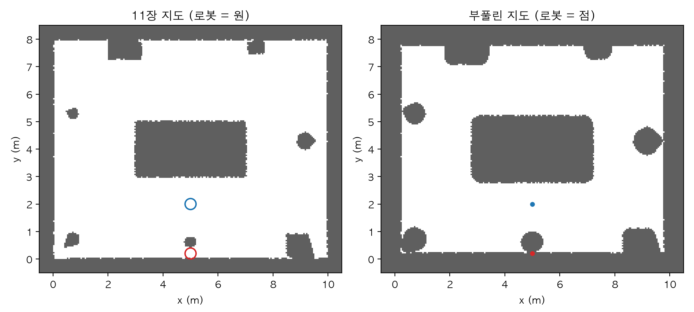
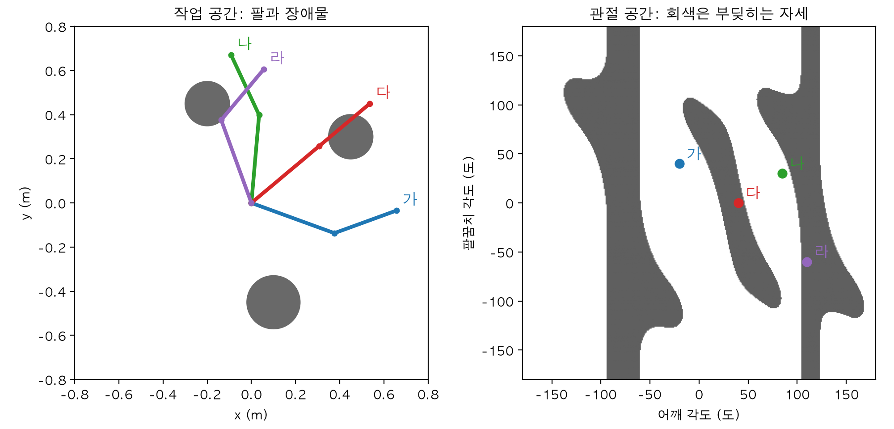
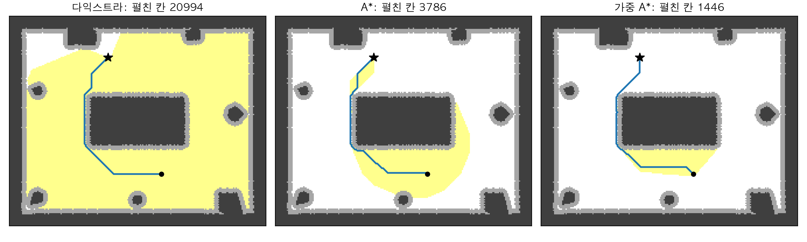
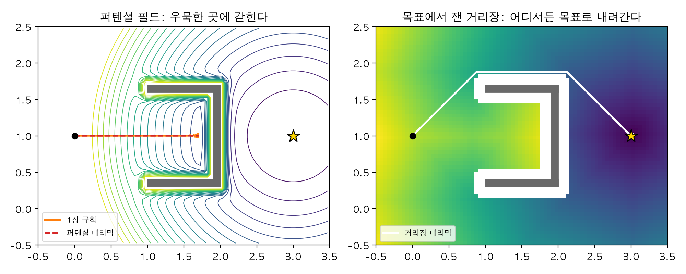
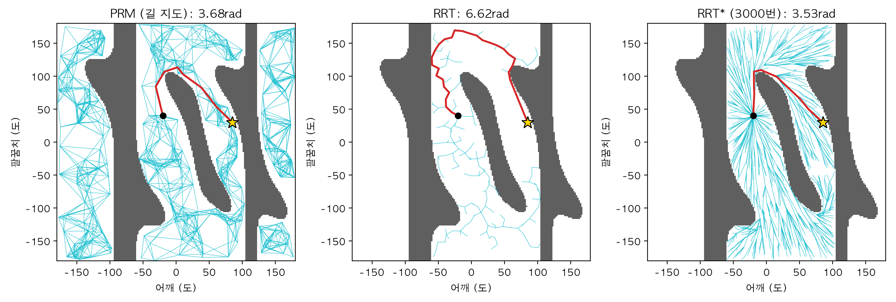
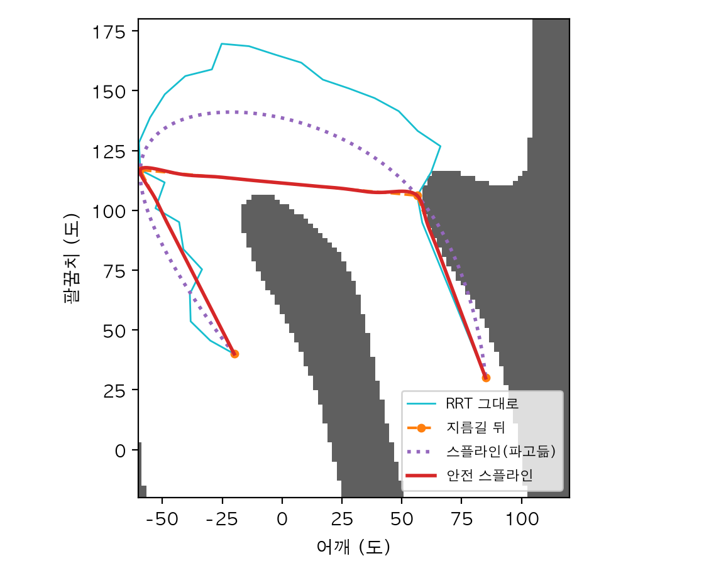
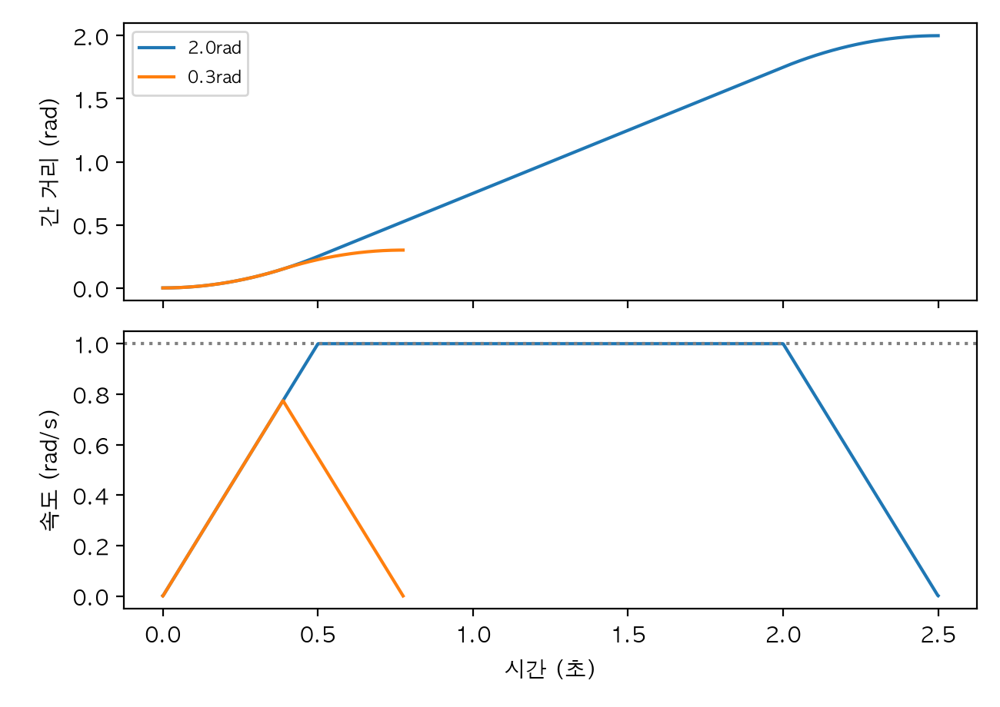
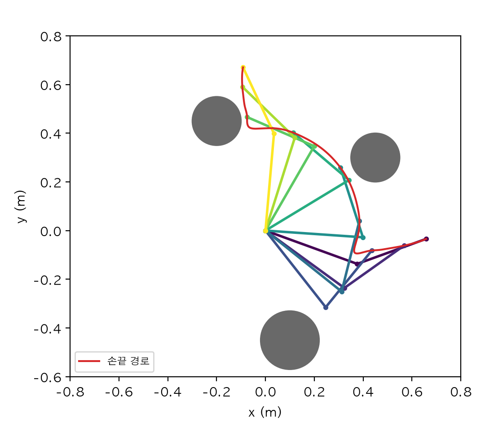
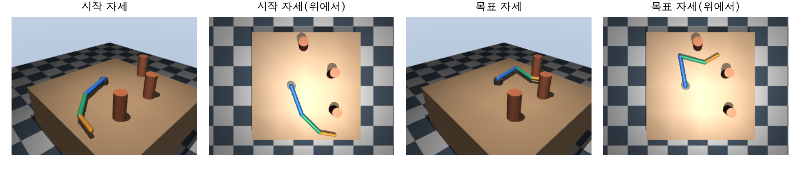
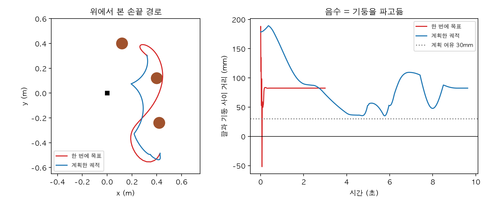

# Chapter 13. 경로 계획: 부딪히지 않는 길 찾기

> **학습 목표**  
> - 규칙 몇 줄로 움직이는 로봇이 ㄷ자 벽 같은 곳에서 왜 갇히는지 설명하기
> - 장애물을 로봇 크기만큼 부풀려 로봇을 점으로 만드는 구성 공간(C-space)을 이해하고, 2링크 팔의 관절 공간 장애물을 그려 보기
> - 점유 격자 위에서 BFS, 다익스트라, A*로 길을 찾고, 펼친 칸 수와 경로 길이로 비교하기
> - 휴리스틱이 허용적(admissible)이라는 것이 무슨 뜻인지 데이터로 확인하기
> - 퍼텐셜 필드가 국소 최소점에 빠지는 모습을 보고, 거리장으로 그 함정을 피하기
> - 관절이 많을 때 쓰는 표본 기반 계획(PRM, RRT, RRT*)을 직접 짜고, 무작위성을 씨앗으로 다루기
> - 찾은 경로를 지름길과 스플라인으로 다듬고, 속도·가속도 한계를 지키도록 시간을 매기기
> - 관절 공간 경로를 순기구학으로 손끝 경로로 바꿔 확인하고, 특이점을 피하는 계획을 세우기
> - MuJoCo에서 3관절 팔이 기둥 사이로 부딪히지 않고 팔을 뻗게 하기

---

## 들어가며: 규칙 몇 줄은 왜 ㄷ자 벽에 갇힐까요?

1장 실습에서 점 로봇은 규칙 세 줄로 둥근 기둥을 비켜 갔습니다. 목표 쪽으로 가고, 장애물에서 밀려나고, 장애물 둘레를 따라 옆으로 도는 규칙이었죠. 그리고 1장 끝에서 이런 말을 남겼어요. "장애물이 ㄷ자 모양으로 로봇을 감싸면 규칙 몇 줄로는 금방 한계에 부딪힌다." 정말 그런지 확인하는 것으로 이 장을 시작하겠습니다.

길을 막은 벽이 입구를 로봇 쪽으로 벌린 ㄷ자라고 해 봅시다. 시작점 (0, 1)에서 보면 목표 (3, 1)은 ㄷ자의 안쪽 벽 바로 뒤에 있어요. 1장의 `점로봇.py`를 그대로 가져오고, 장애물만 직사각형 벽 세 개로 바꿔 `디귿장면.py`로 저장합니다.

```python
"""13장: ㄷ자 벽이 길을 막은 평면과, 1장의 규칙 세 개로 달리는 점 로봇."""
import numpy as np

from 점로봇 import 속도_제한, 최대_속도, 움직이기

시작, 목표 = np.array([0.0, 1.0]), np.array([3.0, 1.0])
# 벽은 직사각형 (x최소, x최대, y최소, y최대). 입구가 시작점 쪽(왼쪽)으로 열린 ㄷ자
벽들 = np.array([[1.9, 2.0, 0.3, 1.7],      # 안쪽 벽(목표를 가로막는다)
                 [1.0, 2.0, 1.6, 1.7],      # 위 팔
                 [1.0, 2.0, 0.3, 0.4]])     # 아래 팔
감지_범위 = 0.4
주기, 이득 = 0.1, 1.5


def 벽까지(위치: np.ndarray) -> tuple[float, np.ndarray]:
    """가장 가까운 벽 표면까지의 거리와, 그 벽에서 로봇 쪽을 향한 단위 벡터."""
    가까운_점들 = np.stack([np.clip(위치[0], 벽들[:, 0], 벽들[:, 1]),
                        np.clip(위치[1], 벽들[:, 2], 벽들[:, 3])], axis=1)
    차이 = 위치 - 가까운_점들
    거리 = np.linalg.norm(차이, axis=1)
    i = int(np.argmin(거리))
    return float(거리[i]), 차이[i] / max(거리[i], 1e-9)


def 판단(위치: np.ndarray) -> np.ndarray:
    """1장 1.8절의 규칙 1~3: 목표 쪽으로, 벽에서 밀려나며, 벽 둘레를 따라 옆으로."""
    속도 = 속도_제한(이득 * (목표 - 위치))
    거리, 바깥 = 벽까지(위치)
    if 거리 > 감지_범위:
        return 속도
    세기 = 최대_속도 * 2 * (1 - 거리 / 감지_범위)
    둘레 = np.array([-바깥[1], 바깥[0]])
    if np.dot(둘레, 목표 - 위치) < 0:
        둘레 = -둘레
    return 속도 + 세기 * 바깥 + 세기 * 둘레


def 규칙_달리기(걸음_수: int = 600) -> np.ndarray:
    """규칙대로 걸음_수만큼(주기 0.1초) 달린 경로."""
    위치, 경로 = 시작.copy(), [시작.copy()]
    for _ in range(걸음_수):
        위치 = 움직이기(위치, 판단(위치), 주기)
        경로.append(위치)
    return np.array(경로)
```

`벽까지` 함수는 벽 세 개 각각에서 로봇과 가장 가까운 점을 찾고(`np.clip`으로 직사각형 안에 가두면 그 점이 됩니다), 그중 가장 가까운 벽의 거리와 방향을 돌려줍니다. `판단`은 1장 1.8절의 규칙 세 개를 한 함수에 모은 것이에요. 60초 동안 달려 보겠습니다.

```python
import numpy as np

from 디귿장면 import 목표, 규칙_달리기, 벽까지

경로 = 규칙_달리기(걸음_수=600)                     # 60초 동안 달리기
벽과_가장_가까이 = min(벽까지(p)[0] for p in 경로)
print(f"60초 뒤 위치 {np.round(경로[-1], 3)}, 목표까지 {np.linalg.norm(목표 - 경로[-1]):.3f}m")
print(f"벽과 가장 가까울 때 {벽과_가장_가까이:.3f}m")
마지막_10초 = 경로[-100:]
print(f"마지막 10초 동안 움직인 범위: x {np.ptp(마지막_10초[:, 0]):.3f}m, y {np.ptp(마지막_10초[:, 1]):.3f}m")
```

```text
60초 뒤 위치 [1.7   1.027], 목표까지 1.300m
벽과 가장 가까울 때 0.200m
마지막 10초 동안 움직인 범위: x 0.000m, y 0.050m
```

60초가 지나도 로봇은 (1.7, 1.027)에 있습니다. 목표까지 1.3m가 남았고, 벽과는 0.2m 떨어져 있어요. ㄷ자 안쪽 벽 바로 앞입니다. 마지막 10초 동안 x는 전혀 움직이지 않았고 y만 5cm 안에서 떨었어요. 무슨 일이 일어난 걸까요?

로봇은 목표를 향해 곧장 ㄷ자 안으로 들어갔습니다. 안쪽 벽 앞에서 규칙 2(밀려나기)가 규칙 1(목표로 가기)과 정확히 맞섰고, 규칙 3(둘레 따라가기)은 위와 아래 중 "목표에 가까워지는 쪽"을 고르는데, 목표가 정면에 있으니 두 방향이 거의 같습니다. 그래서 y가 목표보다 조금 위면 아래로, 조금 아래면 위로 가며 제자리에서 떠는 거예요. 갇힌 곳을 빠져나가려면 **목표에서 잠시 멀어지는 길**, 즉 ㄷ자 입구로 되돌아 나가 벽을 크게 돌아가야 하는데, "지금 목표에 가까워지는 쪽"만 보는 규칙은 그런 결정을 내리지 못합니다.

사람은 이럴 때 고개를 들어 주변을 한 번 훑어봅니다. "아, 막다른 곳이구나. 저 위로 돌아가야겠다." 바로 그 일이 **경로 계획(path planning)** 이에요. 지도 전체를 놓고, 시작에서 목표까지 부딪히지 않는 길을 미리 찾는 것입니다. 1장의 규칙처럼 그때그때 센서에 반응하는 방법을 **반응형(reactive)** 이라고 하면, 경로 계획은 **숙고형(deliberative)** 이라고 할 수 있어요. 실제 로봇은 둘을 함께 씁니다. 큰 길은 계획으로 찾고, 계획에 없던 사람이 끼어들면 반응으로 피하죠. 둘을 엮어 바퀴 로봇을 실제로 달리게 하는 일은 14장의 몫이고, 이 장은 **길을 찾는 알고리즘** 자체에 집중합니다.

이 장의 지도는 이렇습니다. 먼저 로봇을 점으로 만드는 요령(구성 공간)을 배우고, 11장에서 만든 점유 격자 지도 위에서 BFS, 다익스트라, A*로 길을 찾습니다. 위의 갇힘을 수학으로 다시 보는 퍼텐셜 필드와 그 해결책도 봐요. 그다음 관절이 여럿인 팔처럼 칸을 다 셀 수 없을 만큼 넓은 공간에서 쓰는 표본 기반 계획(PRM, RRT, RRT*)을 짜고, 찾은 길을 다듬고 시간을 매깁니다. 마지막 실습에서는 MuJoCo의 3관절 팔이 기둥 사이로 부딪히지 않고 팔을 뻗게 만들어요.

> **Q. 경로와 궤적은 다른 말인가요?**
> 다릅니다. **경로(path)** 는 지나갈 자리들의 순서만 정한 것이고, **궤적(trajectory)** 은 거기에 "언제 어디에 있을지"라는 시간을 붙인 것이에요. 같은 경로라도 천천히 가면 한 궤적, 빨리 가면 다른 궤적입니다. 이 장의 13.1~13.4절은 경로를 찾고, 13.5절에서 시간을 매겨 궤적으로 만듭니다. 예제는 파이썬 3.12, NumPy 2.5, SciPy 1.18, MuJoCo 3.17에서 실행해 확인했어요.

## 13.1 구성 공간: 로봇을 점으로 만들기

### 큰 상자를 들고 복도 지나기

큰 상자를 들고 좁은 복도를 지난다고 해 볼까요? 내 몸이 지나갈 수 있는지가 아니라 **상자까지 포함한 덩치**가 지나갈 수 있는지를 따져야 합니다. 경로 계획에서도 로봇은 크기가 있어요. 11장의 로봇은 반지름 0.2m짜리 원기둥이었죠. 로봇 중심만 보고 길을 찾으면 몸통이 벽을 긁습니다.

해결책은 발상을 뒤집는 것입니다. 로봇을 줄여 점으로 만들고, 그 대신 **장애물을 로봇 반지름만큼 부풀리는** 거예요. "로봇 중심이 벽에서 0.2m보다 가까우면 부딪힌다"와 "0.2m 두께로 부풀린 벽 안에 점이 들어가면 부딪힌다"는 같은 말입니다. 이렇게 로봇의 상태 하나(여기서는 중심의 위치)를 점 하나로 보는 공간을 **구성 공간(configuration space, C-space)** 이라고 해요. 구성 공간에서는 어떤 로봇이든 점이 되니, 길 찾기 알고리즘은 "점이 막힌 칸을 피해 가는" 문제 하나만 풀면 됩니다.

11장 11.4절에서 참 포즈로 만든 점유 격자 지도를 가져와 부풀려 보겠습니다. 11장의 `격자도구.py`, `방장면.py`, `주행데이터.py`, `포즈도구.py`를 이 장 폴더에 복사해 두고, 지도를 준비하는 함수를 `지도준비.py`에 모읍니다.

```python
"""13장: 11장에서 만든 점유 격자 지도를 불러와 로봇 크기만큼 장애물을 부풀린다."""
import numpy as np
from scipy import ndimage

from 격자도구 import 지도_만들기, 지도_원점, 해상도
from 주행데이터 import 주행_기록

로봇_반지름 = 0.2          # m. 11장 방장면의 로봇(원기둥 반지름 0.2m)


def 막힌_칸() -> np.ndarray:
    """11장 11.4절의 '참 포즈로 85개' 지도. 찬칸과 모르는 칸(확률 0.5 이상)을 막힌 칸으로 본다."""
    참_포즈들, _, 스캔들 = 주행_기록()
    return 지도_만들기(참_포즈들, 스캔들).확률() >= 0.5


def 부풀리기(막힘: np.ndarray, 반지름: float) -> np.ndarray:
    """막힌 칸에서 반지름 이내인 칸까지 막는다. 남은 '통과' 칸에는 로봇 중심을 둘 수 있다."""
    벽까지_거리 = ndimage.distance_transform_edt(~막힘) * 해상도     # 칸마다 가장 가까운 막힌 칸까지(m)
    return 벽까지_거리 > 반지름


def 칸(점) -> tuple[int, int]:
    """방 좌표(m) → 칸 번호 (i, j)."""
    i, j = np.floor((np.asarray(점) - 지도_원점) / 해상도).astype(int)
    return int(i), int(j)


def 점들(칸들) -> np.ndarray:
    """칸 번호들 → 칸 가운데의 방 좌표(m)."""
    return (np.asarray(칸들, dtype=float) + 0.5) * 해상도 + 지도_원점
```

`막힌_칸`은 확률 0.5 이상인 칸, 즉 찬칸과 아직 모르는 칸을 모두 막힌 칸으로 봅니다. 모르는 곳으로 길을 내는 건 위험하니까요. `부풀리기`의 핵심은 SciPy의 **거리 변환** `distance_transform_edt`입니다. 0이 아닌 칸마다 가장 가까운 0인 칸까지의 거리를 재 주는 함수라서, 빈칸 표시(`~막힘`)를 넣으면 "칸마다 가장 가까운 벽까지 몇 칸인가"가 나와요. 여기에 칸 한 변(0.05m)을 곱하면 미터가 되고, 그 값이 로봇 반지름보다 큰 칸만 통과시키면 부풀리기가 끝납니다.

```python
import matplotlib.pyplot as plt

from 격자도구 import 해상도
from 지도준비 import 로봇_반지름, 막힌_칸, 부풀리기, 칸

plt.rcParams["font.family"] = "AppleGothic"
plt.rcParams["axes.unicode_minus"] = False

막힘 = 막힌_칸()                                # 11장 지도: 찬칸·모르는 칸 = 막힘
통과 = 부풀리기(막힘, 로봇_반지름)               # 로봇 반지름만큼 벽을 두껍게
print(f"칸 한 변 {해상도}m, 전체 {막힘.size}칸")
print(f"빈칸 {(~막힘).sum()}칸 → 부풀린 뒤 로봇 중심을 둘 수 있는 칸 {통과.sum()}칸")
for 이름, 점 in [("기둥과 아래 벽 사이 틈 (5.0, 0.2)", (5.0, 0.2)),
                ("섬 아래 넓은 통로 (5.0, 2.0)", (5.0, 2.0))]:
    원래 = "빈칸" if not 막힘[칸(점)] else "막힘"
    부풀림 = "통과" if 통과[칸(점)] else "막힘"
    print(f"{이름}: 원래 지도 {원래}, 부풀린 지도 {부풀림}")

그림, 칸들 = plt.subplots(1, 2, figsize=(10, 4.5))
범위 = [-0.5, 10.5, -0.5, 8.5]
for 그림칸, 배열, 제목 in [(칸들[0], 막힘, "11장 지도 (로봇 = 원)"), (칸들[1], ~통과, "부풀린 지도 (로봇 = 점)")]:
    그림칸.imshow(배열.T, origin="lower", extent=범위, cmap="gray_r", vmin=0, vmax=1.6)
    그림칸.set(title=제목, xlabel="x (m)", ylabel="y (m)")
for 점, 색 in [((5.0, 0.2), "tab:red"), ((5.0, 2.0), "tab:blue")]:
    칸들[0].add_patch(plt.Circle(점, 로봇_반지름, fill=False, color=색, linewidth=1.5))
    칸들[1].plot(*점, "o", color=색, markersize=4)
그림.tight_layout()
그림.savefig("inflate.png", dpi=200)
print("저장: inflate.png")
```

```text
칸 한 변 0.05m, 전체 39600칸
빈칸 26929칸 → 부풀린 뒤 로봇 중심을 둘 수 있는 칸 22187칸
기둥과 아래 벽 사이 틈 (5.0, 0.2): 원래 지도 빈칸, 부풀린 지도 막힘
섬 아래 넓은 통로 (5.0, 2.0): 원래 지도 빈칸, 부풀린 지도 통과
저장: inflate.png
```



빈칸 26929칸 중 부풀린 뒤에도 로봇 중심을 둘 수 있는 칸은 22187칸입니다. 벽과 기둥 둘레의 띠가 막혔어요. 그림 아래쪽 가운데를 보세요. 기둥 (5, 0.6)과 아래 벽 사이는 원래 지도에서 빈칸이지만, 그 틈은 0.4m 남짓이라 지름 0.4m인 로봇이 지나갈 수 없습니다. 원래 지도만 보고 찾은 길이라면 로봇을 그 틈으로 밀어 넣었겠죠. 부풀린 지도에서는 그 자리(빨간 점)가 막힌 칸이라, 어떤 알고리즘을 쓰든 그 틈으로 길을 내지 않아요. 반면 섬 아래의 넓은 통로(파란 점)는 그대로 통과입니다.

부풀리는 폭은 로봇 반지름보다 조금 크게 잡는 것이 보통입니다. 지도에도, 위치 추정에도, 바퀴 제어에도 오차가 있으니까요. 그 여유를 얼마로 둘지, 벽에 가까울수록 비용을 높이는 식으로 더 부드럽게 다룰지는 14장 내비게이션에서 다시 만납니다.

### 팔의 구성 공간

바퀴 로봇은 원이라서 부풀리기가 간단했습니다. 로봇 팔은 어떨까요? 팔은 모양이 관절 각도에 따라 바뀌니 "팔만큼 부풀린 장애물"을 그릴 수가 없어요. 그래서 팔의 구성 공간은 **관절 공간** 자체입니다. 3장 3.1절에서 구분한 그 관절 공간이에요. 2링크 평면 팔이라면 (어깨 각도, 팔꿈치 각도) 평면의 점 하나가 팔 자세 하나이고, 그 자세에서 팔이 장애물에 닿으면 그 점을 "막힌 점"으로 칠하면 됩니다.

3장의 `두링크.py`(위팔 0.4m, 아래팔 0.3m)를 가져와, 둥근 장애물 세 개가 있는 평면에서 팔이 부딪히는지 검사하는 도구를 `팔공간.py`로 만들겠습니다.

```python
"""13장: 둥근 장애물이 있는 평면에서 3장의 2링크 팔이 부딪히는지 검사한다."""
import numpy as np

from 두링크 import 아래팔, 위팔

링크_반지름 = 0.02                            # m. 팔 막대의 두께(반지름)
장애물들 = np.array([[0.45, 0.30, 0.10],       # (x, y, 반지름) m
                    [-0.20, 0.45, 0.10],
                    [0.10, -0.45, 0.12]])
하한 = np.array([-np.pi, -np.pi])            # 관절 범위(rad): 어깨, 팔꿈치
상한 = np.array([np.pi, np.pi])


def 관절_점들(q: np.ndarray) -> tuple[np.ndarray, np.ndarray]:
    """관절 각도들(…×2) → 팔꿈치, 손끝 위치(…×2). 여러 자세를 한꺼번에 계산할 수 있다."""
    q = np.asarray(q, dtype=float)
    팔꿈치 = 위팔 * np.stack([np.cos(q[..., 0]), np.sin(q[..., 0])], axis=-1)
    합 = q[..., 0] + q[..., 1]
    손끝 = 팔꿈치 + 아래팔 * np.stack([np.cos(합), np.sin(합)], axis=-1)
    return 팔꿈치, 손끝


def 선분_거리(a: np.ndarray, b: np.ndarray, 점: np.ndarray) -> np.ndarray:
    """선분 a-b와 점 사이의 가장 짧은 거리(…)."""
    ab, ap = b - a, 점 - a
    t = np.clip(np.sum(ap * ab, axis=-1) / np.maximum(np.sum(ab * ab, axis=-1), 1e-12), 0, 1)
    return np.linalg.norm(ap - t[..., None] * ab, axis=-1)


def 여유(q: np.ndarray) -> np.ndarray:
    """팔 표면과 가장 가까운 장애물 표면 사이의 거리(m). 0보다 작으면 부딪힌 것."""
    팔꿈치, 손끝 = 관절_점들(q)
    바닥 = np.zeros_like(팔꿈치)
    거리 = []
    for x, y, r in 장애물들:
        중심 = np.array([x, y])
        d = np.minimum(선분_거리(바닥, 팔꿈치, 중심), 선분_거리(팔꿈치, 손끝, 중심))
        거리.append(d - r - 링크_반지름)
    return np.min(거리, axis=0)


def 충돌(q: np.ndarray) -> bool:
    return bool(여유(q) < 0)


def 선분_충돌(q1: np.ndarray, q2: np.ndarray, 간격: float = 0.02) -> bool:
    """관절 공간의 곧은 선 q1→q2를 간격(rad)마다 잘라 한 곳이라도 부딪히면 True."""
    개수 = int(np.ceil(np.linalg.norm(q2 - q1) / 간격)) + 1
    t = np.linspace(0, 1, 개수)[:, None]
    return bool((여유(q1 + t * (q2 - q1)) < 0).any())


def 관절공간_지도(간격_도: int = 2) -> np.ndarray:
    """어깨·팔꿈치를 -180~180도에서 간격_도마다 훑어, 부딪히는 자세를 True로 표시한 표."""
    각도 = np.deg2rad(np.arange(-180, 181, 간격_도))
    어깨, 팔꿈치 = np.meshgrid(각도, 각도, indexing="ij")
    return 여유(np.stack([어깨, 팔꿈치], axis=-1)) < 0
```

팔의 두 마디를 선분으로 보고, 장애물 중심에서 선분까지의 가장 짧은 거리가 장애물 반지름 + 팔 두께보다 작으면 부딪힌 것입니다. `여유`는 그 차이를 돌려주니 음수면 부딪힘, 양수면 그만큼 떨어져 있다는 뜻이에요. `관절_점들`과 `여유`는 자세 여러 개를 배열로 한꺼번에 받을 수 있게 만들어서, `관절공간_지도`가 관절 공간 전체를 한 번에 훑을 수 있습니다. `선분_충돌`은 두 자세 사이를 관절 공간에서 곧게 이은 길을 0.02rad(약 1.1도)마다 잘라 검사해요. 이 "곧게 이은 길 검사"가 13.4절 표본 기반 계획의 기본 부품이 됩니다.

```python
import matplotlib.pyplot as plt
import numpy as np

from 팔공간 import 관절_점들, 관절공간_지도, 여유, 장애물들

plt.rcParams["font.family"] = "AppleGothic"
plt.rcParams["axes.unicode_minus"] = False

막힘 = 관절공간_지도(간격_도=1)                # 361 × 361 자세를 하나하나 검사
print(f"관절 공간 {막힘.size}칸 중 {막힘.mean() * 100:.1f}%가 장애물")

그림, (왼쪽, 오른쪽) = plt.subplots(1, 2, figsize=(10, 4.8))
for x, y, r in 장애물들:
    왼쪽.add_patch(plt.Circle((x, y), r, color="dimgray"))
자세들 = {"가": (-20, 40), "나": (85, 30), "다": (40, 0), "라": (110, -60)}
for (이름, (a, b)), 색 in zip(자세들.items(), ["tab:blue", "tab:green", "tab:red", "tab:purple"]):
    q = np.deg2rad([a, b])
    print(f"자세 {이름} (어깨 {a:4d}도, 팔꿈치 {b:4d}도): " + ("부딪힘" if 여유(q) < 0 else f"여유 {여유(q):.3f}m"))
    선 = np.vstack([[0, 0], *관절_점들(q)])                 # 바닥, 팔꿈치, 손끝
    왼쪽.plot(*선.T, "o-", color=색, linewidth=3, markersize=4)
    왼쪽.annotate(이름, 선[2], textcoords="offset points", xytext=(5, 5), color=색, fontsize=12)
    오른쪽.plot(a, b, "o", color=색, markersize=7)
    오른쪽.annotate(이름, (a, b), textcoords="offset points", xytext=(6, 4), color=색, fontsize=12)
왼쪽.set(xlim=(-0.8, 0.8), ylim=(-0.8, 0.8), aspect="equal", title="작업 공간: 팔과 장애물",
        xlabel="x (m)", ylabel="y (m)")
오른쪽.imshow(막힘.T, origin="lower", extent=[-180, 180, -180, 180], cmap="gray_r", vmin=0, vmax=1.6)
오른쪽.set(title="관절 공간: 회색은 부딪히는 자세", xlabel="어깨 각도 (도)", ylabel="팔꿈치 각도 (도)")
그림.tight_layout()
그림.savefig("cspace_arm.png", dpi=200)
print("저장: cspace_arm.png")
```

```text
관절 공간 130321칸 중 28.3%가 장애물
자세 가 (어깨  -20도, 팔꿈치   40도): 여유 0.249m
자세 나 (어깨   85도, 팔꿈치   30도): 여유 0.071m
자세 다 (어깨   40도, 팔꿈치    0도): 부딪힘
자세 라 (어깨  110도, 팔꿈치  -60도): 부딪힘
저장: cspace_arm.png
```



오른쪽 그림이 이 팔의 구성 공간입니다. 관절 공간의 28.3%가 장애물이에요. 작업 공간에서는 둥근 장애물 세 개였는데, 관절 공간에서는 전혀 다른 모양이 됐죠?

- **세로 띠 두 개**(어깨 약 -77도, 약 114도): 어깨에서 0.4m 안쪽에 있는 장애물(아래쪽, 왼쪽 위)은 위팔이 닿습니다. 위팔이 닿는지는 팔꿈치 각도와 상관이 없으니, 어깨 각도 몇 도 폭이 팔꿈치 전체 범위에 걸쳐 막혀 세로 띠가 돼요
- **비스듬한 덩어리**: 오른쪽 위 장애물은 어깨에서 0.54m 떨어져 위팔은 닿지 않고 아래팔만 닿습니다. 아래팔의 방향은 어깨 + 팔꿈치로 정해지니, "어깨 + 팔꿈치가 일정한" 비스듬한 방향으로 길쭉한 덩어리가 생겨요

자세 다는 팔을 쭉 편 채 오른쪽 위 장애물을 관통하고, 자세 라는 팔꿈치가 왼쪽 위 장애물에 걸렸습니다. 관절 공간 그림에서도 둘 다 회색 위에 있어요. 이제 팔이 자세 가에서 나로 가는 문제는 **오른쪽 그림에서 회색을 피해 점 하나를 옮기는 문제**가 됐습니다. 가와 나를 곧게 이으면 비스듬한 덩어리를 가로지르니, 팔꿈치를 크게 접어 덩어리 위로 돌아가든 아래로 돌아가든 해야 하죠. 이 문제는 13.4절에서 풉니다.

> **Q. 관절이 세 개, 여섯 개면 구성 공간을 어떻게 그리나요?**
> 그릴 수 없습니다. 3관절 팔의 구성 공간은 3차원이라 겨우 상상이라도 되지만, 6관절 팔은 6차원이에요. 게다가 위 그림처럼 1도 간격으로 모든 자세를 검사해 표를 만드는 것도 금방 불가능해집니다(13.4절에서 계산해 봐요). 그래서 높은 차원에서는 구성 공간 전체를 그리지 않고, **필요한 자세만 그때그때 검사하는** 방법을 씁니다. `충돌(q)` 함수 하나만 있으면 되는 거죠.

## 13.2 격자 위에서 길 찾기

### 물결처럼 번지는 BFS

잔잔한 연못에 돌을 던지면 물결이 동그랗게 번져 나갑니다. 물결이 벽에 막히면 벽을 돌아서 퍼지고요. 어떤 지점에 물결이 **처음 닿은 시각**은 돌을 던진 곳에서 그 지점까지 가장 빨리 가는 길의 길이와 같습니다. 격자 지도에서 이 물결을 흉내 낸 것이 **너비 우선 탐색(BFS, Breadth-First Search)** 이에요.

방법은 간단합니다. 시작 칸을 줄에 넣고, 줄 맨 앞의 칸을 꺼내 아직 안 가 본 이웃을 줄 뒤에 넣는 일을 반복해요. 먼저 들어온 칸이 먼저 나가니(1권 8장의 `deque`), 시작에서 1걸음인 칸들이 다 나간 다음에 2걸음인 칸들이 나갑니다. 물결이 한 겹씩 번지는 거죠. 작은 지도로 해 보겠습니다.

```python
from collections import deque

# 작은 지도: '#'는 벽, S는 시작, G는 목표
지도 = ["..........",
        "....#.....",
        ".S..#..G..",
        "....#.....",
        "....####..",
        ".........."]
행수, 열수 = len(지도), len(지도[0])
시작 = next((r, c) for r in range(행수) for c in range(열수) if 지도[r][c] == "S")

걸음 = {시작: 0}
줄 = deque([시작])                         # 먼저 들어온 칸부터 꺼내는 줄(1권 8장의 deque)
while 줄:
    r, c = 줄.popleft()
    for dr, dc in [(1, 0), (-1, 0), (0, 1), (0, -1)]:      # 위아래 왼쪽 오른쪽 네 방향
        다음 = (r + dr, c + dc)
        if 0 <= 다음[0] < 행수 and 0 <= 다음[1] < 열수 and 지도[다음[0]][다음[1]] != "#" and 다음 not in 걸음:
            걸음[다음] = 걸음[(r, c)] + 1                  # 처음 닿은 순간의 걸음 수가 가장 적은 걸음 수
            줄.append(다음)

for r in range(행수):
    print(" ".join(" #" if 지도[r][c] == "#" else f"{걸음[(r, c)]:2d}" for c in range(열수)))
목표 = next((r, c) for r in range(행수) for c in range(열수) if 지도[r][c] == "G")
print("목표까지 가장 적은 걸음 수:", 걸음[목표])
```

```text
 3  2  3  4  5  6  7  8  9 10
 2  1  2  3  #  7  8  9 10 11
 1  0  1  2  #  8  9 10 11 12
 2  1  2  3  #  9 10 11 12 13
 3  2  3  4  #  #  #  # 11 12
 4  3  4  5  6  7  8  9 10 11
목표까지 가장 적은 걸음 수: 10
```

숫자는 시작 S(0이 적힌 칸)에서 그 칸까지 가장 적은 걸음 수입니다. 물결이 벽(#) 위아래로 갈라져 퍼지다가, 벽 오른쪽에서 다시 만나는 모습이 숫자로 보이죠? 목표 G(10이 적힌 칸)까지는 10걸음이에요. 길을 알고 싶으면 G에서 출발해 숫자가 1씩 작아지는 이웃을 따라 0까지 거슬러 가면 됩니다. 이렇게 숫자가 가장 작은 쪽을 따라 내려가는 방법은 13.3절에서 다시 중요하게 쓰여요.

### 다익스트라와 A*

BFS는 모든 걸음을 똑같이 1로 셉니다. 그런데 실제 격자 지도에서는 대각선으로도 움직이고 싶고, 대각선 한 걸음은 가로 한 걸음의 √2배(약 1.41배) 길이죠. 걸음마다 비용이 다르면 "몇 걸음"이 아니라 "비용 합이 얼마"로 줄을 세워야 합니다. 그래서 줄 대신 **지금까지 비용이 가장 작은 칸을 먼저 꺼내는** 더미를 쓰는 것이 **다익스트라(Dijkstra) 알고리즘**이에요. 파이썬 표준 라이브러리 `heapq`가 이런 더미(힙, heap)를 만들어 줍니다. `heappush`로 넣고 `heappop`으로 꺼내면 늘 가장 작은 것이 나와요.

다익스트라도 물결처럼 사방으로 번집니다. 목표가 오른쪽에 있다는 걸 뻔히 알아도 왼쪽까지 똑같이 살피죠. 여기서 한 가지 꾀를 더한 것이 **A\*(에이 스타)** 입니다. 칸을 꺼내는 순서를 "시작에서 여기까지 온 비용 g"가 아니라 "g + 여기서 목표까지 남았을 것 같은 비용 h"로 정해요. h를 **휴리스틱(heuristic, 어림값)** 이라고 합니다. 목표 쪽 칸은 h가 작으니 먼저 꺼내지고, 반대쪽 칸은 h가 커서 뒤로 밀려요. 내비게이션 앱이 서울에서 부산 가는 길을 찾을 때 강원도 골목까지 다 뒤지지 않는 것과 같은 이치입니다.

세 방법은 꺼내는 순서만 다르니 함수 하나로 짤 수 있습니다. `격자탐색.py`로 저장하세요.

```python
"""13장: 점유 격자 위의 BFS, 다익스트라, A*. 칸은 (i, j), 통과[i, j]가 True면 갈 수 있는 칸."""
import heapq

import numpy as np

# 여덟 방향 이웃: (칸 이동 i, 칸 이동 j, 비용). 대각선은 칸 한 변의 √2배
이웃들 = [(1, 0, 1.0), (-1, 0, 1.0), (0, 1, 1.0), (0, -1, 1.0),
        (1, 1, 2**0.5), (1, -1, 2**0.5), (-1, 1, 2**0.5), (-1, -1, 2**0.5)]


def 옥타일(a, b) -> float:
    """장애물이 없을 때 여덟 방향으로 가는 가장 짧은 칸 거리: 대각선으로 갈 만큼 가고 나머지는 곧게."""
    di, dj = abs(a[0] - b[0]), abs(a[1] - b[1])
    return max(di, dj) + (2**0.5 - 1) * min(di, dj)


def 맨해튼(a, b) -> float:
    """가로·세로로만 가는 거리. 대각선을 쓰는 지도에서는 실제보다 길게 어림한다."""
    return abs(a[0] - b[0]) + abs(a[1] - b[1])


def 갈_수_있는_이웃(통과: np.ndarray, 칸):
    """지도 안이고 막히지 않은 이웃. 대각선은 양옆 두 칸이 모두 비어야 간다(모서리 긁기 금지)."""
    i, j = 칸
    for di, dj, 비용 in 이웃들:
        a, b = i + di, j + dj
        if 0 <= a < 통과.shape[0] and 0 <= b < 통과.shape[1] and 통과[a, b] \
                and 통과[i + di, j] and 통과[i, j + dj]:
            yield (a, b), 비용


def 탐색(통과: np.ndarray, 시작, 목표, 방법: str = "A*", 휴리스틱=옥타일, 가중치: float = 1.0):
    """(경로 칸 목록, 펼친 칸 표시 배열). 목표가 None이면 끝까지 펼쳐 (비용 배열, 펼친 칸)을 돌려준다.
    BFS는 모든 걸음을 1로 센다. 다익스트라는 진짜 비용, A*는 비용 + 가중치 × 휴리스틱 순서로 꺼낸다."""
    비용 = np.full(통과.shape, np.inf)          # 시작에서 그 칸까지 지금까지 찾은 가장 싼 비용 g
    비용[시작] = 0.0
    펼침 = np.zeros(통과.shape, dtype=bool)
    부모, 더미 = {시작: None}, [(0.0, 시작)]
    while 더미:
        _, 칸 = heapq.heappop(더미)
        if 펼침[칸]:
            continue                            # 더 싼 길로 이미 펼친 칸
        펼침[칸] = True
        if 칸 == 목표:
            경로 = [목표]
            while 부모[경로[-1]] is not None:
                경로.append(부모[경로[-1]])
            return 경로[::-1], 펼침
        for 다음, 한걸음 in 갈_수_있는_이웃(통과, 칸):
            새_비용 = 비용[칸] + (1.0 if 방법 == "BFS" else 한걸음)
            if 새_비용 < 비용[다음]:
                비용[다음], 부모[다음] = 새_비용, 칸
                h = 휴리스틱(다음, 목표) if 방법 == "A*" else 0.0
                heapq.heappush(더미, (새_비용 + 가중치 * h, 다음))
    return (비용, 펼침) if 목표 is None else ([], 펼침)


def 경로_길이(경로, 해상도: float) -> float:
    """칸 경로의 길이(m)."""
    return float(np.linalg.norm(np.diff(np.array(경로, dtype=float), axis=0), axis=1).sum() * 해상도)
```

`탐색`의 더미에 들어가는 우선순위가 방법마다 다릅니다. 다익스트라는 g, A*는 g + 가중치 × h예요. BFS는 모든 걸음 비용을 1로 센 다익스트라로 처리했습니다. 비용이 모두 같으면 더미에서 나오는 순서가 줄(`deque`)과 같은 층 순서가 되니, 앞의 물결과 같은 "가장 적은 걸음 수"를 찾아요. 휴리스틱은 두 가지를 준비했습니다. **옥타일 거리**는 장애물이 없을 때 여덟 방향으로 가는 가장 짧은 거리(대각선으로 갈 수 있는 만큼 가고 나머지는 곧게)이고, **맨해튼 거리**는 가로·세로로만 가는 거리예요.

`갈_수_있는_이웃`에는 작은 규칙이 하나 있습니다. 대각선으로 가려면 양옆 두 칸이 모두 비어 있어야 해요. 벽 모서리 두 개 사이의 틈으로 대각선으로 빠져나가는 "모서리 긁기"를 막는 거죠. 목표를 `None`으로 주면 목표에서 멈추지 않고 갈 수 있는 칸을 끝까지 다 펼쳐, 칸마다의 비용 표를 돌려줍니다. 13.2절 끝과 13.3절에서 이 기능을 씁니다.

이제 11장 방에서 섬 아래 (6.0, 1.7)부터 섬 위 (3.7, 6.7)까지 다섯 가지 방법으로 길을 찾아 비교해 보겠습니다. **펼친 칸**은 더미에서 꺼내 이웃을 살펴본 칸의 수로, 알고리즘이 일한 양이에요.

```python
import matplotlib.pyplot as plt
import numpy as np

from 격자도구 import 해상도
from 격자탐색 import 경로_길이, 맨해튼, 옥타일, 탐색
from 지도준비 import 로봇_반지름, 막힌_칸, 부풀리기, 점들, 칸

plt.rcParams["font.family"] = "AppleGothic"
plt.rcParams["axes.unicode_minus"] = False

막힘 = 막힌_칸()
통과 = 부풀리기(막힘, 로봇_반지름)
시작, 목표 = 칸((6.0, 1.7)), 칸((3.7, 6.7))              # 섬 아래에서 섬 위로
방법들 = [("BFS (걸음 수만 센다)", "BFS", 옥타일, 1.0), ("다익스트라", "다익스트라", 옥타일, 1.0),
        ("A* (옥타일 휴리스틱)", "A*", 옥타일, 1.0), ("A* (맨해튼 휴리스틱)", "A*", 맨해튼, 1.0),
        ("가중 A* (옥타일 × 2)", "A*", 옥타일, 2.0)]
결과 = {}
print("경로 길이  걸음 수  펼친 칸  방법")
for 이름, 방법, 휴리스틱, 가중치 in 방법들:
    결과[이름] = 탐색(통과, 시작, 목표, 방법, 휴리스틱, 가중치)
    경로, 펼침 = 결과[이름]
    print(f"{경로_길이(경로, 해상도):7.3f}m {len(경로) - 1:7d} {펼침.sum():8d}  {이름}")

그림, 칸들 = plt.subplots(1, 3, figsize=(13, 3.9))
바탕 = np.where(막힘, 0.75, np.where(~통과, 0.35, 0.0))         # 벽 / 부풀린 테두리 / 빈칸
for 그림칸, 이름 in zip(칸들, ["다익스트라", "A* (옥타일 휴리스틱)", "가중 A* (옥타일 × 2)"]):
    경로, 펼침 = 결과[이름]
    그림칸.imshow(바탕.T, origin="lower", extent=[-0.5, 10.5, -0.5, 8.5], cmap="gray_r", vmin=0, vmax=1)
    그림칸.imshow(np.ma.masked_where(~펼침, 펼침).T, origin="lower", extent=[-0.5, 10.5, -0.5, 8.5],
                cmap="autumn", alpha=0.45, vmin=0, vmax=1)            # 펼친 칸을 노랗게
    그림칸.plot(*점들(경로).T, color="tab:blue", linewidth=2)
    그림칸.plot(*점들([시작])[0], "ko", markersize=5)
    그림칸.plot(*점들([목표])[0], "k*", markersize=11)
    그림칸.set(title=f"{이름.split(' (')[0]}: 펼친 칸 {펼침.sum()}", xticks=[], yticks=[])
그림.tight_layout()
그림.savefig("grid_search.png", dpi=200)
print("저장: grid_search.png")
```

```text
경로 길이  걸음 수  펼친 칸  방법
  8.143m     138    20998  BFS (걸음 수만 센다)
  7.982m     141    20994  다익스트라
  7.982m     141     3786  A* (옥타일 휴리스틱)
  7.982m     141     2649  A* (맨해튼 휴리스틱)
  8.023m     141     1446  가중 A* (옥타일 × 2)
저장: grid_search.png
```



표를 위에서부터 읽어 볼게요.

- **BFS**는 138걸음으로 가장 적은 걸음 수를 찾았지만 길이는 8.143m로 가장 짧은 길이 아닙니다. 대각선 한 걸음과 가로 한 걸음을 같게 세니, 걸음 수가 같으면 대각선을 더 많이 쓴 지그재그 길도 똑같이 좋은 길로 보거든요
- **다익스트라**는 141걸음으로 걸음은 3개 더 많지만 7.982m로 가장 짧은 길을 찾았습니다. 대신 20994칸을 펼쳤어요. 갈 수 있는 칸 22187칸 중 95%쯤을 살핀 셈입니다
- **A\*(옥타일)** 는 다익스트라와 똑같은 7.982m 길을 찾으면서 3786칸만 펼쳤습니다. 일은 5분의 1 아래로 줄었는데 답은 그대로예요
- **A\*(맨해튼)** 는 2649칸으로 더 적게 펼치고 길이도 같았습니다. 그런데 이건 이번에 운이 좋았던 거예요. 곧 봅니다
- **가중 A\*** 는 휴리스틱에 2를 곱해 목표 쪽으로 더 세게 끌리게 한 것입니다. 1446칸만 펼쳤지만 길이가 8.023m로 조금 길어졌어요

그림이 차이를 그대로 보여 줍니다. 다익스트라의 노란 영역은 목표와 반대쪽인 방 오른쪽 아래까지 퍼졌고, A*는 섬 왼쪽으로 돌아가는 길 근처만, 가중 A*는 거의 길 위만 칠했어요. 방 크기가 11m × 9m, 칸이 5cm일 때 이 정도 차이니, 건물 한 층이나 도시 지도처럼 칸이 수백만 개가 되면 차이는 훨씬 커집니다. 실제 로봇이 1초에 몇 번씩 길을 다시 찾을 때(1장 1.4절의 "경로 계획 1~10Hz") 이 차이가 곧 반응 속도예요.

### 휴리스틱의 정직함: 허용성

A*가 언제나 가장 짧은 길을 찾을까요? 조건이 하나 있습니다. 휴리스틱이 **진짜 남은 거리보다 크게 어림하지 않아야** 해요. 이런 휴리스틱을 **허용적(admissible)** 이라고 부릅니다. "부산까지 아무리 빨라도 300km는 남았다"는 어림은 정직한 어림이라 A*가 길을 놓치지 않지만, 실제보다 부풀린 어림은 좋은 길을 "멀어 보인다"며 뒤로 미뤄 버릴 수 있어요.

정말 그런지 데이터로 확인해 보겠습니다. 목표에서 출발해 끝까지 펼치면 모든 칸의 **진짜 남은 거리**를 알 수 있으니, 두 휴리스틱을 칸마다 견줘 볼 수 있어요. 이번에는 오른쪽 위 구석 (9.0, 7.2)에서 왼쪽 아래 구석 (1.5, 0.4)까지 가 보겠습니다.

```python
import numpy as np

from 격자도구 import 해상도
from 격자탐색 import 경로_길이, 맨해튼, 옥타일, 탐색
from 지도준비 import 로봇_반지름, 막힌_칸, 부풀리기, 칸

통과 = 부풀리기(막힌_칸(), 로봇_반지름)
시작, 목표 = 칸((9.0, 7.2)), 칸((1.5, 0.4))           # 오른쪽 위 구석에서 왼쪽 아래 구석으로

# 목표까지 '진짜로' 남은 거리를 모든 칸에 대해 구해 두고, 휴리스틱과 견준다
남은, _ = 탐색(통과, 목표, None, "다익스트라")      # 목표에서 출발해 끝까지 펼친다
갈수있음 = np.isfinite(남은)
칸들 = np.argwhere(갈수있음)
for 이름, 휴리스틱 in [("옥타일", 옥타일), ("맨해튼", 맨해튼)]:
    h = np.array([휴리스틱(tuple(c), 목표) for c in 칸들])
    넘침 = h > 남은[갈수있음] + 1e-9
    print(f"{이름}: 갈 수 있는 {len(칸들)}칸 중 진짜 남은 거리보다 크게 어림한 칸 {넘침.sum()}개"
          f" (가장 크게 넘친 것 {(h - 남은[갈수있음]).max() * 해상도:.3f}m)")

print("가장 짧은 경로 길이:", round(float(남은[시작] * 해상도), 3), "m")
for 이름, 휴리스틱, 가중치 in [("A* 옥타일", 옥타일, 1.0), ("A* 맨해튼", 맨해튼, 1.0), ("가중 A* 옥타일×2", 옥타일, 2.0)]:
    경로, 펼침 = 탐색(통과, 시작, 목표, "A*", 휴리스틱, 가중치)
    print(f"{이름}: 경로 {경로_길이(경로, 해상도):.3f}m, 펼친 칸 {펼침.sum()}")
```

```text
옥타일: 갈 수 있는 22177칸 중 진짜 남은 거리보다 크게 어림한 칸 0개 (가장 크게 넘친 것 0.000m)
맨해튼: 갈 수 있는 22177칸 중 진짜 남은 거리보다 크게 어림한 칸 21244개 (가장 크게 넘친 것 2.900m)
가장 짧은 경로 길이: 11.81 m
A* 옥타일: 경로 11.810m, 펼친 칸 8347
A* 맨해튼: 경로 12.338m, 펼친 칸 231
가중 A* 옥타일×2: 경로 12.379m, 펼친 칸 440
```

옥타일 휴리스틱은 갈 수 있는 22177칸 어디에서도 진짜 남은 거리를 넘지 않았습니다. 장애물이 없을 때의 가장 짧은 거리이니, 장애물이 있으면 진짜 거리는 그보다 길거나 같을 수밖에 없죠. 반면 맨해튼은 21244칸에서 실제보다 크게 어림했고, 가장 많이 넘친 곳은 2.9m나 됩니다. 대각선으로 가면 더 짧은데 가로·세로로만 가는 거리를 쟀으니까요.

결과가 그 차이를 그대로 보여 줍니다. 옥타일 A*는 가장 짧은 11.81m를 찾았고, 맨해튼 A*는 231칸만 펼치고 끝냈지만 12.338m짜리 길을 내놓았어요. 앞에서 맨해튼이 운이 좋았다고 한 이유가 이겁니다. 허용적이지 않은 휴리스틱은 빨리 끝나는 대신 가장 짧은 길을 보장하지 못해요. 가중 A*도 같은 원리로 휴리스틱을 일부러 부풀린 것인데, 차이는 **얼마나 나빠질 수 있는지 알고 쓴다**는 점입니다. 허용적인 휴리스틱에 w를 곱하면 찾은 길은 가장 짧은 길의 w배를 넘지 않는다는 것이 증명되어 있어요. 여기서는 12.379m로 11.81m의 1.05배였습니다. "조금 길어도 좋으니 빨리"가 필요할 때 손잡이처럼 돌려 쓰는 방법이에요.

## 13.3 퍼텐셜 필드와 국소 최소점

### 언덕을 굴러 내려가는 공

격자 탐색과 전혀 다른 생각 하나를 보겠습니다. 바닥이 기울어진 땅에 공을 놓으면 공은 저절로 낮은 곳으로 굴러가죠. 목표를 가장 낮은 골짜기로 만들고, 장애물을 솟은 언덕으로 만들면 어떨까요? 로봇은 그냥 **내리막을 따라가기만** 하면 됩니다. 이렇게 공간 전체에 높이(퍼텐셜)를 매기는 방법을 **퍼텐셜 필드(potential field)** 라고 해요. 계산이 가볍고 센서 값으로 바로 만들 수 있어서 오래전부터 로봇에 쓰였습니다.

높이는 두 가지를 더해 만듭니다. 목표에서 멀수록 높아지는 **끌어당기는 높이**(목표까지 거리의 제곱)와, 벽에 가까울수록 가파르게 솟는 **밀어내는 높이**예요. 밀어내는 높이는 1장의 감지 범위처럼 벽에서 0.4m보다 멀면 0입니다. 내리막 방향은 높이를 미분한 기울기의 반대쪽이고요. `퍼텐셜.py`로 저장하세요.

```python
"""13장: ㄷ자 장면의 퍼텐셜 필드. 목표는 끌어당기고 벽은 밀어낸다."""
import numpy as np

from 디귿장면 import 목표, 벽까지

당김 = 1.0           # 목표가 당기는 세기
밂 = 0.02            # 벽이 미는 세기
밂_범위 = 0.4        # m. 벽에서 이보다 멀면 밀지 않는다(1장의 감지 범위)


def 퍼텐셜(위치: np.ndarray) -> float:
    """높이(에너지): 목표에서 멀수록, 벽에 가까울수록 높다."""
    U = 0.5 * 당김 * np.sum((위치 - 목표) ** 2)
    d, _ = 벽까지(위치)
    if d < 밂_범위:
        U += 0.5 * 밂 * (1 / max(d, 1e-3) - 1 / 밂_범위) ** 2
    return U


def 내리막(위치: np.ndarray) -> np.ndarray:
    """-∇U: 높이가 가장 빨리 낮아지는 방향과 세기."""
    힘 = 당김 * (목표 - 위치)
    d, 바깥 = 벽까지(위치)
    if d < 밂_범위:
        d = max(d, 1e-3)
        힘 = 힘 + 밂 * (1 / d - 1 / 밂_범위) / d**2 * 바깥
    return 힘
```

`내리막`의 첫 줄은 목표 쪽으로 끄는 힘, 둘째 덩어리는 벽에서 밀어내는 힘입니다. 1장의 규칙 1(목표로 가기), 규칙 2(밀려나기)와 똑같은 모양이죠? 실제로 1장의 규칙 1~2는 퍼텐셜 필드의 내리막을 따라가는 것과 거의 같습니다. ㄷ자 장면에서 공을 굴려 보겠습니다. 벽 근처는 비탈이 가팔라서 한 걸음이 크면 벽 앞에서 튕기므로 0.01초씩 잘게 걷게 했어요.

```python
import numpy as np

from 디귿장면 import 목표, 시작, 벽까지
from 점로봇 import 속도_제한
from 퍼텐셜 import 내리막, 퍼텐셜

주기 = 0.01                                           # 벽 근처는 비탈이 가팔라서 잘게 걷는다
위치 = 시작.copy()
for _ in range(6000):                                 # 60초 동안 내리막을 따라 굴러간다
    위치 = 위치 + 속도_제한(내리막(위치)) * 주기
print(f"60초 뒤 위치 {np.round(위치, 3)}, 목표까지 {np.linalg.norm(목표 - 위치):.3f}m, "
      f"벽까지 {벽까지(위치)[0]:.3f}m")
print(f"그 자리의 내리막 세기 {np.linalg.norm(내리막(위치)):.6f}")

# 그 자리가 정말 '우묵한 곳'인지: 둘레 1cm 여덟 방향의 높이와 견준다
둘레 = [위치 + 0.01 * np.array([np.cos(a), np.sin(a)]) for a in np.linspace(0, 2 * np.pi, 8, endpoint=False)]
print(f"높이: 그 자리 {퍼텐셜(위치):.5f}, 둘레 1cm 중 가장 낮은 곳 {min(퍼텐셜(p) for p in 둘레):.5f}")
print("둘레 여덟 곳이 모두 더 높은가?", all(퍼텐셜(p) > 퍼텐셜(위치) for p in 둘레))
print(f"높이: 목표 {퍼텐셜(목표):.5f}")
```

```text
60초 뒤 위치 [1.702 1.   ], 목표까지 1.298m, 벽까지 0.198m
그 자리의 내리막 세기 0.000000
높이: 그 자리 0.90745, 둘레 1cm 중 가장 낮은 곳 0.90750
둘레 여덟 곳이 모두 더 높은가? True
높이: 목표 0.00000
```

공은 (1.702, 1.0)에서 멈췄습니다. 벽에서 0.198m 앞, 목표까지는 1.298m가 남았어요. 그 자리의 내리막 세기는 0입니다. 끄는 힘과 미는 힘이 정확히 비긴 거예요. 둘레 1cm 여덟 방향의 높이를 재 보니 모두 그 자리보다 높았습니다. 공이 **우묵한 곳**에 빠진 거죠. 목표의 높이가 0이니 진짜 바닥은 따로 있는데, 이 우묵한 곳에서는 어느 쪽으로 움직여도 오르막이라 빠져나올 수 없어요. 이런 곳을 **국소 최소점(local minimum)** 이라고 합니다.

들어가며에서 1장 규칙이 갇힌 자리 (1.7, 1.027)와 거의 같은 곳이죠? 규칙 3(둘레 따라가기)을 더해도 소용없었던 이유도 이제 설명할 수 있어요. 규칙 3은 장애물 하나를 비켜 가는 요령이었을 뿐, 높이 지형에 우묵한 곳이 있다는 사실 자체를 바꾸지는 못했습니다. **"지금 여기서 내리막인 쪽"만 보는 방법은 모두 국소 최소점에 빠질 수 있다**, 이게 반응형 방법의 근본적인 한계예요.

### 국소 최소점 없는 높이: 거리장

그렇다면 우묵한 곳이 하나도 없는 높이를 만들 수는 없을까요? 있습니다. 13.2절 BFS의 숫자 지도를 떠올려 보세요. 목표에서 물결을 퍼뜨려 칸마다 **목표까지 진짜로 남은 거리**를 적으면, 목표가 아닌 칸에는 반드시 자기보다 숫자가 작은 이웃이 하나 있습니다. 그 이웃을 거쳐 가는 길이 가장 짧은 길이니까요. 그러니 숫자가 작은 쪽으로만 내려가도 언젠가 반드시 목표(0)에 닿아요. 이 "남은 거리" 표를 높이로 쓰는 것을 **거리장(distance field)** 또는 **내비게이션 함수**라고 합니다.

ㄷ자 장면을 5cm 칸 격자로 옮기고, 목표에서 다익스트라를 끝까지 돌려 거리장을 만든 다음 내리막을 따라가 보겠습니다. 점 로봇이지만 벽에 붙지 않도록 벽에서 0.15m 안쪽 칸은 막았어요.

```python
import matplotlib.pyplot as plt
import numpy as np

from 격자탐색 import 갈_수_있는_이웃, 탐색
from 디귿장면 import 규칙_달리기, 목표, 벽들, 벽까지, 시작
from 점로봇 import 속도_제한
from 퍼텐셜 import 내리막, 퍼텐셜

plt.rcParams["font.family"] = "AppleGothic"
plt.rcParams["axes.unicode_minus"] = False

# ㄷ자 장면을 5cm 칸 격자로 옮기고, 벽에서 0.15m 안쪽 칸은 막는다(점 로봇에 여유를 준 것)
해상도, 원점 = 0.05, np.array([-0.5, -0.5])
X, Y = np.meshgrid(원점[0] + (np.arange(80) + 0.5) * 해상도, 원점[1] + (np.arange(60) + 0.5) * 해상도,
                   indexing="ij")
통과 = np.vectorize(lambda x, y: 벽까지(np.array([x, y]))[0] > 0.15)(X, Y)


def 칸(점) -> tuple[int, int]:
    return tuple(int(v) for v in np.floor((np.asarray(점) - 원점) / 해상도))


남은, _ = 탐색(통과, 칸(목표), None, "다익스트라")       # 목표에서 끝까지 펼친 '남은 거리'가 새 높이
현재, 길 = 칸(시작), [칸(시작)]
while 남은[현재] > 0:                                  # 이웃 중 남은 거리가 가장 작은 칸으로 내려간다
    현재 = min((다음 for 다음, _ in 갈_수_있는_이웃(통과, 현재)), key=lambda c: 남은[c])
    길.append(현재)
길_점 = 원점 + (np.array(길) + 0.5) * 해상도
print(f"거리장 따라 내려가기: {len(길) - 1}걸음 만에 목표 칸 도착, "
      f"길이 {np.linalg.norm(np.diff(길_점, axis=0), axis=1).sum():.3f}m")
print(f"시작 칸의 '남은 거리' {남은[칸(시작)] * 해상도:.3f}m")

위치, 퍼텐셜_길 = 시작.copy(), [시작.copy()]
for _ in range(6000):
    위치 = 위치 + 속도_제한(내리막(위치)) * 0.01
    퍼텐셜_길.append(위치)
퍼텐셜_길, 규칙_길 = np.array(퍼텐셜_길), 규칙_달리기()

그림, (왼쪽, 오른쪽) = plt.subplots(1, 2, figsize=(10, 4))
높이 = np.vectorize(lambda x, y: 퍼텐셜(np.array([x, y])))(X, Y)
왼쪽.contour(X, Y, np.minimum(높이, 4), levels=25, cmap="viridis", linewidths=0.7)
왼쪽.plot(*규칙_길.T, color="tab:orange", label="1장 규칙")
왼쪽.plot(*퍼텐셜_길.T, "--", color="tab:red", label="퍼텐셜 내리막")
왼쪽.set_title("퍼텐셜 필드: 우묵한 곳에 갇힌다")
오른쪽.imshow(np.where(통과, 남은 * 해상도, np.nan).T, origin="lower", extent=[-0.5, 3.5, -0.5, 2.5])
오른쪽.plot(*길_점.T, color="white", linewidth=2, label="거리장 내리막")
오른쪽.set_title("목표에서 잰 거리장: 어디서든 목표로 내려간다")
for 그림칸 in (왼쪽, 오른쪽):
    for x0, x1, y0, y1 in 벽들:
        그림칸.add_patch(plt.Rectangle((x0, y0), x1 - x0, y1 - y0, color="dimgray"))
    그림칸.plot(*시작, "ko")
    그림칸.plot(*목표, "*", color="gold", markeredgecolor="k", markersize=14)
    그림칸.set_xlim(-0.5, 3.5)
    그림칸.set_ylim(-0.5, 2.5)
    그림칸.set_aspect("equal")
    그림칸.legend(fontsize=8, loc="lower left")
그림.tight_layout()
그림.savefig("potential.png", dpi=200)
print("저장: potential.png")
```

```text
거리장 따라 내려가기: 60걸음 만에 목표 칸 도착, 길이 3.704m
시작 칸의 '남은 거리' 3.704m
저장: potential.png
```



거리장을 따라 내려간 길은 60걸음 만에 목표 칸에 닿았고, 길이는 3.704m로 시작 칸의 "남은 거리"와 정확히 같습니다. 내리막을 따라간 길이 곧 가장 짧은 길이라는 뜻이에요.

왼쪽 그림의 등고선을 보면 ㄷ자 안쪽이 오목한 그릇처럼 생겼습니다. 1장 규칙과 퍼텐셜 내리막 모두 그 그릇 바닥에서 멈췄어요. 오른쪽 거리장에서는 ㄷ자 안쪽이 오히려 **밝습니다**(목표에서 멀다). 벽을 넘어서 잰 거리가 아니라 벽을 돌아서 잰 진짜 거리라서, 막다른 골목 안쪽은 목표에서 먼 곳이 되는 거죠. 그래서 흰 경로는 처음부터 ㄷ자 안으로 들어가지 않고 위로 돌아갑니다.

대가도 있습니다. 퍼텐셜 필드는 지금 자리의 센서 값만으로 계산되지만, 거리장은 **지도 전체**가 있어야 하고 목표가 바뀔 때마다 다시 계산해야 해요. 지도 전체를 보는 능력과 계산량을 내고 국소 최소점을 없앤 셈입니다. 이것이 계획과 반응의 차이를 한 장의 그림으로 보여 줘요.

> **Q. 퍼텐셜 필드는 이제 쓰지 않나요?**
> 씁니다. 다만 혼자 쓰지 않아요. 전역 계획(A*나 거리장)이 큰 길을 정하고, 그 길 근처에서 갑자기 나타난 장애물을 피하는 지역적인 반응에 퍼텐셜 필드 같은 방법을 섞는 식입니다. 큰 길이 국소 최소점을 피하게 해 주고, 반응은 지도에 없던 것을 처리하죠. 이 둘을 엮는 구조는 14장에서 바퀴 로봇으로 직접 만들어 봅니다.

## 13.4 표본 기반 계획: 차원이 높을 때

### 칸을 다 셀 수 없다

13.1절에서 2링크 팔의 관절 공간을 1도 간격으로 훑어 그림을 그렸습니다. 관절이 늘어나면 어떻게 될까요? 관절마다 -180~180도를 2도 칸으로 나누면 한 축에 180칸이고, 관절이 d개면 칸은 180^d개입니다. 칸 하나가 부딪히는지 검사하는 데 1마이크로초(백만분의 1초)가 걸린다고 치고 계산해 보면 이렇습니다.

| 관절 수 | 칸 수 | 칸마다 1바이트일 때 | 모두 검사하는 시간 |
|---|---|---|---|
| 2 | 3.2만 | 32KB | 0.03초 |
| 3 | 583만 | 5.8MB | 5.8초 |
| 4 | 10억 | 1GB | 17.5분 |
| 6 | 34조 | 34TB | 1.1년 |
| 7 | 6100조 | 6.1PB | 194년 |

관절 하나가 늘 때마다 180배씩 커집니다. 산업용 팔은 6관절, 사람 팔을 닮은 팔은 7관절이에요. 격자 탐색은 관절 서너 개를 넘으면 쓸 수 없습니다. 이렇게 차원이 늘면 칸 수가 폭발하는 현상을 **차원의 저주**라고 불러요.

그래서 관절이 많은 팔에서는 칸을 다 만들지 않고, **무작위로 자세를 몇 개 뽑아 보는** 방법을 씁니다. 13.1절 Q&A에서 말했듯 `충돌(q)`과 `선분_충돌(q1, q2)` 두 함수만 있으면 돼요. 이런 방법을 **표본 기반 계획(sampling-based planning)** 이라고 합니다. 대표적인 세 가지를 보겠습니다.

- **PRM(Probabilistic Roadmap, 확률적 길 지도)**: 빈 곳에 자세를 수백 개 뿌리고, 가까운 자세끼리 부딪히지 않으면 선으로 이어 **길 지도**를 만든다. 그 지도 위에서 다익스트라로 길을 찾는다. 지도는 한 번 만들어 두면 시작과 목표가 바뀌어도 다시 쓸 수 있다
- **RRT(Rapidly-exploring Random Tree, 빨리 뻗는 무작위 나무)**: 시작 자세에서 나무를 키운다. 무작위 자세를 하나 뽑고, 나무에서 가장 가까운 점에서 그쪽으로 한 걸음(0.2rad) 가지를 뻗는다. 가지가 목표 근처에 닿으면 끝. 아직 안 가 본 넓은 빈 곳으로 가지가 먼저 뻗는 성질이 있어 이름이 "빨리 뻗는"이다
- **RRT\***: RRT에 두 가지를 더한다. 새 점의 부모를 가장 가까운 점이 아니라 반경 안에서 **시작부터의 비용이 가장 싼** 점으로 고르고, 새 점을 거쳐 가는 편이 더 싼 이웃은 부모를 새 점으로 **다시 잇는다**. 오래 돌릴수록 길이 가장 짧은 길에 가까워진다

세 방법을 `표본계획.py`로 짜 보겠습니다. RRT와 RRT*는 가지를 뻗는 부분이 같으니 함수 하나에 `별` 스위치로 나눴어요.

```python
"""13장: 표본 기반 계획(PRM, RRT, RRT*)과 지름길 다듬기. 관절 공간의 점은 각도 배열(rad)."""
import heapq

import numpy as np


def 경로_길이(경로: np.ndarray) -> float:
    return float(np.linalg.norm(np.diff(경로, axis=0), axis=1).sum())


def 거슬러_잇기(점들, 부모, 끝: int) -> np.ndarray:
    """끝 점에서 부모를 따라 거슬러 올라가 시작부터의 경로로 만든다."""
    순서 = [끝]
    while 부모[순서[-1]] is not None:
        순서.append(부모[순서[-1]])
    return np.array([점들[i] for i in 순서[::-1]])


def PRM(시작, 목표, 충돌, 선분_충돌, 하한, 상한, 생성기, 표본_수: int = 300, 이웃_수: int = 10):
    """길 지도: 빈 곳에 점을 뿌리고, 가까운 점끼리 부딪히지 않으면 잇고, 그 위에서 다익스트라.
    0번이 시작, 1번이 목표. (경로, 점들, 간선 목록)을 돌려준다."""
    점들 = [np.asarray(시작, float), np.asarray(목표, float)]
    while len(점들) < 표본_수 + 2:
        q = 생성기.uniform(하한, 상한)
        if not 충돌(q):
            점들.append(q)
    점들 = np.array(점들)
    간선 = {i: [] for i in range(len(점들))}
    for i, q in enumerate(점들):
        거리 = np.linalg.norm(점들 - q, axis=1)
        for j in np.argsort(거리)[1:이웃_수 + 1]:
            if i < j and not 선분_충돌(q, 점들[j]):
                간선[i].append((int(j), 거리[j]))
                간선[int(j)].append((i, 거리[j]))
    비용, 부모, 더미 = {0: 0.0}, {0: None}, [(0.0, 0)]
    while 더미:
        d, i = heapq.heappop(더미)
        if i == 1:
            break
        for j, 길이 in 간선[i]:
            if d + 길이 < 비용.get(j, np.inf):
                비용[j], 부모[j] = d + 길이, i
                heapq.heappush(더미, (d + 길이, j))
    경로 = 거슬러_잇기(점들, 부모, 1) if 1 in 부모 else None
    return 경로, 점들, 간선


def RRT(시작, 목표, 선분_충돌, 하한, 상한, 생성기, 걸음: float = 0.2, 목표_쪽: float = 0.1,
        최대_반복: int = 5000, 별: bool = False, 반경: float = 0.5):
    """빨리 뻗는 무작위 나무. 별=True면 RRT*: 끝까지 돌며 부모를 고르고 이웃을 다시 잇는다.
    (경로 또는 None, 나무의 점들, 부모 번호들, 반복 수 또는 RRT*의 반복마다 가장 좋은 길이)."""
    목표 = np.asarray(목표, float)
    점들, 부모, 비용 = [np.asarray(시작, float)], [None], [0.0]
    목표_번호들, 기록 = [], []
    for 반복 in range(1, 최대_반복 + 1):
        # 가끔(목표_쪽 비율)은 목표 자체를 뽑아 나무를 목표 쪽으로 끌어당긴다
        표본 = 목표 if 생성기.random() < 목표_쪽 else 생성기.uniform(하한, 상한)
        배열 = np.array(점들)
        거리 = np.linalg.norm(배열 - 표본, axis=1)
        i = int(np.argmin(거리))                                   # 표본에서 가장 가까운 나무 점
        새점 = 표본 if 거리[i] <= 걸음 else 배열[i] + (표본 - 배열[i]) / 거리[i] * 걸음
        if not 선분_충돌(배열[i], 새점):
            새_거리 = np.linalg.norm(배열 - 새점, axis=1)
            이웃 = np.flatnonzero(새_거리 <= 반경) if 별 else []
            # RRT*: 이웃 중 '그 점까지 비용 + 새점까지 거리'가 가장 작은 곳을 부모로
            i = min((j for j in 이웃 if not 선분_충돌(배열[j], 새점)),
                    key=lambda j: 비용[j] + 새_거리[j], default=i)
            점들.append(새점)
            부모.append(int(i))
            비용.append(비용[i] + 새_거리[i])
            새번호 = len(점들) - 1
            for j in 이웃:          # 다시 잇기: 새점을 거쳐 가는 편이 싼 이웃은 부모를 바꾼다
                줄어듦 = 비용[j] - (비용[새번호] + 새_거리[j])
                if 줄어듦 > 1e-12 and not 선분_충돌(새점, 배열[j]):
                    부모[j] = 새번호
                    for k in 가지(부모, int(j)):                     # 그 아래 가지 전체가 싸진다
                        비용[k] -= 줄어듦
            if 별 and np.allclose(새점, 목표):
                목표_번호들.append(새번호)
            elif not 별 and np.linalg.norm(새점 - 목표) <= 걸음 and not 선분_충돌(새점, 목표):
                점들.append(목표)
                부모.append(새번호)
                return 거슬러_잇기(점들, 부모, len(점들) - 1), np.array(점들), 부모, 반복
        기록.append(min((비용[k] for k in 목표_번호들), default=np.inf))
    if not 목표_번호들:
        return None, np.array(점들), 부모, 최대_반복
    가장 = min(목표_번호들, key=lambda k: 비용[k])
    return 거슬러_잇기(점들, 부모, 가장), np.array(점들), 부모, 기록


def 가지(부모: list, 뿌리: int) -> list[int]:
    """뿌리와 그 아래 모든 점의 번호."""
    결과 = [뿌리]
    for k in 결과:
        결과.extend(i for i, p in enumerate(부모) if p == k)
    return 결과


def 지름길(경로: np.ndarray, 선분_충돌, 생성기, 시도: int = 200) -> np.ndarray:
    """경로 위 두 점을 무작위로 골라, 그 사이를 곧게 이어도 안 부딪히면 가운데를 잘라 낸다."""
    경로 = np.array(경로, dtype=float)
    for _ in range(시도):
        i, j = sorted(생성기.choice(len(경로), size=2, replace=False))
        if j - i >= 2 and not 선분_충돌(경로[i], 경로[j]):
            경로 = np.concatenate([경로[:i + 1], 경로[j:]])
    return 경로
```

`RRT`의 반복 한 번은 이렇게 흘러갑니다. 표본을 뽑고(열 번 중 한 번은 목표 자체를 뽑아 나무를 목표 쪽으로 끌어당겨요), 나무에서 가장 가까운 점을 찾고, 그쪽으로 `걸음`만큼 뻗은 새 점까지 곧은 길이 안전하면 나무에 붙입니다. `별=True`이면 붙이기 전에 반경 0.5rad 안의 이웃 중 가장 싼 부모를 고르고, 붙인 뒤에는 이웃들의 부모를 다시 이어 줘요. 부모를 바꾼 이웃 아래로 매달린 가지 전체도 그만큼 싸지니 `가지` 함수로 함께 고칩니다. RRT는 목표에 닿는 순간 끝나지만, RRT*는 정해진 횟수까지 계속 돌며 목표에 닿은 경로 중 가장 좋은 것을 기록해요.

13.1절의 자세 가에서 나로 가는 문제를 세 방법으로 풀어 보겠습니다.

```python
import matplotlib.pyplot as plt
import numpy as np

from 팔공간 import 관절공간_지도, 상한, 선분_충돌, 충돌, 하한
from 표본계획 import PRM, RRT, 경로_길이

plt.rcParams["font.family"] = "AppleGothic"
plt.rcParams["axes.unicode_minus"] = False

시작, 목표 = np.deg2rad([-20.0, 40.0]), np.deg2rad([85.0, 30.0])     # 13.1절 그림의 자세 가, 나
print(f"곧게 이으면 부딪히는가? {선분_충돌(시작, 목표)}, 곧은 거리 {np.linalg.norm(목표 - 시작):.3f}rad")

경로_PRM, 점_PRM, 간선_PRM = PRM(시작, 목표, 충돌, 선분_충돌, 하한, 상한, np.random.default_rng(0))
print(f"PRM : 점 {len(점_PRM)}개, 간선 {sum(map(len, 간선_PRM.values())) // 2}개, 경로 {경로_길이(경로_PRM):.3f}rad")
경로_RRT, 점_RRT, 부모_RRT, 반복 = RRT(시작, 목표, 선분_충돌, 하한, 상한, np.random.default_rng(0))
print(f"RRT : {반복}번 뽑아 나무 점 {len(점_RRT)}개, 경로 {경로_길이(경로_RRT):.3f}rad")
경로_별, 점_별, 부모_별, 기록 = RRT(시작, 목표, 선분_충돌, 하한, 상한, np.random.default_rng(0),
                                최대_반복=3000, 별=True)
print("RRT*: 가장 좋은 경로 " + ", ".join(f"{n}번째 {기록[n - 1]:.3f}" for n in [500, 1000, 2000, 3000]) + "rad")

막힘 = 관절공간_지도()
그림, 칸들 = plt.subplots(1, 3, figsize=(13, 4.4))
for 그림칸, 제목, 경로 in zip(칸들, ["PRM (길 지도)", "RRT", "RRT* (3000번)"], [경로_PRM, 경로_RRT, 경로_별]):
    그림칸.imshow(막힘.T, origin="lower", extent=[-180, 180, -180, 180], cmap="gray_r", vmin=0, vmax=1.6)
    그림칸.set(title=f"{제목}: {경로_길이(경로):.2f}rad", xlabel="어깨 (도)", ylabel="팔꿈치 (도)")
잇기들 = [(칸들[0], 점_PRM, [(i, j) for i, 이웃 in 간선_PRM.items() for j, _ in 이웃 if i < j]),
         (칸들[1], 점_RRT, [(p, k) for k, p in enumerate(부모_RRT) if p is not None]),
         (칸들[2], 점_별, [(p, k) for k, p in enumerate(부모_별) if p is not None])]
for 그림칸, 점들, 짝들 in 잇기들:                    # 길 지도의 간선, 나무의 가지
    for i, j in 짝들:
        그림칸.plot(*np.rad2deg(점들[[i, j]]).T, color="tab:cyan", linewidth=0.4)
for 그림칸, 경로 in zip(칸들, [경로_PRM, 경로_RRT, 경로_별]):
    그림칸.plot(*np.rad2deg(경로).T, color="tab:red", linewidth=2)
    그림칸.plot(*np.rad2deg(시작), "ko")
    그림칸.plot(*np.rad2deg(목표), "*", color="gold", markeredgecolor="k", markersize=13)
그림.tight_layout()
그림.savefig("sampling.png", dpi=200)
print("저장: sampling.png")
```

```text
곧게 이으면 부딪히는가? True, 곧은 거리 1.841rad
PRM : 점 302개, 간선 1491개, 경로 3.684rad
RRT : 599번 뽑아 나무 점 201개, 경로 6.623rad
RRT*: 가장 좋은 경로 500번째 inf, 1000번째 4.873, 2000번째 3.653, 3000번째 3.528rad
저장: sampling.png
```



자세 가와 나 사이의 곧은 거리는 1.841rad인데, 곧게 가면 비스듬한 덩어리에 부딪힙니다. 세 방법 모두 덩어리 위쪽으로, 즉 팔꿈치를 100도 넘게 접어 아래팔을 장애물 안쪽으로 당긴 채 돌아가는 길을 찾았어요.

- **PRM**은 점 302개(뿌린 300개 + 시작·목표)와 간선 1491개로 길 지도를 만들고 3.684rad 길을 찾았습니다. 그림 왼쪽을 보면 지도가 세로 띠 너머의 쓸 일 없는 곳까지 덮었어요. 이번 문제만 풀기에는 낭비지만, 같은 팔로 다른 시작·목표를 수없이 풀 때는 이 지도를 다시 쓰면 됩니다
- **RRT**는 599번 뽑아 나무 점 201개로 길을 찾았지만, 길이가 6.623rad로 구불구불합니다. RRT는 길을 **빨리 찾는 것**이 목표이지 짧게 찾는 것이 목표가 아니거든요. 가지가 무작위로 뻗은 자국이 그대로 남았어요
- **RRT\***는 500번째까지는 아직 목표에 닿지 못했고(inf), 1000번째에 4.873rad, 2000번째에 3.653rad, 3000번째에 3.528rad로 계속 짧아졌습니다. 오른쪽 그림의 나무는 시작점에서 별 모양으로 곧게 뻗어 있어요. 다시 잇기가 가지를 계속 "시작에서 곧게 오는" 모양으로 고쳐 준 결과입니다

"빨리 하나 찾기"는 RRT, "시간을 더 주고 짧게"는 RRT*, "같은 장면에서 여러 번"은 PRM이라고 기억해 두면 됩니다. 실제 팔 소프트웨어에서는 RRT의 두 나무를 시작과 목표 양쪽에서 키워 서로 만나게 하는 RRT-Connect 같은 변형도 많이 써요. ROS 2의 팔 계획 도구 MoveIt 2는 이런 표본 기반 계획기를 모아 둔 OMPL이라는 라이브러리를 기본으로 씁니다.

### 운에 맡기되 다시 재현할 수 있게

표본 기반 계획은 이름 그대로 무작위에 기댑니다. 씨앗을 바꾸면 결과가 얼마나 달라질까요? RRT를 씨앗 0부터 19까지 스무 번 돌려 보겠습니다.

```python
import numpy as np

from 팔공간 import 상한, 선분_충돌, 하한
from 표본계획 import RRT, 경로_길이

시작, 목표 = np.deg2rad([-20.0, 40.0]), np.deg2rad([85.0, 30.0])
반복들, 길이들, 아래로 = [], [], 0
for 씨앗 in range(20):
    경로, _, _, 반복 = RRT(시작, 목표, 선분_충돌, 하한, 상한, np.random.default_rng(씨앗))
    반복들.append(반복)
    길이들.append(경로_길이(경로))
    아래로 += bool((경로[:, 1] < 0).any())          # 팔꿈치를 반대쪽(음수)으로 접어 돌아간 경로
print(f"씨앗 20개: 모두 찾음, 뽑은 횟수 {min(반복들)}~{max(반복들)}번")
print(f"경로 길이 {min(길이들):.2f}~{max(길이들):.2f}rad (평균 {np.mean(길이들):.2f})")
print(f"팔꿈치를 음수 쪽으로 접어 장애물 아래로 돌아간 경로: {아래로}개")
print("같은 씨앗을 다시 쓰면 같은 경로인가?",
      np.array_equal(RRT(시작, 목표, 선분_충돌, 하한, 상한, np.random.default_rng(3))[0],
                     RRT(시작, 목표, 선분_충돌, 하한, 상한, np.random.default_rng(3))[0]))
```

```text
씨앗 20개: 모두 찾음, 뽑은 횟수 206~788번
경로 길이 3.95~8.17rad (평균 5.72)
팔꿈치를 음수 쪽으로 접어 장애물 아래로 돌아간 경로: 5개
같은 씨앗을 다시 쓰면 같은 경로인가? True
```

스무 번 모두 길을 찾았지만 뽑은 횟수는 206번에서 788번까지, 길이는 3.95rad에서 8.17rad까지 두 배 넘게 차이 납니다. 그리고 다섯 번은 앞의 그림과 달리 **팔꿈치를 음수 쪽으로 접어 덩어리 아래로** 돌아갔어요. 관절 공간에서 덩어리 아래쪽으로 가는 길도 열려 있으니까요. 같은 문제인데 어떤 날은 팔을 위로 접고, 어떤 날은 아래로 접는 셈입니다.

그래서 표본 기반 계획을 쓸 때는 두 가지를 지킵니다. 첫째, 실험과 디버깅에서는 **씨앗을 고정**합니다. 마지막 줄처럼 같은 씨앗이면 같은 경로가 나오니, "어제는 됐는데 오늘은 이상하다"를 재현할 수 있어요. 둘째, 한 번의 결과를 믿지 말고 **여러 씨앗의 분포**를 봅니다. 평균 5.72rad라는 숫자와 "다섯 번은 아래로 돈다"는 사실이 계획기의 진짜 성격이에요. 결과가 이렇게 흔들리니, 찾은 길을 그대로 쓰지 않고 다음 절처럼 다듬는 것이 기본입니다.

## 13.5 경로 다듬기와 시간 매기기

### 지름길과 스플라인

RRT가 찾은 6.623rad짜리 구불구불한 길을 그대로 팔에 보내면, 팔은 쓸데없이 이리저리 흔들립니다. 가장 간단하고 효과가 큰 다듬기는 **지름길(shortcut)** 이에요. 경로 위의 두 점을 무작위로 골라, 그 사이를 곧게 이어도 부딪히지 않으면 가운데 꼭짓점들을 잘라 냅니다. 산길에서 굽이굽이 난 길 대신 능선을 가로지르는 지름길을 찾는 것과 같아요. `표본계획.py`의 `지름길` 함수가 이 일을 200번 시도합니다.

지름길 뒤의 경로는 짧지만 여전히 꺾은선이라 꼭짓점에서 방향이 확 바뀝니다. 꼭짓점에서 멈추지 않고 지나가려면 무한히 큰 가속이 필요하죠. 그래서 꼭짓점들을 모두 지나는 매끄러운 곡선, **3차 스플라인(cubic spline)** 으로 바꿉니다. SciPy의 `CubicSpline`이 만들어 주는데, 이번 절과 실습에서 쓸 시간 매기기 도구와 함께 `시간매기기.py`에 모았어요.

```python
"""13장: 경유점을 스플라인으로 잇고, 속도·가속도 한계를 지키는 사다리꼴 속도로 시간을 매긴다."""
import numpy as np
from scipy.interpolate import CubicSpline


def 사다리꼴(거리: float, v최대: float, a최대: float):
    """거리를 멈춤 → 가속 → 등속 → 감속 → 멈춤으로 간다. (걸리는 시간, 시각 → 간 거리 함수).
    거리가 짧아 v최대에 못 미치면 등속 구간 없이 삼각형이 된다."""
    가속_시간 = v최대 / a최대
    if 거리 < v최대 * 가속_시간:                   # 가속·감속만으로 거리를 다 쓴다(삼각형)
        가속_시간 = np.sqrt(거리 / a최대)
        v최대 = a최대 * 가속_시간
    등속_시간 = (거리 - v최대 * 가속_시간) / v최대
    총시간 = 2 * 가속_시간 + 등속_시간

    def 간_거리(t):
        t = np.clip(t, 0, 총시간)
        남은_t = 총시간 - t
        return np.where(t < 가속_시간, 0.5 * a최대 * t**2,
                        np.where(남은_t < 가속_시간, 거리 - 0.5 * a최대 * 남은_t**2,
                                 0.5 * a최대 * 가속_시간**2 + v최대 * (t - 가속_시간)))
    return 총시간, 간_거리


def 스플라인(경유점들: np.ndarray, 개수: int = 2000) -> np.ndarray:
    """경유점을 모두 지나는 매끄러운 곡선(3차 스플라인)을 개수만큼 촘촘히 찍는다.
    매개변수는 경유점 사이 거리를 쌓은 값이고, 양 끝에서는 기울기 0으로 시작하고 멈춘다."""
    누적 = np.concatenate([[0], np.cumsum(np.linalg.norm(np.diff(경유점들, axis=0), axis=1))])
    곡선 = CubicSpline(누적, 경유점들, bc_type="clamped")
    return 곡선(np.linspace(0, 누적[-1], 개수))


def 안전한_스플라인(경유점들: np.ndarray, 부딪힘, 최대_횟수: int = 6) -> tuple[np.ndarray, int]:
    """스플라인이 장애물을 파고들면, 경유점 사이마다 가운데 점을 넣어 꺾은선에 더 붙게 한다.
    부딪힘(점들)은 점들 중 하나라도 부딪히면 True. (곡선, 가운데 점을 넣은 횟수)를 돌려준다."""
    for 횟수 in range(최대_횟수 + 1):
        곡선 = 스플라인(경유점들)
        if not 부딪힘(곡선):
            return 곡선, 횟수
        가운데 = (경유점들[:-1] + 경유점들[1:]) / 2
        끼움 = np.empty((len(경유점들) + len(가운데), 경유점들.shape[1]))
        끼움[0::2], 끼움[1::2] = 경유점들, 가운데
        경유점들 = 끼움
    raise RuntimeError("안전한 스플라인을 찾지 못했다. 꺾은선 그대로 쓰자")


def 멈추며_가는_궤적(경유점들: np.ndarray, v최대: float, a최대: float):
    """꺾은선의 구간마다 사다리꼴 하나씩: 경유점마다 멈췄다 간다. (걸리는 시간, 시각 → 자세 함수)."""
    구간들 = [(a, b, *사다리꼴(np.linalg.norm(b - a), v최대, a최대)) for a, b in zip(경유점들[:-1], 경유점들[1:])]
    시작_시각 = np.concatenate([[0], np.cumsum([구간[2] for 구간 in 구간들])])

    def 자세(t: float) -> np.ndarray:
        k = min(int(np.searchsorted(시작_시각, t, side="right")) - 1, len(구간들) - 1)
        a, b, _, 간_거리 = 구간들[max(k, 0)]
        비율 = 간_거리(t - 시작_시각[max(k, 0)]) / max(np.linalg.norm(b - a), 1e-12)
        return a + 비율 * (b - a)
    return float(시작_시각[-1]), 자세
```

함수가 넷입니다. `사다리꼴`과 `멈추며_가는_궤적`은 이 절 뒤쪽에서 설명하고, 먼저 스플라인 두 함수를 보겠습니다. `스플라인`은 경유점 사이 거리를 쌓은 값을 매개변수로 삼아 곡선을 만들고, 2000개 점으로 촘촘히 찍어 돌려줍니다. 양 끝은 기울기 0(`clamped`)으로 두어 멈춘 채 출발하고 멈춘 채 도착하게 했어요. `안전한_스플라인`은 곡선이 장애물을 파고들면 경유점 사이마다 가운데 점을 넣어 다시 만듭니다. 경유점이 촘촘해질수록 곡선이 꺾은선에 바짝 붙으니, 꺾은선이 안전하다면 언젠가는 안전한 곡선이 나와요.

```python
import matplotlib.pyplot as plt
import numpy as np

from 시간매기기 import 스플라인, 안전한_스플라인
from 팔공간 import 관절공간_지도, 상한, 선분_충돌, 여유, 하한
from 표본계획 import RRT, 경로_길이, 지름길

plt.rcParams["font.family"] = "AppleGothic"
plt.rcParams["axes.unicode_minus"] = False

시작, 목표 = np.deg2rad([-20.0, 40.0]), np.deg2rad([85.0, 30.0])
날것, _, _, _ = RRT(시작, 목표, 선분_충돌, 하한, 상한, np.random.default_rng(0))
짧게 = 지름길(날것, 선분_충돌, np.random.default_rng(1))
곡선 = 스플라인(짧게)
안전_곡선, 횟수 = 안전한_스플라인(짧게, lambda 점들: bool((여유(점들) < 0).any()))
print(f"RRT 그대로: 꼭짓점 {len(날것)}개, 길이 {경로_길이(날것):.3f}rad")
print(f"지름길 뒤: 꼭짓점 {len(짧게)}개, 길이 {경로_길이(짧게):.3f}rad")
for 이름, 경로 in [("스플라인", 곡선), ("안전 스플라인", 안전_곡선)]:
    print(f"{이름}: 길이 {경로_길이(경로):.3f}rad, 가장 좁은 여유 {여유(경로).min() * 1000:.1f}mm")
print(f"가운데 점 넣기 {횟수}번 만에 안전: 경유점 {len(짧게)}개 → {(len(짧게) - 1) * 2**횟수 + 1}개")

그림, 칸 = plt.subplots(figsize=(5.6, 4.6))
칸.imshow(관절공간_지도().T, origin="lower", extent=[-180, 180, -180, 180], cmap="gray_r", vmin=0, vmax=1.6)
칸.plot(*np.rad2deg(날것).T, color="tab:cyan", linewidth=1, label="RRT 그대로")
칸.plot(*np.rad2deg(짧게).T, "o--", color="tab:orange", markersize=4, label="지름길 뒤")
칸.plot(*np.rad2deg(곡선).T, ":", color="tab:purple", linewidth=2, label="스플라인(파고듦)")
칸.plot(*np.rad2deg(안전_곡선).T, color="tab:red", linewidth=2, label="안전 스플라인")
칸.set(xlim=(-60, 120), ylim=(-20, 180), xlabel="어깨 (도)", ylabel="팔꿈치 (도)")
칸.legend(fontsize=8, loc="lower right")
그림.tight_layout()
그림.savefig("smooth.png", dpi=200)
print("저장: smooth.png")
```

```text
RRT 그대로: 꼭짓점 35개, 길이 6.623rad
지름길 뒤: 꼭짓점 4개, 길이 4.953rad
스플라인: 길이 5.369rad, 가장 좁은 여유 -36.6mm
안전 스플라인: 길이 4.975rad, 가장 좁은 여유 4.7mm
가운데 점 넣기 3번 만에 안전: 경유점 4개 → 25개
저장: smooth.png
```



지름길 하나로 꼭짓점이 35개에서 4개로, 길이가 6.623rad에서 4.953rad로 줄었습니다. 그런데 그 4개를 스플라인으로 이으니 가장 좁은 여유가 -36.6mm, 즉 **팔이 장애물을 3.7cm 파고드는** 곡선이 됐어요. 그림의 보라 점선이 덩어리 모서리를 둥글게 깎으며 지나가죠? 스플라인은 꼭짓점을 지나기만 할 뿐 그 사이에서는 꺾은선보다 바깥으로 부풀 수 있습니다. **다듬은 경로는 반드시 다시 검사해야 한다**, 이게 이 결과의 교훈이에요.

가운데 점을 세 번 넣어 경유점 25개로 만든 안전한 스플라인은 여유 4.7mm로 장애물을 피했습니다. 길이는 4.975rad로 꺾은선과 거의 같아요. 여유가 5mm도 안 된다는 점은 마음에 걸리죠? 계획할 때부터 여유를 두는 방법은 13.7절 실습에서 씁니다.

### 사다리꼴 속도

이제 경로에 시간을 붙여 궤적으로 만들 차례입니다. 자동차로 신호등 사이를 갈 때를 떠올려 보세요. 멈춰 있다가 가속하고, 제한 속도에 닿으면 그 속도를 유지하고, 다음 신호등 앞에서 감속해 멈춥니다. 속도를 시간에 대해 그리면 사다리꼴이 되죠. 이것이 로봇에서 가장 흔히 쓰는 **사다리꼴 속도 프로파일**입니다. 모터에는 낼 수 있는 최대 속도와 최대 가속이 있으니, 두 한계를 넘지 않으면서 가장 빨리 가는 방법이에요.

`시간매기기.py`의 `사다리꼴`은 거리, 최대 속도, 최대 가속을 받아 걸리는 시간과 "시각 → 간 거리" 함수를 돌려줍니다. 거리가 짧아 최대 속도에 닿기 전에 감속을 시작해야 하면 등속 구간이 없는 **삼각형**이 돼요. 최대 속도 1rad/s, 최대 가속 2rad/s²로 2rad와 0.3rad를 가 보겠습니다.

```python
import matplotlib.pyplot as plt
import numpy as np

from 시간매기기 import 사다리꼴

plt.rcParams["font.family"] = "AppleGothic"
plt.rcParams["axes.unicode_minus"] = False

v최대, a최대 = 1.0, 2.0                       # rad/s, rad/s²
그림, (위, 아래) = plt.subplots(2, 1, figsize=(6.5, 4.6), sharex=True)
for 거리, 색 in [(2.0, "tab:blue"), (0.3, "tab:orange")]:
    총시간, 간_거리 = 사다리꼴(거리, v최대, a최대)
    t = np.linspace(0, 총시간, 2001)
    s = 간_거리(t)
    v = np.gradient(s, t)
    a = np.gradient(v, t)
    print(f"거리 {거리}rad: {총시간:.3f}초, 가장 빠를 때 {v.max():.3f}rad/s, 가장 센 가속 {np.abs(a).max():.2f}rad/s²")
    위.plot(t, s, color=색, label=f"{거리}rad")
    아래.plot(t, v, color=색)
위.set_ylabel("간 거리 (rad)")
위.legend(fontsize=8)
아래.axhline(v최대, color="gray", linestyle=":")
아래.set_ylabel("속도 (rad/s)")
아래.set_xlabel("시간 (초)")
그림.tight_layout()
그림.savefig("trapezoid.png", dpi=200)
print("저장: trapezoid.png")
```

```text
거리 2.0rad: 2.500초, 가장 빠를 때 1.000rad/s, 가장 센 가속 2.00rad/s²
거리 0.3rad: 0.775초, 가장 빠를 때 0.774rad/s, 가장 센 가속 2.00rad/s²
저장: trapezoid.png
```



2rad는 2.5초가 걸렸습니다. 1rad/s까지 가속하는 데 0.5초(1 ÷ 2), 감속에 0.5초, 그동안 각각 0.25rad를 가니 남은 1.5rad를 1rad/s로 1.5초 동안 가요. 0.3rad는 0.775초가 걸렸고 가장 빠를 때도 0.774rad/s로 최대 속도에 닿지 못했습니다. 삼각형이 된 거예요. 두 경우 모두 가속은 정확히 2rad/s²를 넘지 않았습니다.

위 그림의 간 거리 곡선을 보면 출발과 도착이 부드러운 곡선이고 가운데는 직선입니다. 위치가 매끄럽게 이어지니 모터가 갑자기 튀지 않아요. 이렇게 만든 "시각마다의 목표 위치"를 모터 제어기에 차례로 넣어 주면, 제어기는 계단처럼 뛰는 목표 대신 부드럽게 움직이는 목표를 따라갑니다. 12장 12.11절에서 관절끼리의 관성 간섭을 줄이는 길로 예고했던 "부드러운 궤적"이 바로 이것이에요. 그 목표를 얼마나 잘 따라가는지는 12장에서 본 제어기의 몫입니다.

### 경로 전체에 시간 매기기

경로 전체에 시간을 매기는 가장 단순한 방법은 **경유점마다 멈췄다 가는** 것입니다. 꺾은선의 구간마다 사다리꼴을 하나씩 쓰면 돼요. 꼭짓점에서 속도가 0이니 방향이 확 바뀌어도 속도·가속 한계를 어기지 않습니다. `시간매기기.py`의 `멈추며_가는_궤적`이 이 일을 합니다. 구간마다 사다리꼴의 걸리는 시간을 이어 붙여 두었다가, 시각 t가 들어오면 몇 번째 구간인지 찾고 그 구간의 사다리꼴로 얼마나 갔는지 계산해 자세를 돌려줘요. 꼭짓점이 많을수록 멈추는 횟수가 늘어나니, 여기서도 지름길로 꼭짓점을 줄여 두는 것이 큰 효과를 냅니다.

스플라인처럼 매끄러운 곡선 위를 멈추지 않고 가려면 한 가지를 더 따져야 합니다. 자동차가 급커브에서 속도를 줄이듯, 곡선을 따라가는 관절의 가속은 "빠르기의 제곱 × 휘는 정도"만큼 생겨서 휘는 곳에서는 느려져야 하거든요. 실제로 해 보면 장애물 모서리를 피하느라 급하게 휜 안전한 스플라인은 그 급커브에서 거의 멈출 만큼 느려져, 꺾은선에서 멈췄다 가는 것보다 오히려 느릴 때도 있습니다. 움직임이 끊기지 않는다는 장점은 물컵을 든 팔처럼 흔들리면 안 되는 일에서 빛나요. 이 장의 실습은 단순하고 한계를 확실히 지키는 "멈췄다 가기"를 씁니다.

## 13.6 손끝으로 확인하기: 순기구학과 특이점

### 관절 공간의 길, 작업 공간의 길

지금까지는 관절 공간의 그림만 봤습니다. 그런데 사람이 걱정하는 건 "팔이 실제로 어디를 지나가는가"죠. 4장 4.10절에서 관절 각도로 목표를 주면 손끝이 엉뚱하게 휜 길을 그렸던 걸 기억하세요. 관절 공간에서 계획한 경로를 **3장의 순기구학으로 손끝 경로로 바꿔** 눈으로 확인해 보겠습니다. 3장 3.7절에서 특이점을 재는 데 썼던 야코비안 행렬식도 함께 봐요. 2링크 팔에서는 0.4 × 0.3 × sin(팔꿈치)라서, 팔꿈치가 0도(쭉 편 팔)나 ±180도(완전히 접은 팔)일 때 0이 됩니다.

```python
import matplotlib.pyplot as plt
import numpy as np

from 두링크 import 야코비안2
from 시간매기기 import 안전한_스플라인
from 팔공간 import 관절_점들, 상한, 선분_충돌, 여유, 장애물들, 하한
from 표본계획 import RRT, 지름길

plt.rcParams["font.family"] = "AppleGothic"
plt.rcParams["axes.unicode_minus"] = False

시작, 목표 = np.deg2rad([-20.0, 40.0]), np.deg2rad([85.0, 30.0])
날것, _, _, _ = RRT(시작, 목표, 선분_충돌, 하한, 상한, np.random.default_rng(0))
곡선, _ = 안전한_스플라인(지름길(날것, 선분_충돌, np.random.default_rng(1)),
                       lambda 점들: bool((여유(점들) < 0).any()))

팔꿈치들, 손끝들 = 관절_점들(곡선)                     # 3장 순기구학: 관절 경로 → 손끝 경로
행렬식 = np.array([np.linalg.det(야코비안2(q)) for q in 곡선])
print(f"손끝이 지나간 길 {np.linalg.norm(np.diff(손끝들, axis=0), axis=1).sum():.3f}m "
      f"(시작과 끝 손끝 사이 곧은 거리 {np.linalg.norm(손끝들[-1] - 손끝들[0]):.3f}m)")
print(f"손끝이 받침에서 가장 가까울 때 {np.linalg.norm(손끝들, axis=1).min():.3f}m")
print(f"야코비안 행렬식: 가장 작을 때 {np.abs(행렬식).min():.4f} (팔꿈치 {np.rad2deg(곡선[np.abs(행렬식).argmin(), 1]):.1f}도)")

그림, 칸 = plt.subplots(figsize=(5.4, 5))
for x, y, r in 장애물들:
    칸.add_patch(plt.Circle((x, y), r, color="dimgray"))
for k in np.linspace(0, len(곡선) - 1, 9).astype(int):       # 경로 위 아홉 순간의 팔 모양
    선 = np.array([[0, 0], 팔꿈치들[k], 손끝들[k]])
    칸.plot(*선.T, "o-", color=plt.cm.viridis(k / len(곡선)), linewidth=2, markersize=3)
칸.plot(*손끝들.T, color="tab:red", linewidth=1.5, label="손끝 경로")
칸.set(xlim=(-0.8, 0.8), ylim=(-0.6, 0.8), aspect="equal", xlabel="x (m)", ylabel="y (m)")
칸.legend(fontsize=8, loc="lower left")
그림.tight_layout()
그림.savefig("fk_path.png", dpi=200)
print("저장: fk_path.png")
```

```text
손끝이 지나간 길 1.348m (시작과 끝 손끝 사이 곧은 거리 1.029m)
손끝이 받침에서 가장 가까울 때 0.371m
야코비안 행렬식: 가장 작을 때 0.0600 (팔꿈치 30.0도)
저장: fk_path.png
```



그림을 보면 관절 공간에서 "덩어리 위로 돌아간다"는 것이 실제로 무슨 동작인지 보입니다. 팔이 팔꿈치를 접어 손끝을 받침 쪽으로 끌어당긴 채(받침에서 가장 가까울 때 0.371m) 오른쪽 위 장애물 안쪽을 지나고, 장애물을 지난 뒤 다시 펴서 위로 뻗어요. 손끝이 지나간 길은 1.348m로, 시작과 끝 손끝 사이의 곧은 거리 1.029m보다 31% 깁니다. 관절 공간에서 짧은 길이 작업 공간에서도 짧은 길은 아니에요. 손끝이 곧은 선을 따라가야 하는 일이라면 작업 공간에서 계획하고 3장의 역기구학으로 관절로 옮기는 방법을 쓰는데, 이건 15장 매니퓰레이션에서 다룹니다.

야코비안 행렬식은 가장 작을 때도 0.06이고, 그곳은 경로의 끝(팔꿈치 30도, 목표 자세 그 자체)이었습니다. 이 경로는 특이점에서 멀리 떨어져 있어요. 하지만 13.4절에서 본 대로 씨앗에 따라 팔꿈치를 음수 쪽으로 접어 돌아가는 경로도 나왔죠. 팔꿈치가 +40도에서 시작해 음수로 갔다가 +30도로 돌아오려면 팔꿈치 0도를 두 번 지나야 합니다. 그 순간 팔은 쭉 편 특이점 자세예요.

특이점을 피하는 가장 쉬운 방법은 **특이점 근처를 장애물로 치는 것**입니다. 구성 공간에서는 어떤 조건이든 "막힌 점"으로 칠할 수 있으니, 팔꿈치가 0도 ± 15도인 띠를 막아 두면 계획기는 덩어리 위로 도는 길만 고르게 돼요. 다만 이 방법이 통하지 않는 경우가 있습니다. 팔꿈치가 +40도인 자세에서 -40도인 자세로 가려면, 팔꿈치 각도가 연속으로 바뀌는 한 0도(또는 범위 끝의 ±180도)를 반드시 지나야 하거든요. 3장 3.4절에서 본 "팔꿈치 위"와 "팔꿈치 아래" 두 답은 관절 공간에서 특이점 선으로 갈라진 두 동네에 사는 셈입니다. 그래서 실제 팔 프로그램에서는 목표 자세를 역기구학으로 고를 때부터 **지금과 같은 쪽의 답**을 고르는 것이 보통이고, 특이점 근처를 꼭 지나야 한다면 3장 3.7절의 DLS 같은 안전장치를 켜고 천천히 지나갑니다.

## 13.7 실습: 기둥 사이로 팔 뻗기

### 장면 만들기

이 장에서 만든 것을 모두 이어 보겠습니다. 4장 4.10절의 탁자 위 평면 팔에 마디를 하나 더 달아 3관절 팔(0.30m, 0.25m, 0.15m)을 만들고, 탁자 위에 원기둥 세 개를 세웁니다. 팔은 아래쪽으로 뻗은 자세에서 출발해, 기둥 두 개 사이의 좁은 틈으로 손끝을 넣은 자세까지 가야 해요. 3관절이라 관절 공간이 3차원이니 13.4절의 RRT가 제 몫을 할 차례입니다.

부딪힘 검사도 이번에는 MuJoCo에게 맡깁니다. 13.1절의 `팔공간.py`처럼 선분과 원의 거리를 손으로 계산하는 대신, MuJoCo의 `mj_geomDistance`로 두 모양 사이의 거리를 물어보는 거예요. 모양이 아무리 복잡해도 MuJoCo가 계산해 주니, 실제 팔 계획 도구들도 이렇게 물리 엔진이나 충돌 라이브러리에 검사를 맡깁니다. `실습장면.py`로 저장하세요.

```python
"""13장 실습: 기둥 세 개가 선 탁자 위의 평면 3관절 팔. 4장 4.10절 팔장면을 한 마디 늘린 것."""
import mujoco
import numpy as np

길이들 = (0.30, 0.25, 0.15)          # 링크 길이(m)
팔_높이 = 0.45                       # 팔이 움직이는 평면의 높이(탁자 윗면 0.4m보다 5cm 위)
기둥들 = [(0.40, 0.12, 0.045),        # (x, y, 반지름) m. 받침 기준
          (0.12, 0.40, 0.045),
          (0.42, -0.24, 0.045)]
관절_한계 = np.deg2rad([[-170, 170], [-150, 150], [-150, 150]])
시작_자세 = np.deg2rad([-70.0, 25.0, 35.0])
목표_자세 = np.deg2rad([100.0, -115.0, 45.0])


def XML(kp: float = 50) -> str:
    L1, L2, L3 = 길이들
    기둥_글 = "".join(
        f'<geom name="pillar{i}" type="cylinder" pos="{x} {y} 0.5" size="{r} 0.1" rgba="0.8 0.45 0.3 1"/>'
        for i, (x, y, r) in enumerate(기둥들))
    범위 = [" ".join(f"{v:.0f}" for v in np.rad2deg(한계)) for 한계 in 관절_한계]   # MJCF 각도는 기본이 도
    return f"""
<mujoco model="기둥 사이의 3관절 팔">
  <option timestep="0.002" integrator="implicitfast"/>
  <asset>
    <texture type="skybox" builtin="gradient" rgb1="0.95 0.95 1" rgb2="0.6 0.7 0.8" width="256" height="256"/>
    <texture name="격자" type="2d" builtin="checker" rgb1="0.25 0.3 0.35" rgb2="0.75 0.75 0.75"
             width="256" height="256"/>
    <material name="바닥재" texture="격자" texrepeat="8 8"/>
  </asset>
  <default>
    <joint type="hinge" axis="0 0 1" damping="0.05" limited="true"/>
    <position kp="{kp}" dampratio="1"/>
  </default>
  <worldbody>
    <light pos="0.3 -0.5 2.5" dir="0 0.2 -1"/>
    <camera name="top" pos="0.1 0 2.1" xyaxes="1 0 0 0 1 0"/>
    <camera name="overview" pos="1.0 -0.9 1.15" xyaxes="0.67 0.74 0 -0.37 0.34 0.87"/>
    <geom name="floor" type="plane" size="2 2 0.1" material="바닥재"/>
    <geom name="table" type="box" pos="0.15 0 0.2" size="0.55 0.55 0.2" rgba="0.75 0.6 0.45 1"/>
    {기둥_글}
    <body name="base" pos="0 0 {팔_높이}">
      <geom type="cylinder" pos="0 0 -0.025" size="0.04 0.025" rgba="0.3 0.3 0.3 1" contype="0" conaffinity="0"/>
      <body name="link1">
        <joint name="j1" range="{범위[0]}"/>
        <geom name="arm1" type="capsule" fromto="0 0 0 {L1} 0 0" size="0.02" mass="0.3" rgba="0.2 0.5 0.9 1"/>
        <body name="link2" pos="{L1} 0 0">
          <joint name="j2" range="{범위[1]}"/>
          <geom name="arm2" type="capsule" fromto="0 0 0 {L2} 0 0" size="0.018" mass="0.2" rgba="0.2 0.7 0.5 1"/>
          <body name="link3" pos="{L2} 0 0">
            <joint name="j3" range="{범위[2]}"/>
            <geom name="arm3" type="capsule" fromto="0 0 0 {L3} 0 0" size="0.016" mass="0.1" rgba="0.9 0.6 0.2 1"/>
            <site name="tip" pos="{L3} 0 0" size="0.012" rgba="1 0.2 0.2 1"/>
          </body>
        </body>
      </body>
    </body>
  </worldbody>
  <actuator>
    <position joint="j1"/><position joint="j2"/><position joint="j3"/>
  </actuator>
</mujoco>
"""


class 충돌검사기:
    """MuJoCo에게 거리를 물어 자세가 안전한지 본다. 여유보다 가까우면 부딪힌 것으로 친다."""

    def __init__(self, 여유: float = 0.03) -> None:
        self.모델 = mujoco.MjModel.from_xml_string(XML())
        self.데이터 = mujoco.MjData(self.모델)
        self.여유 = 여유
        팔 = [self.모델.geom(f"arm{i}").id for i in (1, 2, 3)]
        기둥 = [self.모델.geom(f"pillar{i}").id for i in range(len(기둥들))]
        self.짝들 = [(a, b) for a in 팔 for b in 기둥] + [(팔[0], 팔[2])]   # 팔-기둥, 위팔-손목
        self.검사_수 = 0

    def 거리(self, q: np.ndarray) -> float:
        """자세 q에서 짝들 사이의 가장 짧은 거리(m)."""
        self.검사_수 += 1
        self.데이터.qpos[:] = q
        mujoco.mj_kinematics(self.모델, self.데이터)        # 위치만 계산(힘·접촉은 건너뛴다)
        return min(mujoco.mj_geomDistance(self.모델, self.데이터, a, b, 1.0, None) for a, b in self.짝들)

    def 충돌(self, q: np.ndarray) -> bool:
        return self.거리(q) < self.여유

    def 선분_충돌(self, q1: np.ndarray, q2: np.ndarray, 간격: float = 0.03) -> bool:
        """관절 공간의 곧은 선을 간격(rad)마다 검사한다(13.1절 팔공간.py와 같은 방식)."""
        개수 = int(np.ceil(np.linalg.norm(q2 - q1) / 간격)) + 1
        return any(self.충돌(q1 + t * (q2 - q1)) for t in np.linspace(0, 1, 개수))
```

장면은 4장 `팔장면.py`와 거의 같습니다. 다른 점이 둘 있어요. 첫째, 받침 원기둥에 `contype="0" conaffinity="0"`을 줘서 접촉 계산에서 뺐습니다. 받침의 윗면과 위팔 막대가 겹쳐 있는데, 받침처럼 관절 없이 바닥에 붙은 몸체는 MuJoCo가 바닥(world)과 한 덩어리로 보기 때문에 "부모와 자식 사이 접촉은 무시한다"는 규칙이 적용되지 않거든요. 실행해 보니 그대로 두면 위팔이 받침과 늘 닿아 있어 어깨에 마찰이 걸렸습니다. 둘째, 관절에 `limited="true"`와 `range`를 줘서 관절 한계를 넣었는데, 여기에 실행으로 확인한 함정이 하나 있어요. MJCF에서 각도는 **기본이 도(degree)** 입니다. 처음에 `관절_한계`의 라디안 값을 그대로 적었더니 관절 범위가 ±3도로 잡혀 팔이 거의 움직이지 않았어요. 그래서 `np.rad2deg`로 바꿔 적었습니다. MuJoCo는 읽은 뒤 안에서는 라디안으로 저장하니, `모델.jnt_range`로 읽으면 다시 라디안이 나와요.

`충돌검사기`는 계획에 쓰는 검사 도구입니다. 자세를 `qpos`에 넣고 `mj_kinematics`로 위치만 계산한 뒤(힘과 접촉까지 계산하는 `mj_forward`보다 가볍습니다), 팔 막대 세 개와 기둥 세 개 사이, 그리고 위팔과 손목 마디 사이의 거리 중 가장 짧은 것을 봐요. 이 거리가 `여유`(기본 3cm)보다 작으면 부딪힌 것으로 칩니다. 13.1절에서 바퀴 로봇의 장애물을 부풀렸던 것과 같은 생각이에요. 13.5절에서 여유 4.7mm에 마음이 걸렸던 문제를 계획 단계에서 해결하는 겁니다.

장면을 확인해 보겠습니다. 렌더링한 프레임을 나란히 놓는 데는 4장의 `그림도구.py`를 복사해 씁니다.

```python
import mujoco
import numpy as np

from 그림도구 import 프레임격자
from 실습장면 import XML, 목표_자세, 시작_자세, 충돌검사기

모델 = mujoco.MjModel.from_xml_string(XML())
데이터 = mujoco.MjData(모델)
print("관절 한계(도):", np.round(np.rad2deg(모델.jnt_range)).astype(int).tolist())

검사기 = 충돌검사기(여유=0.03)
for 이름, q in [("시작", 시작_자세), ("목표", 목표_자세)]:
    print(f"{이름} 자세 {np.rad2deg(q).round().astype(int)}도: 팔과 기둥 사이 {검사기.거리(q) * 1000:.0f}mm")
print("시작과 목표를 관절 공간에서 곧게 이으면 부딪히는가?", 검사기.선분_충돌(시작_자세, 목표_자세))

프레임들 = []
with mujoco.Renderer(모델, 240, 320) as 렌더러:
    for q in [시작_자세, 목표_자세]:
        데이터.qpos[:] = q
        mujoco.mj_forward(모델, 데이터)
        for 카메라 in ["overview", "top"]:
            렌더러.update_scene(데이터, camera=카메라)
            프레임들.append(렌더러.render())
프레임격자(프레임들, ["시작 자세", "시작 자세(위에서)", "목표 자세", "목표 자세(위에서)"], "arm_scene.png", 열=4)
print("저장: arm_scene.png")
```

```text
관절 한계(도): [[-170, 170], [-150, 150], [-150, 150]]
시작 자세 [-70  25  35]도: 팔과 기둥 사이 179mm
목표 자세 [ 100 -115   45]도: 팔과 기둥 사이 83mm
시작과 목표를 관절 공간에서 곧게 이으면 부딪히는가? True
저장: arm_scene.png
```



관절 한계가 도 단위로 -170~170도, -150~150도로 제대로 들어갔습니다. 시작 자세는 기둥에서 179mm, 목표 자세는 83mm 떨어져 있어 둘 다 안전해요. 하지만 둘을 관절 공간에서 곧게 이으면 부딪힙니다. 어깨가 -70도에서 100도까지 170도를 도는 동안 팔이 기둥 두 개를 휩쓸고 지나가거든요.

### 계획을 한 줄로 잇기

RRT → 지름길 → 시간 매기기(경유점마다 멈췄다 가기)를 함수 하나로 묶어 `실습계획.py`에 둡니다. 관절마다 최대 속도 1rad/s, 최대 가속 2rad/s²예요.

```python
"""13장 실습: RRT → 지름길 → 시간 매기기를 한 줄로 잇는다."""
import numpy as np

from 시간매기기 import 멈추며_가는_궤적
from 실습장면 import 관절_한계, 목표_자세, 시작_자세, 충돌검사기
from 표본계획 import RRT, 경로_길이, 지름길

v최대, a최대 = 1.0, 2.0          # 관절마다 rad/s, rad/s²


def 계획하기(씨앗: int = 0, 여유: float = 0.03):
    """(계획 정보 사전, 걸리는 시간, 시각 → 자세 함수)를 돌려준다."""
    검사기 = 충돌검사기(여유)
    생성기 = np.random.default_rng(씨앗)
    날것, 나무, _, 반복 = RRT(시작_자세, 목표_자세, 검사기.선분_충돌, 관절_한계[:, 0], 관절_한계[:, 1],
                         생성기, 걸음=0.3, 최대_반복=8000)
    짧게 = 지름길(날것, 검사기.선분_충돌, 생성기)
    총시간, 자세 = 멈추며_가는_궤적(짧게, v최대, a최대)
    정보 = {"RRT 반복": 반복, "나무 점": len(나무), "RRT 꼭짓점": len(날것), "지름길 꼭짓점": len(짧게),
          "경로 길이(rad)": round(경로_길이(짧게), 3), "충돌 검사": 검사기.검사_수}
    return 정보, 총시간, 자세
```

시뮬레이션을 돌리며 기록하는 도구도 `실행도구.py`로 만듭니다. 매 걸음 `목표_함수(t)`가 주는 관절 목표를 position 액추에이터의 `ctrl`에 넣고, 팔과 기둥 사이의 접촉 수와 거리를 기록해요. 4장 4.10절처럼 `mj_step` 뒤에 `mj_forward`로 접촉과 위치를 지금 상태에 맞춘 다음 읽습니다.

```python
"""13장 실습: 목표 자세를 시각마다 position 액추에이터에 넣으며 시뮬레이션하고 기록한다."""
import mujoco
import numpy as np

from 실습장면 import XML, 기둥들, 시작_자세


def 실행(목표_함수, 시간: float) -> dict[str, np.ndarray]:
    """목표_함수(t) → 그 시각의 관절 목표. 시각, 관절, 목표, 손끝, 팔-기둥 접촉 수, 팔-기둥 거리를 기록한다."""
    모델 = mujoco.MjModel.from_xml_string(XML())
    데이터 = mujoco.MjData(모델)
    데이터.qpos[:] = 시작_자세
    mujoco.mj_forward(모델, 데이터)
    팔 = {모델.geom(f"arm{i}").id for i in (1, 2, 3)}
    기둥 = {모델.geom(f"pillar{i}").id for i in range(len(기둥들))}
    기록 = {"시각": [], "관절": [], "목표": [], "손끝": [], "접촉": [], "거리": []}
    while 데이터.time < 시간 - 1e-9:
        데이터.ctrl[:] = 목표_함수(데이터.time)
        mujoco.mj_step(모델, 데이터)
        mujoco.mj_forward(모델, 데이터)                    # 접촉·위치를 지금 상태로 맞춘다
        짝들 = [{c.geom1, c.geom2} for c in 데이터.contact[:데이터.ncon]]
        기록["시각"].append(데이터.time)
        기록["관절"].append(데이터.qpos.copy())
        기록["목표"].append(데이터.ctrl.copy())
        기록["손끝"].append(데이터.site("tip").xpos[:2].copy())
        기록["접촉"].append(sum(1 for 짝 in 짝들 if 짝 & 팔 and 짝 & 기둥))
        기록["거리"].append(min(mujoco.mj_geomDistance(모델, 데이터, a, b, 1.0, None) for a in 팔 for b in 기둥))
    return {k: np.array(v) for k, v in 기록.items()}
```

### 한 번에 보내기와 계획대로 가기

이제 두 가지로 팔을 움직여 봅니다. 하나는 4장처럼 목표 자세를 처음부터 한 번에 주는 것, 다른 하나는 계획한 궤적을 시각마다 따라가게 하는 것이에요.

```python
import matplotlib.pyplot as plt
import numpy as np

from 실습계획 import 계획하기
from 실습장면 import 기둥들, 목표_자세
from 실행도구 import 실행

plt.rcParams["font.family"] = "AppleGothic"
plt.rcParams["axes.unicode_minus"] = False

정보, 총시간, 자세 = 계획하기(씨앗=0)
print("계획:", ", ".join(f"{k} {v}" for k, v in 정보.items()), f"/ 걸리는 시간 {총시간:.3f}초")

한번에 = 실행(lambda t: 목표_자세, 시간=3.0)            # 4장처럼 목표 자세를 처음부터 한 번에 준다
계획대로 = 실행(자세, 시간=총시간 + 0.5)                 # 계획한 궤적을 따라가고 0.5초 더 지켜본다
그림, (왼쪽, 오른쪽) = plt.subplots(1, 2, figsize=(10, 4.2), gridspec_kw={"width_ratios": [1, 1.3]})
for 기록, 이름, 색 in [(한번에, "한 번에 목표", "tab:red"), (계획대로, "계획한 궤적", "tab:blue")]:
    닿음 = 기록["접촉"] > 0
    print(f"[{이름}] 기둥과 닿은 시간 {닿음.sum() * 0.002:.3f}초, 가장 좁은 거리 {기록['거리'].min() * 1000:.1f}mm, "
          f"가장 빠른 관절 {np.abs(np.diff(기록['관절'], axis=0)).max() / 0.002:.2f}rad/s, "
          f"마지막 관절 {np.rad2deg(기록['관절'][-1]).round(1)}도")
    왼쪽.plot(*기록["손끝"].T, color=색, label=이름)
    오른쪽.plot(기록["시각"], 기록["거리"] * 1000, color=색, label=이름)
print(f"[계획한 궤적] 목표와 실제 관절의 차이: 가장 클 때 "
      f"{np.rad2deg(np.abs(계획대로['관절'] - 계획대로['목표']).max(axis=0)).round(2)}도")

for x, y, r in 기둥들:
    왼쪽.add_patch(plt.Circle((x, y), r, color="sienna"))
왼쪽.plot(0, 0, "ks")
왼쪽.set(xlim=(-0.45, 0.75), ylim=(-0.65, 0.6), aspect="equal", xlabel="x (m)", ylabel="y (m)",
        title="위에서 본 손끝 경로")
왼쪽.legend(fontsize=8, loc="lower left")
오른쪽.axhline(0, color="k", linewidth=0.8)
오른쪽.axhline(30, color="gray", linestyle=":", label="계획 여유 30mm")
오른쪽.set(xlabel="시간 (초)", ylabel="팔과 기둥 사이 거리 (mm)", title="음수 = 기둥을 파고듦")
오른쪽.legend(fontsize=8)
그림.tight_layout()
그림.savefig("arm_compare.png", dpi=200)
print("저장: arm_compare.png")
```

```text
계획: RRT 반복 1083, 나무 점 596, RRT 꼭짓점 32, 지름길 꼭짓점 5, 경로 길이(rad) 7.127, 충돌 검사 12219 / 걸리는 시간 9.127초
[한 번에 목표] 기둥과 닿은 시간 0.010초, 가장 좁은 거리 -51.8mm, 가장 빠른 관절 135.12rad/s, 마지막 관절 [ 100. -115.   45.]도
[계획한 궤적] 기둥과 닿은 시간 0.000초, 가장 좁은 거리 35.2mm, 가장 빠른 관절 0.99rad/s, 마지막 관절 [ 100. -115.   45.]도
[계획한 궤적] 목표와 실제 관절의 차이: 가장 클 때 [1.85 0.55 0.22]도
저장: arm_compare.png
```



먼저 계획부터 볼게요. RRT가 1083번 뽑아 나무 점 596개로 길을 찾았고, 꼭짓점 32개가 지름길로 5개가 됐습니다. 그동안 MuJoCo에게 거리를 물은 횟수가 12219번입니다. 표본 기반 계획에서 시간을 가장 많이 쓰는 곳은 이 충돌 검사예요. 관절 공간 경로는 7.127rad이고, 꼭짓점마다 멈췄다 가도록 시간을 매기니 9.127초가 걸렸습니다.

결과는 분명합니다. **한 번에 목표를 준 팔**은 기둥을 51.8mm나 파고들었어요. 기둥과 닿은 시간은 0.010초, 다섯 걸음뿐입니다. 가장 빠른 관절이 135.12rad/s로 휘둘렸거든요. 목표가 한꺼번에 바뀌자 position 액추에이터라는 용수철이 가벼운 손목 마디를 순식간에 잡아당겼고, 손목이 오른쪽 기둥을 한 박자(2ms) 사이에 뚫고 지나간 겁니다. MuJoCo의 접촉은 조금 파고드는 것을 허용하는 부드러운 접촉이라, 이렇게 빠른 물체는 멈춰 세우지 못하고 통과시켜 버려요. 마지막 관절은 목표와 같으니 "도착했다"는 기록만 보면 성공처럼 보이죠. 실제 팔이라면 기둥을 쳐서 넘어뜨리거나 팔이 부서졌을 겁니다. 접촉 수와 거리를 기록하지 않았다면 이 사고를 몰랐을 거예요. 왼쪽 그림의 빨간 손끝 경로가 오른쪽 기둥을 바깥에서 크게 휘감으며 지나가는 것이 그 흔적입니다.

**계획대로 간 팔**은 기둥과 닿은 시간이 0초, 가장 가까울 때도 35.2mm로 계획 여유 30mm를 지켰습니다. 가장 빠른 관절도 0.99rad/s로 계획한 한계 1rad/s 안이에요. 오른쪽 그림의 파란 선이 9초 동안 한 번도 점선 아래로 내려가지 않고, 왼쪽 그림의 파란 손끝은 기둥들 안쪽으로 돌아 두 기둥 사이에 닿습니다.

마지막 줄도 봐 두세요. 목표 궤적과 실제 관절의 차이가 어깨에서 가장 클 때 1.85도였습니다. 12장 12.2절에서 확인했듯 position 액추에이터는 P 제어기, 즉 용수철이라서 목표가 계속 움직이면 늘 조금 뒤처져 따라가요. 어깨는 팔 전체를 돌려야 해서 무거우니 가장 많이 늦습니다(4장 4.10절에서 본 것과 같은 이유). 이번에는 여유 3cm 덕분에 그 차이를 감당했지만, 여유를 0으로 계획했다면 계획한 길은 안전해도 실제 팔은 기둥을 스쳤을 수 있어요. **계획의 여유는 지도 오차, 제어 지연, 모델 오차를 모두 담는 그릇**입니다. 따라가는 오차를 줄이려면 kp를 키우거나(아래 해 볼 것), 12장 12.9절의 중력 앞먹임처럼 궤적에서 미리 아는 속도·가속도를 앞먹임으로 더해 주는 방법이 있어요.

여기서 더 해 볼 만한 것들을 적어 둘게요.

- `계획하기`의 `여유`를 0.0이나 0.06으로 바꾸고 RRT 반복 수, 경로 길이, 실행 중 가장 좁은 거리가 어떻게 달라지는지 보기
- 씨앗을 0~9로 바꿔 열 번 실행하고, 걸리는 시간과 가장 좁은 거리의 분포 보기
- `실습장면.py`의 `XML(kp=50)`을 `kp=200`으로 바꾸고 따라가는 오차가 얼마나 줄어드는지 재기
- 기둥을 하나 더 세워 길을 더 좁게 만들고, RRT가 길을 찾는 데 몇 번이 걸리는지 보기(좁은 통로는 표본 기반 계획의 약점이다)

## 13.8 정리와 다음 장 미리보기

이 장에서 부딪히지 않는 길을 찾고, 그 길을 로봇이 따라갈 수 있는 궤적으로 바꿨습니다.

- **반응형의 한계**: 지금 자리에서 내리막만 보는 방법(1장 규칙, 퍼텐셜 필드)은 ㄷ자 벽 같은 국소 최소점에 갇힌다. 목표에서 잠시 멀어지는 결정을 내리려면 지도 전체를 보는 계획이 필요하다
- **구성 공간**: 장애물을 로봇 크기만큼 부풀리면 로봇은 점이 된다(거리 변환으로 부풀리기). 팔의 구성 공간은 관절 공간이고, 작업 공간의 둥근 장애물이 관절 공간에서는 띠와 덩어리가 된다
- **격자 탐색**: BFS는 걸음 수, 다익스트라는 비용으로 가장 짧은 길을 찾는다. A*는 휴리스틱으로 목표 쪽부터 살펴 같은 답을 훨씬 적게 펼쳐서 찾는다(20994칸 → 3786칸)
- **허용성**: 휴리스틱이 진짜 남은 거리를 넘지 않으면 A*는 가장 짧은 길을 보장한다. 옥타일은 허용적이고 대각선 지도에서 맨해튼은 아니다. 가중 A*는 w배 이내를 보장하며 일을 줄인다
- **거리장**: 목표에서 잰 진짜 남은 거리를 높이로 쓰면 국소 최소점이 없다. 대신 지도 전체가 필요하다
- **표본 기반 계획**: 관절이 많으면 칸을 다 셀 수 없다(관절 6개면 34조 칸). PRM은 다시 쓰는 길 지도, RRT는 빨리 하나, RRT*는 오래 돌릴수록 짧게. 무작위성은 씨앗으로 고정하고 여러 씨앗의 분포를 본다
- **다듬기와 시간 매기기**: 지름길이 가장 큰 효과를 낸다. 스플라인은 장애물을 파고들 수 있으니 다시 검사한다. 사다리꼴 속도는 속도·가속 한계 안에서 가장 빨리 가는 방법이다. 경유점마다 멈추면 꺾은선도 한계를 지키고, 곡선을 멈추지 않고 가려면 휘는 곳에서 느려져야 한다
- **손끝 확인과 특이점**: 관절 경로를 순기구학으로 손끝 경로로 바꿔 확인한다. 특이점 근처를 장애물로 칠하면 피할 수 있지만, 팔꿈치 위·아래처럼 특이점으로 갈라진 자세 사이는 지나지 않고는 갈 수 없다
- **실습**: MuJoCo의 거리 계산으로 충돌을 검사하며 3관절 팔의 경로를 계획했다. 한 번에 목표를 준 팔은 관절이 135rad/s로 휘둘리며 기둥을 51.8mm 파고들었고, 계획한 팔은 여유 30mm를 지키며 도착했다. MJCF의 각도 기본 단위는 도다

이 장의 길 찾기는 지도와 로봇의 모양을 정확히 안다고 가정했습니다. 다음 14장에서는 이 가정을 실제 바퀴 로봇에 맞춥니다. 11장의 지도와 위치 추정 위에서 A*로 전역 경로를 찾고, 바퀴 두 개로 움직이는 로봇이 그 경로를 실제로 따라가게 만들어요. 1장에서 말한 "게처럼 옆걸음을 할 수 없는" 바퀴 로봇이 꺾인 길을 어떻게 따라가는지, 계획에 없던 장애물이 나타나면 어떻게 하는지, 그리고 ROS 2의 내비게이션 도구 모음 Nav2가 이 모든 것을 어떻게 나눠 맡는지가 14장의 이야기입니다.
