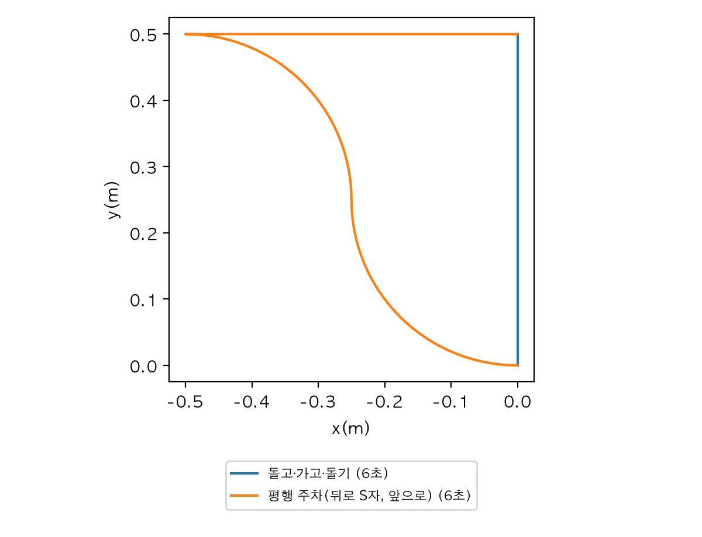
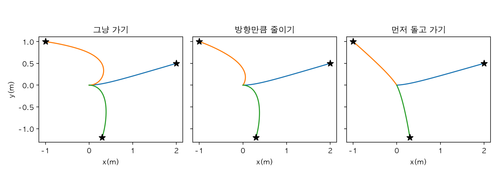
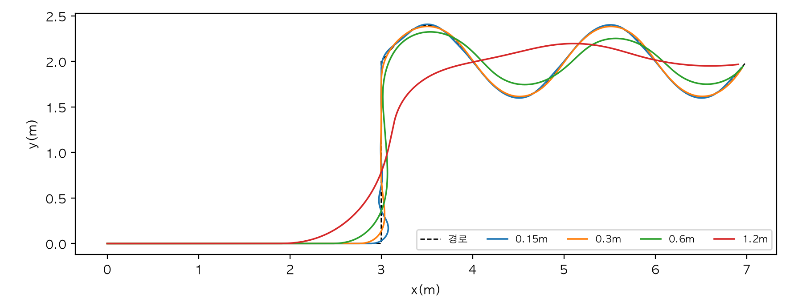
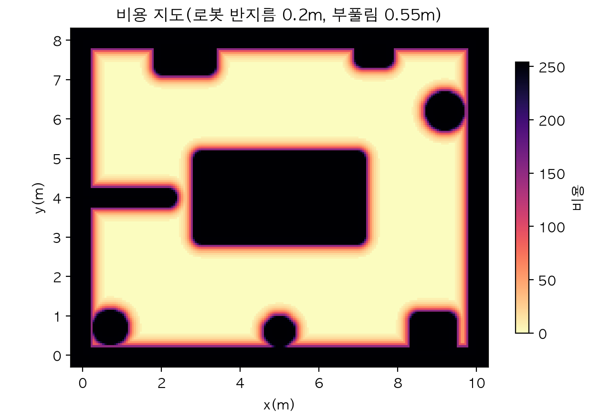
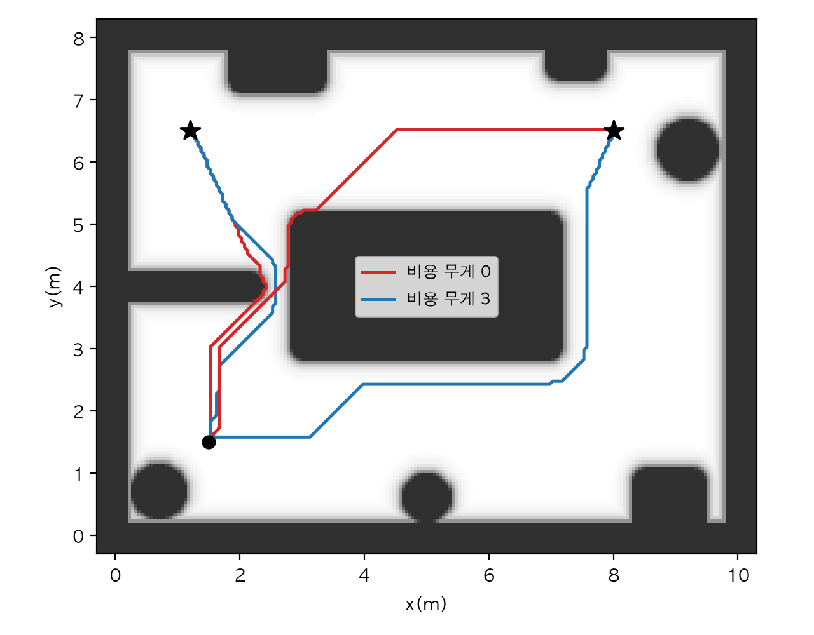
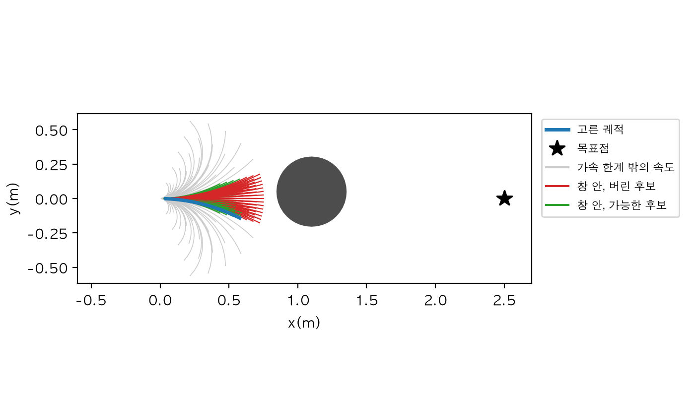
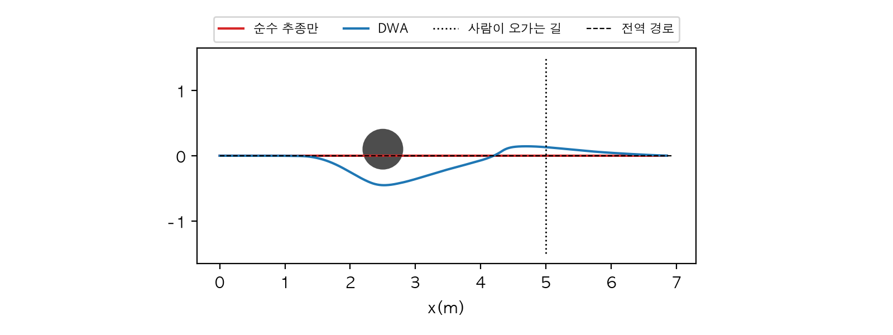
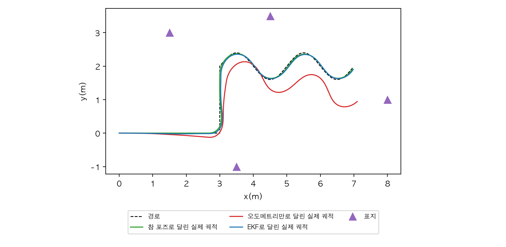
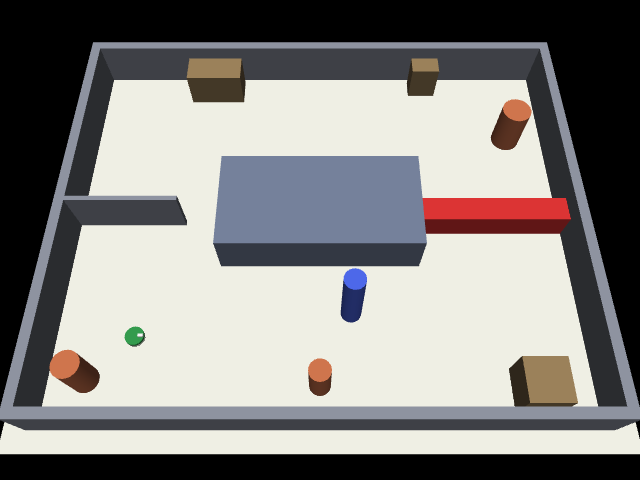
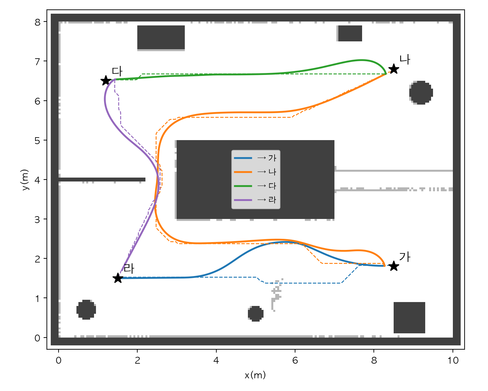

# Chapter 14. 내비게이션: 바퀴 로봇을 목적지까지

> **학습 목표**  
> - 두 바퀴의 속도와 로봇 몸의 선속도·각속도를 오가는 차동 구동 기구학을 세우고, MuJoCo 로봇으로 검산하기
> - 바퀴 로봇이 옆으로 갈 수 없다는 제약(비홀로노믹)이 경로와 제어에 주는 영향 이해하기
> - 거리·방향 오차로 점 하나에 가는 제어기와, 경로를 따라가는 순수 추종(앞을 보는 거리의 영향)·스탠리 비교하기
> - 장애물을 부풀린 비용 지도를 만들고, 그 위에서 A*가 벽에서 떨어진 길을 고르게 하기
> - 동적 창 방식(DWA)으로 지도에 없던 장애물을 그 자리에서 피하고, 그 한계까지 확인하기
> - 추정한 위치로 달릴 때 위치 오차가 그대로 주행 오차가 된다는 것을 보고, 도착 판정·진척 감시·복구 행동 만들기
> - Nav2의 구조(계획기, 제어기, 행동 트리, 비용 지도)를 이 장의 부품과 짝지어 읽기

---

## 들어가며: 지도에 길이 있다고 그 길을 갈 수 있을까요?

내비게이션 앱이 "300m 앞에서 좌회전"이라고 알려 주면, 나머지는 운전하는 사람 몫입니다. 핸들을 얼마나 꺾을지, 앞차가 갑자기 서면 어떻게 할지, 골목에 트럭이 서 있어 길이 막혔으면 어디로 돌아갈지는 앱이 정해 주지 않아요. 앱은 **길을 찾고**, 사람은 **그 길을 달립니다**.

로봇도 똑같습니다. 13장에서 지도 위에 길을 찾는 법(경로 계획)을 배웠지만, 길은 선일 뿐이에요. 바퀴 둘 달린 로봇이 그 선을 실제로 따라가려면 몇 가지 질문에 더 답해야 합니다.

- 바퀴 두 개를 각각 얼마나 빨리 돌려야 원하는 방향으로 가는가? 1장 1.2절에서 본 대로 이 로봇은 **옆으로는 못 가요**.
- 꺾인 길을 어떻게 매끄럽게 따라가는가?
- 지도를 만든 뒤에 누가 상자를 놓고 갔거나 사람이 지나가면 어떻게 하는가?
- 내 위치를 정확히 모를 때(8장, 11장) 달리면 무슨 일이 생기는가?
- 꽉 막혀서 더 갈 수 없으면 어떻게 하는가?

이 질문들에 차례로 답하며 부품을 하나씩 만들고, 마지막 실습에서 모두 이어 붙입니다. 11장의 방과 비슷한 MuJoCo 방에서 바퀴 로봇이 목적지 네 곳을 차례로 돌며, 지도에 없던 상자와 서성이는 사람을 피하는 장면이에요.

> **Q. 1장 1.8절의 점 로봇도 장애물을 피해 목표에 갔는데, 무엇이 다른가요?**
> 1장의 점 로봇은 어느 쪽으로든 바로 움직일 수 있었고, 규칙 몇 줄로 눈앞의 장애물 하나를 비켜 갔습니다. 이 장의 로봇은 바퀴가 둘이라 방향을 돌려야만 옆으로 갈 수 있고, 방 전체 지도를 보고 먼 길을 계획한 뒤 그 길을 따라가면서 눈앞의 장애물도 피해야 해요. "멀리 보는 계획"과 "가까이 보는 반응"을 나눠 맡기는 것이 이 장의 핵심입니다. 예제는 파이썬 3.12, NumPy 2.5, SciPy 1.18, MuJoCo 3.17에서 실행해 확인했어요.

## 14.1 차동 구동: 바퀴 두 개로 움직이는 법

### 두 바퀴의 속도 차이가 방향을 만든다

로봇 청소기나 마트의 짐 나르는 로봇을 뒤집어 보면 큰 바퀴 두 개가 같은 축 위에 달려 있고, 앞뒤에 작은 보조 바퀴(캐스터)가 있습니다. 운전대는 없어요. 두 바퀴를 같은 빠르기로 돌리면 곧게 가고, 한쪽을 더 빨리 돌리면 느린 쪽으로 휘어 돕니다. 탱크나 굴착기가 방향을 바꾸는 방식과 같아서, 이런 로봇을 **차동 구동(differential drive)** 로봇이라고 불러요. 좌우 바퀴의 속도 **차이**로 방향을 바꾼다는 뜻입니다.

바퀴 반지름을 r, 두 바퀴 사이 거리를 L, 왼쪽·오른쪽 바퀴의 각속도를 ω_왼, ω_오른이라고 하면 바퀴 둘레가 바닥을 미는 속도는 r × ω_왼, r × ω_오른이에요. 로봇 몸 한가운데는 두 바퀴의 평균만큼 앞으로 가고, 두 바퀴 속도의 차이를 바퀴 간격으로 나눈 만큼 돕니다.

- 선속도 v = r × (ω_왼 + ω_오른) / 2
- 각속도 ω = r × (ω_오른 - ω_왼) / L

거꾸로 원하는 v와 ω가 있으면 바퀴 각속도는 (v ∓ ω × L/2) / r입니다. 사실 이 식은 8장 8.8절 실습 코드에서 한 줄로 이미 지나갔어요. 로봇에게 8자를 그리게 할 때 `데이터.ctrl`에 넣은 값이 바로 이것이었습니다. 이 장에서 계속 쓸 함수들을 `이동도구.py`에 모으겠습니다. 치수는 8장 로봇과 같아요.

```python
"""14장: 차동 구동 로봇의 기구학. 포즈는 지도 기준 (x, y, θ)(m, m, rad)."""
import numpy as np

바퀴_반지름 = 0.05      # m
바퀴_간격 = 0.26        # m. 두 바퀴 사이 거리(8장 로봇과 같은 치수)


def 각도_감싸기(각):
    """각도를 -π 이상 π 미만으로 접는다."""
    return (np.asarray(각) + np.pi) % (2 * np.pi) - np.pi


def 바퀴에서_속도(왼_각속도: float, 오른_각속도: float) -> tuple[float, float]:
    """두 바퀴의 각속도(rad/s)를 몸의 선속도 v(m/s)와 각속도 ω(rad/s)로."""
    왼, 오른 = 왼_각속도 * 바퀴_반지름, 오른_각속도 * 바퀴_반지름   # 바퀴 둘레의 속도(m/s)
    return (왼 + 오른) / 2, (오른 - 왼) / 바퀴_간격


def 속도에서_바퀴(v: float, ω: float) -> tuple[float, float]:
    """원하는 v, ω를 내려면 두 바퀴를 몇 rad/s로 돌려야 하나."""
    return (v - ω * 바퀴_간격 / 2) / 바퀴_반지름, (v + ω * 바퀴_간격 / 2) / 바퀴_반지름


def 유니사이클_걸음(포즈, v: float, ω: float, dt: float) -> np.ndarray:
    """v, ω를 dt초 동안 유지했을 때의 다음 포즈. 도는 동안에는 원호를 따라 정확히 옮긴다."""
    x, y, θ = 포즈
    if abs(ω) < 1e-9:
        return np.array([x + v * dt * np.cos(θ), y + v * dt * np.sin(θ), θ])
    반지름 = v / ω
    새_θ = θ + ω * dt
    return np.array([x + 반지름 * (np.sin(새_θ) - np.sin(θ)),
                     y - 반지름 * (np.cos(새_θ) - np.cos(θ)),
                     float(각도_감싸기(새_θ))])
```

`유니사이클_걸음`은 v와 ω를 dt초 동안 유지했을 때 로봇이 어디로 가는지 계산합니다. ω가 일정하면 로봇은 반지름 v/ω인 원호 위를 가니까, 그 원호를 따라 정확히 옮겼어요. 이렇게 "앞으로 가는 속도 v와 도는 속도 ω 두 개로 움직이는 물체"를 **유니사이클(외바퀴 자전거) 모델**이라고 부릅니다. 바퀴가 몇 개든, 차동 구동 로봇은 몸 한가운데만 보면 이 모델로 움직여요. 바퀴 다섯 쌍으로 확인해 봅시다.

```python
from 이동도구 import 바퀴에서_속도, 속도에서_바퀴

# 왼쪽·오른쪽 바퀴 각속도(rad/s) 다섯 쌍을 몸의 속도로 바꿔 본다
for 왼, 오른 in [(6, 6), (4, 8), (8, 4), (-4, 4), (0, 6)]:
    v, ω = 바퀴에서_속도(왼, 오른)
    반지름 = "직진" if ω == 0 else f"{v / ω:.3f}m"
    print(f"왼 {왼:3d}, 오른 {오른:3d} → v {v:.2f}m/s, ω {ω:6.3f}rad/s, 회전 반지름 {반지름}")

왼, 오른 = 속도에서_바퀴(0.3, 0.5)
print(f"되돌리기: v 0.3, ω 0.5 → 왼 {왼:.2f}, 오른 {오른:.2f}rad/s")
```

```text
왼   6, 오른   6 → v 0.30m/s, ω  0.000rad/s, 회전 반지름 직진
왼   4, 오른   8 → v 0.30m/s, ω  0.769rad/s, 회전 반지름 0.390m
왼   8, 오른   4 → v 0.30m/s, ω -0.769rad/s, 회전 반지름 -0.390m
왼  -4, 오른   4 → v 0.00m/s, ω  1.538rad/s, 회전 반지름 0.000m
왼   0, 오른   6 → v 0.15m/s, ω  1.154rad/s, 회전 반지름 0.130m
되돌리기: v 0.3, ω 0.5 → 왼 4.70, 오른 7.30rad/s
```

두 바퀴가 같으면 곧게 가고(반지름 없음), 오른쪽이 빠르면 ω가 양수라 왼쪽으로 돌아요(반시계, 2장의 약속). 바퀴를 서로 반대로 돌리면 v가 0이 되어 **제자리에서** 돕니다. 회전 반지름이 0이에요. 한쪽 바퀴만 세우면 그 바퀴를 중심으로 도는데, 회전 반지름 0.130m는 바퀴 간격 0.26m의 절반, 즉 멈춘 바퀴까지의 거리입니다.

### MuJoCo 로봇으로 검산

식이 실제 물리와 맞는지 MuJoCo로 확인하겠습니다. 이 장 내내 쓸 장면을 `주행장면.py`로 저장하세요. 11장의 방과 같은 크기(10m × 8m)에 가운데 섬과 기둥들이 있고, 왼쪽에 폭 0.8m의 문이 있는 칸막이를 더했어요. 로봇은 몸통 반지름 0.18m, 바퀴 둘에 앞뒤 보조 바퀴가 달린 차동 구동 로봇이고, 11장처럼 `mj_multiRay`로 흉내 낸 2차원 라이다를 답니다. `group="1"`로 표시한 빨간 상자와 파란 사람은 **지도를 만든 뒤에 생긴 것**이라 지도에 그리지 않을 거예요. 14.4절과 실습에서 이 차이가 중요해집니다.

```python
"""14장: 11장과 비슷한 방에 바퀴 둘 달린 로봇을 들여놓은 MuJoCo 장면과 2차원 라이다."""
import mujoco
import numpy as np

from 이동도구 import 바퀴_간격, 바퀴_반지름

# group="1"인 물체는 지도를 만든 뒤에 생긴 것이라 지도에 없다(지나가는 사람, 누가 놓고 간 상자)
방_XML = f"""
<mujoco>
  <option timestep="0.002" integrator="implicitfast"/>
  <visual><headlight ambient="0.3 0.3 0.3" diffuse="0.3 0.3 0.3" specular="0 0 0"/></visual>
  <default><geom rgba="0.55 0.57 0.62 1"/></default>
  <worldbody>
    <light pos="5 4 10" dir="0 0 -1" directional="true" diffuse="0.45 0.45 0.45" specular="0 0 0"/>
    <geom type="plane" pos="5 4 0" size="5.6 4.6 0.1" rgba="0.92 0.92 0.88 1"/>
    <geom type="box" pos="5 -0.1 0.5" size="5.2 0.1 0.5"/>
    <geom type="box" pos="5 8.1 0.5" size="5.2 0.1 0.5"/>
    <geom type="box" pos="-0.1 4 0.5" size="0.1 4 0.5"/>
    <geom type="box" pos="10.1 4 0.5" size="0.1 4 0.5"/>
    <geom type="box" pos="5 4 0.5" size="2 1 0.5" rgba="0.45 0.5 0.6 1"/>
    <geom type="box" pos="1.1 4 0.5" size="1.1 0.05 0.5"/>
    <geom type="cylinder" pos="0.7 0.7 0.5" size="0.25 0.5" rgba="0.8 0.45 0.3 1"/>
    <geom type="cylinder" pos="5 0.6 0.5" size="0.2 0.5" rgba="0.8 0.45 0.3 1"/>
    <geom type="cylinder" pos="9.2 6.2 0.5" size="0.3 0.5" rgba="0.8 0.45 0.3 1"/>
    <geom type="box" pos="2.6 7.6 0.4" size="0.6 0.3 0.4" rgba="0.6 0.5 0.35 1"/>
    <geom type="box" pos="8.9 0.5 0.4" size="0.4 0.4 0.4" rgba="0.6 0.5 0.35 1"/>
    <geom type="box" pos="7.4 7.7 0.4" size="0.3 0.2 0.4" rgba="0.6 0.5 0.35 1"/>
    <geom name="상자" type="box" pos="8.5 4 0.3" size="1.5 0.25 0.3" group="1" rgba="0.85 0.2 0.2 1"/>
    <body name="사람" mocap="true" pos="5.6 2 0">
      <geom type="cylinder" size="0.2 0.8" pos="0 0 0.8" group="1" rgba="0.3 0.4 0.9 1"/>
    </body>
    <body name="로봇" pos="1.5 1.5 0.05">
      <freejoint/>
      <geom type="cylinder" size="0.18 0.03" pos="0 0 0.03" mass="2" rgba="0.2 0.6 0.3 1"/>
      <geom type="box" size="0.05 0.03 0.02" pos="0.12 0 0.08" mass="0.01" rgba="0.95 0.95 0.95 1"/>
      <geom type="sphere" size="0.02" pos="0.13 0 -0.026" condim="1" mass="0.02"/>
      <geom type="sphere" size="0.02" pos="-0.13 0 -0.026" condim="1" mass="0.02"/>
      <body name="왼바퀴" pos="0 {바퀴_간격 / 2} 0">
        <joint name="왼쪽" type="hinge" axis="0 1 0" armature="0.001"/>
        <geom type="cylinder" size="{바퀴_반지름} 0.01" euler="90 0 0" mass="0.2" rgba="0.2 0.2 0.2 1"/>
      </body>
      <body name="오른바퀴" pos="0 {-바퀴_간격 / 2} 0">
        <joint name="오른쪽" type="hinge" axis="0 1 0" armature="0.001"/>
        <geom type="cylinder" size="{바퀴_반지름} 0.01" euler="90 0 0" mass="0.2" rgba="0.2 0.2 0.2 1"/>
      </body>
    </body>
  </worldbody>
  <actuator>
    <velocity name="왼쪽" joint="왼쪽" kv="2" ctrlrange="-12 12" forcerange="-3 3"/>
    <velocity name="오른쪽" joint="오른쪽" kv="2" ctrlrange="-12 12" forcerange="-3 3"/>
  </actuator>
</mujoco>
"""

라이다_높이 = 0.3     # m. 로봇 몸(높이 0.11m)보다 높게 쏜다
라이다_최대 = 6.0     # m


def 장면_만들기(로봇_포즈=(1.5, 1.5, 0.0), 더할_XML: str = "") -> tuple[mujoco.MjModel, mujoco.MjData]:
    """더할_XML: 지도에 없는 물체를 더 놓을 때(group="1"로)."""
    모델 = mujoco.MjModel.from_xml_string(방_XML.replace("</worldbody>", 더할_XML + "</worldbody>"))
    데이터 = mujoco.MjData(모델)
    x, y, θ = 로봇_포즈
    데이터.qpos[:7] = [x, y, 0.05, np.cos(θ / 2), 0, 0, np.sin(θ / 2)]
    mujoco.mj_forward(모델, 데이터)
    return 모델, 데이터


def 로봇_포즈(데이터: mujoco.MjData) -> np.ndarray:
    """MuJoCo가 아는 참 포즈 (x, y, θ)."""
    w, x, y, z = 데이터.qpos[3:7]
    return np.array([데이터.qpos[0], 데이터.qpos[1], np.arctan2(2 * (w * z + x * y), 1 - 2 * (y * y + z * z))])


def 라이다(모델: mujoco.MjModel, 데이터: mujoco.MjData, 개수: int = 120) -> np.ndarray:
    """로봇 둘레를 한 바퀴 재서 맞은 곳을 방 기준 점들(N×2)로 돌려준다."""
    x, y, θ = 로봇_포즈(데이터)
    각도들 = θ + np.arange(개수) * 2 * np.pi / 개수
    방향들 = np.stack([np.cos(각도들), np.sin(각도들), np.zeros(개수)], axis=1)
    거리 = np.zeros(개수)
    맞은_것 = np.zeros(개수, dtype=np.int32)
    mujoco.mj_multiRay(모델, 데이터, np.array([x, y, 라이다_높이]), 방향들.ravel(), None, True,
                       모델.body("로봇").id, 맞은_것, 거리, None, 개수, 라이다_최대)
    맞음 = (거리 > 0) & (거리 <= 라이다_최대)
    return np.column_stack([x + 거리[맞음] * np.cos(각도들[맞음]), y + 거리[맞음] * np.sin(각도들[맞음])])
```

보조 바퀴는 바닥에 닿는 아랫면이 진짜 바퀴보다 4mm 높게(`-0.026`) 달았습니다. 처음에 아랫면이 바퀴와 정확히 같은 높이(`-0.03`)가 되게 달았더니, 로봇이 보조 바퀴 위에 얹힌 채 바퀴가 바닥을 제대로 누르지 못해서, 바퀴는 0.3m/s어치 돌아가는데 몸은 0.1m/s밖에 안 나갔어요. 바퀴 엔코더로는 알 수 없는 미끄러짐입니다. 이 장면을 만들며 실행으로 알게 된 사실이고, 실물 로봇에서도 보조 바퀴가 너무 낮으면 같은 일이 생깁니다.

이제 v와 ω를 바퀴 명령으로 바꿔 넣고, 2초 뒤 몸이 정말 그렇게 움직이는지 봅시다. freejoint의 선속도는 방 기준이라, 몸의 방향 θ로 돌려 "앞"과 "옆" 성분으로 나눴어요.

```python
import mujoco
import numpy as np

from 이동도구 import 바퀴에서_속도, 속도에서_바퀴
from 주행장면 import 로봇_포즈, 장면_만들기

# 빈 바닥 한가운데(사람·상자와 멀리)에서 바퀴 명령만 주고 몸이 실제로 어떻게 움직이는지 잰다
for v_명령, ω_명령 in [(0.3, 0.0), (0.3, 0.5), (0.0, 1.0)]:
    모델, 데이터 = 장면_만들기((2.0, 2.0, 0.0))
    데이터.ctrl[:] = 속도에서_바퀴(v_명령, ω_명령)
    옆_속도들 = []
    while 데이터.time < 2.0:
        mujoco.mj_step(모델, 데이터)
        θ = 로봇_포즈(데이터)[2]
        vx, vy = 데이터.qvel[0:2]                          # freejoint의 선속도는 방 기준
        옆_속도들.append(-np.sin(θ) * vx + np.cos(θ) * vy)  # 몸의 왼쪽 방향 성분
    # 출력용으로 반올림하고 + 0.0으로 -0.0을 0.0으로 바꾼다
    앞_속도, 몸_ω = np.round([np.cos(θ) * vx + np.sin(θ) * vy, 데이터.qvel[5]], 3) + 0.0
    바퀴_v, 바퀴_ω = np.round(바퀴에서_속도(데이터.qvel[6], 데이터.qvel[7]), 3) + 0.0
    print(f"명령 v {v_명령:.1f}, ω {ω_명령:.1f} → 몸 v {앞_속도:.3f}, ω {몸_ω:.3f}"
          f" (바퀴로 계산 v {바퀴_v:.3f}, ω {바퀴_ω:.3f}), 옆 속도 최대 {np.max(np.abs(옆_속도들)):.4f}m/s")
```

```text
명령 v 0.3, ω 0.0 → 몸 v 0.303, ω 0.000 (바퀴로 계산 v 0.300, ω 0.000), 옆 속도 최대 0.0000m/s
명령 v 0.3, ω 0.5 → 몸 v 0.304, ω 0.491 (바퀴로 계산 v 0.300, ω 0.495), 옆 속도 최대 0.0099m/s
명령 v 0.0, ω 1.0 → 몸 v 0.000, ω 0.984 (바퀴로 계산 v 0.000, ω 0.994), 옆 속도 최대 0.0061m/s
```

명령한 v와 ω가 몸에서 거의 그대로 나왔습니다. 바퀴 각속도로 계산한 값도 명령과 맞아요. 제자리 돌기에서는 바퀴로 계산한 ω(0.994)부터 명령 1.0보다 조금 작은데, 4장에서 본 것처럼 velocity 액추에이터는 짐을 지면 명령보다 조금 처지기 때문입니다. 몸의 ω(0.984)가 그보다 또 조금 작은 건 바퀴가 바닥에서 살짝 미끄러진 만큼이에요.

가장 눈여겨볼 숫자는 **옆 속도**예요. 몸의 왼쪽 방향 속도가 가장 클 때도 0.01m/s 정도로, 사실상 0입니다. 바퀴는 굴러가는 방향으로만 움직이고 옆으로는 미끄러지지 않으니까요. 수식으로 쓰면 몸의 옆 속도 -ẋ sin θ + ẏ cos θ = 0이라는 조건이 늘 붙어 있습니다.

### 옆으로 못 가는 로봇

이 조건 때문에 생기는 일을 보겠습니다. 바로 왼쪽 0.5m 자리로 옮겨 가는 두 가지 방법이에요. 점 로봇이라면 왼쪽으로 0.5m 가면 끝이지만, 이 로봇은 그럴 수 없습니다.

```python
import matplotlib.pyplot as plt
import numpy as np

from 이동도구 import 유니사이클_걸음

plt.rcParams["font.family"] = "AppleGothic"
plt.rcParams["axes.unicode_minus"] = False


def 달리기(포즈, 명령들, dt=0.05):
    """(v, ω, 초) 명령을 차례로 따라 달린 포즈들."""
    포즈들 = [np.array(포즈, dtype=float)]
    for v, ω, 초 in 명령들:
        for _ in range(round(초 / dt)):
            포즈들.append(유니사이클_걸음(포즈들[-1], v, ω, dt))
    return np.array(포즈들)


그림, 칸 = plt.subplots(figsize=(6, 4.6))
# 바로 왼쪽 0.5m로 옮겨 가기: 옆걸음이 안 되니 돌고, 가고, 다시 돈다
사분_ω = np.pi / 4                    # 2초에 90도 도는 각속도
방법들 = {"돌고·가고·돌기": [(0, 사분_ω, 2), (0.25, 0, 2), (0, -사분_ω, 2)],
        "평행 주차(뒤로 S자, 앞으로)": [(-0.25 * 사분_ω, -사분_ω, 2), (-0.25 * 사분_ω, 사분_ω, 2), (0.25, 0, 2)]}
for 이름, 명령들 in 방법들.items():
    궤적 = 달리기([0, 0, 0], 명령들)
    칸.plot(궤적[:, 0], 궤적[:, 1], label=f"{이름} ({sum(초 for *_, 초 in 명령들)}초)")
    x, y, θ = np.round(궤적[-1], 3) + 0.0                       # + 0.0: -0.0을 0.0으로
    print(f"{이름}: 끝 포즈 x {x:.3f}, y {y:.3f}, θ {np.rad2deg(θ):.1f}도")
칸.legend(fontsize=8, loc="upper center", bbox_to_anchor=(0.5, -0.2))
칸.set(aspect="equal", xlabel="x(m)", ylabel="y(m)")
그림.tight_layout()
그림.savefig("sideways.png", dpi=200)
print("저장: sideways.png")
```

```text
돌고·가고·돌기: 끝 포즈 x 0.000, y 0.500, θ 0.0도
평행 주차(뒤로 S자, 앞으로): 끝 포즈 x 0.000, y 0.500, θ 0.0도
저장: sideways.png
```



두 방법 모두 끝 포즈가 정확히 (0, 0.5, 0도)지만 6초씩 걸렸어요. 돌고, 가고, 다시 돌거나, 자동차 평행 주차처럼 뒤로 S자를 그려야 했습니다. 어느 쪽이든 출발하는 순간에는 옆(y축)으로 한 걸음도 가지 못해요. 몸이 먼저 돌거나 앞뒤로 움직여야 옆으로 가는 성분이 생깁니다.

로봇이 차지할 수 있는 상태는 x, y, θ 세 개(1장 1.2절의 3자유도)인데, 순간순간 바꿀 수 있는 것은 v와 ω 두 개뿐이에요. 이런 로봇을 **비홀로노믹(nonholonomic)** 로봇이라고 부릅니다. 세 상태 어디에든 결국 갈 수는 있지만, 가는 길이 제한된다는 뜻이에요. 반대로 사방으로 바로 움직일 수 있는 로봇(1장의 점 로봇, 메카넘 바퀴 로봇)은 **홀로노믹**입니다. 13장의 경로 계획기는 로봇을 점으로 보고 꺾인 길을 내놓기도 하는데, 이 로봇은 그 꺾인 모퉁이를 그대로 돌 수 없습니다. 그래서 길을 **따라가는 법**이 따로 필요해요.

## 14.2 점 하나로 가기

### 거리 오차와 방향 오차

가장 단순한 문제부터 풀어 봅시다. 장애물 없는 바닥에서 목표점 하나로 가는 것이에요. 사람이라면 "목표 쪽으로 몸을 돌리고, 멀면 빨리, 가까우면 천천히 걷는다"고 할 겁니다. 이걸 그대로 숫자로 옮기면 오차가 두 개 나옵니다.

- **거리 오차**: 목표까지 남은 거리. 선속도 v를 정한다
- **방향 오차**: 로봇이 보는 방향과 목표 방향의 차이. 각속도 ω를 정한다

각각에 비례해 속도를 내면 12장에서 본 비례 제어(P)를 두 개 쓴 셈입니다. 문제는 둘을 어떻게 섞느냐예요. 목표가 등 뒤에 있는데 거리만 보고 빨리 달리면 엉뚱한 쪽으로 멀어지거든요. 세 가지 방법을 비교해 보겠습니다.

```python
import matplotlib.pyplot as plt
import numpy as np

from 이동도구 import 각도_감싸기, 유니사이클_걸음

plt.rcParams["font.family"] = "AppleGothic"
plt.rcParams["axes.unicode_minus"] = False
최고_v, 최고_ω = 0.5, 1.5            # m/s, rad/s


def 점으로_가기(포즈, 목표, 방법: str, k_거리=1.0, k_방향=2.0) -> tuple[float, float]:
    """거리 오차와 방향 오차만 보고 (v, ω)를 정한다. 12장 PID의 P만 쓴 셈이다."""
    dx, dy = 목표 - 포즈[:2]
    거리 = np.hypot(dx, dy)
    방향_오차 = 각도_감싸기(np.arctan2(dy, dx) - 포즈[2])
    v = k_거리 * 거리
    if 방법 == "방향만큼 줄이기":
        v *= max(0.0, np.cos(방향_오차))            # 목표가 옆이나 뒤에 있으면 속도를 줄인다
    elif 방법 == "먼저 돌고 가기":
        v *= abs(방향_오차) < 0.2                   # 약 11도 안으로 들어오기 전에는 서 있는다
    return min(v, 최고_v), float(np.clip(k_방향 * 방향_오차, -최고_ω, 최고_ω))


목표들 = np.array([[2.0, 0.5], [-1.0, 1.0], [0.3, -1.2]])
그림, 칸들 = plt.subplots(1, 3, figsize=(10, 3.6), sharey=True)
for 칸, 방법 in zip(칸들, ["그냥 가기", "방향만큼 줄이기", "먼저 돌고 가기"]):
    결과 = []
    for 목표 in 목표들:
        포즈, 궤적 = np.zeros(3), [np.zeros(3)]
        while np.linalg.norm(목표 - 포즈[:2]) > 0.05 and len(궤적) < 2000:
            포즈 = 유니사이클_걸음(포즈, *점으로_가기(포즈, 목표, 방법), 0.01)
            궤적.append(포즈)
        궤적 = np.array(궤적)
        길이 = np.sum(np.linalg.norm(np.diff(궤적[:, :2], axis=0), axis=1))
        결과.append(f"{len(궤적) * 0.01:.1f}초/{길이:.2f}m")
        칸.plot(궤적[:, 0], 궤적[:, 1])
        칸.plot(*목표, "k*", ms=10)
    print(f"{방법:9s}:", ", ".join(결과))
    칸.set(title=방법, aspect="equal", xlabel="x(m)")
칸들[0].set_ylabel("y(m)")
그림.tight_layout()
그림.savefig("go_to_goal.png", dpi=200)
print("저장: go_to_goal.png")
```

```text
그냥 가기    : 5.4초/2.02m, 5.5초/2.07m, 4.1초/1.36m
방향만큼 줄이기 : 5.4초/2.02m, 5.2초/1.55m, 4.1초/1.34m
먼저 돌고 가기 : 5.5초/2.01m, 5.9초/1.37m, 4.8초/1.19m
저장: go_to_goal.png
```



앞쪽 목표 (2.0, 0.5)는 세 방법이 거의 같습니다. 차이는 뒤쪽 목표 (-1.0, 1.0)에서 나요. "그냥 가기"는 목표가 등 뒤에 있는데도 거리에 비례해 달려서, 앞으로 크게 나갔다가 돌아오느라 2.07m를 달렸습니다. 거리 오차에 cos(방향 오차)를 곱한 "방향만큼 줄이기"는 목표가 옆이나 뒤에 있을 때 속도를 줄이니 1.55m로 줄었고, "먼저 돌고 가기"는 제자리에서 돈 다음 곧게 가서 1.37m로 가장 짧았어요. 대신 서서 도는 시간 때문에 5.9초로 가장 오래 걸렸습니다. 짧은 길과 빠른 도착이 늘 같지는 않아요.

차동 구동 로봇은 제자리에서 돌 수 있으니 "먼저 돌고 가기"가 쓸 만한 선택입니다. 실습에서도 가야 할 방향이 90도 넘게 뒤쪽이면 먼저 제자리에서 돌게 해요. 자동차처럼 제자리에서 못 도는 로봇이라면 이 방법은 쓸 수 없습니다.

### 이 제어기의 빈틈

점으로 가기 제어기에는 두 가지 빈틈이 있습니다. 첫째, **도착했을 때의 방향**을 정하지 않아요. 그림에서 로봇은 목표에 닿는 순간 아무 쪽이나 보고 있습니다. 충전기에 꽂으려면 방향도 맞아야 하죠. 이럴 때는 목표 방향 오차 항을 더한 제어기를 쓰거나, 도착한 뒤 제자리에서 돌아 방향을 맞춥니다. 둘째, 목표에 아주 가까워지면 작은 위치 오차에도 방향 오차가 크게 출렁입니다. 0.01m 옆에 있는 목표는 방향으로 보면 90도 옆일 수 있으니까요. 그래서 목표 바로 앞에서 빙글빙글 도는 일이 생기고, 실제 시스템은 "이만하면 도착"이라는 **허용 오차**를 둡니다(14.7절). 위 코드도 0.05m 안에 들면 멈췄어요.

무엇보다 이 제어기는 목표까지 곧게 가려고만 합니다. 사이에 벽이 있으면 벽으로 돌진하죠. 그래서 실제로는 13장의 계획기가 벽을 피한 **경로**를 만들고, 로봇은 목표점 대신 그 경로를 따라갑니다.

## 14.3 경로 따라가기: 순수 추종

### 앞을 보고 걷기

자전거를 처음 배울 때 "바로 앞바퀴 말고 멀리 보라"는 말을 듣습니다. 발밑만 보면 핸들이 좌우로 흔들리고, 멀리 보면 부드럽게 가요. **순수 추종(pure pursuit)** 이 바로 이 방법입니다.

1. 경로 위에서 로봇과 가장 가까운 점을 찾는다
2. 거기서 경로를 따라 **앞을 보는 거리(lookahead distance)** 만큼 떨어진 점을 고른다
3. 지금 위치에서 그 점까지 이어지는 원호를 그리고, 그 원호의 곡률대로 돈다

원호의 곡률은 2 sin α / d입니다. α는 로봇 앞 방향에서 잰 그 점의 방향, d는 그 점까지의 거리예요. 로봇이 지금 방향으로 출발해 그 점을 지나는 원은 하나뿐이고, 기하로 따지면 이 곡률이 나옵니다. 곡률에 v를 곱하면 ω가 돼요. 비교할 스탠리 방법과 함께 `추종도구.py`에 모으겠습니다.

```python
"""14장: 경로 추종(순수 추종, 스탠리)과, 바퀴가 늦게 따라오는 로봇으로 달려 보는 도구."""
import numpy as np

from 이동도구 import 각도_감싸기, 바퀴에서_속도, 속도에서_바퀴, 유니사이클_걸음


def 다시_찍기(점들: np.ndarray, 간격: float = 0.05) -> np.ndarray:
    """꺾은선 경로를 같은 간격의 점들로 다시 찍는다."""
    조각 = np.linalg.norm(np.diff(점들, axis=0), axis=1)
    누적 = np.concatenate([[0], np.cumsum(조각)])
    새_누적 = np.arange(0, 누적[-1], 간격)
    return np.column_stack([np.interp(새_누적, 누적, 점들[:, 0]), np.interp(새_누적, 누적, 점들[:, 1])])


def 가까운_번호(경로: np.ndarray, 위치, 이전: int = 0, 창: int = 40) -> int:
    """지난번 번호부터 앞으로 창 안에서 가장 가까운 경로 점(뒤로 돌아가지 않게)."""
    끝 = min(len(경로), 이전 + 창)
    return 이전 + int(np.argmin(np.linalg.norm(경로[이전:끝] - 위치, axis=1)))


def 순수_추종(포즈, 경로: np.ndarray, 번호: int, 앞_거리: float, v: float) -> tuple[float, float]:
    """앞_거리만큼 앞의 경로 점을 지나는 원호를 골라 (v, ω)를 낸다."""
    거리들 = np.linalg.norm(경로[번호:] - 포즈[:2], axis=1)
    넘은 = np.nonzero(거리들 >= 앞_거리)[0]
    목표 = 경로[번호 + 넘은[0]] if len(넘은) else 경로[-1]
    dx, dy = 목표 - 포즈[:2]
    알파 = 각도_감싸기(np.arctan2(dy, dx) - 포즈[2])     # 로봇 앞에서 잰 목표 방향
    곡률 = 2 * np.sin(알파) / max(np.hypot(dx, dy), 1e-6)
    return v, v * 곡률


def 스탠리(포즈, 경로: np.ndarray, 번호: int, v: float, k: float = 2.0) -> tuple[float, float]:
    """방향 오차와 옆 오차를 함께 줄인다. 원래 자동차 앞바퀴 조향각 식을 각속도로 바꿔 쓴다."""
    i = min(번호, len(경로) - 2)
    접선 = 경로[i + 1] - 경로[i]
    경로_방향 = np.arctan2(접선[1], 접선[0])
    dx, dy = 포즈[:2] - 경로[i]
    옆_오차 = np.cos(경로_방향) * dy - np.sin(경로_방향) * dx      # 경로 왼쪽이면 +
    조향 = 각도_감싸기(경로_방향 - 포즈[2]) + np.arctan2(-k * 옆_오차, v)
    return v, 2.5 * 조향


def 따라_달리기(경로: np.ndarray, 제어기, 시작_포즈, 지연: float = 0.15, 주기: float = 0.1,
            초: float = 60.0, ω_한계: float = 2.5, 위치_알기=None) -> np.ndarray:
    """주기마다 제어기(포즈, 경로, 번호)를 부르고, 바퀴는 지연(s)만큼 늦게 명령을 따라간다.
    위치_알기(참 포즈)를 주면 제어기는 참 포즈 대신 그 함수가 알려 준 포즈로 판단한다."""
    dt = 0.01
    포즈 = np.array(시작_포즈, dtype=float)
    바퀴 = np.zeros(2)                                   # 실제 바퀴 각속도(rad/s)
    명령 = np.zeros(2)
    번호, 궤적 = 0, [포즈]
    for k in range(round(초 / dt)):
        if k % round(주기 / dt) == 0:
            아는_포즈 = 위치_알기(포즈) if 위치_알기 else 포즈
            번호 = 가까운_번호(경로, 아는_포즈[:2], 번호)
            if 번호 >= len(경로) - 2 and np.linalg.norm(경로[-1] - 아는_포즈[:2]) < 0.1:
                break
            v, ω = 제어기(아는_포즈, 경로, 번호)
            명령 = np.array(속도에서_바퀴(v, float(np.clip(ω, -ω_한계, ω_한계))))
        바퀴 += (명령 - 바퀴) * dt / 지연                    # 1차 지연: 바퀴는 명령을 천천히 따라간다
        포즈 = 유니사이클_걸음(포즈, *바퀴에서_속도(*바퀴), dt)
        궤적.append(포즈)
    return np.array(궤적)


def 옆_오차들(경로: np.ndarray, 궤적: np.ndarray) -> np.ndarray:
    """궤적의 각 점에서 경로까지 가장 가까운 거리(m)."""
    return np.array([np.min(np.linalg.norm(경로 - p[:2], axis=1)) for p in 궤적])
```

`따라_달리기`에는 현실을 조금 넣었습니다. 제어기는 0.1초마다 한 번 명령을 내고(1장 1.4절의 제어 주기), 바퀴는 명령을 바로 따르지 않고 0.15초 정도 늦게 따라가요(1차 지연). 4장에서 본 velocity 액추에이터도 명령을 이렇게 천천히 따라갔습니다. 이 지연이 없으면 제어기들의 차이가 잘 드러나지 않아요.

시험할 길은 곧은길, 직각 모퉁이, 물결 구간을 이었습니다. `시험길.py`로 저장하세요.

```python
"""14장: 경로 추종을 시험할 길. 곧은길, 직각 모퉁이, 물결 구간이 이어진다."""
import numpy as np

from 추종도구 import 다시_찍기

_꺾은선 = np.array([[0.0, 0.0], [3.0, 0.0], [3.0, 2.0]])
_물결_x = np.linspace(3.0, 7.0, 81)
_물결 = np.column_stack([_물결_x, 2.0 + 0.4 * np.sin((_물결_x - 3.0) * np.pi)])
시험_경로 = 다시_찍기(np.vstack([_꺾은선, _물결[1:]]), 0.05)
```

### 앞을 보는 거리를 바꿔 보기

앞을 보는 거리를 0.15m부터 1.2m까지 바꿔 0.4m/s로 달려 봅시다. 비교를 위해 마지막에 다른 방법 하나(스탠리)도 같은 길에 달려요. 스탠리는 뒤에서 설명합니다.

```python
import matplotlib.pyplot as plt
import numpy as np

from 시험길 import 시험_경로
from 추종도구 import 순수_추종, 스탠리, 옆_오차들, 따라_달리기

plt.rcParams["font.family"] = "AppleGothic"
plt.rcParams["axes.unicode_minus"] = False

그림, 칸 = plt.subplots(figsize=(9, 3.4))
칸.plot(시험_경로[:, 0], 시험_경로[:, 1], "k--", lw=1, label="경로")
for 앞_거리 in [0.15, 0.3, 0.6, 1.2]:
    제어기 = lambda 포즈, 경로, 번호: 순수_추종(포즈, 경로, 번호, 앞_거리, v=0.4)
    궤적 = 따라_달리기(시험_경로, 제어기, [0, 0, 0])
    오차 = 옆_오차들(시험_경로, 궤적)
    print(f"앞을 보는 거리 {앞_거리:.2f}m: 걸린 시간 {len(궤적) * 0.01:.1f}초, "
          f"옆 오차 평균 {오차.mean():.3f}m, 최대 {오차.max():.3f}m")
    칸.plot(궤적[:, 0], 궤적[:, 1], lw=1.3, label=f"{앞_거리}m")
# 비교: 앞을 보지 않고 가장 가까운 점의 방향·옆 오차를 보는 스탠리
궤적 = 따라_달리기(시험_경로, lambda 포즈, 경로, 번호: 스탠리(포즈, 경로, 번호, v=0.4, k=2.0), [0, 0, 0])
오차 = 옆_오차들(시험_경로, 궤적)
print(f"스탠리(k=2)        : 걸린 시간 {len(궤적) * 0.01:.1f}초, 옆 오차 평균 {오차.mean():.3f}m, 최대 {오차.max():.3f}m")
칸.set_aspect("equal")
칸.legend(fontsize=8, ncol=5, loc="lower right")
칸.set(xlabel="x(m)", ylabel="y(m)")
그림.tight_layout()
그림.savefig("pure_pursuit.png", dpi=200)
print("저장: pure_pursuit.png")
```

```text
앞을 보는 거리 0.15m: 걸린 시간 25.7초, 옆 오차 평균 0.015m, 최대 0.081m
앞을 보는 거리 0.30m: 걸린 시간 25.3초, 옆 오차 평균 0.016m, 최대 0.061m
앞을 보는 거리 0.60m: 걸린 시간 23.6초, 옆 오차 평균 0.052m, 최대 0.155m
앞을 보는 거리 1.20m: 걸린 시간 20.2초, 옆 오차 평균 0.137m, 최대 0.500m
스탠리(k=2)        : 걸린 시간 27.3초, 옆 오차 평균 0.037m, 최대 0.199m
저장: pure_pursuit.png
```



앞을 보는 거리가 결과를 크게 바꿉니다.

- **짧으면(0.15m)** 경로에 바짝 붙으려 하다가 모퉁이 뒤에서 좌우로 흔들려요. 발밑만 보는 자전거입니다. 바퀴가 늦게 따라오는 사이에 지나쳐 버리고, 다시 반대로 꺾는 일을 되풀이하니까요. 최대 오차 0.081m가 이 흔들림에서 나왔습니다.
- **알맞으면(0.3m)** 평균 0.016m, 최대 0.061m로 가장 잘 붙었어요.
- **길면(0.6m, 1.2m)** 부드럽지만 모퉁이를 깎고 물결을 납작하게 펴 버립니다. 1.2m는 최대 0.5m나 벗어났어요. 대신 길을 질러가니 20.2초로 가장 빨리 끝났습니다.

정답은 속도에 따라 다릅니다. 빨리 달릴수록 같은 시간 동안 더 멀리 가니 앞을 더 멀리 봐야 흔들리지 않아요. 그래서 실제로는 앞을 보는 거리를 속도에 비례하게 두는 경우가 많습니다. 좁은 곳에서는 짧게, 넓은 곳을 빨리 달릴 때는 길게요. 또 이 실험은 모퉁이에서도 0.4m/s를 그대로 유지했는데, 급하게 꺾이는 곳에서는 속도를 줄이는 것이 자연스럽습니다. 14.8절에서 볼 Nav2의 순수 추종 제어기가 이 두 가지를 더한 것이에요.

### 스탠리 방법과 비교

순수 추종 말고도 경로 추종 방법은 많습니다. 2005년 DARPA 무인차 대회에서 우승한 스탠퍼드의 자율주행차 스탠리(Stanley)에 쓰인 **스탠리 방법**은 앞을 보지 않고 가장 가까운 경로 점에서 두 가지를 잽니다. 경로 방향과 내 방향의 차이(방향 오차), 그리고 경로에서 옆으로 벗어난 거리(옆 오차)예요. 원래 자동차 앞바퀴의 조향각을 정하는 식인데, `추종도구.py`의 `스탠리` 함수에서는 그 조향각에 비례해 각속도를 내도록 바꿔 썼습니다.

위 출력의 마지막 줄을 보면 스탠리는 평균 0.037m, 최대 0.199m로 순수 추종(0.3m일 때 0.016m, 0.061m)보다 많이 벗어났어요. 최대 오차는 직각 모퉁이에서 나왔습니다. 스탠리는 가장 가까운 점만 보니 모퉁이가 **오고 나서야** 꺾기 시작하고, 순수 추종은 앞을 보니 모퉁이가 **오기 전에** 꺾기 시작하거든요. 반대로 스탠리는 옆 오차를 직접 줄이니 곧은길에서는 경로에 정확히 붙고, 앞바퀴로 조향하는 자동차의 운동과 잘 맞아서 자동차 쪽에서 많이 씁니다. 이 장의 로봇처럼 제자리에서 돌 수 있는 차동 구동 로봇에는 순수 추종이 다루기 쉬워요.

## 14.4 비용 지도: 벽에서 얼마나 떨어져 갈까

### 벽 옆을 스치는 길

13장에서 경로를 찾을 때, 장애물을 로봇 반지름만큼 부풀려서 로봇을 점으로 다뤘습니다(C-space). 그렇게 찾은 가장 짧은 길은 부풀린 벽에 **딱 붙어** 지나가요. 수학적으로는 안 부딪히지만, 위치 추정이 몇 cm만 틀려도, 경로 추종이 모퉁이에서 조금만 바깥으로 나가도 부딪힙니다. 사람도 좁은 복도에서는 벽에 어깨를 대고 걷지 않고 가운데로 걷죠.

그래서 실제 내비게이션은 지도를 "갈 수 있다/없다" 두 가지로만 보지 않고, 칸마다 **얼마나 가기 싫은지**를 0~254의 숫자로 적은 **비용 지도(costmap)** 를 씁니다. Nav2의 비용 지도는 이 숫자를 이렇게 정해요(소스 코드의 `cost_values.hpp`로 확인).

| 비용 | 이름 | 뜻 |
|---|---|---|
| 254 | 치명(LETHAL_OBSTACLE) | 장애물이 있는 칸 |
| 253 | 내접(INSCRIBED_INFLATED_OBSTACLE) | 로봇 중심이 여기 오면 몸이 장애물에 닿는다 |
| 1~252 | 부풀림 | 장애물에서 멀어질수록 지수로 줄어드는 비용 |
| 0 | 빈칸(FREE_SPACE) | 마음껏 가도 되는 칸 |
| 255 | 모름(NO_INFORMATION) | 본 적 없는 칸 |

부풀림 비용은 252 × exp(-감쇠 × (장애물까지 거리 - 로봇 반지름))입니다. Nav2 부풀림 층의 기본값은 부풀림 반지름(`inflation_radius`) 0.55m, 감쇠(`cost_scaling_factor`) 10.0이에요(Nav2 설정 문서로 확인). 13장의 C-space 부풀림이 "로봇 반지름까지 막기"라면, 부풀림 층은 그 바깥에 "가까울수록 싫다"는 띠를 두르는 것입니다.

### 지도 그리기와 비용 지도

`지도도구.py`에 세 가지를 모읍니다. MuJoCo 장면의 상자·원기둥 모양을 칸에 칠한 점유 격자, 그 위의 비용 지도, 그리고 비용을 따지는 A*예요. 11장에서는 라이다로 지도를 그렸지만, 이 장의 주제는 지도를 만드는 것이 아니니 장면의 모양에서 바로 그린 정답 지도를 씁니다. A* 자체는 13장에서 배운 그대로이고, 한 칸 옮길 때 드는 값에 비용을 더한 것만 다릅니다.

```python
"""14장: 장면 모양에서 그린 점유 격자, 부풀림 비용 지도, 그 위의 A*."""
import heapq

import mujoco
import numpy as np
from scipy.ndimage import distance_transform_edt

해상도 = 0.05                 # m. 칸 하나의 한 변
지도_원점 = np.array([-0.3, -0.3])   # m. 격자 왼쪽 아래 모서리의 방 좌표
지도_크기 = (212, 172)        # 칸 수(x 방향, y 방향)
치명 = 254                    # 장애물이 있는 칸
내접 = 253                    # 로봇 중심이 오면 몸이 장애물에 닿는 칸


def 지도_그리기(모델: mujoco.MjModel) -> np.ndarray:
    """세상(body 0)에 붙은 group 0 상자·원기둥을 칸에 칠한 점유 격자(True = 찬칸)."""
    i, j = np.meshgrid(np.arange(지도_크기[0]), np.arange(지도_크기[1]), indexing="ij")
    cx, cy = 지도_원점[0] + (i + 0.5) * 해상도, 지도_원점[1] + (j + 0.5) * 해상도   # 칸 중심
    찬칸 = np.zeros(지도_크기, dtype=bool)
    for g in range(모델.ngeom):
        if 모델.geom_bodyid[g] != 0 or 모델.geom_group[g] != 0:
            continue
        (px, py, _), (sx, sy, _) = 모델.geom_pos[g], 모델.geom_size[g]
        if 모델.geom_type[g] == mujoco.mjtGeom.mjGEOM_BOX:
            찬칸 |= (abs(cx - px) <= sx) & (abs(cy - py) <= sy)
        elif 모델.geom_type[g] == mujoco.mjtGeom.mjGEOM_CYLINDER:
            찬칸 |= np.hypot(cx - px, cy - py) <= sx
    return 찬칸


def 비용_지도(찬칸: np.ndarray, 로봇_반지름: float = 0.2, 부풀림_반지름: float = 0.55,
          감쇠: float = 10.0) -> np.ndarray:
    """Nav2 부풀림 층과 같은 식: 장애물에서 멀어질수록 비용이 지수로 줄어든다(0~254)."""
    거리 = distance_transform_edt(~찬칸) * 해상도          # 칸마다 가장 가까운 찬칸까지(m)
    비용 = (내접 - 1) * np.exp(-감쇠 * (거리 - 로봇_반지름))
    비용[거리 > 부풀림_반지름] = 0
    비용[거리 <= 로봇_반지름] = 내접
    비용[찬칸] = 치명
    return 비용.astype(np.uint8)


def 칸으로(점) -> tuple[int, int]:
    i, j = np.floor((np.asarray(점) - 지도_원점) / 해상도).astype(int)
    return int(i), int(j)


def 점으로(칸) -> np.ndarray:
    return 지도_원점 + (np.asarray(칸) + 0.5) * 해상도


def a_star(비용: np.ndarray, 시작, 목표, 비용_무게: float = 3.0) -> np.ndarray | None:
    """13장의 A*를 비용 지도 위로: 한 칸 옮길 때 '거리 × (1 + 무게 × 비용/252)'를 낸다."""
    시작, 목표 = 칸으로(시작), 칸으로(목표)
    이웃 = [(1, 0), (-1, 0), (0, 1), (0, -1), (1, 1), (1, -1), (-1, 1), (-1, -1)]
    g = {시작: 0.0}
    부모 = {}
    열린 = [(0.0, 시작)]
    while 열린:
        _, 지금 = heapq.heappop(열린)
        if 지금 == 목표:
            길 = [지금]
            while 길[-1] in 부모:
                길.append(부모[길[-1]])
            return np.array([점으로(칸) for 칸 in 길[::-1]])
        for di, dj in 이웃:
            다음 = (지금[0] + di, 지금[1] + dj)
            if not (0 <= 다음[0] < 지도_크기[0] and 0 <= 다음[1] < 지도_크기[1]) or 비용[다음] >= 내접:
                continue
            새_g = g[지금] + np.hypot(di, dj) * (1 + 비용_무게 * 비용[다음] / 252)
            if 새_g < g.get(다음, np.inf):
                g[다음], 부모[다음] = 새_g, 지금
                heapq.heappush(열린, (새_g + np.hypot(다음[0] - 목표[0], 다음[1] - 목표[1]), 다음))
    return None


def 장애물까지(찬칸: np.ndarray, 점들: np.ndarray) -> np.ndarray:
    """점들(N×2)에서 가장 가까운 찬칸 가장자리까지의 거리(m)."""
    거리표 = distance_transform_edt(~찬칸) * 해상도
    i, j = np.clip(np.floor((점들 - 지도_원점) / 해상도).astype(int), 0, np.array(지도_크기) - 1).T
    return 거리표[i, j] - 해상도 / 2
```

`비용_지도`는 SciPy의 `distance_transform_edt`로 칸마다 가장 가까운 찬칸까지의 거리를 한 번에 구하고(11장 MCL에서도 썼죠), 거기에 위의 식을 적용합니다. `a_star`는 비용 253 이상인 칸에는 들어가지 않고, 비용이 있는 칸은 거리 × (1 + 무게 × 비용/252)만큼 비싸게 칩니다. 무게가 0이면 13장처럼 C-space 안에서 가장 짧은 길을 찾고, 무게가 클수록 벽에서 멀리 돌아가요.

```python
import matplotlib.pyplot as plt
import numpy as np

from 주행장면 import 장면_만들기
from 지도도구 import 내접, 비용_지도, 지도_그리기, 지도_원점, 지도_크기, 치명, 해상도

plt.rcParams["font.family"] = "AppleGothic"
plt.rcParams["axes.unicode_minus"] = False

모델, _ = 장면_만들기()
찬칸 = 지도_그리기(모델)
비용 = 비용_지도(찬칸)
print("지도 크기:", 지도_크기, "칸 /", 해상도, "m 간격")
print(f"치명(254) {np.sum(비용 == 치명)}칸, 내접(253) {np.sum(비용 == 내접)}칸, "
      f"부풀림(1~252) {np.sum((비용 > 0) & (비용 < 내접))}칸, 빈칸(0) {np.sum(비용 == 0)}칸")
# y = 2.5m 줄에서 왼쪽 벽의 마지막 찬칸부터 방 안쪽으로 두 칸씩 건너뛰며 비용을 읽는다
j = int((2.5 - 지도_원점[1]) / 해상도)
벽_끝 = np.nonzero(찬칸[:40, j])[0].max()
print("벽 칸에서 떨어진 거리(m):", [round(k * 해상도, 2) for k in range(0, 14, 2)])
print("비용                :", [int(비용[벽_끝 + k, j]) for k in range(0, 14, 2)])

범위 = [지도_원점[0], 지도_원점[0] + 지도_크기[0] * 해상도, 지도_원점[1], 지도_원점[1] + 지도_크기[1] * 해상도]
그림, 칸 = plt.subplots(figsize=(6.4, 4.4))
면 = 칸.imshow(비용.T, origin="lower", extent=범위, cmap="magma_r")
그림.colorbar(면, ax=칸, shrink=0.8, label="비용")
칸.set(title="비용 지도(로봇 반지름 0.2m, 부풀림 0.55m)", xlabel="x(m)", ylabel="y(m)")
그림.tight_layout()
그림.savefig("costmap.png", dpi=200)
print("저장: costmap.png")
```

```text
지도 크기: (212, 172) 칸 / 0.05 m 간격
치명(254) 7116칸, 내접(253) 6532칸, 부풀림(1~252) 7925칸, 빈칸(0) 14891칸
벽 칸에서 떨어진 거리(m): [0.0, 0.1, 0.2, 0.3, 0.4, 0.5, 0.6]
비용                : [254, 253, 253, 92, 34, 12, 0]
저장: costmap.png
```



벽 칸에서 0.2m까지는 253이라 로봇 중심이 들어갈 수 없고, 0.3m에서 92, 0.4m에서 34, 0.5m에서 12로 빠르게 줄다가 부풀림 반지름 0.55m를 넘는 0.6m에서 0이 됩니다. 왼쪽 칸막이 끝과 섬 사이의 문은 폭이 0.8m라서, 내접 띠를 빼면 로봇 중심이 지나갈 수 있는 폭이 0.4m 남아요. 비용 지도에서 이 문은 가운데만 옅은 좁은 통로로 보입니다.

### 비용을 따지는 A*

같은 출발점(1.5, 1.5)에서 목표 두 곳으로, 비용 무게 0과 3으로 A*를 돌려 보겠습니다.

```python
import matplotlib.pyplot as plt
import numpy as np

from 주행장면 import 장면_만들기
from 지도도구 import a_star, 비용_지도, 장애물까지, 지도_그리기, 지도_원점, 지도_크기, 해상도

plt.rcParams["font.family"] = "AppleGothic"
plt.rcParams["axes.unicode_minus"] = False

모델, _ = 장면_만들기()
찬칸 = 지도_그리기(모델)
비용 = 비용_지도(찬칸)
범위 = [지도_원점[0], 지도_원점[0] + 지도_크기[0] * 해상도, 지도_원점[1], 지도_원점[1] + 지도_크기[1] * 해상도]
그림, 칸 = plt.subplots(figsize=(6.4, 5))
칸.imshow(비용.T, origin="lower", extent=범위, cmap="Greys", vmax=300)
for 목표 in [(1.2, 6.5), (8.0, 6.5)]:
    for 무게, 색 in [(0.0, "tab:red"), (3.0, "tab:blue")]:
        경로 = a_star(비용, (1.5, 1.5), 목표, 비용_무게=무게)
        길이 = np.sum(np.linalg.norm(np.diff(경로, axis=0), axis=1))
        여유 = 장애물까지(찬칸, 경로)
        print(f"목표 {목표}, 비용 무게 {무게:.0f}: 길이 {길이:.2f}m, "
              f"장애물까지 최소 {여유.min():.2f}m, 평균 {여유.mean():.2f}m")
        칸.plot(경로[:, 0], 경로[:, 1], color=색, lw=1.8, label=f"비용 무게 {무게:.0f}" if 목표[0] < 2 else None)
    칸.plot(*목표, "k*", ms=12)
칸.plot(1.5, 1.5, "ko", ms=7)
칸.legend(loc="center", fontsize=9)
칸.set(xlabel="x(m)", ylabel="y(m)")
그림.tight_layout()
그림.savefig("astar_cost.png", dpi=200)
print("저장: astar_cost.png")
```

```text
목표 (1.2, 6.5), 비용 무게 0: 길이 5.87m, 장애물까지 최소 0.18m, 평균 0.96m
목표 (1.2, 6.5), 비용 무게 3: 길이 5.99m, 장애물까지 최소 0.38m, 평균 1.00m
목표 (8.0, 6.5), 비용 무게 0: 길이 9.89m, 장애물까지 최소 0.18m, 평균 0.94m
목표 (8.0, 6.5), 비용 무게 3: 길이 10.45m, 장애물까지 최소 0.51m, 평균 0.79m
저장: astar_cost.png
```



무게 0인 경로는 장애물 칸 가장자리에서 0.18m까지 다가갔어요. 로봇 반지름 0.2m를 생각하면 사실상 스치듯 지나갑니다. 무게 3을 주자 왼쪽 위 목표로 가는 길은 0.12m(2%)만 길어지면서 최소 여유가 0.38m로 두 배가 됐어요. 문은 그대로 지나지만 칸막이 끝에 붙지 않고 문 가운데를 지납니다. 오른쪽 위 목표로 가는 길은 아예 다른 길을 골랐어요. 좁은 문 대신 섬 아래 넓은 복도로 돌아서, 길이는 0.56m 늘었지만 최소 여유가 0.51m입니다. "조금 돌아가더라도 넓은 길로"라는 판단을 비용 무게 하나가 대신해 준 셈이에요.

한 가지 짚어 둘 것이 있습니다. 무게 3인 길의 **평균** 여유(0.79m)는 무게 0(0.94m)보다 오히려 작아요. 넓은 아래 복도를 지나는 길이 벽 가까이를 오래 가기 때문인데, 그래도 0.55m 부풀림 띠 바깥이라 비용은 0입니다. 비용 지도는 "가까운 곳만 피하라"고 말할 뿐 "늘 한가운데로 가라"고 하지는 않아요.

## 14.5 지역 계획: 동적 창 방식(DWA)

### 전역 계획과 지역 계획의 역할 분담

A*로 찾은 길은 **지도를 만들 때의** 방을 기준으로 합니다. 그 뒤에 누가 상자를 놓고 갔거나 사람이 지나가면 지도는 모르죠. 그렇다고 장애물이 보일 때마다 방 전체에 A*를 다시 돌리는 것도 느리고, 무엇보다 A*의 꺾인 길은 바퀴 로봇이 그대로 달릴 수 없습니다. 그래서 일을 둘로 나눕니다.

| | 전역 계획(global planner) | 지역 계획(local planner, 제어기) |
|---|---|---|
| 보는 범위 | 방 전체 지도 | 로봇 둘레 몇 m |
| 답 | 목적지까지의 경로(점들) | 지금 낼 v, ω |
| 빈도 | 가끔(1초에 한 번, 또는 길이 막혔을 때) | 자주(1초에 10~20번) |
| 아는 것 | 지도, 쌓아 둔 장애물 | 방금 센서로 본 것, 로봇의 속도 한계 |
| 예 | 13장 A*, Dijkstra, RRT | 순수 추종, DWA, MPC(16장) |

택시로 치면 전역 계획은 내비게이션 앱이 그린 경로이고, 지역 계획은 운전자가 그 경로를 보며 지금 핸들과 페달을 얼마나 밟을지 정하는 일입니다.

### 할 수 있는 움직임만 놓고 고르기

순수 추종은 장애물을 보지 않습니다. 길 위에 상자가 있으면 그대로 들이받아요. **동적 창 방식(DWA, Dynamic Window Approach)** 은 장애물을 보면서 v와 ω를 고르는 지역 계획 방법입니다. 이름의 "동적 창"은 **지금 속도에서 다음 제어 주기 안에 낼 수 있는 속도의 범위**를 뜻해요. 0.4m/s로 달리는 로봇은 가속 한계 때문에 0.1초 뒤에 갑자기 0m/s나 0.5m/s를 낼 수 없으니, 그 근처의 속도들만 후보로 놓습니다.

1. 지금 (v, ω) 둘레에서 가속 한계 안의 후보를 격자로 뽑는다
2. 후보마다 1.5초 동안 그 속도를 유지했다고 치고 궤적을 굴려 본다(유니사이클 모델)
3. 장애물에 닿거나, 지금 브레이크를 잡아도 장애물 앞에서 못 서는 후보는 버린다
4. 남은 후보에 점수를 매긴다: 경로 위 목표점에 얼마나 가까워지나, 장애물과 얼마나 떨어지나, 얼마나 빠른가
5. 점수가 가장 높은 (v, ω)를 내보낸다

`동적창.py`로 만들어 봅시다. 장애물은 라이다가 본 점들로 받아요.

```python
"""14장: 동적 창 방식(DWA). 지금 낼 수 있는 (v, ω)들을 짧게 굴려 보고 가장 좋은 것을 고른다."""
import numpy as np

최고_v, 최저_v = 0.5, 0.0          # m/s. 후진은 복구 행동에서만
최고_ω = 1.5                       # rad/s
가속_v, 가속_ω = 1.0, 3.0          # m/s², rad/s²
주기 = 0.1                         # s. 제어 주기
내다볼_초, 굴림_간격 = 1.5, 0.1    # s
몸_반지름 = 0.2                    # m
무게 = {"목표": 1.0, "여유": 0.6, "속도": 0.4}


def 후보_굴리기(포즈, v들: np.ndarray, ω들: np.ndarray) -> np.ndarray:
    """후보마다 내다볼_초 동안 굴린 궤적. 모양 (후보 수, 걸음 수, 3)."""
    걸음 = round(내다볼_초 / 굴림_간격)
    궤적 = np.zeros((len(v들), 걸음, 3))
    x, y, θ = (np.full(len(v들), 값, dtype=float) for 값 in 포즈)
    for k in range(걸음):
        θ = θ + ω들 * 굴림_간격
        x = x + v들 * np.cos(θ) * 굴림_간격
        y = y + v들 * np.sin(θ) * 굴림_간격
        궤적[:, k] = np.column_stack([x, y, θ])
    return 궤적


def dwa(포즈, 지금_v: float, 지금_ω: float, 목표점, 장애물점: np.ndarray) -> dict:
    """가장 점수가 높은 (v, ω)와, 그림을 그릴 수 있게 후보 전부를 돌려준다."""
    v_범위 = np.linspace(max(최저_v, 지금_v - 가속_v * 주기), min(최고_v, 지금_v + 가속_v * 주기), 7)
    ω_범위 = np.linspace(max(-최고_ω, 지금_ω - 가속_ω * 주기), min(최고_ω, 지금_ω + 가속_ω * 주기), 15)
    v들, ω들 = (a.ravel() for a in np.meshgrid(v_범위, ω_범위))
    궤적 = 후보_굴리기(포즈, v들, ω들)
    가까운 = 장애물점[np.linalg.norm(장애물점 - 포즈[:2], axis=1) < 3.0] if len(장애물점) else 장애물점
    if len(가까운):
        사이 = np.linalg.norm(궤적[:, :, None, :2] - 가까운[None, None], axis=3)
        여유 = 사이.min(axis=(1, 2)) - 몸_반지름
    else:
        여유 = np.full(len(v들), 3.0)
    # 부딪히거나, 지금 브레이크를 잡아도 장애물 앞에서 못 서는 후보는 버린다
    가능 = (여유 > 0) & (v들 <= np.sqrt(2 * 가속_v * np.maximum(여유, 0)))
    끝_거리 = np.linalg.norm(궤적[:, -1, :2] - 목표점, axis=1)
    점수 = -무게["목표"] * 끝_거리 + 무게["여유"] * np.minimum(여유, 0.5) + 무게["속도"] * v들
    점수[~가능] = -np.inf
    최선 = int(np.argmax(점수))
    return {"v": float(v들[최선]) if 가능.any() else 0.0, "ω": float(ω들[최선]) if 가능.any() else 0.0,
            "막힘": not 가능.any(), "궤적": 궤적, "가능": 가능, "최선": 최선}
```

"못 서는 후보"는 v ≤ √(2 × 감속 × 여유)로 거릅니다. 처음 속도 v에서 일정한 감속으로 서기까지 v² / (2 × 감속)만큼 가니까, 그 거리가 장애물까지의 여유보다 짧아야 해요. 1.5초 앞까지만 굴려 보니, 그보다 먼 곳의 장애물을 위한 안전장치입니다.

기둥을 앞에 둔 로봇이 후보들을 어떻게 고르는지 그려 보겠습니다.

```python
import matplotlib.pyplot as plt
import numpy as np

from 동적창 import dwa, 최고_v, 최고_ω, 후보_굴리기

plt.rcParams["font.family"] = "AppleGothic"
plt.rcParams["axes.unicode_minus"] = False

# 로봇은 원점에서 +x를 보고 0.4m/s로 달리는 중. 1.1m 앞에 반지름 0.25m 기둥, 목표점은 2.5m 앞
각 = np.linspace(0, 2 * np.pi, 40, endpoint=False)
기둥 = np.column_stack([1.1 + 0.25 * np.cos(각), 0.05 + 0.25 * np.sin(각)])
결과 = dwa(np.zeros(3), 0.4, 0.0, np.array([2.5, 0.0]), 기둥)
가능 = 결과["가능"]
print(f"창 안의 후보 {len(가능)}개 중 버린 것 {np.sum(~가능)}개")
print(f"고른 명령: v {결과['v']:.3f}m/s, ω {결과['ω']:.3f}rad/s")

그림, 칸 = plt.subplots(figsize=(7, 4))
# 회색: 가속 한계를 무시하면 낼 수 있었을 모든 속도. 0.1초 안에는 이 중 일부만 낼 수 있다
v들, ω들 = (a.ravel() for a in np.meshgrid(np.linspace(0, 최고_v, 6), np.linspace(-최고_ω, 최고_ω, 13)))
for 궤 in 후보_굴리기(np.zeros(3), v들, ω들):
    칸.plot(궤[:, 0], 궤[:, 1], color="0.8", lw=0.6)
for 궤, 됨 in zip(결과["궤적"], 가능):
    칸.plot(궤[:, 0], 궤[:, 1], color="tab:green" if 됨 else "tab:red", lw=0.8)
최선 = 결과["궤적"][결과["최선"]]
칸.plot(최선[:, 0], 최선[:, 1], color="tab:blue", lw=2.5, label="고른 궤적")
칸.fill(기둥[:, 0], 기둥[:, 1], color="0.3")
칸.plot(2.5, 0, "k*", ms=12, label="목표점")
칸.plot([], [], color="0.8", label="가속 한계 밖의 속도")
칸.plot([], [], color="tab:red", label="창 안, 버린 후보")
칸.plot([], [], color="tab:green", label="창 안, 가능한 후보")
칸.set(aspect="equal", xlim=(-0.6, 2.7), xlabel="x(m)", ylabel="y(m)")
칸.legend(fontsize=8, loc="upper left", bbox_to_anchor=(1.01, 1))
그림.tight_layout()
그림.savefig("dwa_fan.png", dpi=200)
print("저장: dwa_fan.png")
```

```text
창 안의 후보 105개 중 버린 것 56개
고른 명령: v 0.400m/s, ω -0.300rad/s
저장: dwa_fan.png
```



회색 궤적이 가속 한계를 무시했을 때 고를 수 있는 전부이고, 색 있는 궤적이 0.1초 안에 실제로 낼 수 있는 "창" 안의 후보입니다. 창이 생각보다 좁죠? 0.4m/s로 달리는 로봇은 다음 순간에도 거의 0.4m/s로 달릴 수밖에 없어요. 105개 후보 중 56개가 버려졌는데, 기둥 쪽으로 곧게 가는 후보들이 1.5초 안에 기둥에 닿거나, 닿지는 않아도 그 뒤에 서지 못해서 걸렸습니다. 고른 명령은 속도를 유지한 채 아래로 비켜 가는 ω -0.3rad/s예요. 기둥 중심이 경로보다 조금 위(y 0.05)에 있어서 아래쪽 여유가 더 크기 때문입니다.

### 상자와 사람이 있는 길

지도에서 찾은 곧은 길 위에 지도에 없던 상자가 놓여 있고, 그 너머 x = 5m에서는 사람이 길을 가로질러 오갑니다. 순수 추종만 쓸 때와 DWA를 쓸 때를 비교하되, 한 번만 달리면 사람과 마주치는 타이밍에 따라 결과가 우연히 좋거나 나쁠 수 있으니, 사람이 길 한가운데를 지나는 시각을 1초씩 바꿔 11번 달렸어요.

```python
import matplotlib.pyplot as plt
import numpy as np

from 동적창 import dwa, 몸_반지름
from 이동도구 import 유니사이클_걸음
from 추종도구 import 가까운_번호, 다시_찍기, 순수_추종

plt.rcParams["font.family"] = "AppleGothic"
plt.rcParams["axes.unicode_minus"] = False

경로 = 다시_찍기(np.array([[0.0, 0.0], [7.0, 0.0]]))       # 지도에서 찾은 곧은 길
각 = np.linspace(0, 2 * np.pi, 24, endpoint=False)
둘레 = np.column_stack([np.cos(각), np.sin(각)])


def 장애물들(t: float, 지나는_시각: float) -> list[tuple[np.ndarray, float]]:
    """(중심, 반지름): 길 위에 놓인 상자(지도에 없음)와, x = 5m에서 길을 가로질러 오가는 사람."""
    사람_y = 1.5 * np.sin(0.5 / 1.5 * (t - 지나는_시각))      # 길 한가운데를 0.5m/s로 지난다
    return [(np.array([2.5, 0.1]), 0.3), (np.array([5.0, 사람_y]), 0.2)]


def 달리기(방법: str, 지나는_시각: float):
    포즈, v, ω, 번호 = np.zeros(3), 0.0, 0.0, 0
    궤적, 최소 = [포즈], (np.inf, 0.0)                     # (가장 작은 여유, 그때 로봇 속도)
    for k in range(4000):
        t = k * 0.01
        장애물 = 장애물들(t, 지나는_시각)
        여유 = min(np.linalg.norm(포즈[:2] - c) - r for c, r in 장애물) - 몸_반지름
        최소 = min(최소, (여유, v))
        if np.linalg.norm(포즈[:2] - 경로[-1]) < 0.1:
            break
        if k % 10 == 0:
            번호 = 가까운_번호(경로, 포즈[:2], 번호)
            if 방법 == "순수 추종만":
                v, ω = 순수_추종(포즈, 경로, 번호, 1.0, v=0.4)
            else:
                점들 = np.vstack([c + r * 둘레 for c, r in 장애물])   # 라이다가 본 장애물 둘레
                결과 = dwa(포즈, v, ω, 경로[min(번호 + 20, len(경로) - 1)], 점들)   # 1m 앞 경로 점으로
                v, ω = 결과["v"], 결과["ω"]
        포즈 = 유니사이클_걸음(포즈, v, ω, 0.01)
        궤적.append(포즈)
    return np.array(궤적), t, 최소


# 사람이 길 한가운데를 지나는 시각을 8초부터 18초까지 1초씩 바꿔 11번 달린다
그림, 칸 = plt.subplots(figsize=(8, 3))
for 방법, 색 in [("순수 추종만", "tab:red"), ("DWA", "tab:blue")]:
    결과들 = [달리기(방법, 시각) for 시각 in np.arange(8.0, 18.5, 1.0)]
    부딪힘 = [(여유, v) for _, _, (여유, v) in 결과들 if 여유 < 0]
    print(f"{방법:6s}: 11번 중 부딪힘 {len(부딪힘)}번, 걸린 시간 "
          f"{min(r[1] for r in 결과들):.1f}~{max(r[1] for r in 결과들):.1f}초, "
          f"가장 깊이 겹친 여유 {min(부딪힘)[0]:+.3f}m, 그 순간 로봇 속도 {min(부딪힘)[1]:.2f}m/s")
    궤적 = 결과들[2][0]                                     # 사람이 10초에 지나간 판을 그린다
    칸.plot(궤적[:, 0], 궤적[:, 1], color=색, label=방법)
칸.add_patch(plt.Circle((2.5, 0.1), 0.3, color="0.3"))
칸.plot([5, 5], [-1.5, 1.5], "k:", lw=1, label="사람이 오가는 길")
칸.plot(경로[:, 0], 경로[:, 1], "k--", lw=0.8, label="전역 경로")
칸.set(aspect="equal", xlabel="x(m)")
칸.legend(fontsize=8, ncol=4, loc="lower center", bbox_to_anchor=(0.5, 1.0))
그림.tight_layout()
그림.savefig("dwa_vs_pp.png", dpi=200)
print("저장: dwa_vs_pp.png")
```

```text
순수 추종만: 11번 중 부딪힘 11번, 걸린 시간 17.1~17.1초, 가장 깊이 겹친 여유 -0.400m, 그 순간 로봇 속도 0.40m/s
DWA   : 11번 중 부딪힘 1번, 걸린 시간 16.9~18.7초, 가장 깊이 겹친 여유 -0.161m, 그 순간 로봇 속도 0.00m/s
저장: dwa_vs_pp.png
```



순수 추종만 쓰면 11번 모두 상자를 정면으로 들이받습니다. 장애물을 보지 않으니 당연하죠. DWA는 상자를 매번 비켜 갔고, 사람과도 10번은 부딪히지 않았어요. 상자를 비켜 가느라 생긴 우회와 사람을 기다린 시간 때문에 걸린 시간이 16.9~18.7초로 들쭉날쭉합니다.

남은 1번이 중요합니다. 부딪힌 순간 로봇의 속도는 0이었어요. 로봇은 사람 앞에서 섰는데, **사람이 걸어와 로봇에 닿은** 것입니다. DWA는 궤적을 굴려 볼 때 장애물이 그 자리에 멈춰 있다고 가정해요. 그래서 다가오는 사람을 "지금 있는 곳"으로만 보고, 비켜 설 생각 없이 그 자리에 서 버립니다. 게다가 이 DWA는 후진 후보를 두지 않았어요. 실제 사람은 로봇을 보고 비켜 가겠지만, 로봇 쪽에서도 움직이는 장애물의 속도를 추정해 앞날을 함께 굴리거나, 가까이 오면 무조건 멈추고 물러서는 안전 장치를 따로 둡니다. Nav2에는 비용 지도와 궤적 계획기를 거치지 않고 센서 자료를 직접 보다가, 정해 둔 구역 안에 무언가 들어오면 속도 명령을 줄이거나 멈추는 충돌 감시(Collision Monitor) 노드가 따로 있어요. 지역 계획기 하나에 안전을 모두 맡기지 않는 것입니다.

## 14.6 위치 추정과 합치기

### 로봇은 추정한 위치를 따라간다

지금까지 경로 추종과 DWA는 로봇의 **참 위치**를 알고 있었습니다. 실제 로봇은 참 위치를 모르고, 8장의 EKF나 11장의 MCL이 추정한 위치로 달려요. 추정이 틀리면 어떻게 될까요? 제어기는 "추정한 위치가 경로 위에 있도록" 열심히 일하니까, 추정이 왼쪽으로 0.3m 틀리면 로봇은 실제로 경로 오른쪽 0.3m를 달리면서 "잘 가고 있다"고 믿습니다. **추정 오차가 그대로 주행 오차가 되는** 거예요. 경로 추종기가 아무리 정확해도 이 오차는 고칠 수 없습니다.

14.3절의 시험길을 세 가지 위치로 달려 확인하겠습니다. 참 포즈, 바퀴 오도메트리만으로 쌓은 위치, 그리고 8장 8.5절의 EKF가 표지 네 개로 고친 위치예요. 8장의 `바퀴로봇.py`를 이 장 폴더로 복사해 그대로 씁니다. 오도메트리에는 0.1초마다 이동 거리 3%의 잡음과, 늘 왼쪽으로 0.001rad씩 더 돌았다고 세는 치우침을 넣었어요(11장의 바퀴 치우침과 같은 성격). 표지 측정은 8장처럼 0.5초마다, 4m 안 앞쪽 ±60도 안의 표지를 거리 0.05m·방향 2도 잡음으로 잽니다.

```python
import matplotlib.pyplot as plt
import numpy as np

from 바퀴로봇 import 각도_감싸기, ekf_갱신, ekf_예측, 표지_R, 표지_보기
from 시험길 import 시험_경로
from 추종도구 import 따라_달리기, 순수_추종, 옆_오차들

plt.rcParams["font.family"] = "AppleGothic"
plt.rcParams["axes.unicode_minus"] = False
표지들 = np.array([[1.5, 3.0], [4.5, 3.5], [3.5, -1.0], [8.0, 1.0]])


def 위치_추정기(출처: str, 생성기: np.random.Generator):
    """0.1초마다 참 포즈를 받아, 제어기에 줄 포즈(참, 오도메트리, EKF)를 돌려주는 함수를 만든다."""
    기록 = {"추정": np.zeros(3), "P": np.eye(3) * 1e-4, "이전_참": np.zeros(3), "참들": [], "추정들": [], "점프": [0.0]}

    def 알기(참: np.ndarray) -> np.ndarray:
        # 오도메트리: 실제 움직임에 잡음과, 늘 왼쪽으로 더 돌았다고 세는 치우침(0.001rad)이 섞인다
        이동 = np.linalg.norm(참[:2] - 기록["이전_참"][:2]) * (1 + 생성기.normal(0, 0.03))
        회전 = 각도_감싸기(참[2] - 기록["이전_참"][2]) + 0.001 + 생성기.normal(0, 0.002)
        기록["이전_참"] = 참.copy()
        추정, P = ekf_예측(기록["추정"], 기록["P"], 이동, 회전)
        if 출처 == "EKF" and len(기록["참들"]) % 5 == 0:          # 0.5초마다 표지 측정
            고치기_전 = 추정[:2].copy()
            for 표지 in 표지들:
                z = 표지_보기(참, 표지) + 생성기.normal(0, np.sqrt(np.diag(표지_R)))
                if z[0] < 4.0 and abs(z[1]) < np.deg2rad(60):
                    추정, P, _, _ = ekf_갱신(추정, P, z, 표지, 표지_R)
            기록["점프"].append(np.linalg.norm(추정[:2] - 고치기_전))   # 측정 한 번에 추정이 뛴 거리
        기록["추정"], 기록["P"] = 추정, P
        기록["참들"].append(참)
        기록["추정들"].append(추정)
        return 참 if 출처 == "참 포즈" else 추정
    return 알기, 기록


그림, 칸 = plt.subplots(figsize=(9, 4.4))
칸.plot(시험_경로[:, 0], 시험_경로[:, 1], "k--", lw=1, label="경로")
for 출처, 색 in [("참 포즈", "tab:green"), ("오도메트리만", "tab:red"), ("EKF", "tab:blue")]:
    알기, 기록 = 위치_추정기(출처, np.random.default_rng(0))
    제어기 = lambda 포즈, 경로, 번호: 순수_추종(포즈, 경로, 번호, 0.4, v=0.4)
    궤적 = 따라_달리기(시험_경로, 제어기, [0, 0, 0], 위치_알기=알기)
    오차 = 옆_오차들(시험_경로, 궤적)
    추정_오차 = np.linalg.norm(np.array(기록["참들"])[:, :2] - np.array(기록["추정들"])[:, :2], axis=1)
    print(f"{출처:6s}: 실제 옆 오차 평균 {오차.mean():.3f}m, 최대 {오차.max():.3f}m, "
          f"끝점에서 {np.linalg.norm(궤적[-1, :2] - 시험_경로[-1]):.3f}m 빗나감")
    if 출처 != "참 포즈":
        print(f"        추정 오차 평균 {추정_오차.mean():.3f}m, 끝에서 {추정_오차[-1]:.3f}m"
              + (f", 측정 한 번에 추정이 뛴 거리 최대 {max(기록['점프']):.3f}m" if 출처 == "EKF" else ""))
    칸.plot(궤적[:, 0], 궤적[:, 1], color=색, lw=1.3, label=f"{출처}로 달린 실제 궤적")
칸.plot(*표지들.T, "^", color="tab:purple", ms=9, label="표지")
칸.set(aspect="equal", xlabel="x(m)", ylabel="y(m)")
칸.legend(fontsize=8, ncol=3, loc="upper center", bbox_to_anchor=(0.5, -0.2))
그림.tight_layout()
그림.savefig("follow_estimate.png", dpi=200)
print("저장: follow_estimate.png")
```

```text
참 포즈  : 실제 옆 오차 평균 0.023m, 최대 0.087m, 끝점에서 0.050m 빗나감
오도메트리만: 실제 옆 오차 평균 0.237m, 최대 0.855m, 끝점에서 1.039m 빗나감
        추정 오차 평균 0.352m, 끝에서 0.986m
EKF   : 실제 옆 오차 평균 0.033m, 최대 0.082m, 끝점에서 0.074m 빗나감
        추정 오차 평균 0.022m, 끝에서 0.034m, 측정 한 번에 추정이 뛴 거리 최대 0.021m
저장: follow_estimate.png
```



오도메트리만 쓴 로봇은 끝에서 경로 끝점을 1.039m나 빗나갔습니다. 그런데 그 로봇이 믿는 추정 위치는 줄곧 경로 위에 있었어요. 추정 오차가 끝에서 0.986m인 것과 거의 같은 크기만큼 실제 궤적이 벗어난 것입니다. 그림에서 빨간 궤적이 물결 모양은 그대로 따라 그리면서 통째로 아래로 처진 게 보이죠? 경로 추종은 잘했는데, 엉뚱한 자리에서 잘한 거예요.

EKF로 고친 위치를 쓰면 실제 옆 오차가 평균 0.033m로, 참 포즈로 달릴 때(0.023m)와 큰 차이가 없습니다. 추정 오차 평균 0.022m 정도가 주행에 얹힌 셈이에요.

### 추정이 툭 뛸 때

EKF는 표지를 볼 때마다 위치를 고치니, 추정 위치가 순간적으로 **툭 뜁니다**. 이번 실험에서 가장 크게 뛴 것은 0.021m였어요. 이 정도면 순수 추종이 받아 넘기지만, 11장의 MCL처럼 입자들이 다른 곳으로 몰리면서 수십 cm씩 뛰면 제어기가 갑자기 크게 꺾고, 그 사이 경로의 "가장 가까운 점"을 엉뚱한 곳에서 찾기도 합니다.

11장 11.7절에서 본 REP 105의 좌표계 약속이 이 문제를 다루는 방법이에요. `odom` 좌표계는 오도메트리로 쌓아서 드리프트는 있지만 **매끄럽고**, `map` 좌표계는 드리프트가 없지만 **뛸 수 있습니다**. 그래서 몇 초 앞을 보는 지역 일은 매끄러운 `odom` 기준으로 하고, 방 전체를 보는 전역 일은 `map` 기준으로 하는 경우가 많아요. Nav2의 행동 서버(behavior_server)도 설정 문서에 지역 좌표계(`local_frame`) 기본값을 `odom`, 전역 좌표계(`global_frame`) 기본값을 `map`으로 적어 두었습니다. 1.5초 앞까지만 굴려 보는 DWA에게는 지난 몇 초의 상대 움직임이 정확한 것이 더 중요하고, 그 정도 시간에는 오도메트리의 드리프트가 거의 쌓이지 않으니까요.

> **Q. 그럼 실습에서는 어떤 위치를 쓰나요?**
> 실습은 부품을 모두 잇는 것이 목적이라 MuJoCo가 아는 참 포즈를 씁니다. 위치 추정이 주행에 미치는 영향은 이 절에서 따로 봤으니, 실습 코드의 `로봇_포즈(데이터)`를 EKF나 MCL의 추정값으로 바꾸면 어떻게 달라지는지 직접 해 보세요. 추정 오차만큼 장애물과의 여유가 줄어든다는 것도 함께 확인할 수 있습니다.

## 14.7 막혔을 때: 도착 판정과 복구 행동

### 언제 "도착"인가

14.2절에서 본 것처럼 목표점에 정확히 서는 것은 불가능합니다. 그래서 "목표에서 이만큼 안이면 도착"이라는 허용 오차를 둬요. Nav2의 기본 도착 판정기(SimpleGoalChecker)는 위치 0.25m, 방향 0.25rad(약 14도)가 기본값입니다(Nav2 설정 문서로 확인). 허용 오차가 너무 작으면 목표 앞에서 맴돌고, 너무 크면 엉뚱한 곳에서 멈춰요. 로봇 크기, 위치 추정의 정확도와 맞춰 정합니다.

### 진척이 없으면 막힌 것

로봇이 움직이고는 있는데 앞으로 나아가지 못하는 때가 있습니다. DWA가 좁은 곳에서 갈 곳을 못 찾아 서 있거나, 바퀴가 헛돌거나, 같은 자리에서 좌우로 흔들리는 경우예요. 이걸 알아채는 장치가 **진척 감시(progress checker)** 입니다. Nav2의 기본 진척 감시기(SimpleProgressChecker)는 "10초(`movement_time_allowance`) 안에 0.5m(`required_movement_radius`)를 벗어나지 못하면 막혔다"고 봐요. 이 두 가지를 `감시도구.py`에 만듭니다.

```python
"""14장: 도착 판정과 진척 감시. 값은 Nav2 문서의 기본값(0.25m, 0.5m/10초)을 따랐다."""
import numpy as np


def 도착했나(포즈, 목표, 거리_허용: float = 0.25) -> bool:
    """목표 위치에서 거리_허용(m) 안이면 도착. 이 장의 목적지는 방향을 따지지 않는다."""
    return bool(np.hypot(목표[0] - 포즈[0], 목표[1] - 포즈[1]) <= 거리_허용)


class 진척_감시:
    """허용_초 동안 기준 반지름(m)만큼도 못 움직였으면 '막혔다'고 알린다."""

    def __init__(self, 반지름: float = 0.5, 허용_초: float = 10.0) -> None:
        self.반지름, self.허용_초 = 반지름, 허용_초
        self.기준_위치, self.기준_시각 = None, 0.0

    def 다시(self, 위치, 시각: float) -> None:
        self.기준_위치, self.기준_시각 = np.array(위치[:2], dtype=float), 시각

    def 막혔나(self, 위치, 시각: float) -> bool:
        if self.기준_위치 is None or np.linalg.norm(np.asarray(위치[:2]) - self.기준_위치) > self.반지름:
            self.다시(위치, 시각)                  # 충분히 움직였으면 기준을 지금으로 옮긴다
            return False
        return 시각 - self.기준_시각 > self.허용_초
```

천천히 가다가 거의 멈춘 로봇으로 시험해 봅시다.

```python
from 감시도구 import 도착했나, 진척_감시

감시 = 진척_감시()
# 0.1m/s로 3초 가다가, 무언가에 막혀 0.01m/s로 겨우 꼼지락거리는 로봇
for k in range(200):
    시각 = k * 0.1
    x = 0.1 * min(시각, 3.0) + 0.01 * max(시각 - 3.0, 0.0)
    if 감시.막혔나((x, 0.0), 시각):
        print(f"{시각:.1f}초에 '막혔다' (위치 x {x:.2f}m, 기준점 x {감시.기준_위치[0]:.2f}m, 기준 시각 {감시.기준_시각:.1f}초)")
        break
print("목표 (1, 0)에서 0.2m 떨어진 곳:", 도착했나((0.8, 0.0), (1.0, 0.0)))
print("목표 (1, 0)에서 0.3m 떨어진 곳:", 도착했나((0.7, 0.0), (1.0, 0.0)))
```

```text
10.1초에 '막혔다' (위치 x 0.37m, 기준점 x 0.00m, 기준 시각 0.0초)
목표 (1, 0)에서 0.2m 떨어진 곳: True
목표 (1, 0)에서 0.3m 떨어진 곳: False
```

처음 3초 동안 0.3m를 갔지만, 기준점(0초의 자리)에서 0.5m를 벗어나지 못한 채 10초가 지나자 10.1초에 "막혔다"고 알렸어요. 진척 감시는 속도가 아니라 **기준점에서 벗어났는가**를 봅니다. 그래서 같은 자리에서 앞뒤로 흔들리기만 하는 로봇도 잡아내요.

### 복구 행동

막혔다는 걸 알았으면 무언가 해야 합니다. 사람이라면 한 발 물러서서 주위를 둘러보고 다른 길을 찾겠죠. 로봇의 **복구 행동(recovery behavior)** 도 비슷합니다.

- **뒤로 물러서기**: 벽이나 장애물에 너무 붙어서 계획기가 길을 못 찾을 때(로봇 중심이 내접 칸에 들어감) 빈 곳으로 나온다
- **제자리에서 돌기**: 라이다로 주위를 다시 둘러봐 비용 지도를 새로 채운다
- **비용 지도 지우기**: 센서 잡음이나 이미 지나간 사람이 남긴 가짜 장애물을 지운다
- **기다리기**: 사람이 비켜 주기를 기다린다
- **포기하고 알리기**: 여러 번 해도 안 되면 실패를 알리고 사람의 도움을 청한다

Nav2의 기본 행동 트리는 비용 지도 지우기, 제자리 돌기(1.57rad), 5초 기다리기, 뒤로 0.30m(0.15m/s) 물러서기를 돌아가며 시도합니다. 실습 코드도 이를 따라 뒤로 0.3m 물러선 다음 제자리에서 90도 돌고, 그래도 안 되면 다시 하기를 세 번까지 한 뒤 포기하게 했어요.

## 14.8 Nav2의 구조

ROS 2에서 이동 로봇 내비게이션을 할 때 가장 널리 쓰는 도구 모음이 **Nav2**입니다. 11장에서 본 AMCL과 map_server도 Nav2의 일부예요. 공식 문서(docs.nav2.org)의 설명을 따라, 이 장에서 만든 부품과 짝지어 구조를 보겠습니다. 기본값과 플러그인 목록은 배포판마다 바뀔 수 있으니, 아래는 이 글을 쓰며 확인한 문서 기준이고 실제로 쓸 때는 자기 배포판의 문서를 확인하세요.

| Nav2 서버 | 하는 일 | 이 장의 부품 |
|---|---|---|
| 계획기 서버(planner_server) | 목표까지의 경로 계산. 전역 비용 지도를 가진다. 기본 플러그인은 NavFn(기본값으로는 Dijkstra, `use_astar`로 A*) | `a_star`, 14.4절 |
| 제어기 서버(controller_server) | 경로를 따라가는 속도 명령 계산(기본 20Hz). 지역 비용 지도를 가진다. 기본 플러그인은 DWB(문서 설명으로는 동적 창 방식을 쓰는 제어기), 그 밖에 Regulated Pure Pursuit, MPPI 등 | `순수_추종`, `dwa`, 14.3·14.5절 |
| 도착 판정·진척 감시 | 제어기 서버 안의 플러그인(SimpleGoalChecker, SimpleProgressChecker) | `도착했나`, `진척_감시`, 14.7절 |
| 행동 서버(behavior_server) | 복구 행동. 기본으로 Spin, BackUp, DriveOnHeading, Wait | `몰기`로 물러서기·돌기, 14.7절 |
| 경로 다듬기 서버(smoother_server) | 계획기가 낸 경로를 매끄럽게, 장애물에서 멀게 | 13장의 경로 다듬기 |
| BT 내비게이터(bt_navigator) | 행동 트리로 위의 서버들을 언제, 어떤 순서로 부를지 정한다 | `목적지_하나`의 while 고리 |
| 비용 지도(costmap_2d) | 층을 겹쳐 만든 비용 지도. 기본 층은 정적 층, 장애물 층, 부풀림 층 | `지도_그리기`, `장애물_층`, `비용_지도` |

Nav2 개념 문서는 제어기를 "ROS 1에서 지역 계획기(local planner)라고 부르던 것"이라고 소개해요. 14.5절의 전역/지역 역할 분담이 그대로 서버 둘로 나뉜 것입니다. 각 서버는 알고리즘을 **플러그인**으로 받아서, 설정 파일 한 줄로 NavFn을 Smac 계획기로, DWB를 MPPI로 바꿀 수 있어요.

### 행동 트리

서버들을 이어 주는 것이 **행동 트리(behavior tree)** 입니다. "이걸 하고, 실패하면 저걸 하고"를 나무 모양으로 적은 것으로, 상태가 수십 개인 상태 기계보다 읽고 고치기 쉬워서 쓴다고 문서는 설명해요. Nav2는 BehaviorTree.CPP 라이브러리를 쓰고, 트리를 XML 파일로 적습니다. 문서의 해설에 따르면 기본 트리(`navigate_to_pose_w_replanning_and_recovery.xml`)는 대략 이렇게 돌아요.

1. 1초에 한 번(`RateController hz="1.0"`) 경로를 다시 계산한다(`ComputePathToPose`). 실패했고 지우는 것이 도움이 될 만한 실패라면 전역 비용 지도를 지우고 한 번 더
2. 그 경로를 따라간다(`FollowPath`). 실패하면 마찬가지로 지역 비용 지도를 지우고 한 번 더
3. 그래도 안 되면 복구 행동을 돌아가며 한다(`RoundRobin`): 비용 지도 지우기 → 제자리 돌기(`Spin spin_dist="1.57"`) → 기다리기(`Wait wait_duration="5.0"`) → 물러서기(`BackUp backup_dist="0.30" backup_speed="0.15"`)
4. 1~3을 감싼 `RecoveryNode`가 최대 6번(`number_of_retries="6"`)까지 다시 시도하고, 그래도 안 되면 목적지를 실패로 돌려준다

이 장의 `목적지_하나` 함수는 이 트리를 while 고리 하나로 아주 작게 줄인 것입니다. 다만 우리 코드는 1초마다 다시 계산하지 않고 **지금 경로가 막혔을 때만** 다시 계산하며, 비용 지도를 지우는 복구는 넣지 않았어요.

Nav2를 직접 띄워 보려면 부록의 ROS 2 Docker 환경에 Nav2 패키지를 더 설치해야 합니다. 이 책의 Docker 이미지에는 들어 있지 않으니, 설치 방법은 Nav2 문서의 Getting Started를 따르세요. 이 장에서 만든 부품들이 저 표의 어느 칸에 들어가는지 알고 나면, Nav2의 설정 파일에 늘어선 수백 개의 매개변수도 "아, 이건 부풀림 반지름이구나, 이건 앞을 보는 거리구나" 하고 읽힐 거예요.

## 14.9 실습: 방 안의 네 목적지 돌기

### 무엇을 만드나

이제 모든 부품을 이어 붙입니다. 14.1절의 MuJoCo 방에서 로봇이 (1.5, 1.5)를 출발해 목적지 가 → 나 → 다 → 라를 차례로 돌고 출발점으로 돌아와요. 지도에는 없지만 실제로는 두 가지가 있습니다.

- **빨간 상자**: 섬 오른쪽 복도를 완전히 막고 있다. 지도만 보면 가에서 나로 가는 가장 짧은 길이 이 복도다
- **파란 사람**: 아래 복도 x = 5.6m에서 위아래로 서성인다

먼저 장면을 한 장 찍어 보겠습니다.

```python
import matplotlib.pyplot as plt
import mujoco

from 주행장면 import 장면_만들기

모델, 데이터 = 장면_만들기((1.5, 1.5, 0.0))
카메라 = mujoco.MjvCamera()
카메라.lookat[:] = [5.0, 3.6, 0.0]
카메라.distance, 카메라.azimuth, 카메라.elevation = 12.0, 90, -62
with mujoco.Renderer(모델, 480, 640) as 렌더러:
    렌더러.update_scene(데이터, 카메라)
    plt.imsave("nav_scene.png", 렌더러.render())
print("저장: nav_scene.png")
```

```text
저장: nav_scene.png
```



### 내비게이션 고리

주행 고리는 `내비실습.py`에 모았습니다. 0.1초마다 한 번씩 이 순서로 돌아요.

1. **재기**: MuJoCo에서 포즈와 라이다 스캔을 받는다
2. **지도 갱신**: `장애물_층`에 스캔을 넣는다. 레이가 끝난 칸은 "본 장애물"로 칠하고, 레이가 지나간 칸은 지운다. 그래서 지나간 사람의 흔적은 다음 레이가 지나가며 지워지고, 계속 보이는 상자는 남는다. Nav2 장애물 층의 표시(marking)와 지우기(clearing)를 줄인 것이다
3. **도착 판정**: 0.25m 안이면 이 목적지는 끝
4. **다시 계획**: 경로가 없거나, 남은 경로가 비용 253 이상인 칸을 지나면 지금 위치에서 A*를 다시 돌린다
5. **복구**: 길을 못 찾았거나 진척 감시가 막혔다고 하면 물러서고 돈다. 세 번 해도 안 되면 포기
6. **명령**: 1m 앞 경로 점이 등 뒤(90도 넘게)에 있으면 제자리에서 돌고(14.2절의 "먼저 돌고 가기"), 아니면 DWA로 v, ω를 골라 바퀴에 넣는다. DWA의 지금 속도는 바퀴 엔코더(관절 속도)로 잰다

```python
"""14.9절 실습: MuJoCo 방에서 전역 A*와 DWA로 여러 목적지를 차례로 돈다."""
import mujoco
import numpy as np

from 감시도구 import 도착했나, 진척_감시
from 동적창 import dwa
from 이동도구 import 각도_감싸기, 바퀴에서_속도, 속도에서_바퀴
from 주행장면 import 라이다, 로봇_포즈, 장면_만들기
from 지도도구 import a_star, 내접, 비용_지도, 지도_그리기, 지도_원점, 지도_크기, 해상도
from 추종도구 import 가까운_번호, 다시_찍기

제어_주기 = 0.1          # s. 10Hz로 재고, 판단하고, 명령한다
몸_반지름 = 0.18         # m. MuJoCo 로봇 몸통의 실제 반지름


def 사람_위치(t: float) -> list[float]:
    """아래 복도 가운데에서 위아래로 서성이는 사람(가장 빠를 때 0.24m/s)."""
    return [5.6, 1.4 + 0.6 * np.sin(0.4 * t), 0.0]


def 칸_번호들(점들: np.ndarray) -> tuple[np.ndarray, np.ndarray]:
    i, j = np.floor((점들 - 지도_원점) / 해상도).astype(int).T
    return np.clip(i, 0, 지도_크기[0] - 1), np.clip(j, 0, 지도_크기[1] - 1)


class 장애물_층:
    """라이다로 본 것을 지도 위에 기억한다. 레이가 끝난 칸은 칠하고, 지나간 칸은 지운다."""

    def __init__(self, 정적_찬칸: np.ndarray) -> None:
        self.정적 = 정적_찬칸
        self.본 = np.zeros_like(정적_찬칸)

    def 넣기(self, 로봇_xy: np.ndarray, 점들: np.ndarray) -> None:
        비율 = np.arange(0, 1, 0.01)
        표본 = 로봇_xy + 비율[None, :, None] * (점들 - 로봇_xy)[:, None, :]
        길이 = np.linalg.norm(점들 - 로봇_xy, axis=1)
        지나감 = 비율[None, :] * 길이[:, None] < 길이[:, None] - 0.1
        self.본[칸_번호들(표본[지나감])] = False
        self.본[칸_번호들(점들)] = True

    def 비용(self) -> np.ndarray:
        return 비용_지도(self.정적 | self.본)


def 경로_막혔나(경로: np.ndarray, 번호: int, 비용: np.ndarray) -> bool:
    return bool(np.any(비용[칸_번호들(경로[번호:])] >= 내접))


def 몰기(모델, 데이터, v: float, ω: float, 초: float) -> None:
    """바퀴 명령을 걸어 두고 초만큼 시뮬레이션을 진행한다(사람도 함께 움직인다)."""
    데이터.ctrl[:] = 속도에서_바퀴(v, ω)
    for _ in range(round(초 / 모델.opt.timestep)):
        데이터.mocap_pos[0] = 사람_위치(데이터.time)
        mujoco.mj_step(모델, 데이터)


def 부딪혔나(모델, 데이터) -> bool:
    """로봇(몸·바퀴)이 바닥이 아닌 무언가에 닿았는가."""
    로봇들 = {모델.body(이름).id for 이름 in ["로봇", "왼바퀴", "오른바퀴"]}
    for c in 데이터.contact[:데이터.ncon]:
        몸1, 몸2 = 모델.geom_bodyid[c.geom1], 모델.geom_bodyid[c.geom2]
        if (몸1 in 로봇들) != (몸2 in 로봇들) and 0 not in (c.geom1, c.geom2):
            return True
    return False


def 목적지_하나(모델, 데이터, 층: 장애물_층, 목표, 최대_초: float = 120.0, 최대_복구: int = 3) -> dict:
    """한 목적지까지: 재고(라이다) → 지도 갱신 → 필요하면 다시 계획 → DWA → 바퀴 명령.
    길을 못 찾거나 막히면 복구 행동을 하고, 복구를 최대_복구번 해도 안 되면 포기한다."""
    시작_시각, 경로, 번호 = 데이터.time, None, 0
    감시 = 진척_감시()
    기록 = {"궤적": [], "경로들": [], "최소_여유": np.inf, "다시_계획": 0, "복구": 0, "부딪힘": 0, "사건": []}
    while 데이터.time - 시작_시각 < 최대_초:
        포즈 = 로봇_포즈(데이터)
        점들 = 라이다(모델, 데이터)
        층.넣기(포즈[:2], 점들)
        기록["궤적"].append(포즈)
        기록["최소_여유"] = min(기록["최소_여유"], np.linalg.norm(점들 - 포즈[:2], axis=1).min() - 몸_반지름)
        if 도착했나(포즈, 목표):
            break
        비용 = 층.비용()
        if 경로 is None or 경로_막혔나(경로, 번호, 비용):
            찾은 = a_star(비용, 포즈[:2], 목표)
            경로, 번호 = (다시_찍기(찾은) if 찾은 is not None else None), 0
            기록["다시_계획"] += 1
            기록["사건"].append((데이터.time, "경로 계획" + (" 실패" if 경로 is None else "")))
            if 경로 is not None:
                기록["경로들"].append(경로)
        if 경로 is None or 감시.막혔나(포즈, 데이터.time):
            if 기록["복구"] == 최대_복구:
                기록["사건"].append((데이터.time, "포기"))
                break
            기록["사건"].append((데이터.time, "길 없음 → 복구" if 경로 is None else "진척 없음 → 복구"))
            몰기(모델, 데이터, -0.15, 0.0, 2.0)          # 복구 1: 0.3m 뒤로
            몰기(모델, 데이터, 0.0, 1.0, np.pi / 2)      # 복구 2: 제자리에서 90도
            기록["복구"] += 1
            경로 = None
            감시.다시(로봇_포즈(데이터), 데이터.time)
            continue
        번호 = 가까운_번호(경로, 포즈[:2], 번호)
        목표점 = 경로[min(번호 + 20, len(경로) - 1)]                  # 1m 앞의 경로 점
        방향_차 = 각도_감싸기(np.arctan2(*(목표점 - 포즈[:2])[::-1]) - 포즈[2])
        if abs(방향_차) > np.pi / 2:                                # 길이 뒤쪽이면 제자리에서 먼저 돈다
            몰기(모델, 데이터, 0.0, np.sign(방향_차) * 1.0, 제어_주기)
            continue
        지금_v, 지금_ω = 바퀴에서_속도(데이터.qvel[6], 데이터.qvel[7])   # 바퀴 엔코더로 잰 속도
        결과 = dwa(포즈, 지금_v, 지금_ω, 목표점, 점들)
        몰기(모델, 데이터, 결과["v"], 결과["ω"], 제어_주기)
        기록["부딪힘"] += 부딪혔나(모델, 데이터)
    기록["걸린_초"] = 데이터.time - 시작_시각
    기록["도착"] = 도착했나(로봇_포즈(데이터), 목표)
    기록["궤적"] = np.array(기록["궤적"])
    return 기록
```

`부딪혔나`는 MuJoCo의 접촉 목록을 보고 로봇(몸·바퀴)이 바닥 말고 다른 것에 닿았는지 셉니다. 라이다로 잰 최소 여유와 별개로, 물리 엔진이 판정한 진짜 충돌을 세는 거예요.

### 달려 보기

```python
import matplotlib.pyplot as plt
import numpy as np

from 내비실습 import 목적지_하나, 장애물_층
from 주행장면 import 장면_만들기
from 지도도구 import 지도_그리기, 지도_원점, 지도_크기, 해상도

plt.rcParams["font.family"] = "AppleGothic"
plt.rcParams["axes.unicode_minus"] = False

목적지들 = {"가": (8.5, 1.8), "나": (8.5, 6.8), "다": (1.2, 6.5), "라": (1.5, 1.5)}
모델, 데이터 = 장면_만들기((1.5, 1.5, 0.0))
층 = 장애물_층(지도_그리기(모델))
기록들 = {}
print("목적지 | 도착 | 걸린 시간 | 달린 거리 | 최소 여유 | 다시 계획 | 복구 | 부딪힘")
for 이름, 목표 in 목적지들.items():
    기록 = 목적지_하나(모델, 데이터, 층, 목표)
    기록들[이름] = 기록
    거리 = np.sum(np.linalg.norm(np.diff(기록["궤적"][:, :2], axis=0), axis=1))
    print(f"{이름} {목표} | {'예' if 기록['도착'] else '아니요'} | {기록['걸린_초']:.1f}초 | {거리:.2f}m | "
          f"{기록['최소_여유']:.2f}m | {기록['다시_계획']}번 | {기록['복구']}번 | {기록['부딪힘']}번")
print(f"합계: {데이터.time:.1f}초")

범위 = [지도_원점[0], 지도_원점[0] + 지도_크기[0] * 해상도, 지도_원점[1], 지도_원점[1] + 지도_크기[1] * 해상도]
그림, 칸 = plt.subplots(figsize=(7.5, 6))
칸.imshow((층.정적 | 층.본).T * 1.0 + 층.정적.T, origin="lower", extent=범위, cmap="Greys", vmax=2.5)
for (이름, 기록), 색 in zip(기록들.items(), ["tab:blue", "tab:orange", "tab:green", "tab:purple"]):
    칸.plot(*기록["경로들"][0].T, "--", color=색, lw=1)            # 처음 계획한 경로
    칸.plot(기록["궤적"][:, 0], 기록["궤적"][:, 1], color=색, lw=2, label=f"→ {이름}")
    칸.annotate(이름, 목적지들[이름], xytext=(6, 6), textcoords="offset points", fontsize=13)
    칸.plot(*목적지들[이름], "k*", ms=12)
칸.legend(loc="center", fontsize=9)
칸.set(xlabel="x(m)", ylabel="y(m)")
그림.tight_layout()
그림.savefig("nav_run.png", dpi=200)
print("저장: nav_run.png")
```

```text
목적지 | 도착 | 걸린 시간 | 달린 거리 | 최소 여유 | 다시 계획 | 복구 | 부딪힘
가 (8.5, 1.8) | 예 | 15.0초 | 7.07m | 0.40m | 2번 | 0번 | 0번
나 (8.5, 6.8) | 예 | 31.5초 | 14.42m | 0.12m | 2번 | 0번 | 0번
다 (1.2, 6.5) | 예 | 16.4초 | 7.05m | 0.29m | 1번 | 0번 | 0번
라 (1.5, 1.5) | 예 | 12.6초 | 5.62m | 0.14m | 1번 | 0번 | 0번
합계: 75.5초
저장: nav_run.png
```



네 목적지에 모두 도착했고, 75.5초 동안 물리 엔진이 판정한 충돌은 한 번도 없었습니다. 구간마다 볼 점이 있어요.

- **가**: 지도만 보고 그린 첫 경로(점선)는 아래 복도 한가운데를 곧게 지났습니다. 출발하고 0.1초 만에 라이다가 경로 위에 선 사람을 비용 지도에 칠했고, 경로가 막혀 사람 위쪽으로 돌아가는 길로 다시 계획했어요(다시 계획 2번 = 처음 1번 + 1번). 최소 여유 0.40m로 가장 넉넉했습니다.
- **나**: 지도만 보면 섬 오른쪽 복도가 지름길이지만, 가에 도착했을 때 라이다가 이미 그 복도의 상자를 봤습니다. 그래서 첫 경로부터 섬을 왼쪽으로 크게 돌아 왼쪽 문을 지나는 길이었고, 가는 길에 서성이는 사람 옆을 지나며 한 번 더 다시 계획했어요. 14.42m를 31.5초에 달렸습니다. 문을 지나는 동안 최소 여유가 0.12m까지 줄었습니다. 폭 0.8m의 문을 몸통 지름 0.36m인 로봇이 가운데로 지나도 양쪽에 0.22m씩밖에 안 남는데, 로봇이 문 가운데(x 2.6m)보다 칸막이 끝 쪽으로 0.1m 치우쳐(x 2.5m) 지났거든요.
- **다, 라**: 지도대로 갈 수 있는 구간이라 한 번 계획한 경로를 끝까지 썼습니다. 라는 다시 문을 지나서 최소 여유가 0.14m였어요.

처음 계획한 경로(점선)와 실제 궤적(실선)을 비교해 보세요. A*의 경로는 칸을 따라 꺾여 있지만, 실제 궤적은 DWA가 바퀴 로봇이 낼 수 있는 원호들로 이어 붙여 매끄럽습니다. 목적지에 닿을 때 방향을 정하지 않았으니, 다음 목적지가 등 뒤에 있으면 제자리에서 먼저 돌고 출발했어요.

### 길이 모두 막히면

이번에는 지도에 없는 상자로 왼쪽 문까지 막아 보겠습니다. 오른쪽 복도의 상자와 함께, 출발점에서 나로 가는 길이 하나도 없어요. 로봇은 이 사실을 처음에는 모릅니다.

```python
import numpy as np

from 내비실습 import 목적지_하나, 장애물_층
from 주행장면 import 장면_만들기
from 지도도구 import 지도_그리기

# 지도에 없는 상자로 왼쪽 문까지 막는다. 오른쪽 복도의 상자와 함께 목적지 '나'로 가는 길이 모두 막혔다
문_막이 = '<geom type="box" pos="2.6 4 0.3" size="0.45 0.1 0.3" group="1" rgba="0.85 0.2 0.2 1"/>'
모델, 데이터 = 장면_만들기((1.5, 1.5, 0.0), 문_막이)
층 = 장애물_층(지도_그리기(모델))
기록 = 목적지_하나(모델, 데이터, 층, (8.5, 6.8))
for 시각, 사건 in 기록["사건"]:
    print(f"{시각:5.1f}초  {사건}")
x, y, _ = 기록["궤적"][-1]
print(f"도착: {'예' if 기록['도착'] else '아니요'}, 멈춘 곳 ({x:.2f}, {y:.2f}), 부딪힘 {기록['부딪힘']}번")
```

```text
  0.0초  경로 계획
  0.1초  경로 계획
 10.5초  경로 계획
 10.9초  경로 계획
 11.1초  경로 계획 실패
 11.1초  길 없음 → 복구
 14.7초  경로 계획 실패
 14.7초  길 없음 → 복구
 18.2초  경로 계획 실패
 18.2초  길 없음 → 복구
 21.8초  경로 계획 실패
 21.8초  포기
도착: 아니요, 멈춘 곳 (6.83, 2.14), 부딪힘 0번
```

문을 막은 상자는 출발할 때 이미 라이다에 보였으니, 0초의 첫 경로는 섬 아래를 지나 오른쪽 복도로 올라가는 길이었어요. 0.1초에는 서성이는 사람 때문에 한 번 고쳤습니다. 10.5초쯤 오른쪽 복도에 다가가 상자가 보이기 시작하자 두 번 더 고쳤는데, 상자의 한쪽만 보였을 때는 아직 칠해지지 않은 쪽에 틈이 있다고 믿고 그리로 길을 냈어요. 11.1초에 상자가 복도를 가로질러 다 칠해지자 더 이상 길이 없었습니다. 그때부터 뒤로 물러서고 제자리에서 돌기를 세 번 했지만(돌 때마다 라이다로 주위를 다시 봤지만) 길은 열리지 않았고, 21.8초에 포기했어요.

포기는 실패가 아니라 **정직한 보고**입니다. 길이 없는데 영원히 맴돌거나, 비용 지도를 지우고 상자를 들이받는 것보다 "갈 수 없다"고 알리는 쪽이 사람에게 훨씬 쓸모 있어요. Nav2에서도 목적지 요청은 성공 아니면 실패로 끝나고, 실패를 받은 쪽(사람이나 더 위의 프로그램)이 다음 할 일을 정합니다.

## 14.10 정리와 다음 장 미리보기

이 장에서는 바퀴 로봇을 지도 위의 목적지까지 보내는 부품을 하나씩 만들고 이어 붙였습니다.

- **차동 구동 기구학**: v = r(ω_왼 + ω_오른)/2, ω = r(ω_오른 - ω_왼)/L. 몸 한가운데는 유니사이클 모델로 움직인다. 바퀴는 옆으로 미끄러지지 않아서(옆 속도 0) 옆으로 바로 갈 수 없다(비홀로노믹). 제자리 돌기는 된다
- **점으로 가기**: 거리 오차로 v, 방향 오차로 ω. 목표가 옆이나 뒤에 있으면 속도를 줄이거나 먼저 돈다. 도착 방향은 따로 맞춰야 한다
- **순수 추종**: 앞을 보는 거리만큼 앞의 경로 점을 지나는 원호(곡률 2 sin α / d)를 따른다. 짧으면 흔들리고 길면 모퉁이를 깎는다. 스탠리는 가까운 점의 방향·옆 오차를 보니 모퉁이에서 늦다
- **비용 지도**: 치명 254, 내접 253, 그 바깥은 지수로 줄어드는 부풀림 비용. 비용을 따지는 A*는 조금 돌아가더라도 벽에서 떨어진 길을 고른다
- **전역 계획과 지역 계획**: 전역은 방 전체를 가끔, 지역은 둘레를 자주. DWA는 가속 한계 안의 (v, ω)를 굴려 보고 부딪히거나 못 서는 것을 버린 뒤 점수로 고른다. 장애물이 멈춰 있다고 보는 한계가 있다
- **위치 추정**: 로봇은 추정한 위치를 따라가므로 추정 오차가 그대로 주행 오차가 된다. 지역 일은 매끄러운 `odom`, 전역 일은 `map` 기준
- **도착·진척·복구**: 허용 오차 안이면 도착, 정해진 시간 안에 정해진 거리를 못 벗어나면 막힘. 물러서기, 돌기, 지우기, 기다리기, 그래도 안 되면 포기하고 알리기
- **Nav2**: 계획기·제어기·행동 서버를 행동 트리가 부르고, 알고리즘은 플러그인으로 갈아 끼운다

다음 15장에서는 바퀴 로봇에서 로봇 팔로 돌아가 **매니퓰레이션(물건 잡기)** 을 배웁니다. 이 장의 로봇이 "어디로 갈까"를 풀었다면, 15장의 팔은 "어떻게 잡을까"를 풀어요. 3장의 역기구학으로 손을 물건 앞까지 가져가는 것은 시작일 뿐이고, 손가락이 물건을 얼마나 세게 쥐어야 미끄러지지 않는지, 어느 쪽에서 잡아야 하는지, 잡은 뒤 들어 올려 다른 곳에 놓기까지가 15장의 주제입니다. 이 장에서 "충돌 없이 경로를 따라간다"고 했던 일이, 팔에서는 "물건과 **일부러** 닿아서 힘을 주고받는" 일로 바뀌는 셈이에요.
