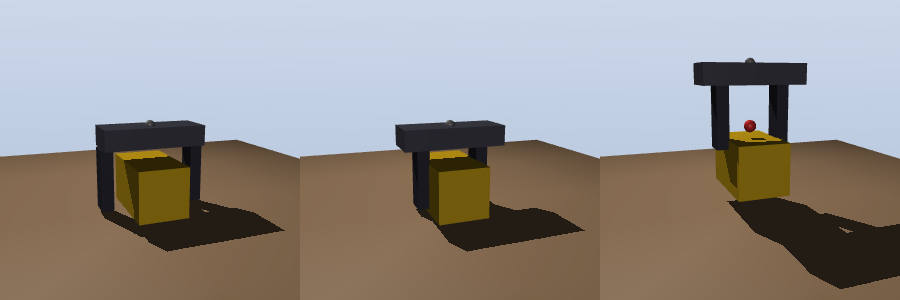
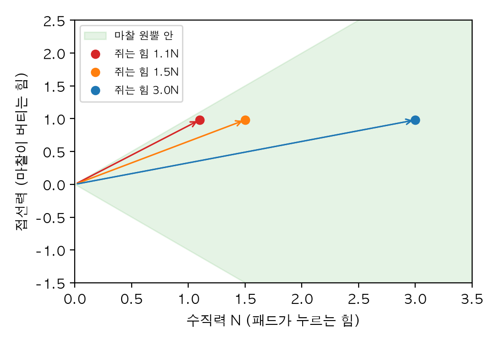
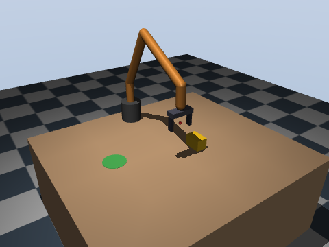
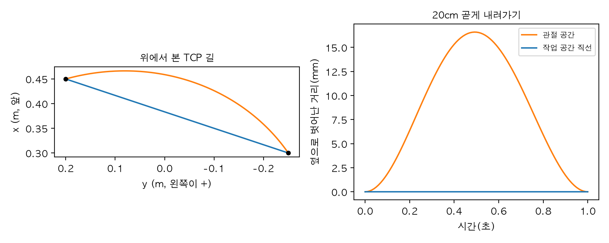
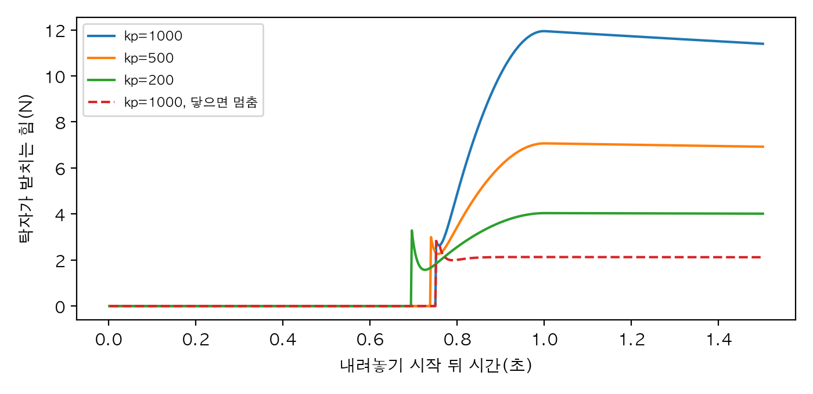
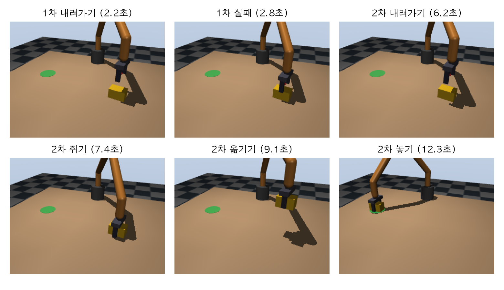

# Chapter 15. 매니퓰레이션: 물건을 잡고 옮기기

> **학습 목표**  
> - 평행 집게, 흡착 컵, 여러 손가락 손의 차이를 알고, MuJoCo로 평행 집게를 직접 만들기
> - 마찰 원뿔로 "얼마나 세게 쥐어야 미끄러지지 않는가"를 계산하고 시뮬레이션으로 확인하기
> - 물체의 위치와 방향에서 집는 자세(접근 방향, 사전 접근 자세, 집게의 요)를 고르고 6자유도 팔의 역기구학으로 풀기
> - 작업 공간 직선 경로와 관절 공간 경로가 손끝의 길을 어떻게 다르게 만드는지 비교하기
> - 손가락 접촉 센서와 손목 힘·토크 센서로 잡았는지, 무엇을 들었는지, 어디에 닿았는지 판단하기
> - 위치 제어의 단단함이 접촉 힘을 정한다는 것(임피던스)을 보고, 닿으면 멈추는 내려놓기 만들기
> - 집고-놓기를 상태 기계로 짜고, 상자 위치를 바꿔 가며 성공률을 재고 실패를 분석하기

---

## 들어가며: 밀 수 있으면 잡을 수도 있을까요?

4장 4.10절에서 2관절 팔로 탁자 위 상자를 **밀어서** 떨어뜨렸죠. 미는 건 비교적 쉽습니다. 팔을 상자 쪽으로 휘두르기만 하면 되니까요. 상자가 어디로 갈지는 몰라도, 밀리기는 합니다. 그럼 같은 상자를 들어서 다른 자리에 얌전히 **내려놓으려면** 무엇이 더 필요할까요?

컵을 집을 때 우리가 무심코 하는 일을 하나씩 적어 보면 답이 보입니다.

| 사람이 하는 일 | 로봇이 해야 하는 일 | 이 장에서 |
|---|---|---|
| 컵을 보고 어디에 있는지 안다 | 물체의 위치와 방향 재기(9장) | 15.3절 |
| 손 모양을 컵에 맞추고 위에서 다가간다 | 집는 자세와 사전 접근 자세 고르기 | 15.3절 |
| 손을 곧게 뻗는다 | 손끝 경로 만들기 | 15.4절 |
| 적당히 세게 쥔다 | 미끄러지지 않을 힘 계산하기 | 15.2절 |
| 손끝 느낌으로 잡았는지 안다 | 접촉 센서와 힘 센서 읽기 | 15.5절 |
| 탁자에 닿는 느낌이 오면 놓는다 | 힘을 보며 내려놓기 | 15.6절 |
| 이 모든 걸 순서대로, 실패하면 다시 | 상태 기계 | 15.7절 |

사람은 이 일을 1초 만에 해치우지만, 로봇에게는 한 줄 한 줄이 따로 풀어야 할 문제입니다. 이 장에서는 이 일곱 줄을 차례로 코드로 옮기고, 마지막 실습에서 3장의 6자유도 예제 팔에 집게를 달아 탁자 위 상자를 스무 번 집어 옮겨 봅니다. 그중 몇 번은 실패하는데, 왜 실패했고 로봇이 그걸 어떻게 알아차리고 다시 시도하는지도 함께 보겠습니다.

> **Q. 21장 책상 정리 로봇과는 무엇이 다른가요?**
> 21장은 카메라로 여러 물건을 찾고, 무엇부터 치울지 정하고, 정리를 끝까지 해내는 종합 프로젝트입니다. 이 장은 그 안에서 되풀이되는 한 동작, **물건 하나를 잘 집어서 잘 놓는 기술**에만 집중해요. 한 동작을 확실히 다져 두어야 여러 동작을 이어 붙일 수 있습니다. 예제는 파이썬 3.12, MuJoCo 3.17, NumPy 2.5, SciPy 1.18에서 실행해 확인했어요.

## 15.1 그리퍼: 로봇의 손

### 세 가지 손

로봇 팔 끝에 다는 손을 **그리퍼(gripper)** 또는 **말단 장치(end effector)** 라고 부릅니다. 공장과 연구실에서 가장 흔히 보는 것은 세 가지예요.

| 종류 | 잡는 방법 | 잘 잡는 것 | 못 잡는 것 |
|---|---|---|---|
| 평행 집게 | 손가락 두 개가 마주 보고 다가와 마찰로 쥔다 | 상자, 원기둥, 부품처럼 마주 보는 면이 있는 물건 | 집게보다 넓은 것, 납작하게 바닥에 붙은 것 |
| 흡착 컵 | 공기를 빨아들여 겉면에 붙는다 | 상자 윗면, 판, 봉투처럼 매끈하고 평평한 면 | 구멍 난 것, 울퉁불퉁한 것, 무거운데 면이 작은 것 |
| 여러 손가락 손 | 관절 달린 손가락 여럿이 감싼다 | 모양이 제각각인 물건, 도구 쥐고 쓰기 | 제어가 어렵고 비싸다 |

택배 물류 창고의 로봇은 흡착 컵을 많이 씁니다. 상자 윗면에 붙이기만 하면 되니 빠르거든요. 사람 손을 닮은 여러 손가락 손은 연구용으로 많이 만들어지지만, 손가락마다 관절이 3~4개라 제어할 것이 아주 많습니다. 그래서 실제 현장의 로봇 팔 대부분은 **평행 집게**를 씁니다. 모터 하나로 두 손가락을 함께 여닫는 단순한 구조인데도, 생각보다 많은 물건을 잡을 수 있어요. 이 장도 평행 집게로 갑니다.

### MuJoCo로 평행 집게 만들기

평행 집게를 MJCF로 옮기면 이런 부품이 필요합니다.

- **손바닥(palm)**: 팔 끝에 붙는 몸통
- **손가락 두 개**: 각각 `slide` 관절(4장 4.2절에서 서랍 레일로 본 미끄럼 관절) 하나로 손바닥에서 옆으로 미끄러진다
- **두 손가락을 묶는 장치**: 진짜 집게는 모터 하나가 톱니로 두 손가락을 함께 움직인다. MuJoCo에서는 **equality 제약**으로 "왼쪽 관절 값 = 오른쪽 관절 값"을 강제한다
- **명령 하나**: 두 관절 값의 합, 곧 손가락 사이 너비를 재는 **힘줄(tendon)** 을 만들고 거기에 position 액추에이터를 단다

팔에도, 뒤에 볼 시험대에도 같은 집게를 달 거라서 MJCF 조각을 만들어 주는 함수 두 개를 `집게.py`에 둡니다.

```python
"""15장: 손가락 두 개짜리 평행 집게를 MJCF 조각으로 만든다."""

손가락_최대 = 0.04       # 손가락 하나가 가운데에서 벌어질 수 있는 거리(m). 최대 너비 8cm
TCP = 0.06               # 손바닥 기준 집는 점(TCP)까지의 거리(m): 손가락 끝 쪽 가운데


def 집게_몸체(위치: str = "0 0 0", 마찰: float = 1.0) -> str:
    """부모 몸체의 +z 쪽으로 뻗은 집게(hand). 손가락은 y축을 따라 마주 보고 미끄러진다."""
    손가락 = """
      <body name="finger_{0}" pos="0 {1}0.006 0.02" gravcomp="1">
        <joint name="finger_{0}" type="slide" axis="0 {1}1 0" range="0 {2}" damping="10" armature="0.01"/>
        <geom name="pad_{0}" type="box" pos="0 0 0.03" size="0.01 0.006 0.03" friction="{3} 0.005 0.0001"
              mass="0.02" rgba="0.2 0.2 0.25 1"/>
        <site name="touch_{0}" type="box" pos="0 {4}0.006 0.03" size="0.011 0.002 0.031" rgba="0 0 0 0"/>
      </body>"""
    return f"""
    <body name="hand" pos="{위치}" gravcomp="1">
    <geom name="palm" type="box" pos="0 0 0.01" size="0.02 0.05 0.01" mass="0.1" rgba="0.3 0.3 0.35 1"/>
    <site name="tcp" pos="0 0 {TCP}" size="0.006" rgba="1 0.2 0.2 1"/>
    <site name="wrist_ft" pos="0 0 0"/>{손가락.format("l", "", 손가락_최대, 마찰, "-")}{손가락.format("r", "-", 손가락_최대, 마찰, "")}
    </body>"""


def 집게_부속(쥐는_힘: float = 10.0) -> str:
    """두 손가락을 묶는 제약, 벌림 너비를 재는 힘줄, 액추에이터, 센서."""
    return f"""
  <equality><joint joint1="finger_l" joint2="finger_r"/></equality>
  <tendon>
    <fixed name="width"><joint joint="finger_l" coef="1"/><joint joint="finger_r" coef="1"/></fixed>
  </tendon>
  <actuator>
    <position name="grip" tendon="width" kp="2000" dampratio="1" ctrlrange="0 {2 * 손가락_최대}"
              forcelimited="true" forcerange="-{쥐는_힘} {쥐는_힘}"/>
  </actuator>
  <sensor>
    <touch name="touch_l" site="touch_l"/>
    <touch name="touch_r" site="touch_r"/>
    <tendonpos name="width" tendon="width"/>
    <force name="wrist_force" site="wrist_ft"/>
    <torque name="wrist_torque" site="wrist_ft"/>
  </sensor>"""
```

하나씩 볼게요.

- 손가락 몸체는 `{1}` 자리에 부호가 들어가서, 왼쪽(`l`)은 +y로, 오른쪽(`r`)은 -y로 벌어집니다. 두 관절 모두 **값이 클수록 벌어지고**, 0이면 두 손가락이 한가운데에서 맞닿아요. 그래서 손가락 사이 너비는 두 관절 값의 합이고, `width` 힘줄이 바로 그 합을 잽니다(`coef="1"` 두 개).
- `grip` 액추에이터의 명령은 **원하는 너비(m)** 입니다. 핵심은 `forcerange`예요. 상자보다 좁게(0으로) 닫으라고 명령하면 손가락은 상자에 막혀 더 못 가고, 액추에이터는 kp × 남은 거리만큼 힘을 내려 하지만 `forcerange`에서 잘립니다. 그래서 **쥐는 힘 = forcerange**가 돼요. 실제 전동 그리퍼도 "얼마나 세게 쥘지"를 설정값으로 받는 경우가 많습니다.
- 손가락 안쪽 면을 덮는 납작한 사이트 `touch_l`, `touch_r`에 접촉 센서를 달았습니다. 4장 4.7절에서 본 대로, 접촉 센서는 사이트 **부피 안**의 접촉만 세요.
- 손바닥 원점의 `wrist_ft` 사이트에는 힘(`force`)과 토크(`torque`) 센서를 달았습니다. 손목에 다는 6축 힘·토크 센서를 흉내 낸 것으로, 15.5절에서 씁니다.
- `tcp`는 **TCP(tool center point, 도구 중심점)**, 집게가 물건을 쥐는 점입니다. 3장에서 "손끝"이라 부른 자리를 이제부터 이렇게 부를게요.
- `gravcomp="1"`은 MuJoCo가 그 몸체의 무게만큼 위로 받쳐 주라는 설정입니다. 12장 12.9절에서는 중력 처짐을 없애려고 `qfrc_bias`를 계산해 앞먹임으로 직접 더했죠. 이 장에서는 그 일을 `gravcomp`가 대신 해 줍니다. 정말 같은 일을 하는지는 15.3절에서 팔을 만든 뒤 숫자로 확인할게요.

집게만 따로 시험할 무대도 하나 만들어 둡니다. 집게를 수직 `slide` 관절 하나(`lift`)에 매달아 위아래로만 움직이게 하고, 그 아래 탁자에 상자를 놓았어요. `lift`가 0이면 TCP가 상자 가운데 높이에 옵니다.

```python
"""15장: 집게만 위아래로 움직이는 시험대. 탁자 위 상자를 집어 들어 본다."""
import mujoco

from 집게 import 손가락_최대, 집게_몸체, 집게_부속

탁자_높이 = 0.4
상자_높이 = 0.05


def 시험대_xml(쥐는_힘: float = 10.0, 상자_질량: float = 0.2, 상자_x: float = 0.0, 상자_y: float = 0.0,
            옵션: str = 'cone="elliptic" impratio="10"', 묶기: bool = True, 들기_kp: float = 2000) -> str:
    """집게는 수직 slide 관절(lift) 하나로 오르내린다. lift = 0이면 TCP가 상자 가운데 높이."""
    부속 = 집게_부속(쥐는_힘)
    if not 묶기:
        부속 = 부속.replace('<equality><joint joint1="finger_l" joint2="finger_r"/></equality>', "")
    TCP_시작 = 탁자_높이 + 상자_높이 / 2
    return f"""
<mujoco>
  <option timestep="0.002" integrator="implicitfast" {옵션}/>
  <asset>
    <texture type="skybox" builtin="gradient" rgb1="0.95 0.95 1" rgb2="0.6 0.7 0.8" width="256" height="256"/>
  </asset>
  <worldbody>
    <light pos="-0.6 -0.3 1.2" dir="0.6 0.3 -0.8"/>
    <geom name="table" type="box" pos="0 0 0.2" size="0.3 0.3 0.2" friction="0.5 0.005 0.0001" rgba="0.75 0.6 0.45 1"/>
    <body name="lifter" pos="0 0 {TCP_시작 + 0.06}" quat="0 1 0 0" gravcomp="1">
      <joint name="lift" type="slide" axis="0 0 -1"/>
      {집게_몸체()}
    </body>
    <body name="box" pos="{상자_x} {상자_y} {TCP_시작}">
      <freejoint/>
      <geom name="box" type="box" size="0.04 0.025 {상자_높이 / 2}" mass="{상자_질량}" friction="0.5 0.005 0.0001"
            rgba="0.95 0.75 0.1 1"/>
    </body>
  </worldbody>
  <actuator><position name="lift" joint="lift" kp="{들기_kp}" dampratio="1"/></actuator>
  {부속}
</mujoco>"""


def 만들기(**설정) -> tuple[mujoco.MjModel, mujoco.MjData]:
    """시험대를 만들고 집게를 활짝 연 채로 시작한다."""
    모델 = mujoco.MjModel.from_xml_string(시험대_xml(**설정))
    데이터 = mujoco.MjData(모델)
    for 손가락 in ("finger_l", "finger_r"):
        데이터.joint(손가락).qpos = 손가락_최대
    데이터.ctrl[모델.actuator("grip").id] = 2 * 손가락_최대
    mujoco.mj_forward(모델, 데이터)
    return 모델, 데이터


def 흘려보내기(모델, 데이터, 초: float, 매번=None) -> None:
    """초만큼 시간을 흘린다. 매번(데이터)을 주면 걸음마다 부른다."""
    끝 = 데이터.time + 초
    while 데이터.time < 끝 - 1e-9:
        if 매번 is not None:
            매번(데이터)
        mujoco.mj_step(모델, 데이터)


def 들기(모델, 데이터, 높이: float, 초: float = 1.0) -> None:
    """집게를 지금 높이에서 '높이'(m)까지 초 동안 부드럽게(3s² - 2s³) 옮기고 0.5초 기다린다."""
    시작, 처음 = 데이터.time, 데이터.ctrl[모델.actuator("lift").id]

    def 한_걸음(d) -> None:
        s = min((d.time - 시작) / 초, 1.0)
        d.ctrl[모델.actuator("lift").id] = 처음 + (높이 - 처음) * (3 * s**2 - 2 * s**3)

    흘려보내기(모델, 데이터, 초 + 0.5, 한_걸음)
```

`만들기`가 손가락을 **연 채로** 시작하는 데는 이유가 있습니다. 관절 값의 기본은 0이라서 그냥 두면 손가락이 닫힌 채, 즉 상자 한가운데를 파고든 채로 시작해요. 그러면 첫 걸음에 MuJoCo가 겹친 것을 밀어내면서 상자가 튕겨 나갑니다. 시뮬레이션의 시작 상태도 진짜 세상처럼 말이 되게 만들어야 해요.

### 두 손가락을 묶는 이유

equality 제약이 정말 필요한지 확인해 봅시다. 손가락 하나를 일부러 짝짝이로 벌려 놓고(왼쪽 4cm, 오른쪽 1cm), 너비 명령을 주었을 때 묶은 집게와 묶지 않은 집게를 비교합니다.

```python
from 집게시험장면 import 만들기, 흘려보내기

# 상자는 옆(y = 0.2m)으로 치워 두고, 공중에서 손가락만 움직여 본다
for 묶기 in [True, False]:
    모델, 데이터 = 만들기(상자_y=0.2, 묶기=묶기)
    데이터.joint("finger_l").qpos = 0.04                   # 일부러 짝짝이로 시작: 왼쪽은 활짝, 오른쪽은 1cm
    데이터.joint("finger_r").qpos = 0.01
    print("equality로 묶음" if 묶기 else "묶지 않음")
    for 너비 in [0.06, 0.03]:
        데이터.ctrl[모델.actuator("grip").id] = 너비          # 명령은 손가락 사이 너비(m) 하나
        흘려보내기(모델, 데이터, 1.0)
        왼, 오 = 데이터.joint("finger_l").qpos[0], 데이터.joint("finger_r").qpos[0]
        print(f"  너비 명령 {너비 * 100:.0f}cm → 왼쪽 {왼 * 100:.2f}cm, 오른쪽 {오 * 100:.2f}cm, "
              f"잰 너비 {데이터.sensor('width').data[0] * 100:.2f}cm, 쥐는 가운데가 {abs(왼 - 오) / 2 * 100:.2f}cm 틀어짐")
```

```text
equality로 묶음
  너비 명령 6cm → 왼쪽 3.00cm, 오른쪽 3.00cm, 잰 너비 6.00cm, 쥐는 가운데가 0.00cm 틀어짐
  너비 명령 3cm → 왼쪽 1.50cm, 오른쪽 1.50cm, 잰 너비 3.00cm, 쥐는 가운데가 0.00cm 틀어짐
묶지 않음
  너비 명령 6cm → 왼쪽 4.00cm, 오른쪽 2.00cm, 잰 너비 6.00cm, 쥐는 가운데가 1.00cm 틀어짐
  너비 명령 3cm → 왼쪽 2.50cm, 오른쪽 0.50cm, 잰 너비 3.00cm, 쥐는 가운데가 1.00cm 틀어짐
```

둘 다 잰 너비는 명령대로 6cm, 3cm가 됐습니다. 그런데 묶지 않은 집게는 처음의 짝짝이가 그대로 남아서, 쥐는 가운데가 1cm 틀어져 있어요. 힘줄 액추에이터는 **너비의 합**만 맞출 뿐 두 손가락을 어떻게 나눌지는 모르기 때문입니다. 이 집게로 상자를 집으면 TCP가 아니라 1cm 옆에서 쥐게 되죠. equality로 묶으면 두 손가락이 늘 같은 거리만큼 벌어져서 쥐는 가운데가 TCP에 고정됩니다.

이제 상자를 실제로 집어 봅시다. 벌리고, 쥐고, 6cm 들어 올리는 세 순간을 찍습니다.

```python
import mujoco
import numpy as np
from PIL import Image

from 집게시험장면 import 만들기, 흘려보내기

모델, 데이터 = 만들기()
카메라 = mujoco.MjvCamera()
카메라.lookat[:] = [0, 0, 0.46]
카메라.distance, 카메라.azimuth, 카메라.elevation = 0.36, 160, -12

사진들 = []
with mujoco.Renderer(모델, 300, 300) as 그리개:
    for 너비, 들기 in [(0.08, 0.0), (0.0, 0.0), (0.0, 0.06)]:     # 벌리고 → 쥐고 → 6cm 들기
        데이터.ctrl[모델.actuator("grip").id] = 너비
        데이터.ctrl[모델.actuator("lift").id] = 들기
        흘려보내기(모델, 데이터, 1.0)
        그리개.update_scene(데이터, camera=카메라)
        사진들.append(그리개.render())
        print(f"너비 명령 {너비 * 100:.0f}cm, 들기 {들기 * 100:.0f}cm → 잰 너비 {데이터.sensor('width').data[0] * 100:.2f}cm, "
              f"접촉 센서 {데이터.sensor('touch_l').data[0]:.2f}N / {데이터.sensor('touch_r').data[0]:.2f}N")
Image.fromarray(np.hstack(사진들)).save("gripper.png")
print("저장: gripper.png")
```

```text
너비 명령 8cm, 들기 0cm → 잰 너비 8.00cm, 접촉 센서 0.00N / 0.00N
너비 명령 0cm, 들기 0cm → 잰 너비 4.81cm, 접촉 센서 10.00N / 10.00N
너비 명령 0cm, 들기 6cm → 잰 너비 4.81cm, 접촉 센서 10.00N / 10.00N
저장: gripper.png
```



쥐었더니 너비가 4.81cm가 됐습니다. 상자 폭은 5cm인데 조금 좁죠? 4장 4.3절에서 본 **부드러운 접촉** 때문에 패드가 상자를 양쪽에서 1mm쯤 파고든 거예요. 두 접촉 센서는 10N, 바로 `forcerange`로 정한 쥐는 힘을 그대로 잽니다. 들어 올린 뒤에도 그대로라 상자는 손가락 사이에 잘 붙어 있어요.

## 15.2 잡기의 물리: 마찰 원뿔

### 미끄러지지 않을 조건

손바닥 두 개로 책 한 권을 양쪽에서 눌러 들어 보세요. 살짝 누르면 책이 미끄러져 떨어지고, 꾹 누르면 버팁니다. 책을 붙잡고 있는 건 **마찰**이에요. 마찰력은 누르는 힘(수직력) N에 비례해서 최대 μN까지 버틸 수 있습니다. μ는 마찰 계수로, 고무처럼 끈끈한 면은 1 안팎, 매끈한 플라스틱은 0.3 정도, 젖은 유리는 0.1까지도 내려가요.

평행 집게도 똑같습니다. 손가락 두 개가 각각 N으로 누르면 마찰이 버틸 수 있는 힘은 모두 2μN이고, 이것이 물체의 무게 mg보다 커야 해요.

> 2μN ≥ mg, 즉 N ≥ mg / (2μ)

들어 올리는 순간 위로 가속도 a가 있으면 무게 대신 m(g + a)를 버텨야 합니다. 몇 가지 경우를 계산해 보겠습니다.

```python
g = 9.81


def 최소_쥐는_힘(질량: float, 마찰: float, 손가락_수: int = 2, 가속도: float = 0.0) -> float:
    """손가락마다 눌러야 하는 최소 수직력(N). 마찰력 합 μ·N·손가락_수 ≥ m(g + a)."""
    return 질량 * (g + 가속도) / (마찰 * 손가락_수)


print("물체               | μ   | 최소 힘 | 안전율 2배")
for 이름, 질량, 마찰 in [("0.2kg 상자, 고무 패드", 0.2, 1.0), ("0.2kg 상자, 플라스틱", 0.2, 0.3),
                     ("1kg 병, 고무 패드", 1.0, 1.0), ("1kg 병, 젖은 유리", 1.0, 0.1)]:
    힘 = 최소_쥐는_힘(질량, 마찰)
    print(f"{이름:17s}| {마찰:.1f} | {힘:5.2f}N | {2 * 힘:5.2f}N")
print(f"0.2kg 상자를 2m/s²로 들어 올리면: {최소_쥐는_힘(0.2, 1.0, 가속도=2.0):.2f}N")
```

```text
물체               | μ   | 최소 힘 | 안전율 2배
0.2kg 상자, 고무 패드  | 1.0 |  0.98N |  1.96N
0.2kg 상자, 플라스틱   | 0.3 |  3.27N |  6.54N
1kg 병, 고무 패드     | 1.0 |  4.91N |  9.81N
1kg 병, 젖은 유리     | 0.1 | 49.05N | 98.10N
0.2kg 상자를 2m/s²로 들어 올리면: 1.18N
```

같은 0.2kg 상자도 패드가 고무냐 플라스틱이냐에 따라 필요한 힘이 0.98N과 3.27N으로 세 배 넘게 차이 납니다. 1kg 병이 젖어서 μ가 0.1로 떨어지면 49N, 안전율까지 두면 98N이 필요해요. 작은 전동 그리퍼가 낼 수 있는 힘을 훌쩍 넘습니다. 그래서 그리퍼 손가락 끝에는 고무 패드를 붙이는 경우가 많아요. 쥐는 힘을 키우는 것보다 μ를 키우는 편이 훨씬 싸거든요. 실제 μ는 물체마다, 날마다(먼지, 기름, 습기) 달라지니 계산값의 2배 정도를 안전율로 두는 것이 보통입니다.

### MuJoCo로 확인하기

식이 맞는지 시험대로 확인해 봅시다. 0.2kg 상자를 쥐고 1초 동안 6.5cm 들어 올린 뒤, 상자가 손가락 안에서 얼마나 미끄러져 내려갔는지 잽니다. 패드의 마찰은 1.0, 상자는 0.5인데, 두 모양이 닿으면 MuJoCo는 기본으로 둘 중 큰 값을 씁니다. 그러니 μ = 1.0이고, 최소 쥐는 힘은 0.981N이에요(아래 결과의 경계가 정확히 여기에 걸리는 것으로도 확인됩니다). 4장 4.3절에서 비탈 위의 상자가 기어 내려가는 걸 막아 준 `cone="elliptic" impratio="10"` 설정도 함께 비교합니다.

```python
import numpy as np

from 집게시험장면 import 들기, 만들기, 흘려보내기

질량, 마찰 = 0.2, 1.0                      # 상자 마찰 0.5와 패드 1.0 중 큰 값이 쓰인다
최소 = 질량 * 9.81 / (2 * 마찰)
print(f"식으로 구한 최소 쥐는 힘: {최소:.3f}N")


def 들어_보기(쥐는_힘: float, 옵션: str) -> float:
    """쥐고 1초 동안 6.5cm 들어 올리고 0.5초 기다린 뒤, 상자가 손가락 안에서 미끄러져 내려간 거리(mm)."""
    모델, 데이터 = 만들기(쥐는_힘=쥐는_힘, 상자_질량=질량, 옵션=옵션)
    데이터.ctrl[모델.actuator("grip").id] = 0.0                 # 끝까지 닫으라고 명령
    흘려보내기(모델, 데이터, 0.5)
    처음 = 데이터.site("tcp").xpos[2] - 데이터.body("box").xpos[2]
    들기(모델, 데이터, 0.065)
    return (데이터.site("tcp").xpos[2] - 데이터.body("box").xpos[2] - 처음) * 1000


print("쥐는 힘 | 최소의 몇 배 | 미끄러짐: 기본 설정 | 타원 원뿔 + impratio=10")
for 쥐는_힘 in [0.8, 0.95, 1.0, 1.1, 1.5, 3.0, 10.0]:
    기본 = 들어_보기(쥐는_힘, "")
    타원 = 들어_보기(쥐는_힘, 'cone="elliptic" impratio="10"')
    print(f" {쥐는_힘:5.2f}N | {쥐는_힘 / 최소:7.2f}배 | {np.round(기본, 1):8.1f}mm | {np.round(타원, 1):8.1f}mm")
```

```text
식으로 구한 최소 쥐는 힘: 0.981N
쥐는 힘 | 최소의 몇 배 | 미끄러짐: 기본 설정 | 타원 원뿔 + impratio=10
  0.80N |    0.82배 |     65.0mm |     65.0mm
  0.95N |    0.97배 |     65.0mm |     65.0mm
  1.00N |    1.02배 |     32.7mm |      9.8mm
  1.10N |    1.12배 |     25.4mm |      0.7mm
  1.50N |    1.53배 |     19.1mm |      0.6mm
  3.00N |    3.06배 |     10.5mm |      0.5mm
 10.00N |   10.19배 |      6.6mm |      0.3mm
```

65.0mm는 들어 올린 높이 전부, 즉 상자가 탁자에 그대로 남았다는 뜻입니다. 최소의 0.82배와 0.97배로 쥐면 두 설정 모두 상자를 전혀 들지 못했어요. 식이 말한 경계가 시뮬레이션에서도 그대로 나타났습니다.

경계를 넘은 뒤가 흥미롭습니다. 타원 원뿔 설정은 최소의 1.12배만 돼도 미끄러짐이 0.7mm로 줄어 사실상 붙잡았어요. 경계에 딱 붙은 1.02배에서는 9.8mm 미끄러졌는데, 들어 올리는 가속도만큼 힘이 더 필요했으니 당연한 결과입니다. 반면 기본 설정은 10배 넘게 세게 쥐어도 6.6mm, 1.53배에서는 19.1mm나 미끄러졌어요. 4장에서 비탈 위의 상자가 기어 내려가던 것과 같은 현상입니다. 물건을 쥐고 다니는 시뮬레이션에서는 이 차이가 성공과 실패를 가르니, 이 장의 장면은 모두 타원 원뿔 설정을 씁니다.

### 마찰 원뿔

"마찰은 최대 μN까지"를 그림으로 그리면 원뿔이 됩니다. 접촉면에 수직인 축을 가운데에 두고, 접촉점이 받는 힘을 화살표로 그려 보세요. 화살표가 수직축과 이루는 각이 작아서(접선 성분 ≤ μ × 수직 성분) **원뿔 안**에 있으면 붙어 있고, 원뿔 밖으로 나가려 하면 미끄러집니다. 원뿔의 벌어진 정도는 μ가 정해요. 이것을 **마찰 원뿔(friction cone)** 이라고 부릅니다. 기본 설정의 `pyramidal`은 이 원뿔을 각뿔로 근사한 것이고, `elliptic`은 원뿔 그대로 계산하는 것이에요.

들어 올린 상자를 손가락이 실제로 어떤 힘으로 받치고 있는지, 4장 4.8절의 `mj_contactForce`로 패드마다 접촉 힘을 모아 보겠습니다. 접촉 힘은 접촉마다 다른 좌표계로 나오니, `contact.frame`으로 세계 좌표계로 바꿔서 더해요.

```python
import matplotlib.pyplot as plt
import mujoco
import numpy as np

from 집게시험장면 import 들기, 만들기, 흘려보내기

plt.rcParams["font.family"] = "AppleGothic"
plt.rcParams["axes.unicode_minus"] = False

마찰 = 1.0
그림, 칸 = plt.subplots(figsize=(5.2, 3.6))
칸.fill_between([0, 3.5], [0, 3.5 * 마찰], [0, -3.5 * 마찰], color="tab:green", alpha=0.12, label="마찰 원뿔 안")
for 쥐는_힘, 색 in [(1.1, "tab:red"), (1.5, "tab:orange"), (3.0, "tab:blue")]:
    모델, 데이터 = 만들기(쥐는_힘=쥐는_힘, 상자_질량=0.2)
    데이터.ctrl[모델.actuator("grip").id] = 0.0
    흘려보내기(모델, 데이터, 0.5)
    들기(모델, 데이터, 0.03)                                     # 3cm 들고 가만히
    for 패드 in ["pad_l", "pad_r"]:
        합 = np.zeros(3)
        힘 = np.zeros(6)
        for i, c in enumerate(데이터.contact[:데이터.ncon]):
            if 모델.geom(패드).id in (c.geom1, c.geom2):
                mujoco.mj_contactForce(모델, 데이터, i, 힘)
                합 += c.frame.reshape(3, 3).T @ 힘[:3]               # 접촉 좌표계 → 세계 좌표계
        수직 = abs(합[1])                                             # 패드는 y축을 따라 상자를 누른다
        접선 = np.linalg.norm(합[[0, 2]])
        print(f"쥐는 힘 {쥐는_힘}N, {패드}: 수직 {수직:.3f}N, 접선 {접선:.3f}N, 접선/수직 {접선 / 수직:.2f} (μ = {마찰})")
        칸.plot(수직, 접선, "o", color=색, label=f"쥐는 힘 {쥐는_힘}N" if 패드 == "pad_l" else None)
        칸.annotate("", (수직, 접선), (0, 0), arrowprops={"arrowstyle": "->", "color": 색})
칸.set_xlabel("수직력 N (패드가 누르는 힘)")
칸.set_ylabel("접선력 (마찰이 버티는 힘)")
칸.set_xlim(0, 3.5)
칸.set_ylim(-1.5, 2.5)
칸.legend(fontsize=8, loc="upper left")
그림.tight_layout()
그림.savefig("friction_cone.png", dpi=200)
print("저장: friction_cone.png")
```

```text
쥐는 힘 1.1N, pad_l: 수직 1.100N, 접선 0.981N, 접선/수직 0.89 (μ = 1.0)
쥐는 힘 1.1N, pad_r: 수직 1.100N, 접선 0.981N, 접선/수직 0.89 (μ = 1.0)
쥐는 힘 1.5N, pad_l: 수직 1.500N, 접선 0.981N, 접선/수직 0.65 (μ = 1.0)
쥐는 힘 1.5N, pad_r: 수직 1.500N, 접선 0.981N, 접선/수직 0.65 (μ = 1.0)
쥐는 힘 3.0N, pad_l: 수직 3.000N, 접선 0.981N, 접선/수직 0.33 (μ = 1.0)
쥐는 힘 3.0N, pad_r: 수직 3.000N, 접선 0.981N, 접선/수직 0.33 (μ = 1.0)
저장: friction_cone.png
```



패드마다 접선력은 0.981N, 상자 무게 1.962N의 정확히 절반입니다. 두 손가락이 무게를 반씩 나눠 받치는 거예요. 쥐는 힘을 바꿔도 접선력은 그대로이고 수직력만 바뀌어서, 접선/수직 비율이 0.33, 0.65, 0.89로 μ = 1에 다가갑니다. 쥐는 힘 1.1N의 빨간 화살표가 원뿔 가장자리 바로 안쪽에 있죠. 조금만 더 약하게 쥐거나 상자가 조금만 더 무거우면 원뿔 밖으로 나가 미끄러지는 상태예요.

> **Q. 그럼 그냥 아주 세게 쥐면 되지 않나요?**
> 상자라면 그래도 되지만, 종이컵, 과일, 달걀은 찌그러지거나 깨집니다. 모터도 큰 힘을 오래 내면 뜨거워지고 전기를 많이 먹어요. 그래서 물체의 무게와 μ로 필요한 힘을 계산하고 안전율을 곱한 만큼만 쥐는 것이 기본입니다. 15.5절에서 볼 손목 힘 센서로 들어 올린 물체의 무게를 재면, 그 값으로 쥐는 힘을 다시 맞출 수도 있어요.

## 15.3 잡는 자세 고르기

### 팔에 집게 달기

이제 3장의 6자유도 예제 팔에 집게를 답니다. 팔은 3장 `팔도구.py`의 `예제_팔` 목록을 그대로 MJCF로 옮기고, 마지막 관절(손목3)에서 0.05m, 3장에서 손끝이 있던 자리에 집게의 손바닥을 붙여요. 그러면 TCP는 손목3에서 0.05 + 0.06 = 0.11m 떨어진 곳이 됩니다. 팔 받침은 높이 0.4m 탁자 위에 놓고, 탁자에는 노란 상자와 초록색 "놓을 곳" 표시를 둡니다. 이 장면을 `팔집게장면.py`로 둡니다.

```python
"""15장: 3장의 6자유도 예제 팔 끝에 평행 집게를 달고 탁자 위에 놓는다."""
import mujoco
import numpy as np

from 집게 import TCP, 손가락_최대, 집게_몸체, 집게_부속
from 팔도구 import 변환, 예제_팔

받침_위치 = np.array([0.0, 0.0, 0.4])       # 팔 받침은 탁자 윗면(높이 0.4m)에 붙어 있다
T_세계_받침 = 변환(np.eye(3), 받침_위치)
손끝_집게 = [0, 0, 0.05 + TCP]              # 마지막 관절 기준 TCP: 손바닥(0.05) + 손가락 쪽(TCP)
상자_반크기 = np.array([0.04, 0.025, 0.025])  # 길이 8cm, 너비 5cm, 높이 5cm
집_자세 = np.deg2rad([0, 30, 90, 0, 60, 0])    # 출발 자세: 손가락이 바로 아래를 본다


def 글(벡터) -> str:
    return " ".join(f"{float(값):.6g}" for 값 in 벡터)


def 장면_xml(상자_위치=(0.4, 0.1), 상자_요_도: float = 0.0, 놓을_곳=(0.3, -0.25),
            쥐는_힘: float = 10.0, 상자_질량: float = 0.1) -> str:
    """팔·집게·상자·놓을 곳 표시가 든 MJCF. 상자 위치는 탁자 위 (x, y)(m)."""
    몸체들 = []
    for i, (_, 위치, 축) in enumerate(예제_팔):
        다음 = 예제_팔[i + 1][1] if i + 1 < len(예제_팔) else [0, 0, 0.03]
        몸체들.append(f'<body name="link{i + 1}" pos="{글(위치)}" gravcomp="1">'
                    f'<joint name="joint{i + 1}" axis="{글(축)}"/>'
                    f'<geom type="capsule" fromto="0 0 0 {글(다음)}" size="0.02" rgba="0.8 0.5 0.2 1"/>')
    상자_z = 받침_위치[2] + 상자_반크기[2]
    return f"""
<mujoco model="집게 단 6자유도 팔">
  <option timestep="0.002" integrator="implicitfast" cone="elliptic" impratio="10"/>
  <asset>
    <texture type="skybox" builtin="gradient" rgb1="0.95 0.95 1" rgb2="0.6 0.7 0.8" width="256" height="256"/>
    <texture name="격자" type="2d" builtin="checker" rgb1="0.25 0.3 0.35" rgb2="0.75 0.75 0.75"
             width="256" height="256"/>
    <material name="바닥재" texture="격자" texrepeat="8 8"/>
  </asset>
  <default>
    <joint type="hinge" damping="1" armature="0.05"/>
    <geom contype="2" conaffinity="1"/>
    <position kp="400" dampratio="1"/>
  </default>
  <worldbody>
    <light pos="0.3 -0.5 2.5" dir="0 0.2 -1"/>
    <camera name="top" pos="0.4 0 1.2" xyaxes="1 0 0 0 1 0" fovy="50"/>
    <geom name="floor" type="plane" size="2 2 0.1" material="바닥재" contype="1"/>
    <geom name="table" type="box" pos="0.35 0 0.2" size="0.45 0.5 0.2" rgba="0.75 0.6 0.45 1"
          contype="1" friction="0.5 0.005 0.0001"/>
    <geom name="target" type="cylinder" pos="{글(놓을_곳)} 0.4005" size="0.05 0.0005"
          rgba="0.2 0.7 0.3 0.6" contype="0" conaffinity="0"/>
    <body name="base" pos="{글(받침_위치)}">
      <geom type="cylinder" fromto="0 0 0 0 0 0.1" size="0.05" rgba="0.3 0.3 0.3 1"/>
      {"".join(몸체들)}{집게_몸체("0 0 0.05")}{"</body>" * len(예제_팔)}
    </body>
    <body name="box" pos="{글(상자_위치)} {상자_z}" euler="0 0 {상자_요_도}">
      <freejoint/>
      <geom name="box" type="box" size="{글(상자_반크기)}" mass="{상자_질량}" contype="1"
            friction="0.5 0.005 0.0001" rgba="0.95 0.75 0.1 1"/>
    </body>
  </worldbody>
  <actuator>
    {"".join(f'<position name="joint{i + 1}" joint="joint{i + 1}"/>' for i in range(len(예제_팔)))}
  </actuator>
  {집게_부속(쥐는_힘)}
</mujoco>"""


def 준비(모델: mujoco.MjModel, 데이터: mujoco.MjData) -> None:
    """팔을 출발 자세에 두고 손가락을 활짝 연다(관절 값과 명령을 함께)."""
    데이터.qpos[:6] = 데이터.ctrl[:6] = 집_자세
    데이터.joint("finger_l").qpos = 데이터.joint("finger_r").qpos = 손가락_최대
    데이터.ctrl[모델.actuator("grip").id] = 2 * 손가락_최대
    mujoco.mj_forward(모델, 데이터)
```

3장의 `팔모델.py`와 다른 점만 짚어 볼게요.

- `<default>`에서 모든 모양의 `contype="2" conaffinity="1"`을 기본으로 했습니다. 두 모양은 한쪽의 contype과 다른 쪽의 conaffinity가 비트로 겹칠 때만 부딪히는데, 2와 1은 겹치지 않으니 **팔 부품끼리는 서로 부딪히지 않고**, contype이 1인 탁자·바닥·상자와는 부딪힙니다. 손가락도 같은 기본값을 받으니 손가락끼리, 손가락과 팔 막대끼리도 부딪히지 않아요.
- 관절마다 kp 400의 position 액추에이터를 달고 `dampratio="1"`로 흔들림을 잡았습니다(4장 4.6절).
- 마지막 링크의 막대는 0.05m 대신 0.03m까지만 그렸습니다. 0.05m 자리부터는 집게의 손바닥이 있으니까요.

장면이 3장의 순기구학과 정말 맞는지부터 검산합니다. 3장 3.9절처럼 아무 관절 각도 100개에서 MuJoCo의 `tcp` 사이트와 우리 계산을 비교해요. TCP 포즈를 계산하는 `TCP_포즈`는 곧 볼 `잡기도구.py`에 있습니다.

```python
import mujoco
import numpy as np
from PIL import Image

from 잡기도구 import TCP_포즈
from 팔집게장면 import 장면_xml, 준비

모델 = mujoco.MjModel.from_xml_string(장면_xml())
데이터 = mujoco.MjData(모델)
print("관절 수(nq):", 모델.nq, "= 팔 6 + 손가락 2 + 상자 자유 관절 7")

# 3장의 순기구학(손끝을 TCP로 바꾼 것)과 MuJoCo의 tcp 사이트가 같은 곳을 가리키나?
생성기 = np.random.default_rng(0)
차이 = []
for _ in range(100):
    q = 생성기.uniform(-np.pi, np.pi, size=6)
    데이터.qpos[:6] = q
    mujoco.mj_forward(모델, 데이터)
    T = TCP_포즈(q)
    차이.append(max(np.abs(데이터.site("tcp").xpos - T[:3, 3]).max(),
                  np.abs(데이터.site("tcp").xmat.reshape(3, 3) - T[:3, :3]).max()))
print(f"TCP 포즈 최대 차이: {max(차이):.1e}")

준비(모델, 데이터)                                       # 출발 자세, 손가락은 활짝
print("출발 자세의 TCP 위치:", np.round(데이터.site("tcp").xpos, 3) + 0.0)
print("TCP의 z축(손가락이 뻗은 쪽):", np.round(데이터.site("tcp").xmat.reshape(3, 3)[:, 2], 3) + 0.0)
# gravcomp가 관절에 보태는 힘(qfrc_gravcomp)은 12장 12.9절의 qfrc_bias(멈춰 있을 때 = 중력)와 같을까?
print("qfrc_bias    :", np.round(데이터.qfrc_bias[:6], 3) + 0.0)
print("qfrc_gravcomp:", np.round(데이터.qfrc_gravcomp[:6], 3) + 0.0)

카메라 = mujoco.MjvCamera()
카메라.lookat[:] = [0.3, 0.0, 0.5]
카메라.distance, 카메라.azimuth, 카메라.elevation = 1.3, 145, -28
with mujoco.Renderer(모델, 360, 480) as 그리개:
    그리개.update_scene(데이터, camera=카메라)
    Image.fromarray(그리개.render()).save("arm_scene.png")
print("저장: arm_scene.png")
```

```text
관절 수(nq): 15 = 팔 6 + 손가락 2 + 상자 자유 관절 7
TCP 포즈 최대 차이: 6.7e-16
출발 자세의 TCP 위치: [0.41 0.   0.55]
TCP의 z축(손가락이 뻗은 쪽): [ 0.  0. -1.]
qfrc_bias    : [ 0.    -2.786 -1.378  0.     0.     0.   ]
qfrc_gravcomp: [ 0.    -2.786 -1.378  0.     0.     0.   ]
저장: arm_scene.png
```



100개 자세 모두에서 차이가 1e-15 수준이니, 3장의 순기구학에 손끝 위치만 TCP로 바꿔 넣으면 됩니다. 출발 자세 (0, 30, 90, 0, 60, 0)도는 어깨·팔꿈치·손목2를 합쳐 180도 숙인 자세라서 TCP의 z축이 (0, 0, -1), 바로 아래를 봐요. `nq`가 15인 것도 읽어 두세요. 팔 6, 손가락 2에 상자의 자유 관절이 7칸(4장 4.2절)입니다.

마지막 두 줄은 `gravcomp`의 정체입니다. MuJoCo가 `gravcomp` 몸체들 때문에 관절에 보태는 힘 `qfrc_gravcomp`가, 12장 12.9절에서 중력 보상 앞먹임으로 쓴 `qfrc_bias`(팔이 멈춰 있을 때는 중력만 담는다)와 관절마다 같습니다. 12장에서 `ctrl`에 직접 더한 그 힘을, 여기서는 MuJoCo가 액추에이터와 따로 관절에 넣어 주는 거예요. 그래서 관절의 position 액추에이터는 중력에 처지지 않고 목표를 따라가는 일에만 힘을 씁니다. 다만 `gravcomp`는 장면 파일에 적은 몸체의 무게만 받쳐 줍니다. 손에 든 상자의 무게는 액추에이터가 버텨야 해요.

### 집는 자세 정하기

탁자 위 상자를 위에서 집으려면 TCP 포즈를 이렇게 정합니다.

- **위치**: 상자 가운데. 높이는 탁자 + 상자 반높이
- **손가락 방향**: 바로 아래. TCP의 z축이 세계의 -z를 보게 x축으로 180도 뒤집는다(`Rx(180)`)
- **요(yaw)**: 손가락이 상자의 **좁은 쪽**을 집도록 z축으로 돌린다

집게의 손가락은 TCP의 y축을 따라 여닫히고, `Rz(요) @ Rx(180)`로 만든 자세에서는 손가락이 요 + 90도 방향으로 마주 봐요. 상자의 폭 방향(상자 y축)도 상자 요 + 90도 방향이니, **집게 요 = 상자 요**로 두면 손가락이 폭 5cm를 집습니다. 길이 8cm 쪽은 집게 최대 너비 8cm에 꽉 차서 집을 수 없어요.

여기에 하나 더, 평행 집게는 앞뒤가 똑같습니다. 상자 요가 30도라면 집게 요 30도와 -150도가 같은 집기예요. 둘 중 **손목을 덜 돌리는 쪽**을 고르면 됩니다. 이런 함수들을 `잡기도구.py`에 모았어요. 역기구학은 3장 3.6절의 감쇠 최소제곱에 걸음 제한을 단 것 그대로입니다.

```python
"""15장: 집는 자세와 역기구학. 3장의 팔도구·야코비안도구를 집게의 TCP에 맞춰 쓴다."""
import numpy as np
from scipy.spatial.transform import Rotation

from 야코비안도구 import 야코비안
from 팔도구 import 변환, 역변환, 순기구학
from 팔집게장면 import T_세계_받침, 손끝_집게
from 회전도구 import Rx, Rz


def 집기_포즈(위치_세계, 요_도: float) -> np.ndarray:
    """손가락이 아래(-z)를 향하고, z축을 중심으로 요만큼 돌린 TCP 포즈(세계 기준 4×4)."""
    return 변환(Rz(요_도) @ Rx(180), 위치_세계)


def TCP_포즈(q) -> np.ndarray:
    """관절 각도(rad)에서 TCP의 세계 기준 포즈. 3장의 순기구학에 받침 위치를 곱한다."""
    return T_세계_받침 @ 순기구학(q, 손끝=손끝_집게)[-1]


def 포즈_오차(T_목표: np.ndarray, T_지금: np.ndarray) -> np.ndarray:
    """[위치 오차 3개(m), 자세 오차 회전 벡터 3개(rad)]. 3장 3.6절과 같다."""
    위치 = T_목표[:3, 3] - T_지금[:3, 3]
    자세 = Rotation.from_matrix(T_목표[:3, :3] @ T_지금[:3, :3].T).as_rotvec()
    return np.concatenate([위치, 자세])


def 역기구학(T_세계_목표: np.ndarray, q_시작, 반복: int = 100, λ: float = 0.05) -> np.ndarray:
    """3장의 감쇠 최소제곱(DLS)에 걸음 제한. 지금 자세에서 출발해 가까운 답을 찾는다."""
    T_받침_목표 = 역변환(T_세계_받침) @ T_세계_목표
    q = np.array(q_시작, dtype=float)
    for _ in range(반복):
        e = 포즈_오차(T_받침_목표, 순기구학(q, 손끝=손끝_집게)[-1])
        if np.linalg.norm(e) < 1e-6:
            break
        if np.linalg.norm(e) > 0.2:
            e = e * 0.2 / np.linalg.norm(e)
        J = 야코비안(q, 손끝=손끝_집게)
        q = q + J.T @ np.linalg.solve(J @ J.T + λ**2 * np.eye(6), e)
    return q


def 요_고르기(잡을_곳, 상자_요_도: float, q_지금) -> float:
    """집게는 앞뒤가 같으니 상자 요와 요+180도 둘 다 답이다. 손목3을 덜 돌리는 쪽을 고른다."""
    후보들 = [(상자_요_도 + 더할) % 360 - 180 for 더할 in (180, 0)]   # -180~180도로 정리
    돌림 = [abs(역기구학(집기_포즈(잡을_곳, 요), q_지금)[5] - q_지금[5]) for 요 in 후보들]
    return 후보들[int(np.argmin(돌림))]
```

두 후보를 직접 풀어 비교해 봅시다. 마지막에는 팔이 닿지 않는 곳(x = 0.8m)도 넣었습니다.

```python
import numpy as np

from 잡기도구 import TCP_포즈, 역기구학, 요_고르기, 집기_포즈, 포즈_오차
from 팔집게장면 import 집_자세

상자_높이 = 0.425                                   # 탁자 0.4m + 상자 반높이 2.5cm: TCP를 상자 가운데에


def 풀어_보기(위치, 요_도: float) -> tuple[np.ndarray, float, float]:
    """출발 자세에서 역기구학을 풀고, 남은 위치 오차(mm)와 자세 오차(도)를 함께 돌려준다."""
    T = 집기_포즈(위치, 요_도)
    q = 역기구학(T, 집_자세)
    e = 포즈_오차(T, TCP_포즈(q))
    return q, np.linalg.norm(e[:3]) * 1000, np.rad2deg(np.linalg.norm(e[3:]))


for 상자, 상자_요 in [((0.45, 0.15), 30), ((0.45, 0.15), 120), ((0.8, 0.0), 0)]:
    위치 = [*상자, 상자_높이]
    print(f"상자 {상자}, 요 {상자_요}도")
    for 요 in [상자_요, 상자_요 - 180]:
        q, 위치_mm, 자세_도 = 풀어_보기(위치, 요)
        print(f"  집게 요 {요:4d}도 → 관절 {np.round(np.rad2deg(q)).astype(int)}도, "
              f"손목3 {np.rad2deg(q[5] - 집_자세[5]):+6.1f}도 돌림, 남은 오차 {위치_mm:.1f}mm·{자세_도:.1f}도")
    if 위치_mm < 1:
        print(f"  요_고르기 → {요_고르기(위치, 상자_요, 집_자세):.0f}도")

# 사전 접근 자세(10cm 위)와 집는 자세는 관절이 조금만 다르다
q_위 = 역기구학(집기_포즈([0.45, 0.15, 상자_높이 + 0.1], 30), 집_자세)
q_집기 = 역기구학(집기_포즈([0.45, 0.15, 상자_높이], 30), q_위)
print("사전 접근 → 집기 관절 변화(도):", np.round(np.rad2deg(q_집기 - q_위), 1) + 0.0)
```

```text
상자 (0.45, 0.15), 요 30도
  집게 요   30도 → 관절 [ 18  54  75   0  50 168]도, 손목3 +168.4도 돌림, 남은 오차 0.0mm·0.0도
  집게 요 -150도 → 관절 [ 18  54  75   0  50 -12]도, 손목3  -11.6도 돌림, 남은 오차 0.0mm·0.0도
  요_고르기 → -150도
상자 (0.45, 0.15), 요 120도
  집게 요  120도 → 관절 [18 54 75  0 50 78]도, 손목3  +78.4도 돌림, 남은 오차 0.0mm·0.0도
  집게 요  -60도 → 관절 [  18   54   75    0   50 -102]도, 손목3 -101.6도 돌림, 남은 오차 0.0mm·0.0도
  요_고르기 → 120도
상자 (0.8, 0.0), 요 0도
  집게 요    0도 → 관절 [  0 126 -69   0 122 180]도, 손목3 +180.0도 돌림, 남은 오차 302.0mm·1.4도
  집게 요 -180도 → 관절 [ 0 80 23  0 76  0]도, 손목3   -0.0도 돌림, 남은 오차 207.3mm·1.7도
사전 접근 → 집기 관절 변화(도): [  0.   10.8   2.3   0.  -13.1   0. ]
```

상자 요가 30도일 때, 집게 요 30도로 풀면 손목3이 168.4도나 돌아야 하지만 -150도로 풀면 11.6도면 됩니다. 나머지 관절은 똑같아요. 출발 자세의 집게 요가 180도이기 때문입니다. 손목을 반 바퀴 돌리는 동안 팔이 엉뚱한 곳을 휘젓는 일을 막으려면 이 선택이 중요해요. 상자 요가 120도면 반대로 120도 쪽이 덜 돕니다(78.4도 대 101.6도). `요_고르기`가 두 경우 모두 덜 도는 쪽을 골랐어요.

x = 0.8m의 상자는 두 후보 모두 207~302mm가 남았습니다. 팔이 닿지 않는 곳이라 역기구학이 줄일 수 있는 데까지만 줄이고 멈춘 거예요. 그래서 집기 전에는 반드시 **남은 오차를 확인**하고, 크면 "닿지 않음"으로 처리해야 합니다.

마지막 줄은 **사전 접근 자세(pre-grasp)** 입니다. 곧장 집는 자세로 가지 않고, 상자 10cm 위에서 한 번 멈췄다가 곧게 내려가는 거예요. 옆에서 비스듬히 들어오면 손가락이 상자 모서리를 치기 쉽지만, 바로 위에서 수직으로 내려가면 손가락이 상자 양옆으로 미끄러져 들어갑니다. 사전 접근 자세와 집는 자세는 관절이 많아야 13도쯤 달라서, 마지막 10cm를 천천히 정확하게 갈 수 있어요.

### 크기를 모르는 물체: 점구름으로 잡을 곳 찾기

9장 9.5절에서 크기를 모르는 물체는 점구름에서 모양을 맞춘다고 했죠. 상자를 위에서 내려다보는 깊이 카메라 `top`으로 찍어서, 9장의 역투영으로 점구름을 만들고 상자의 가운데, 방향, 크기를 알아내 봅시다. 방향은 **주성분 분석(PCA)** 으로 찾습니다. 점들의 공분산 행렬에서 가장 큰 고유값의 고유벡터가 점들이 가장 길게 퍼진 방향, 곧 상자의 긴 변이에요.

```python
import mujoco
import numpy as np

from 팔집게장면 import 받침_위치, 상자_반크기, 장면_xml

모델 = mujoco.MjModel.from_xml_string(장면_xml(상자_위치=(0.45, 0.15), 상자_요_도=30))
데이터 = mujoco.MjData(모델)
데이터.qpos[:6] = np.deg2rad([180, 30, 90, 0, 60, 0])   # 팔을 뒤로 돌려 카메라 앞을 비운다
mujoco.mj_forward(모델, 데이터)

높이, 너비 = 240, 320
with mujoco.Renderer(모델, 높이, 너비) as 그리개:
    그리개.enable_depth_rendering()
    그리개.update_scene(데이터, camera="top")
    깊이 = 그리개.render()                               # 픽셀마다 광학 z(m), 9장 9.4절

# 9장의 역투영: 픽셀 (u, v)와 깊이 Z → 광학 좌표 (X, Y, Z)
f = (높이 / 2) / np.tan(np.deg2rad(모델.cam("top").fovy[0]) / 2)
v, u = np.indices(깊이.shape)
X, Y = (u - (너비 - 1) / 2) / f * 깊이, (v - (높이 - 1) / 2) / f * 깊이
# 이 카메라는 바로 아래를 본다: 광학 x = 세계 x, 광학 y = 세계 -y, 광학 z = 세계 -z
점들 = np.stack([X, -Y, -깊이], axis=-1).reshape(-1, 3) + 데이터.cam("top").xpos
탁자 = 받침_위치[2]
위 = 점들[(점들[:, 2] > 탁자 + 0.01) & (점들[:, 0] > 0.15)]   # 작업 영역(팔 받침 앞)에서 탁자보다 1cm 넘게 높은 점
윗면_높이 = np.percentile(위[:, 2], 90)
윗면 = 위[위[:, 2] > 윗면_높이 - 0.005][:, :2]            # 윗면에 찍힌 점들의 (x, y)
print(f"탁자 위 점 {len(위)}개 중 윗면 점 {len(윗면)}개")

가운데 = 윗면.mean(axis=0)
고유값, 고유벡터 = np.linalg.eigh(np.cov((윗면 - 가운데).T))  # 주성분 분석: 퍼진 방향 찾기
긴축 = 고유벡터[:, 1]                                     # 가장 크게 퍼진 방향 = 긴 변
요_도 = np.rad2deg(np.arctan2(긴축[1], 긴축[0]))
투영 = (윗면 - 가운데) @ 고유벡터
길이, 폭 = np.ptp(투영[:, 1]), np.ptp(투영[:, 0])
print(f"가운데 (x, y): {np.round(가운데, 3)} (참값 [0.45 0.15])")
print(f"긴 변 방향(요): {요_도:.1f}도 (참값 30도, 180도 차이는 같은 방향)")
print(f"길이 {길이 * 100:.1f}cm, 폭 {폭 * 100:.1f}cm, 높이 {(윗면_높이 - 탁자) * 100:.1f}cm "
      f"(참값 {상자_반크기[0] * 200:.0f}, {상자_반크기[1] * 200:.0f}, {상자_반크기[2] * 200:.0f}cm)")
print(f"→ 집게 요 {요_도:.0f}도로 폭 {폭 * 100:.1f}cm를 집는다. TCP 높이 {탁자 + (윗면_높이 - 탁자) / 2:.3f}m")
```

```text
탁자 위 점 530개 중 윗면 점 478개
가운데 (x, y): [0.45 0.15] (참값 [0.45 0.15])
긴 변 방향(요): -150.1도 (참값 30도, 180도 차이는 같은 방향)
길이 8.0cm, 폭 5.0cm, 높이 5.0cm (참값 8, 5, 5cm)
→ 집게 요 -150도로 폭 5.0cm를 집는다. TCP 높이 0.425m
```

상자 크기를 미리 알려 주지 않았는데도 가운데 (0.45, 0.15), 길이 8.0cm, 폭 5.0cm, 높이 5.0cm를 정확히 찾았습니다. 긴 변 방향이 -150.1도로 나왔는데, 30도와 180도 차이라 같은 방향이에요(고유벡터는 부호가 정해져 있지 않습니다). 위에서 본 대로 평행 집게는 180도 차이가 같은 집기이니 그대로 쓰면 됩니다.

두 가지를 손봤어요. 하나는 팔을 뒤로 돌려(허리 180도) 카메라 앞을 비운 것이고, 다른 하나는 x > 0.15m인 점만 남긴 것입니다. 이 조건이 없으면 팔 받침의 원기둥(높이 0.1m)까지 "탁자 위 물체"로 잡혀서 가운데가 팔 받침 쪽으로 끌려갑니다. 실제 로봇도 작업 영역 밖의 점은 잘라 내고 시작합니다. 또 윗면 점만 골라 쓴 이유는 9장 9.9절의 교훈 그대로예요. 비스듬히 보이는 옆면 점이 섞이면 가운데가 카메라 쪽으로 끌려갑니다.

### 후보를 만들고 거르기

지금까지는 상자를 바로 위에서 집는 방법 하나만 생각했지만, 실제로는 잡는 방법이 여러 개 나옵니다. 위에서 집을 수도, 옆에서 집을 수도 있고, 길이 방향으로 가운데를 집을 수도 끝을 집을 수도 있죠. 그래서 흔히 쓰는 방식은 **후보를 많이 만들고, 못 쓰는 것을 거르고, 남은 것에 점수를 매기는 것**입니다. 거르는 기준은 이 절에서 다 나왔어요.

- 집게에 들어가는가: 집을 폭이 최대 너비 8cm보다 충분히 좁은가
- 팔이 닿는가: 집는 자세와 사전 접근 자세 모두 역기구학의 남은 오차가 0에 가까운가
- 길이 비어 있는가: 사전 접근 자세에서 곧게 내려가는 동안 탁자나 이웃 물체에 걸리지 않는가

남은 후보에는 점수를 매깁니다. 손목을 덜 돌리는가, 무게 중심에 가까운가(15.5절), 특이점에서 먼가(3장 3.7절) 같은 것들이에요. `요_고르기`는 후보 두 개를 손목 회전 하나로 점수 매긴 가장 작은 예입니다. 물건이 많아지고 모양이 제각각이 되면 후보도 수백 개로 늘어나는데, 그래도 "만들고, 거르고, 점수 매기기"라는 뼈대는 같아요.

## 15.4 작업 공간 직선과 관절 공간 직선

4장 4.10절 실습에서 관절 목표를 한 번에 주었더니 손끝이 크게 휘어진 길로 갔죠. 그때 "곧은 선을 따라가려면 길을 잘게 나눈 점들을 차례로 줘야 한다"고 했습니다. 두 가지 방법을 `경로도구.py`로 만들어 비교해 봅시다.

- **관절 공간 경로**: 출발과 도착의 관절 각도를 역기구학으로 한 번씩만 구하고, 그 사이는 관절 각도를 곧게 잇는다
- **작업 공간(데카르트) 직선 경로**: TCP 위치를 곧은 선으로, 자세는 2장 2.7절의 slerp로 잘게 나누고, 점마다 역기구학을 푼다. 3장 3.10절처럼 바로 앞 점의 답에서 출발한다

둘 다 출발과 도착에서 속도가 0이 되게 `부드럽게`(3s² - 2s³) 곡선으로 시간을 나눕니다. 일정한 속도로 갔다가 갑자기 멈추면 관절에 큰 충격이 가거든요.

```python
"""15장: 관절 목표 경로 만들기. 작업 공간 직선과 관절 공간 직선."""
import numpy as np
from scipy.spatial.transform import Rotation, Slerp

from 잡기도구 import TCP_포즈, 역기구학
from 팔도구 import 변환

제어_주기 = 0.01          # 100Hz로 관절 목표를 보낸다


def 부드럽게(s: float) -> float:
    """0→1을 출발과 도착에서 속도가 0이 되게 잇는 곡선(3s² - 2s³)."""
    return 3 * s**2 - 2 * s**3


def 직선_경로(q_시작, T_끝: np.ndarray, 시간: float) -> list[np.ndarray]:
    """TCP가 곧은 선을 따라가는 관절 목표 목록. 위치는 선형, 자세는 slerp(2장)."""
    T_시작 = TCP_포즈(q_시작)
    자세 = Slerp([0, 1], Rotation.from_matrix([T_시작[:3, :3], T_끝[:3, :3]]))
    q, 경로 = np.array(q_시작, dtype=float), []
    for k in range(1, int(round(시간 / 제어_주기)) + 1):
        s = 부드럽게(k * 제어_주기 / 시간)
        T = 변환(자세(s).as_matrix(), (1 - s) * T_시작[:3, 3] + s * T_끝[:3, 3])
        q = 역기구학(T, q, 반복=10)              # 바로 앞 점의 답에서 출발(3장 3.10절)
        경로.append(q)
    return 경로


def 관절_경로(q_시작, q_끝, 시간: float) -> list[np.ndarray]:
    """관절 각도를 곧게 잇는 목표 목록. TCP가 지나는 길은 정하지 않는다."""
    n = int(round(시간 / 제어_주기))
    return [q_시작 + 부드럽게(k / n) * (np.asarray(q_끝) - q_시작) for k in range(1, n + 1)]
```

`부드럽게`를 미분하면 6s - 6s²이라 s = 0과 1에서 속도가 0이고, 가운데(s = 0.5)에서 가장 빨라 평균 속도의 1.5배가 됩니다. 다만 가속도(6 - 12s)는 출발 순간에 6, 도착 순간에 -6으로 0이 아니라서, 출발할 때 살짝 툭 하는 느낌이 남아요. 더 부드럽게 하고 싶으면 가속도까지 양 끝에서 0이 되는 5차 곡선 10s³ - 15s⁴ + 6s⁵을 씁니다. 이 장의 느린 움직임에는 3차 곡선으로 충분했어요.

상자 위에서 놓을 곳 위로 옮기는 2초짜리 경로와, 상자 위 20cm에서 집는 높이까지 곧게 내려가는 1초짜리 경로를 두 방법으로 만들어 TCP가 지나는 길을 비교합니다.

```python
import matplotlib.pyplot as plt
import numpy as np

from 경로도구 import 제어_주기, 관절_경로, 직선_경로
from 잡기도구 import TCP_포즈, 역기구학, 집기_포즈
from 팔집게장면 import 집_자세

plt.rcParams["font.family"] = "AppleGothic"
plt.rcParams["axes.unicode_minus"] = False

출발, 도착 = np.array([0.45, 0.2, 0.55]), np.array([0.3, -0.25, 0.5])   # 상자 위 → 놓을 곳 위
q_출발 = 역기구학(집기_포즈(출발, 180), 집_자세)
q_도착 = 역기구학(집기_포즈(도착, 90), q_출발)

그림, (위에서, 옆에서) = plt.subplots(1, 2, figsize=(9, 3.6))
print("[옮기기] 상자 위 → 놓을 곳 위, 2초")
for 이름, 경로, 색 in [("관절 공간", 관절_경로(q_출발, q_도착, 2.0), "tab:orange"),
                      ("작업 공간 직선", 직선_경로(q_출발, 집기_포즈(도착, 90), 2.0), "tab:blue")]:
    점들 = np.array([TCP_포즈(q)[:3, 3] for q in [q_출발, *경로]])
    방향 = (도착 - 출발) / np.linalg.norm(도착 - 출발)
    벗어남 = np.linalg.norm((점들 - 출발) - np.outer((점들 - 출발) @ 방향, 방향), axis=1)
    관절_속도 = np.abs(np.diff(np.array([q_출발, *경로]), axis=0)).max(axis=0) / 제어_주기
    길이 = np.linalg.norm(np.diff(점들, axis=0), axis=1).sum()
    print(f"{이름:8s}: TCP 길이 {길이:.3f}m (직선 {np.linalg.norm(도착 - 출발):.3f}m), 직선에서 최대 {벗어남.max() * 100:.1f}cm, "
          f"가장 빠른 관절 {np.rad2deg(관절_속도.max()):.0f}도/초")
    위에서.plot(점들[:, 1], 점들[:, 0], color=색, label=이름)

print("[내려가기] (0.3, 0) 위 20cm → 집는 높이, 1초")
위, 아래 = np.array([0.3, 0.0, 0.625]), np.array([0.3, 0.0, 0.425])
q_위 = 역기구학(집기_포즈(위, 180), 집_자세)
q_아래 = 역기구학(집기_포즈(아래, 180), q_위)
for 이름, 경로, 색 in [("관절 공간", 관절_경로(q_위, q_아래, 1.0), "tab:orange"),
                      ("작업 공간 직선", 직선_경로(q_위, 집기_포즈(아래, 180), 1.0), "tab:blue")]:
    점들 = np.array([TCP_포즈(q)[:3, 3] for q in [q_위, *경로]])
    옆으로_mm = np.linalg.norm(점들[:, :2] - 위[:2], axis=1) * 1000
    print(f"{이름:8s}: 옆으로 최대 {옆으로_mm.max():.1f}mm 벗어남")
    옆에서.plot(np.arange(len(점들)) * 제어_주기, 옆으로_mm, color=색, label=이름)
위에서.plot([출발[1], 도착[1]], [출발[0], 도착[0]], "ko", markersize=4)
위에서.set_xlabel("y (m, 왼쪽이 +)")
위에서.set_ylabel("x (m, 앞)")
위에서.invert_xaxis()
위에서.set_aspect("equal")
위에서.set_title("위에서 본 TCP 길", fontsize=10)
옆에서.set_xlabel("시간(초)")
옆에서.set_ylabel("옆으로 벗어난 거리(mm)")
옆에서.set_title("20cm 곧게 내려가기", fontsize=10)
옆에서.legend(fontsize=8)
그림.tight_layout()
그림.savefig("paths.png", dpi=200)
print("저장: paths.png")
```

```text
[옮기기] 상자 위 → 놓을 곳 위, 2초
관절 공간   : TCP 길이 0.508m (직선 0.477m), 직선에서 최대 7.5cm, 가장 빠른 관절 48도/초
작업 공간 직선: TCP 길이 0.477m (직선 0.477m), 직선에서 최대 0.0cm, 가장 빠른 관절 54도/초
[내려가기] (0.3, 0) 위 20cm → 집는 높이, 1초
관절 공간   : 옆으로 최대 16.6mm 벗어남
작업 공간 직선: 옆으로 최대 0.0mm 벗어남
저장: paths.png
```



옮기기에서 관절 공간 경로는 허리 관절이 돌면서 TCP가 팔 받침을 중심으로 한 호를 그렸습니다. 직선에서 7.5cm나 벗어났어요. 작업 공간 직선은 정확히 곧은 선이고 TCP 길이도 직선 거리 0.477m 그대로입니다. 그 대신 가장 빠른 관절 속도가 54도/초로, 관절 공간 경로의 48도/초보다 조금 빨라요. 곧은 선을 지키느라 관절들이 고르지 않게 움직이는 겁니다.

내려가기는 더 중요한 결과입니다. 관절 공간 경로로 20cm를 내려가면 중간에 TCP가 옆으로 16.6mm 벗어납니다. 이 장의 집게는 8cm로 벌리고 5cm 상자를 집으니 양쪽 여유가 1.5cm인데, 그보다 크게 벗어나는 거예요. 상자 바로 위에서 이렇게 움직이면 손가락이 상자 윗면을 칩니다. 작업 공간 직선은 옆으로 0mm, 정확히 수직으로 내려가요.

그래서 보통 이렇게 나눠 씁니다. 주변에 아무것도 없는 넓은 공중을 크게 옮겨 갈 때는 관절 공간 경로가 단순하고 관절에도 무리가 덜 가요. 물체 근처에서 다가가고, 내려가고, 들어 올릴 때는 작업 공간 직선을 씁니다. 이 장의 상태 기계는 모든 단계에 작업 공간 직선을 쓰는데, 탁자 위 좁은 범위만 오가는 데다 손목 자세를 늘 아래로 유지하고 싶어서예요.

> **Q. 작업 공간 직선이 특이점 근처를 지나면 어떻게 되나요?**
> 3장 3.10절의 실습에서 본 일이 생깁니다. 곧은 선을 지키려면 어떤 관절이 아주 빨리 돌아야 하는 구간이 생기고, DLS는 그 대신 선에서 조금 벗어나는 쪽을 택해요. 그래서 작업 공간 직선은 특이점에서 먼 곳에 긋고, 만든 경로의 관절 속도를 위의 예제처럼 검사해서 모터 한계를 넘으면 시간을 늘리거나 경로를 바꿉니다. 장애물을 피해 가는 길을 찾는 일은 13장에서 본 경로 계획의 몫이에요.

## 15.5 잡았는지 확인하기: 접촉과 힘

### 손가락 접촉 센서

사람은 눈을 감고도 컵을 쥐었는지 압니다. 손끝에 닿는 느낌과 손가락이 얼마나 오므려졌는지를 느끼니까요. 로봇도 같은 두 가지를 봅니다. **두 손가락 모두 쥐는 힘의 절반 이상을 느끼는가**(접촉 센서), 그리고 **손가락 사이가 1cm보다 넓은가**(너비 센서). 빈손으로 닫으면 너비가 0이 되니까요. 세 경우를 시험대에서 확인해 봅시다. 보통으로 쥔 경우, 상자가 없는 곳을 쥔 경우, 15.2절의 최소보다 약하게(0.8N) 쥔 경우입니다.

```python
from 집게시험장면 import 들기, 만들기, 흘려보내기

쥐는_힘 = {"가) 보통": 10.0, "나) 상자가 없다": 10.0, "다) 너무 약하게": 0.8}


def 잡고_있나(데이터, 힘: float) -> str:
    """두 손가락 모두 쥐는 힘의 절반 이상을 느끼고, 너비가 1cm보다 넓어야 잡은 것."""
    왼, 오 = 데이터.sensor("touch_l").data[0], 데이터.sensor("touch_r").data[0]
    너비 = 데이터.sensor("width").data[0]
    판단 = "잡음" if min(왼, 오) > 0.5 * 힘 and 너비 > 0.01 else "못 잡음"
    return f"접촉 {왼:5.2f}N / {오:5.2f}N, 너비 {너비 * 100:4.1f}cm → {판단}"


for 경우, 힘 in 쥐는_힘.items():
    모델, 데이터 = 만들기(쥐는_힘=힘, 상자_질량=0.2, 상자_y=0.2 if "없다" in 경우 else 0.0)
    데이터.ctrl[모델.actuator("grip").id] = 0.0
    흘려보내기(모델, 데이터, 0.5)
    print(f"{경우:10s} 쥔 직후  : {잡고_있나(데이터, 힘)}")
    들기(모델, 데이터, 0.06)
    print(f"{'':10s} 6cm 든 뒤: {잡고_있나(데이터, 힘)}")
```

```text
가) 보통      쥔 직후  : 접촉 10.00N / 10.00N, 너비  4.8cm → 잡음
           6cm 든 뒤: 접촉 10.00N / 10.00N, 너비  4.8cm → 잡음
나) 상자가 없다  쥔 직후  : 접촉  0.00N /  0.00N, 너비  0.0cm → 못 잡음
           6cm 든 뒤: 접촉  0.00N /  0.00N, 너비  0.0cm → 못 잡음
다) 너무 약하게  쥔 직후  : 접촉  0.80N /  0.80N, 너비  5.0cm → 잡음
           6cm 든 뒤: 접촉  0.00N /  0.00N, 너비  0.0cm → 못 잡음
```

가)는 쥔 직후와 든 뒤 모두 10N, 4.8cm로 잡았습니다. 나)는 너비가 0이라 바로 "못 잡음"이에요. 상자를 잘못 재서 엉뚱한 곳을 쥐었을 때 여기서 걸러집니다.

다)가 중요합니다. 쥔 직후에는 접촉 0.8N(쥐는 힘의 절반 넘음), 너비 5.0cm로 판정이 "잡음"이었어요. 그런데 들어 올리자 상자가 미끄러져 빠지면서 접촉이 0, 손가락이 끝까지 닫혀 너비도 0이 됐습니다. 쥔 순간의 판단만 믿으면 안 된다는 뜻이에요. 그래서 15.7절의 상태 기계는 들어 올리고 옮기는 동안에도 **계속** 접촉을 확인합니다.

### 손목 힘·토크 센서

1장 1.3절의 센서 표에서 "손목이나 손끝에 걸린 힘"을 재는 힘·토크 센서를 15장에서 쓴다고 했죠. 손바닥 원점에 단 `wrist_ft` 센서는 팔이 집게를 받치는 힘과 토크를 집게 좌표계로 잽니다. 집게가 아래를 보고 있으니 이 좌표계의 z축은 세계의 아래쪽이에요. 빈손으로 들고 있을 때 z가 -1.373N인데, 집게 무게(손바닥 0.1kg + 손가락 2 × 0.02kg = 0.14kg) × 9.81과 같습니다. `gravcomp`는 관절에 힘을 보태 줄 뿐, 집게 자신의 무게는 여전히 손목에 걸리는 거예요.

그래서 실제 힘 센서처럼 **영점 맞추기**부터 합니다. 빈손일 때 값을 영점으로 저장해 두고, 물건을 든 뒤의 값과 빼면 물건의 무게만 남아요.

```python
import numpy as np

from 집게시험장면 import 들기, 만들기, 흘려보내기

print("상자 질량 | 들기 전 손목 힘 z | 든 뒤 z | 차이로 잰 질량")
for 질량 in [0.05, 0.1, 0.2, 0.5]:
    모델, 데이터 = 만들기(쥐는_힘=10.0, 상자_질량=질량)
    영점 = 데이터.sensor("wrist_force").data.copy()             # 빈손일 때: 집게 자신의 무게
    데이터.ctrl[모델.actuator("grip").id] = 0.0
    흘려보내기(모델, 데이터, 0.5)
    들기(모델, 데이터, 0.06)
    힘 = 데이터.sensor("wrist_force").data
    print(f"  {질량:.2f}kg | {영점[2]:8.3f}N | {힘[2]:7.3f}N | {(영점[2] - 힘[2]) / 9.81:.3f}kg")

# 상자 끝을 잡으면? 무게 중심이 손가락에서 벗어난 만큼 손목에 토크가 걸린다
모델, 데이터 = 만들기(쥐는_힘=10.0, 상자_질량=0.2, 상자_x=0.035)
데이터.ctrl[모델.actuator("grip").id] = 0.0
흘려보내기(모델, 데이터, 0.5)
들기(모델, 데이터, 0.06)
토크 = 데이터.sensor("wrist_torque").data
print(f"상자 가운데에서 3.5cm 떨어진 곳을 잡음 → 손목 토크 {np.round(토크, 4) + 0.0}N·m, "
      f"무게 중심까지 거리 추정 {np.linalg.norm(토크) / (0.2 * 9.81) * 100:.1f}cm")
```

```text
상자 질량 | 들기 전 손목 힘 z | 든 뒤 z | 차이로 잰 질량
  0.05kg |   -1.373N |  -1.864N | 0.050kg
  0.10kg |   -1.373N |  -2.354N | 0.100kg
  0.20kg |   -1.373N |  -3.335N | 0.200kg
  0.50kg |   -1.373N |  -6.278N | 0.500kg
상자 가운데에서 3.5cm 떨어진 곳을 잡음 → 손목 토크 [0.     0.0686 0.    ]N·m, 무게 중심까지 거리 추정 3.5cm
```

네 상자 모두 손목 힘의 차이로 질량을 정확히 쟀습니다. 이 값으로 "정말 그 물건을 들었나"(예상한 무게와 같은가)를 확인할 수 있고, 15.2절의 식에 넣어 쥐는 힘을 고칠 수도 있어요.

토크도 쓸모가 있습니다. 상자 가운데에서 3.5cm 떨어진 곳을 쥐었더니 손목에 0.0686N·m의 토크가 걸렸어요. 무게(0.2 × 9.81 = 1.962N)로 나누면 무게 중심까지의 거리 3.5cm가 그대로 나옵니다. 무게 중심에서 먼 곳을 쥐면 물건이 손가락을 축으로 돌아가려 하고, 이 돌림을 버티는 것도 마찰이에요. 무거운 물건일수록 무게 중심 가까이를 쥐어야 하고, 토크가 크면 다시 쥐어야 한다는 신호가 됩니다.

## 15.6 힘 제어 맛보기: 부드럽게 내려놓기

### 위치 제어는 고집이 세다

물건을 내려놓을 때를 생각해 봅시다. 탁자 높이를 1cm 틀리게 알고 있어서, 목표를 탁자보다 1cm 아래로 줬다면 어떻게 될까요? 4장 4.6절에서 position 액추에이터는 목표와 지금 위치 사이에 단 **용수철**이라고 했죠. 목표가 탁자 속에 있으면 용수철은 탁자를 계속 누릅니다. 힘은 kp × (파고들려는 거리)예요. kp가 크면 위치를 정확히 지키는 대신 탁자를 세게 누르고, 작으면 부드럽게 누르는 대신 위치가 덜 정확합니다.

이렇게 "어긋나면 힘이 얼마나 생기는가", 곧 용수철의 단단함(stiffness)과 감쇠를 일부러 골라서 로봇이 세상과 맞닿을 때의 성격을 정하는 방법을 **임피던스 제어(impedance control)** 라고 합니다. 반대로 힘을 재서 그만큼 위치를 물러 주는 방식은 **어드미턴스 제어(admittance control)** 라고 해요. 둘 다 "위치만 고집하지 말고 힘에 따라 양보하라"는 같은 생각입니다.

시험대로 확인해 봅시다. 상자를 쥐고 6cm 위에서 "탁자보다 1cm 아래"를 목표로 1초 동안 내려놓으면서, 탁자가 상자를 받치는 힘을 잽니다. `lift`의 kp를 1000, 500, 200으로 바꾸고, 마지막으로 kp 1000에 **닿으면 멈추기**를 더했어요. 손목 힘 센서로 잰 하중(상자 무게)이 절반 아래로 떨어지면 탁자가 무게를 받기 시작한 것이니, 그 순간의 위치를 새 목표로 삼아 멈춥니다.

```python
import matplotlib.pyplot as plt
import mujoco
import numpy as np

from 집게시험장면 import 들기, 만들기, 흘려보내기

plt.rcParams["font.family"] = "AppleGothic"
plt.rcParams["axes.unicode_minus"] = False
질량 = 0.2


def 탁자_힘(모델, 데이터) -> float:
    """상자와 탁자 사이 접촉의 수직력 합(N). 4장 4.8절의 mj_contactForce."""
    짝, 힘, 합 = {모델.geom("box").id, 모델.geom("table").id}, np.zeros(6), 0.0
    for i, c in enumerate(데이터.contact[:데이터.ncon]):
        if {c.geom1, c.geom2} == 짝:
            mujoco.mj_contactForce(모델, 데이터, i, 힘)
            합 += 힘[0]
    return 합


def 내려놓기(kp: float, 멈추기: bool) -> tuple[list[float], list[float]]:
    """6cm 위에서 '탁자보다 1cm 아래'를 목표로 1초 동안 내려놓는다. 멈추기면 닿는 순간 그 자리에 선다."""
    모델, 데이터 = 만들기(쥐는_힘=30.0, 상자_질량=질량, 들기_kp=kp)   # 상자가 손가락 사이에서 밀리지 않게 세게
    영점 = 데이터.sensor("wrist_force").data[2]
    데이터.ctrl[모델.actuator("grip").id] = 0.0
    흘려보내기(모델, 데이터, 0.5)
    들기(모델, 데이터, 0.06)
    들기_번호, 시작, 시각, 힘들 = 모델.actuator("lift").id, 데이터.time, [], []
    섰다 = False
    while 데이터.time < 시작 + 1.5:
        s = min((데이터.time - 시작) / 1.0, 1.0)
        하중 = 영점 - 데이터.sensor("wrist_force").data[2]                # 집게가 떠받치는 상자 무게(N)
        if 멈추기 and not 섰다 and s > 0.1 and 하중 < 0.5 * 질량 * 9.81:   # 무게 절반이 탁자로 넘어갔다
            데이터.ctrl[들기_번호] = 데이터.qpos[모델.joint("lift").qposadr[0]]
            섰다 = True
        if not 섰다:
            데이터.ctrl[들기_번호] = 0.06 + (-0.01 - 0.06) * (3 * s**2 - 2 * s**3)
        mujoco.mj_step(모델, 데이터)
        시각.append(데이터.time - 시작)
        힘들.append(탁자_힘(모델, 데이터))
    return 시각, 힘들


그림, 칸 = plt.subplots(figsize=(7, 3.4))
for kp, 멈추기 in [(1000, False), (500, False), (200, False), (1000, True)]:
    시각, 힘들 = 내려놓기(kp, 멈추기)
    이름 = f"kp={kp}" + (", 닿으면 멈춤" if 멈추기 else "")
    print(f"{이름:16s}: 가장 큰 힘 {max(힘들):6.2f}N, 마지막 {힘들[-1]:6.2f}N "
          f"(상자 무게 {질량 * 9.81:.2f}N + kp × 1cm = {질량 * 9.81 + kp * 0.01 * (not 멈추기):6.2f}N)")
    칸.plot(시각, 힘들, label=이름, linestyle="--" if 멈추기 else "-")
칸.set_xlabel("내려놓기 시작 뒤 시간(초)")
칸.set_ylabel("탁자가 받치는 힘(N)")
칸.legend(fontsize=8)
그림.tight_layout()
그림.savefig("impedance.png", dpi=200)
print("저장: impedance.png")
```

```text
kp=1000         : 가장 큰 힘  11.94N, 마지막  11.39N (상자 무게 1.96N + kp × 1cm =  11.96N)
kp=500          : 가장 큰 힘   7.07N, 마지막   6.92N (상자 무게 1.96N + kp × 1cm =   6.96N)
kp=200          : 가장 큰 힘   4.04N, 마지막   4.01N (상자 무게 1.96N + kp × 1cm =   3.96N)
kp=1000, 닿으면 멈춤 : 가장 큰 힘   2.83N, 마지막   2.12N (상자 무게 1.96N + kp × 1cm =   1.96N)
저장: impedance.png
```



마지막 힘이 거의 "상자 무게 1.96N + kp × 1cm"대로 나왔습니다. kp 1000은 11.39N으로 예측 11.96N보다 조금 작은데, 그림에서 보듯 시간이 갈수록 조금씩 줄어들어요. 상자가 손가락 사이에서 아주 조금씩 밀려 올라가는 것으로 보입니다(15.2절의 부드러운 접촉). 0.2kg 상자를 내려놓는 데 상자 무게의 여섯 배 가까운 힘으로 탁자를 누르는 셈이에요. 상자가 달걀이었다면 깨졌겠죠.

그림에서 눈여겨볼 곳이 하나 더 있습니다. kp 200은 다른 것보다 0.05초쯤 **먼저** 탁자에 닿았어요. 부드러운 용수철은 상자 무게(1.96N)에 1.96 / 200 ≈ 1cm 처진 채로 내려왔기 때문입니다. 단단함을 낮추면 접촉 힘은 작아지지만 위치 정확도를 잃는다는 맞바꿈이 그대로 보여요.

닿으면 멈추기는 kp 1000의 정확함을 그대로 두고도 마지막 힘이 2.12N, 상자 무게와 거의 같았습니다. 탁자 높이를 1cm 틀리게 알아도 상관없어요. 탁자가 어디 있는지를 **힘으로 알아낸** 거니까요. 이처럼 위치로 움직이되 힘을 보며 멈추는 방법을 **가드 이동(guarded move)** 이라고 부르고, 실제 로봇이 물건을 내려놓거나 구멍을 찾을 때 많이 씁니다. 15.7절의 상태 기계도 내려놓기를 이렇게 해요.

> **Q. 실제 로봇 팔도 kp를 바꿀 수 있나요?**
> 협동 로봇 팔 상당수는 관절 토크를 직접 제어할 수 있어서, 손끝의 단단함을 방향마다 다르게(예: 옆으로는 단단하게, 아래로는 부드럽게) 정하는 임피던스 모드를 제공합니다. 그렇지 않은 팔은 손목 힘 센서를 달고 이 절처럼 힘을 보며 위치 명령을 고치는 어드미턴스 방식을 써요. 어느 쪽이든 사람과 함께 일하는 로봇에게는 안전과 직결되는 기능입니다.

## 15.7 집고-놓기를 상태 기계로

### 순서도를 코드로

지금까지 만든 조각을 이어 붙이면 집고-놓기는 이런 순서가 됩니다.

| 단계 | 들어갈 때 할 일 | 다음 단계로 가는 조건 | 실패로 가는 조건 |
|---|---|---|---|
| 접근 | 상자 위 10cm로 직선 경로(2초) | 경로 끝 | |
| 내려가기 | 손목 힘 영점 잡기, 곧게 내려가기(1초) | 경로 끝 → 쥐기 | 손목 힘이 2N 넘게 변함(부딪힘) |
| 쥐기 | 집게 닫기 명령 | 0.5초 뒤 잡았으면 → 들기 | 0.5초 뒤 못 잡음(빈손) |
| 들기 | 15cm 들어 올리기(1초) | 경로 끝, 무게 기록 → 옮기기 | 접촉을 잃음 |
| 옮기기 | 놓을 곳 위 5cm로(2초) | 경로 끝 → 내려놓기 | 접촉을 잃음 |
| 내려놓기 | 놓을 곳보다 3cm 아래까지 천천히(1.6초) | 하중이 절반 아래 → 멈추고 놓기 | |
| 놓기 | 집게 열기 | 0.4초 뒤 → 물러나기 | |
| 물러나기 | 10cm 위로(1초) | 경로 끝 → 완료 | |
| 실패 | 집게 열기, 10cm 위로 물러나기 | | |

한 번에 하나의 단계에만 있고, 정해진 조건이 맞을 때만 정해진 다음 단계로 넘어가죠? 1권 8장에서 Enum으로 만든 **상태 기계(state machine)** 그대로입니다. 로봇 작업을 상태 기계로 짜면 좋은 점이 많아요. 지금 무엇을 하는 중인지 늘 분명하고, 실패 조건을 단계마다 따로 걸 수 있고, 기록을 보면 어디서 무엇 때문에 멈췄는지 바로 압니다. 이 표를 그대로 `집고놓기.py`로 옮겼습니다.

```python
"""15장: 집고-놓기를 상태 기계로. 단계마다 들어갈 때 할 일과 넘어갈 조건을 적는다."""
from enum import Enum

import mujoco
import numpy as np

from 경로도구 import 제어_주기, 직선_경로
from 잡기도구 import TCP_포즈, 집기_포즈
from 집게 import 손가락_최대

접근_높이 = 0.10          # 잡을 곳 위 10cm에서 멈췄다가 곧게 내려간다(사전 접근 자세)
들기_높이 = 0.15
부딪힘_힘 = 2.0           # 내려가는 중 손목 힘이 이만큼(N) 변하면 무언가에 부딪힌 것
닿음_비율 = 0.5           # 두 손가락이 모두 쥐는 힘의 절반 이상을 느껴야 잡은 것
최소_너비 = 0.01          # 손가락이 1cm보다 좁게 닫히면 빈손


class 단계(Enum):
    접근 = "접근"
    내려가기 = "내려가기"
    쥐기 = "쥐기"
    들기 = "들기"
    옮기기 = "옮기기"
    내려놓기 = "내려놓기"
    놓기 = "놓기"
    물러나기 = "물러나기"
    완료 = "완료"
    실패 = "실패"


class 집고놓기:
    def __init__(self, 모델, 데이터, 잡을_곳, 잡을_요_도, 놓을_곳, 놓을_요_도, 쥐는_힘):
        self.모델, self.데이터 = 모델, 데이터
        self.잡을_곳, self.잡을_요_도 = np.asarray(잡을_곳, dtype=float), 잡을_요_도
        self.놓을_곳, self.놓을_요_도 = np.asarray(놓을_곳, dtype=float), 놓을_요_도
        self.쥐는_힘 = 쥐는_힘
        self.기록: list[tuple[float, str, str]] = []
        self.바꾸기(단계.접근)

    def 손목_힘(self) -> np.ndarray:
        return self.데이터.sensor("wrist_force").data.copy()

    def 잡고_있나(self) -> bool:
        닿음 = min(self.데이터.sensor("touch_l").data[0], self.데이터.sensor("touch_r").data[0])
        return 닿음 > 닿음_비율 * self.쥐는_힘 and self.데이터.sensor("width").data[0] > 최소_너비

    def 길(self, 곳, 위로: float, 요_도: float, 시간: float) -> list[np.ndarray]:
        """지금 관절 목표에서 '곳 위 위로 m' 포즈까지 직선 경로. 끝에 0.2초 머문다."""
        경로 = 직선_경로(self.데이터.ctrl[:6].copy(), 집기_포즈(곳 + [0, 0, 위로], 요_도), 시간)
        return 경로 + [경로[-1]] * 20

    def 바꾸기(self, 새_단계: 단계, 메모: str = "") -> None:
        """단계를 바꾸고, 그 단계에 들어가며 할 일(경로·집게 명령)을 정한다."""
        self.단계, self.시작 = 새_단계, self.데이터.time
        self.기록.append((round(self.데이터.time, 2), 새_단계.value, 메모))
        잡, 놓 = (self.잡을_곳, self.잡을_요_도), (self.놓을_곳, self.놓을_요_도)
        self.경로 = {단계.접근: lambda: self.길(잡[0], 접근_높이, 잡[1], 2.0),
                   단계.내려가기: lambda: self.길(잡[0], 0.0, 잡[1], 1.0),
                   단계.들기: lambda: self.길(잡[0], 들기_높이, 잡[1], 1.0),
                   단계.옮기기: lambda: self.길(놓[0], 0.05, 놓[1], 2.0),
                   단계.내려놓기: lambda: self.길(놓[0], -0.03, 놓[1], 1.6),   # 일부러 3cm 더 아래까지
                   단계.물러나기: lambda: self.길(TCP_포즈(self.데이터.ctrl[:6])[:3, 3], 접근_높이, 놓[1], 1.0),
                   단계.실패: lambda: self.길(TCP_포즈(self.데이터.ctrl[:6])[:3, 3], 접근_높이, 잡[1], 1.0),
                   }.get(새_단계, lambda: [])()
        if 새_단계 is 단계.내려가기:
            self.영점 = self.손목_힘()                  # 빈손일 때의 손목 힘(집게 무게)을 영점으로
        if 새_단계 is 단계.쥐기:
            self.데이터.ctrl[6] = 0.0                    # 끝까지 닫으라고 명령: 힘은 forcerange까지만
        if 새_단계 in (단계.놓기, 단계.실패):
            self.데이터.ctrl[6] = 2 * 손가락_최대

    def 판단(self) -> tuple[단계, str] | None:
        """지금 단계가 끝났는지, 끝났다면 다음 단계는 무엇인지."""
        s, 남은_길, 지난 = self.단계, len(self.경로), self.데이터.time - self.시작
        변화 = self.손목_힘() - self.영점 if hasattr(self, "영점") else np.zeros(3)
        힘_변화, 하중 = np.linalg.norm(변화), -변화[2]     # 손목 z축은 아래(손가락 쪽)를 본다
        if s is 단계.내려가기 and 힘_변화 > 부딪힘_힘:
            return 단계.실패, f"내려가다 부딪힘({힘_변화:.1f}N)"
        if s in (단계.들기, 단계.옮기기) and not self.잡고_있나():
            return 단계.실패, "들고 가다 놓침"
        if s is 단계.쥐기 and 지난 > 0.5:
            너비_cm = self.데이터.sensor("width").data[0] * 100
            return (단계.들기, f"너비 {너비_cm:.1f}cm") if self.잡고_있나() else (단계.실패, f"빈손(너비 {너비_cm:.1f}cm)")
        if s is 단계.내려놓기 and 하중 < 0.5 * self.무게_힘:
            self.데이터.ctrl[:6] = self.데이터.qpos[:6]  # 무게 절반이 탁자로 넘어갔다: 그 자리에 멈춘다
            return 단계.놓기, f"탁자에 닿음(TCP 높이 {self.데이터.site('tcp').xpos[2]:.3f}m)"
        if s is 단계.놓기 and 지난 > 0.4:
            return 단계.물러나기, ""
        if 남은_길 == 0 and s in (단계.접근, 단계.내려가기, 단계.들기, 단계.옮기기, 단계.내려놓기, 단계.물러나기):
            if s is 단계.들기:
                self.무게_힘 = 하중
                return 단계.옮기기, f"무게 {하중 / 9.81:.3f}kg"
            다음 = {단계.접근: 단계.내려가기, 단계.내려가기: 단계.쥐기, 단계.옮기기: 단계.내려놓기,
                  단계.내려놓기: 단계.놓기, 단계.물러나기: 단계.완료}[s]
            return 다음, ""
        return None

    def 실행(self, 최대_시간: float = 20.0, 찍기=None) -> bool:
        """제어 주기마다 경로를 한 칸 보내고 판단한다. 완료면 True."""
        걸음 = int(round(제어_주기 / self.모델.opt.timestep))
        while not (self.단계 in (단계.완료, 단계.실패) and not self.경로):
            if self.경로:
                self.데이터.ctrl[:6] = self.경로.pop(0)
            if (다음 := self.판단()) is not None:
                self.바꾸기(*다음)
            for _ in range(걸음):
                mujoco.mj_step(self.모델, self.데이터)
            if 찍기 is not None:
                찍기(self)
            if self.데이터.time > 최대_시간 and self.단계 is not 단계.실패:
                self.바꾸기(단계.실패, "시간 초과")
        return self.단계 is 단계.완료
```

구조는 세 부분입니다.

- `바꾸기`: 단계를 바꾸고 기록을 남기고, 표의 "들어갈 때 할 일"을 합니다. 경로가 필요한 단계는 사전에서 함수를 꺼내 직선 경로를 만들어요. 경로 끝에 같은 점을 20번(0.2초) 덧붙여 팔이 자리 잡을 시간을 줍니다.
- `판단`: 표의 조건을 차례로 확인합니다. 부딪힘과 접촉 잃음 같은 **실패 조건을 먼저** 보고, 그다음 끝났는지를 봐요. 손목 힘은 `내려가기`에 들어갈 때 잡은 영점과의 차이로 보고, 하중은 집게 좌표계 z 성분의 부호를 바꾼 것(아래로 매달린 무게)입니다.
- `실행`: 제어 주기(0.01초)마다 경로를 한 칸 보내고, 판단하고, MuJoCo를 다섯 걸음(0.002초 × 5) 진행합니다. 1장 1.4절에서 본 "박자에 맞춰 도는 고리"예요.

`실행`에 `최대_시간`을 둔 것도 눈여겨보세요. 1장 1.7절의 감시견처럼, 어떤 조건도 맞지 않아 한 단계에 영원히 머무는 일을 막는 장치입니다. 같은 이유로 내려놓기는 하중이 줄지 않더라도(탁자가 생각보다 낮더라도) 경로가 끝나면 놓기로 넘어가게 했어요. 상태 기계를 짤 때는 "이 단계에서 빠져나가지 못하는 경우가 있는가"를 단계마다 물어보는 습관이 좋습니다.

하나 짚어 둘 것이 있습니다. 처음에는 하중 대신 손목 힘 변화의 **크기**(`np.linalg.norm`)로 탁자에 닿았는지 판단했는데, 내려놓기가 끝까지 멈추지 않았어요. 기록해 보니 상자가 탁자에 닿자 하중이 +0.98N에서 순식간에 0을 지나 탁자를 누르는 쪽(음수)으로 커졌습니다. 크기만 보면 0 근처를 아주 잠깐 스치고 다시 커지는 값이라, 절반 아래로 떨어지는 짧은 순간이 제어 주기 사이에 묻혀 버린 거예요. 부호까지 보는 z 성분으로 바꾸자 바로 잡혔어요. 힘을 판단할 때는 크기만 보지 말고 **방향**을 보라는 교훈입니다.

상자가 (0.45, 0.15)에 요 30도로 놓여 있고 위치를 정확히 안다고 하고, 한 번 실행해 봅시다.

```python
import mujoco
import numpy as np
from scipy.spatial.transform import Rotation

from 잡기도구 import 요_고르기
from 집고놓기 import 집고놓기
from 팔집게장면 import 받침_위치, 상자_반크기, 장면_xml, 준비, 집_자세

상자, 상자_요 = (0.45, 0.15), 30.0
놓을_곳, 놓을_요 = np.array([0.3, -0.25, 받침_위치[2] + 상자_반크기[2]]), 90.0
모델 = mujoco.MjModel.from_xml_string(장면_xml(상자, 상자_요, 놓을_곳[:2]))
데이터 = mujoco.MjData(모델)
준비(모델, 데이터)

잡을_곳 = np.array([*상자, 받침_위치[2] + 상자_반크기[2]])   # 9장처럼 잰 상자 가운데(여기서는 정확히)
작업 = 집고놓기(모델, 데이터, 잡을_곳, 요_고르기(잡을_곳, 상자_요, 집_자세),
             놓을_곳, 요_고르기(놓을_곳, 놓을_요, 집_자세), 쥐는_힘=10.0)
성공 = 작업.실행()
for 시각, 단계, 메모 in 작업.기록:
    print(f"{시각:5.2f}초  {단계:5s} {메모}".rstrip())
놓인_곳 = 데이터.body("box").xpos
놓인_요 = Rotation.from_quat(데이터.body("box").xquat, scalar_first=True).as_euler("ZYX", degrees=True)[0]
print(f"성공: {성공}, 놓인 곳 {np.round(놓인_곳, 3)}, 목표와 {np.linalg.norm(놓인_곳[:2] - 놓을_곳[:2]) * 1000:.1f}mm, "
      f"요 {놓인_요:.1f}도")
```

```text
 0.00초  접근
 2.19초  내려가기
 3.39초  쥐기
 3.90초  들기    너비 4.8cm
 5.10초  옮기기   무게 0.100kg
 7.30초  내려놓기
 8.27초  놓기    탁자에 닿음(TCP 높이 0.426m)
 8.67초  물러나기
 9.87초  완료
성공: True, 놓인 곳 [ 0.3   -0.253  0.425], 목표와 3.0mm, 요 -89.9도
```

기록만 봐도 무슨 일이 있었는지 다 보입니다. 2.19초에 상자 위 10cm에 도착해 내려가기 시작했고, 3.39초에 쥐고, 3.90초에 너비 4.8cm로 잡은 걸 확인했어요. 들어 올린 뒤 손목 센서로 잰 무게는 0.100kg, 장면에 넣은 상자 질량 그대로입니다. 8.27초에는 하중이 줄어든 것을 보고 TCP 높이 0.426m에서 멈췄어요. 상자 가운데 높이 0.425m보다 1mm 위, 상자 바닥이 탁자에 막 닿은 자리입니다. 목표보다 3cm 아래까지 내려가라고 했지만, 탁자를 누르기 전에 멈춘 거예요.

상자는 놓을 곳에서 3.0mm 떨어진 곳에 요 -89.9도로 놓였습니다. 목표 요 90도와 180도 차이라 같은 방향이에요. 상자는 앞뒤가 똑같으니까요.

## 15.8 실습: 상자 위치를 바꿔 가며 집고 놓기

### 무엇을 하나

진짜 로봇은 상자 위치를 정확히 알지 못합니다. 9장 9.9절의 실습에서 카메라로 잰 물체 위치는 0.34~3.43cm 틀렸죠. 그래서 이 실습에서는 상자 위치와 요를 탁자 위 여러 곳에 무작위로 놓고, 로봇은 **참값에 9장 수준의 오차(위치 1cm, 요 5도, 표준편차)를 섞은 값**만 안다고 하겠습니다. 실패하면 다시 재고 다시 시도하는데, 세 번까지만 해요. 놓인 상자가 놓을 곳에서 3cm 안이면 성공으로 칩니다.

### 스무 번 시도하기

```python
import mujoco
import numpy as np
from scipy.spatial.transform import Rotation

from 잡기도구 import 요_고르기
from 집고놓기 import 집고놓기
from 팔집게장면 import 받침_위치, 상자_반크기, 장면_xml, 준비

생성기 = np.random.default_rng(0)
높이 = 받침_위치[2] + 상자_반크기[2]                         # 상자 가운데 높이
놓을_곳 = np.array([0.3, -0.25, 높이])


def 상자_요(데이터) -> float:
    return Rotation.from_quat(데이터.body("box").xquat, scalar_first=True).as_euler("ZYX", degrees=True)[0]


def 길이_폭_성분(데이터, 차이) -> np.ndarray:
    """수평 위치 차이를 상자의 길이 방향 성분과 폭 방향 성분으로 나눈다."""
    ψ = np.deg2rad(상자_요(데이터))
    return np.array([[np.cos(ψ), np.sin(ψ)], [-np.sin(ψ), np.cos(ψ)]]) @ 차이


def 재기(데이터) -> tuple[np.ndarray, float]:
    """9장처럼 카메라로 잰 상자 위치와 요. 참값에 9장 수준의 오차(1cm, 5도)를 섞는다."""
    위치 = 데이터.body("box").xpos[:2] + 생성기.normal(0, 0.01, 2)
    return np.array([*위치, 높이]), 상자_요(데이터) + 생성기.normal(0, 5)


결과 = []
for 번호 in range(20):
    상자, 요 = 생성기.uniform([0.3, -0.05], [0.5, 0.25]), 생성기.uniform(-90, 90)
    모델 = mujoco.MjModel.from_xml_string(장면_xml(상자, 요, 놓을_곳[:2]))
    데이터 = mujoco.MjData(모델)
    준비(모델, 데이터)
    이유들 = []
    for 시도 in range(1, 4):                                  # 실패하면 다시 재고 다시 시도, 세 번까지
        잡을_곳, 잰_요 = 재기(데이터)
        q = 데이터.ctrl[:6].copy()
        작업 = 집고놓기(모델, 데이터, 잡을_곳, 요_고르기(잡을_곳, 잰_요, q),
                     놓을_곳, 요_고르기(놓을_곳, 90, q), 쥐는_힘=10.0)
        폭_오차 = 길이_폭_성분(데이터, 잡을_곳[:2] - 데이터.body("box").xpos[:2])[1]
        if 작업.실행(최대_시간=데이터.time + 20):
            break
        이유들.append(f"{작업.기록[-1][2]}, 폭 방향으로 {폭_오차 * 1000:+.1f}mm 틀리게 잼")
    놓인_차이 = 데이터.body("box").xpos[:2] - 놓을_곳[:2]
    오차_mm = np.linalg.norm(놓인_차이) * 1000
    성공 = 오차_mm < 30                                        # 놓을 곳 표시(반지름 5cm) 안쪽 3cm
    결과.append((시도, 성공, 오차_mm, *np.abs(길이_폭_성분(데이터, 놓인_차이)) * 1000))
    print(f"{번호:2d}: 상자 {np.round(상자, 3)}, 요 {요:6.1f}도 → 시도 {시도}번, "
          f"{'성공' if 성공 else '실패'}, 놓인 오차 {오차_mm:5.1f}mm {' / '.join(이유들)}".rstrip())

시도들, 성공들, 오차들, 길이들, 폭들 = map(np.array, zip(*결과))
print(f"첫 시도에 성공: {np.sum(성공들 & (시도들 == 1))}/20, 다시 시도까지 성공: {성공들.sum()}/20")
print(f"놓인 오차: 평균 {오차들[성공들].mean():.1f}mm, 가장 클 때 {오차들[성공들].max():.1f}mm "
      f"(상자 길이 방향 평균 {길이들[성공들].mean():.1f}mm, 폭 방향 평균 {폭들[성공들].mean():.1f}mm)")
```

```text
 0: 상자 [0.427 0.031], 요  -82.6도 → 시도 1번, 성공, 놓인 오차   4.1mm
 1: 상자 [0.421 0.169], 요    7.9도 → 시도 1번, 성공, 놓인 오차  16.8mm
 2: 상자 [ 0.471 -0.04 ], 요   41.3도 → 시도 1번, 성공, 놓인 오차  10.6mm
 3: 상자 [0.36  0.077], 요  -84.9도 → 시도 1번, 성공, 놓인 오차   7.6mm
 4: 상자 [0.423 0.065], 요   89.5도 → 시도 1번, 성공, 놓인 오차   2.8mm
 5: 상자 [0.438 0.067], 요  -65.7도 → 시도 1번, 성공, 놓인 오차   1.2mm
 6: 상자 [0.397 0.217], 요   78.1도 → 시도 2번, 성공, 놓인 오차  11.0mm 내려가다 부딪힘(9.4N), 폭 방향으로 -17.2mm 틀리게 잼
 7: 상자 [0.478 0.018], 요   22.2도 → 시도 1번, 성공, 놓인 오차  20.7mm
 8: 상자 [0.348 0.213], 요  -79.5도 → 시도 1번, 성공, 놓인 오차  11.8mm
 9: 상자 [0.459 0.019], 요  -80.6도 → 시도 1번, 성공, 놓인 오차   8.4mm
10: 상자 [0.416 0.04 ], 요   31.0도 → 시도 1번, 성공, 놓인 오차  19.1mm
11: 상자 [0.321 0.139], 요   76.9도 → 시도 1번, 성공, 놓인 오차  10.1mm
12: 상자 [0.499 0.235], 요   -7.2도 → 시도 2번, 성공, 놓인 오차   9.7mm 내려가다 부딪힘(8.3N), 폭 방향으로 +19.9mm 틀리게 잼
13: 상자 [0.442 0.23 ], 요  -69.3도 → 시도 1번, 성공, 놓인 오차  11.6mm
14: 상자 [0.303 0.209], 요   86.6도 → 시도 1번, 성공, 놓인 오차   7.8mm
15: 상자 [0.478 0.197], 요   -3.6도 → 시도 1번, 성공, 놓인 오차  18.0mm
16: 상자 [0.353 0.112], 요  -10.3도 → 시도 1번, 성공, 놓인 오차  15.0mm
17: 상자 [ 0.423 -0.041], 요   39.5도 → 시도 1번, 성공, 놓인 오차   1.1mm
18: 상자 [ 0.486 -0.03 ], 요   61.4도 → 시도 1번, 성공, 놓인 오차   9.9mm
19: 상자 [0.493 0.119], 요  -43.4도 → 시도 1번, 성공, 놓인 오차  11.0mm
첫 시도에 성공: 18/20, 다시 시도까지 성공: 20/20
놓인 오차: 평균 10.4mm, 가장 클 때 20.7mm (상자 길이 방향 평균 10.4mm, 폭 방향 평균 0.3mm)
```

스무 번 중 열여덟 번은 첫 시도에 성공했고, 두 번(6번, 12번)은 첫 시도에서 "내려가다 부딪힘"으로 실패한 뒤 다시 재고 두 번째에 성공했습니다. 둘 다 상자의 폭 방향으로 17.2mm, 19.9mm 틀리게 잰 경우예요. 다시 시도까지 합치면 20번 모두 성공이에요.

놓인 오차는 평균 10.4mm, 가장 클 때 20.7mm입니다. 재는 오차가 1cm였는데 놓는 오차도 그만큼 남은 거죠. 그런데 마지막 줄에서 놓인 오차를 상자의 길이 방향과 폭 방향으로 나눠 보면, 길이 방향이 평균 10.4mm이고 폭 방향은 0.3mm뿐입니다. 두 손가락이 같은 거리만큼 다가오니(15.1절의 equality) 먼저 닿은 손가락이 상자를 가운데로 밀어 주고, **폭 방향** 오차는 쥐는 순간 사라지는 거예요. 남는 것은 손가락이 미끄러지지 않는 **길이 방향** 오차입니다. 상자 가운데에서 1cm 옆을 쥐었다면, 놓을 때도 상자 가운데가 1cm 옆에 놓여요. 이 오차는 15.5절의 손목 토크로 줄일 수 있습니다. 토크 ÷ 무게가 쥔 곳에서 무게 중심까지의 거리였으니, 그만큼 놓을 위치를 옮겨 주면 돼요.

### 실패 하나 뜯어보기

6번 시도처럼 실패한 경우를 다시 만들어 들여다봅시다. 상자를 (0.4, 0.22)에 요 80도로 두고, 첫 번째에는 상자 **폭 방향**으로 1.8cm 틀리게 잰 값을, 다시 잴 때는 정확한 값을 줍니다. 단계가 바뀔 때마다 사진을 찍어 4장의 `그림도구.py`로 프레임 격자를 만들어요.

```python
import mujoco
import numpy as np

from 그림도구 import 프레임격자
from 잡기도구 import 요_고르기
from 집고놓기 import 집고놓기
from 팔집게장면 import 받침_위치, 상자_반크기, 장면_xml, 준비

상자, 상자_요 = np.array([0.4, 0.22]), 80.0
높이 = 받침_위치[2] + 상자_반크기[2]
놓을_곳 = np.array([0.3, -0.25, 높이])
모델 = mujoco.MjModel.from_xml_string(장면_xml(상자, 상자_요, 놓을_곳[:2]))
데이터 = mujoco.MjData(모델)
준비(모델, 데이터)

손가락_방향 = np.array([-np.sin(np.deg2rad(상자_요)), np.cos(np.deg2rad(상자_요))])  # 상자의 폭 방향
잰_곳들 = [상자 + 0.018 * 손가락_방향, 상자]                 # 첫 번째는 폭 방향으로 1.8cm 틀리게 잼

카메라 = mujoco.MjvCamera()
카메라.lookat[:] = [0.37, 0.05, 0.45]
카메라.distance, 카메라.azimuth, 카메라.elevation = 0.75, 200, -30
찍을_단계 = {"내려가기", "실패", "쥐기", "옮기기", "놓기"}
프레임들, 제목들 = [], []
with mujoco.Renderer(모델, 240, 320) as 그리개:
    for 시도, 잰_곳 in enumerate(잰_곳들, start=1):
        잡을_곳 = np.array([*잰_곳, 높이])
        q = 데이터.ctrl[:6].copy()
        작업 = 집고놓기(모델, 데이터, 잡을_곳, 요_고르기(잡을_곳, 상자_요, q),
                     놓을_곳, 요_고르기(놓을_곳, 90, q), 쥐는_힘=10.0)
        찍은_수 = [0]

        def 찍기(작업) -> None:
            """단계가 바뀐 직후에 한 장씩 찍는다."""
            if len(작업.기록) > 찍은_수[0]:
                찍은_수[0] = len(작업.기록)
                if 작업.단계.value in 찍을_단계:
                    그리개.update_scene(데이터, camera=카메라)
                    프레임들.append(그리개.render())
                    제목들.append(f"{시도}차 {작업.단계.value} ({데이터.time:.1f}초)")

        성공 = 작업.실행(최대_시간=데이터.time + 20, 찍기=찍기)
        print(f"--- {시도}차 시도: 잰 곳 {np.round(잰_곳, 3)} (참값 {상자}), 결과 {'성공' if 성공 else '실패'}")
        for 시각, 단계, 메모 in 작업.기록:
            print(f"  {시각:5.2f}초  {단계:5s} {메모}".rstrip())
        print("  상자 위치:", np.round(데이터.body("box").xpos, 3))
프레임격자(프레임들, 제목들, "pick_retry_frames.png")
print("저장: pick_retry_frames.png")
```

```text
--- 1차 시도: 잰 곳 [0.382 0.223] (참값 [0.4  0.22]), 결과 실패
   0.00초  접근
   2.19초  내려가기
   2.78초  실패    내려가다 부딪힘(6.4N)
  상자 위치: [0.4   0.22  0.425]
--- 2차 시도: 잰 곳 [0.4  0.22] (참값 [0.4  0.22]), 결과 성공
   3.99초  접근
   6.18초  내려가기
   7.38초  쥐기
   7.89초  들기    너비 4.8cm
   9.09초  옮기기   무게 0.100kg
  11.29초  내려놓기
  12.26초  놓기    탁자에 닿음(TCP 높이 0.426m)
  12.66초  물러나기
  13.86초  완료
  상자 위치: [ 0.3   -0.251  0.425]
저장: pick_retry_frames.png
```



첫 시도에서 무슨 일이 있었는지 숫자로 따라가 봅시다. 집게를 8cm로 벌리면 상자(폭 5cm) 양옆으로 1.5cm씩 여유가 있어요. 그런데 1.8cm를 틀리게 쟀으니 한쪽 손가락이 상자 윗면 위로 내려옵니다. 2.19초에 내려가기 시작해 2.78초에 손목 힘이 6.4N 변한 것을 보고 "부딪힘"으로 멈췄어요. 0.6초 동안 10cm 중 6cm 남짓 내려간 자리예요. 손가락 끝은 TCP보다 2cm 아래에 있으니, TCP가 상자 가운데보다 4.5cm 위(5.5cm 내려간 곳)에 오면 손가락 끝이 상자 윗면에 닿습니다. 판단 기준은 2N이었는데 6.4N에서 멈춘 건, 손가락이 단단한 상자를 누르기 시작하면 힘이 한 제어 주기(0.01초) 안에 쑥 커지기 때문이에요.

상자 위치는 (0.4, 0.22, 0.425) 그대로입니다. 바로 멈추고 물러났으니 상자를 밀거나 넘어뜨리지 않은 거예요. 이 판단이 없었다면 팔은 계속 내려가서 15.6절에서 본 것처럼 kp × 남은 거리만큼 상자를 눌렀을 겁니다. 진짜 로봇이라면 손가락이나 물건이 상할 수 있는 상황이에요. **실패를 빨리 알아차리고 조용히 물러나는 것**이 다시 시도할 수 있는 조건입니다.

실습 20번의 기록을 다시 보면, 실패한 6번과 12번은 모두 폭 방향 오차가 여유 1.5cm를 넘은 경우였습니다. 재는 오차 1cm(표준편차)에 여유 1.5cm라면, 폭 방향 오차가 1.5배 표준편차를 넘을 때마다 걸리는 셈이에요. 정규 분포에서 그런 일은 열 번에 한 번 남짓(약 13%) 일어나니, 20번 중 2번은 딱 그 정도입니다. 성공률을 높이는 길은 세 가지예요. 더 정확히 재거나(9장), 집게를 더 넓게 벌리거나(더 큰 집게), 이 실습처럼 실패를 감지해 다시 시도하는 것입니다.

한 가지는 꼭 기억해 두세요. 이 실습은 시뮬레이션이라 마찰 계수, 상자 무게, 센서 값이 모두 장면 파일에 적은 그대로였습니다. 진짜 로봇에서는 접촉 센서에 잡음이 섞이고, 힘 센서의 영점은 온도에 따라 조금씩 흘러가며(2장 2.11절 자이로의 치우침과 같은 이야기예요), 패드의 마찰은 먼지 한 겹에 달라집니다. 그래서 "2N이면 부딪힘", "하중이 절반이면 닿음" 같은 기준은 진짜 센서 값을 보면서 다시 정해야 해요. 시뮬레이션에서 잘 되던 것이 현실에서 어긋나는 문제는 20장 sim2real에서 본격적으로 다룹니다.

여기서 더 해 볼 만한 것들을 적어 둘게요.

- `재기`의 오차를 0.5cm, 2cm로 바꾸고 첫 시도 성공률이 어떻게 변하는지 보기
- 15.5절의 손목 토크로 쥔 곳의 치우침을 재서 놓을 위치를 고치고, 놓인 오차가 얼마나 줄어드는지 재기
- `장면_xml`의 `상자_질량`을 0.5kg으로 늘리고 `쥐는_힘`을 15.2절의 식으로 정해 보기
- 부딪혔을 때 그냥 다시 재는 대신, 손목 힘의 방향으로 어느 쪽 손가락이 걸렸는지 알아내 반대쪽으로 옮겨 다시 내려가기

## 15.9 정리와 다음 장 미리보기

이 장에서 로봇 팔로 물건 하나를 잘 집어서 잘 놓는 기술을 하나씩 쌓았습니다.

- **그리퍼**: 평행 집게, 흡착 컵, 여러 손가락 손. MuJoCo 평행 집게는 slide 관절 두 개를 equality로 묶고, 너비를 재는 힘줄에 position 액추에이터를 단다. `forcerange`가 쥐는 힘이 된다. 묶지 않으면 쥐는 가운데가 틀어진다
- **마찰 원뿔**: 미끄러지지 않으려면 2μN ≥ m(g + a). 식의 경계가 시뮬레이션에서도 그대로 나왔고, 들고 다니는 장면은 `cone="elliptic" impratio="10"`으로 미끄러짐을 막는다. 두 손가락이 무게를 반씩 마찰로 받친다
- **집는 자세**: TCP를 상자 가운데에, 손가락은 아래로, 집게 요 = 상자 요(좁은 쪽을 집음). 평행 집게는 180도 대칭이니 손목을 덜 돌리는 쪽을 고른다. 역기구학의 남은 오차로 닿는지 확인한다. 사전 접근 자세에서 곧게 내려간다. 크기를 모르면 점구름 윗면의 주성분 분석으로 가운데·방향·크기를 찾는다
- **경로**: 관절 공간 경로는 TCP가 휜다(내려가기에서 16.6mm). 물체 근처에서는 작업 공간 직선(위치는 선형, 자세는 slerp, 점마다 역기구학)
- **확인**: 두 손가락 접촉 + 너비로 잡았는지, 들고 가는 동안에도 계속. 손목 힘·토크 센서는 영점을 맞춘 뒤 무게와 무게 중심 치우침을 잰다
- **힘 제어**: 위치 제어의 kp는 용수철의 단단함이고, 목표가 탁자 속이면 kp × 거리로 누른다(임피던스). 힘을 보며 멈추는 가드 이동으로 위치 정확도와 작은 접촉 힘을 함께 얻는다
- **상태 기계**: 단계마다 들어갈 때 할 일, 다음 조건, 실패 조건. 힘은 크기가 아니라 방향(부호)까지 본다
- **실습**: 1cm 오차로 재도 첫 시도 18/20, 다시 시도까지 20/20. 실패는 손가락이 상자 윗면에 걸린 경우였고, 손목 힘으로 바로 알아차려 상자를 건드리지 않고 물러났다

이 장의 로봇은 미리 경로를 다 만들어 두고 따라갔습니다. 접근 2초, 내려가기 1초처럼 정해 둔 길을 한 칸씩 보냈죠. 하지만 상자가 움직이는 컨베이어 위에 있거나, 팔이 빠르게 움직여서 관절의 힘 한계가 문제가 되면 미리 만든 길로는 부족합니다. 다음 16장에서는 매 순간 **앞으로 몇 초 동안의 움직임을 예측하고, 제약을 지키는 가장 좋은 명령을 다시 계산하는** 모델 예측 제어(MPC)를 맛봅니다. 예측하고, 첫 명령만 보내고, 다시 예측하는 고리가 1장의 감지·판단·행동 고리의 판단 부분을 얼마나 똑똑하게 만드는지 보게 될 거예요.
