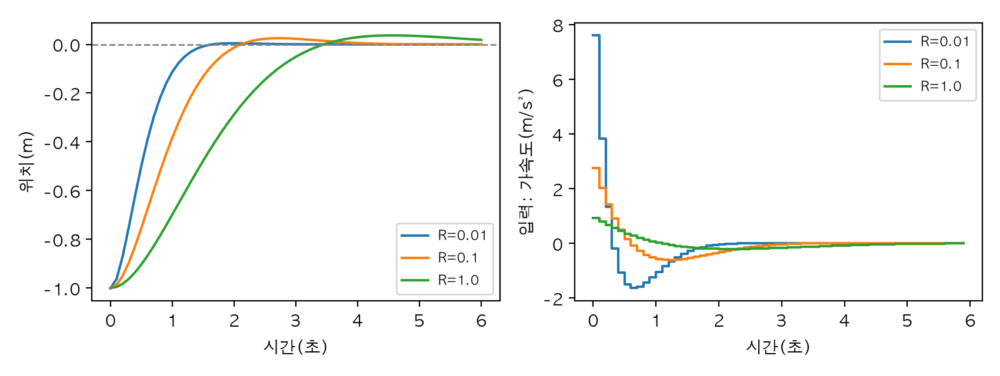
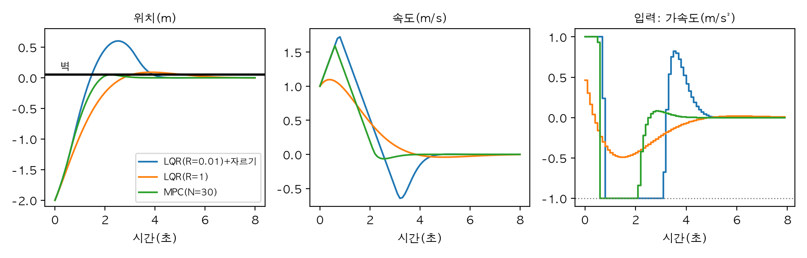
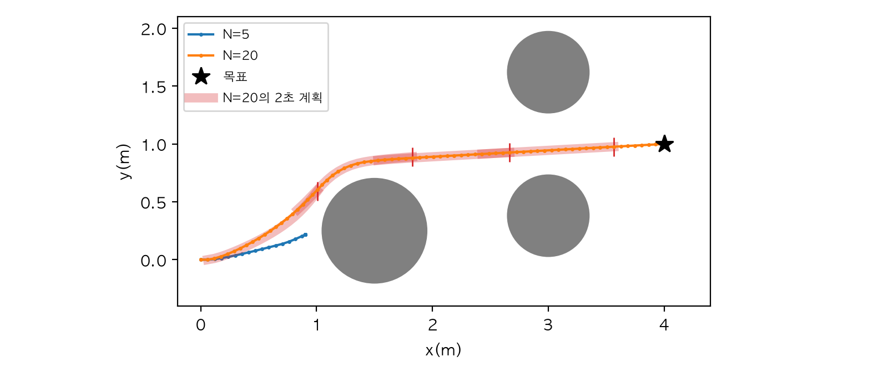
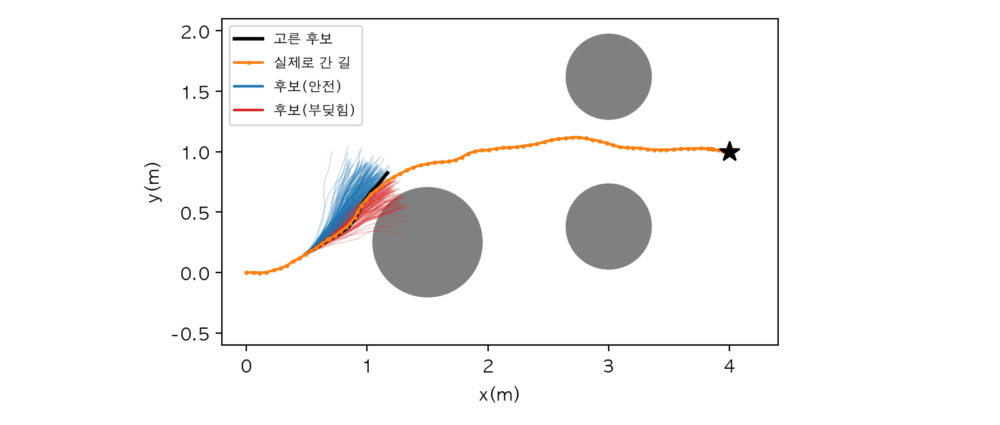
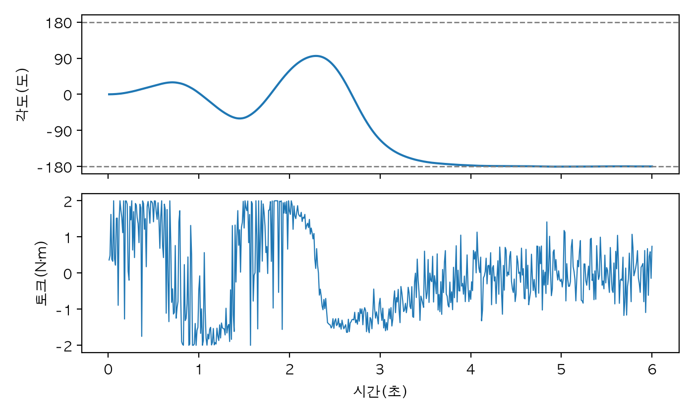
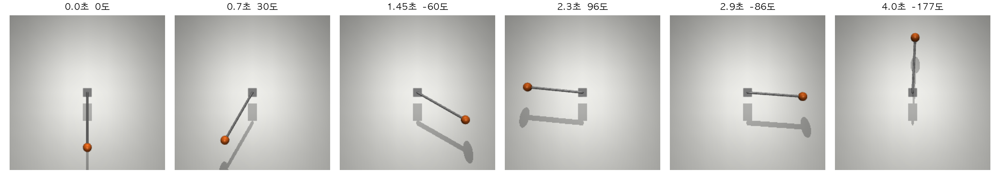

# Chapter 16. MPC 맛보기: 앞을 내다보며 움직이기

> **학습 목표**  
> - 제어를 "상태, 입력, 비용, 제약"으로 이루어진 최적화 문제로 적기
> - 연속 시간 모델을 제어 주기에 맞춰 이산화하고, MuJoCo로 검산하기
> - LQR 이득을 리카티 방정식으로 구하고, 비용의 가중치가 움직임을 어떻게 바꾸는지 보기
> - MPC의 후퇴 구간 방식(매 주기 다시 풀고 첫 입력만 쓰기)을 구현하고, 제약이 있을 때 LQR과 비교하기
> - 예측 구간 길이와 계산 시간의 맞바꿈을 재고, 제어 주기 안에 끝나는지 확인하기
> - 비선형 모델(바퀴 로봇)과 장애물 제약으로 MPC를 넓히기
> - 무작위 사격과 MPPI처럼 후보를 굴려 보고 고르는 방법을 알고, MuJoCo를 예측 모델로 써서 진자를 흔들어 올리기

---

## 들어가며: 운전할 때 어디를 보나요?

운전을 처음 배울 때 강사가 꼭 하는 말이 있습니다. "바로 앞 범퍼만 보지 말고 멀리 보세요." 바로 앞만 보면 앞차가 브레이크를 밟은 걸 너무 늦게 알아채고, 굽은 길에서는 핸들을 늦게 꺾어 차선을 넘어가요. 멀리 보는 운전자는 "저기서 길이 굽으니 지금부터 속도를 줄이자"처럼 **앞으로 일어날 일을 미리 계산해서** 지금 할 일을 정합니다.

12장의 PID 제어기는 지금 오차와 지난 오차의 합, 오차가 변하는 빠르기를 봤습니다. 지금과 과거를 보는 제어기예요. 대부분의 일에는 이걸로 충분하지만, 범퍼만 보는 운전자처럼 곤란해지는 때가 있습니다. 특히 **할 수 있는 일에 한계가 있을 때**가 그래요. 브레이크를 아무리 세게 밟아도 줄일 수 있는 속도에는 한계가 있으니, 멈춰야 할 곳이 가까워진 다음에 반응하면 이미 늦습니다.

얼마나 앞을 봐야 하는지 숫자로 따져 봅시다. 최대 1m/s²로 감속할 수 있는 로봇이 속도별로 멈추는 데 걸리는 시간과 거리입니다.

```python
최대_감속 = 1.0                  # 브레이크를 끝까지 밟았을 때의 감속(m/s²)
주기 = 0.1                       # 판단 주기(초)

for 속도 in [0.5, 1.0, 2.0]:                     # 지금 속도(m/s)
    멈추는_시간 = 속도 / 최대_감속
    멈추는_거리 = 속도**2 / (2 * 최대_감속)      # 등감속 운동: v² = 2·a·s
    print(f"{속도:.1f}m/s로 달리면: 멈추는 데 {멈추는_시간:.1f}초, {멈추는_거리:.3f}m "
          f"→ 적어도 {멈추는_시간 / 주기:.0f}주기 앞을 봐야 한다")
```

```text
0.5m/s로 달리면: 멈추는 데 0.5초, 0.125m → 적어도 5주기 앞을 봐야 한다
1.0m/s로 달리면: 멈추는 데 1.0초, 0.500m → 적어도 10주기 앞을 봐야 한다
2.0m/s로 달리면: 멈추는 데 2.0초, 2.000m → 적어도 20주기 앞을 봐야 한다
```

1m/s로 달리는 로봇은 브레이크를 끝까지 밟아도 0.5m를 더 가고, 그동안 1초가 흐릅니다. 0.1초마다 판단하는 로봇이라면 적어도 10주기 뒤까지 내다봐야 "지금 브레이크를 밟아야 하는가"를 알 수 있다는 뜻이에요. 속도가 두 배가 되면 거리는 네 배가 됩니다.

이 장의 주인공 **MPC(Model Predictive Control, 모델 예측 제어)** 는 바로 이 "멀리 보기"를 코드로 옮긴 것입니다. 로봇이 어떻게 움직이는지 아는 **모델**로 앞날을 **예측**하고, 그 예측이 가장 좋아지는 입력을 골라 **제어**해요. 이 장에서는 먼저 "가장 좋다"가 무슨 뜻인지 비용으로 적고(16.1절), 제약이 없을 때의 정답인 LQR을 본 뒤(16.2절), MPC를 직접 만들어 LQR이 못 하는 일을 시킵니다(16.3~16.4절). 그다음 휘어진 모델인 바퀴 로봇으로 넓히고(16.5절), 마지막에는 MuJoCo 시뮬레이터 자체를 예측 모델로 삼아 힘이 약한 모터로 진자를 거꾸로 세웁니다(16.6~16.7절). Part 4의 마지막 장이자 "맛보기" 장이라, 깊은 이론보다는 손으로 돌려 보며 감을 잡는 데 집중할게요.

> **Q. MPC는 특별한 라이브러리가 있어야 하나요?**
> 실무에서는 이차 계획(QP) 전용 풀이기나 최적 제어 도구를 많이 쓰지만, 생각 자체는 "예측하고, 비용을 재고, 가장 좋은 걸 고른다"가 전부입니다. 이 장은 NumPy, SciPy의 `scipy.optimize`, MuJoCo만으로 만듭니다. 원리를 손에 익힌 뒤 전용 도구로 옮기면 무엇이 빨라지는지가 보여요.

## 16.1 최적 제어 문제: 무엇을 가장 좋게 할까

### 네 가지 재료

"제어를 잘한다"를 컴퓨터가 풀 수 있는 문제로 바꾸려면 네 가지를 적어야 합니다.

| 재료 | 뜻 | 이 장의 첫 예 |
|---|---|---|
| 상태 x | 앞날을 예측하는 데 필요한 지금의 숫자들 | 수레의 [위치, 속도] |
| 입력 u | 우리가 고를 수 있는 값 | 수레의 가속도(모터가 미는 힘) |
| 비용 J | 작을수록 좋은 점수 | 목표에서 먼 정도 + 힘을 쓴 정도 |
| 제약 | 반드시 지켜야 하는 한계 | 가속도 ±1m/s², 벽을 넘지 않기 |

8장 칼만 필터에서 상태와 예측 모델 x[k+1] = F x[k] + B u[k]를 이미 만났죠. 칼만 필터는 이 모델로 "지금 어디 있는지"를 추정했고, 이 장에서는 같은 모델로 "앞으로 무엇을 할지"를 정합니다. 두 일은 거울에 비친 짝 같아서, 추정과 제어를 함께 쓰는 로봇에서는 칼만 필터가 상태를 알려 주면 MPC가 그 상태에서 다음 입력을 고르는 식으로 이어집니다.

비용은 흔히 이런 모양으로 적습니다.

J = Σ (xᵀ Q x + R u²)

xᵀ Q x는 상태가 목표(여기서는 원점)에서 먼 정도를, R u²는 입력을 크게 쓴 정도를 잽니다. Q와 R은 둘 사이의 **저울**이에요. Q를 키우면 "빨리 도착하는 게 중요해", R을 키우면 "힘을 아껴 부드럽게 움직여"라는 뜻이 됩니다. 3장의 감쇠 최소제곱(DLS)이 관절을 너무 크게 움직이는 답에 벌점을 줬던 것과 같은 생각이에요.

### 이중 적분기: 가장 단순한 로봇

첫 예제는 마찰 없는 레일 위의 1kg 수레입니다. 미는 힘이 곧 가속도이고, 가속도를 한 번 적분하면 속도, 두 번 적분하면 위치라서 **이중 적분기(double integrator)** 라고 불러요. 단순해 보이지만 바퀴 로봇의 전진, 드론의 높이, 로봇 팔 관절 하나처럼 "힘을 주면 빨라지고, 빨라지면 움직인다"는 많은 것의 뼈대입니다.

컴퓨터는 0.1초마다 판단하니 모델도 0.1초 간격으로 적어야 합니다. 이것을 **이산화**라고 해요. 한 주기 동안 같은 가속도 u를 유지하면 고등학교 물리의 등가속도 공식이 그대로 쓰입니다. 위치는 속도 × Δt + u × Δt²/2만큼, 속도는 u × Δt만큼 바뀌죠. 이 모델과 비용 계산을 `이중적분기.py`에 둡니다.

```python
"""16장: 직선 위를 미끄러지는 1kg 수레(이중 적분기). 상태는 [위치(m), 속도(m/s)], 입력은 가속도(m/s²)."""
import numpy as np

주기 = 0.1                                   # 제어 주기(초): 10Hz로 판단한다

# 한 주기 동안 같은 가속도 u를 낼 때: 위치 += 속도·Δt + u·Δt²/2, 속도 += u·Δt
A = np.array([[1.0, 주기],
              [0.0, 1.0]])
B = np.array([[주기**2 / 2],
              [주기]])


def 굴리기(x0: np.ndarray, 입력들: np.ndarray) -> np.ndarray:
    """처음 상태에서 입력을 차례로 넣어 상태 기록((N+1)×2)을 돌려준다."""
    상태들 = [np.asarray(x0, dtype=float)]
    for u in 입력들:
        상태들.append(A @ 상태들[-1] + B[:, 0] * u)
    return np.array(상태들)


def 비용(상태들: np.ndarray, 입력들: np.ndarray, Q: np.ndarray, R: float) -> tuple[float, float]:
    """목표(원점)에서 벗어난 정도의 합과 입력 크기의 합을 따로 돌려준다."""
    오차_비용 = float(sum(x @ Q @ x for x in 상태들[1:]))
    입력_비용 = float(R * np.sum(np.square(입력들)))
    return 오차_비용, 입력_비용
```

B의 첫 칸 Δt²/2가 눈에 띌 겁니다. "위치는 속도 × Δt만큼 바뀐다"고만 적고 이 항을 빼먹는 실수가 흔한데, 얼마나 차이가 나는지 MuJoCo로 검산해 보겠습니다. 4장에서 만든 것처럼 미끄럼 관절에 1kg 상자를 달고 motor 액추에이터로 밉니다. 3초 동안 주기마다 아무렇게나 고른 힘을 주고, 두 모델의 예측과 비교해요.

```python
import mujoco
import numpy as np

from 이중적분기 import A, B, 굴리기, 주기

# 1kg 수레가 마찰 없는 레일(x축 미끄럼 관절) 위에 있고, motor가 밀어 준다(힘 1N = 가속도 1m/s²)
xml = """
<mujoco>
  <option timestep="0.001" gravity="0 0 0"/>
  <worldbody>
    <body name="수레">
      <joint name="레일" type="slide" axis="1 0 0"/>
      <geom type="box" size="0.1 0.05 0.05" mass="1"/>
    </body>
  </worldbody>
  <actuator><motor joint="레일" gear="1"/></actuator>
</mujoco>
"""
모델 = mujoco.MjModel.from_xml_string(xml)
데이터 = mujoco.MjData(모델)
입력들 = np.random.default_rng(0).uniform(-1, 1, size=30)      # 3초 동안 아무렇게나 민다
한_주기_걸음 = round(주기 / 모델.opt.timestep)

시뮬 = [[0.0, 0.0]]
for u in 입력들:
    데이터.ctrl[0] = u                                  # 한 주기 동안 같은 힘을 유지한다
    for _ in range(한_주기_걸음):
        mujoco.mj_step(모델, 데이터)
    시뮬.append([데이터.qpos[0], 데이터.qvel[0]])
시뮬 = np.array(시뮬)

예측 = 굴리기([0.0, 0.0], 입력들)
B_어림 = np.array([[0.0], [주기]])                      # Δt²/2 항을 빼먹은 어림
어림 = [np.zeros(2)]
for u in 입력들:
    어림.append(A @ 어림[-1] + B_어림[:, 0] * u)
어림 = np.array(어림)
print(f"3초 뒤 MuJoCo 위치 {시뮬[-1, 0]:.4f}m, A·B 예측 {예측[-1, 0]:.4f}m, 어림 {어림[-1, 0]:.4f}m")
print(f"가장 큰 위치 차이: A·B 예측 {np.abs(시뮬 - 예측)[:, 0].max() * 1000:.2f}mm, "
      f"어림 {np.abs(시뮬 - 어림)[:, 0].max() * 1000:.2f}mm")
```

```text
3초 뒤 MuJoCo 위치 0.0465m, A·B 예측 0.0464m, 어림 0.0361m
가장 큰 위치 차이: A·B 예측 0.10mm, 어림 10.46mm
```

A와 B로 한 예측은 MuJoCo와 가장 크게 어긋날 때도 0.1mm 차이입니다. MuJoCo가 1ms 간격으로 적분하며 생긴 작은 차이예요. Δt²/2 항을 뺀 어림은 3초 만에 10mm 넘게 어긋났습니다. 1cm가 별것 아닌 것 같아도, MPC는 이 모델로 수십 걸음 앞을 내다보니 작은 오차가 예측 끝에서 커집니다. **모델이 틀리면 예측이 틀리고, 예측이 틀리면 고른 입력도 틀린다**는 것이 이 장 전체에 깔린 전제예요.

### 비용이 "가장 좋음"을 정한다

같은 일을 하는 계획이 여럿 있을 때 비용이 어떤 계획을 고르는지 봅시다. 수레가 목표보다 1m 뒤에 서 있고, 4초 동안 쓸 가속도 계획 세 가지를 비교합니다. 세게 밀었다 세게 당겨 2초 만에 도착하는 "급하게", 살살 밀고 당겨 4초 만에 도착하는 "느긋이", 아무것도 하지 않는 "가만히"예요.

```python
import numpy as np

from 이중적분기 import 굴리기, 비용

x0 = np.array([-1.0, 0.0])                    # 목표(원점)보다 1m 뒤에 서 있다
Q = np.diag([1.0, 0.1])                       # 위치 오차를 속도 오차보다 10배 무겁게
계획들 = {                                     # 4초(40주기) 동안의 가속도 계획(m/s²)
    # 1m/s²로 1초 밀고 1초 당겨 2초 만에 도착
    "급하게": np.r_[np.full(10, 1.0), np.full(10, -1.0), np.zeros(20)],
    # 0.25m/s²로 2초 밀고 2초 당겨 4초 만에 도착
    "느긋이": np.r_[np.full(20, 0.25), np.full(20, -0.25)],
    "가만히": np.zeros(40),
}
for R in [0.01, 1.0]:
    print(f"R = {R}")
    for 이름, 입력들 in 계획들.items():
        상태들 = 굴리기(x0, 입력들)
        오차, 힘 = 비용(상태들, 입력들, Q, R)
        print(f"  {이름} 끝 위치 {round(상태들[-1, 0], 2) + 0.0:5.2f}m | 오차 비용 {오차:5.2f} + 입력 비용 {힘:5.2f} = {오차 + 힘:5.2f}")
```

```text
R = 0.01
  급하게 끝 위치  0.00m | 오차 비용  7.84 + 입력 비용  0.20 =  8.04
  느긋이 끝 위치  0.00m | 오차 비용 15.17 + 입력 비용  0.03 = 15.19
  가만히 끝 위치 -1.00m | 오차 비용 40.00 + 입력 비용  0.00 = 40.00
R = 1.0
  급하게 끝 위치  0.00m | 오차 비용  7.84 + 입력 비용 20.00 = 27.84
  느긋이 끝 위치  0.00m | 오차 비용 15.17 + 입력 비용  2.50 = 17.67
  가만히 끝 위치 -1.00m | 오차 비용 40.00 + 입력 비용  0.00 = 40.00
```

같은 세 계획인데 R에 따라 1등이 바뀝니다. R = 0.01이면 입력 비용이 거의 공짜라 일찍 도착해 오차를 줄인 "급하게"가 8.04로 이기고, R = 1이면 힘을 쓰는 값이 비싸져 "느긋이"가 17.67로 이깁니다. "가만히"는 힘을 하나도 안 썼지만 4초 내내 1m 떨어져 있어서 어느 쪽에서도 꼴찌예요.

여기서 중요한 건 **"가장 좋은 제어"는 비용을 적는 사람이 정한다**는 점입니다. 최적 제어는 정답을 알려 주는 마법이 아니라, 우리가 적은 저울에 가장 충실한 답을 찾아 주는 도구예요. 저울을 잘못 적으면 엉뚱한 행동이 "최적"으로 나옵니다.

## 16.2 LQR: 제약이 없을 때의 정답

### 끝에서부터 거꾸로

앞에서는 계획 세 개만 비교했지만, 가능한 계획은 끝없이 많습니다. 그중 비용이 가장 작은 것을 어떻게 찾을까요? 모델이 선형(행렬 곱)이고 비용이 이차식(제곱)이며 제약이 없을 때는 아주 깔끔한 답이 있습니다. **LQR(Linear Quadratic Regulator, 선형 이차 조절기)** 이에요.

LQR의 답은 놀랍게도 "상태에 이득 행렬 K를 곱해 빼라", 즉 u = -K x 한 줄입니다. 12장의 PD 제어처럼 위치 오차와 속도에 각각 이득을 곱해 더하는 모양이죠. 다른 점은 이득을 손으로 조율하지 않고 **Q와 R에서 계산해 낸다**는 거예요.

계산은 끝에서부터 거꾸로 합니다. 마지막 한 걸음만 남았다면 최선은 쉽게 구해지고, 그때 남는 비용을 행렬 P로 적을 수 있어요. 두 걸음 남았다면 "한 걸음 움직인 뒤 남는 비용은 P"라는 걸 이미 아니 다시 최선을 구할 수 있고요. 이렇게 P를 한 걸음씩 고쳐 쓰는 식을 **리카티(Riccati) 식**이라고 합니다. 남은 걸음을 늘려 가며 K가 어떻게 바뀌는지 보고, 끝없이 긴 경우를 SciPy의 `solve_discrete_are`로 한 번에 푼 답과 비교해 봅시다.

```python
import numpy as np
from scipy.linalg import solve_discrete_are

from 이중적분기 import A, B

Q = np.diag([1.0, 0.1])
R = 0.1

# 1) 끝에서부터 거꾸로: 남은 걸음이 하나씩 늘 때 '앞으로 쌓일 비용' 행렬 P를 고쳐 쓴다
P = Q.copy()
for 걸음 in range(1, 201):
    K = np.linalg.solve(R + B.T @ P @ B, B.T @ P @ A)
    P_새 = Q + A.T @ P @ (A - B @ K)
    if 걸음 in (1, 5, 20, 200):
        print(f"남은 걸음 {걸음:3d}: K = {np.round(K[0], 3)}")
    P = P_새

# 2) 끝없이 긴 구간: 리카티 방정식을 SciPy로 한 번에 푼다
P무한 = solve_discrete_are(A, B, Q, R)
K무한 = np.linalg.solve(R + B.T @ P무한 @ B, B.T @ P무한 @ A)
print("SciPy 리카티 풀이 K =", np.round(K무한[0], 3))
print("닫힌 고리 A - BK의 고유값 크기:", np.round(np.abs(np.linalg.eigvals(A - B @ K무한)), 3))
```

```text
남은 걸음   1: K = [0.049 0.104]
남은 걸음   5: K = [1.084 0.83 ]
남은 걸음  20: K = [2.718 2.485]
남은 걸음 200: K = [2.762 2.508]
SciPy 리카티 풀이 K = [2.762 2.508]
닫힌 고리 A - BK의 고유값 크기: [0.874 0.874]
```

남은 걸음이 하나일 때 K는 [0.049, 0.104]로 아주 작습니다. 한 걸음 안에 할 수 있는 일이 별로 없으니 힘을 쓸 가치가 적은 거예요. 남은 걸음이 늘수록 K가 커지다가 20걸음쯤에서 [2.718, 2.485]로 거의 자리를 잡고, 200걸음에서는 SciPy가 바로 풀어 준 [2.762, 2.508]과 같아졌습니다. 구간이 충분히 길면 남은 걸음 수와 상관없이 같은 이득을 쓰면 된다는 뜻이고, 그래서 보통 LQR이라고 하면 이 끝없이 긴 구간의 K를 말합니다.

마지막 줄의 고유값은 안정성 검사입니다. 제어를 붙인 뒤의 움직임 x[k+1] = (A - BK) x[k]에서 A - BK의 고유값 크기가 모두 1보다 작으면 오차가 주기마다 그 비율로 줄어들어요. 0.874이니 매 주기 오차가 87.4% 정도로 줄어듭니다. 1장 1.4절에서 "한 번에 고치는 비율"이 1보다 크면 흔들림이 커졌던 것과 같은 이야기를 행렬로 한 것입니다.

이 두 줄은 앞으로도 쓰니 `LQR도구.py`로 저장합니다.

```python
"""16장: 이산 시간 LQR 이득."""
import numpy as np
from scipy.linalg import solve_discrete_are


def LQR(A: np.ndarray, B: np.ndarray, Q: np.ndarray, R: float) -> tuple[np.ndarray, np.ndarray]:
    """끝없이 긴 구간의 최적 이득 K(u = -K x)와 비용 행렬 P."""
    P = solve_discrete_are(A, B, Q, R)
    K = np.linalg.solve(R + B.T @ P @ B, B.T @ P @ A)
    return K, P
```

### 저울을 바꾸면

R을 바꿔 가며 1m 뒤에서 목표로 오는 모습을 비교해 봅시다.

```python
import matplotlib.pyplot as plt
import numpy as np

from LQR도구 import LQR
from 이중적분기 import A, B, 주기

plt.rcParams["font.family"] = "AppleGothic"
plt.rcParams["axes.unicode_minus"] = False

Q = np.diag([1.0, 0.1])
x0 = np.array([-1.0, 0.0])
시각 = np.arange(61) * 주기
그림, (칸1, 칸2) = plt.subplots(1, 2, figsize=(8.5, 3.2))
for R in [0.01, 0.1, 1.0]:
    K, _ = LQR(A, B, Q, R)
    x, 위치, 입력 = x0.copy(), [x0[0]], []
    for _ in range(60):
        u = float((-K @ x)[0])                     # LQR은 상태에 이득을 곱하기만 하면 된다
        x = A @ x + B[:, 0] * u
        위치.append(x[0])
        입력.append(u)
    위치 = np.array(위치)
    도착 = 시각[np.argmax(np.abs(위치) < 0.02)]
    print(f"R={R:4}: K={np.round(K[0], 2)} | 2cm 안에 드는 시각 {도착:.1f}초, "
          f"가장 센 입력 {max(np.abs(입력)):.2f}m/s², 지나침 {max(위치.max(), 0) * 100:.1f}cm")
    칸1.plot(시각, 위치, label=f"R={R}")
    칸2.step(시각[:-1], 입력, where="post", label=f"R={R}")
칸1.axhline(0, color="gray", linestyle="--", linewidth=1)
칸1.set_ylabel("위치(m)")
칸2.set_ylabel("입력: 가속도(m/s²)")
for 칸 in (칸1, 칸2):
    칸.set_xlabel("시간(초)")
    칸.legend(fontsize=8)
그림.tight_layout()
그림.savefig("lqr_weights.png", dpi=200)
print("저장: lqr_weights.png")
```

```text
R=0.01: K=[7.61 4.58] | 2cm 안에 드는 시각 1.4초, 가장 센 입력 7.61m/s², 지나침 0.5cm
R= 0.1: K=[2.76 2.51] | 2cm 안에 드는 시각 2.0초, 가장 센 입력 2.76m/s², 지나침 2.5cm
R= 1.0: K=[0.93 1.4 ] | 2cm 안에 드는 시각 3.3초, 가장 센 입력 0.93m/s², 지나침 3.7cm
저장: lqr_weights.png
```



R = 0.01이면 첫 순간 7.61m/s²로 세게 밀어 1.4초 만에 2cm 안으로 들어옵니다. R = 1이면 가장 센 입력이 0.93m/s²로 부드럽지만 3.3초가 걸려요. 첫 입력이 정확히 K의 첫 칸(위치 이득)과 같다는 점도 보세요. 처음에 위치 오차가 -1m, 속도가 0이니 u = -K x = K의 첫 칸이 됩니다.

12장의 PID와 LQR을 한 표로 비교하면 이렇습니다.

| | PID | LQR |
|---|---|---|
| 보는 것 | 오차 하나(와 그 적분, 미분) | 상태 전체(위치, 속도, …) |
| 이득 정하기 | 손으로 조율하거나 경험 규칙 | Q, R을 적으면 리카티 식이 계산 |
| 필요한 것 | 모델 없이도 된다 | 선형 모델 A, B |
| 여러 입력·여러 출력 | 고리를 하나씩 따로 만든다 | 행렬이라 한 번에 다룬다 |
| 정상 상태 오차 | 적분 항이 없앤다 | 모델이 틀리면 남는다(적분 상태를 덧붙여 해결) |
| 입력·상태 한계 | 모른다(포화, 와인드업 대책 필요) | 모른다 |

마지막 줄이 이 장의 다음 이야기입니다. LQR은 끝없이 센 힘을 낼 수 있다고 가정하고 푼 답이라, 모터의 한계나 벽처럼 "넘으면 안 되는 선"을 모릅니다. R = 0.01의 7.61m/s²는 우리 수레의 모터가 1m/s²밖에 못 낸다면 그림의 떡이에요.

> **Q. LQR이 그렇게 좋으면 왜 PID를 더 많이 쓰나요?**
> PID는 모델이 없어도 현장에서 이득을 돌려 가며 맞출 수 있고, 계산이 덧셈 몇 번이라 아주 작은 마이크로컨트롤러에서도 돕니다. 관절 하나, 모터 하나처럼 입력과 출력이 하나씩인 고리에서는 그것으로 충분한 경우가 많아요. 상태가 여럿이고 서로 얽혀 있을 때(드론의 자세, 거꾸로 선 진자) 모델을 구할 수 있다면 LQR이 빛을 발합니다.

## 16.3 MPC: 매 주기 다시 계획하기

### 후퇴 구간

LQR이 한계를 모르는 이유는 "한 번 계산한 K를 영원히 쓰기" 때문입니다. 한계를 넣으면 깔끔한 u = -K x 공식이 사라지거든요. MPC는 발상을 바꿉니다. **공식을 미리 구해 두지 말고, 매 주기 그 자리에서 최적화 문제를 풀자.**

MPC가 한 주기에 하는 일은 이렇습니다.

1. 지금 상태 x를 잰다(또는 8장의 칼만 필터로 추정한다)
2. 앞으로 N걸음 동안의 입력열 u[0], …, u[N-1]을 정하는 최적화 문제를 푼다. 모델로 N걸음 뒤까지 예측해 비용을 재고, 제약을 지키는 답 중 비용이 가장 작은 것을 찾는다
3. 찾은 입력열 중 **첫 번째 입력 하나만** 실제로 쓴다
4. 한 주기 뒤 1로 돌아가 처음부터 다시 푼다

N걸음짜리 계획을 세워 놓고 한 걸음만 쓰고 버리는 게 낭비처럼 보이죠? 하지만 이게 MPC의 핵심입니다. 운전자도 "앞으로 100m를 이렇게 가야지"라고 생각하지만, 한 순간 핸들을 움직인 뒤에는 새로 보이는 것을 반영해 계획을 다시 세웁니다. 계획이 내다보는 끝이 시간과 함께 계속 앞으로 밀려나서 **후퇴 구간(receding horizon)** 이라고 불러요. 매번 다시 재고 다시 푸니, 모델이 조금 틀리거나 밀려도 다음 주기에 저절로 고쳐집니다. 1장의 닫힌 고리가 여기서도 그대로 살아 있는 거예요.

### N걸음을 한 번에 예측하기

최적화 문제를 풀려면 "입력열 U를 넣으면 N걸음 동안의 상태가 어떻게 되나"를 식으로 적어야 합니다. 모델이 선형이라 상태를 한 줄로 쌓으면 X = Φ x0 + Γ U라는 행렬 곱 하나가 돼요. Φ는 "아무것도 안 하면 처음 상태가 어디로 흘러가나", Γ는 "입력 하나하나가 앞날의 상태에 얼마나 영향을 주나"를 담습니다. 이걸 넣으면 비용이 U에 대한 이차식 UᵀHU + 2fᵀU가 되고, 입력 한계와 위치 상한은 U에 대한 일차 부등식이 됩니다. 이런 문제를 **이차 계획(QP, quadratic programming)** 이라고 해요.

`MPC도구.py`는 예측 행렬을 만드는 함수와, 매 주기 문제를 푸는 `선형MPC` 클래스를 담습니다. 제약이 없으면 연립방정식 하나로 풀고, 제약이 있으면 SciPy의 `minimize`(SLSQP 방법)에 비용과 그 기울기, 입력 범위, 위치 제약을 넘겨 풉니다.

```python
"""16장: 선형 모델 x[k+1] = A x[k] + B u[k]의 MPC. 입력 한계와 위치 상한을 다룬다."""
import numpy as np
from scipy.optimize import minimize


def 예측행렬(A: np.ndarray, B: np.ndarray, N: int) -> tuple[np.ndarray, np.ndarray]:
    """N걸음 뒤까지의 상태를 한 줄로 쌓은 X = Φ x0 + Γ U의 Φ와 Γ."""
    n, m = B.shape
    Φ = np.zeros((N * n, n))
    Γ = np.zeros((N * n, N * m))
    거듭 = np.eye(n)
    for k in range(N):
        거듭 = A @ 거듭                                   # A^(k+1)
        Φ[k * n:(k + 1) * n] = 거듭
        for j in range(k + 1):                            # u[j]가 x[k+1]에 주는 영향 A^(k-j) B
            Γ[k * n:(k + 1) * n, j * m:(j + 1) * m] = np.linalg.matrix_power(A, k - j) @ B
    return Φ, Γ


class 선형MPC:
    """비용 Σ x'Qx + u'Ru (마지막 상태는 P)를 N걸음 앞까지 최소로 하는 입력열을 매 주기 푼다."""

    def __init__(self, A: np.ndarray, B: np.ndarray, Q: np.ndarray, R: float, P: np.ndarray, N: int,
                 입력_한계: float | None = None, 위치_상한: float | None = None):
        self.N, self.입력_한계, self.위치_상한 = N, 입력_한계, 위치_상한
        self.Φ, self.Γ = 예측행렬(A, B, N)
        Q막대 = np.kron(np.eye(N), Q)
        Q막대[-2:, -2:] = P                               # 마지막 상태에는 P를 쓴다
        self.ΓᵀQ = self.Γ.T @ Q막대
        self.H = self.ΓᵀQ @ self.Γ + R * np.eye(N)        # 비용 = U'HU + 2f'U + 상수
        self.위치_고르기 = np.kron(np.eye(N), [1.0, 0.0])  # 쌓인 상태에서 위치만 뽑는다
        self.지난_답, self.성공 = np.zeros(N), True

    def 풀기(self, x0: np.ndarray) -> np.ndarray:
        """지금 상태 x0에서 앞으로 N개의 입력을 돌려준다(첫 값만 쓸 것)."""
        f = self.ΓᵀQ @ (self.Φ @ x0)
        if self.입력_한계 is None and self.위치_상한 is None:
            return np.linalg.solve(self.H, -f)            # 제약이 없으면 한 번에 풀린다
        제약 = []
        if self.위치_상한 is not None:                    # 상한 - 예측 위치 ≥ 0
            S = self.위치_고르기
            제약.append({"type": "ineq",
                       "fun": lambda U: self.위치_상한 - S @ (self.Φ @ x0 + self.Γ @ U),
                       "jac": lambda U: -S @ self.Γ})
        한계 = None if self.입력_한계 is None else [(-self.입력_한계, self.입력_한계)] * self.N
        첫_추측 = np.r_[self.지난_답[1:], self.지난_답[-1]]   # 지난 답을 한 칸 당겨 시작점으로
        결과 = minimize(lambda U: U @ self.H @ U + 2 * f @ U, 첫_추측,
                      jac=lambda U: 2 * (self.H @ U + f), bounds=한계, constraints=제약,
                      method="SLSQP", options={"maxiter": 200, "ftol": 1e-9})
        self.지난_답, self.성공 = 결과.x, bool(결과.success)
        return 결과.x
```

`풀기`의 첫 추측을 보세요. 지난 주기의 답을 한 칸 앞으로 당겨서 시작점으로 씁니다. 한 주기 전에 세운 계획의 두 번째 입력이 지금의 첫 입력 후보가 되는 거죠. 계획은 주기마다 크게 바뀌지 않으니 정답 근처에서 출발하게 되고, 풀이가 훨씬 빨라집니다. 이 요령을 **웜 스타트(warm start)** 라고 해요. 16.4절에서 효과를 숫자로 봅니다.

먼저 쌓은 예측이 한 걸음씩 굴린 것과 같은지 확인합니다.

```python
import numpy as np

from MPC도구 import 예측행렬
from 이중적분기 import A, B, 굴리기

N = 4
Φ, Γ = 예측행렬(A, B, N)
print("Φ (8×2) 위 네 줄:\n", Φ[:4])
print("Γ (8×4) 위 네 줄:\n", Γ[:4])

x0 = np.array([-1.0, 0.5])
U = np.array([1.0, -0.5, 0.2, 0.0])
한꺼번에 = (Φ @ x0 + Γ @ U).reshape(N, 2)            # 행렬 곱 한 번으로 N걸음을 내다본다
하나씩 = 굴리기(x0, U)[1:]                            # 한 걸음씩 굴린 것
print("두 예측이 같은가?", np.allclose(한꺼번에, 하나씩))
```

```text
Φ (8×2) 위 네 줄:
 [[1.  0.1]
 [0.  1. ]
 [1.  0.2]
 [0.  1. ]]
Γ (8×4) 위 네 줄:
 [[0.005 0.    0.    0.   ]
 [0.1   0.    0.    0.   ]
 [0.015 0.005 0.    0.   ]
 [0.1   0.1   0.    0.   ]]
두 예측이 같은가? True
```

Γ의 아래 삼각 모양을 보세요. 첫 입력은 첫 상태부터 영향을 주지만, 두 번째 입력은 두 번째 상태부터 영향을 줍니다. 미래의 입력이 과거의 상태를 바꿀 수는 없으니까요. 행렬 곱 한 번이 한 걸음씩 굴린 결과와 같다는 것도 확인했습니다.

### 제약이 없으면 MPC는 LQR이다

제약 없이 풀면 MPC는 LQR과 어떤 관계일까요? 같은 Q, R로 MPC를 풀어 첫 입력을 LQR과 비교합니다. 마지막 상태에 리카티의 P를 비용으로 매긴 경우와, 그냥 Q를 매긴 경우를 나란히 봐요.

```python
import numpy as np

from LQR도구 import LQR
from MPC도구 import 선형MPC
from 이중적분기 import A, B

Q, R = np.diag([1.0, 0.1]), 0.1
K, P = LQR(A, B, Q, R)
x0 = np.array([-1.0, 0.5])
print(f"LQR이 고른 첫 입력: {float((-K @ x0)[0]):.4f}")
for N in [1, 5, 20, 60]:
    끝_P = 선형MPC(A, B, Q, R, P, N).풀기(x0)[0]          # 마지막 상태에 리카티의 P를 쓴 MPC
    끝_Q = 선형MPC(A, B, Q, R, Q, N).풀기(x0)[0]          # 마지막 상태도 그냥 Q로 잰 MPC
    print(f"N={N:2d}: 끝 비용 P → {끝_P:.4f} | 끝 비용 Q → {끝_Q:.4f}")
```

```text
LQR이 고른 첫 입력: 1.5086
N= 1: 끝 비용 P → 1.5086 | 끝 비용 Q → -0.0025
N= 5: 끝 비용 P → 1.5086 | 끝 비용 Q → 0.6693
N=20: 끝 비용 P → 1.5086 | 끝 비용 Q → 1.4760
N=60: 끝 비용 P → 1.5086 | 끝 비용 Q → 1.5086
```

마지막 상태에 P를 쓰면 N이 1이든 60이든 첫 입력이 LQR과 소수 넷째 자리까지 같습니다. P가 "여기서부터 끝없이 LQR로 갔을 때 드는 비용"이니, 그걸 끝에 붙이면 짧게 내다봐도 끝없이 내다본 것과 같아지는 거예요. 반대로 끝에 Q만 쓰면 N = 1에서는 -0.0025로 거의 아무것도 하지 않고, N = 5에서 0.6693, N = 20에서 1.4760으로 점점 LQR에 다가가 N = 60에서야 같아집니다. 한 걸음 앞만 보면 "지금 밀어 봤자 한 걸음 안에는 위치가 별로 안 바뀌네"라고 판단해 버리는 근시안이 되는 거죠. 이 실험에서 두 가지를 챙기세요. **제약이 없으면 MPC는 LQR과 같은 답을 낸다**, 그리고 **끝 비용을 잘 매기면 짧은 구간으로도 멀리 본 효과를 낼 수 있다.**

### 한계와 벽이 있을 때

이제 MPC가 LQR보다 잘하는 일을 시켜 봅시다. 수레가 목표 2m 앞에서 이미 1m/s로 다가오고 있습니다. 모터는 ±1m/s²까지만 낼 수 있고, 목표 5cm 뒤에는 벽이 있어요. 세 제어기를 비교합니다.

- **LQR(R=0.01) + 자르기**: 빠른 LQR의 출력을 모터 한계로 잘라서 쓴다. 현장에서 가장 흔히 하는 방법
- **LQR(R=1)**: 한계를 넘지 않을 만큼 부드러운 LQR
- **MPC(N=30)**: 3초 앞까지 내다보며 입력 한계와 벽을 제약으로 넣은 MPC

```python
import matplotlib.pyplot as plt
import numpy as np

from LQR도구 import LQR
from MPC도구 import 선형MPC
from 이중적분기 import A, B, 주기

plt.rcParams["font.family"] = "AppleGothic"
plt.rcParams["axes.unicode_minus"] = False

Q = np.diag([1.0, 0.1])
입력_한계 = 1.0                           # 모터가 낼 수 있는 가속도(m/s²)
벽 = 0.05                                # 목표 5cm 뒤에 벽이 있다
x0 = np.array([-2.0, 1.0])               # 2m 앞의 목표로 1m/s로 다가오는 중

K빠른, P빠른 = LQR(A, B, Q, 0.01)
K느린, _ = LQR(A, B, Q, 1.0)
mpc = 선형MPC(A, B, Q, 0.01, P빠른, N=30, 입력_한계=입력_한계, 위치_상한=벽)
제어기들 = {
    "LQR(R=0.01)+자르기": lambda x: np.clip((-K빠른 @ x)[0], -입력_한계, 입력_한계),
    "LQR(R=1)": lambda x: (-K느린 @ x)[0],
    "MPC(N=30)": lambda x: mpc.풀기(x)[0],
}
시각 = np.arange(81) * 주기
그림, 칸들 = plt.subplots(1, 3, figsize=(10, 3.2))
for 이름, 제어기 in 제어기들.items():
    x, 기록, 입력 = x0.copy(), [x0], []
    for _ in range(80):
        u = float(제어기(x))
        x = A @ x + B[:, 0] * u
        기록.append(x)
        입력.append(u)
    기록 = np.array(기록)
    도착 = 시각[np.argmax(np.all(np.abs(기록) < [0.02, 0.05], axis=1))]
    print(f"{이름:17s}: 가장 멀리 {기록[:, 0].max() * 100:5.1f}cm (벽 {벽 * 100:.0f}cm), "
          f"가장 센 입력 {max(np.abs(입력)):.2f}, 멈춘 시각 {도착:.1f}초")
    칸들[0].plot(시각, 기록[:, 0], label=이름)
    칸들[1].plot(시각, 기록[:, 1], label=이름)
    칸들[2].step(시각[:-1], 입력, where="post", label=이름)
칸들[0].axhline(벽, color="black", linewidth=2)
칸들[0].text(0.2, 벽 + 0.08, "벽", fontsize=9)
칸들[0].set_ylim(-2.1, 0.8)
for 칸, 이름 in zip(칸들, ["위치(m)", "속도(m/s)", "입력: 가속도(m/s²)"]):
    칸.set_title(이름, fontsize=10)
    칸.set_xlabel("시간(초)")
칸들[2].axhline(-입력_한계, color="gray", linestyle=":", linewidth=1)
칸들[0].legend(fontsize=8, loc="lower right")
그림.tight_layout()
그림.savefig("mpc_constraints.png", dpi=200)
print("저장: mpc_constraints.png")
```

```text
LQR(R=0.01)+자르기  : 가장 멀리  60.2cm (벽 5cm), 가장 센 입력 1.00, 멈춘 시각 4.4초
LQR(R=1)         : 가장 멀리   9.0cm (벽 5cm), 가장 센 입력 0.49, 멈춘 시각 6.1초
MPC(N=30)        : 가장 멀리   5.0cm (벽 5cm), 가장 센 입력 1.00, 멈춘 시각 2.9초
저장: mpc_constraints.png
```



**LQR + 자르기**는 벽을 60.2cm나 넘어갔습니다. LQR은 "언제든 7m/s²로 세게 멈출 수 있다"고 믿고 끝까지 가속했는데, 실제로는 1m/s²로 잘리니 멈추는 거리가 모자랐던 거예요. 오른쪽 입력 그림의 파란 선이 0.8초쯤까지 +1로 가속하고 있는 게 보입니다. 들어가며에서 본 "범퍼만 보는 운전"이 바로 이겁니다. **부드러운 LQR**은 한계 안의 힘만 썼지만 여전히 9.0cm 넘어갔고 6.1초나 걸렸어요. LQR의 비용에는 벽이 없으니, R을 아무리 돌려도 "벽을 넘지 마라"를 지키게 할 직접적인 방법이 없습니다.

**MPC**는 벽 5.0cm에 딱 맞춰 멈췄고 2.9초로 가장 빨랐습니다. 입력 그림의 초록 선을 보면 LQR보다 일찍(0.6초쯤) 최대 감속 -1로 바꿨어요. 3초 앞을 내다보니 "지금 감속하지 않으면 1m/s²로는 벽 앞에 못 선다"는 걸 미리 안 겁니다. 속도 그림에서도 MPC는 최고 속도가 더 낮고, 감속 구간이 곧은 직선(최대 감속)이에요. 한계까지 힘을 쓰되 넘지는 않는, 한계를 아는 제어기의 모습입니다.

> **Q. 위치가 벽에 딱 붙는데, 진짜 로봇에서도 괜찮나요?**
> 아닙니다. 최적화는 제약을 "넘지 않는 범위에서 최대한"으로 쓰니, 답이 경계에 붙는 것이 보통이에요. 진짜 로봇은 모델 오차와 측정 잡음이 있으니 벽 바로 앞을 경계로 두면 안 되고, 실제 벽보다 여유를 두고 제약을 걸어야 합니다. 로봇 반지름을 부풀려 장애물을 크게 보는 것도 같은 요령이에요.

## 16.4 예측 구간과 계산 시간

MPC는 매 주기 최적화 문제를 풉니다. 1장 1.4절에서 본 대로 할 일은 **한 박자 안에** 끝나야 하죠. 0.1초 주기라면 상태를 재고, 문제를 풀고, 모터에 명령을 보내는 것까지 100ms 안이어야 합니다. 그런데 멀리 볼수록(N이 클수록) 변수가 많아져 문제가 커집니다. 앞을 얼마나 볼지와 계산 시간 사이의 맞바꿈을 같은 벽 실험으로 재 봅시다.

```python
import time

import numpy as np

from LQR도구 import LQR
from MPC도구 import 선형MPC
from 이중적분기 import A, B, 주기

Q, R = np.diag([1.0, 0.1]), 0.01
_, P = LQR(A, B, Q, R)
print(f"제어 주기 {주기 * 1000:.0f}ms 안에 풀어야 한다")
for N in [5, 10, 20, 40, 80, 160]:
    mpc = 선형MPC(A, B, Q, R, P, N, 입력_한계=1.0, 위치_상한=0.05)
    x, 가장_멀리, 실패, 걸린_시간 = np.array([-2.0, 1.0]), -2.0, 0, []
    for _ in range(80):
        시작 = time.perf_counter()
        u = mpc.풀기(x)[0]
        걸린_시간.append(time.perf_counter() - 시작)
        실패 += not mpc.성공                      # 제약을 다 지키는 답을 못 찾은 주기
        x = A @ x + B[:, 0] * np.clip(u, -1, 1)
        가장_멀리 = max(가장_멀리, x[0])
    걸린_시간 = np.array(걸린_시간) * 1000
    print(f"N={N:3d}({N * 주기:4.1f}초): 가장 멀리 {가장_멀리 * 100:4.1f}cm, 못 푼 주기 {실패:2d} | "
          f"첫 주기 {걸린_시간[0]:5.1f}ms, 그 뒤 중앙값 {np.median(걸린_시간[1:]):.2f}ms, 최대 {걸린_시간[1:].max():4.1f}ms")
```

```text
제어 주기 100ms 안에 풀어야 한다
N=  5( 0.5초): 가장 멀리 39.0cm, 못 푼 주기 21 | 첫 주기   0.3ms, 그 뒤 중앙값 0.13ms, 최대  2.5ms
N= 10( 1.0초): 가장 멀리 14.3cm, 못 푼 주기 17 | 첫 주기   0.4ms, 그 뒤 중앙값 0.14ms, 최대 22.8ms
N= 20( 2.0초): 가장 멀리  5.0cm, 못 푼 주기  0 | 첫 주기   1.1ms, 그 뒤 중앙값 0.11ms, 최대  1.2ms
N= 40( 4.0초): 가장 멀리  5.0cm, 못 푼 주기  0 | 첫 주기   6.7ms, 그 뒤 중앙값 0.16ms, 최대  1.9ms
N= 80( 8.0초): 가장 멀리  5.0cm, 못 푼 주기  0 | 첫 주기  24.9ms, 그 뒤 중앙값 0.25ms, 최대  1.9ms
N=160(16.0초): 가장 멀리  5.0cm, 못 푼 주기  0 | 첫 주기 138.1ms, 그 뒤 중앙값 0.59ms, 최대 10.1ms
```

시간 수치는 이 맥(Apple M4 Max)에서 잰 값이고, 다른 프로그램이 함께 돌고 있어 실행할 때마다 조금씩 달라집니다. 경향만 읽어 주세요.

먼저 위쪽 두 줄입니다. N = 5(0.5초 앞)와 N = 10(1초 앞)은 벽을 넘었습니다. 1m/s²로 멈추는 데 필요한 시간이 들어가며에서 계산한 대로 1초 남짓이라, 그보다 짧게 내다보면 벽이 예측 구간에 들어왔을 때는 이미 늦은 거예요. 이미 늦은 상황에서는 모든 제약을 지키는 답이 없으니 "못 푼 주기"가 생깁니다. 최적화가 답이 없다고 하면 제어기는 그 주기에 무엇을 할지 따로 정해 둬야 하는데, 여기서는 풀이기가 마지막으로 찾은 값을 한계로 잘라 썼어요. 진짜 로봇이라면 안전 정지 같은 대책이 필요합니다. N = 20(2초 앞)부터는 모두 벽 5.0cm에 맞춰 멈췄고, 그보다 멀리 봐도 결과는 같습니다.

다음은 계산 시간입니다. 웜 스타트가 된 둘째 주기부터는 N = 160에서도 중앙값이 1ms 아래로 아주 빠릅니다. 눈여겨볼 곳은 **첫 주기**예요. 아무 추측 없이 0에서 출발하는 첫 풀이는 N이 커질수록 빠르게 길어져, N = 160에서는 100ms 제어 주기를 넘겼습니다. 운영 중의 대부분 주기는 빨라도, **가장 오래 걸리는 한 번**이 박자를 놓치게 만들어요. 그래서 MPC를 설계할 때는 평균이 아니라 최악의 풀이 시간을 재고, 다음 대책을 씁니다.

- 필요한 만큼만 내다본다. 이 문제에서는 멈추는 데 필요한 2초면 충분했다
- 16.3절처럼 끝 비용을 잘 매겨 짧은 구간으로 먼 효과를 낸다
- 웜 스타트를 쓰고, 시작 전에 한 번 미리 풀어 둔다
- 반복 횟수나 시간에 상한을 두고, 다 못 풀면 지금까지의 답을 쓴다
- 이 예처럼 문제 모양이 정해져 있으면 범용 `minimize` 대신 QP 전용 풀이기를 쓴다

## 16.5 비선형 MPC: 기둥 사이로 지나가기

### 휘어진 모델

수레는 행렬 곱으로 앞날을 예측할 수 있었습니다. 바퀴 둘 달린 로봇은 그렇지 않죠. 8장에서 본 것처럼 방향 θ에 따라 cos θ, sin θ만큼 x, y가 바뀌니까요. 14장의 순수 추종이 쓴 것과 같은 **유니사이클 모델**입니다. 입력은 앞으로 가는 속도 v와 도는 각속도 ω예요.

모델이 휘어 있으면 X = Φ x0 + Γ U 같은 깔끔한 식이 없고, 비용도 더는 이차식이 아닙니다. 하지만 MPC의 뼈대는 그대로예요. 입력열을 넣어 모델로 굴려 보고, 비용과 제약을 계산해서, 최적화 풀이기에게 "이 함수를 가장 작게 하는 입력열을 찾아 줘"라고 맡기면 됩니다. 이것을 **비선형 MPC**라고 해요.

장면을 만들어 봅시다. 로봇은 (0, 0)에서 x 방향을 보고 출발해 (4, 1)의 목표로 갑니다. 가는 길에 큰 기둥이 앞을 막고, 그 뒤에 기둥 두 개가 좁은 문을 만들어요. 로봇 반지름은 0.15m라서 문 사이 여유는 양쪽 합쳐 0.24m입니다.

```python
"""16장: 바퀴 둘 달린 로봇을 유니사이클로 본 모델과 장애물 장면. 상태 [x, y, θ](m, m, rad), 입력 [v, ω](m/s, rad/s)."""
import numpy as np

주기 = 0.1                                       # 제어 주기(초)
속도_한계 = (0.0, 0.6)                            # 앞으로만 간다(m/s)
회전_한계 = (-2.0, 2.0)                           # rad/s
로봇_반지름 = 0.15
목표 = np.array([4.0, 1.0])
# 장애물: 중심 x, 중심 y, 반지름(m). 앞을 막는 큰 기둥 하나와 좁은 문을 만드는 기둥 둘
장애물 = np.array([[1.5, 0.25, 0.45],
                [3.0, 1.62, 0.35],
                [3.0, 0.38, 0.35]])


def 굴리기(상태: np.ndarray, 입력들: np.ndarray) -> np.ndarray:
    """입력열((N,2))을 차례로 넣어 앞으로의 상태((N,3))를 예측한다."""
    x, y, θ = 상태
    기록 = np.empty((len(입력들), 3))
    for k, (v, ω) in enumerate(입력들):
        x, y, θ = x + v * np.cos(θ) * 주기, y + v * np.sin(θ) * 주기, θ + ω * 주기
        기록[k] = x, y, θ
    return 기록


def 여유(위치들: np.ndarray) -> np.ndarray:
    """각 위치에서 각 장애물 표면까지 남은 거리(로봇 반지름을 뺀 값). 음수면 부딪힌 것."""
    차이 = 위치들[:, None, :2] - 장애물[None, :, :2]
    return np.linalg.norm(차이, axis=2) - 장애물[None, :, 2] - 로봇_반지름
```

`여유` 함수가 장애물 제약의 재료입니다. 예측한 위치마다 각 장애물 표면까지 남은 거리를 재서, 모두 0 이상이어야 한다고 제약을 걸 거예요. 직선 하나로 적을 수 없는, 원 모양의 휘어진 제약입니다.

### 최적화에 맡기기

비용은 예측한 위치가 목표에서 먼 정도(마지막 위치는 5배 더 무겁게)와 회전을 많이 쓴 정도입니다. 기울기를 직접 적어 주지 않으면 SciPy가 입력을 조금씩 바꿔 가며 수치로 계산해요. 3장에서 야코비안을 수치 미분으로 검산했던 것과 같은 방식입니다.

```python
"""16장: 유니사이클 로봇의 비선형 MPC. 입력열을 SciPy SLSQP로 고르고, 장애물 여유 ≥ 0을 제약으로 건다."""
import numpy as np
from scipy.optimize import minimize

from 유니사이클 import 굴리기, 목표, 속도_한계, 여유, 회전_한계


def 비용(입력_한줄: np.ndarray, 상태: np.ndarray, N: int) -> float:
    """예측한 위치가 목표에서 먼 정도(마지막은 5배 더) + 회전을 많이 쓴 정도."""
    입력들 = 입력_한줄.reshape(N, 2)
    거리 = 굴리기(상태, 입력들)[:, :2] - 목표
    return float(np.sum(거리**2) + 5 * np.sum(거리[-1]**2) + 0.1 * np.sum(입력들[:, 1]**2))


def 계획(상태: np.ndarray, 첫_추측: np.ndarray) -> tuple[np.ndarray, int]:
    """지금 상태에서 N걸음 입력열((N,2))과 반복 횟수를 돌려준다."""
    N = len(첫_추측)
    결과 = minimize(비용, 첫_추측.ravel(), args=(상태, N), method="SLSQP",
                  bounds=[속도_한계, 회전_한계] * N,
                  constraints=[{"type": "ineq",          # 모든 예측 위치에서 모든 장애물과의 여유 ≥ 0
                                "fun": lambda U: 여유(굴리기(상태, U.reshape(N, 2))).ravel()}],
                  options={"maxiter": 100})
    return 결과.x.reshape(N, 2), 결과.nit
```

내다보는 거리를 0.5초(N = 5)와 2초(N = 20)로 바꿔 비교합니다. 두 경우 모두 지난 답을 한 칸 당겨 웜 스타트하고, 첫 입력만 실제로 써요.

```python
import time

import matplotlib.pyplot as plt
import numpy as np

from 비선형MPC import 계획
from 유니사이클 import 굴리기, 목표, 여유, 장애물, 주기

plt.rcParams["font.family"] = "AppleGothic"
plt.rcParams["axes.unicode_minus"] = False

그림, 칸 = plt.subplots(figsize=(8, 3.4))
for N in [5, 20]:
    상태 = np.array([0.0, 0.0, 0.0])
    입력들 = np.tile([0.3, 0.0], (N, 1))                  # 처음 추측: 천천히 곧장
    경로, 걸린_시간, 가장_가까이 = [상태], [], np.inf
    for 걸음 in range(150):                               # 최대 15초
        시작 = time.perf_counter()
        입력들, _ = 계획(상태, np.r_[입력들[1:], 입력들[-1:]])   # 지난 답을 한 칸 당겨 첫 추측으로
        걸린_시간.append(time.perf_counter() - 시작)
        if N == 20 and 걸음 in (0, 15, 30, 45):             # 이 순간 머릿속에 그린 2초 계획
            예측 = 굴리기(상태, 입력들)
            칸.plot(예측[:, 0], 예측[:, 1], color="tab:red", linewidth=6, alpha=0.3)
            칸.plot(*예측[-1, :2], "|", color="tab:red", markersize=12)
        상태 = 굴리기(상태, 입력들[:1])[0]                    # 첫 입력만 실제로 쓴다
        경로.append(상태)
        가장_가까이 = min(가장_가까이, 여유(상태[None]).min())
        if np.linalg.norm(상태[:2] - 목표) < 0.05:
            break
    경로 = np.array(경로)
    남은_거리 = np.linalg.norm(경로[-1, :2] - 목표)
    걸린_시간 = np.array(걸린_시간) * 1000
    print(f"N={N:2d}: {len(경로) - 1}주기 뒤 남은 거리 {남은_거리:.2f}m, "
          f"최소 여유 {round(가장_가까이 * 100, 1) + 0.0}cm | "
          f"풀이 중앙값 {np.median(걸린_시간):.1f}ms, 최대 {걸린_시간.max():.0f}ms(첫 주기 {걸린_시간[0]:.0f}ms)")
    칸.plot(경로[:, 0], 경로[:, 1], ".-", markersize=3, label=f"N={N}")
for x, y, r in 장애물:
    칸.add_patch(plt.Circle((x, y), r, color="gray"))
칸.plot(*목표, "k*", markersize=12, label="목표")
칸.plot([], [], color="tab:red", linewidth=6, alpha=0.3, label="N=20의 2초 계획")
칸.set_xlabel("x(m)")
칸.set_ylabel("y(m)")
칸.set_aspect("equal")
칸.set_xlim(-0.2, 4.4)
칸.set_ylim(-0.4, 2.1)
칸.legend(fontsize=8, loc="upper left")
그림.tight_layout()
그림.savefig("nmpc_corridor.png", dpi=200)
print("저장: nmpc_corridor.png")
```

```text
N= 5: 150주기 뒤 남은 거리 3.20m, 최소 여유 0.0cm | 풀이 중앙값 0.4ms, 최대 3ms(첫 주기 2ms)
N=20: 72주기 뒤 남은 거리 0.01m, 최소 여유 0.0cm | 풀이 중앙값 2.1ms, 최대 160ms(첫 주기 29ms)
저장: nmpc_corridor.png
```



N = 20은 72주기(7.2초) 만에 목표에 닿았습니다. 큰 기둥을 위쪽으로 돌고, 좁은 문 한가운데를 지나요. 그림의 붉은 띠는 몇몇 순간에 세운 2초짜리 계획인데, 계획의 끝(세로 표시)이 시간에 따라 앞으로 밀려나는 것이 후퇴 구간의 모습입니다. 띠와 실제 경로가 거의 겹치는 건 모델이 정확해서 계획대로 움직였기 때문이에요.

N = 5는 15초(150주기)가 지나도 목표까지 3.20m가 남았습니다. 큰 기둥 바로 앞에서 멈춰 버렸어요. 0.5초 앞까지만 보면 "기둥을 돌아가는 길"은 처음 한동안 목표에서 오히려 멀어지는 길이라 비용이 커 보입니다. 그렇다고 곧장 가면 부딪히니, 가만히 서 있는 것이 그 짧은 시야 안에서는 최선이 되는 거죠. 이런 함정을 **국소 최솟값(local minimum)** 이라고 합니다. 멀리 봐야 "잠깐 돌아가는 게 결국 빠르다"는 걸 알 수 있어요. 실무에서는 13장의 경로 계획이 큰 길을 정해 주고 MPC는 그 길을 따라가며 가까운 장애물을 피하게 나누는 일이 많은데, 바로 이 함정 때문입니다.

최소 여유(장애물 표면과 로봇 가장자리 사이가 가장 가까웠을 때)가 0.0cm인 것도 보세요. 16.3절의 벽처럼 제약 경계에 붙어서 지나갔습니다. 진짜 로봇이라면 로봇 반지름을 넉넉하게 부풀려 둬야 해요.

계산 시간도 볼까요. N = 20의 풀이 시간 중앙값은 2ms대로 0.1초 주기에 넉넉하지만, 가장 오래 걸린 주기는 100ms를 넘었습니다. 첫 주기도 아닌 운행 도중이에요. 기둥 옆을 스치며 제약이 켜졌다 꺼졌다 하는 순간에는 풀이기가 반복을 훨씬 많이 합니다. 선형 MPC보다 비선형 MPC에서 16.4절의 "최악의 시간" 이야기가 훨씬 절실해지는 이유예요.

## 16.6 표본 기반 MPC: 많이 쏴 보고 고르기

### 무작위 사격

비선형 MPC는 최적화 풀이기가 비용의 기울기를 따라 내려가며 답을 찾았습니다. 그런데 비용이 매끄럽지 않다면 어떨까요? "부딪히면 벌점 1000점"처럼 계단 모양이거나, 모델이 접촉과 마찰로 가득한 물리 시뮬레이터라 기울기를 구하기 어렵다면요.

이때 쓸 수 있는 아주 단순한 방법이 있습니다. **후보를 잔뜩 만들어서 전부 굴려 보고, 가장 좋은 것을 고르는 것**이에요. 과녁을 향해 화살을 여러 발 쏘고 가장 가까이 꽂힌 것을 고르는 셈이라 **무작위 사격(random shooting)** 이라고 부릅니다. 기울기도, 미분도, 최적화 풀이기도 필요 없고 "모델로 굴려 볼 수 있다"는 것만 있으면 돼요.

같은 장면에서 후보 300개를 쏴 봅시다. 후보는 지난 주기의 최선을 한 칸 당긴 계획 주변에 잡음을 더해 만들고, 지난 계획 자체도 후보에 넣어 둡니다. 300개를 하나씩 굴리면 느리니, NumPy 배열로 한꺼번에 굴려요.

```python
import matplotlib.pyplot as plt
import numpy as np

from 유니사이클 import 굴리기, 목표, 속도_한계, 여유, 장애물, 주기, 회전_한계

plt.rcParams["font.family"] = "AppleGothic"
plt.rcParams["axes.unicode_minus"] = False


def 여럿_굴리기(상태: np.ndarray, 입력들: np.ndarray) -> np.ndarray:
    """K개의 입력열((K,N,2))을 한꺼번에 굴려 (K,N,3) 상태를 돌려준다."""
    x, y, θ = (np.full(len(입력들), 값) for 값 in 상태)
    기록 = np.empty(입력들.shape[:2] + (3,))
    for k in range(입력들.shape[1]):
        v, ω = 입력들[:, k, 0], 입력들[:, k, 1]
        x, y, θ = x + v * np.cos(θ) * 주기, y + v * np.sin(θ) * 주기, θ + ω * 주기
        기록[:, k] = np.stack([x, y, θ], axis=1)
    return 기록


def 점수(예측들: np.ndarray, 입력들: np.ndarray) -> np.ndarray:
    """비선형 MPC와 같은 비용 + 부딪힌 걸음마다 벌점 1000. 매끄럽지 않아도 괜찮다."""
    거리 = 예측들[:, :, :2] - 목표
    비용 = np.sum(거리**2, axis=(1, 2)) + 5 * np.sum(거리[:, -1]**2, axis=1) + 0.1 * np.sum(입력들[:, :, 1]**2, axis=1)
    부딪힘 = (여유(예측들.reshape(-1, 3)).reshape(len(예측들), -1) < 0).sum(axis=1)
    return 비용 + 1000 * 부딪힘


생성기 = np.random.default_rng(0)
K, N = 300, 20                                      # 후보 300개, 2초 앞까지
상태, 최선 = np.array([0.0, 0.0, 0.0]), np.tile([0.3, 0.0], (N, 1))
경로 = [상태]
그림, 칸 = plt.subplots(figsize=(8, 3.4))
for 걸음 in range(150):
    기준 = np.r_[최선[1:], 최선[-1:]]                 # 지난 최선을 한 칸 당긴 것 주변에 쏜다
    후보들 = 기준 + 생성기.normal(0, [0.2, 0.8], size=(K, N, 2))
    후보들[0] = 기준                                  # 지난 계획도 후보에 넣어 둔다
    후보들[..., 0] = np.clip(후보들[..., 0], *속도_한계)
    후보들[..., 1] = np.clip(후보들[..., 1], *회전_한계)
    예측들 = 여럿_굴리기(상태, 후보들)
    점수들 = 점수(예측들, 후보들)
    최선 = 후보들[np.argmin(점수들)]
    if 걸음 == 8:                                     # 한 순간의 '사격' 모습을 그린다
        for 예측, 값 in zip(예측들, 점수들):
            칸.plot(예측[:, 0], 예측[:, 1], color="tab:red" if 값 >= 1000 else "tab:blue",
                   linewidth=0.5, alpha=0.3)
        칸.plot(*예측들[np.argmin(점수들), :, :2].T, color="black", linewidth=2, label="고른 후보")
        print(f"{걸음}번째 주기: 후보 {K}개 중 부딪히는 것 {(점수들 >= 1000).sum()}개")
    상태 = 굴리기(상태, 최선[:1])[0]
    경로.append(상태)
    if np.linalg.norm(상태[:2] - 목표) < 0.05:
        break
경로 = np.array(경로)
가장_가까이 = 여유(경로).min()
print(f"{len(경로) - 1}주기 뒤 남은 거리 {np.linalg.norm(경로[-1, :2] - 목표):.2f}m, "
      f"최소 여유 {가장_가까이 * 100:.1f}cm")
칸.plot(경로[:, 0], 경로[:, 1], ".-", color="tab:orange", markersize=3, label="실제로 간 길")
for x, y, r in 장애물:
    칸.add_patch(plt.Circle((x, y), r, color="gray"))
칸.plot(*목표, "k*", markersize=12)
칸.plot([], [], color="tab:blue", label="후보(안전)")
칸.plot([], [], color="tab:red", label="후보(부딪힘)")
칸.set_xlabel("x(m)")
칸.set_ylabel("y(m)")
칸.set_aspect("equal")
칸.set_xlim(-0.2, 4.4)
칸.set_ylim(-0.6, 2.1)
칸.legend(fontsize=8, loc="upper left")
그림.tight_layout()
그림.savefig("random_shooting.png", dpi=200)
print("저장: random_shooting.png")
```

```text
8번째 주기: 후보 300개 중 부딪히는 것 114개
80주기 뒤 남은 거리 0.03m, 최소 여유 0.5cm
저장: random_shooting.png
```



80주기 만에 목표에 닿았습니다. 그림은 8번째 주기에 쏜 300발의 모습이에요. 기둥 쪽으로 간 후보 114개가 붉게 표시됐고 벌점 때문에 뽑히지 못했습니다. 고른 후보(검은 선)는 기둥을 아슬아슬하게 비켜 가는 길이에요.

비선형 MPC(72주기)보다 조금 느리고, 경로도 구불구불합니다. 300발 중 가장 좋은 한 발을 고를 뿐 정확한 최솟값을 찾는 게 아니라서, 고른 계획이 주기마다 조금씩 흔들리거든요. 대신 장점이 분명합니다. 부딪힘 같은 계단 모양 비용을 그대로 쓸 수 있고, 후보들을 서로 독립으로 굴리니 CPU 코어나 GPU에 나눠 주기 좋아요.

### MPPI: 고르지 말고 섞기

무작위 사격은 가장 좋은 한 발만 남기고 나머지 299발의 정보를 버립니다. 두 번째, 세 번째로 좋은 후보도 꽤 쓸 만한 방향을 알려 주는데 아깝죠. **MPPI(Model Predictive Path Integral, 경로 적분 MPC)** 는 모든 후보를 **비용에 따라 가중 평균**합니다.

- 가중치 = exp(-(비용 - 가장 낮은 비용) / 온도)
- 새 계획 = Σ 가중치 × 후보 / Σ 가중치

가장 좋은 후보의 가중치는 1이고, 비용이 높을수록 가중치가 지수적으로 작아집니다. **온도**가 그 날카로움을 정해요. 온도가 아주 낮으면 가장 좋은 하나만 남아 무작위 사격과 같아지고, 높으면 모든 후보를 고르게 섞어 계획이 무뎌집니다. 섞인 계획은 여러 좋은 후보의 평균이라 덜 흔들리고, 다음 주기에는 그 주변에 다시 쏘니 점점 좋은 쪽으로 다가가요. 2권에서 신경망 학습이 손실을 줄이는 쪽으로 조금씩 나아갔던 것과 비슷하지만, 기울기 대신 "굴려 본 결과"로 방향을 잡는다는 점이 다릅니다.

### MuJoCo를 예측 모델로

표본 기반 MPC는 "굴려 볼 수 있으면 된다"고 했습니다. 그렇다면 4장부터 써 온 MuJoCo 자체가 예측 모델이 될 수 있겠죠? 접촉, 마찰, 관절 한계까지 모두 들어 있는 모델이니 손으로 운동 방정식을 적을 필요가 없습니다.

요령은 하나입니다. **진짜(지금 제어하는 로봇)는 건드리지 말고, 상태를 복사한 '상상용' 데이터에서 굴린다.** 4장에서 본 대로 MjModel은 설계도, MjData는 지금 상태였죠. MuJoCo는 `mj_getState`로 MjData에서 상태를 숫자 배열로 꺼내고 `mj_setState`로 다른 MjData에 넣는 함수를 줍니다. 4장의 진자(0.5m 막대 끝에 1kg 추)에 힘이 약한 모터를 단 장면을 `진자장면.py`로 만들어 두고 시험해 봅시다.

```python
"""16장: 4장의 진자(0.5m 막대 끝에 1kg 추)에 힘이 약한 모터를 단 장면. 각도 0은 매달린 자세, ±π가 거꾸로 선 자세."""
import mujoco
import numpy as np

토크_한계 = 2.0                     # N·m. 추를 옆으로 들어 버티는 데만 약 4.9N·m가 필요하다
xml = f"""
<mujoco>
  <option timestep="0.01"/>
  <worldbody>
    <light pos="0 -1 3" dir="0 0.3 -1"/>
    <camera name="옆" pos="0 -1.7 1" xyaxes="1 0 0 0 0 1"/>
    <geom type="plane" pos="0 0.15 1" zaxis="0 -1 0" size="1 1 0.1" rgba="0.9 0.9 0.88 1" contype="0" conaffinity="0"/>
    <geom type="box" pos="0 0.05 1" size="0.04 0.02 0.04" rgba="0.3 0.3 0.3 1" contype="0" conaffinity="0"/>
    <body pos="0 0 1">
      <joint name="축" type="hinge" axis="0 1 0" damping="0.05"/>
      <geom type="capsule" fromto="0 0 0 0 0 -0.5" size="0.01" mass="0.01"/>
      <geom type="sphere" pos="0 0 -0.5" size="0.04" mass="1" rgba="0.9 0.4 0.1 1"/>
    </body>
  </worldbody>
  <actuator><motor joint="축" ctrlrange="-{토크_한계} {토크_한계}"/></actuator>
</mujoco>
"""


def 장면() -> tuple[mujoco.MjModel, mujoco.MjData]:
    모델 = mujoco.MjModel.from_xml_string(xml)
    return 모델, mujoco.MjData(모델)


def 세운_자세_오차(각도: np.ndarray) -> np.ndarray:
    """거꾸로 선 자세(π)에서 벗어난 각도를 -π~π로 감싸서 돌려준다(rad)."""
    return (각도 - np.pi + np.pi) % (2 * np.pi) - np.pi
```

모터는 최대 2N·m까지만 낼 수 있습니다. 1kg 추를 0.5m 막대 끝에 달아 옆으로 수평하게 들고 버티는 데만 약 4.9N·m(1kg × 9.81m/s² × 0.5m)가 필요하니, 힘으로 곧장 들어 올리기에는 한참 모자란 모터예요. 이 장면에서 진짜 진자를 1초 흔든 뒤, 상태를 복사해 "앞으로 0.5초 동안 -1.5N·m를 주면 어떻게 될까"를 상상해 보고, 실제로도 해 봅니다.

```python
import mujoco
import numpy as np

from 진자장면 import 장면

모델, 진짜 = 장면()
상태_종류 = mujoco.mjtState.mjSTATE_FULLPHYSICS          # 시각 + qpos + qvel (+ 있으면 액추에이터 상태 등)
print("상태 크기:", mujoco.mj_stateSize(모델, 상태_종류), "= 시각 1 + qpos", 모델.nq, "+ qvel", 모델.nv)

# 진짜 진자를 1초 동안 흔든다
for k in range(100):
    진짜.ctrl[0] = 2.0 * np.sign(np.sin(k * 0.1))
    mujoco.mj_step(모델, 진짜)

# 지금 상태를 복사해 '상상용' 데이터에 넣는다. 진짜는 건드리지 않는다
지금 = np.empty(mujoco.mj_stateSize(모델, 상태_종류))
mujoco.mj_getState(모델, 진짜, 지금, 상태_종류)
상상 = mujoco.MjData(모델)
mujoco.mj_setState(모델, 상상, 지금, 상태_종류)

계획 = np.full(50, -1.5)                                 # 앞으로 0.5초 동안 -1.5N·m를 줘 볼까?
for u in 계획:
    상상.ctrl[0] = u
    mujoco.mj_step(모델, 상상)
print(f"상상: 0.5초 뒤 각도 {상상.qpos[0]:.4f}rad (시각 {상상.time:.2f}초)")
print(f"진짜는 그대로: 각도 {진짜.qpos[0]:.4f}rad (시각 {진짜.time:.2f}초)")

# 그 계획을 진짜로 실행하면?
for u in 계획:
    진짜.ctrl[0] = u
    mujoco.mj_step(모델, 진짜)
print(f"진짜로 해 보니: 0.5초 뒤 각도 {진짜.qpos[0]:.4f}rad, 상상과 차이 {abs(진짜.qpos[0] - 상상.qpos[0])}")
```

```text
상태 크기: 3 = 시각 1 + qpos 1 + qvel 1
상상: 0.5초 뒤 각도 -0.2579rad (시각 1.50초)
진짜는 그대로: 각도 -0.1936rad (시각 1.00초)
진짜로 해 보니: 0.5초 뒤 각도 -0.2579rad, 상상과 차이 0.0
```

상태는 시각, qpos, qvel 세 숫자입니다. 상상용 데이터에서 0.5초를 굴리는 동안 진짜는 1.00초에 그대로 머물러 있어요. 그 계획을 진짜로 실행해 보니 각도가 상상과 정확히 같았습니다(차이 0.0). MuJoCo는 같은 상태에서 같은 입력을 주면 같은 결과를 내니, 시뮬레이션 안에서는 완벽한 예측 모델이에요. 진짜 로봇이라면 시뮬레이터와 실물의 차이만큼 예측이 틀릴 텐데, 그 차이를 줄이는 이야기는 20장 sim2real에서 다룹니다.

### 후보 여럿을 빠르게 굴리기

MPPI는 매 주기 후보 수백 개를 1초 앞까지 굴려야 합니다. 파이썬 `for` 문으로 `mj_step`을 부르면 될까요? MuJoCo는 반복을 C 안에서 돌려 주는 `rollout` 모듈도 제공합니다. 후보 256개 × 100걸음을 세 가지 방법으로 굴려 비교해 봅시다.

```python
import os
import time

import mujoco
import numpy as np
from mujoco import rollout

from 진자장면 import 장면

모델, 데이터 = 장면()
상태_종류 = mujoco.mjtState.mjSTATE_FULLPHYSICS
지금 = np.empty(mujoco.mj_stateSize(모델, 상태_종류))
mujoco.mj_getState(모델, 데이터, 지금, 상태_종류)
K, T = 256, 100                                          # 후보 256개 × 1초(100걸음)
후보들 = np.random.default_rng(0).normal(0, 1, size=(K, T, 모델.nu))

# 1) 파이썬 for 문으로 하나씩 굴리기
시작 = time.perf_counter()
상상 = mujoco.MjData(모델)
각도1 = np.empty((K, T))
for i in range(K):
    mujoco.mj_setState(모델, 상상, 지금, 상태_종류)
    for t in range(T):
        상상.ctrl[:] = 후보들[i, t]
        mujoco.mj_step(모델, 상상)
        각도1[i, t] = 상상.qpos[0]
print(f"파이썬 for 문: {(time.perf_counter() - 시작) * 1000:5.1f}ms")

# 2) rollout 모듈: 반복을 C 안에서 돈다. MjData를 여러 개 주면 그 수만큼 스레드로 나눈다
for 스레드 in [1, 8]:
    상상들 = [mujoco.MjData(모델) for _ in range(스레드)]
    rollout.rollout(모델, 상상들, 지금, 후보들)           # 스레드를 준비하는 첫 호출은 빼고 잰다
    시작 = time.perf_counter()
    상태들, _ = rollout.rollout(모델, 상상들, 지금, 후보들)
    print(f"rollout, MjData {스레드}개: {(time.perf_counter() - 시작) * 1000:5.1f}ms "
          f"(결과 모양 {상태들.shape}, for 문과 같은가? {np.array_equal(상태들[:, :, 1], 각도1)})")
print("이 맥의 CPU 코어 수:", os.cpu_count())
```

```text
파이썬 for 문:  38.9ms
rollout, MjData 1개:  24.4ms (결과 모양 (256, 100, 3), for 문과 같은가? True)
rollout, MjData 8개:   4.1ms (결과 모양 (256, 100, 3), for 문과 같은가? True)
이 맥의 CPU 코어 수: 16
```

세 방법의 결과는 똑같고, 시간만 다릅니다(이 맥에서 잰 값이고 실행마다 조금씩 달라요). 진자처럼 단순한 모델은 한 걸음이 아주 가벼워서, 스레드 하나로는 파이썬 `for` 문보다 1.6배쯤 빠를 뿐입니다. 파이썬이 `mj_step`을 부르는 수고를 덜어 준 만큼이에요. 차이를 만드는 건 **스레드**예요. `rollout`에 MjData를 여러 개 주면 그 수만큼 스레드를 띄워 후보를 나눠 굴립니다. 후보들은 서로 독립이라 나누기 쉬운 일이죠. 무작위 사격에서 말한 "코어에 나눠 주기 좋다"는 장점이 여기서 숫자로 나타납니다. 제어 주기가 10ms라면 이 차이가 MPPI를 쓸 수 있느냐 없느냐를 가릅니다.

## 16.7 실습: 진자 흔들어 올리기

### 힘으로는 안 된다

진자를 거꾸로 세워 봅시다. 매달린 자세(0도)에서 시작해 거꾸로 선 자세(180도, 또는 같은 자리인 -180도)로 올리고 거기서 버티는 것이 목표입니다. 먼저 12장의 PD 제어로 "위쪽으로 곧장 당기기"를 해 봐요.

```python
import mujoco
import numpy as np

from 진자장면 import 세운_자세_오차, 장면, 토크_한계

모델, 데이터 = 장면()
kp, kd = 20.0, 2.0
각도들 = []
for _ in range(1000):                                    # 10초
    오차 = 세운_자세_오차(데이터.qpos[0])                     # 거꾸로 선 자세에서 얼마나 벗어났나
    토크 = -kp * 오차 - kd * 데이터.qvel[0]                   # 12장의 PD 제어: 위쪽으로 곧장 당긴다
    데이터.ctrl[0] = np.clip(토크, -토크_한계, 토크_한계)
    mujoco.mj_step(모델, 데이터)
    각도들.append(np.rad2deg(데이터.qpos[0]))
각도들 = np.array(각도들)
print(f"PD로 곧장 들어 올리기: 가장 높이 {각도들.max():.1f}도, "
      f"마지막 2초 동안 {각도들[-200:].min():.1f}~{각도들[-200:].max():.1f}도 (거꾸로 서려면 180도)")
print(f"모터 한계 {토크_한계}N·m로 버틸 수 있는 기울기: "
      f"{np.rad2deg(np.arcsin(토크_한계 / (1.0 * 9.81 * 0.5))):.1f}도 근처")
```

```text
PD로 곧장 들어 올리기: 가장 높이 47.6도, 마지막 2초 동안 14.0~35.0도 (거꾸로 서려면 180도)
모터 한계 2.0N·m로 버틸 수 있는 기울기: 24.1도 근처
```

가장 높이 올라간 것이 47.6도이고, 그 뒤로는 14~35도 사이를 오갈 뿐입니다. 오차가 크니 PD는 계속 최대 토크 2N·m로 같은 방향을 밀지만, 2N·m로 중력과 비길 수 있는 기울기가 24.1도라 그 근처에서 그네처럼 흔들려요. 이득을 아무리 키워도 모터 한계 때문에 출력은 2N·m에서 잘리니 소용이 없습니다.

사람이라면 어떻게 할까요? 그네를 탈 때처럼 **반대쪽으로 먼저 흔들어서** 속도를 붙인 다음 그 힘으로 올라갈 겁니다. 목표에서 잠깐 멀어지는 동작이죠. 16.5절의 기둥 앞에서처럼, 이 동작은 짧게 보면 손해이고 멀리 봐야 이득입니다. 이 "멀리 보고 잠깐 손해 보기"를 MPPI가 스스로 찾아낼 수 있을까요?

### MPPI 제어기

`MPPI도구.py`는 16.6절의 재료를 모은 것입니다. 매 주기 지금 상태를 복사하고, 지난 계획 주변에 잡음을 더해 후보를 만들고, `rollout`으로 한꺼번에 굴려 비용을 재고, 가중 평균으로 계획을 고쳐 첫 입력을 돌려줍니다.

```python
"""16장: MuJoCo 모델을 예측기로 쓰는 MPPI(경로 적분 모델 예측 제어). 학습 없이, 굴려 보고 고른다."""
import mujoco
import numpy as np
from mujoco import rollout

from 진자장면 import 세운_자세_오차, 토크_한계


class MPPI:
    def __init__(self, 모델: mujoco.MjModel, 후보_수: int = 128, 걸음_수: int = 100,
                 흔들기: float = 1.0, 온도: float = 1.0, 씨앗: int = 0, 스레드: int = 8):
        self.모델, self.K, self.T = 모델, 후보_수, 걸음_수
        self.흔들기, self.온도 = 흔들기, 온도
        self.생성기 = np.random.default_rng(씨앗)
        self.상상들 = [mujoco.MjData(모델) for _ in range(스레드)]   # 예측 전용 데이터
        self.상태_종류 = mujoco.mjtState.mjSTATE_FULLPHYSICS
        self.지금 = np.empty(mujoco.mj_stateSize(모델, self.상태_종류))
        self.계획 = np.zeros(걸음_수)                                # 지금까지의 최선 입력열(N·m)

    def 비용(self, 상태들: np.ndarray, 입력들: np.ndarray) -> np.ndarray:
        """후보마다 '거꾸로 선 자세에서 먼 정도 + 빠르기 + 힘'을 시간에 걸쳐 더한다."""
        각도, 각속도 = 상태들[:, :, 1], 상태들[:, :, 2]               # 상태 = [시각, qpos, qvel]
        return np.sum(세운_자세_오차(각도)**2 + 0.1 * 각속도**2 + 0.01 * 입력들**2, axis=1)

    def 고르기(self, 진짜: mujoco.MjData) -> float:
        """지금 상태에서 후보를 굴려 보고, 비용이 낮을수록 큰 가중치로 평균 내 계획을 고친다."""
        mujoco.mj_getState(self.모델, 진짜, self.지금, self.상태_종류)
        잡음 = self.생성기.normal(0, self.흔들기, size=(self.K, self.T))
        후보들 = np.clip(self.계획 + 잡음, -토크_한계, 토크_한계)
        상태들, _ = rollout.rollout(self.모델, self.상상들, self.지금, 후보들[:, :, None])
        비용들 = self.비용(상태들, 후보들)
        가중치 = np.exp(-(비용들 - 비용들.min()) / self.온도)        # 가장 좋은 후보가 1
        가중치 /= 가중치.sum()
        self.계획 = 가중치 @ 후보들                                  # 가중 평균이 새 계획
        첫_입력 = float(self.계획[0])
        self.계획 = np.r_[self.계획[1:], self.계획[-1]]              # 다음 주기를 위해 한 칸 당긴다
        return 첫_입력
```

비용은 거꾸로 선 자세에서 먼 정도, 빠르기, 힘의 합입니다. 어디에도 "먼저 반대로 흔들어라"는 말은 없어요. 다만 1초(100걸음) 앞까지 굴려 보니, 흔들어서 올라가는 후보가 1초 동안 쌓는 비용이 더 작다는 걸 굴려 본 결과로 알게 될 뿐입니다. 후보 128개, 100Hz로 6초 동안 돌려 봅시다.

```python
import time

import matplotlib.pyplot as plt
import mujoco
import numpy as np

from MPPI도구 import MPPI
from 진자장면 import 세운_자세_오차, 장면

plt.rcParams["font.family"] = "AppleGothic"
plt.rcParams["axes.unicode_minus"] = False

모델, 진짜 = 장면()
제어기 = MPPI(모델, 후보_수=128, 걸음_수=100)              # 후보 128개 × 1초 앞
각도들, 토크들, 걸린_시간 = [], [], []
for _ in range(600):                                     # 6초, 100Hz
    시작 = time.perf_counter()
    진짜.ctrl[0] = 제어기.고르기(진짜)
    걸린_시간.append(time.perf_counter() - 시작)
    mujoco.mj_step(모델, 진짜)                            # 진짜 진자는 고른 첫 입력으로 한 걸음
    각도들.append(진짜.qpos[0])
    토크들.append(진짜.ctrl[0])
시각 = np.arange(1, 601) * 모델.opt.timestep
오차_도 = np.rad2deg(np.abs(세운_자세_오차(np.array(각도들))))
print(f"처음으로 거꾸로 선 자세 10도 안에 든 시각: {시각[np.argmax(오차_도 < 10)]:.2f}초")
print(f"마지막 2초 동안 가장 큰 오차: {오차_도[-200:].max():.1f}도")
print(f"한 주기 계획 시간(이 맥): 중앙값 {np.median(걸린_시간) * 1000:.1f}ms, 제어 주기 {모델.opt.timestep * 1000:.0f}ms")

그림, (칸1, 칸2) = plt.subplots(2, 1, figsize=(7, 4.2), sharex=True)
칸1.plot(시각, np.rad2deg(각도들))
for 높이 in (180, -180):
    칸1.axhline(높이, color="gray", linestyle="--", linewidth=1)
칸1.set_ylabel("각도(도)")
칸1.set_yticks([-180, -90, 0, 90, 180])
칸2.plot(시각, 토크들, linewidth=0.8)
칸2.set_ylabel("토크(N·m)")
칸2.set_xlabel("시간(초)")
그림.tight_layout()
그림.savefig("mppi_swingup.png", dpi=200)
print("저장: mppi_swingup.png")
```

```text
처음으로 거꾸로 선 자세 10도 안에 든 시각: 3.56초
마지막 2초 동안 가장 큰 오차: 2.5도
한 주기 계획 시간(이 맥): 중앙값 2.0ms, 제어 주기 10ms
저장: mppi_swingup.png
```



3.56초에 거꾸로 선 자세 10도 안으로 들어왔고, 마지막 2초 동안은 2.5도 안에서 버텼습니다. 위 그림의 각도를 보면 처음에 양(+) 쪽으로 30도쯤, 그다음 음(-) 쪽으로 60도쯤, 다시 양 쪽으로 100도 가까이 점점 크게 흔들다가, 그 반동으로 음 쪽을 지나 -180도까지 올라갔어요. 사람이 그네를 구르듯 흔들어 올리는 동작을, 아무도 알려 주지 않았는데 굴려 보고 고르는 것만으로 찾아냈습니다. 한 주기의 계획 시간도 10ms 주기 안에 들어옵니다.

아래 토크 그림은 꽤 지저분하죠? MPPI의 계획이 무작위 후보의 평균이라 주기마다 잘게 흔들립니다. 실제 모터에 이대로 보내면 소음과 마모가 생기니, 실무에서는 후보의 잡음 자체를 부드럽게 만들거나(시간에 따라 이어지는 잡음), 입력 변화량에 비용을 매기거나, 거른 뒤 보냅니다.

진자가 실제로 어떻게 움직였는지 4장의 렌더러로 찍어 봅시다. 같은 씨앗을 쓰니 앞 실험과 똑같이 움직입니다. 프레임을 나란히 놓는 데는 4장의 `그림도구.py`를 그대로 가져와 썼어요.

```python
import mujoco
import numpy as np

from MPPI도구 import MPPI
from 그림도구 import 프레임격자
from 진자장면 import 장면

모델, 진짜 = 장면()
제어기 = MPPI(모델, 후보_수=128, 걸음_수=100)              # 앞 실험과 같은 설정, 같은 씨앗
찍을_걸음 = {0: "0.0초", 70: "0.7초", 145: "1.45초", 230: "2.3초", 290: "2.9초", 400: "4.0초"}
프레임들, 제목들 = [], []
with mujoco.Renderer(모델, 240, 240) as 렌더러:
    for 걸음 in range(401):
        if 걸음 in 찍을_걸음:
            mujoco.mj_forward(모델, 진짜)
            렌더러.update_scene(진짜, camera="옆")
            프레임들.append(렌더러.render())
            제목들.append(f"{찍을_걸음[걸음]}  {np.rad2deg(진짜.qpos[0]):.0f}도")
        진짜.ctrl[0] = 제어기.고르기(진짜)
        mujoco.mj_step(모델, 진짜)
프레임격자(프레임들, 제목들, "swingup_frames.png", 열=6)
print("저장: swingup_frames.png")
```

```text
저장: swingup_frames.png
```



### 얼마나 멀리, 얼마나 많이

MPPI의 두 손잡이, 내다보는 시간과 후보 수를 바꿔 봅시다. 실행이 결정적이라 설정만 바꿔 비교할 수 있어요.

```python
import mujoco
import numpy as np

from MPPI도구 import MPPI
from 진자장면 import 세운_자세_오차, 장면


def 해_보기(후보_수: int, 걸음_수: int) -> str:
    """6초 동안 흔들어 올리고, 언제 10도 안에 들었는지와 마지막 1초의 최대 오차를 돌려준다."""
    모델, 진짜 = 장면()
    제어기 = MPPI(모델, 후보_수=후보_수, 걸음_수=걸음_수)
    오차_도 = []
    for _ in range(600):
        진짜.ctrl[0] = 제어기.고르기(진짜)
        mujoco.mj_step(모델, 진짜)
        오차_도.append(np.rad2deg(abs(세운_자세_오차(진짜.qpos[0]))))
    오차_도 = np.array(오차_도)
    if 오차_도[-100:].max() > 10:
        return f"6초 안에 못 세움(마지막 1초 오차 {오차_도[-100:].min():.0f}~{오차_도[-100:].max():.0f}도)"
    return f"{(np.argmax(오차_도 < 10) + 1) * 모델.opt.timestep:.2f}초에 10도 안, 마지막 1초 최대 오차 {오차_도[-100:].max():.1f}도"


print("[내다보는 시간을 바꾸면] 후보 128개")
for 걸음_수 in [30, 60, 100, 150]:
    print(f"  {걸음_수 / 100:.1f}초 앞: {해_보기(128, 걸음_수)}")
print("[후보 수를 바꾸면] 1초 앞")
for 후보_수 in [8, 32, 128, 512]:
    print(f"  후보 {후보_수:3d}개: {해_보기(후보_수, 100)}")
```

```text
[내다보는 시간을 바꾸면] 후보 128개
  0.3초 앞: 6초 안에 못 세움(마지막 1초 오차 153~165도)
  0.6초 앞: 4.52초에 10도 안, 마지막 1초 최대 오차 2.2도
  1.0초 앞: 3.56초에 10도 안, 마지막 1초 최대 오차 0.6도
  1.5초 앞: 3.55초에 10도 안, 마지막 1초 최대 오차 2.7도
[후보 수를 바꾸면] 1초 앞
  후보   8개: 6초 안에 못 세움(마지막 1초 오차 22~52도)
  후보  32개: 4.84초에 10도 안, 마지막 1초 최대 오차 5.8도
  후보 128개: 3.56초에 10도 안, 마지막 1초 최대 오차 0.6도
  후보 512개: 3.71초에 10도 안, 마지막 1초 최대 오차 0.3도
```

**내다보는 시간**부터 봅시다. 0.3초 앞만 보면 6초가 지나도 아래쪽에서 흔들릴 뿐(오차 153~165도) 올라가지 못합니다. 0.3초 동안은 흔들어 올리는 동작의 이득이 보이지 않으니, PD처럼 근시안이 된 거예요. 0.6초면 4.52초에 서고, 1초면 3.56초로 빨라집니다. 1.5초로 늘려도 3.55초로 거의 같아요. 16.4절의 벽 실험처럼, 할 일을 끝까지 볼 수 있을 만큼 내다보면 그 이상은 계산만 늘립니다.

**후보 수**는 탐색의 촘촘함입니다. 8개로는 끝까지 서지 못했고, 32개면 서긴 하지만 4.84초로 늦고 버티는 오차도 5.8도로 큽니다. 128개면 3.56초, 512개면 3.71초로 128개와 비슷하지만 버티는 오차가 0.3도로 더 작아졌어요. 후보를 늘리면 대체로 나아지지만 굴리는 양도 그만큼 늘어나니, 이것도 제어 주기 안에서 고를 맞바꿈입니다.

마지막으로 이 실습에서 일어나지 않은 일을 짚어 둡시다. 제어기는 **아무것도 배우지 않았습니다.** 신경망도, 학습 데이터도, 수천 번의 시행착오도 없었어요. 매 주기 MuJoCo 모델로 1초 앞을 128번 상상해 보고 그중 좋은 쪽으로 움직였을 뿐입니다. 진자를 처음 본 순간부터 흔들어 올리기를 했고, 내일 다시 켜도 처음부터 다시 상상합니다. 이 점이 다음 장과 가장 크게 다른 부분이에요.

## 16.8 정리와 다음 장 미리보기

이 장에서 "지금"만 보던 제어를 "앞날"을 보는 제어로 넓혔습니다.

- **최적 제어 문제**: 상태, 입력, 비용, 제약 네 가지로 적는다. 비용 Σ(xᵀQx + Ru²)의 Q와 R이 "빨리"와 "부드럽게" 사이의 저울이고, 무엇이 최적인지는 비용을 적는 사람이 정한다
- **이산화**: 한 주기 동안 입력을 유지하면 이중 적분기는 A = [[1, Δt], [0, 1]], B = [Δt²/2, Δt]. Δt²/2를 빼면 예측이 쌓여 어긋난다. 모델은 MuJoCo로 검산한다
- **LQR**: 선형 모델, 이차 비용, 제약 없음일 때의 정답 u = -Kx. 리카티 식을 끝에서부터 거꾸로 풀거나 `solve_discrete_are`로 한 번에 푼다. A - BK의 고유값 크기가 1보다 작으면 안정하다. 한계와 벽은 모른다
- **MPC**: 매 주기 N걸음 앞까지 예측해 최적화를 풀고 첫 입력만 쓴다(후퇴 구간). 선형 모델이면 X = Φx0 + ΓU로 이차 계획이 된다. 제약이 없고 끝 비용이 리카티의 P면 LQR과 같다. 입력 한계와 상태 제약을 지키며 한계까지 쓴다
- **예측 구간과 시간**: 할 일(멈추기, 돌아가기)을 끝까지 볼 만큼은 내다봐야 하고, 그 이상은 계산만 는다. 평균이 아니라 최악의 풀이 시간이 제어 주기 안에 들어와야 한다. 웜 스타트, 끝 비용, 반복 상한이 대책이다
- **비선형 MPC**: 휘어진 모델과 장애물 제약도 최적화 풀이기에 맡길 수 있다. 짧은 시야는 국소 최솟값에 갇히고, 풀이 시간이 주기마다 크게 흔들린다
- **표본 기반 MPC**: 후보를 굴려 보고 고르는 무작위 사격, 비용으로 가중 평균하는 MPPI. 기울기가 필요 없어 계단 모양 비용이나 물리 시뮬레이터를 모델로 쓸 수 있고, 후보를 스레드에 나눠 굴린다
- **MuJoCo를 예측 모델로**: `mj_getState`/`mj_setState`로 상태를 상상용 데이터에 복사해 굴리고, `rollout` 모듈로 여러 후보를 한꺼번에 굴린다. 진짜 데이터는 건드리지 않는다

이것으로 Part 4 "판단과 제어"가 끝납니다. 12장의 PID부터 이 장의 MPPI까지, 모든 제어기는 **사람이 적어 준 것**으로 움직였어요. PID는 사람이 고른 이득으로, MPC는 사람이 적은 모델과 비용으로요. 진자를 흔들어 올린 MPPI도 매 주기 모델로 1초 앞을 상상하는 계산을 처음부터 다시 했고, 그 경험에서 무엇도 남기지 않았습니다.

다음 17장부터 시작하는 Part 5 "배우는 로봇"은 질문을 바꿉니다. **계산을 매번 하는 대신, 경험에서 좋은 행동을 배워 두면 어떨까?** 17장의 **강화 학습**은 로봇이 수많은 시도에서 받은 보상으로 "이 상태에서는 이렇게 하라"는 정책을 신경망에 새깁니다. 비용 대신 보상, 예측 구간 대신 할인된 미래의 보상 합을 쓰니, 이 장의 비용과 내다보기가 이름만 바꿔 다시 나와요. 배우는 데는 오래 걸리지만, 다 배운 정책은 상태를 넣으면 신경망 한 번 통과로 행동이 나와 MPPI처럼 매 주기 수백 번 굴려 볼 필요가 없습니다. 이 장의 진자 실습을 기억해 두고, 17장에서 Gymnasium과 MuJoCo로 같은 종류의 문제를 "배워서" 풀어 보며 두 방법을 견줘 보세요.
