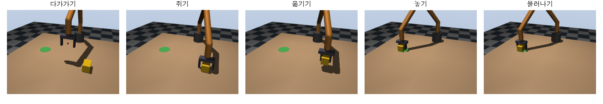
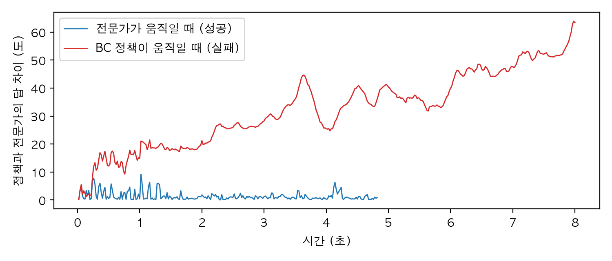
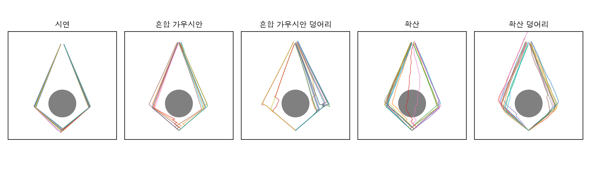
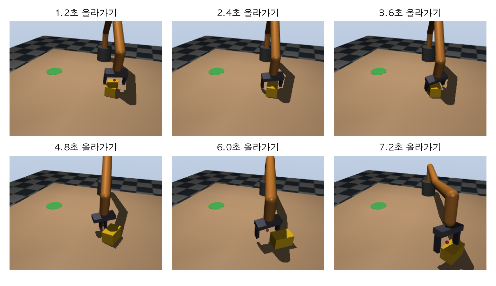

# Chapter 18. 모방 학습: 보고 따라 하는 로봇

> **학습 목표**  
> - 보상을 적기 어려운 일을 시범으로 가르치는 모방 학습의 생각과, 시연 데이터를 모으는 세 가지 길(원격 조작, 사람 영상, 스크립트 전문가) 알기
> - 15장의 집고 놓기를 "지금 상태만 보고 답하는" 스크립트 전문가로 바꿔 시연 수백 개를 모으기
> - 시연을 에피소드 단위로 나눠야 하는 이유를 실험으로 확인하고, LeRobot 데이터셋의 짜임새 알기
> - 행동 복제(BC)를 PyTorch로 구현하고, 손실이 아니라 시뮬레이션 성공률로 평가하기
> - 작은 흔들림에도 오차가 쌓여 무너지는 공변량 이동을 직접 보고, DAgger와 흔들며 시연하기로 고치기
> - 답이 여럿인 시연에서 평균을 내는 BC가 실패하는 모습을 보고, 혼합 가우시안·확산 정책·행동 덩어리(ACT의 생각)로 풀기
> - LeRobot과 SO-101로 실제 시연을 모으고 학습하는 흐름 알기

---

## 들어가며: 설명하기 어려우면 보여 주세요

자전거 타는 법을 글로 설명해 본 적 있나요? "넘어질 것 같은 쪽으로 핸들을 살짝 꺾고, 페달은 일정하게..." 아무리 자세히 적어도 이 설명만 읽고 자전거를 타는 사람은 없습니다. 대신 옆에서 한 번 타는 걸 보여 주고, 뒤에서 잡아 주며 몇 번 같이 타 보면 금방 늡니다.

로봇에게 일을 가르칠 때도 같은 고민이 생깁니다. 16장까지는 사람이 규칙을 적어 줬어요. 15장의 집고 놓기 상태 기계는 "상자 위 10cm로 가서, 곧게 내려가서, 쥐고..."를 한 줄씩 코드로 적었죠. 17장의 강화 학습은 규칙 대신 **보상**을 적어 주면 로봇이 시행착오로 행동을 찾아냅니다. 그런데 "셔츠를 예쁘게 개라"나 "책상을 깔끔하게 정리하라"의 보상은 어떻게 숫자로 적을까요? 규칙도 보상도 적기 어려운 일이 생각보다 많습니다.

그럴 때 쓰는 세 번째 길이 **모방 학습(imitation learning)** 입니다. 사람이 몇십 번 시범을 보이고, 로봇은 "이런 상황에서는 이렇게 움직였다"는 짝을 모아 그대로 따라 하도록 신경망을 학습해요. 2권에서 사진과 정답 짝으로 분류기를 학습한 것과 같은 지도 학습이라, 학습 루프는 이미 익숙한 모양입니다. 다만 로봇은 한 번 답하고 끝나는 게 아니라 **자기 답의 결과로 다음 문제를 받는다**는 점이 다르고, 이 차이가 이 장의 절반을 차지합니다.

이 장에서는 15장의 6자유도 팔과 상자를 그대로 가져와, 스크립트 전문가로 시연을 수백 번 모으고, 행동 복제로 학습하고, 성공률로 평가합니다. 깨끗한 시뮬레이션에서는 시연 25개면 충분한데, 팔이 0.2도쯤 흔들리기만 해도 성공률이 0%가 되는 모습을 보고 그 이유와 처방을 찾아요. 그다음 "왼쪽으로도 오른쪽으로도 피해 가는" 시연처럼 답이 여럿일 때 생기는 문제와, 요즘 로봇 학습에서 많이 쓰는 행동 덩어리(action chunking)와 확산 정책의 생각을 작은 예로 확인합니다.

> **Q. 강화 학습과 모방 학습은 어느 쪽이 더 좋은가요?**
> 쓰는 곳이 다릅니다. 강화 학습은 보상만 있으면 사람보다 잘하는 방법도 찾지만, 시행착오가 수백만 번 필요해서 시뮬레이션 밖에서는 쓰기 어려워요. 모방 학습은 시연 수십 개로 시작할 수 있지만 시범을 보인 사람보다 잘하기는 어렵습니다. 실제로는 시연으로 먼저 배우고 강화 학습으로 다듬는 식으로 섞어 쓰기도 해요. 예제는 파이썬 3.12, MuJoCo 3.17, NumPy 2.5, PyTorch 2.14에서 실행해 확인했습니다. 학습은 모두 CPU에서 씨앗을 고정해 돌렸어요.

## 18.1 시연 데이터는 어디서 올까

### 관측과 행동의 짝

모방 학습의 데이터는 **관측(observation)과 행동(action)의 짝**을 시간 순서대로 늘어놓은 것입니다. 관측은 그 순간 로봇이 아는 것(관절 각도, 카메라 사진, 물체 위치), 행동은 그때 시연자가 한 것(관절 목표, 집게 명령)이에요. 한 번의 시범 처음부터 끝까지를 **에피소드(episode)** 라고 부르고, 에피소드 하나는 1초에 수십 번 찍은 짝 수백 개로 이루어집니다. 이 짝으로 "관측을 넣으면 행동이 나오는 함수", 즉 **정책(policy)** 을 학습해요. 17장의 정책과 같은 말입니다.

### 세 가지 길

시연자가 누구냐에 따라 데이터를 모으는 길이 셋 있습니다.

| 길 | 어떻게 | 좋은 점 | 어려운 점 | 이 책에서 |
|---|---|---|---|---|
| 원격 조작 | 사람이 리더 팔을 움직이면 로봇 팔이 따라 하고, 그동안의 관측과 명령을 기록 | 로봇의 몸으로 한 행동이라 그대로 쓸 수 있다 | 사람 시간이 많이 든다. 사람마다, 날마다 시연이 다르다 | 7장 SO-101 리더/팔로워, 18.8절 |
| 사람 영상 | 사람이 맨손으로 하는 모습을 찍고 자세를 추정해 로봇 동작으로 옮김 | 장비 없이 많이 모은다. 인터넷 영상도 있다 | 사람과 로봇의 몸이 달라 리타게팅이 필요하고, 힘·접촉 정보가 없다 | 10장 자세 추정·리타게팅 |
| 스크립트 전문가 | 시뮬레이션의 정답(물체의 정확한 위치 등)을 아는 프로그램이 시연 | 공짜로 수천 번, 언제든 다시 물어볼 수 있다 | 전문가를 짤 수 있는 일에만 쓴다. 시뮬레이션과 현실의 차이 | 15장 상태 기계, 이 장 |

"전문가를 짤 수 있으면 그냥 전문가를 쓰면 되지 않나?" 싶을 수 있어요. 스크립트 전문가는 시뮬레이터만 아는 정보, 예를 들어 상자의 **정확한** 위치와 손가락이 상자에 닿았는지를 씁니다. 현실의 로봇은 이런 정보를 카메라 사진으로 짐작해야 하죠. 그래서 정답을 아는 전문가가 시범을 보이고, 로봇이 실제로 가질 관측만으로 따라 하는 정책을 배우게 하는 방식이 연구에서 널리 쓰입니다. 이 장에서는 학습 과정을 또렷이 보려고 관측에도 상자 위치를 넣지만, 18.7절에서 이것을 카메라로 바꾸는 이야기를 합니다.

이 장의 실험은 세 번째 길로 하고, 실제 키트로 첫 번째 길을 가는 방법은 18.8절에서 봅니다. 어느 길로 모으든 데이터의 모양과 학습 방법은 같아요.

## 18.2 스크립트 전문가 만들기

### 걸음 단위 환경

15장의 장면(6자유도 팔, 평행 집게, 탁자 위 상자, 초록 놓을 곳)을 그대로 씁니다. 15장 폴더의 `팔도구.py`, `야코비안도구.py`, `회전도구.py`, `집게.py`, `팔집게장면.py`, `잡기도구.py`, `그림도구.py`를 이 장 폴더로 복사해 두세요. 15장에서는 상태 기계가 MuJoCo를 직접 돌렸는데, 학습에 쓰려면 **"관측을 주면 행동을 하나 받아 0.02초 진행한다"** 는 걸음 단위로 바꾸는 편이 편합니다. 17장의 Gymnasium 환경이 `step(action)`으로 한 걸음씩 가는 것과 같은 모양이에요.

```python
"""18장: 15장의 집고 놓기 장면을 '관측을 보고 행동 하나를 고르는' 걸음 단위 환경으로."""
import mujoco
import numpy as np

from 팔집게장면 import 받침_위치, 상자_반크기, 장면_xml, 준비

제어_주기 = 0.02                        # 50Hz로 행동을 고른다
최대_걸음 = 400                         # 한 에피소드는 8초
높이 = 받침_위치[2] + 상자_반크기[2]      # 탁자 위에 놓인 상자 가운데 높이
놓을_곳 = np.array([0.3, -0.25])
상자_범위 = ([0.3, -0.05], [0.5, 0.25])   # 상자가 놓이는 탁자 위 x, y 범위(m)
열림, 닫힘 = 0.08, 0.0                  # 집게 너비 명령(m)
최대_변화 = 0.1                          # 한 걸음에 관절 목표를 바꿀 수 있는 최대값(rad). 안전 장치


class 집고놓기환경:
    def __init__(self, 상자_위치, 흔들림: float = 0.0, 씨앗: int = 0) -> None:
        self.모델 = mujoco.MjModel.from_xml_string(장면_xml(상자_위치, 0.0, 놓을_곳))
        self.데이터 = mujoco.MjData(self.모델)
        준비(self.모델, self.데이터)
        self.걸음 = 0
        self.흔들림, self.생성기 = 흔들림, np.random.default_rng(씨앗)   # 관절 명령에 섞이는 잡음(rad)
        self.하위_걸음 = int(round(제어_주기 / self.모델.opt.timestep))

    def 관측(self) -> np.ndarray:
        """관절 각도 6개, 집게 너비, 상자 위치 3개, TCP에서 본 상자 3개를 이은 13개짜리 벡터."""
        d = self.데이터
        상자 = d.body("box").xpos
        return np.concatenate([d.qpos[:6], d.sensor("width").data, 상자, 상자 - d.site("tcp").xpos])

    def 한걸음(self, 행동) -> None:
        """행동 = [관절 6개를 얼마나 더 돌릴지(rad), 집게 너비 명령(m)]."""
        변화 = np.clip(행동[:6], -최대_변화, 최대_변화)
        self.데이터.ctrl[:6] = self.데이터.qpos[:6] + 변화 + self.생성기.normal(0, self.흔들림, 6)
        self.데이터.ctrl[6] = 열림 if 행동[6] > (열림 + 닫힘) / 2 else 닫힘   # 집게는 열기·닫기 둘 중 하나
        for _ in range(self.하위_걸음):
            mujoco.mj_step(self.모델, self.데이터)
        self.걸음 += 1

    def 잡고_있나(self) -> bool:
        d = self.데이터
        닿음 = min(d.sensor("touch_l").data[0], d.sensor("touch_r").data[0])
        return 닿음 > 1.0 and d.sensor("width").data[0] > 0.01

    def 성공(self) -> bool:
        """상자가 놓을 곳 3cm 안, 탁자 위에 있고, 집게가 열려 있다."""
        상자 = self.데이터.body("box").xpos
        return (np.linalg.norm(상자[:2] - 놓을_곳) < 0.03 and 상자[2] < 높이 + 0.005
                and self.데이터.sensor("width").data[0] > 0.06)

    def 끝났나(self) -> bool:
        """성공한 뒤 집게가 상자 위로 물러났으면 에피소드를 끝낸다."""
        return self.성공() and self.데이터.site("tcp").xpos[2] > 높이 + 0.07

    def 망쳤나(self) -> bool:
        """상자가 탁자 밖으로 떨어졌으면 더 해 볼 것이 없다."""
        return self.데이터.body("box").xpos[2] < 받침_위치[2]
```

몇 가지 약속을 짚어 두겠습니다.

- **관측** 13칸: 관절 각도 6개(rad), 집게 너비(m), 상자 위치 3개(세계 기준, m), 그리고 TCP에서 본 상자 위치 3개(`상자 - TCP`). 마지막 세 칸은 앞의 칸들로 계산할 수 있는 값인데, 넣는 이유는 18.4절에서 실험으로 봅니다.
- **행동** 7칸: 관절 6개를 "지금 각도에서 얼마나 더 돌릴지"와 집게 너비 명령. 관절 목표를 그대로 쓰지 않고 차이로 적은 이유도 18.4절에서 이야기해요. 집게는 열기(0.08m)와 닫기(0) 둘 중 하나로만 움직입니다.
- **안전 장치**: 행동이 아무리 커도 한 걸음에 관절을 0.1rad(약 5.7도)보다 많이 돌리지 않습니다. 학습한 정책은 처음 보는 상황에서 엉뚱한 값을 낼 수 있어서, 실제 로봇에서도 이런 제한은 반드시 둡니다.
- **흔들림**: 관절 명령에 섞는 잡음입니다. 지금은 0이고, 18.5절에서 씁니다.
- **끝**: 상자가 놓을 곳 3cm 안에 놓이고 집게가 7cm 넘게 물러나면 성공으로 끝나고, 상자가 바닥에 떨어지면 실패로 끝나요. 아무 일도 없으면 400걸음(8초)에서 끝납니다.

### 지금 상태만 보고 답하는 전문가

15장 15.7절의 상태 기계는 단계마다 경로를 미리 만들어 두고 한 칸씩 따라갔습니다. "지금 몇 번째 칸인가"를 기억하는 전문가죠. 이런 전문가는 시연은 잘하지만 **아무 상태에서나 물어볼 수가 없어요.** 누가 상자를 옮겨 놓거나 팔을 밀면, 미리 만든 경로는 더 이상 맞지 않습니다. 18.5절의 DAgger는 학습 중인 정책이 엉뚱한 곳으로 간 상태에서 "여기서는 어떻게 해야 하나요?"라고 전문가에게 물어야 하니, 기억 대신 **지금 상태에서 단계를 읽는** 전문가가 필요합니다.

```python
"""18장: 15장의 집고 놓기 순서를 '지금 상태만 보고 다음 행동을 정하는' 스크립트 전문가로."""
import numpy as np

from 모방환경 import 높이, 놓을_곳, 닫힘, 열림, 제어_주기
from 잡기도구 import TCP_포즈, 역기구학, 집기_포즈

최대_속도 = 0.4           # TCP 목표를 한 걸음에 수평·수직 각각 0.4m/s × 0.02s = 8mm까지만 옮긴다
접근_높이 = 0.10
들기_높이 = 0.15


def 목표_정하기(환경) -> tuple[np.ndarray, float, str]:
    """(TCP가 갈 곳, 집게 명령, 단계 이름). 상태 기계의 단계를 기억하지 않고 지금 상태에서 읽는다."""
    d = 환경.데이터
    tcp, 상자 = d.site("tcp").xpos.copy(), d.body("box").xpos.copy()
    놓을 = np.array([*놓을_곳, 높이])
    위로 = lambda 곳, 얼마: np.array([곳[0], 곳[1], 얼마])       # 곳의 x, y에 높이만 바꾼 점
    if 환경.잡고_있나():
        if np.linalg.norm(tcp[:2] - 놓을[:2]) > 0.008:
            if tcp[2] < 높이 + 0.05:                             # 상자가 탁자에서 5cm 뜰 때까지는 곧게 위로
                return 위로(tcp, 높이 + 들기_높이), 닫힘, "들기"
            return 위로(놓을, 높이 + 들기_높이), 닫힘, "옮기기"
        if 상자[2] < 높이 + 0.003:                               # 상자가 탁자에 닿았다
            return tcp, 열림, "놓기"
        return 놓을 - [0, 0, 0.01], 닫힘, "내려놓기"
    if np.linalg.norm(상자[:2] - 놓을[:2]) < 0.03 and 상자[2] < 높이 + 0.01:
        if d.sensor("width").data[0] < 0.06:                   # 손가락이 다 열릴 때까지 그대로
            return tcp, 열림, "놓기"
        return 위로(tcp, 높이 + 접근_높이), 열림, "물러나기"
    if np.linalg.norm(tcp[:2] - 상자[:2]) > 0.008:
        if tcp[2] < 상자[2] + 접근_높이 - 0.03:                 # 상자 옆에서 낮게 있으면 먼저 올라간다
            return 위로(tcp, 상자[2] + 접근_높이), 열림, "올라가기"
        return 위로(상자, 상자[2] + 접근_높이), 열림, "다가가기"
    if tcp[2] > 상자[2] + 0.005:
        return 상자, 열림, "내려가기"
    return 상자, 닫힘, "쥐기"


def 요_정하기(q) -> float:
    """상자 요가 0이니 집게 요는 0도나 180도(15장). 지금 집게 방향에 가까운 쪽을 고른다."""
    R = TCP_포즈(q)[:3, :3]
    지금 = np.degrees(np.arctan2(R[1, 0], R[0, 0]))
    return 0.0 if abs((지금 + 180) % 360 - 180) < 90 else 180.0


def 전문가(환경) -> np.ndarray:
    """전문가의 행동 [관절 6개를 얼마나 더 돌릴지, 집게 명령]. 어떤 상태에서 물어도 답한다."""
    q = 환경.데이터.qpos[:6].copy()
    목표, 집게, _ = 목표_정하기(환경)
    tcp = 환경.데이터.site("tcp").xpos
    수평, 수직 = (목표 - tcp)[:2], (목표 - tcp)[2]
    한계 = 최대_속도 * 제어_주기
    수평 = 수평 * min(1.0, 한계 / max(np.linalg.norm(수평), 1e-9))
    걸음 = np.array([*수평, np.clip(수직, -한계, 한계)])
    q_목표 = 역기구학(집기_포즈(tcp + 걸음, 요_정하기(q)), q, 반복=10)     # 지금 관절에서 출발(15장)
    return np.concatenate([q_목표 - q, [집게]])
```

`목표_정하기`가 15장 상태 기계의 단계 판단을 상태 하나로 옮긴 것입니다. 상자를 잡고 있으면 들기·옮기기·내려놓기 중 하나이고, 상자가 놓을 곳에 있으면 물러나기, 아니면 상자 위로 다가가거나 내려가거나 쥐어요. 단계가 정해지면 `전문가`가 TCP를 목표 쪽으로 한 걸음(수평·수직 각각 최대 8mm) 옮긴 포즈를 15장의 역기구학으로 풀고, 지금 관절과의 차이를 행동으로 냅니다. 역기구학은 지금 관절 각도에서 출발하니 가까운 답이 나와요.

수평과 수직을 따로 제한한 데는 사연이 있습니다. 처음에는 두 방향을 합친 길이를 8mm로 잘랐더니, 상자를 들고 옆으로 옮기기 시작할 때 걸음 대부분이 수평 방향이 되면서 상자 무게에 팔이 살짝 처졌어요. 그러자 TCP 높이가 "들기" 문턱 아래로 내려가 들기와 옮기기가 한 걸음마다 번갈아 나왔습니다. 기억 없이 상태만 보는 전문가는 이렇게 **문턱 근처에서 떨기** 쉬우니, 문턱을 정할 때 움직임이 그 문턱을 다시 넘지 않는지 확인해야 합니다.

전문가를 한 번 돌려 보며 단계가 바뀌는 순간을 적고 찍어 보겠습니다.

```python
import mujoco

from 그림도구 import 프레임격자
from 모방환경 import 집고놓기환경, 최대_걸음, 제어_주기
from 전문가 import 목표_정하기, 전문가

환경 = 집고놓기환경([0.45, 0.15])
카메라 = mujoco.MjvCamera()
카메라.lookat[:] = [0.37, -0.05, 0.45]
카메라.distance, 카메라.azimuth, 카메라.elevation = 0.8, 200, -30
기록, 프레임들, 제목들 = [], [], []
with mujoco.Renderer(환경.모델, 240, 320) as 그리개:
    while 환경.걸음 < 최대_걸음 and not 환경.끝났나():
        단계 = 목표_정하기(환경)[2]
        if not 기록 or 기록[-1][1] != 단계:                 # 단계가 바뀐 걸음만 적고 찍는다
            기록.append((환경.걸음, 단계))
            if 단계 in ("다가가기", "쥐기", "옮기기", "놓기", "물러나기") and 단계 not in 제목들:
                그리개.update_scene(환경.데이터, camera=카메라)
                프레임들.append(그리개.render())
                제목들.append(단계)
        환경.한걸음(전문가(환경))
for 걸음, 단계 in 기록:
    print(f"{걸음:3d}걸음({걸음 * 제어_주기:4.2f}초)  {단계}")
print(f"끝: {환경.걸음}걸음, 성공 {환경.성공()}")
프레임격자(프레임들, 제목들, "expert_frames.png", 열=5)
print("저장: expert_frames.png")
```

```text
  0걸음(0.00초)  다가가기
 34걸음(0.68초)  내려가기
 69걸음(1.38초)  쥐기
 71걸음(1.42초)  들기
 92걸음(1.84초)  옮기기
184걸음(3.68초)  내려놓기
231걸음(4.62초)  놓기
232걸음(4.64초)  물러나기
끝: 257걸음, 성공 True
저장: expert_frames.png
```



1.38초에 쥐기 시작해서 4.62초에 놓고, 257걸음(5.14초) 만에 물러나며 끝났습니다. 단계 이름이 15장의 상태 기계와 거의 같죠. 쥐기는 2걸음 만에 들기로 넘어갔는데, 두 손가락 모두 1N 넘게 닿으면 잡은 것으로 보기 때문이에요.

이제 이 전문가가 정말 "아무 상태에서나" 답하는지 시험해 보겠습니다. 팔이 상자로 내려가는 도중에 상자를 슬쩍 옮겨 놓아요.

```python
import mujoco
import numpy as np

from 모방환경 import 집고놓기환경, 최대_걸음
from 전문가 import 목표_정하기, 전문가

환경 = 집고놓기환경([0.45, 0.15])
상자_주소 = 환경.모델.jnt_qposadr[환경.모델.body("box").jntadr[0]]    # 상자 자유 관절의 qpos 시작 칸
기록 = []
while 환경.걸음 < 최대_걸음 and not 환경.끝났나():
    if 환경.걸음 == 50:                                  # 내려가는 도중에 누가 상자를 5cm 옮겨 놓는다
        환경.데이터.qpos[상자_주소:상자_주소 + 2] += [-0.03, 0.04]
        mujoco.mj_forward(환경.모델, 환경.데이터)
        print("50걸음: 상자를 옮겼다 →", np.round(환경.데이터.body("box").xpos[:2], 3))
    단계 = 목표_정하기(환경)[2]
    if not 기록 or 기록[-1][1] != 단계:
        기록.append((환경.걸음, 단계))
    환경.한걸음(전문가(환경))
print("단계 변화:", ", ".join(f"{걸음} {단계}" for 걸음, 단계 in 기록))
print(f"끝: {환경.걸음}걸음, 성공 {환경.성공()}")
```

```text
50걸음: 상자를 옮겼다 → [0.42 0.19]
단계 변화: 0 다가가기, 34 내려가기, 50 올라가기, 56 다가가기, 66 내려가기, 98 쥐기, 100 들기, 121 옮기기, 220 내려놓기, 267 놓기, 268 물러나기
끝: 293걸음, 성공 True
```

50걸음에 상자를 옮기자 전문가는 바로 "올라가기"로 바꿔 상자 옆에서 몸을 들고, 새 위치로 "다가가기", "내려가기"를 다시 해서 293걸음 만에 성공했습니다. 상자가 어디 있는지만 보고 판단하니 미리 만든 경로가 없어도 되는 거예요. 이 성질이 18.5절에서 요긴하게 쓰입니다.

## 18.3 시연 데이터셋 만들기

### 수백 번 시연하기

상자 위치를 탁자 위 20cm × 30cm 범위에서 무작위로 바꿔 가며 전문가를 돌리고, 걸음마다 관측과 행동을 적습니다. 시연을 굴리고 정책을 평가하는 도구를 한 파일에 모았어요. 모은 시연은 파일로 저장해 두고, 같은 요청이 오면 다시 돌리지 않고 읽습니다.

```python
"""18장: 시연을 모으고, 정책을 굴리고, 성공률을 재는 도구."""
import os
from pathlib import Path

import numpy as np

from 모방환경 import 집고놓기환경, 상자_범위, 최대_걸음
from 전문가 import 전문가

저장_폴더 = Path(os.environ.get("BOOK_DATA_DIR", "data")) / "ch18"


def 굴리기(상자_위치, 정책=None, 물어보기: bool = False, 흔들림: float = 0.0, 씨앗: int = 0, 찍기=None):
    """에피소드 하나. 정책이 없으면 전문가가 움직인다.
    물어보기=True면 정책이 움직이는 동안 들른 상태마다 전문가의 답을 함께 적는다(DAgger)."""
    환경 = 집고놓기환경(상자_위치, 흔들림, 씨앗)
    관측들, 전문가_행동들 = [], []
    while 환경.걸음 < 최대_걸음 and not 환경.끝났나() and not 환경.망쳤나():
        관측 = 환경.관측()
        답 = 전문가(환경) if 정책 is None or 물어보기 else None
        관측들.append(관측)
        전문가_행동들.append(답)
        환경.한걸음(답 if 정책 is None else 정책(관측))
        if 찍기 is not None:
            찍기(환경)
    행동들 = np.array(전문가_행동들) if 전문가_행동들[0] is not None else None
    return np.array(관측들), 행동들, 환경.끝났나()


def 시연_모으기(개수: int, 씨앗: int = 0) -> dict[str, np.ndarray]:
    """전문가 시연 개수만큼. 한 번 만든 것은 저장해 두고 다시 읽는다."""
    파일 = 저장_폴더 / f"demos_{개수}_{씨앗}.npz"
    if 파일.exists():
        return dict(np.load(파일))
    생성기 = np.random.default_rng(씨앗)
    관측, 행동, 번호 = [], [], []
    for i in range(개수):
        o, a, _ = 굴리기(생성기.uniform(*상자_범위))
        관측.append(o)
        행동.append(a)
        번호.append(np.full(len(o), i))
    데이터 = {"관측": np.concatenate(관측), "행동": np.concatenate(행동), "에피소드": np.concatenate(번호)}
    저장_폴더.mkdir(parents=True, exist_ok=True)
    np.savez(파일, **데이터)
    return 데이터


def 시험_위치(개수: int = 50) -> np.ndarray:
    """학습에 쓰지 않은 상자 위치. 모든 정책을 같은 위치에서 시험한다."""
    return np.random.default_rng(1000).uniform(*상자_범위, size=(개수, 2))


def 성공률(정책, 위치들, 흔들림: float = 0.0) -> float:
    return float(np.mean([굴리기(p, 정책, 흔들림=흔들림, 씨앗=i)[2] for i, p in enumerate(위치들)]))
```

`굴리기`는 정책이 없으면 전문가가, 있으면 정책이 움직이는 에피소드 하나를 돌립니다. `물어보기=True`는 정책이 움직이는 동안에도 걸음마다 전문가의 답을 함께 적으라는 뜻인데, 18.5절의 DAgger에서 씁니다. `성공률`은 처음 보는 상자 위치 여러 곳에서 정책을 굴려 성공한 비율이고, 이 장의 모든 정책은 `시험_위치`가 주는 같은 50곳에서 시험해요.

```python
import numpy as np

from 모방환경 import 제어_주기
from 시연도구 import 시연_모으기
from 회전도구 import 깔끔

데이터 = 시연_모으기(250)                    # 처음이면 250번 시연을 돌리고, 다음부터는 저장한 것을 읽는다
for 이름, 값 in 데이터.items():
    print(f"{이름:5s}: 모양 {값.shape}, 자료형 {값.dtype}")
길이 = np.bincount(데이터["에피소드"]) * 제어_주기
print(f"에피소드 {len(길이)}개, 길이 평균 {길이.mean():.2f}초 (가장 짧게 {길이.min():.2f}초, 길게 {길이.max():.2f}초)")
print("첫 걸음 관측:", 깔끔(데이터["관측"][0]))
print("첫 걸음 행동:", 깔끔(데이터["행동"][0], 4))
```

```text
관측   : 모양 (60222, 13), 자료형 float64
행동   : 모양 (60222, 7), 자료형 float64
에피소드 : 모양 (60222,), 자료형 int64
에피소드 250개, 길이 평균 4.82초 (가장 짧게 3.72초, 길게 6.14초)
첫 걸음 관측: [ 0.     0.524  1.571  0.     1.047  0.     0.08   0.427  0.031  0.425
  0.018  0.031 -0.125]
첫 걸음 행동: [ 0.0168  0.025  -0.009   0.     -0.0161  0.0168  0.08  ]
```

250번 시연해서 걸음 60,222개가 모였습니다. 에피소드마다 길이가 3.72초에서 6.14초까지 다른데, 상자가 놓을 곳에서 멀수록 오래 걸리기 때문이에요. 세 배열은 줄 수가 같고, `에피소드` 배열이 각 줄이 몇 번째 시연의 걸음인지 알려 줍니다. 첫 걸음의 행동을 보면 관절을 0.01~0.03rad씩 돌리라는 아주 작은 값이에요. 0.02초 동안의 변화니까요.

### 에피소드 단위로 나누기

학습 데이터와 검증 데이터를 나눌 때, 2권에서처럼 줄을 무작위로 섞어서 나누면 될까요? 시연의 걸음들은 0.02초 간격이라 이웃한 걸음끼리 거의 똑같습니다. 걸음 단위로 섞어 나누면 검증 걸음 바로 앞뒤의 걸음이 학습 데이터에 들어가니, 검증이 사실상 이미 본 문제를 다시 푸는 셈이 돼요. 2권 2장 2.3절의 **데이터 누수**입니다. 실험해 보겠습니다. 시연 10개로 일부러 과적합하기 쉽게 학습하고(2권 8장), 두 방식의 검증 손실을 진짜 처음 보는 에피소드 50개의 손실과 비교합니다.

```python
import numpy as np

from 시연도구 import 시연_모으기
from 정책도구 import 검증_손실, 학습

데이터 = 시연_모으기(250)
관측, 행동, 에피소드 = 데이터["관측"], 데이터["행동"], 데이터["에피소드"]
쓸_칸 = 에피소드 < 10                                # 앞 10개 에피소드로만 실험한다
새_칸 = 에피소드 >= 200                              # 끝 50개는 진짜 처음 보는 에피소드

생성기 = np.random.default_rng(0)
번호 = np.flatnonzero(쓸_칸)
섞은_검증 = np.zeros(len(관측), bool)
섞은_검증[생성기.choice(번호, len(번호) // 5, replace=False)] = True   # 걸음을 섞어 20%를 검증으로
나누기 = {"걸음 단위로 섞기": (쓸_칸 & ~섞은_검증, 섞은_검증),
         "에피소드 단위로 나누기": (에피소드 < 8, 쓸_칸 & (에피소드 >= 8))}  # 8개 학습, 2개 검증
for 이름, (학습_칸, 검증_칸) in 나누기.items():
    정책 = 학습(관측[학습_칸], 행동[학습_칸], 걸음=20000)
    print(f"{이름:12s}: 학습 {검증_손실(정책, 관측[학습_칸], 행동[학습_칸]):.3f}, "
          f"검증 {검증_손실(정책, 관측[검증_칸], 행동[검증_칸]):.3f}, "
          f"처음 보는 에피소드 {검증_손실(정책, 관측[새_칸], 행동[새_칸]):.3f}")
```

```text
걸음 단위로 섞기   : 학습 0.001, 검증 0.008, 처음 보는 에피소드 0.028
에피소드 단위로 나누기: 학습 0.001, 검증 0.057, 처음 보는 에피소드 0.044
```

걸음 단위로 섞으면 검증 손실이 0.008로 나와서 "잘 일반화한다"고 믿게 됩니다. 그런데 진짜 처음 보는 에피소드에서는 0.028로 세 배가 넘었어요. 에피소드 단위로 나누면 검증 손실(0.057)이 처음 보는 에피소드(0.044)와 같은 쪽, 오히려 조금 비관적인 쪽에 섭니다. 검증 에피소드가 2개뿐이라 숫자가 거칠지만, 적어도 속이지는 않아요. **시연은 반드시 에피소드 단위로 나눕니다.** 같은 이유로 실제 로봇 데이터라면 같은 날, 같은 사람이 모은 시연끼리 한쪽에 몰리지 않는지도 봐야 합니다.

데이터를 나누기 전에 시연 자체도 한 번 걸러야 해요. 스크립트 전문가는 250번 모두 성공했지만, 사람이 원격 조작으로 모은 시연에는 물건을 떨어뜨렸다가 다시 집은 것, 중간에 한참 멈춘 것, 다른 사람과 전혀 다른 순서로 한 것이 섞이기 마련입니다. 실패한 시연은 빼고, 시연자의 방식이 너무 제각각이면 한 가지로 맞춰 다시 모으는 편이 학습에 유리합니다. 일부러 섞은 작은 흔들림은 도움이 되지만(18.5절), 방식 자체가 여러 갈래면 18.6절의 문제가 생기거든요.

### LeRobot 데이터셋의 짜임새

실제 로봇 데이터는 사진과 영상까지 들어가서 훨씬 커지니, 정해진 형식이 있으면 편합니다. Hugging Face의 LeRobot은 **LeRobotDataset**이라는 형식을 쓰고, 집필 시점(LeRobot 0.6.1)의 판은 v3.0이에요. 공식 문서와 소스로 확인한 짜임새는 이렇습니다.

| 이 장의 배열 | LeRobotDataset의 이름 | 비고 |
|---|---|---|
| `관측`(관절·집게) | `observation.state` | 로봇 상태 벡터 |
| (카메라 사진) | `observation.images.<카메라 이름>` | MP4 영상으로 저장 |
| `행동` | `action` | 리더 팔의 관절 목표 등 |
| `에피소드` | `episode_index` | 자동으로 채워진다 |
| 에피소드 안의 걸음 번호 | `frame_index` | 자동 |
| 걸음 × 0.02초 | `timestamp` | 자동, 초 단위 |
| 전체 줄 번호 | `index` | 자동 |
| "상자를 초록 표시에" 같은 지시 | `task_index`(글은 `meta/tasks.parquet`) | 19장의 언어 지시로 이어진다 |

파일은 `meta/info.json`(칸 이름·모양·초당 걸음 수), `meta/stats.json`(정규화에 쓸 평균·표준편차 등), `meta/episodes/`(에피소드마다 길이와 파일 안의 위치), `data/chunk-000/file-000.parquet`(표 데이터), `videos/<카메라>/chunk-000/file-000.mp4`(영상)로 나뉩니다. v3.0은 에피소드 여러 개를 큰 파일 하나에 이어 붙이고, 에피소드의 경계는 메타데이터로 찾아요. 이 장의 `.npz` 파일에 `에피소드` 배열을 둔 것과 같은 생각입니다. 학습할 때는 `LeRobotDataset`이 PyTorch `Dataset`처럼 한 줄씩 텐서 사전을 돌려주고, 2권 7장의 `DataLoader`에 그대로 넣을 수 있어요.

## 18.4 행동 복제: 시연을 그대로 따라 배우기

### 관측을 넣으면 행동이 나오는 신경망

가장 단순한 모방 학습은 **행동 복제(behavior cloning, BC)** 입니다. 관측을 입력, 전문가의 행동을 정답으로 두고 MSE로 회귀를 학습해요. 2권 6장의 학습 루프 그대로입니다. 정책은 은닉층 두 개짜리 MLP로 충분합니다. 18.6절에서 쓸 "행동 덩어리"를 위해 행동 여러 걸음을 한꺼번에 내는 기능도 미리 넣어 두었어요. `묶음`이 1이면 보통의 BC입니다.

```python
"""18장: 관측 → 행동을 배우는 MLP 정책(2권 6장의 학습 루프)."""
import numpy as np
import torch
from torch import nn

torch.set_num_threads(4)                 # 스레드 수를 고정해야 결과가 실행마다 똑같다


class MLP정책(nn.Module):
    """관측 하나를 받아 앞으로 '묶음' 걸음 동안의 행동을 한꺼번에 낸다. 묶음=1이면 보통의 BC."""

    def __init__(self, 관측: np.ndarray, 행동: np.ndarray, 너비: int = 256) -> None:
        super().__init__()
        _, self.묶음, self.행동_크기 = 행동.shape               # 행동: (개수, 묶음, 행동 크기)
        self.관측_크기 = 관측.shape[1]                          # 관측 벡터의 앞에서부터 이만큼만 본다
        # 표준편차가 0에 가까운 칸(늘 0인 손목1 등)으로 나누면 작은 차이가 수천 배로 커진다
        self.관측_평균, self.관측_표준 = 관측.mean(0), np.maximum(관측.std(0), 0.01)
        self.행동_평균, self.행동_표준 = 행동.mean((0, 1)), np.maximum(행동.std((0, 1)), 0.01)
        self.망 = nn.Sequential(nn.Linear(관측.shape[1], 너비), nn.ReLU(),
                               nn.Linear(너비, 너비), nn.ReLU(),
                               nn.Linear(너비, self.묶음 * self.행동_크기))

    def 정규화(self, 관측: np.ndarray, 행동: np.ndarray | None = None):
        x = torch.tensor((관측 - self.관측_평균) / self.관측_표준, dtype=torch.float32)
        if 행동 is None:
            return x
        y = (행동 - self.행동_평균) / self.행동_표준
        return x, torch.tensor(y.reshape(len(y), -1), dtype=torch.float32)

    @torch.no_grad()
    def 덩어리(self, 관측: np.ndarray) -> np.ndarray:
        """관측 하나 → (묶음, 행동 크기)짜리 행동 덩어리."""
        y = self.망(self.정규화(관측[None, :self.관측_크기]))[0].view(self.묶음, self.행동_크기).numpy()
        return y * self.행동_표준 + self.행동_평균

    def __call__(self, 관측: np.ndarray) -> np.ndarray:
        """정책으로 쓸 때: 관측 하나 → 지금 할 행동 하나(numpy)."""
        return self.덩어리(관측)[0]


def 덩어리_만들기(행동: np.ndarray, 에피소드: np.ndarray, 묶음: int) -> np.ndarray:
    """걸음마다 '지금부터 묶음 걸음 동안의 행동'을 모은다. 에피소드 끝을 넘으면 마지막 행동으로 채운다."""
    덩어리 = np.empty((len(행동), 묶음, 행동.shape[1]))
    for i in range(len(행동)):
        끝 = np.searchsorted(에피소드, 에피소드[i], side="right") - 1    # 같은 에피소드의 마지막 걸음
        덩어리[i] = 행동[np.minimum(np.arange(i, i + 묶음), 끝)]
    return 덩어리


def 학습(관측: np.ndarray, 행동: np.ndarray, 걸음: int = 20000, 씨앗: int = 0) -> MLP정책:
    """행동을 MSE로 따라 배운다. 행동은 (개수, 행동 크기) 또는 (개수, 묶음, 행동 크기)."""
    torch.manual_seed(씨앗)
    행동 = 행동 if 행동.ndim == 3 else 행동[:, None]
    정책 = MLP정책(관측, 행동)
    X, Y = 정책.정규화(관측, 행동)
    최적화 = torch.optim.Adam(정책.parameters(), lr=1e-3)
    생성기 = torch.Generator().manual_seed(씨앗)
    for _ in range(걸음):
        고른 = torch.randint(0, len(X), (256,), generator=생성기)
        손실 = ((정책.망(X[고른]) - Y[고른]) ** 2).mean()
        최적화.zero_grad()
        손실.backward()
        최적화.step()
    return 정책


@torch.no_grad()
def 검증_손실(정책: MLP정책, 관측: np.ndarray, 행동: np.ndarray) -> float:
    X, Y = 정책.정규화(관측, 행동 if 행동.ndim == 3 else 행동[:, None])
    return float(((정책.망(X) - Y) ** 2).mean())
```

입력과 출력은 칸마다 평균을 빼고 표준편차로 나눠 정규화했습니다(2권 2장). 관절 각도는 1rad 안팎, 상자 위치는 cm 단위로 움직이고, 행동은 0.01rad 정도라 크기가 제각각이거든요.

그런데 `np.maximum(..., 0.01)`로 표준편차에 하한을 둔 데는 사연이 있습니다. 이 팔의 손목1 관절은 집는 자세에서 늘 0이라 시연 속 표준편차가 0입니다. 처음에는 0으로 나누지 않으려고 1e-6을 더했는데, 그러자 정책이 손목1을 0.001rad만 움직여도 정규화한 입력이 1,000이 되어 신경망이 엉뚱한 답을 냈어요. 시연에서는 늘 0이던 칸이 정책을 직접 돌릴 때는 조금씩 흔들리니까요. 이 버그가 있을 때는 정책을 직접 굴리는 평가에서 성공률이 크게 떨어졌고, 정책이 낯선 상태를 많이 들르는 18.5절의 DAgger는 0%로 무너졌어요. 시연에서 거의 변하지 않는 칸은 표준편차에 하한을 두거나 아예 빼는 것이 안전해요.

학습하고 평가해 봅시다. 시연 250개 중 200개로 학습하고 50개는 검증으로 둡니다.

```python
from 시연도구 import 성공률, 시연_모으기, 시험_위치
from 정책도구 import 검증_손실, 학습

데이터 = 시연_모으기(250)
관측, 행동, 에피소드 = 데이터["관측"], 데이터["행동"], 데이터["에피소드"]
학습_칸, 검증_칸 = 에피소드 < 200, 에피소드 >= 200          # 에피소드 단위로 나눈다

정책 = 학습(관측[학습_칸], 행동[학습_칸])
print(f"학습 걸음 {학습_칸.sum():,}개, 검증 걸음 {검증_칸.sum():,}개")
print(f"검증 손실(정규화한 MSE): {검증_손실(정책, 관측[검증_칸], 행동[검증_칸]):.4f}")
print("검증 첫 걸음 전문가 행동:", 행동[검증_칸][0].round(4))
print("검증 첫 걸음 정책 행동  :", 정책(관측[검증_칸][0]).round(4))
print(f"처음 보는 상자 위치 50곳에서 성공률: {성공률(정책, 시험_위치(50)):.0%}")
```

```text
학습 걸음 48,183개, 검증 걸음 12,039개
검증 손실(정규화한 MSE): 0.0031
검증 첫 걸음 전문가 행동: [ 0.0188  0.0073  0.0195  0.     -0.0268  0.0188  0.08  ]
검증 첫 걸음 정책 행동  : [ 0.0189  0.0087  0.02    0.     -0.0278  0.0186  0.0785]
처음 보는 상자 위치 50곳에서 성공률: 100%
```

검증 첫 걸음에서 정책의 답이 전문가와 거의 같은 값(차이가 0.002rad 안쪽)이고, 처음 보는 상자 위치 50곳에서 모두 성공했습니다. 2만 걸음 학습이 CPU로 금방 끝나는 작은 신경망이에요.

여기서 평가 방법을 짚어 두겠습니다. 검증 손실 0.0031은 "시연과 같은 상태가 주어졌을 때 전문가와 얼마나 비슷하게 답하는가"를 잽니다. 하지만 로봇에게 중요한 건 **일을 해내는가**예요. 그래서 모방 학습에서는 정책을 시뮬레이션(또는 실제 로봇)에서 직접 굴려 **성공률**로 평가합니다. 두 숫자가 늘 같은 방향으로 움직이지 않는다는 것을 곧 보게 돼요.

### 시연은 몇 개나 필요할까

시연 수를 바꿔 가며 학습해 보겠습니다. 마지막 줄은 시연 200개를 쓰되, 관측에서 "TCP에서 본 상자" 세 칸을 뺀 정책이에요.

```python
from 시연도구 import 성공률, 시연_모으기, 시험_위치
from 정책도구 import 검증_손실, 학습

데이터 = 시연_모으기(250)
관측, 행동, 에피소드 = 데이터["관측"], 데이터["행동"], 데이터["에피소드"]
검증_칸, 시험 = 에피소드 >= 200, 시험_위치(50)

print("시연 수  관측 칸  검증 손실  성공률")
for 시연_수, 칸_수 in [(5, 13), (10, 13), (25, 13), (200, 10)]:
    학습_칸 = 에피소드 < 시연_수
    정책 = 학습(관측[학습_칸, :칸_수], 행동[학습_칸])          # 10칸이면 'TCP에서 본 상자'를 뺀다
    print(f"{시연_수:6d}  {칸_수:7d}  {검증_손실(정책, 관측[검증_칸, :칸_수], 행동[검증_칸]):9.4f}  "
          f"{성공률(정책, 시험):6.0%}")
```

```text
시연 수  관측 칸  검증 손실  성공률
     5       13     0.0667     50%
    10       13     0.0297     98%
    25       13     0.0048    100%
   200       10     0.0041     94%
```

시연 5개로는 50%, 10개로 98%, 25개면 100%입니다. 상자 위치만 바뀌는 단순한 일이라 시연이 많이 필요하지 않네요. 검증 손실도 시연이 늘수록 줄었습니다.

마지막 줄이 흥미롭습니다. "TCP에서 본 상자"를 뺀 10칸 정책은 시연 200개로 학습해 검증 손실이 0.0041인데, 13칸으로 시연 25개만 쓴 정책(0.0048)보다 손실이 **낮은데도** 성공률은 94%로 더 낮아요. 빠진 세 칸은 관절 각도(순기구학, 3장)와 상자 위치로 계산할 수 있는 값이라 정보가 줄어든 것은 아닙니다. 하지만 신경망은 관절 각도 여섯 개에서 손끝 위치를 mm 단위로 계산하는 일을 따로 배워야 하고, 그 작은 오차가 "손가락 사이에 상자가 들어왔는가"처럼 결정적인 순간에 몰려요. 평균 손실에는 거의 티가 나지 않는 오차가 성공률을 가릅니다. 손목 카메라를 단 로봇이 "손에서 본 물체"를 바로 관측으로 받는 것도 같은 이유예요.

> **Q. 행동을 관절 목표가 아니라 "얼마나 더 돌릴지"로 적은 이유는?**
> 관절 목표를 그대로 배우면 출력이 1rad 안팎인데, 실제로 중요한 것은 지금 자세와의 0.01rad 차이입니다. 출력의 1%만 틀려도 차이 부분은 통째로 틀려요. 차이로 적으면 신경망이 중요한 부분에 눈금을 다 쓸 수 있습니다. 대신 차이를 쌓아 가는 방식이라 작은 치우침이 모이면 위치가 밀리는데, 이 장에서는 매 걸음 지금 관절에 더하니 쌓이지 않아요. LeRobot의 ACT처럼 절대 관절 목표를 덩어리로 내는 정책도 많으니, 둘 다 쓰인다고 알아 두면 됩니다.

## 18.5 오차가 쌓이는 문제와 DAgger

### 0.2도 흔들렸을 뿐인데

지금까지의 시뮬레이션은 완벽했습니다. 명령한 관절 목표가 그대로 들어갔죠. 실제 로봇은 그렇지 않아요. 7장에서 본 기어 백래시, 서보의 눈금 오차, 케이블이 당기는 힘 때문에 명령과 실제가 조금씩 어긋납니다. 이것을 흉내 내서 관절 명령에 매 걸음 표준편차 0.004rad(0.23도)의 잡음을 섞어 보겠습니다. 팔 길이 0.5m 끝에서 2mm 정도 흔들리는 크기예요.

```python
import numpy as np

from 시연도구 import 굴리기, 성공률, 시연_모으기, 시험_위치
from 정책도구 import 학습

데이터 = 시연_모으기(250)
학습_칸 = 데이터["에피소드"] < 200
정책 = 학습(데이터["관측"][학습_칸], 데이터["행동"][학습_칸])
시험 = 시험_위치(50)

print("흔들림(rad)  전문가  BC(시연 200개)")
for 흔들림 in [0.0, 0.002, 0.004, 0.006]:
    전문가_성공 = np.mean([굴리기(p, 흔들림=흔들림, 씨앗=i)[2] for i, p in enumerate(시험)])
    print(f"{흔들림:10.3f}  {전문가_성공:6.0%}  {성공률(정책, 시험, 흔들림):8.0%}")
```

```text
흔들림(rad)  전문가  BC(시연 200개)
     0.000    100%      100%
     0.002    100%       62%
     0.004    100%        0%
     0.006    100%        0%
```

전문가는 0.006rad까지 흔들려도 모두 성공합니다. 그런데 깨끗한 환경에서 100%였던 BC 정책은 0.002rad에서 62%, 0.004rad부터는 **0%** 예요. 시연을 200개나 썼는데도요. 검증 손실이 아무리 낮아도 소용이 없었습니다.

무슨 일이 일어났는지 걸음마다 들여다보겠습니다. 정책이 움직이는 동안 매 걸음 같은 상태를 전문가에게도 보여 주고, 두 답이 얼마나 다른지 잽니다. 비교를 위해 전문가가 움직일 때도 같은 것을 재요.

```python
import matplotlib.pyplot as plt
import numpy as np

from 모방환경 import 제어_주기
from 시연도구 import 굴리기, 시연_모으기, 시험_위치
from 전문가 import 목표_정하기, 전문가
from 정책도구 import 학습

plt.rcParams["font.family"] = "AppleGothic"
plt.rcParams["axes.unicode_minus"] = False

데이터 = 시연_모으기(250)
학습_칸 = 데이터["에피소드"] < 200
정책 = 학습(데이터["관측"][학습_칸], 데이터["행동"][학습_칸])
상자 = 시험_위치(50)[0]

그림, 칸 = plt.subplots(figsize=(7.5, 3.2))
for 이름, 운전자, 색 in [("전문가가 움직일 때", None, "tab:blue"), ("BC 정책이 움직일 때", 정책, "tab:red")]:
    차이, 단계들 = [], []

    def 찍기(환경) -> None:
        """한 걸음 뒤의 상태에서 정책과 전문가에게 같은 질문을 던져 답의 차이를 잰다."""
        차이.append(np.abs(정책(환경.관측())[:6] - 전문가(환경)[:6]).max())
        단계들.append(목표_정하기(환경)[2])

    _, _, 성공 = 굴리기(상자, 운전자, 흔들림=0.004, 씨앗=0, 찍기=찍기)
    시각 = np.arange(1, len(차이) + 1) * 제어_주기
    칸.plot(시각, np.degrees(차이), color=색, linewidth=1, label=f"{이름} ({'성공' if 성공 else '실패'})")
    print(f"{이름}: {len(차이)}걸음, 차이 중앙값 {np.degrees(np.median(차이)):.2f}도, "
          f"가장 클 때 {np.degrees(max(차이)):.1f}도, 마지막 단계 {단계들[-1]}")
칸.set_xlabel("시간 (초)")
칸.set_ylabel("정책과 전문가의 답 차이 (도)")
칸.legend()
그림.tight_layout()
그림.savefig("drift.png", dpi=200)
print("저장: drift.png")
```

```text
전문가가 움직일 때: 241걸음, 차이 중앙값 0.87도, 가장 클 때 9.3도, 마지막 단계 물러나기
BC 정책이 움직일 때: 400걸음, 차이 중앙값 33.56도, 가장 클 때 63.9도, 마지막 단계 올라가기
저장: drift.png
```



같은 정책인데, **전문가가 데려간 상태에서는** 전문가와 거의 같은 답(차이 중앙값 0.87도)을 내고, **자기가 움직여 도착한 상태에서는** 중앙값 33.56도로 전혀 다른 답을 냅니다. 이것이 모방 학습의 가장 유명한 문제, **오차 누적** 또는 **공변량 이동(covariate shift)** 이에요.

- 정책은 시연에 나온 상태들에서만 배웠다. 전문가는 늘 정확히 상자 위로 갔으니, 시연에는 "상자에서 1cm 비켜 낮게 떠 있는 상태"가 한 번도 없다
- 흔들림 때문에 정책이 조금 비켜난다. 그 상태는 처음 보는 곳이라 답이 조금 더 틀린다
- 더 틀린 답이 더 낯선 상태로 데려간다. 작은 오차가 걸음마다 눈덩이처럼 커진다

운전 연수를 늘 차선 한가운데로만 달려 본 사람을 떠올려 보세요. 차가 한쪽으로 살짝 쏠리면 그 상태에서 어떻게 돌아오는지 본 적이 없으니 당황합니다. 2권의 분류기는 사진 한 장에 답하면 끝이라 이런 일이 없었는데, 로봇의 정책은 **자기 답이 다음 문제를 만든다**는 점이 다릅니다. 18.9절에서 이 정책이 실제로 어떻게 실패하는지 사진으로 볼 거예요.

### DAgger: 정책이 간 곳에서 전문가에게 묻기

해결 방법은 의외로 단순합니다. 시연에 없던 상태가 문제라면, **정책이 실제로 가는 상태를 모아서 거기서의 정답을 받으면** 되죠. 2011년에 나온 **DAgger(Dataset Aggregation)** 의 순서는 이렇습니다.

1. 시연으로 BC 정책을 학습한다
2. 그 정책으로 로봇을 움직이며, 들른 상태마다 "전문가라면 어떻게 했을까"를 묻는다(행동은 정책 것을 쓰고, 답만 적는다)
3. 새로 적은 상태와 전문가의 답을 지금까지의 데이터에 **보탠다**
4. 모은 데이터 전체로 다시 학습하고 2로 돌아간다

> **Q. 시연을 훨씬 더 많이 모으면 해결되지 않나요?**
> 앞의 표에서 시연 200개로도 0%였죠. 시연을 늘려도 전문가는 늘 같은 매끈한 길로만 가니, "비켜난 상태"는 몇 개를 모아도 들어오지 않습니다. 데이터의 양보다 **어떤 상태가 들어 있느냐**가 문제예요. 2권의 분류기에서 "다양한 데이터를 모아라"라고 했던 말이 로봇에서는 "정책이 실제로 가게 될 상태를 모아라"로 바뀝니다.

18.2절에서 전문가를 "아무 상태에서나 물어볼 수 있게" 만든 이유가 여기 있습니다. `굴리기`의 `물어보기=True`가 2번을 하는 부분이에요.

```python
"""18장: DAgger. 정책이 직접 움직이고, 들른 상태마다 전문가에게 답을 물어 데이터에 보탠다."""
import numpy as np

from 모방환경 import 상자_범위
from 시연도구 import 굴리기
from 정책도구 import 학습


def 다거(관측, 행동, 회차: int = 5, 에피소드: int = 25, 흔들림: float = 0.004, 씨앗: int = 7):
    """처음 시연으로 BC를 학습한 뒤, 굴리기 → 묻기 → 모으기 → 다시 학습을 회차만큼."""
    생성기 = np.random.default_rng(씨앗)
    관측들, 행동들 = [관측], [행동]
    정책 = 학습(관측, 행동)
    for 회 in range(1, 회차 + 1):
        성공 = 0
        for i in range(에피소드):
            o, a, s = 굴리기(생성기.uniform(*상자_범위), 정책, 물어보기=True, 흔들림=흔들림, 씨앗=회 * 1000 + i)
            관측들.append(o)                 # 정책이 들른 상태와
            행동들.append(a)                 # 그 상태에서 전문가가 했을 행동
            성공 += s
        정책 = 학습(np.concatenate(관측들), np.concatenate(행동들))
        print(f"{회}회차: 지난 정책으로 {에피소드}번 중 {성공}번 성공, 모은 걸음 {sum(map(len, 관측들)):,}개")
    return 정책
```

깨끗한 시연 25개에서 출발해, 회차마다 흔들리는 팔(0.004rad)로 25번 굴리고 다시 학습합니다. 이 블록은 이 맥에서 2분쯤 걸려요.

```python
import os
from pathlib import Path

import torch

from 다거 import 다거
from 시연도구 import 성공률, 시연_모으기, 시험_위치

데이터 = 시연_모으기(250)
처음_칸 = 데이터["에피소드"] < 25                      # 깨끗한 시연 25개에서 출발
정책 = 다거(데이터["관측"][처음_칸], 데이터["행동"][처음_칸], 회차=5, 에피소드=25, 흔들림=0.004)
시험 = 시험_위치(50)
print(f"DAgger 정책: 흔들림 0.004에서 {성공률(정책, 시험, 0.004):.0%}, 흔들림 없이 {성공률(정책, 시험):.0%}")

저장 = Path(os.environ.get("BOOK_DATA_DIR", "data")) / "ch18" / "dagger.pt"
torch.save(정책, 저장, pickle_protocol=4)   # 18.9절 실습에서 다시 쓴다. 한글 모듈 이름은 4판 이상이 필요
```

```text
1회차: 지난 정책으로 25번 중 0번 성공, 모은 걸음 15,973개
2회차: 지난 정책으로 25번 중 25번 성공, 모은 걸음 21,934개
3회차: 지난 정책으로 25번 중 17번 성공, 모은 걸음 29,634개
4회차: 지난 정책으로 25번 중 25번 성공, 모은 걸음 35,650개
5회차: 지난 정책으로 25번 중 25번 성공, 모은 걸음 41,656개
DAgger 정책: 흔들림 0.004에서 100%, 흔들림 없이 100%
```

1회차에 굴린 것은 깨끗한 시연으로만 배운 정책이라 25번 모두 실패했습니다. 하지만 그 실패한 에피소드들에서 "여기서는 이렇게 돌아오면 된다"는 답을 받아 보태자, 2회차 정책은 25번 모두 성공했어요. 3회차에 17번으로 한 번 흔들렸다가 다시 25번으로 돌아왔고, 마지막 정책은 시험 위치 50곳에서 흔들림이 있든 없든 100% 성공합니다. 실패한 시도도 버리지 않고 답을 받아 데이터로 쓰는 것이 DAgger의 힘이에요.

DAgger의 약점은 **전문가가 계속 곁에 있어야 한다**는 것입니다. 스크립트 전문가는 언제든 물어볼 수 있지만, 사람이 전문가라면 로봇이 이상한 곳에 가 있을 때마다 "여기서는 이렇게"를 알려 줘야 하죠. 18.8절에서 보듯 LeRobot에는 사람이 로봇이 실패하려는 순간 리더 팔로 끼어들어 바로잡고, 그 구간을 데이터로 남기는 방식이 들어 있습니다. DAgger를 사람에게 맞게 고친 거예요.

### 흔들며 시연하기

전문가에게 계속 묻기 어렵다면 다른 방법도 있습니다. **시연할 때부터 일부러 흔드는** 거예요. 전문가도 흔들리는 팔로 시연하면, 시연 속에 "조금 비켜났다가 돌아오는" 상태와 행동이 저절로 들어갑니다. 이 생각을 다듬은 방법이 DART(2017)예요. 흔들리는 팔로 시연 50개를 모아 BC를 학습하고, 깨끗한 시연 200개로 학습한 정책과 비교합니다.

```python
import numpy as np

from 모방환경 import 상자_범위
from 시연도구 import 굴리기, 성공률, 시연_모으기, 시험_위치
from 정책도구 import 검증_손실, 학습

깨끗 = 시연_모으기(250)
검증_칸 = 깨끗["에피소드"] >= 200
생성기 = np.random.default_rng(3)
관측들, 행동들 = [], []
for i in range(50):                                     # 전문가도 흔들리는 팔로 시연한다
    o, a, _ = 굴리기(생성기.uniform(*상자_범위), 흔들림=0.004, 씨앗=500 + i)
    관측들.append(o)
    행동들.append(a)
시험 = 시험_위치(50)
for 이름, 관측, 행동 in [("깨끗한 시연 200개", 깨끗["관측"][~검증_칸], 깨끗["행동"][~검증_칸]),
                       ("흔들며 시연 50개 ", np.concatenate(관측들), np.concatenate(행동들))]:
    정책 = 학습(관측, 행동)
    print(f"{이름}: 깨끗한 검증 손실 {검증_손실(정책, 깨끗['관측'][검증_칸], 깨끗['행동'][검증_칸]):.4f}, "
          f"성공률 흔들림 없이 {성공률(정책, 시험):.0%} / 0.004에서 {성공률(정책, 시험, 0.004):.0%}")
```

```text
깨끗한 시연 200개: 깨끗한 검증 손실 0.0031, 성공률 흔들림 없이 100% / 0.004에서 0%
흔들며 시연 50개 : 깨끗한 검증 손실 0.0063, 성공률 흔들림 없이 100% / 0.004에서 100%
```

흔들며 시연 50개로 배운 정책은 흔들림 0.004rad에서도 100% 성공합니다. 그런데 깨끗한 검증 시연으로 잰 손실은 0.0063으로, 깨끗한 시연 200개로 배운 정책(0.0031)의 두 배예요. **손실은 두 배인데 흔들리는 팔에서의 성공률은 0%와 100%** 입니다. 18.4절에서 말한 "손실과 성공률은 다른 것을 잰다"가 가장 극적으로 드러나는 예예요. 검증 손실은 시연의 상태에서만 재니, 정책이 스스로 찾아갈 상태에서의 실력은 알려 주지 못합니다.

사람이 원격 조작으로 시연할 때는 손이 저절로 조금씩 흔들리고 고치기를 반복하니, 자연스럽게 이 효과가 생깁니다. 오히려 너무 매끈하게만 시연하면 정책이 실수에서 돌아오는 법을 배우지 못해요. LeRobot 문서가 같은 동작을 여러 위치에서 반복해 시연하라고 권하는 것도 정책이 볼 상태를 넓히기 위해서입니다.

## 18.6 답이 여럿인 시연

### 왼쪽으로 갈까, 오른쪽으로 갈까

길 한가운데 기둥이 있습니다. 어떤 날은 왼쪽으로, 어떤 날은 오른쪽으로 돌아갔다고 해 봐요. 둘 다 좋은 시연입니다. 그런데 이 시연으로 MSE 회귀를 학습하면 어떻게 될까요? MSE는 정답들의 **평균**을 내도록 배웁니다. 왼쪽과 오른쪽의 평균은... 기둥 한가운데예요.

로봇 팔로도 이런 시연은 흔합니다. 물건을 왼손 쪽에서 잡기도 하고 오른쪽에서 잡기도 하고, 사람 시연자는 날마다 다른 길로 팔을 움직여요. 작은 2차원 연습장으로 확인해 보겠습니다. 점 로봇이 (0, 0)에서 출발해 (0, 1)까지 가는데, (0, 0.3)에 반지름 0.15의 장애물이 있습니다. 전문가는 시연마다 번갈아 왼쪽과 오른쪽으로 돌아가요.

```python
"""18장: 가운데 장애물을 왼쪽으로도 오른쪽으로도 피해 가는 2차원 연습장."""
import numpy as np

출발, 도착 = np.array([0.0, 0.0]), np.array([0.0, 1.0])
장애물, 반지름 = np.array([0.0, 0.3]), 0.15
보폭 = 0.03                                   # 한 걸음에 움직이는 거리
최대_걸음 = 60


def 시연(개수: int, 씨앗: int = 0) -> tuple[np.ndarray, np.ndarray, np.ndarray]:
    """전문가는 에피소드마다 번갈아 왼쪽, 오른쪽으로 돌아간다. (상태, 행동, 에피소드 번호)."""
    생성기 = np.random.default_rng(씨앗)
    상태들, 행동들, 번호들 = [], [], []
    for i in range(개수):
        방향 = -1.0 if i % 2 == 0 else 1.0              # -1 왼쪽, +1 오른쪽
        경유 = np.array([방향 * 0.35, 장애물[1]])        # 장애물 옆을 지나는 점
        p = 출발 + 생성기.normal(0, 0.02, 2)              # 출발점은 시연마다 조금씩 다르다
        for _ in range(최대_걸음):
            목표 = 경유 if p[1] < 경유[1] - 0.05 else 도착
            a = 목표 - p
            a = a / max(np.linalg.norm(a), 1e-9) * 보폭
            상태들.append(p.copy())
            행동들.append(a)
            번호들.append(i)
            p = p + a
            if np.linalg.norm(p - 도착) < 보폭:
                break
    return np.array(상태들), np.array(행동들), np.array(번호들)


def 굴리기(정책, 개수: int) -> tuple[np.ndarray, np.ndarray]:
    """정책(상태 배치 → 행동 배치)으로 여러 에피소드를 한꺼번에. 모두 정확히 출발점에서. (궤적, 성공 여부)."""
    p = np.tile(출발, (개수, 1))
    궤적, 부딪힘, 도착함 = [p.copy()], np.zeros(개수, bool), np.zeros(개수, bool)
    for _ in range(최대_걸음):
        a = 정책(p)
        a = a / np.maximum(np.linalg.norm(a, axis=1, keepdims=True), 1e-9) * 보폭   # 보폭은 같게, 방향만 배운다
        p = np.where(도착함[:, None], p, p + a)                                   # 도착했으면 멈춘다
        부딪힘 |= np.linalg.norm(p - 장애물, axis=1) < 반지름
        도착함 |= np.linalg.norm(p - 도착, axis=1) < 0.05
        궤적.append(p.copy())
    return np.stack(궤적, axis=1), 도착함 & ~부딪힘
```

먼저 18.4절과 같은 MSE 행동 복제입니다. 신경망은 다음에 볼 `여러답정책.py`의 `망`(은닉층 두 개짜리 MLP)을 그대로 씁니다.

```python
import torch

from 갈림길 import 굴리기, 보폭, 시연
from 여러답정책 import 망

상태, 행동, _ = 시연(100)
print(f"시연 100개(왼쪽 50, 오른쪽 50), 걸음 {len(상태)}개")
X, Y = torch.tensor(상태, dtype=torch.float32), torch.tensor(행동 / 보폭, dtype=torch.float32)
torch.manual_seed(0)
모델 = 망(2, 2)
최적화 = torch.optim.Adam(모델.parameters(), lr=1e-3)
for _ in range(8000):                                    # 18.4절과 같은 MSE 행동 복제
    고른 = torch.randint(0, len(X), (256,))
    손실 = ((모델(X[고른]) - Y[고른]) ** 2).mean()
    최적화.zero_grad()
    손실.backward()
    최적화.step()

with torch.no_grad():
    출발_행동 = 모델(torch.zeros(1, 2))[0]
처음 = 상태[:, 1] < 0.05                                 # 출발 직후 시연 걸음들
print("출발점에서 시연 행동: 왼쪽", (행동[처음 & (행동[:, 0] < 0)] / 보폭).mean(0).round(2),
      "/ 오른쪽", (행동[처음 & (행동[:, 0] > 0)] / 보폭).mean(0).round(2))
print("출발점에서 MSE 정책 :", 출발_행동.numpy().round(2))
_, 성공 = 굴리기(lambda p: 모델(torch.tensor(p, dtype=torch.float32)).detach().numpy(), 100)
print(f"MSE 정책 성공률: {성공.mean():.0%}")
```

```text
시연 100개(왼쪽 50, 오른쪽 50), 걸음 3932개
출발점에서 시연 행동: 왼쪽 [-0.76  0.65] / 오른쪽 [0.76 0.65]
출발점에서 MSE 정책 : [-0.02  0.59]
MSE 정책 성공률: 0%
```

출발점에서 시연은 왼쪽 위(-0.76, 0.65)나 오른쪽 위(0.76, 0.65)로 갔는데, MSE 정책은 (-0.02, 0.59), 거의 똑바로 위를 가리킵니다. 두 답의 평균이에요. 출발점이 늘 같으니 100번 모두 같은 길로 곧장 장애물에 부딪혔습니다. 성공률 0%입니다.

### 분포를 배우는 정책

답이 여럿일 때는 "행동 하나"가 아니라 **행동의 분포**를 배우고, 거기서 하나를 뽑아야 합니다. 두 가지 방법을 만들어 보겠습니다.

- **혼합 가우시안(mixture density network)**: 신경망이 종 모양(가우시안) K개의 비중, 가운데, 퍼짐을 냅니다. "왼쪽 위에 종 하나, 오른쪽 위에 종 하나, 비중은 반반"처럼요. 학습은 시연 행동이 이 분포 아래에서 얼마나 그럴듯한지(로그 가능도)를 키우는 방향으로 하고, 쓸 때는 종 하나를 비중대로 고른 뒤 그 안에서 뽑습니다.
- **확산 정책(diffusion policy)**: 2권 15장 15.8절의 DDPM을 사진 대신 행동에 씁니다. 잡음 낀 행동과 상태, 단계 번호를 받아 섞인 잡음을 맞히도록 학습하고, 쓸 때는 순수한 잡음에서 출발해 50단계에 걸쳐 걷어 내면 시연 같은 행동이 나와요. 출발 잡음에 따라 왼쪽 행동도, 오른쪽 행동도 나옵니다.

```python
"""18장: 답이 여럿인 행동을 배우는 두 정책. 혼합 가우시안(MDN)과 작은 확산 정책."""
import torch
from torch import nn

torch.set_num_threads(4)                 # 스레드 수를 고정해야 결과가 실행마다 똑같다


def 망(입력: int, 출력: int, 너비: int = 128) -> nn.Sequential:
    return nn.Sequential(nn.Linear(입력, 너비), nn.ReLU(), nn.Linear(너비, 너비), nn.ReLU(),
                         nn.Linear(너비, 출력))


class 혼합가우시안(nn.Module):
    """상태 → 종 모양(가우시안) K개의 비중·가운데·퍼짐. 행동은 그중 하나를 골라 뽑는다."""

    def __init__(self, 상태_크기: int, 행동_크기: int, K: int = 5) -> None:
        super().__init__()
        self.K, self.D = K, 행동_크기
        self.망 = 망(상태_크기, K * (1 + 2 * 행동_크기))

    def 나누기(self, 상태: torch.Tensor):
        출력 = self.망(상태).view(-1, self.K, 1 + 2 * self.D)
        return 출력[..., 0], 출력[..., 1:1 + self.D], 출력[..., 1 + self.D:].clamp(-7, 2)

    def 손실(self, 상태: torch.Tensor, 행동: torch.Tensor) -> torch.Tensor:
        """음의 로그 가능도: 시연 행동이 섞인 종 모양 아래에서 얼마나 그럴듯한가."""
        비중, 가운데, 로그퍼짐 = self.나누기(상태)
        로그p = (-0.5 * ((행동[:, None] - 가운데) / 로그퍼짐.exp()) ** 2 - 로그퍼짐).sum(-1)
        return -torch.logsumexp(로그p + torch.log_softmax(비중, -1), -1).mean()

    @torch.no_grad()
    def 뽑기(self, 상태: torch.Tensor, 생성기: torch.Generator) -> torch.Tensor:
        비중, 가운데, 로그퍼짐 = self.나누기(상태)
        k = torch.multinomial(torch.softmax(비중, -1), 1, generator=생성기)[:, 0]   # 종 하나 고르기
        i = torch.arange(len(상태))
        return 가운데[i, k] + 로그퍼짐[i, k].exp() * torch.randn(len(상태), self.D, generator=생성기)


class 확산정책(nn.Module):
    """2권 15장의 DDPM을 행동에: 잡음 낀 행동과 상태, 단계를 받아 섞인 잡음을 맞힌다."""

    def __init__(self, 상태_크기: int, 행동_크기: int, T: int = 50) -> None:
        super().__init__()
        self.T, self.D = T, 행동_크기
        self.베타 = torch.linspace(1e-4, 0.2, T)          # 행동은 작아서 50단계면 충분하다
        self.알파 = 1 - self.베타
        self.알파_누적 = torch.cumprod(self.알파, 0)
        self.망 = 망(상태_크기 + 행동_크기 + 1, 행동_크기, 너비=256)

    def 잡음_맞히기(self, 상태, 잡음_행동, t) -> torch.Tensor:
        return self.망(torch.cat([상태, 잡음_행동, t[:, None] / self.T], 1))

    def 손실(self, 상태: torch.Tensor, 행동: torch.Tensor) -> torch.Tensor:
        t = torch.randint(0, self.T, (len(상태),))
        잡음 = torch.randn_like(행동)
        a = self.알파_누적[t][:, None]
        return ((self.잡음_맞히기(상태, a.sqrt() * 행동 + (1 - a).sqrt() * 잡음, t) - 잡음) ** 2).mean()

    @torch.no_grad()
    def 뽑기(self, 상태: torch.Tensor, 생성기: torch.Generator) -> torch.Tensor:
        x = torch.randn(len(상태), self.D, generator=생성기)        # 순수한 잡음에서 출발
        for i in reversed(range(self.T)):
            예측 = self.잡음_맞히기(상태, x, torch.full((len(상태),), i))
            x = (x - self.베타[i] / (1 - self.알파_누적[i]).sqrt() * 예측) / self.알파[i].sqrt()
            if i > 0:
                x = x + self.베타[i].sqrt() * torch.randn(x.shape, generator=생성기)
        return x


def 학습(종류: type, 상태, 행동, 걸음: int = 8000, 씨앗: int = 0) -> nn.Module:
    """종류(혼합가우시안 또는 확산정책)의 모델을 만들어 시연을 배운다. 씨앗을 먼저 정해야 결과가 같다."""
    torch.manual_seed(씨앗)
    모델 = 종류(상태.shape[1], 행동.shape[1])
    X, Y = torch.tensor(상태, dtype=torch.float32), torch.tensor(행동, dtype=torch.float32)
    최적화 = torch.optim.Adam(모델.parameters(), lr=1e-3)
    for _ in range(걸음):
        고른 = torch.randint(0, len(X), (256,))
        손실 = 모델.손실(X[고른], Y[고른])
        최적화.zero_grad()
        손실.backward()
        최적화.step()
    return 모델
```

`혼합가우시안.손실`의 `logsumexp`는 "종 K개 중 어느 것에서 나왔든" 그럴듯하면 되도록 확률을 더하는 계산을 로그로 안전하게 한 것입니다. `확산정책`은 2권의 `확산도구.py`에서 U-Net 대신 MLP를 쓰고, 단계를 1,000이 아니라 50으로 줄였어요. 행동은 숫자 몇 개뿐이라 이걸로 충분합니다.

### 행동 덩어리: 한 번에 여러 걸음

분포에서 매 걸음 따로 뽑으면 다른 문제가 생깁니다. 이번 걸음에 왼쪽을 뽑고 다음 걸음에 오른쪽을 뽑으면 로봇이 갈팡질팡하겠죠. 사람 시연에 있는 멈칫거림이나 순간의 망설임도 상태만 보는 정책에는 같은 혼란을 줍니다.

2023년의 **ACT(Action Chunking with Transformers)** 는 이 문제를 **행동 덩어리(action chunk)** 로 풉니다. 정책이 다음 한 걸음이 아니라 **앞으로 k걸음의 행동을 한꺼번에** 내고, 로봇은 그 덩어리를 차례로 실행해요. 한 번 왼쪽으로 정하면 k걸음 동안은 왼쪽으로 갑니다. 정책에게 묻는 횟수가 k분의 1로 줄어서, 판단 횟수만큼 생기는 오차 누적도 줄어요. 같은 해의 **Diffusion Policy**도 행동 여러 걸음을 확산 모델로 한꺼번에 그립니다. 18.4절 `정책도구.py`의 `덩어리_만들기`가 시연에서 "지금부터 k걸음의 행동"을 모으는 함수였어요.

네 가지 정책을 비교해 봅니다. 덩어리는 8걸음으로 하고, 처음 25걸음 동안 x 방향(왼쪽·오른쪽)이 바뀐 횟수를 "갈팡질팡"으로 셉니다.

```python
import matplotlib.pyplot as plt
import numpy as np
import torch

from 갈림길 import 굴리기, 반지름, 보폭, 시연, 장애물
from 여러답정책 import 혼합가우시안, 확산정책, 학습
from 정책도구 import 덩어리_만들기

plt.rcParams["font.family"] = "AppleGothic"
plt.rcParams["axes.unicode_minus"] = False

상태, 행동, 번호 = 시연(100)


def 덩어리_정책(모델, 묶음: int):
    """묶음 걸음마다 한 번 행동 덩어리를 뽑고, 그동안은 뽑은 것을 차례로 쓴다."""
    생성기, 남은, 걸음 = torch.Generator().manual_seed(0), None, [0]

    def 정책(p: np.ndarray) -> np.ndarray:
        nonlocal 남은
        if 걸음[0] % 묶음 == 0:
            남은 = 모델.뽑기(torch.tensor(p, dtype=torch.float32), 생성기).numpy().reshape(len(p), 묶음, 2)
        걸음[0] += 1
        return 남은[:, (걸음[0] - 1) % 묶음]
    return 정책


궤적들 = {"시연": [상태[번호 == i] for i in range(20)]}
print("정책               성공률  왼쪽으로  갈팡질팡(횟수)")
for 이름, 종류, 묶음 in [("혼합 가우시안", 혼합가우시안, 1), ("혼합 가우시안 덩어리", 혼합가우시안, 8),
                       ("확산", 확산정책, 1), ("확산 덩어리", 확산정책, 8)]:
    목표 = 덩어리_만들기(행동 / 보폭, 번호, 묶음).reshape(len(행동), -1)   # 묶음 걸음치 행동을 한 줄로
    모델 = 학습(종류, 상태, 목표)
    궤적, 성공 = 굴리기(덩어리_정책(모델, 묶음), 100)
    방향 = np.sign(np.diff(궤적[:, :25, 0], axis=1))        # 처음 25걸음 동안 x 방향이 바뀐 횟수
    갈팡질팡 = (np.diff(방향, axis=1) != 0).sum(1).mean()
    print(f"{이름:12s}  {성공.mean():5.0%}  {np.mean(궤적[:, 30, 0] < 0):7.0%}  {갈팡질팡:10.1f}")
    궤적들[이름] = 궤적[:20]

그림, 칸들 = plt.subplots(1, 5, figsize=(11, 3.2))
for 칸, (이름, 선들) in zip(칸들, 궤적들.items()):
    for 선 in 선들:
        칸.plot(선[:, 0], 선[:, 1], linewidth=0.8, alpha=0.7)
    칸.add_patch(plt.Circle(장애물, 반지름, color="gray"))
    칸.set_title(이름, fontsize=10)
    칸.set_xlim(-0.6, 0.6)
    칸.set_ylim(-0.1, 1.1)
    칸.set_aspect("equal")
    칸.set_xticks([])
    칸.set_yticks([])
그림.tight_layout()
그림.savefig("fork_policies.png", dpi=200)
print("저장: fork_policies.png")
```

```text
정책               성공률  왼쪽으로  갈팡질팡(횟수)
혼합 가우시안        100%      51%         2.6
혼합 가우시안 덩어리     99%      41%         1.8
확산              92%      47%         2.8
확산 덩어리          95%      50%         1.3
저장: fork_policies.png
```



MSE가 0%였던 같은 시연으로, 분포를 배운 정책들은 92~100% 성공하고, 왼쪽으로 간 비율이 41~51%로 두 방향에 고루 나뉩니다. 시연의 두 갈래를 그대로 배운 거예요. 덩어리로 실행하면 갈팡질팡 횟수가 혼합 가우시안은 2.6회에서 1.8회로, 확산은 2.8회에서 1.3회로 줄었고, 그림에서도 덩어리 쪽 선이 더 매끈합니다. 매 걸음 뽑는 확산 정책에는 왼쪽과 오른쪽 사이에서 망설이다 장애물을 뚫고 지나간 궤적이 보이죠. 다만 이 연습장에서 성공률의 차이는 몇 % 안팎이라, 덩어리가 늘 성공률을 올린다고 말할 수는 없습니다. 덩어리는 정해 둔 k걸음 동안 눈을 감고 가는 셈이라, 그사이 무슨 일이 생기면 반응하지 못하거든요.

ACT는 이 약점을 **시간 앙상블(temporal ensembling)** 로 줄입니다. 매 걸음 새 덩어리를 받되, 지난 덩어리들이 이번 걸음에 대해 냈던 예측과 가중 평균해서 써요. LeRobot 0.6.1의 ACT 설정은 기본으로 덩어리 100걸음을 받아 100걸음을 다 실행하고(`chunk_size`, `n_action_steps`), 시간 앙상블은 꺼져 있습니다. Diffusion Policy 설정은 관측 2걸음을 보고 64걸음을 그린 뒤 그중 32걸음을 실행해요. 두 정책 모두 사진을 ResNet-18(2권 9장)로 읽습니다. ACT는 그 위에 트랜스포머(2권 12장)를 얹고, 시연자의 버릇 같은 "같은 상태에서도 다른 행동"을 따로 담는 VAE(2권 15장)도 함께 써요.

> **Q. 그럼 언제나 확산 정책을 쓰면 되나요?**
> 확산 정책은 행동 하나를 뽑는 데 신경망을 수십 번 돌려야 해서 느립니다. 이 장의 작은 예에서도 50단계를 걸었어요. 답이 하나뿐인 일이라면 18.4절의 MSE 정책이 빠르고 충분합니다. 시연이 여러 갈래인지, 실시간으로 얼마나 빨리 답해야 하는지를 보고 고르세요. 덩어리로 실행하면 정책을 묻는 횟수가 줄어서 느린 정책의 약점도 함께 줄어듭니다.

## 18.7 카메라 사진을 관측으로

지금까지의 관측에는 상자 위치가 정답 그대로 들어 있었습니다. 실제 로봇에서는 이 값을 9장처럼 카메라로 재야 해요. 방법은 두 가지입니다.

- **나눠서 하기**: 9장의 방법(또는 2권 9장의 CNN)으로 사진에서 물체 위치를 먼저 재고, 그 숫자를 이 장의 정책에 넣는다. 각 부분을 따로 시험할 수 있지만, 물체 위치로 나타내기 어려운 정보(천이 구겨진 모양 같은)는 쓸 수 없다
- **통째로 배우기**: 사진을 CNN에 넣어 나온 특징 벡터를 관절 각도와 이어 붙여 정책의 입력으로 쓰고, 전체를 행동 복제 손실 하나로 함께 학습한다. ACT와 Diffusion Policy가 이 방식이다

통째로 배울 때 기억할 점이 몇 가지 있습니다. 사진은 숫자 13개보다 훨씬 크니 시연이 더 많이 필요하고, 학습에 GPU가 필요해져요. 2권 10장의 사전학습 가중치로 시작하면 시연을 줄일 수 있습니다. 카메라 위치가 시연 때와 조금만 달라져도 정책이 무너질 수 있어서, LeRobot 문서는 카메라를 고정하고 "카메라 사진만 보고 사람이 그 일을 할 수 있어야 한다"고 권해요. 18.4절에서 "TCP에서 본 상자" 세 칸이 성공률을 올린 것처럼, 손목에 단 카메라는 손과 물체의 관계를 바로 보여 주니 자주 함께 씁니다. 밝기와 색을 조금씩 바꾸는 데이터 증강(2권 7장)도 기본이고요. 그리고 시뮬레이션에서 렌더링한 사진으로 배운 정책이 진짜 카메라 사진에서도 통할지는 20장 sim2real의 질문입니다.

## 18.8 LeRobot과 SO-101로 실제 시연 모으기

### 실제 키트가 있을 때

7장 7.11절에서 SO-101 리더·팔로워를 준비하고 `lerobot-teleoperate`로 원격 조작까지 했다면, 이 장의 흐름을 실물로 그대로 밟을 수 있습니다. 아래 명령은 LeRobot 0.6.1(집필 시점 PyPI의 최신판)의 공식 문서 "Imitation Learning on Real-World Robots"에서 확인한 것이고, 키트와 카메라가 있어야 의미가 있어서 이 책의 예제 환경에서 실행한 출력은 싣지 않았어요. 포트·카메라 번호·이름은 7장에서 정한 것으로 바꾸세요.

```bash
# 1. 시연 모으기: 리더 팔로 시범을 보이면 팔로워와 카메라의 기록이 LeRobotDataset으로 쌓인다
lerobot-record \
    --robot.type=so101_follower --robot.port=/dev/ttyACM0 --robot.id=my_follower \
    --robot.cameras="{ front: {type: opencv, index_or_path: 0, width: 640, height: 480, fps: 30}}" \
    --teleop.type=so101_leader --teleop.port=/dev/ttyACM1 --teleop.id=my_leader \
    --display_data=true \
    --dataset.repo_id=${HF_USER}/so101_pick_place \
    --dataset.num_episodes=50 \
    --dataset.single_task="Put the yellow block on the green mark"

# 2. ACT 정책 학습(GPU가 있으면 cuda, 애플 실리콘이면 mps)
lerobot-train \
    --dataset.repo_id=${HF_USER}/so101_pick_place \
    --policy.type=act \
    --output_dir=outputs/train/act_so101_pick_place \
    --job_name=act_so101_pick_place \
    --policy.device=cuda \
    --policy.repo_id=${HF_USER}/act_so101_pick_place

# 3. 학습한 정책으로 팔로워를 움직이기(기록 없이 시험)
lerobot-rollout \
    --strategy.type=base \
    --policy.path=${HF_USER}/act_so101_pick_place \
    --robot.type=so101_follower --robot.port=/dev/ttyACM0 --robot.id=my_follower \
    --robot.cameras="{ front: {type: opencv, index_or_path: 0, width: 640, height: 480, fps: 30}}" \
    --task="Put the yellow block on the green mark" \
    --duration=60
```

`HF_USER`는 Hugging Face 계정 이름이고, 문서는 `hf auth login`으로 로그인한 뒤 `hf auth whoami`에서 읽어 오는 방법을 안내합니다. 몇 가지를 덧붙이면 이렇습니다.

- **`lerobot-record`** 는 에피소드마다 정해진 시간(기본 60초) 동안 기록하고, 다음 에피소드 전에 물건을 되돌려 놓을 시간(기본 60초)을 줍니다. 오른쪽 화살표(또는 `n`)로 에피소드를 일찍 끝내고, 왼쪽 화살표(`r`)로 망친 에피소드를 다시 찍고, `Esc`(`q`)로 그만둬요. 기본으로 Hub에 올리니, 올리지 않으려면 `--dataset.push_to_hub=false`를 줍니다. 로컬 사본은 `~/.cache/huggingface/lerobot/{repo-id}`에 있어요
- 문서는 처음에 물건 위치 몇 곳에서 위치마다 10번씩, 적어도 50개의 에피소드를 모으고 잡는 방식을 일정하게 하라고 권합니다. 18.4절에서 본 대로 위치를 고르게 바꾸는 게 중요해요
- **`lerobot-train`** 은 학습 중 체크포인트를 `outputs/train/.../checkpoints`에 남기고, 문서는 학습에 몇 시간 걸린다고 적고 있습니다
- **`lerobot-rollout`** 의 `--strategy.type`에는 기록 없이 시험하는 `base` 말고도 `dagger`가 있습니다. 정책이 팔로워를 움직이다가 사람이 실패를 예감하면 멈추고, 리더 팔로 직접 바로잡은 뒤 다시 정책에 넘겨요. 정책이 움직인 구간과 사람이 바로잡은 구간이 모두 데이터로 남고, 이것으로 정책을 다시 학습하기를 되풀이합니다. 18.5절 DAgger의 사람판이에요. 이때 리더 팔이 팔로워의 자세로 스스로 움직여야 하니 서보 토크를 켤 수 있는 리더(SO-101 리더처럼)가 필요합니다

처음에는 시뮬레이션에서처럼 성공률을 재는 습관부터 들이세요. 물건 위치 10곳을 테이프로 표시해 두고 위치마다 몇 번씩 시험해 표로 적으면, 시연을 더 모을지, 흔들림을 섞을지, DAgger를 할지 판단할 근거가 생깁니다. 그리고 정책이 처음 보는 상황에서 팔을 크게 휘두를 수 있으니, 18.2절의 `최대_변화`처럼 속도 제한을 두고 비상 정지를 손 닿는 곳에 두세요(부록의 로봇 안전).

## 18.9 실습: 흔들리는 팔로 집고 놓기

### 무엇을 하나

이 장에서 만든 정책들을 한자리에 모아, 상자 위치가 무작위인 집고 놓기를 흔들리는 팔에서 시험합니다. 비교할 정책은 넷입니다.

- **BC 시연 25**, **BC 시연 200**: 깨끗한 시연으로 배운 행동 복제
- **흔들며 시연 50**: 흔들림 0.004rad로 시연해 배운 행동 복제(18.5절)
- **DAgger**: 18.5절에서 학습해 저장한 정책. 깨끗한 시연 25개 + 정책이 들른 상태 125에피소드치

실패는 두 가지로 나눠 셉니다. 상자를 탁자에서 2cm 넘게 한 번도 들어 올리지 못한 "들지 못함"과, 들기는 했지만 놓을 곳에 제대로 내려놓지 못한 "들었지만 실패"예요. 흔들림은 DAgger와 흔들며 시연이 학습 때 겪은 0.004rad과, 한 번도 겪지 않은 0.006rad 두 가지로 합니다.

### 성공률 표

```python
import os
from collections import Counter
from pathlib import Path

import numpy as np
import torch

from 모방환경 import 상자_범위, 높이
from 시연도구 import 굴리기, 시연_모으기, 시험_위치
from 정책도구 import 학습

데이터 = 시연_모으기(250)
관측, 행동, 에피소드 = 데이터["관측"], 데이터["행동"], 데이터["에피소드"]
생성기 = np.random.default_rng(3)
흔든_관측, 흔든_행동 = [], []
for i in range(50):                                   # 18.5절과 같은 '흔들며 시연' 50개
    o, a, _ = 굴리기(생성기.uniform(*상자_범위), 흔들림=0.004, 씨앗=500 + i)
    흔든_관측.append(o)
    흔든_행동.append(a)
다거_파일 = Path(os.environ.get("BOOK_DATA_DIR", "data")) / "ch18" / "dagger.pt"
정책들 = {"BC 시연 25": 학습(관측[에피소드 < 25], 행동[에피소드 < 25]),
         "BC 시연 200": 학습(관측[에피소드 < 200], 행동[에피소드 < 200]),
         "흔들며 시연 50": 학습(np.concatenate(흔든_관측), np.concatenate(흔든_행동)),
         "DAgger": torch.load(다거_파일, weights_only=False)}   # 18.5절에서 저장한 정책


def 결과(정책, 상자, 흔들림: float, 씨앗: int) -> str:
    """에피소드 하나를 굴리고 어떻게 끝났는지 한 단어로."""
    들었나 = [False]

    def 찍기(환경) -> None:
        들었나[0] |= 환경.데이터.body("box").xpos[2] > 높이 + 0.02     # 상자가 탁자에서 2cm 넘게 떴다

    _, _, 성공 = 굴리기(상자, 정책, 흔들림=흔들림, 씨앗=씨앗, 찍기=찍기)
    if 성공:
        return "성공"
    return "들었지만 실패" if 들었나[0] else "들지 못함"


시험 = 시험_위치(50)
for 흔들림 in [0.004, 0.006]:
    print(f"--- 흔들림 {흔들림} rad, 상자 위치 50곳")
    for 이름, 정책 in 정책들.items():
        세기 = Counter(결과(정책, p, 흔들림, i) for i, p in enumerate(시험))
        print(f"{이름:9s}  성공 {세기['성공'] / 50:4.0%}  (들지 못함 {세기['들지 못함']}, "
              f"들었지만 실패 {세기['들었지만 실패']})")
```

```text
--- 흔들림 0.004 rad, 상자 위치 50곳
BC 시연 25   성공   4%  (들지 못함 44, 들었지만 실패 4)
BC 시연 200  성공   0%  (들지 못함 39, 들었지만 실패 11)
흔들며 시연 50  성공 100%  (들지 못함 0, 들었지만 실패 0)
DAgger     성공 100%  (들지 못함 0, 들었지만 실패 0)
--- 흔들림 0.006 rad, 상자 위치 50곳
BC 시연 25   성공   0%  (들지 못함 45, 들었지만 실패 5)
BC 시연 200  성공   0%  (들지 못함 47, 들었지만 실패 3)
흔들며 시연 50  성공 100%  (들지 못함 0, 들었지만 실패 0)
DAgger     성공 100%  (들지 못함 0, 들었지만 실패 0)
```

깨끗한 시연으로만 배운 BC는 시연이 25개든 200개든 흔들리는 팔에서 거의 아무것도 하지 못합니다(0~4%). 실패는 대부분 "들지 못함"이에요. 상자를 쥐는 순간이 이 일에서 가장 정밀함이 필요한 곳이라, 오차가 쌓인 정책이 가장 먼저 무너지는 곳도 거기입니다. 시연을 8배 늘려도 소용없었다는 점이 중요해요. 같은 종류의 데이터를 더 모으는 것으로는 공변량 이동이 풀리지 않습니다.

흔들며 시연한 정책과 DAgger 정책은 두 흔들림 모두에서 50곳 전부 성공했습니다. 특히 0.006rad은 두 정책 모두 학습 때 한 번도 겪지 않은 크기인데도 버텼어요. 비켜났다가 돌아오는 법을 배운 정책은, 조금 더 크게 비켜나도 같은 방법으로 돌아옵니다. 데이터의 양으로 보면 DAgger는 사람(여기서는 전문가)의 시연 25개에 "묻기" 125에피소드치를, 흔들며 시연은 시연 50개를 썼어요. 어느 쪽이 싼지는 전문가에게 묻는 일과 시연을 새로 하는 일 중 무엇이 쉬운지에 달려 있습니다.

### 실패 하나 뜯어보기

BC 정책이 흔들리는 팔에서 어떻게 실패하는지 사진으로 보겠습니다. 18.5절의 그래프와 같은 상자 위치, 같은 흔들림이에요. 1.2초마다 한 장씩 찍고, 그 순간의 상태를 전문가가 어느 단계로 읽는지 제목에 적었습니다.

```python
import mujoco

from 그림도구 import 프레임격자
from 모방환경 import 제어_주기
from 시연도구 import 굴리기, 시연_모으기, 시험_위치
from 전문가 import 목표_정하기
from 정책도구 import 학습

데이터 = 시연_모으기(250)
학습_칸 = 데이터["에피소드"] < 200
정책 = 학습(데이터["관측"][학습_칸], 데이터["행동"][학습_칸])

카메라 = mujoco.MjvCamera()
카메라.lookat[:] = [0.4, 0.0, 0.45]
카메라.distance, 카메라.azimuth, 카메라.elevation = 0.7, 200, -30
프레임들, 제목들 = [], []
그리개 = None


def 찍기(환경) -> None:
    """1.2초마다 한 장. 제목에는 전문가가 그 상태를 어느 단계로 읽는지 적는다."""
    global 그리개
    if 그리개 is None:
        그리개 = mujoco.Renderer(환경.모델, 240, 320)
    if 환경.걸음 % 60 == 0:
        그리개.update_scene(환경.데이터, camera=카메라)
        프레임들.append(그리개.render())
        제목들.append(f"{환경.걸음 * 제어_주기:.1f}초 {목표_정하기(환경)[2]}")
        print(f"{환경.걸음 * 제어_주기:4.1f}초  전문가가 읽은 단계: {목표_정하기(환경)[2]:5s} "
              f"너비 {환경.데이터.sensor('width').data[0] * 100:.1f}cm, "
              f"TCP에서 본 상자 {(환경.관측()[10:] * 100).round(1)}cm")


_, _, 성공 = 굴리기(시험_위치(50)[0], 정책, 흔들림=0.004, 씨앗=0, 찍기=찍기)
그리개.close()
print("성공:", 성공)
프레임격자(프레임들[:6], 제목들[:6], "bc_failure_frames.png")
print("저장: bc_failure_frames.png")
```

```text
 1.2초  전문가가 읽은 단계: 올라가기  너비 8.0cm, TCP에서 본 상자 [ 1.3 -0.8 -3.8]cm
 2.4초  전문가가 읽은 단계: 올라가기  너비 8.0cm, TCP에서 본 상자 [ 2.1  0.8 -1.2]cm
 3.6초  전문가가 읽은 단계: 올라가기  너비 8.0cm, TCP에서 본 상자 [ 2.4  0.1 -0.8]cm
 4.8초  전문가가 읽은 단계: 올라가기  너비 0.9cm, TCP에서 본 상자 [ 5.2  5.1 -0.5]cm
 6.0초  전문가가 읽은 단계: 올라가기  너비 8.0cm, TCP에서 본 상자 [-0.5  6.  -3.1]cm
 7.2초  전문가가 읽은 단계: 올라가기  너비 8.0cm, TCP에서 본 상자 [-2.2  2.3 -5.3]cm
성공: False
저장: bc_failure_frames.png
```



여섯 장 모두 전문가는 같은 단계, "올라가기"로 읽습니다. 집게가 상자에서 수평으로 2cm 안팎 비켜난 채 상자 가운데 높이 근처까지 내려와 있으니, 전문가라면 일단 위로 올라가 다시 맞추고 내려올 상황이에요. 그런데 시연 속 전문가는 늘 상자 바로 위로 정확히 내려갔기 때문에, **"비켜난 채 낮게 떠 있는 상태"도, 거기서 올라가는 행동도 시연에 한 번도 없었습니다.** 정책은 비슷해 보이는 시연 상태의 답, "조금만 더 내려가라"를 흉내 내며 상자 옆을 맴돌다, 4.8초에 빈 곳에서 집게를 닫고(너비 0.9cm), 그 뒤로는 손가락에 상자가 밀려 비틀리면서 점점 더 낯선 상태로 빠져듭니다. 18.5절의 그래프에서 빨간 선이 계속 올라간 이유가 이 사진들이에요.

DAgger 정책이 같은 상황을 넘긴 것은 1회차에 바로 이런 상태들을 겪고 전문가의 답 "올라가기"를 받아 배웠기 때문이고, 흔들며 시연한 정책은 전문가 자신이 흔들리다 비켜나서 올라가 다시 맞추는 모습을 시연 속에서 봤기 때문입니다. 처방은 달라도 원리는 하나예요. **정책이 실제로 가게 될 상태를 데이터에 넣는다.**

## 18.10 정리와 다음 장 미리보기

이 장에서 로봇이 시범을 보고 배우는 방법을 처음부터 끝까지 따라가 봤습니다.

- **모방 학습**: 규칙도 보상도 적기 어려운 일을 관측-행동 짝으로 가르친다. 시연은 원격 조작(7장), 사람 영상(10장), 스크립트 전문가(15장)에서 온다
- **스크립트 전문가**: 단계를 기억하지 않고 지금 상태에서 읽게 만들면 아무 상태에서나 물어볼 수 있다. 상태만 보는 판단은 문턱 근처에서 떨기 쉬우니 확인한다
- **데이터셋**: 에피소드 단위로 나눈다. 걸음 단위로 섞으면 검증 손실이 0.008로 나왔지만 처음 보는 에피소드에서는 0.028이었다. LeRobotDataset v3.0은 `observation.state`, `action`, `episode_index`, `frame_index`, `timestamp` 등을 Parquet과 MP4에 담는다
- **행동 복제**: MLP와 MSE로 충분히 시작할 수 있다. 깨끗한 시뮬레이션에서는 시연 25개로 100%. 표준편차가 0인 칸은 정규화에서 조심한다. 관측을 어떻게 주느냐(TCP에서 본 상자)가 시연 수만큼 중요할 수 있다
- **평가는 성공률로**: 검증 손실은 시연의 상태에서만 잰다. 손실이 두 배인 정책이 흔들리는 팔에서는 0% 대 100%로 이겼다
- **오차 누적(공변량 이동)**: 0.004rad의 흔들림에 깨끗한 시연 200개짜리 BC가 0%가 됐다. 정책은 자기가 데려간 낯선 상태에서 틀리고, 그 오차가 더 낯선 상태를 만든다
- **처방**: DAgger(정책이 간 곳에서 전문가에게 묻기, 2회차에 25/25)와 흔들며 시연하기(DART). 둘 다 정책이 실제로 갈 상태를 데이터에 넣는다
- **답이 여럿일 때**: MSE는 평균을 내서 장애물에 부딪혔다(0%). 혼합 가우시안과 확산 정책은 분포를 배워 두 갈래로 나뉜다. 행동 덩어리는 갈팡질팡을 줄이고 정책을 묻는 횟수를 줄인다(ACT, Diffusion Policy)
- **실물**: LeRobot의 `lerobot-record` → `lerobot-train` → `lerobot-rollout`, 그리고 사람판 DAgger인 `--strategy.type=dagger`

이 장의 정책은 한 가지 일만 할 줄 압니다. 노란 상자를 초록 표시에 놓는 일이요. 빨간 컵을 서랍에 넣게 하려면 시연을 처음부터 다시 모아야 하죠. 사람은 처음 보는 물건이라도 "그 컵을 서랍에 넣어 줘"라는 말 한마디면 해냅니다. 다음 19장에서는 수많은 로봇의 시연과 인터넷의 사진·글로 미리 학습해, **말로 지시하면** 여러 가지 일을 해내는 **로봇 파운데이션 모델**을 살펴봅니다. 이 장의 LeRobotDataset에 들어 있던 `task` 한 줄, "Put the yellow block on the green mark"가 거기서는 정책의 입력이 돼요.
