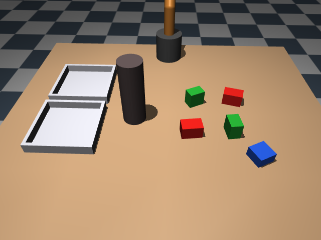
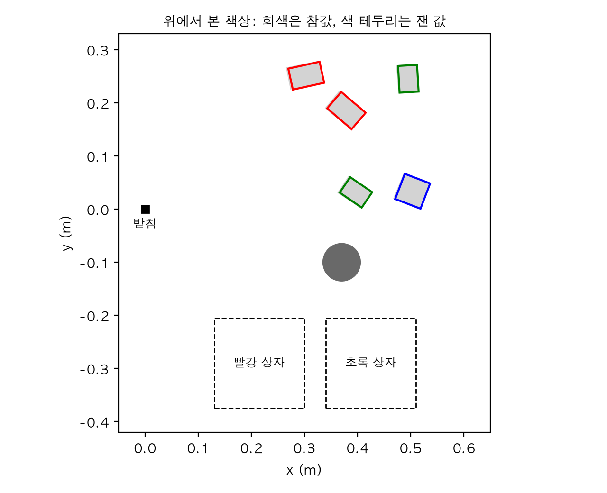
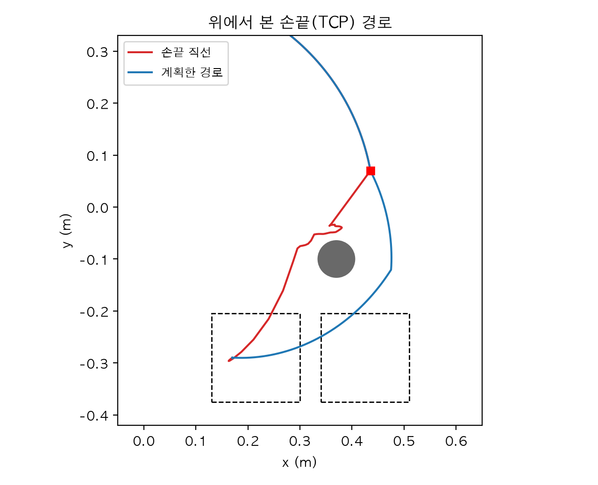
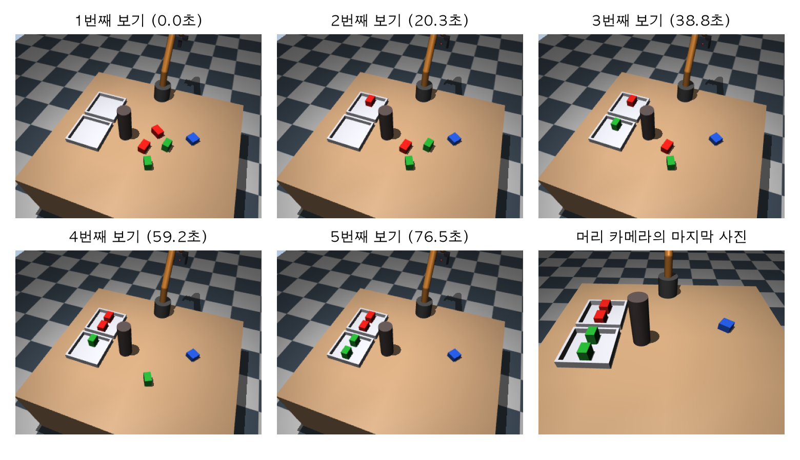
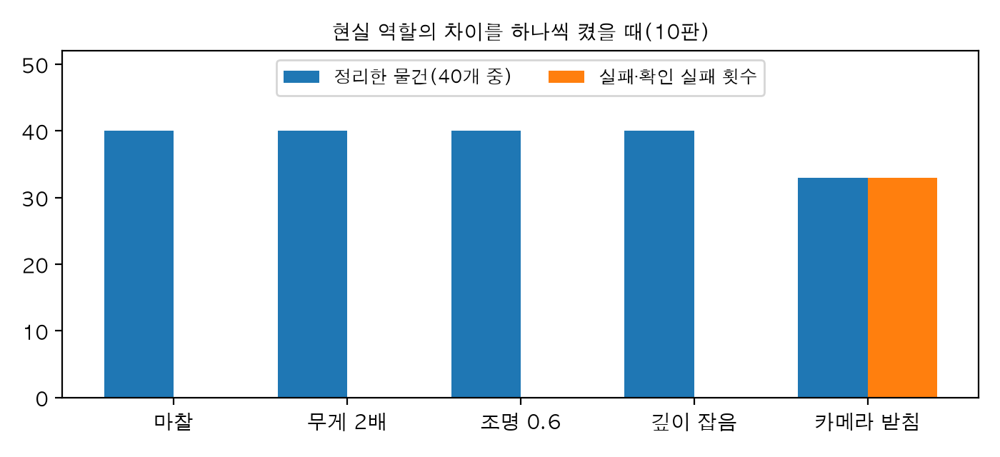

# Chapter 21. 종합 프로젝트: 책상 정리 로봇 팔

> **학습 목표**  
> - 1장의 감지·판단·행동 고리로 시스템을 설계하고, 모듈 사이에 무엇이 오가는지와 실패했을 때 무엇을 할지를 먼저 정하기
> - 9장의 색 분할과 깊이로 같은 색 물건 여럿을 위에서 내려다보듯 나눠 찾고, 가운데·방향·크기를 재기
> - 옮기지 못하는 물건은 까닭과 함께 건너뛰고, 다음에 옮길 물건과 놓을 칸을 고르는 판단 규칙 만들기
> - 손가락이 아래를 보는 자세만 다니게 해서 13장의 RRT를 4차원에서 돌리고, 15장 상태 기계의 접근·옮기기에 끼우기
> - 물건 하나마다 다시 보는 닫힌 고리, 다시 시도, 감시견, 기록으로 실패에서 돌아오기
> - 무작위 배치 여러 판으로 성공률·시간·실패 원인을 재고, 현실 역할 책상에서 범인을 찾아 보정하기
> - SO-101로 옮길 때 바뀌는 곳과 그대로인 곳을 나누고, 20장의 순서대로 실물에 올리는 길 정리하기

---

## 들어가며: 지금까지 만든 부품으로 책상을 치울 수 있을까요?

아이에게 "책상 좀 치우렴"이라고 하면 무슨 일이 일어날까요? 아이는 책상을 한번 훑어보고, 빨간 블록은 빨간 통에, 초록 블록은 초록 통에 넣습니다. 손이 닿지 않는 건 의자를 끌어오거나 어른을 부르고, 모르는 물건은 그냥 두죠. 중간에 동생이 블록 하나를 옮겨 놓아도 아이는 다시 보고 그 자리로 손을 뻗습니다. 사람에게는 너무 쉬워서 일이라고 부르기도 어색한 일이에요.

로봇에게 이 일을 시키려면 이 책에서 만든 거의 모든 부품이 필요합니다. 지금까지는 한 장에 하나씩 부품을 만들고 그 부품 하나를 시험했어요. 이 장은 부품을 한 대의 팔에 모읍니다. 새로 배우는 것은 많지 않고, 대신 **부품을 잇는 접착제**를 만들게 돼요. 무엇을 어디서 가져오는지 먼저 지도로 보겠습니다.

| 해야 할 일 | 가져올 장 | 이 장에서 쓰는 파일 |
|---|---|---|
| 좌표와 변환, 순기구학·역기구학 | 2장, 3장 | 2장 `회전도구.py`, 3장 `팔도구.py`·`야코비안도구.py` |
| 팔·집게·책상 장면 | 4장, 15장, 19장 | 15장 `집게.py`·`팔집게장면.py`, 19장 장면 구조를 고친 `책상장면.py` |
| 물건 찾고 재기 | 9장, 15장, 19장 | 9장 `색찾기.py`, 새로 만드는 `책상인지.py` |
| 다음에 할 일 고르기, 실행 전 검사 | 19장 | 새로 만드는 `작업판단.py` |
| 부딪히지 않는 길 | 13장 | 13장 `표본계획.py`(RRT, 지름길), 새로 만드는 `팔계획.py` |
| 집고 놓기 | 15장 | 15장 `집고놓기.py`·`잡기도구.py`·`경로도구.py` |
| 고리, 감시견, 기록 | 1장 | 새로 만드는 `정리로봇.py` |
| 현실 차이와 안전 | 20장 | 20장의 물성 묶음 생각, 범인 찾기, 보정 |

앞 장의 파일은 그 장 폴더에서 이 장 폴더로 그대로 복사했고, 본문에서는 다시 설명하지 않고 "15장의 `집고놓기`"처럼 출처만 밝힙니다. 이 장에서 새로 쓰는 모듈은 여섯 개예요. 장면, 인지, 판단, 경로 계획, 고리, 평가가 하나씩이고, 21.4절에서 시험용 배치를 적은 작은 파일이 하나 더 있습니다.

> **Q. 앞 장을 다 읽어야 이 장을 따라올 수 있나요?**
> 코드는 모두 이 장 폴더 안에서 돌아가니 실행은 바로 됩니다. 다만 각 부품이 왜 그렇게 생겼는지는 그 장에 있어요. 특히 15장의 집고-놓기 상태 기계와 13장의 RRT는 이 장의 뼈대라서, 낯설면 15.7절과 13.4절을 먼저 훑어 보세요. 예제는 파이썬 3.12, MuJoCo 3.17, NumPy 2.5, SciPy 1.18, OpenCV 5.0, matplotlib 3.11에서 실행해 확인했어요.

## 21.1 요구사항과 설계

### 무엇을 해야 하고, 무엇을 하면 안 되나

코드를 쓰기 전에 할 일을 문장으로 적어 둡니다. 이 문장이 21.7절의 평가 기준이 돼요.

1. 책상 위의 빨간 블록은 빨강 상자에, 초록 블록은 초록 상자에 넣는다
2. 정리 규칙에 없는 물건(파란 블록)은 건드리지 않는다
3. 옮기지 못하는 물건은 억지로 하지 않고 까닭을 남긴다(팔이 닿지 않음, 손가락 자리가 막힘 등)
4. 연필꽂이, 상자 벽, 다른 물건에 부딪히지 않는다
5. 일하는 도중에 사람이 물건을 옮겨도 따라간다
6. 사진이 이상하거나 시간이 너무 걸리면 멈춘다
7. 끝나면 무엇을 했고 무엇을 못 했는지 기록이 남는다

3번과 6번이 눈에 띄죠? 로봇의 요구사항은 "무엇을 하라"만큼 "무엇을 하지 말라"가 중요합니다. 1장 1.7절에서 본 대로 로봇 프로그램의 버그는 물건을 움직이니까요.

### 고리로 그린 설계

1장의 감지·판단·행동 고리를 이 일에 맞춰 적으면 이렇습니다.

- **감지**: 팔을 뒤로 돌린 대기 자세에서 머리 카메라로 컬러와 깊이를 찍고, 물건 목록을 만든다
- **판단**: 목록에서 다음에 옮길 물건 하나와 놓을 칸을 고른다. 옮기지 못하는 물건은 까닭과 함께 건너뛴다
- **행동**: 길을 계획해 집고, 상자에 놓고, 대기 자세로 돌아온다
- 그리고 다시 **감지**: 방금 옮긴 물건이 정말 상자에 들어갔는지 새 사진으로 확인하고, 다음 물건을 고른다

19장 19.7절의 로봇은 한 번 보고 계획을 끝까지 실행했습니다. 고리를 한 번만 돈 셈이었죠. 이 장의 로봇은 **물건 하나를 옮길 때마다 고리를 한 바퀴씩** 돕니다. 19장 끝에서 약속한 "매번 다시 보는 닫힌 고리"예요.

모듈은 고리의 칸을 따라 나눕니다. 모듈 사이를 오가는 것을 좁고 분명하게 정해 두면, 나중에 한 칸을 통째로 바꿔도 다른 칸은 그대로 둘 수 있어요.

| 모듈 | 받는 것 | 내놓는 것 |
|---|---|---|
| `책상장면.py` | 물건 배치, 물성 | MuJoCo 장면, 사진 찍기 |
| `책상인지.py` | 컬러 사진, 깊이 사진 | 물건 목록: 종류, 가운데, 요, 길이·폭·높이, 자리(책상 또는 어느 상자) |
| `작업판단.py` | 물건 목록, 할 종류, 실패한 자리 | 다음 대상 하나, 건너뛴 물건과 까닭 |
| `팔계획.py` | 시작·끝 관절 자세, 장애물 목록, 들고 있는 물건 | 100Hz 관절 목표 목록(길이 없으면 없음) |
| `정리로봇.py` | 위 모듈 전부 | 고리 실행, 기록 |

가운데 세 모듈이 주고받는 것은 **물건 목록** 하나뿐입니다. 물건 하나는 `{"종류": "빨강", "중심": [x, y, z], "요_도": ..., "길이": ..., "폭": ..., "높이": ..., "자리": "책상"}` 같은 사전이에요. 19장의 개방 어휘 검출기로 바꾸고 싶다면 `책상인지.py`가 같은 모양의 목록을 내놓게만 하면 됩니다.

### 실패했을 때의 행동

실패를 미리 표로 정해 둡니다. 어느 칸이 알아차리고 무엇을 하는지예요.

| 상황 | 알아차리는 곳 | 하는 일 |
|---|---|---|
| 내려가다 부딪힘 | 15장 상태 기계의 손목 힘 | 물러나서 대기 자세로, 실패한 자리를 기록 |
| 빈손, 들고 가다 놓침 | 15장 상태 기계의 접촉·너비 | 같다 |
| 길을 찾지 못함 | `팔계획.py` | 같다 |
| 상자에 들어가지 않음 | 다시 찍은 사진(확인) | 확인 실패를 기록 |
| 같은 자리에서 두 번 실패 | `작업판단.py` | 그 물건은 더 건드리지 않고 까닭을 남김 |
| 사진이 이상함 | 감시견 | 대기 자세에서 멈춤 |
| 정해 둔 시간을 넘김 | 감시견 | 멈춤 |

원칙을 한 줄로 줄이면 **"실패하면 물러나서 다시 보고, 모르면 선다"** 입니다. 실패한 다음에도 판단은 늘 새 사진을 보고 다시 해요.

## 21.2 장면: 책상, 블록, 상자, 연필꽂이

### 팔은 15장의 그 팔로

팔은 15장과 19장에서 쓴 3장의 6자유도 예제 팔에 15장의 평행 집게를 단 것입니다. 6장 6.9절에서 본 SO-101의 MJCF를 쓸 수도 있지만, 15장의 역기구학, 집는 자세, 상태 기계가 모두 이 팔에 맞춰 시험되어 있어서 그대로 가져가는 편이 안전해요. SO-101과 무엇이 같고 무엇이 다른지는 21.8절에서 따져 봅니다.

책상에는 세 가지가 놓입니다.

- **블록**: 빨강(6×4×4cm), 초록(5×3.5×5cm), 파랑(5×5×3cm). 빨강·초록은 정리할 물건이고 파랑은 규칙에 없는 물건이다. 노랑은 21.7절에서 카메라 보정용으로만 쓴다
- **정리 상자 두 개**: 안쪽 17×17cm, 벽 높이 3cm. 상자마다 물건을 나란히 놓을 **칸**을 두 개 정해 둔다
- **연필꽂이**: 지름 7cm, 높이 20cm. 블록이 놓이는 곳과 상자 사이를 일부러 막는다

19장의 `지시장면.py` 구조를 고쳐 `책상장면.py`를 만들었습니다. 20장 20.1절처럼 현실에서 다를 수 있는 숫자는 `물성` 데이터 클래스 하나에 모았어요.

```python
"""21장: 15장의 집게 단 팔 앞 책상에 물건 여러 개, 정리 상자 둘, 연필꽂이를 놓는다(19장 지시장면.py를 고친 것)."""
from dataclasses import dataclass

import mujoco
import numpy as np

from 집게 import 집게_몸체, 집게_부속
from 팔도구 import 예제_팔
from 팔집게장면 import 글, 받침_위치

높이, 너비 = 480, 640
카메라_fovy = 50
카메라_위치 = np.array([0.95, 0.0, 0.95])     # 19장과 같은 머리 카메라: 책상 앞쪽 위에서 로봇 쪽을 본다
카메라_목표 = np.array([0.38, -0.02, 0.40])
R_광학_mj = np.diag([1, -1, -1])
책상_높이 = 받침_위치[2]                       # 0.4m

# 종류(색) → (반크기(m), rgba). 빨강·초록은 정리할 물건, 파랑은 규칙에 없는 물건
종류들 = {"빨강": ([0.03, 0.02, 0.02], "0.85 0.12 0.1 1"),
         "초록": ([0.025, 0.0175, 0.025], "0.15 0.65 0.2 1"),
         "파랑": ([0.025, 0.025, 0.015], "0.15 0.35 0.85 1"),
         "노랑": ([0.025, 0.025, 0.02], "0.95 0.8 0.1 1")}     # 노랑은 카메라 보정용 블록
상자들 = {"빨강": np.array([0.215, -0.29]), "초록": np.array([0.425, -0.29])}   # 종류별 정리 상자 가운데(책상에 고정)
상자_안쪽, 상자_벽_높이 = 0.085, 0.03         # 안쪽 반너비 8.5cm(안쪽 17×17cm), 벽 높이 3cm
칸들 = [np.array([-0.045, 0.0]), np.array([0.045, 0.0])]   # 상자 안 놓을 자리 두 칸(상자 가운데 기준, 물건 길이를 x로)
연필꽂이 = (np.array([0.37, -0.10]), 0.035, 0.20)   # 가운데, 반지름, 높이(m): 물건과 상자 사이를 막는다
대기_자세 = np.deg2rad([180, 30, 90, 0, 60, 0])     # 사진 찍을 때 팔을 뒤로 돌려 둔다(19장의 찍는 자세)


@dataclass(frozen=True)
class 물성:
    """시뮬과 '현실 역할'이 다를 수 있는 숫자들(20장 20.1절의 생각을 책상에)."""
    물건_마찰: float = 0.5
    패드_마찰: float = 1.0
    질량_배율: float = 1.0
    밝기: float = 1.0
    깊이_잡음: float = 0.0                       # 깊이 표준편차(m)
    카메라_틀어짐: tuple = (0.0, 0.0, 0.0)        # 실제 카메라 위치가 아는 값에서 벗어난 양(m)


def 바라보기(위치, 목표) -> np.ndarray:
    """위치에서 목표를 보는 카메라의 R_세계_광학(9장)."""
    z = np.asarray(목표, float) - 위치
    z /= np.linalg.norm(z)
    x = np.cross(z, [0, 0, 1])
    x /= np.linalg.norm(x)
    return np.column_stack([x, np.cross(z, x), z])


def 무작위_배치(생성기, 개수={"빨강": 2, "초록": 2, "파랑": 0}, 간격: float = 0.10) -> list[dict]:
    """책상 앞쪽(x 0.28~0.52, y 0~0.26m)에 물건을 서로 간격 이상 떨어뜨려 놓는다."""
    물건들 = []
    for 종류, 수 in 개수.items():
        for _ in range(수):
            while True:
                위치 = 생성기.uniform([0.28, 0.0], [0.52, 0.26])
                if all(np.linalg.norm(위치 - 다른["위치"]) > 간격 for 다른 in 물건들):
                    break
            물건들.append({"이름": f"{종류}{len(물건들)}", "종류": 종류, "위치": 위치,
                        "요": float(생성기.uniform(-90, 90))})
    return 물건들


def 물건_xml(물건: dict, p: 물성) -> str:
    반크기, 색 = 종류들[물건["종류"]]
    return (f'<body name="{물건["이름"]}" pos="{글(물건["위치"])} {책상_높이 + 반크기[2]}" '
            f'euler="0 0 {물건["요"]:.2f}"><freejoint/><geom name="{물건["이름"]}" type="box" size="{글(반크기)}" '
            f'mass="{0.1 * p.질량_배율}" rgba="{색}" contype="1" friction="{p.물건_마찰} 0.005 0.0001"/></body>')


def 상자_xml(종류: str) -> str:
    """바닥판 하나와 벽 넷으로 만든 열린 상자(책상에 붙어 있다)."""
    a, h, 두께 = 상자_안쪽, 상자_벽_높이, 0.005
    벽들 = [(a + 두께, 0, 두께, a + 2 * 두께), (-a - 두께, 0, 두께, a + 2 * 두께),
           (0, a + 두께, a, 두께), (0, -a - 두께, a, 두께)]
    return (f'<body name="상자_{종류}" pos="{글(상자들[종류])} {책상_높이}"><geom type="box" size="{a} {a} 0.0025" '
            f'pos="0 0 0.0025"/>' + "".join(f'<geom type="box" pos="{x} {y} {h / 2}" size="{sx} {sy} {h / 2}"/>'
                                           for x, y, sx, sy in 벽들) + "</body>")


def 장면_xml(물건들: list[dict], p: 물성 = 물성()) -> str:
    몸체들 = []
    for i, (_, 위치, 축) in enumerate(예제_팔):
        다음 = 예제_팔[i + 1][1] if i + 1 < len(예제_팔) else [0, 0, 0.03]
        몸체들.append(f'<body name="link{i + 1}" pos="{글(위치)}" gravcomp="1"><joint name="joint{i + 1}" '
                    f'axis="{글(축)}"/><geom type="capsule" fromto="0 0 0 {글(다음)}" size="0.02" rgba="0.8 0.5 0.2 1"/>')
    실제_위치 = 카메라_위치 + np.asarray(p.카메라_틀어짐)
    R_mj = 바라보기(실제_위치, 카메라_목표 + np.asarray(p.카메라_틀어짐)) @ R_광학_mj
    (펜_x, 펜_y), 펜_r, 펜_h = 연필꽂이
    return f"""
<mujoco model="책상 정리 팔">
  <option timestep="0.002" integrator="implicitfast" cone="elliptic" impratio="10"/>
  <visual><global offwidth="{너비}" offheight="{높이}"/>
    <headlight diffuse="{0.4 * p.밝기:.3f} {0.4 * p.밝기:.3f} {0.4 * p.밝기:.3f}" ambient="{0.1 * p.밝기:.3f} {0.1 * p.밝기:.3f} {0.1 * p.밝기:.3f}"/></visual>
  <asset>
    <texture type="skybox" builtin="gradient" rgb1="0.95 0.95 1" rgb2="0.6 0.7 0.8" width="256" height="256"/>
    <texture name="격자" type="2d" builtin="checker" rgb1="0.25 0.3 0.35" rgb2="0.75 0.75 0.75" width="256" height="256"/>
    <material name="바닥재" texture="격자" texrepeat="8 8"/>
  </asset>
  <default>
    <joint type="hinge" damping="1" armature="0.05"/>
    <geom contype="2" conaffinity="1"/>
    <position kp="400" dampratio="1"/>
    <default class="상자"><geom contype="1" rgba="0.82 0.82 0.85 1"/></default>
  </default>
  <worldbody>
    <light pos="0.6 -0.4 2.5" dir="-0.1 0.15 -1" diffuse="{0.8 * p.밝기:.3f} {0.8 * p.밝기:.3f} {0.8 * p.밝기:.3f}"/>
    <camera name="머리" pos="{글(실제_위치)}" xyaxes="{글(R_mj[:, 0])} {글(R_mj[:, 1])}" fovy="{카메라_fovy}"/>
    <geom name="floor" type="plane" size="2 2 0.1" material="바닥재" contype="1"/>
    <geom name="table" type="box" pos="0.35 0 0.2" size="0.45 0.5 0.2" rgba="0.75 0.6 0.45 1"
          contype="1" friction="0.5 0.005 0.0001"/>
    <geom name="연필꽂이" type="cylinder" pos="{펜_x} {펜_y} {책상_높이 + 펜_h / 2}" size="{펜_r} {펜_h / 2}"
          rgba="0.35 0.3 0.3 1" contype="1"/>
    <body name="base" pos="{글(받침_위치)}">
      <geom type="cylinder" fromto="0 0 0 0 0 0.1" size="0.05" rgba="0.3 0.3 0.3 1"/>
      {"".join(몸체들)}{집게_몸체("0 0 0.05", p.패드_마찰)}{"</body>" * len(예제_팔)}
    </body>
    {"".join(물건_xml(물건, p) for 물건 in 물건들)}
    <frame childclass="상자">{상자_xml("빨강")}{상자_xml("초록")}</frame>
  </worldbody>
  <actuator>
    {"".join(f'<position name="joint{i + 1}" joint="joint{i + 1}"/>' for i in range(len(예제_팔)))}
  </actuator>
  {집게_부속()}
</mujoco>"""


def 찍기(모델, 데이터, p: 물성 = 물성(), 생성기=None) -> tuple[np.ndarray, np.ndarray]:
    """지금 상태 그대로 컬러와 깊이(광학 z, m)를 찍는다. 팔을 대기 자세에 두는 것은 부르는 쪽의 일이다."""
    with mujoco.Renderer(모델, 높이, 너비) as 그리개:
        그리개.update_scene(데이터, camera="머리")
        컬러 = 그리개.render()
        그리개.enable_depth_rendering()
        그리개.update_scene(데이터, camera="머리")
        깊이 = 그리개.render()
    if p.깊이_잡음 > 0:
        깊이 = 깊이 + (생성기 or np.random.default_rng(0)).normal(0, p.깊이_잡음, 깊이.shape)
    return 컬러, 깊이
```

몇 가지만 짚을게요. `무작위_배치`는 물건끼리 가운데를 10cm 넘게 떨어뜨립니다. 가장 긴 빨강 블록의 대각선 절반이 3.6cm라서, 어떻게 돌아가 있어도 서로 겹치지 않는 거리예요. 상자 칸은 상자 가운데에서 x로 ±4.5cm이고, 물건은 길이 방향을 x로 맞춰 놓습니다. 그러면 손가락은 y 방향으로 벌어져서 옆 칸의 물건과 부딪히지 않아요. `대기_자세`는 19장에서 사진을 찍을 때 쓰던 자세인데, 19장은 `qpos`에 바로 써서 팔을 순간 이동시켰지만 이 장에서는 21.5절의 계획 경로로 실제로 움직여 갑니다. `찍기`는 지금 상태를 그대로 찍을 뿐 팔을 옮기지 않아요.

장면을 한 번 찍어 봅시다.

```python
import mujoco
import numpy as np
from PIL import Image

from 책상장면 import 대기_자세, 무작위_배치, 상자들, 연필꽂이, 장면_xml, 찍기

물건들 = 무작위_배치(np.random.default_rng(0), {"빨강": 2, "초록": 2, "파랑": 1})
모델 = mujoco.MjModel.from_xml_string(장면_xml(물건들))
데이터 = mujoco.MjData(모델)
데이터.qpos[:6] = 데이터.ctrl[:6] = 대기_자세              # 팔은 뒤로 돌려 둔 대기 자세에서 시작
for _ in range(500):                                        # 1초 동안 물건이 책상에 자리 잡게 둔다
    mujoco.mj_step(모델, 데이터)
컬러, 깊이 = 찍기(모델, 데이터)
Image.fromarray(컬러).save("desk_scene.png")
for 물건 in 물건들:
    print(f"{물건['이름']}: ({물건['위치'][0]:.3f}, {물건['위치'][1]:.3f}), 요 {물건['요']:6.1f}도")
print("정리 상자:", {종류: tuple(곳.round(3).tolist()) for 종류, 곳 in 상자들.items()},
      f"/ 연필꽂이: {tuple(연필꽂이[0].tolist())}, 높이 {연필꽂이[2]}m")
print(f"자유도: 관절 {모델.njnt}개, qpos {모델.nq}개 / 액추에이터 {모델.nu}개")
print("저장: desk_scene.png")
```

```text
빨강0: (0.433, 0.070), 요  -82.6도
빨강1: (0.284, 0.211), 요   74.3도
초록2: (0.426, 0.190), 요    7.9도
초록3: (0.294, 0.087), 요  -62.9도
파랑4: (0.515, 0.249), 요  -63.2도
정리 상자: {'빨강': (0.215, -0.29), '초록': (0.425, -0.29)} / 연필꽂이: (0.37, -0.1), 높이 0.2m
자유도: 관절 13개, qpos 43개 / 액추에이터 7개
저장: desk_scene.png
```



카메라가 로봇을 마주 보고 있어서 사진의 왼쪽이 로봇의 오른쪽(-y)입니다. 사진에서 위쪽 상자가 로봇에 가까운 빨강 상자(x 0.215m), 아래쪽이 초록 상자(x 0.425m)예요. 관절 13개는 팔 6개, 손가락 2개, 블록마다 하나씩인 `freejoint` 5개입니다. freejoint 하나가 위치 3개와 쿼터니언 4개를 쓰니 `qpos`는 6 + 2 + 5 × 7 = 43개예요.

## 21.3 인지: 사진 한 장에서 물건 목록으로

### 같은 색이 여럿이면

9장의 `물체_찾기`는 색마다 **가장 큰 덩어리 하나**를 돌려줬습니다. 9장의 탁자에는 색마다 물건이 하나였으니 충분했죠. 이 책상에는 빨강이 둘, 초록이 둘입니다. 그러면 사진에서 이어진 픽셀 덩어리를 모두 세면 될까요? 대부분은 되지만, 카메라에서 볼 때 두 블록이 앞뒤로 겹쳐 보이면 사진 속 덩어리는 하나로 붙어 버립니다.

책상 위에서 떨어져 있는 물건은 **위에서 내려다보면** 떨어져 있습니다. 그래서 색이 맞는 픽셀을 9장의 역투영으로 3차원 점으로 바꾼 뒤, 책상보다 높은 점을 위에서 본 격자(한 칸 5mm)에 찍고 이어진 칸끼리 묶어요. 지도를 펼쳐 놓고 섬을 세는 것과 같습니다. 나뉜 덩어리마다 19장 `상자_재기`의 방법(윗면 고르기와 15장 15.3절의 주성분 분석)으로 가운데, 요, 길이, 폭, 높이를 잽니다. 이것이 `책상인지.py`예요.

```python
"""21장: 9장의 색 분할과 깊이로 물건을 모두 찾고, 가운데·요·크기를 잰다(19장 상자_재기를 색 덩어리에)."""
import cv2
import numpy as np

from 색찾기 import 색_마스크
from 책상장면 import 높이, 너비, 바라보기, 상자_안쪽, 상자들, 종류들, 책상_높이, 카메라_fovy, 카메라_목표, 카메라_위치

최소_점수 = 150                       # 이보다 점이 적은 덩어리는 티끌이나 가려진 조각으로 본다


def 점구름(깊이: np.ndarray) -> np.ndarray:
    """깊이 사진의 픽셀마다 세계 기준 3차원 점. 카메라 포즈는 로봇이 '아는' 값(보정 결과)을 쓴다."""
    f = (높이 / 2) / np.tan(np.deg2rad(카메라_fovy) / 2)
    v, u = np.indices(깊이.shape)
    점_광학 = np.stack([(u - (너비 - 1) / 2) / f * 깊이, (v - (높이 - 1) / 2) / f * 깊이, 깊이], axis=-1)
    return 점_광학 @ 바라보기(카메라_위치, 카메라_목표).T + 카메라_위치


def 덩어리_재기(점들: np.ndarray) -> dict | None:
    """덩어리의 점에서 윗면을 골라 주성분 분석으로 가운데·요·길이·폭·높이를 잰다(15장 15.3절)."""
    위 = 점들[점들[:, 2] > 책상_높이 + 0.01]
    if len(위) < 20:
        return None
    윗면_높이 = np.percentile(위[:, 2], 90)
    윗면 = 위[위[:, 2] > 윗면_높이 - 0.005][:, :2]
    중심 = 윗면.mean(axis=0)
    _, 고유벡터 = np.linalg.eigh(np.cov((윗면 - 중심).T))
    투영 = (윗면 - 중심) @ 고유벡터
    return {"중심": np.array([*중심, (책상_높이 + 윗면_높이) / 2]),
            "요_도": float(np.rad2deg(np.arctan2(고유벡터[1, 1], 고유벡터[0, 1]))),
            "길이": float(np.ptp(투영[:, 1])), "폭": float(np.ptp(투영[:, 0])), "높이": float(윗면_높이 - 책상_높이)}


def 어느_상자(중심) -> str | None:
    """가운데가 정리 상자 안쪽에 있으면 그 상자의 종류."""
    return next((종류 for 종류, 곳 in 상자들.items() if np.all(np.abs(중심[:2] - 곳) < 상자_안쪽)), None)


def 위에서_나누기(점들: np.ndarray, 칸: float = 0.005) -> list[np.ndarray]:
    """책상보다 높은 점을 위에서 내려다본 격자에 찍고 이어진 칸끼리 묶는다.
    사진에서는 앞뒤로 겹쳐 한 덩어리로 보여도, 책상 위에서 떨어져 있으면 따로 나뉜다."""
    위 = 점들[점들[:, 2] > 책상_높이 + 0.01]
    if len(위) == 0:
        return []
    칸번호 = np.floor((위[:, :2] - 위[:, :2].min(axis=0)) / 칸).astype(int)
    격자 = np.zeros(칸번호.max(axis=0) + 1, np.uint8)
    격자[칸번호[:, 0], 칸번호[:, 1]] = 255
    격자 = cv2.morphologyEx(격자, cv2.MORPH_CLOSE, np.ones((3, 3), np.uint8))   # 표본 사이 빈칸 메우기
    _, 표시 = cv2.connectedComponents(격자)
    묶음 = 표시[칸번호[:, 0], 칸번호[:, 1]]
    return [위[묶음 == k] for k in np.unique(묶음) if k > 0]


def 물건_찾기(컬러: np.ndarray, 깊이: np.ndarray, 보정=(0.0, 0.0, 0.0)) -> list[dict]:
    """색마다 물건을 모두 찾아 잰다. 책상 위 물건과 상자 안 물건을 '자리'로 나눈다.
    보정: 알려진 자리의 물건을 재서 얻은 치우침(m). 잰 점에서 빼 준다(21.7절)."""
    점들 = 점구름(깊이) - np.asarray(보정)
    물건들 = []
    for 종류 in 종류들:
        for 덩어리 in 위에서_나누기(점들[색_마스크(컬러, 종류) > 0]):
            if len(덩어리) >= 최소_점수 and (잰 := 덩어리_재기(덩어리)) is not None:
                물건들.append({"종류": 종류, **잰, "자리": 어느_상자(잰["중심"]) or "책상"})
    return 물건들
```

`점구름`은 카메라 포즈로 장면 파일의 값이 아니라 **로봇이 알고 있는 값**(`카메라_위치`, `카메라_목표`)을 씁니다. 19장에서는 MuJoCo가 알려 주는 카메라 포즈를 썼는데, 실물에서는 그런 정답이 없으니까요. 21.7절에서 이 차이가 큰일을 냅니다. `물건_찾기`의 `보정`도 그때 쓰니 지금은 0이라고 생각하세요.

두 블록이 사진에서 겹쳐 보이는 배치에서 세 방법을 비교해 봅시다.

```python
import cv2
import mujoco
import numpy as np

from 색찾기 import 물체_찾기, 색_마스크
from 책상인지 import 점구름, 위에서_나누기
from 책상장면 import 대기_자세, 무작위_배치, 장면_xml, 찍기

물건들 = 무작위_배치(np.random.default_rng(18), {"빨강": 2, "초록": 2, "파랑": 1})
모델 = mujoco.MjModel.from_xml_string(장면_xml(물건들))
데이터 = mujoco.MjData(모델)
데이터.qpos[:6] = 데이터.ctrl[:6] = 대기_자세
mujoco.mj_forward(모델, 데이터)
컬러, 깊이 = 찍기(모델, 데이터)
점들 = 점구름(깊이)

아홉장 = 물체_찾기(컬러)                                          # 9장: 색마다 가장 큰 덩어리 하나
for 종류 in ["빨강", "초록", "파랑"]:
    마스크 = 색_마스크(컬러, 종류)
    개수, _, 통계, _ = cv2.connectedComponentsWithStats(마스크)
    사진_덩어리 = int(np.sum(통계[1:, cv2.CC_STAT_AREA] >= 150))     # 사진에서 이어진 픽셀 덩어리
    위에서 = 위에서_나누기(점들[마스크 > 0])                          # 책상 위에서 내려다보고 나눈 덩어리
    print(f"{종류}: 실제 {sum(물건['종류'] == 종류 for 물건 in 물건들)}개 / 9장 방식 {int(종류 in 아홉장)}개 / "
          f"사진 덩어리 {사진_덩어리}개 / 위에서 나누면 {len(위에서)}개 {[len(덩어리) for 덩어리 in 위에서]}점")
```

```text
빨강: 실제 2개 / 9장 방식 1개 / 사진 덩어리 1개 / 위에서 나누면 2개 [1243, 1340]점
초록: 실제 2개 / 9장 방식 1개 / 사진 덩어리 2개 / 위에서 나누면 2개 [1276, 1802]점
파랑: 실제 1개 / 9장 방식 1개 / 사진 덩어리 1개 / 위에서 나누면 1개 [1517]점
```

9장 방식은 색마다 하나씩만 찾으니 빨강과 초록을 하나씩 놓쳤습니다. 사진 덩어리를 모두 세도 빨강은 하나였어요. 두 빨강 블록이 카메라에서 볼 때 앞뒤로 겹쳐 한 덩어리가 된 것입니다. 위에서 나누자 1243점과 1340점짜리 두 덩어리로 갈라졌어요.

### 얼마나 정확한가

같은 배치에서 잰 값을 참값과 견주고, 위에서 본 지도로 그려 봅니다.

```python
import matplotlib.pyplot as plt
import mujoco
import numpy as np
from matplotlib.patches import Circle, Rectangle

from 책상인지 import 물건_찾기
from 책상장면 import 대기_자세, 무작위_배치, 상자_안쪽, 상자들, 연필꽂이, 장면_xml, 종류들, 찍기

plt.rcParams["font.family"] = "AppleGothic"
plt.rcParams["axes.unicode_minus"] = False

물건들 = 무작위_배치(np.random.default_rng(18), {"빨강": 2, "초록": 2, "파랑": 1})
모델 = mujoco.MjModel.from_xml_string(장면_xml(물건들))
데이터 = mujoco.MjData(모델)
데이터.qpos[:6] = 데이터.ctrl[:6] = 대기_자세
mujoco.mj_forward(모델, 데이터)
잰_것들 = 물건_찾기(*찍기(모델, 데이터))


def 직사각형(중심, 요_도, 길이, 폭, **모양) -> Rectangle:
    """가운데·요·크기로 위에서 본 직사각형을 만든다."""
    ψ = np.deg2rad(요_도)
    구석 = np.asarray(중심[:2]) - np.array([[np.cos(ψ), -np.sin(ψ)], [np.sin(ψ), np.cos(ψ)]]) @ [길이 / 2, 폭 / 2]
    return Rectangle(구석, 길이, 폭, angle=요_도, **모양)


그림, 칸 = plt.subplots(figsize=(6.4, 5.2))
for 물건 in 물건들:
    반 = 종류들[물건["종류"]][0]
    칸.add_patch(직사각형(물건["위치"], 물건["요"], 2 * 반[0], 2 * 반[1], color="lightgray"))
for 잰 in 잰_것들:
    참 = min(물건들, key=lambda 물건: np.linalg.norm(물건["위치"] - 잰["중심"][:2]))
    요_차이 = (잰["요_도"] - 참["요"] + 90) % 180 - 90                # 상자는 180도 돌려도 같은 모양
    print(f"{잰['종류']}: 가운데 ({잰['중심'][0]:.3f}, {잰['중심'][1]:.3f}, {잰['중심'][2]:.3f}) "
          f"오차 {np.linalg.norm(잰['중심'][:2] - 참['위치']) * 1000:3.1f}mm, 요 오차 {요_차이:5.1f}도, "
          f"크기 {잰['길이'] * 100:.1f}×{잰['폭'] * 100:.1f}×{잰['높이'] * 100:.1f}cm, 자리 {잰['자리']}")
    칸.add_patch(직사각형(잰["중심"], 잰["요_도"], 잰["길이"], 잰["폭"], fill=False,
                       edgecolor={"빨강": "red", "초록": "green", "파랑": "blue"}[잰["종류"]], linewidth=1.5))
for 종류, 곳 in 상자들.items():
    칸.add_patch(Rectangle(곳 - 상자_안쪽, 2 * 상자_안쪽, 2 * 상자_안쪽, fill=False, edgecolor="k", linestyle="--"))
    칸.text(곳[0], 곳[1], f"{종류} 상자", ha="center", va="center", fontsize=9)
칸.add_patch(Circle(연필꽂이[0], 연필꽂이[1], color="dimgray"))
칸.plot(0, 0, "ks")
칸.text(0.0, -0.035, "받침", ha="center", fontsize=9)
칸.set(xlim=(-0.05, 0.65), ylim=(-0.42, 0.33), aspect="equal", xlabel="x (m)", ylabel="y (m)")
칸.set_title("위에서 본 책상: 회색은 참값, 색 테두리는 잰 값", fontsize=10)
그림.tight_layout()
그림.savefig("measured_map.png", dpi=200)
print("저장: measured_map.png")
```

```text
빨강: 가운데 (0.303, 0.251, 0.420) 오차 3.6mm, 요 오차   0.8도, 크기 6.0×4.0×4.0cm, 자리 책상
빨강: 가운데 (0.379, 0.186, 0.420) 오차 3.2mm, 요 오차  -1.1도, 크기 6.0×4.1×4.0cm, 자리 책상
초록: 가운데 (0.397, 0.032, 0.425) 오차 2.8mm, 요 오차  -0.7도, 크기 5.0×3.5×5.0cm, 자리 책상
초록: 가운데 (0.495, 0.245, 0.425) 오차 2.4mm, 요 오차  -1.3도, 크기 5.0×3.6×5.0cm, 자리 책상
파랑: 가운데 (0.504, 0.034, 0.415) 오차 2.5mm, 요 오차   1.5도, 크기 5.1×5.1×3.0cm, 자리 책상
저장: measured_map.png
```



가운데 오차는 2.4~3.6mm, 요 오차는 1.5도 안쪽이고, 크기는 장면 파일에 적은 그대로 나왔습니다. 9장 9.9절이나 15장 15.8절에서 가정한 1cm보다 훨씬 작아요. 깊이 사진을 쓰는 데다 카메라 포즈를 정확히 알고 있어서입니다. 이 "정확히 알고 있다"가 언제까지 참일지는 21.7절에서 보겠습니다. 파랑은 정사각형이라 길이와 폭이 같으니 요가 뜻이 없는데(19장의 공처럼), 파랑은 집지 않으니 상관없어요.

> **Q. 19장의 개방 어휘 검출기로 바꾸려면 어떻게 하나요?**
> `물건_찾기` 안에서 색 마스크를 만드는 자리를 검출 상자로 바꾸고, `종류`에 검출기의 글을 넣으면 됩니다. 판단과 계획은 물건 목록만 보니 그대로예요. 이 책상처럼 색이 뚜렷한 블록에는 색이 더 빠르고 결정적이지만, 펜·지우개·컵처럼 모양이 제각각인 물건을 종류별로 나누려면 19장의 방법이 필요합니다. 그때도 19장에서 본 "검출 상자 안의 가장 높은 면이 그 물체"라는 가정이 물건이 겹치면 깨진다는 점은 이 장의 위에서 나누기로 보완할 수 있어요.

## 21.4 작업 계획: 무엇을 어떤 순서로

### 못 옮기는 물건 먼저 걸러내기

물건 목록이 생겼으니 다음에 무엇을 옮길지 정합니다. 19장 19.5절에서 계획을 실행하기 전에 검사했던 것처럼, 여기서도 물건마다 **옮기면 안 되는 까닭**이 있는지 먼저 봅니다. 까닭이 없는 물건 가운데 받침(로봇)에 가장 가까운 것을 고르고요. `작업판단.py`입니다.

```python
"""21장: 책상 위 물건 목록에서 다음에 옮길 물건을 고른다. 못 옮기는 물건은 까닭과 함께 건너뛴다."""
import numpy as np

from 잡기도구 import TCP_포즈, 역기구학, 집기_포즈
from 집게 import 손가락_최대
from 집고놓기 import 들기_높이
from 책상장면 import 상자들, 칸들
from 팔집게장면 import 집_자세

최대_시도 = 2                                   # 같은 자리의 물건에 이만큼 실패하면 건드리지 않는다
집을_수_있는_폭 = 2 * 손가락_최대 - 0.01        # 손가락을 다 벌려도 1cm는 남아야 한다(19장)


def 닿나(위치) -> bool:
    """손가락을 아래로 한 채 위치와 들기 높이까지 닿는가(19장 계획도구.py와 같다)."""
    for 위로 in (0.0, 들기_높이):
        T = 집기_포즈(np.asarray(위치) + [0, 0, 위로], 0.0)
        if np.linalg.norm(T[:3, 3] - TCP_포즈(역기구학(T, 집_자세, 반복=200))[:3, 3]) > 0.001:
            return False
    return True


def 손가락_막힘(물건: dict, 물건들: list[dict]) -> bool:
    """손가락을 다 벌렸을 때 두 손가락 자리(물건의 폭 방향 양쪽)에 다른 물건이 걸리는가."""
    ψ = np.deg2rad(물건["요_도"])
    for 부호 in (1, -1):
        손가락 = 물건["중심"][:2] + 부호 * (손가락_최대 + 0.006) * np.array([-np.sin(ψ), np.cos(ψ)])
        for 다른 in (다른 for 다른 in 물건들 if 다른 is not 물건):
            φ = np.deg2rad(다른["요_도"])
            x, y = np.array([[np.cos(φ), np.sin(φ)], [-np.sin(φ), np.cos(φ)]]) @ (손가락 - 다른["중심"][:2])
            if abs(x) < 다른["길이"] / 2 + 0.015 and abs(y) < 다른["폭"] / 2 + 0.01:   # 다른 물건 틀에서 본 손가락
                return True
    return False


def 빈_칸(종류: str, 물건들: list[dict]) -> np.ndarray | None:
    """그 종류 상자에서 아무 물건도 3cm 안에 없는 첫 칸(세계 기준 xy)."""
    for 칸 in 칸들:
        if all(np.linalg.norm(물건["중심"][:2] - (상자들[종류] + 칸)) > 0.03 for 물건 in 물건들):
            return 상자들[종류] + 칸
    return None


def 못_옮기는_까닭(물건: dict, 물건들: list[dict], 할_종류, 실패_자리: list) -> str:
    """빈 글이면 옮겨도 된다. 싼 검사부터 하고, 역기구학이 드는 검사는 뒤에 둔다."""
    if 물건["종류"] not in 할_종류:
        return "정리 규칙에 없는 종류"
    if sum(np.linalg.norm(물건["중심"][:2] - 곳) < 0.03 for 곳 in 실패_자리) >= 최대_시도:
        return f"{최대_시도}번 실패"
    if 빈_칸(물건["종류"], 물건들) is None:
        return "상자가 가득 참"
    if 물건["폭"] > 집을_수_있는_폭:
        return "집게보다 넓음"
    if 손가락_막힘(물건, 물건들):
        return "손가락 자리가 막힘"
    if not 닿나(물건["중심"]):
        return "팔이 닿지 않음"
    return ""


def 고르기(물건들: list[dict], 할_종류, 실패_자리: list) -> tuple[dict | None, list[str]]:
    """책상 위에서 옮길 수 있는 물건 중 받침(로봇)에 가장 가까운 것, 그리고 건너뛴 물건과 까닭."""
    후보, 건너뜀 = [], []
    for 물건 in (물건 for 물건 in 물건들 if 물건["자리"] == "책상"):
        if 까닭 := 못_옮기는_까닭(물건, 물건들, 할_종류, 실패_자리):
            건너뜀.append(f"{물건['종류']}({물건['중심'][0]:.2f}, {물건['중심'][1]:.2f}) {까닭}")
        else:
            후보.append(물건)
    return min(후보, key=lambda 물건: np.linalg.norm(물건["중심"][:2]), default=None), 건너뜀
```

검사는 일부러 순서를 정해 두었습니다. 종류, 실패 횟수, 상자 칸, 폭, 손가락 자리처럼 계산이 싼 것부터 보고, 역기구학을 두 번 풀어야 하는 `닿나`를 맨 뒤에 둬요. 앞에서 걸러지면 비싼 검사는 하지 않습니다.

새로 생긴 검사는 `손가락_막힘`입니다. 15장의 집게는 손가락을 8cm까지 벌린 채 내려가는데, 그 자리에 옆 물건이 있으면 15장 15.8절처럼 "내려가다 부딪힘"으로 실패해요. 그래서 두 손가락이 내려갈 자리를 옆 물건의 틀에서 보고(2장의 좌표 바꾸기), 옆 물건의 반크기에 패드 크기만큼 더한 범위 안이면 막혔다고 합니다. 부딪히고 나서 알아차리는 것보다 부딪히기 전에 피하는 편이 물건에도 팔에도 좋죠.

순서 규칙 "받침에 가까운 것부터"는 가장 단순한 규칙입니다. 가까운 물건은 팔을 덜 뻗으니 빠르고, 손 닿기도 쉬워요. 상자에 가까운 것부터, 옆 물건을 막고 있는 것부터 같은 규칙도 쓸 수 있고, 21.7절의 평가로 비교해 볼 수 있습니다.

### 손으로 놓은 배치로 시험하기

판단 규칙을 시험하려고 일부러 까다로운 배치를 손으로 만들었습니다. 초록B는 손가락 자리에 빨강C가 걸리고, 초록E는 받침에서 0.65m 떨어져 있어요.

```python
"""21.4절: 판단 규칙을 시험하려고 손으로 놓은 배치. 손가락 자리가 막힌 물건, 먼 물건, 규칙에 없는 물건이 있다."""
import numpy as np

손_배치 = [
    {"이름": "빨강A", "종류": "빨강", "위치": np.array([0.33, 0.05]), "요": 0.0},
    {"이름": "초록B", "종류": "초록", "위치": np.array([0.45, 0.10]), "요": 0.0},    # 손가락이 빨강C에 걸린다
    {"이름": "빨강C", "종류": "빨강", "위치": np.array([0.45, 0.17]), "요": 90.0},
    {"이름": "파랑D", "종류": "파랑", "위치": np.array([0.30, 0.22]), "요": 20.0},
    {"이름": "초록E", "종류": "초록", "위치": np.array([0.60, 0.25]), "요": 0.0},    # 받침에서 0.65m
]
```

19장의 언어 지시도 선택 입력으로 붙여 봅니다. 19장 19.5절의 규칙 계획기를 아주 작게 줄여서, "빨간 것만"처럼 '만'이 붙은 색이 있으면 그 종류만 정리하게 했어요.

```python
import mujoco

from 손배치 import 손_배치
from 작업판단 import 고르기
from 책상인지 import 물건_찾기
from 책상장면 import 대기_자세, 상자들, 장면_xml, 찍기

모델 = mujoco.MjModel.from_xml_string(장면_xml(손_배치))
데이터 = mujoco.MjData(모델)
데이터.qpos[:6] = 데이터.ctrl[:6] = 대기_자세
mujoco.mj_forward(모델, 데이터)
물건들 = 물건_찾기(*찍기(모델, 데이터))


def 지시_종류(지시: str) -> tuple[str, ...]:
    """'빨간 것만'처럼 '만'이 붙은 색만 고른다. 그 밖의 말은 모든 종류(19장 규칙 계획기의 아주 작은 판)."""
    색_말 = {"빨간": "빨강", "초록": "초록", "파란": "파랑"}
    고른 = tuple(종류 for 말, 종류 in 색_말.items() if 말 in 지시)
    return 고른 if 고른 and "만" in 지시 else tuple(상자들)


for 지시 in ["책상 좀 치워 줘", "빨간 것만 치워 줘", "초록 블록만 정리해"]:
    대상, 건너뜀 = 고르기(물건들, 지시_종류(지시), 실패_자리=[])
    다음 = f"{대상['종류']}({대상['중심'][0]:.2f}, {대상['중심'][1]:.2f})" if 대상 else "없음"
    print(f"[{지시}] 할 종류 {지시_종류(지시)} → 다음 대상: {다음}")
    for 글 in 건너뜀:
        print("   건너뜀:", 글)
```

```text
[책상 좀 치워 줘] 할 종류 ('빨강', '초록') → 다음 대상: 빨강(0.33, 0.05)
   건너뜀: 초록(0.45, 0.10) 손가락 자리가 막힘
   건너뜀: 초록(0.60, 0.25) 팔이 닿지 않음
   건너뜀: 파랑(0.30, 0.22) 정리 규칙에 없는 종류
[빨간 것만 치워 줘] 할 종류 ('빨강',) → 다음 대상: 빨강(0.33, 0.05)
   건너뜀: 초록(0.45, 0.10) 정리 규칙에 없는 종류
   건너뜀: 초록(0.60, 0.25) 정리 규칙에 없는 종류
   건너뜀: 파랑(0.30, 0.22) 정리 규칙에 없는 종류
[초록 블록만 정리해] 할 종류 ('초록',) → 다음 대상: 없음
   건너뜀: 빨강(0.33, 0.05) 정리 규칙에 없는 종류
   건너뜀: 빨강(0.45, 0.17) 정리 규칙에 없는 종류
   건너뜀: 초록(0.45, 0.10) 손가락 자리가 막힘
   건너뜀: 초록(0.60, 0.25) 팔이 닿지 않음
   건너뜀: 파랑(0.30, 0.22) 정리 규칙에 없는 종류
```

"책상 좀 치워 줘"에서는 빨강A가 첫 대상이고, 나머지 셋은 까닭과 함께 건너뛰었습니다. 초록B는 손가락 자리가 막혔고, 초록E는 팔이 닿지 않고, 파랑D는 규칙에 없어요. "빨간 것만"이면 초록과 파랑은 모두 규칙 밖입니다.

마지막 지시가 재미있습니다. "초록 블록만"이라고 하자 할 일이 **없음**이 됐어요. 초록B는 빨강C에 막혔는데, 이 지시에서는 빨강C를 옮기면 안 되니 영영 풀리지 않습니다. 로봇은 억지로 집으려 하지 않고 까닭을 남겼어요. 말로 준 제약이 할 일을 막는 일은 실제로 자주 생기고, 그때 "왜 못 하는지"를 사람에게 알려 주는 것이 판단 칸의 몫입니다.

### 고리를 돌리면 막힌 것이 풀린다

"책상 좀 치워 줘"를 끝까지 실행해 봅시다. 고리의 코드(`정리로봇.py`)는 21.5절에서 보고, 여기서는 기록만 읽어요.

```python
import mujoco

from 손배치 import 손_배치
from 정리로봇 import 정리로봇
from 책상장면 import 장면_xml

모델 = mujoco.MjModel.from_xml_string(장면_xml(손_배치))
데이터 = mujoco.MjData(모델)
for 시각, 무엇, 메모 in 정리로봇(모델, 데이터).정리():
    print(f"{시각:5.1f}초  {무엇:5s} {메모}")
```

```text
 13.1초  옮기기   빨강(0.33, 0.05) 완료
 20.7초  확인    빨강 상자 안 0개 → 1개
 33.3초  옮기기   빨강(0.45, 0.17) 완료
 39.6초  확인    빨강 상자 안 1개 → 2개
 51.2초  옮기기   초록(0.45, 0.10) 완료
 57.3초  확인    초록 상자 안 0개 → 1개
 57.3초  끝     초록(0.60, 0.25) 팔이 닿지 않음 / 파랑(0.30, 0.22) 정리 규칙에 없는 종류
```

빨강A를 옮긴 뒤 다시 봤을 때 다음으로 가까운 것은 여전히 막힌 초록B가 아니라 빨강C였습니다. 빨강C를 치우고 나서 다시 보자 초록B의 손가락 자리가 비었고, 51.2초에 초록B를 옮겼어요. 처음 판단에서는 건너뛰었던 물건이 **다시 보고 다시 판단한 덕분에** 풀린 것입니다. 끝까지 남은 두 물건은 기록의 마지막 줄에 까닭이 적혀 있어요. 요구사항 2, 3, 7번이 지켜졌습니다.

## 21.5 동작: 계획한 길로 집고 놓기

### 손가락이 아래를 보는 자세는 숫자 넷

15장의 상태 기계는 접근과 옮기기를 손끝(TCP) 직선으로 갔습니다. 책상 한가운데 연필꽂이가 서 있으면 그 직선이 연필꽂이를 지나갈 수 있죠. 13장의 RRT로 돌아가는 길을 찾아야 합니다.

그런데 관절이 여섯 개라 관절 공간이 6차원이에요. 13장 13.4절에서 본 대로 차원이 높을수록 표본이 많이 필요합니다. 여기서 이 팔의 생김새를 보면 차원을 줄일 수 있어요. 3장의 예제 팔에서 어깨, 팔꿈치, 손목2는 모두 y축 관절이라 각도가 그대로 더해집니다. 15장의 출발 자세가 30 + 90 + 60 = 180도였던 것처럼, **손목1이 0이고 세 각의 합이 180도면 손가락은 바로 아래를 봐요.** 실제로 15장의 역기구학이 내놓는 집는 자세도 늘 이 모양이었습니다(21.8절에서 한 판 동안 보낸 명령을 모두 기록해 보면, 손목1은 한 번도 0에서 움직이지 않아요). 남는 것은 허리, 어깨, 팔꿈치, 그리고 손가락이 벌어지는 방향인 집게 요, 숫자 넷입니다. 손목3은 집게 요 = 허리 + 180도 - 손목3에서 정해져요.

그래서 RRT를 이 4차원에서 돌립니다. 그러면 계획한 길 위의 어느 자세에서든 손가락이 아래를 보니, 들고 가는 블록이 기울어지지도 않아요. 충돌 검사는 13장 13.7절처럼 MuJoCo에 맡기되 방법을 바꿨습니다. 13장은 팔 마디와 기둥의 짝마다 `mj_geomDistance`로 거리를 물었는데, 이번에는 팔 마디, 손바닥, 손가락, 들고 있는 블록과 책상, 연필꽂이, 상자 벽, 다른 블록의 짝이 백 개가 넘어요. 그래서 세상 쪽 모양에 `margin`(여유)을 주고 MuJoCo의 접촉 판정을 한 번 부릅니다. 두 모양이 여유 안으로 들어오면 접촉이 생기니, 접촉 수가 0이 아니면 부딪힌 것이에요. 로봇 몸끼리, 세상끼리는 `contype`과 `conaffinity`로 짝을 지어 아예 검사하지 않습니다. `팔계획.py`입니다.

```python
"""21장: 손가락이 늘 아래를 보는 자세만으로 13장의 RRT를 돌려, 장애물을 피하는 관절 경로를 만든다."""
import mujoco
import numpy as np

from 경로도구 import 관절_경로
from 집게 import TCP, 집게_몸체
from 책상장면 import 상자_xml, 연필꽂이, 책상_높이
from 팔도구 import 예제_팔
from 팔집게장면 import 글, 받침_위치
from 표본계획 import RRT, 지름길

여유 = 0.02                     # 장애물과 이만큼(m) 가까우면 부딪힌 것으로 친다(13장 13.7절의 여유)
v최대 = 1.0                     # 관절 최대 속도(rad/s)
하한 = np.deg2rad([-120, -30, 0, -360])      # 상태 = (허리, 어깨, 팔꿈치, 집게 요)의 표본 범위
상한 = np.deg2rad([200, 120, 150, 360])


def 관절로(c) -> np.ndarray:
    """상태 4개 → 관절 6개. 손목1 = 0, 어깨 + 팔꿈치 + 손목2 = 180도면 손가락이 바로 아래를 본다."""
    허리, 어깨, 팔꿈치, 요 = c
    return np.array([허리, 어깨, 팔꿈치, 0.0, np.pi - 어깨 - 팔꿈치, 허리 + np.pi - 요])


def 상태로(q) -> np.ndarray:
    return np.array([q[0], q[1], q[2], q[0] + np.pi - q[5]])


def 계획_xml(장애물: list[dict], 든_것: dict | None) -> str:
    """계획 전용 모델: 로봇 몸(contype 1)과 세상(conaffinity 1)만 서로 닿는지 본다. 세상에는 여유를 준다."""
    몸체들 = "".join(f'<body name="link{i + 1}" pos="{글(위치)}"><joint axis="{글(축)}"/><geom type="capsule" '
                  f'fromto="0 0 0 {글(예제_팔[i + 1][1] if i + 1 < len(예제_팔) else [0, 0, 0.03])}" size="0.02"/>'
                  for i, (_, 위치, 축) in enumerate(예제_팔))
    손 = 집게_몸체("0 0 0.05")
    if 든_것 is not None:                     # 들고 있는 물건은 손의 일부: TCP에 물건 가운데가 온다
        반 = [든_것["길이"] / 2, 든_것["폭"] / 2, 든_것["높이"] / 2]
        손 = 손[:손.rfind("</body>")] + f'<geom type="box" pos="0 0 {TCP}" size="{글(반)}"/></body>'
    물건들 = "".join(f'<geom type="box" pos="{글(물건["중심"])}" euler="0 0 {물건["요_도"]:.1f}" '
                  f'size="{글([물건["길이"] / 2, 물건["폭"] / 2, 물건["높이"] / 2])}"/>' for 물건 in 장애물)
    (펜_x, 펜_y), 펜_r, 펜_h = 연필꽂이
    return f"""
<mujoco><default><joint type="hinge"/><geom contype="1" conaffinity="0"/>
  <default class="세상"><geom contype="0" conaffinity="1" margin="{여유}"/></default></default>
  <worldbody>
    <frame childclass="세상">
      <geom type="box" pos="0.35 0 0.2" size="0.45 0.5 0.2"/>
      <geom type="cylinder" pos="{펜_x} {펜_y} {책상_높이 + 펜_h / 2}" size="{펜_r} {펜_h / 2}"/>
      {상자_xml("빨강")}{상자_xml("초록")}{물건들}
    </frame>
    <body pos="{글(받침_위치)}">{몸체들}{손}{"</body>" * len(예제_팔)}</body>
  </worldbody>
</mujoco>"""


class 충돌검사기:
    def __init__(self, 장애물: list[dict], 든_것: dict | None = None):
        self.모델 = mujoco.MjModel.from_xml_string(계획_xml(장애물, 든_것))
        self.데이터 = mujoco.MjData(self.모델)
        self.손가락 = (든_것["폭"] / 2 + 0.002) if 든_것 else 0.04      # 쥐고 있으면 물건 폭만큼 벌어져 있다
        self.검사_수 = 0

    def 충돌(self, c) -> bool:
        """상태 c에서 몸과 세상이 여유 안으로 들어오는가. 13장처럼 짝마다 묻지 않고 접촉 판정 한 번으로."""
        self.검사_수 += 1
        self.데이터.qpos[:6] = 관절로(c)
        self.데이터.qpos[6:8] = self.손가락
        mujoco.mj_kinematics(self.모델, self.데이터)
        mujoco.mj_collision(self.모델, self.데이터)
        return self.데이터.ncon > 0

    def 선분_충돌(self, c1, c2, 간격: float = 0.03) -> bool:
        개수 = int(np.ceil(np.linalg.norm(c2 - c1) / 간격)) + 1
        return any(self.충돌(c1 + t * (c2 - c1)) for t in np.linspace(0, 1, 개수))


def 계획(q_시작, q_끝, 검사기: 충돌검사기, 생성기) -> list[np.ndarray] | None:
    """곧게 갈 수 있으면 곧게, 막혔으면 RRT + 지름길(13장). 100Hz 관절 목표 목록, 길이 없으면 None."""
    c_시작, c_끝 = 상태로(q_시작), 상태로(q_끝)
    if not 검사기.선분_충돌(c_시작, c_끝):
        경유점 = [c_시작, c_끝]                 # 관절 공간의 곧은 선(손끝은 휘어 간다)
    else:
        경유점, _, _, _ = RRT(c_시작, c_끝, 검사기.선분_충돌, 하한, 상한, 생성기, 걸음=0.3, 최대_반복=3000)
        if 경유점 is None:
            return None
        경유점 = 지름길(경유점, 검사기.선분_충돌, 생성기)
    검사기.경유점_수 = len(경유점)
    경로, q = [], 관절로(경유점[0])
    for c in 경유점[1:]:                       # 경유점마다 멈췄다 간다. 가장 많이 도는 관절이 v최대를 넘지 않게
        다음 = 관절로(c)
        경로 += 관절_경로(q, 다음, max(0.3, 1.5 * np.abs(다음 - q).max() / v최대))
        q = 다음
    return 경로
```

계획용 모델은 진짜 장면과 따로 만듭니다. 질량도 액추에이터도 없이 모양만 있는 가벼운 모델이고, 장애물은 **인지가 잰 물건 목록**으로 채워요. 로봇이 아는 세상으로 계획한다는 뜻입니다. 들고 있는 블록은 손의 일부로 붙여서, 블록이 연필꽂이나 상자 벽을 스치는 것도 잡아냅니다. `계획`은 곧게 갈 수 있으면 관절 공간의 곧은 선으로 가고, 막혔을 때만 13장의 `RRT`와 `지름길`을 씁니다. 시간 매기기는 13장 13.5절의 "경유점마다 멈췄다 가기"를 15장의 `관절_경로`로 했어요.

### 고리를 코드로

이제 고리 전체를 묶습니다. 1장 1.1절의 `고리로봇`처럼 감지, 판단, 행동을 메서드로 나눴어요. `계획하는_집고놓기`는 15장의 `집고놓기`를 물려받아 접근과 옮기기의 길만 계획 경로로 바꿉니다. 나머지 단계(내려가기, 쥐기, 들기, 내려놓기, 놓기, 물러나기)와 실패 판단은 15장 그대로예요.

```python
"""21장: 1장의 감지·판단·행동 고리로 책상을 정리한다. 물건 하나를 옮길 때마다 다시 보고 다시 계획한다."""
import mujoco
import numpy as np

from 경로도구 import 제어_주기
from 작업판단 import 고르기, 빈_칸
from 잡기도구 import 역기구학, 요_고르기, 집기_포즈
from 집게 import 손가락_최대
from 집고놓기 import 단계, 집고놓기
from 책상인지 import 물건_찾기
from 책상장면 import 대기_자세, 물성, 상자들, 찍기
from 팔계획 import 계획, 충돌검사기
from 팔집게장면 import 집_자세

옮길_높이 = 0.08            # 상자 위 이만큼에서 내려놓기 시작한다(벽 3cm보다 넉넉히)


class 계획하는_집고놓기(집고놓기):
    """15장 상태 기계에서 접근과 옮기기만 장애물을 피하는 계획 경로로 바꾼다."""

    def __init__(self, 모델, 데이터, 물건: dict, 장애물: list[dict], 놓을_곳, 생성기):
        self.물건, self.장애물, self.생성기, self.길_없음 = 물건, 장애물, 생성기, False
        self.계획_기록: list[tuple[str, int, int]] = []         # (단계, 경유점 수, 충돌 검사 수)
        잡을_요 = 요_고르기(물건["중심"], 물건["요_도"], 집_자세)
        놓을_요 = 요_고르기(놓을_곳, 0.0, 집_자세)                 # 상자 안에서는 물건 길이를 x 방향으로
        super().__init__(모델, 데이터, 물건["중심"], 잡을_요, 놓을_곳, 놓을_요, 쥐는_힘=10.0)

    def 길(self, 곳, 위로: float, 요_도: float, 시간: float) -> list[np.ndarray]:
        if self.단계 not in (단계.접근, 단계.옮기기):
            return super().길(곳, 위로, 요_도, 시간)
        든_것 = self.물건 if self.단계 is 단계.옮기기 else None
        q_끝 = 역기구학(집기_포즈(곳 + [0, 0, 옮길_높이 if 든_것 else 위로], 요_도), 집_자세, 반복=200)
        검사기 = 충돌검사기(self.장애물, 든_것)
        경로 = 계획(self.데이터.ctrl[:6].copy(), q_끝, 검사기, self.생성기)
        self.계획_기록.append((self.단계.value, getattr(검사기, "경유점_수", 0), 검사기.검사_수))
        if 경로 is None:
            self.길_없음 = True
            return []
        return 경로 + [경로[-1]] * 20

    def 판단(self):
        if self.길_없음 and self.단계 is not 단계.실패:
            return 단계.실패, "길을 찾지 못함"
        return super().판단()


class 정리로봇:
    def __init__(self, 모델, 데이터, p: 물성 = 물성(), 씨앗: int = 0, 할_종류=tuple(상자들),
                 최대_시간: float = 240.0, 다시_보기: bool = True, 카메라_보정=(0.0, 0.0, 0.0)):
        self.모델, self.데이터, self.p = 모델, 데이터, p
        self.생성기 = np.random.default_rng(씨앗)
        self.할_종류, self.최대_시간, self.다시_보기 = 할_종류, 최대_시간, 다시_보기
        self.카메라_보정 = 카메라_보정
        self.기록: list[tuple[float, str, str]] = []
        self.실패_자리: list[np.ndarray] = []
        self.직전: tuple[dict, int] | None = None           # 방금 옮긴 물건과, 그때 그 종류 상자 안에 있던 수
        self.데이터.qpos[:6] = self.데이터.ctrl[:6] = 대기_자세
        self.데이터.ctrl[6] = 2 * 손가락_최대
        mujoco.mj_forward(모델, 데이터)

    def 적기(self, 무엇: str, 메모: str = "") -> None:
        self.기록.append((round(self.데이터.time, 1), 무엇, 메모))

    def 사진(self) -> tuple[np.ndarray, np.ndarray]:
        return 찍기(self.모델, self.데이터, self.p, self.생성기)

    def 감지(self) -> list[dict] | None:
        컬러, 깊이 = self.사진()
        if not np.all(np.isfinite(깊이)) or 깊이.max() <= 0:
            return None                                       # 사진이 이상하면 판단하지 않는다(감시견)
        return 물건_찾기(컬러, 깊이, self.카메라_보정)

    def 지켜보기(self, 작업=None) -> None:
        """제어 주기마다 불린다. 명령을 기록하거나 그림을 남기고 싶으면 이 메서드를 바꾼다."""

    def 따라가기(self, 경로: list[np.ndarray]) -> None:
        걸음 = int(round(제어_주기 / self.모델.opt.timestep))
        for q in 경로 + [경로[-1]] * 20:
            self.데이터.ctrl[:6] = q
            for _ in range(걸음):
                mujoco.mj_step(self.모델, self.데이터)
            self.지켜보기()

    def 행동(self, 물건: dict, 물건들: list[dict]) -> bool:
        """한 물건을 집어 종류별 상자에 놓고 대기 자세로 돌아온다."""
        장애물 = [다른 for 다른 in 물건들 if 다른 is not 물건]
        작업 = 계획하는_집고놓기(self.모델, self.데이터, 물건, 장애물, [*빈_칸(물건["종류"], 물건들), 물건["중심"][2]], self.생성기)
        성공 = 작업.실행(최대_시간=self.데이터.time + 30, 찍기=self.지켜보기)
        self.적기("옮기기" if 성공 else "실패", f"{물건['종류']}({물건['중심'][0]:.2f}, {물건['중심'][1]:.2f}) "
                                             f"{작업.기록[-1][2] or 작업.기록[-1][1]}")
        if not 성공:
            self.실패_자리.append(물건["중심"][:2])
        돌아갈_길 = 계획(self.데이터.ctrl[:6].copy(), 대기_자세, 충돌검사기(장애물), self.생성기)
        if 돌아갈_길 is None:
            raise RuntimeError("대기 자세로 돌아갈 길이 없다")
        self.따라가기(돌아갈_길)
        return 성공

    def 확인(self, 물건들: list[dict]) -> None:
        """방금 옮겼다는 물건이 정말 상자에 들어갔는지 새 사진으로 확인한다."""
        if self.직전 is None:
            return
        대상, 전 = self.직전
        지금 = sum(물건["종류"] == 대상["종류"] and 물건["자리"] == 대상["종류"] for 물건 in 물건들)
        if 지금 > 전:
            self.적기("확인", f"{대상['종류']} 상자 안 {전}개 → {지금}개")
        else:
            self.적기("확인 실패", f"{대상['종류']} 상자 안 {지금}개 그대로")
            self.실패_자리.append(대상["중심"][:2])
        self.직전 = None

    def 정리(self) -> list[tuple[float, str, str]]:
        """감지 → 판단 → 행동을 물건 하나마다 되풀이한다. 다시_보기=False면 처음 한 번만 본다."""
        물건들 = None
        while True:
            if self.데이터.time > self.최대_시간:
                self.적기("감시견", "시간 초과로 멈춤")
                break
            if 물건들 is None or self.다시_보기:
                if (물건들 := self.감지()) is None:
                    self.적기("감시견", "사진 이상으로 멈춤")
                    break
                self.확인(물건들)
            대상, 건너뜀 = 고르기(물건들, self.할_종류, self.실패_자리)
            if 대상 is None:
                self.적기("끝", " / ".join(건너뜀))
                break
            안 = sum(물건["종류"] == 대상["종류"] and 물건["자리"] == 대상["종류"] for 물건 in 물건들)
            self.직전 = (대상, 안) if self.행동(대상, 물건들) else None
            if not self.다시_보기:
                물건들 = [물건 for 물건 in 물건들 if 물건 is not 대상]
        return self.기록
```

`계획하는_집고놓기`는 15장 상태 기계의 `길` 메서드 하나만 바꿨습니다. 상태 기계는 단계에 들어갈 때 `길`을 불러 경로를 받으니, 접근과 옮기기 단계에서만 계획기를 부르면 돼요. 길이 없으면 `판단`에서 실패로 넘깁니다. 옮기기의 끝은 상자 칸 위 8cm로, 15장의 5cm보다 높게 잡았어요. 상자 벽이 3cm라서 들고 있는 블록 밑면이 계획 여유 2cm를 넘게 벽 위를 지나야 하거든요. 놓는 요는 0도로 정해 블록 길이가 상자의 x 방향으로 눕게 했습니다.

`정리로봇`의 `정리`가 고리입니다. 시간 감시견 → 감지(사진이 이상하면 멈춤) → 확인 → 판단 → 행동을 물건 하나마다 되풀이해요. `확인`은 방금 옮긴 물건의 종류가 그 상자 안에서 하나 늘었는지를 새 사진으로 봅니다. `다시_보기=False`로 만들면 처음 한 번만 보고 그 목록으로 끝까지 가는데, 21.6절에서 비교용으로 씁니다. `지켜보기`는 아무것도 하지 않는 빈 메서드예요. 제어 주기마다 불리니, 기록을 남기거나 그림을 찍고 싶을 때 이 메서드만 바꾸면 됩니다.

### 직선으로 옮기면

21.2절의 배치에서 연필꽂이 쪽에 있는 빨강 블록 하나를 옮겨 봅니다. 한 번은 옮기기만 15장처럼 손끝 직선으로, 한 번은 계획한 경로로요.

```python
import matplotlib.pyplot as plt
import mujoco
import numpy as np
from matplotlib.patches import Circle, Rectangle

from 작업판단 import 빈_칸
from 정리로봇 import 계획하는_집고놓기
from 집고놓기 import 단계, 집고놓기
from 책상인지 import 물건_찾기, 어느_상자
from 책상장면 import 대기_자세, 무작위_배치, 상자_안쪽, 상자들, 연필꽂이, 장면_xml, 찍기

plt.rcParams["font.family"] = "AppleGothic"
plt.rcParams["axes.unicode_minus"] = False


class 곧게_옮기기(계획하는_집고놓기):
    """비교용: 옮기기만 15장처럼 손끝 직선으로 간다."""
    def 길(self, 곳, 위로, 요_도, 시간):
        if self.단계 is 단계.옮기기:
            return 집고놓기.길(self, 곳, 위로, 요_도, 시간)
        return super().길(곳, 위로, 요_도, 시간)


물건들 = 무작위_배치(np.random.default_rng(0), {"빨강": 2, "초록": 2, "파랑": 1})
그림, 칸 = plt.subplots(figsize=(6.4, 5.2))
for 방법, 작업_종류, 색 in [("손끝 직선", 곧게_옮기기, "tab:red"), ("계획한 경로", 계획하는_집고놓기, "tab:blue")]:
    모델 = mujoco.MjModel.from_xml_string(장면_xml(물건들))
    데이터 = mujoco.MjData(모델)
    데이터.qpos[:6] = 데이터.ctrl[:6] = 대기_자세
    데이터.ctrl[6] = 0.08
    mujoco.mj_forward(모델, 데이터)
    잰_것들 = 물건_찾기(*찍기(모델, 데이터))
    대상 = min((잰 for 잰 in 잰_것들 if 잰["종류"] == "빨강"), key=lambda 잰: 잰["중심"][1])   # 연필꽂이 쪽 빨강
    펜, 닿은_걸음, 손끝 = 모델.geom("연필꽂이").id, [0], []

    def 지켜보기(작업) -> None:
        닿은_걸음[0] += any(펜 in (c.geom1, c.geom2) for c in 데이터.contact[:데이터.ncon])
        손끝.append(데이터.site("tcp").xpos[:2].copy())

    작업 = 작업_종류(모델, 데이터, 대상, [잰 for 잰 in 잰_것들 if 잰 is not 대상],
                 [*빈_칸("빨강", 잰_것들), 대상["중심"][2]], np.random.default_rng(0))
    작업.실행(최대_시간=30, 찍기=지켜보기)
    빨강 = 데이터.body("빨강0").xpos                                   # 대상의 참값 몸체
    print(f"[{방법}] {' → '.join(단계 + (f'({메모})' if 메모 else '') for _, 단계, 메모 in 작업.기록[3:])}")
    print(f"   연필꽂이와 닿은 제어 주기 {닿은_걸음[0]}번, 빨강 블록 ({빨강[0]:.3f}, {빨강[1]:.3f}) 자리 {어느_상자(빨강)}"
          f", 계획(단계, 경유점, 충돌 검사) {작업.계획_기록}")
    칸.plot(*np.array(손끝).T, color=색, label=방법)
for 종류, 곳 in 상자들.items():
    칸.add_patch(Rectangle(곳 - 상자_안쪽, 2 * 상자_안쪽, 2 * 상자_안쪽, fill=False, edgecolor="k", linestyle="--"))
칸.add_patch(Circle(연필꽂이[0], 연필꽂이[1], color="dimgray"))
칸.plot(*대상["중심"][:2], "rs")
칸.set(xlim=(-0.05, 0.65), ylim=(-0.42, 0.33), aspect="equal", xlabel="x (m)", ylabel="y (m)",
      title="위에서 본 손끝(TCP) 경로")
칸.legend(fontsize=9, loc="upper left")
그림.tight_layout()
그림.savefig("straight_vs_plan.png", dpi=200)
print("저장: straight_vs_plan.png")
```

```text
[손끝 직선] 들기(너비 3.8cm) → 옮기기(무게 0.100kg) → 실패(들고 가다 놓침)
   연필꽂이와 닿은 제어 주기 226번, 빨강 블록 (0.387, -0.034) 자리 None, 계획(단계, 경유점, 충돌 검사) [('접근', 2, 112)]
[계획한 경로] 들기(너비 3.8cm) → 옮기기(무게 0.100kg) → 내려놓기 → 놓기(탁자에 닿음(TCP 높이 0.426m)) → 물러나기 → 완료
   연필꽂이와 닿은 제어 주기 0번, 빨강 블록 (0.172, -0.291) 자리 빨강, 계획(단계, 경유점, 충돌 검사) [('접근', 2, 112), ('옮기기', 3, 2379)]
저장: straight_vs_plan.png
```



손끝 직선으로 옮긴 팔은 226번의 제어 주기 동안 연필꽂이와 닿았고, 블록은 "들고 가다 놓침"으로 떨어져 연필꽂이 옆 책상(0.387, -0.034)에 남았습니다. 그림의 빨간 선이 연필꽂이 근처에서 비틀거리는 것은 팔이 연필꽂이에 밀린 흔적이에요. 15장의 상태 기계가 놓친 것을 알아차리고 실패로 끝낸 것은 다행이지만, 실물이라면 연필이 쏟아졌을 겁니다.

계획한 경로는 연필꽂이와 한 번도 닿지 않고 블록을 빨강 상자 칸(0.17, -0.29)에 놓았습니다. 계획 기록을 보면 접근은 경유점 2개, 곧은 선으로 충분했고, 옮기기는 곧은 선이 막혀 RRT가 경유점 3개짜리 길을 찾았어요. 충돌 검사를 2379번 했습니다. 파란 선이 연필꽂이 바깥으로 크게 도는 것이 그 길입니다. 두 경로 모두 위쪽에서 활 모양으로 내려오는 부분은 대기 자세(허리 180도)에서 블록 위로 오는 접근 경로예요.

### 한 판 끝까지

이제 고리 전체를 한 판 돌립니다. 머리 카메라로 볼 때마다 비스듬한 카메라로도 한 장씩 남기도록 `사진` 메서드를 바꿨고, 사진을 나란히 놓는 데는 4장의 `그림도구.py`를 썼어요.

```python
import mujoco
import numpy as np

from 그림도구 import 프레임격자
from 정리로봇 import 정리로봇
from 책상장면 import 무작위_배치, 장면_xml, 찍기

물건들 = 무작위_배치(np.random.default_rng(3), {"빨강": 2, "초록": 2, "파랑": 1})
모델 = mujoco.MjModel.from_xml_string(장면_xml(물건들))
데이터 = mujoco.MjData(모델)
카메라 = mujoco.MjvCamera()
카메라.lookat[:], 카메라.distance, 카메라.azimuth, 카메라.elevation = [0.3, -0.05, 0.42], 1.25, 200, -50
프레임들, 제목들 = [], []


class 찍어_두는_로봇(정리로봇):
    def 사진(self):
        """머리 카메라로 볼 때마다 비스듬한 카메라로도 한 장 남긴다."""
        with mujoco.Renderer(self.모델, 300, 400) as 그리개:
            그리개.update_scene(self.데이터, camera=카메라)
            프레임들.append(그리개.render())
        제목들.append(f"{len(제목들) + 1}번째 보기 ({self.데이터.time:.1f}초)")
        return super().사진()


로봇 = 찍어_두는_로봇(모델, 데이터)
for 시각, 무엇, 메모 in 로봇.정리():
    print(f"{시각:5.1f}초  {무엇:5s} {메모}")
print("본 횟수:", len(프레임들))
프레임들.append(찍기(모델, 데이터)[0])                    # 마지막으로 머리 카메라가 본 사진도 함께
제목들.append("머리 카메라의 마지막 사진")
프레임격자(프레임들, 제목들, "tidy_round.png", 열=3)
print("저장: tidy_round.png")
```

```text
 13.7초  옮기기   빨강(0.30, 0.06) 완료
 20.3초  확인    빨강 상자 안 0개 → 1개
 32.9초  옮기기   초록(0.38, 0.13) 완료
 38.8초  확인    초록 상자 안 0개 → 1개
 52.9초  옮기기   빨강(0.42, 0.02) 완료
 59.2초  확인    빨강 상자 안 1개 → 2개
 70.7초  옮기기   초록(0.51, 0.07) 완료
 76.5초  확인    초록 상자 안 1개 → 2개
 76.5초  끝     파랑(0.28, 0.25) 정리 규칙에 없는 종류
본 횟수: 5
저장: tidy_round.png
```



네 블록을 76.5초(시뮬레이션 시간)에 정리했습니다. 물건 하나에 19초쯤이에요. 순서는 받침에 가까운 빨강(0.30, 0.06), 초록(0.38, 0.13), 빨강(0.42, 0.02), 초록(0.51, 0.07)이고, 매번 확인에서 상자 안 개수가 하나씩 늘었어요. 그림을 보면 같은 상자의 두 블록이 두 칸에 나란히 들어갔습니다. 판단이 다시 본 사진에서 첫 칸이 찼다는 것을 알고 둘째 칸을 골랐기 때문이에요. 파랑은 처음부터 끝까지 그 자리에 있습니다.

> **Q. 물건 하나마다 대기 자세로 돌아가서 찍는 건 시간 낭비 아닌가요?**
> 맞습니다. 머리 카메라가 책상 앞에 고정되어 있고 팔이 책상 위에 있으면 물건을 가리니, 이 장은 찍을 때마다 팔을 뒤로 돌렸어요. 21.6절에서 보듯 그만큼 시간이 더 듭니다. 줄이는 방법은 여럿이에요. 팔이 가리지 않는 곳에 카메라를 하나 더 두거나, 9장 9.7절처럼 손목에 카메라를 달아 집기 직전에 가까이서 다시 보거나, 팔의 관절 각도로 팔이 사진의 어디를 가리는지 계산해 그 부분만 빼고 볼 수도 있습니다. 어느 쪽이든 "옮길 때마다 다시 본다"는 고리의 모양은 그대로예요.

## 21.6 실패 처리와 복구

### 사람이 끼어들면

19장 끝에서 "사람이 중간에 물건을 옮길 수도 있다"고 했죠. 첫 블록을 옮긴 직후에 사람이 책상 위의 블록 하나를 y로 8cm 밀어 둔다고 해 봅시다. 처음 한 번만 보는 로봇과 매번 다시 보는 로봇을 비교해요.

```python
import mujoco
import numpy as np

from 정리로봇 import 정리로봇
from 책상인지 import 어느_상자
from 책상장면 import 무작위_배치, 장면_xml

물건들 = 무작위_배치(np.random.default_rng(0), {"빨강": 2, "초록": 2, "파랑": 1})


class 사람이_끼어드는_책상(정리로봇):
    """첫 물건을 옮긴 직후, 사람이 책상 위의 (받침에 가장 가까운) 물건 하나를 y로 8cm 밀어 둔다."""
    밀었나 = False

    def 행동(self, 물건, 물건들_):
        성공 = super().행동(물건, 물건들_)
        if not self.밀었나:
            남은 = [b for b in 물건들 if b["종류"] != "파랑" and 어느_상자(self.데이터.body(b["이름"]).xpos) is None]
            민_것 = min(남은, key=lambda b: np.linalg.norm(self.데이터.body(b["이름"]).xpos[:2]))
            주소 = self.모델.jnt_qposadr[self.모델.body(민_것["이름"]).jntadr[0]]   # freejoint의 x, y, z, 쿼터니언
            self.데이터.qpos[주소 + 1] += 0.08
            mujoco.mj_forward(self.모델, self.데이터)
            self.적기("사람", f"{민_것['이름']}을(를) y로 8cm 밂")
            self.밀었나 = True
        return 성공


for 다시_보기 in [False, True]:
    모델 = mujoco.MjModel.from_xml_string(장면_xml(물건들))
    데이터 = mujoco.MjData(모델)
    print(f"--- {'매번 다시 보기' if 다시_보기 else '처음 한 번만 보기'}")
    for 시각, 무엇, 메모 in 사람이_끼어드는_책상(모델, 데이터, 다시_보기=다시_보기).정리():
        print(f"{시각:5.1f}초  {무엇:5s} {메모}")
    print("   끝난 뒤:", ", ".join(f"{b['이름']} {어느_상자(데이터.body(b['이름']).xpos) or '책상'}"
                               f"(높이 {데이터.body(b['이름']).xpos[2]:.3f}m)" for b in 물건들 if b["종류"] != "파랑"))
```

```text
--- 처음 한 번만 보기
 13.3초  옮기기   초록(0.30, 0.09) 완료
 19.3초  사람    빨강1을(를) y로 8cm 밂
 26.1초  실패    빨강(0.29, 0.21) 빈손(너비 0.0cm)
 43.7초  옮기기   빨강(0.44, 0.07) 완료
 61.3초  옮기기   초록(0.43, 0.19) 완료
 67.2초  끝     파랑(0.52, 0.25) 정리 규칙에 없는 종류
   끝난 뒤: 빨강0 빨강(높이 0.425m), 빨강1 책상(높이 0.420m), 초록2 초록(높이 0.480m), 초록3 초록(높이 0.430m)
--- 매번 다시 보기
 13.3초  옮기기   초록(0.30, 0.09) 완료
 19.3초  사람    빨강1을(를) y로 8cm 밂
 19.3초  확인    초록 상자 안 0개 → 1개
 31.8초  옮기기   빨강(0.29, 0.29) 완료
 41.5초  확인    빨강 상자 안 0개 → 1개
 54.9초  옮기기   빨강(0.44, 0.07) 완료
 61.1초  확인    빨강 상자 안 1개 → 2개
 72.6초  옮기기   초록(0.43, 0.19) 완료
 78.3초  확인    초록 상자 안 1개 → 2개
 78.3초  끝     파랑(0.52, 0.25) 정리 규칙에 없는 종류
   끝난 뒤: 빨강0 빨강(높이 0.425m), 빨강1 빨강(높이 0.425m), 초록2 초록(높이 0.430m), 초록3 초록(높이 0.430m)
```

처음 한 번만 본 로봇은 사람이 민 빨강1을 원래 자리(0.29, 0.21)에서 집으려다 **빈손**으로 돌아왔습니다. 그 물건은 목록에서 빠졌으니 끝까지 책상에 남았어요. 문제가 하나 더 있습니다. 초록2의 높이가 0.480m인데, 초록 블록이 책상 위에 있을 때 가운데 높이는 0.43m죠. 처음 목록에는 상자가 비어 있었으니 로봇은 두 번째 초록도 첫 칸에 놓았고, **첫 초록 위에 쌓아 버린** 것입니다. 상태 기계는 둘 다 "완료"라고 했어요.

매번 다시 본 로봇은 밀린 빨강1을 새 자리(0.29, 0.29)에서 찾아 옮겼고, 네 블록 모두 제 상자의 다른 칸에 0.425m, 0.43m 높이로 놓였습니다. 시간은 78.3초로 11초쯤 더 걸렸어요. 볼 때마다 대기 자세로 돌아와야 하니까요. 대신 세상이 바뀌어도 따라갑니다. 1장 1.1절의 열린 고리와 닫힌 고리 비교를 팔 하나로 다시 한 셈이에요.

### 감시견

1장 1.7절의 감시견을 시험합니다. 하나는 세 번째 사진부터 깊이 값이 오지 않는 카메라(USB 선이 빠졌다고 치자), 하나는 정리 시간 한도를 30초로 줄인 경우예요.

```python
import mujoco
import numpy as np

from 정리로봇 import 정리로봇
from 책상장면 import 무작위_배치, 장면_xml

물건들 = 무작위_배치(np.random.default_rng(0), {"빨강": 2, "초록": 2, "파랑": 1})


class 선이_빠지는_카메라(정리로봇):
    """세 번째 사진부터 깊이 값이 오지 않는다(USB 선이 빠졌다고 치자)."""
    찍은_수 = 0

    def 사진(self):
        컬러, 깊이 = super().사진()
        self.찍은_수 += 1
        return (컬러, np.full_like(깊이, np.nan)) if self.찍은_수 >= 3 else (컬러, 깊이)


for 이름, 로봇_종류, 최대_시간 in [("카메라 고장", 선이_빠지는_카메라, 240.0), ("시간 한도 30초", 정리로봇, 30.0)]:
    모델 = mujoco.MjModel.from_xml_string(장면_xml(물건들))
    데이터 = mujoco.MjData(모델)
    기록 = 로봇_종류(모델, 데이터, 최대_시간=최대_시간).정리()
    print(f"--- {이름}")
    for 시각, 무엇, 메모 in 기록:
        print(f"{시각:5.1f}초  {무엇:5s} {메모}")
    print(f"   멈춘 자세(도): {np.rad2deg(데이터.qpos[:6]).round(0) + 0.0}, 손가락 너비 {데이터.sensor('width').data[0] * 100:.1f}cm")
```

```text
--- 카메라 고장
 13.3초  옮기기   초록(0.30, 0.09) 완료
 19.3초  확인    초록 상자 안 0개 → 1개
 31.5초  옮기기   빨강(0.29, 0.21) 완료
 38.0초  감시견   사진 이상으로 멈춤
   멈춘 자세(도): [180.  30.  90.   0.  60.   0.], 손가락 너비 8.0cm
--- 시간 한도 30초
 13.3초  옮기기   초록(0.30, 0.09) 완료
 19.3초  확인    초록 상자 안 0개 → 1개
 31.5초  옮기기   빨강(0.29, 0.21) 완료
 38.0초  감시견   시간 초과로 멈춤
   멈춘 자세(도): [180.  30.  90.   0.  60.   0.], 손가락 너비 8.0cm
```

카메라가 고장 나자 로봇은 판단하지 않고 멈췄습니다. 두 블록을 옮긴 뒤 대기 자세(허리 180도)에서, 손가락은 벌린 채로요. 깊이 값이 없으니 물건 목록도 없고, 목록 없이 움직이면 장애물을 모르는 채로 팔을 휘두르는 셈이죠. 1장의 "모르면 서라"입니다.

시간 한도 쪽은 눈여겨볼 점이 있습니다. 한도는 30초인데 멈춘 시각은 38.0초예요. 감시견이 고리의 맨 앞, 즉 **물건 사이에서만** 시계를 보기 때문입니다. 두 번째 물건을 옮기기 시작한 시각에는 아직 30초가 안 됐고, 일단 시작한 동작은 끝까지 했어요. 동작 하나의 시간 한도는 15장 상태 기계의 `최대_시간`(시작부터 30초)이 따로 맡습니다. 실물에서는 이렇게 층마다 감시견을 두고, 맨 아래에는 7장 서보의 위치 한계나 20장 20.7절의 안전감싸개처럼 소프트웨어가 멈춰도 동작하는 장치를 둬요.

### 기록은 로봇의 블랙박스

지금까지 본 출력은 모두 `정리로봇.기록`, 즉 `(시각, 무엇, 메모)` 묶음의 목록입니다. 기록 한 줄 한 줄이 짧아도, 순서대로 읽으면 무슨 일이 있었는지 다시 그릴 수 있어요. 실패 원인을 세거나(21.7절), 사람이 끼어든 시각을 찾는 데 씁니다. 실물에서는 이 목록을 1권 12장에서 배운 파일 쓰기로 한 줄씩 JSON 줄 파일에 남기고, 사진도 함께 저장해 두세요. 비행기의 블랙박스처럼, 일이 잘못된 뒤에야 그 값어치를 압니다.

> **Q. 같은 물건에 왜 두 번까지만 다시 시도하나요?**
> 세 번, 네 번 다시 해도 되지만 끝이 있어야 합니다. 같은 자리에서 같은 방법으로 두 번 실패했다면 운이 나빴다기보다 무언가가 꾸준히 틀렸을 가능성이 커요. 15장 15.8절의 실패는 재는 오차가 우연히 큰 경우라 다시 재면 풀렸지만, 21.7절에서 볼 실패는 다시 재도 똑같이 틀립니다. 그런 실패를 끝없이 되풀이하면 물건을 밀어 옆 물건까지 망가뜨려요. 몇 번에서 멈출지는 실패를 다시 재현해 원인을 본 뒤 정합니다.

## 21.7 평가: 여러 판으로 재기

### 한 판은 운이다

한 판 성공했다고 로봇이 잘한다고 말할 수는 없습니다. 17장 17.8절에서 씨앗 하나의 결과로 판단하지 말라고 했던 것과 같아요. 무작위 배치를 여러 판 돌리고, 시뮬레이터가 아는 정답으로 채점합니다. 판마다 빨강 둘, 초록 둘, 파랑 하나를 놓고, 빨강·초록이 제 상자에 있는지, 파랑을 건드렸는지(5mm 넘게 움직였는지), 시간, 그리고 기록 속의 실패 까닭을 셉니다.

20장처럼 '현실 역할' 책상도 하나 만듭니다. 블록 마찰 0.5 → 0.3, 손가락 패드 마찰 1.0 → 0.6, 블록 무게 두 배, 조명 0.6배, 깊이 잡음 2mm, 그리고 카메라 받침이 x로 2cm, y로 1.5cm 밀린 책상이에요. 로봇은 이 숫자들을 모릅니다. `평가도구.py`입니다.

```python
"""21장 21.7절: 무작위 배치 여러 판으로 정리 로봇을 평가하고, 실패 원인을 기록에서 모은다."""
import re
from collections import Counter

import mujoco
import numpy as np

from 책상인지 import 어느_상자
from 책상장면 import 무작위_배치, 물성, 상자들, 장면_xml
from 정리로봇 import 정리로봇

# 정답지: '현실 역할' 책상(20장처럼 봉투에 넣어 둔 셈 친다). 마찰·무게·조명·깊이 잡음·카메라 받침이 다르다
현실_물성 = 물성(물건_마찰=0.3, 패드_마찰=0.6, 질량_배율=2.0, 밝기=0.6, 깊이_잡음=0.002, 카메라_틀어짐=(0.02, 0.015, 0.0))


def 한_판(씨앗: int, p: 물성 = 물성(), 보정=(0.0, 0.0, 0.0)) -> dict:
    """빨강 둘, 초록 둘, 파랑 하나를 무작위로 놓고 정리시킨 뒤 시뮬레이터가 아는 정답으로 채점한다."""
    물건들 = 무작위_배치(np.random.default_rng(씨앗), {"빨강": 2, "초록": 2, "파랑": 1})
    모델 = mujoco.MjModel.from_xml_string(장면_xml(물건들, p))
    데이터 = mujoco.MjData(모델)
    기록 = 정리로봇(모델, 데이터, p, 씨앗=씨앗, 카메라_보정=보정).정리()
    파랑 = next(물건 for 물건 in 물건들 if 물건["종류"] == "파랑")
    return {"정리": sum(어느_상자(데이터.body(물건["이름"]).xpos) == 물건["종류"] for 물건 in 물건들 if 물건["종류"] in 상자들),
            "시간": 데이터.time,
            "원인": Counter(re.sub(r"\(.*?\)", "", 메모.split(") ", 1)[-1]) for _, 무엇, 메모 in 기록 if 무엇 == "실패"),
            "확인 실패": sum(무엇 == "확인 실패" for _, 무엇, _ in 기록),
            "파랑 건드림": np.linalg.norm(데이터.body(파랑["이름"]).xpos[:2] - 파랑["위치"]) > 0.005}


def 요약(이름: str, 판들: list[dict]) -> str:
    원인 = sum((판["원인"] for 판 in 판들), Counter())
    return (f"{이름}: 다 정리한 판 {sum(판['정리'] == 4 for 판 in 판들)}/{len(판들)}, "
            f"물건 {sum(판['정리'] for 판 in 판들)}/{4 * len(판들)}, 판당 {np.mean([판['시간'] for 판 in 판들]):.1f}초, "
            f"실패 {sum(원인.values())}번 {dict(원인.most_common())}, 확인 실패 {sum(판['확인 실패'] for 판 in 판들)}번, "
            f"파랑 건드림 {sum(판['파랑 건드림'] for 판 in 판들)}판")
```

시뮬과 현실 역할에서 20판씩 돌립니다. 이 블록은 1분 반쯤 걸려요.

```python
from 평가도구 import 요약, 한_판, 현실_물성

시뮬 = [한_판(씨앗) for 씨앗 in range(20)]
print(요약("시뮬     ", 시뮬))
현실 = [한_판(씨앗, 현실_물성) for 씨앗 in range(20)]
print(요약("현실 역할", 현실))
print("판마다 정리한 수(시뮬):", [판["정리"] for 판 in 시뮬])
print("판마다 정리한 수(현실):", [판["정리"] for 판 in 현실])
```

```text
시뮬     : 다 정리한 판 20/20, 물건 80/80, 판당 79.2초, 실패 1번 {'길을 찾지 못함': 1}, 확인 실패 0번, 파랑 건드림 0판
현실 역할: 다 정리한 판 5/20, 물건 56/80, 판당 86.0초, 실패 56번 {'내려가다 부딪힘': 33, '빈손': 21, '길을 찾지 못함': 2}, 확인 실패 12번, 파랑 건드림 1판
판마다 정리한 수(시뮬): [4, 4, 4, 4, 4, 4, 4, 4, 4, 4, 4, 4, 4, 4, 4, 4, 4, 4, 4, 4]
판마다 정리한 수(현실): [3, 3, 4, 3, 3, 3, 4, 2, 2, 2, 3, 2, 0, 4, 4, 1, 3, 4, 3, 3]
```

시뮬에서는 20판 모두, 80개 블록을 모두 정리했습니다. 한 판에 평균 79.2초, 블록 하나에 20초쯤이에요. 실패는 한 번, "길을 찾지 못함"이었고 다시 보고 다시 시도해서 그 판도 끝냈습니다. 파랑은 한 번도 건드리지 않았어요.

현실 역할에서는 다 정리한 판이 20판 중 5판, 블록은 80개 중 56개로 떨어졌습니다. 실패가 56번이나 있었고 "내려가다 부딪힘"이 33번, "빈손"이 21번이에요. 확인 실패도 12번 나왔고, 한 판에서는 실패한 시도가 파랑을 밀었습니다. 그래도 요구사항 6번 덕분에 끝없이 되풀이하지 않고, 두 번 실패한 블록은 까닭을 남기고 내려놓았어요.

### 범인 찾기

현실 역할은 여섯 가지가 한꺼번에 다릅니다. 무엇이 범인일까요? 20장 20.2절에서 한 것처럼 **차이를 하나씩만 켜 봅니다.** 시간이 들어서 이번에는 10판씩이에요.

```python
from dataclasses import replace

import matplotlib.pyplot as plt

from 책상장면 import 물성
from 평가도구 import 한_판, 현실_물성

plt.rcParams["font.family"] = "AppleGothic"
plt.rcParams["axes.unicode_minus"] = False

# 20장 20.2절처럼 현실 역할의 차이를 하나씩만 켜서 범인을 찾는다(판 수를 줄여 10판씩)
하나씩 = {"마찰": dict(물건_마찰=현실_물성.물건_마찰, 패드_마찰=현실_물성.패드_마찰),
        "무게 2배": dict(질량_배율=현실_물성.질량_배율), "조명 0.6": dict(밝기=현실_물성.밝기),
        "깊이 잡음": dict(깊이_잡음=현실_물성.깊이_잡음), "카메라 받침": dict(카메라_틀어짐=현실_물성.카메라_틀어짐)}
정리_수, 실패_수 = [], []
for 이름, 바꿀_것 in 하나씩.items():
    판들 = [한_판(씨앗, replace(물성(), **바꿀_것)) for 씨앗 in range(10)]
    정리_수.append(sum(판["정리"] for 판 in 판들))
    실패_수.append(sum(sum(판["원인"].values()) + 판["확인 실패"] for 판 in 판들))
    print(f"{이름:6s}만: 물건 {정리_수[-1]}/40, 실패·확인 실패 {실패_수[-1]}번")

그림, 칸 = plt.subplots(figsize=(7, 3.2))
위치 = range(len(하나씩))
칸.bar([x - 0.2 for x in 위치], 정리_수, width=0.4, label="정리한 물건(40개 중)")
칸.bar([x + 0.2 for x in 위치], 실패_수, width=0.4, label="실패·확인 실패 횟수")
칸.set_xticks(list(위치), list(하나씩))
칸.set_ylim(0, 52)
칸.legend(fontsize=9, loc="upper center", ncol=2)
칸.set_title("현실 역할의 차이를 하나씩 켰을 때(10판)", fontsize=10)
그림.tight_layout()
그림.savefig("factors.png", dpi=200)
print("저장: factors.png")
```

```text
마찰    만: 물건 40/40, 실패·확인 실패 0번
무게 2배 만: 물건 40/40, 실패·확인 실패 0번
조명 0.6만: 물건 40/40, 실패·확인 실패 0번
깊이 잡음 만: 물건 40/40, 실패·확인 실패 0번
카메라 받침만: 물건 33/40, 실패·확인 실패 33번
저장: factors.png
```



범인은 하나였습니다. 마찰, 무게, 조명, 깊이 잡음은 따로 켜면 아무 일도 일으키지 않았어요. 쥐는 힘 10N에 패드 마찰 0.6이면 15장 15.2절의 식으로 2 × 0.6 × 10 = 12N까지 버티니 0.2kg 블록(약 2N)은 여유가 많았고, 조명 0.6배는 20장 20.6절에서 색 분할이 깨진 어두운 방만큼 어둡지 않아 9장의 색 범위로도 블록을 그대로 찾았어요. 카메라 받침만 켜도 40개 중 7개를 놓치고, 실패와 확인 실패가 합쳐 33번 났어요.

까닭을 따라가 봅시다. 로봇은 카메라가 원래 자리에 있다고 믿고 역투영하니, 잰 점이 모두 카메라가 밀린 반대쪽으로 2cm 넘게 밀립니다. 손가락은 블록 양옆에 2cm쯤 여유를 두고 내려가는데(벌린 너비 8cm, 블록 폭 4cm 안팎), 블록 요에 따라 이 오차의 폭 방향 성분이 여유를 넘으면 손가락이 블록 윗면을 누릅니다. 이것이 "내려가다 부딪힘"이에요. 오차가 주로 길이 방향이면 손가락은 무사히 내려가지만, 손가락 패드(폭 2cm)가 블록 끝에 겨우 걸칩니다. 닫히는 동안 블록이 손가락 사이에서 밀려 나가면 "빈손"이 돼요. 길이가 5cm로 짧은 초록 블록이 특히 그렇습니다. 다시 재도 같은 방향으로 같은 만큼 틀리니, 다시 시도해도 같은 실패가 되풀이됐죠. 15장 15.8절의 우연한 오차와 다른 점입니다.

확인 실패도 같은 범인입니다. 블록 가운데에서 벗어난 곳을 쥐면 15장 15.8절에서 본 대로 그 길이 방향 차이가 놓는 자리에 그대로 남아요. 칸에서 1cm 넘게 벗어나 놓인 두 블록이 거의 붙자, 위에서 나눠도 한 덩어리로 보여서 상자 안 개수가 늘지 않은 것입니다.

### 아는 것은 맞춘다

20장의 결론은 "아는 것은 맞추고, 모르는 것은 흔든다"였습니다. 카메라 위치는 잴 수 있는 것이니 맞추면 돼요. 9장 9.7절의 손눈 보정까지 갈 것도 없이, 이번에는 간단한 방법을 씁니다. 책상에 표시해 둔 자리에 노란 보정 블록을 놓고 재서, **잰 가운데와 참 가운데의 차이**를 치우침으로 삼아 앞으로 잰 모든 점에서 빼는 거예요.

```python
import mujoco
import numpy as np

from 책상인지 import 물건_찾기
from 책상장면 import 대기_자세, 물성, 장면_xml, 찍기
from 평가도구 import 요약, 한_판, 현실_물성

보정_자리 = np.array([0.40, 0.12, 0.42])            # 책상에 표시해 둔 자리: 노란 보정 블록(높이 4cm)의 가운데


def 카메라_치우침(p: 물성) -> np.ndarray:
    """노란 블록을 표시한 자리에 두고 재서, 잰 가운데 - 참 가운데를 돌려준다."""
    블록 = [{"이름": "보정", "종류": "노랑", "위치": 보정_자리[:2], "요": 0.0}]
    모델 = mujoco.MjModel.from_xml_string(장면_xml(블록, p))
    데이터 = mujoco.MjData(모델)
    데이터.qpos[:6] = 데이터.ctrl[:6] = 대기_자세
    mujoco.mj_forward(모델, 데이터)
    잰 = next(물건 for 물건 in 물건_찾기(*찍기(모델, 데이터, p)) if 물건["종류"] == "노랑")
    return 잰["중심"] - 보정_자리


print("시뮬 카메라의 치우침(mm):", (카메라_치우침(물성()) * 1000).round(1) + 0.0)
치우침 = 카메라_치우침(현실_물성)
print("현실 역할 카메라의 치우침(mm):", (치우침 * 1000).round(1) + 0.0)
print(요약("현실 역할 + 보정", [한_판(씨앗, 현실_물성, 보정=치우침) for 씨앗 in range(20)]))
```

```text
시뮬 카메라의 치우침(mm): [ 3.  -0.5  0. ]
현실 역할 카메라의 치우침(mm): [-17.4 -15.3   0.6]
현실 역할 + 보정: 다 정리한 판 20/20, 물건 80/80, 판당 78.4초, 실패 0번 {}, 확인 실패 0번, 파랑 건드림 0판
```

현실 역할 카메라의 치우침은 (-17.4, -15.3, 0.6)mm였습니다. 카메라 받침이 (+20, +15, 0)mm 밀렸으니 잰 점은 그 반대로 밀렸고, 시뮬 카메라에도 원래 있던 x 3.0mm 치우침(21.3절에서 본 3mm 남짓한 오차)이 더해진 값이에요. 이 치우침을 빼 주자 현실 역할에서도 20판 모두, 80개 모두 정리했고 실패와 확인 실패가 0번이 됐습니다. 마찰, 무게, 조명, 잡음은 그대로인데요.

이 보정은 카메라가 **평행 이동만** 했을 때 맞는 방법입니다. 카메라가 기울었다면 책상 위 자리마다 치우침이 달라서 점 하나로는 부족하고, 9장 9.7절처럼 여러 자세에서 재서 변환 전체를 풀어야 해요. 그래도 순서는 같습니다. 여러 판으로 재고, 차이를 하나씩 켜서 범인을 찾고, 맞출 수 있는 것은 맞춘 뒤 다시 잽니다.

## 21.8 SO-101로 옮기기

### 무엇이 바뀌고 무엇이 그대로인가

이 장의 시스템을 실물 SO-101로 옮긴다고 해 봅시다. 21.1절의 모듈 표로 보면 바뀌는 칸과 그대로인 칸이 갈립니다.

| 칸 | 시뮬레이션에서 | SO-101에서 |
|---|---|---|
| 사진 | MuJoCo 머리 카메라의 컬러·깊이 | 깊이 카메라. 카메라 포즈는 9장 9.7절의 손눈 보정이나 21.7절의 보정 블록으로 |
| 인지, 판단 | `책상인지.py`, `작업판단.py` | 그대로. 색 범위만 20장 20.6절처럼 실제 조명에서 다시 고른다 |
| 계획 | 3장 예제 팔의 기구학 | SO-101의 링크 길이로 바꾼다(6장 6.9절의 URDF) |
| 집고 놓기 | 15장 상태 기계, 접촉·손목 힘 센서 | 단계는 그대로, 센서는 서보 값으로 바꾼다(아래) |
| 관절 명령 | `데이터.ctrl`(rad) | LeRobot의 `send_action`(도) |

관절은 어떻게 짝지어질까요? 한 판 동안 보낸 관절 명령을 모두 기록해 보면 알 수 있습니다. `정리로봇.지켜보기`를 바꿔 제어 주기마다 명령을 받아 적어요.

```python
import mujoco
import numpy as np

from 정리로봇 import 정리로봇
from 책상장면 import 무작위_배치, 장면_xml

물건들 = 무작위_배치(np.random.default_rng(3), {"빨강": 2, "초록": 2, "파랑": 1})
모델 = mujoco.MjModel.from_xml_string(장면_xml(물건들))
데이터 = mujoco.MjData(모델)
명령들 = []


class 받아_적는_로봇(정리로봇):
    def 지켜보기(self, 작업=None) -> None:
        명령들.append(self.데이터.ctrl.copy())                      # 제어 주기(100Hz)마다 보낸 명령


받아_적는_로봇(모델, 데이터).정리()
명령 = np.array(명령들)
한_번에_도 = np.rad2deg(np.abs(np.diff(명령[:, :6], axis=0)).max(axis=0))
SO101_이름 = ["shoulder_pan", "shoulder_lift", "elbow_flex", "(없음)", "wrist_flex", "wrist_roll"]
print(f"기록한 명령 {len(명령)}개({len(명령) * 0.01:.1f}초)")
for i, (이름, 실물) in enumerate(zip(["허리", "어깨", "팔꿈치", "손목1", "손목2", "손목3"], SO101_이름)):
    도 = np.round(np.rad2deg(명령[:, i]), 1) + 0.0
    print(f"{이름:4s} → {실물:13s}: {도.min():7.1f} ~ {도.max():6.1f}도, 10ms에 가장 크게 {한_번에_도[i]:.2f}도"
          f"(초당 {한_번에_도[i] * 100:.0f}도)")
print(f"집게 → gripper      : 너비 명령 {명령[:, 6].min() * 100:.1f} ~ {명령[:, 6].max() * 100:.1f}cm")
```

```text
기록한 명령 7645개(76.5초)
허리   → shoulder_pan :   -59.6 ~  180.0도, 10ms에 가장 크게 0.58도(초당 58도)
어깨   → shoulder_lift:     6.4 ~   68.4도, 10ms에 가장 크게 0.64도(초당 64도)
팔꿈치  → elbow_flex   :    42.2 ~  117.8도, 10ms에 가장 크게 0.58도(초당 58도)
손목1  → (없음)         :     0.0 ~    0.0도, 10ms에 가장 크게 0.00도(초당 0도)
손목2  → wrist_flex   :    27.5 ~   90.8도, 10ms에 가장 크게 0.58도(초당 58도)
손목3  → wrist_roll   :   -94.5 ~   32.1도, 10ms에 가장 크게 0.57도(초당 57도)
집게 → gripper      : 너비 명령 0.0 ~ 8.0cm
```

손목1은 76.5초 동안 한 번도 0에서 움직이지 않았습니다. 21.5절에서 손가락이 아래를 보는 자세만 다니게 했으니 당연한 결과예요. 그러니 이 장의 일은 **관절 5개와 집게**로 할 수 있고, 그것이 바로 7장 7.11절 표의 SO-101 관절 구성입니다. 허리는 `shoulder_pan`, 어깨와 팔꿈치는 `shoulder_lift`와 `elbow_flex`, 손목2는 `wrist_flex`, 손목3은 `wrist_roll`이에요. 다만 각도의 영점과 방향은 7장의 보정이 정하니, 이 표의 숫자를 그대로 보내면 안 됩니다. 20장 20.7절 순서표의 1단계(토크 끄고 읽기)에서 관절마다 방향과 영점을 맞춰야 해요.

허리는 -59.6~180도를 썼습니다. 대기 자세가 허리 180도였기 때문이에요. 실물 팔의 허리가 그만큼 돌지 못하면 카메라를 다른 곳에 두고 대기 자세를 옆으로 바꿉니다. 한 제어 주기(10ms)에 가장 크게 바뀐 각도는 0.64도, 초당 64도였어요. LeRobot의 `max_relative_target`(20장 20.7절)을 처음에는 이보다 작게 걸고, 계획 쪽의 `v최대`도 낮춰서 둘이 맞게 시작하세요.

센서가 가장 크게 바뀝니다. SO-101에는 15장 집게의 손가락 접촉 센서도, 손목 힘 센서도 없어요. 대신 집게 서보의 현재 위치로 "얼마나 닫혔나"(빈손 판단)를 보고, 서보가 재는 부하나 전류로 "무언가에 막혔나"를 봅니다. LeRobot 0.6.1의 STS3215 컨트롤 테이블에는 이 값이 `Present_Load`, `Present_Current`라는 이름으로 들어 있어요. 15장 상태 기계의 `잡고_있나`와 손목 힘 판단을 이 값들로 바꾸고, 문턱은 15장 15.8절에서 말한 대로 실물 값을 보면서 다시 정해야 해요.

### 20장의 순서대로

20장 20.7절의 "실물에 올리는 순서"를 이 프로젝트에 맞춰 적으면 이렇습니다.

| 단계 | 이 프로젝트에서 할 일 |
|---|---|
| 1. 토크 끄고 읽기 | 7장 보정 뒤, 손으로 팔을 대기 자세와 상자 위로 옮기며 각도를 읽고 방향·영점이 계획 쪽 약속과 같은지 본다 |
| 2. 한계 쓰기 | 보정 범위(서보 위치 한계)와 `max_relative_target`을 걸고, 책상과 연필꽂이를 소프트웨어 장애물에도 넣는다 |
| 3. 약하게 작게 | 물건 없이 대기 자세 ↔ 접근 자세만 천천히 오간다. 계획 경로를 빈 책상에서 먼저 |
| 4. 기록하고 재기 | 보정 블록으로 카메라 치우침을 재고(21.7절), 블록 하나로 집고 놓기를 여러 번 해서 놓인 오차를 잰다 |
| 5. 맞추기 | 치우침을 보정하고, 집게 서보 값으로 빈손·부딪힘 문턱을 다시 정한다 |
| 6. 고르고 풀기 | 21.7절처럼 여러 판으로 평가하고, 속도 한계를 조금씩 푼다 |

### 실제 키트가 있을 때

아래는 LeRobot 0.6.1(집필 시점 PyPI의 최신판) 소스에서 이름을 확인한 것이고, 키트가 있어야 의미가 있어서 이 책의 예제 환경에서 실행한 출력은 싣지 않았습니다. 포트와 보정은 7장 7.11절의 `lerobot-find-port`, `lerobot-calibrate`를 먼저 따르세요. 팔로워는 `SO101Follower`이고, 설정의 `max_relative_target`은 실수(예: `5.0`)나 관절 이름별 사전으로 줍니다. 소스가 `isinstance(값, float)`으로 검사해서 정수 `5`를 주면 TypeError가 나요. 위치는 기본(`use_degrees=True`)으로 도 단위이고, 그리퍼만 0~100입니다.

```python
from lerobot.robots.so_follower import SO101Follower, SO101FollowerConfig

설정 = SO101FollowerConfig(port="/dev/ttyACM0", id="my_follower", max_relative_target=5.0)
팔 = SO101Follower(설정)
팔.connect()                              # 보정 파일이 없으면 보정부터 시킨다
지금 = 팔.get_observation()               # {"shoulder_pan.pos": 도, ..., "gripper.pos": 0~100}
팔.send_action({"shoulder_pan.pos": 지금["shoulder_pan.pos"] + 2.0})   # 한 관절만 2도
팔.disconnect()
```

`send_action`은 `max_relative_target`으로 잘린 뒤 **실제로 보낸** 목표를 돌려주니, 이 장의 `지켜보기`처럼 그 값을 기록하세요. 깊이 카메라는 같은 소스의 `RealSenseCameraConfig`에 `use_depth=True`를 주면 관측에 `{이름}_depth`로 깊이가 함께 들어옵니다. SO-101의 URDF로 역기구학을 풀고 싶다면 LeRobot의 `RobotKinematics`(placo 라이브러리를 쓰는 추가 기능)가 있고, 3장의 `역기구학`에 SO-101의 링크 값을 넣어 직접 풀어도 됩니다. 실물에서는 첫 토크를 켜기 전에 팔 주변을 비우고 전원을 바로 뽑을 수 있게 두세요.

## 21.9 더 나아가기: 바꿔 볼 곳

이 장의 로봇은 판단도 동작도 사람이 규칙으로 짰습니다. 모듈 경계가 좁으니 한 칸씩 5부의 방법으로 바꿔 볼 수 있어요.

- **집고 놓기를 모방 학습으로(18장)**: 블록이 아니라 모양이 제각각인 물건이라면 15장의 집는 자세 규칙이 맞지 않습니다. SO-101 리더 팔로 사람이 집는 시연을 모아(18장 18.8절의 `lerobot-record`) 정책을 배우고, 이 장의 `계획하는_집고놓기` 자리에 넣으면 인지·판단·계획은 그대로 쓸 수 있어요
- **막힌 물건 밀어 두기를 강화 학습으로(17장)**: "손가락 자리가 막힘"인 물건을 살짝 밀어 자리를 만드는 동작은 규칙으로 짜기 어렵습니다. 17장의 Gymnasium 환경으로 만들어 PPO로 배우고, 20장의 무작위화로 현실 역할에서도 버티게 해 보세요. 보상은 21.7절의 채점을 그대로 쓸 수 있습니다
- **말과 눈을 19장으로**: 색 대신 개방 어휘 검출기로 종류를 나누고, 21.4절의 작은 규칙 대신 19장의 계획기와 검사로 "연필은 연필꽂이에, 나머지는 상자에" 같은 지시를 받기
- **해 볼 것**: 순서 규칙을 "상자에 가까운 것부터"로 바꿔 21.7절의 시간을 비교하기, `무작위_배치`의 간격을 8cm로 줄여 "손가락 자리가 막힘"이 얼마나 생기는지 세기, 21.7절의 카메라를 2도 기울여 점 하나 보정이 어디까지 통하는지 보기

이 장의 고리를 다시 보면, 판단 칸이 하는 일은 결국 "지금 무엇이 보이는가를 받아, 쓸 수 있는 기술 가운데 무엇을 할지 고르고, 결과를 다시 보는 것"입니다. 이 판단 칸 자리에 언어 모델을 앉히고, 보기·고르기·옮기기 같은 기능을 도구로 쥐여 주면 **에이전트**가 됩니다. 4권 「에이전트 엔지니어링 편」은 Claude를 중심으로 바로 그 이야기를 해요. 언어 모델 API를 부르는 첫걸음부터 도구를 쓰는 루프, MCP로 도구 만들기, 기억과 검색, 여러 에이전트, 평가와 안전까지, 이 장에서 몸으로 해 본 감지·판단·행동 고리를 소프트웨어 세계에서 다시 만나게 됩니다. 이 장에서 지킨 원칙인 좁은 모듈 경계, 실행 전 검사, 기록, 여러 판으로 하는 평가도 그대로 이어집니다.

## 21.10 정리: 3권을 돌아보며

이 장에서 책 전체의 부품을 한 대의 팔에 모았습니다.

- **설계**: 1장의 감지·판단·행동 고리로 모듈을 나누고, 모듈 사이에는 물건 목록 하나만 오가게 했다. 요구사항에 "하지 말 것"과 "실패하면 할 일"을 먼저 적었다
- **장면**: 15장의 집게 단 팔, 블록, 칸이 있는 상자, 길을 막는 연필꽂이. 현실에서 다를 수 있는 숫자는 `물성` 하나에
- **인지**: 9장의 색 분할 + 역투영 + 위에서 내려다본 격자로 같은 색 물건 여럿을 나누고, 19장의 윗면·주성분으로 2.4~3.6mm 안에서 쟀다
- **판단**: 못 옮기는 까닭(규칙 밖, 두 번 실패, 상자 가득, 넓음, 손가락 자리 막힘, 닿지 않음)을 싼 검사부터 걸러 받침에 가까운 것부터. 막힌 물건은 다시 보면 풀린다
- **동작**: 손가락이 아래를 보는 자세는 (허리, 어깨, 팔꿈치, 집게 요) 넷. 그 4차원에서 13장의 RRT, 충돌은 MuJoCo 접촉 판정에 여유를 줘서 한 번에. 15장 상태 기계의 접근·옮기기만 바꿨다. 손끝 직선은 연필꽂이에 걸려 블록을 놓쳤다
- **실패와 복구**: 매번 다시 보는 고리는 사람이 민 블록을 따라갔고, 한 번만 보는 고리는 빈손과 쌓기를 했다. 감시견은 사진 고장과 시간 초과에서 멈췄고, 시간 감시견은 물건 사이에서만 본다
- **평가**: 시뮬 20판 80/80. 현실 역할 56/80에서 차이를 하나씩 켜 범인(카메라 받침이 2.5cm 밀림)을 찾고, 보정 블록으로 맞추자 80/80
- **실물로**: 손목1을 쓰지 않았으니 SO-101의 다섯 관절과 집게로 같은 일을 한다. 센서는 서보의 위치·부하로 바꾸고, 20장 순서대로 올린다

그리고 3권 전체를 한 줄씩 돌아보면 이렇습니다.

| 장 | 한 줄 |
|---|---|
| 1 로봇이란 | 감지·판단·행동 고리, 닫힌 고리가 오차를 고치고, 감시견은 모르면 세운다 |
| 2 좌표계와 회전 | 이름에 기준을 적고(`T_방_로봇`), 회전은 행렬과 쿼터니언으로 |
| 3 기구학 | 변환을 곱하면 손끝, 거꾸로는 야코비안과 DLS로 조금씩 |
| 4 MuJoCo 입문 | MJCF로 몸을 적고, 접촉·액추에이터·센서를 시간 간격에 맞춰 돌린다 |
| 5 ROS 2 기초 | 노드와 토픽으로 로봇 프로그램을 여러 조각으로 |
| 6 URDF와 시각화 | 같은 팔을 URDF로 적고, tf2로 좌표계 나무를 본다 |
| 7 하드웨어 | 전원, 직렬 통신, Feetech 패킷, 보정, 그리고 SO-101 |
| 8 칼만 필터 | 예측하고 고치기, 성격이 다른 센서를 섞는다 |
| 9 로봇 비전 | 핀홀 카메라, 보정, 깊이, 색 분할, 픽셀에서 로봇 기준 위치로 |
| 10 사람 자세 | 사진에서 관절을 찾고, 3차원으로 올리고, 로봇에 옮긴다 |
| 11 SLAM | 지도를 그리며 내 위치를 찾는 닭과 달걀 |
| 12 PID | 비례·적분·미분, 포화와 와인드업, 여유 있는 이득 |
| 13 경로 계획 | 구성 공간, A*, RRT, 다듬기와 시간 매기기 |
| 14 내비게이션 | 차동 구동, 순수 추종, DWA, Nav2 |
| 15 매니퓰레이션 | 마찰 원뿔, 집는 자세, 상태 기계로 집고 놓기 |
| 16 MPC | 앞을 내다보고 첫 명령만 보내고 다시 계획 |
| 17 강화 학습 | 보상으로 배우는 정책, PPO, 정직한 비교 |
| 18 모방 학습 | 시연을 따라 배우기, 쌓이는 오차와 DAgger |
| 19 파운데이션 모델 | 글로 찾고, 말을 계획으로, 실행 전에 검사 |
| 20 sim2real | 재고, 맞추고, 흔들고, 안전하게 올린다 |
| 21 종합 프로젝트 | 부품을 고리로 묶고, 여러 판으로 재고, 범인을 찾아 맞춘다 |

1장의 첫 질문은 "로봇 청소기는 세탁기와 무엇이 다를까요?"였습니다. 답은 고리였어요. 세탁기는 정해진 순서를 끝까지 돌고, 로봇은 보고, 판단하고, 움직이고, 다시 봅니다. 이 장의 책상 정리 로봇도 결국 그 고리를 정직하게 여러 번 돈 것뿐이에요. 다만 그 고리 하나를 제대로 돌리려고 좌표계와 기구학, 시뮬레이터와 하드웨어, 카메라와 필터, 계획과 제어, 학습과 현실 차이를 하나씩 쌓아 왔습니다. 시뮬레이션에서 고리를 몇 번이고 돌려 본 여러분이라면, 진짜 팔 앞에서도 무엇부터 확인해야 할지 알 거예요. 키트가 있다면 20장의 순서표를 펴고 토크를 끈 채 각도부터 읽어 보세요.
